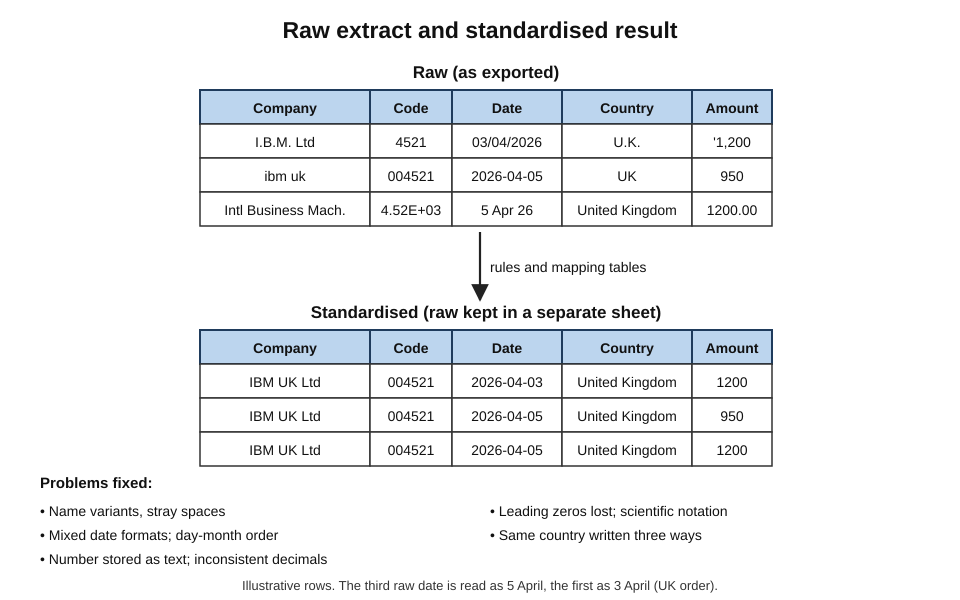
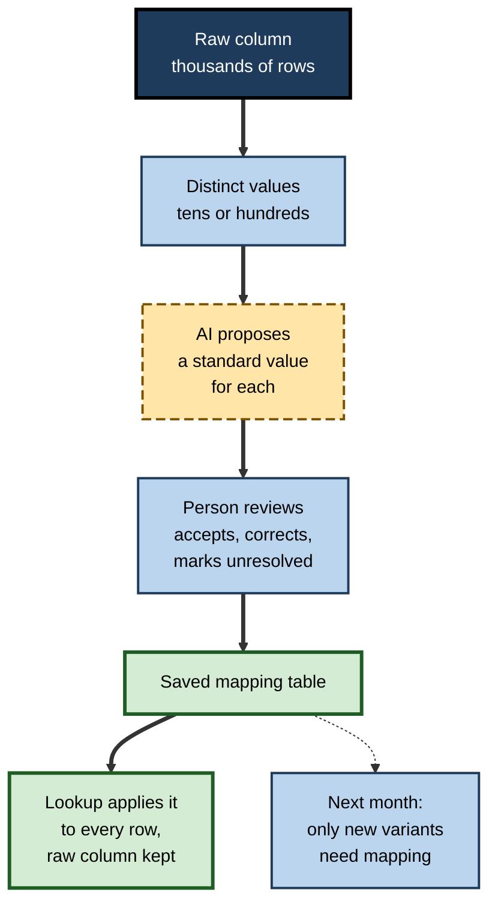
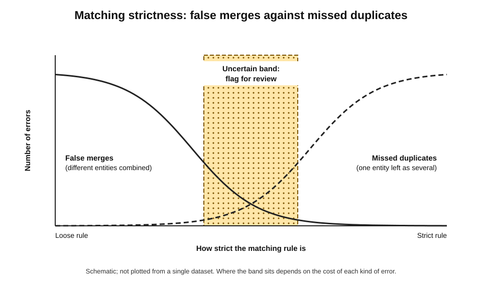
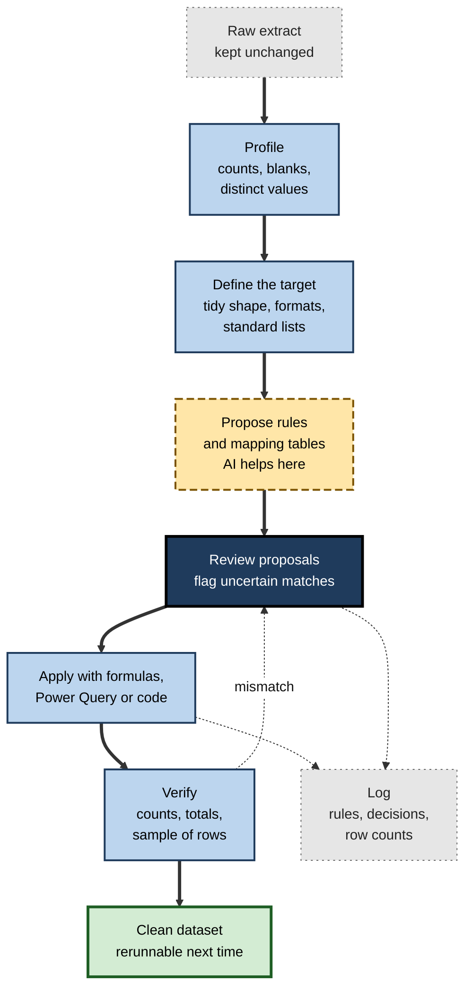
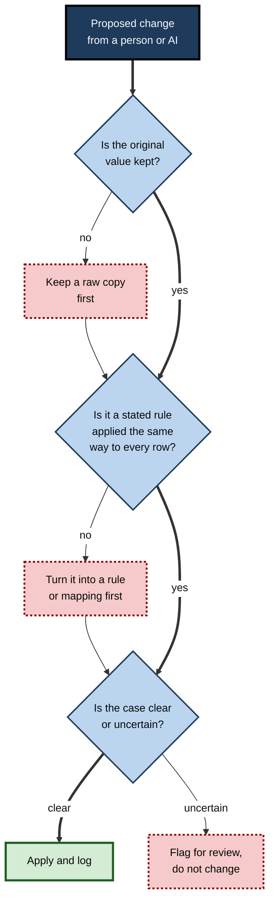

# E.3. Cleaning and standardising data

A marketing team exports 12,000 customer records to plan a campaign. The same company appears as "IBM", "I.B.M. Ltd", "International Business Machines" and "ibm uk"; dates arrive in three formats; postcodes have lost their spaces and some product codes have lost their leading zeros. An AI assistant offers to "clean this up" and, a minute later, the list is tidy — and 600 rows shorter. Some of those rows were genuine duplicates. Some were different customers with similar names.

> **Definition — Data cleaning:** detecting and correcting (or removing) errors, inconsistencies and gaps in a dataset so that it accurately represents what it is meant to describe.

> **Definition — Standardisation:** converting values that mean the same thing into one agreed form — one spelling, one date format, one unit, one code — so that they can be counted, matched and compared.

**Why it matters**

- **Every downstream result inherits the data's flaws.** A total, chart or model is no better than the rows beneath it.
- **Cleaning takes a large share of analytical effort.** Practitioners commonly report that preparing data consumes much of the time on a data project; the exact share varies by survey and should be treated as an impression, not a measurement.
- **AI makes cleaning faster and judgement-based cleaning possible** — recognising that "Bombay" and "Mumbai" refer to the same city, or that a free-text job title is a "manager".
- **Cleaning is where data is most easily destroyed.** A wrong merge, a silent conversion or an invented value is hard to detect afterwards and often impossible to undo without the original.

---

## What Clean Data Looks Like

### Dimensions of data quality

- **Accuracy** — values match reality.
  - *e.g.* the customer's address is where they actually are.
- **Completeness** — required values are present.
- **Consistency** — the same thing is recorded the same way everywhere.
- **Validity** — values follow the allowed format and range.
  - *e.g.* a date is a real date; an age is not 212.
- **Uniqueness** — each real-world entity appears once.
- **Timeliness** — values are current enough for the purpose.

> **Mnemonic — "All Customers Can Validly Use Tidy data":** Accuracy, Completeness, Consistency, Validity, Uniqueness, Timeliness.

| Dimension | Typical failure | Simple check |
|---|---|---|
| Accuracy | Wrong address, outdated price | Compare a sample with a trusted source |
| Completeness | Blank email, missing region | Count blanks per column |
| Consistency | "UK", "U.K.", "United Kingdom" | List distinct values and their counts |
| Validity | 31/02/2026; negative quantity | Range and format rules |
| Uniqueness | Same customer three times | Count duplicates on a key; fuzzy-match names |
| Timeliness | Extract from last year | Check the extract date and last-updated fields |

### Tidy data

> **Definition — Tidy data (Hadley Wickham, 2014):** a layout in which each variable is a column, each observation is a row, and each type of observational unit is a separate table.

- **Why it helps:** tidy tables can be filtered, pivoted, joined and charted without rearrangement.
- **Common untidy layouts:**
  - months spread across columns ("Jan", "Feb", "Mar") instead of one Month column;
  - two variables in one column ("London – Retail");
  - several header rows, merged cells, subtotals inside the data;
  - one table spread across many sheets, one per region.

**Practical rules for spreadsheet data (Karl Broman and Kara Woo, 2018)**

- **Be consistent** — in codes, names, missing-value markers and units.
- **Write dates as YYYY-MM-DD** (the ISO 8601 format), which sorts correctly and is unambiguous.
- **Put one thing in each cell** — not "12 (estimated)".
- **Make it a rectangle** — one header row, no gaps, no merged cells.
- **Keep a data dictionary** — what each column means, its units and allowed values.
- **Do not calculate in the raw data**, and do not use fill colour or bold as data.
- **Keep backups and save a plain-text copy.**

> **Key point:** cleaning is easier, and AI assistance more reliable, when the target shape is defined first. "Clean this" is vague; "make this tidy, one row per order, dates in ISO format, country names from this list" is a specification.

---

## The Common Kinds of Mess

**Figure 1.** Typical problems in a raw extract and their standardised forms.

### Text problems

- **Whitespace** — leading, trailing or doubled spaces; non-breaking spaces copied from web pages.
- **Case** — "north", "North", "NORTH".
- **Spelling variants and abbreviations** — "Ltd", "Limited", "Ltd."; "St" and "Street".
- **Synonyms and renamed entities** — "Bombay" and "Mumbai"; a company's old and new names.
- **Combined fields** — full names, addresses or "City, Country" in a single cell.
- **Invisible characters** — line breaks inside cells, zero-width characters, encoding errors ("Café" for "Café").

### Number and code problems

- **Numbers stored as text**, which look correct but are ignored by sums.
- **Lost leading zeros** — product codes, postcodes, phone numbers and account numbers read as numbers.
- **Long identifiers** rounded or turned into scientific notation, because spreadsheets keep only about 15 significant digits.
- **Units mixed** — kilograms and pounds; pounds sterling and thousands of pounds.
- **Placeholders posing as values** — 0, 999 or −1 entered to mean "unknown".

### Date problems

- **Day–month order** — 03/04/2026 is 3 April in the United Kingdom and 4 March in the United States.
- **Dates stored as text**, often from imports.
- **Mixed formats** in one column.
- **Two-digit years** and impossible dates.

### Structural problems

- **Duplicates** — exact (identical rows) and near (same entity, different spelling).
- **Blanks with meaning** — a blank that means "zero", "not applicable" or "unknown".
- **Subtotal and total rows** inside the data, double-counting when summed.
- **Merged cells and multi-row headers.**

> **Watch out:** spreadsheets clean data **by themselves**, unasked. On import, values that look like dates or numbers are converted automatically — codes lose leading zeros, long IDs lose digits, and text such as "MARCH1" becomes a date. The original value is usually unrecoverable from the converted cell.

**Study card — Ziemann, Eren and El-Osta (2016): gene names turned into dates**

- **Setting:** supplementary data files published with genomics papers.
- **Method:** an automated scan of Excel gene lists attached to papers in leading journals.
- **Finding:** about one in five papers with such files contained gene names silently converted by the spreadsheet — symbols such as "SEPT2" (Septin 2) and "MARCH1" became the dates 2-Sep and 1-Mar.
- **Follow-up:**
  - a later study (2021) found the problem had persisted, not shrunk;
  - in 2020 the body responsible for human gene nomenclature renamed a number of genes — for example SEPT1 to SEPTIN1 and MARCH1 to MARCHF1 — partly so that spreadsheets would stop misreading them.
- **Lesson:** a cleaning step nobody asked for can corrupt data at scale, even among expert users; import settings and column types must be controlled deliberately.

---

## The Cleaning Toolkit

### Classic tools

- **Functions** — `TRIM`, `CLEAN`, `PROPER`, `UPPER`, `SUBSTITUTE`, `VALUE`, `DATEVALUE`, `TEXT`.
- **Commands** — Remove Duplicates, Text to Columns, Find and Replace, sorting and filtering.
- **Data validation** — drop-down lists and rules that stop bad values being entered at all.
- **Power Query** (Excel and Power BI) — a recorded sequence of transformation steps that can be **refreshed** on next month's extract, so the cleaning is repeatable.

### Example-driven and AI-driven tools

- **Flash Fill** (Excel, since 2013) and **Smart Fill** (Google Sheets) — infer a transformation from one or two typed examples, such as splitting names.
- **Cleaning suggestions** — Google Sheets proposes fixes for inconsistent values, extra spaces and duplicates; Excel has introduced automatic detection of inconsistencies such as numbers stored as text and near-duplicate text values.
- **Built-in assistants** (Copilot in Excel, Gemini in Sheets) — accept requests such as "standardise the country column" or "split the address into street, city and postcode" and apply formulas or edits.
- **Chat assistants with code execution** — write and run code (often Python with the pandas library) on an uploaded file and return a cleaned version.
- **AI functions in cells** — classify or normalise each row's free text with a model, such as mapping job titles to job families.

| | Manual edits | Formulas and commands | Power Query or code | AI assistant edits |
|---|---|---|---|---|
| Repeatable next month | No | Partly | Yes — rerun the steps | Not reliably |
| Visible record of what changed | No | Formula visible; commands not | Yes — step list or script | Depends on the tool |
| Handles judgement (synonyms, free text) | Yes, slowly | Poorly | With explicit rules | Yes, quickly |
| Risk of silent damage | Typing errors | Overwritten originals | Wrong rule applied everywhere | Merges, invented values, inconsistency |
| Best for | A few fixes | Simple, uniform fixes | Recurring extracts | Proposing rules and mappings |

> **Key point:** the most robust pattern uses AI to **propose** rules and mapping tables, and deterministic tools — formulas, Power Query, code — to **apply** them. The judgement is fast; the application is repeatable and auditable.

---

## Where AI Helps Most

### Mapping messy values to a standard list

- **The task:** hundreds of distinct spellings must be mapped to a short list of standard values.
- **AI's strength:** recognising that "Deutschland", "Germany" and "GER" are the same country, or that "Snr Software Eng." is a software engineer.
- **The robust output is a mapping table** — two columns, "raw value" and "standard value" — which a person reviews and a lookup then applies.

> **Definition — Mapping table:** a two-column table pairing every observed raw value with its agreed standard value, used by a lookup to standardise data repeatably.

**Figure 2.** The mapping-table pattern: AI proposes, a person reviews, a lookup applies.

### Parsing free text

- Splitting addresses into components; extracting amounts and dates from description fields; separating titles from names.
- **Caution:** free text contains rare forms; parsing rules suggested from a sample may fail on the rest.

### Proposing duplicate matches

> **Definition — Entity resolution (record linkage):** identifying records that refer to the same real-world entity despite differences in how they are recorded.

- **Background:** Ivan Fellegi and Alan Sunter (1969) set out the statistical theory of record linkage — comparing records field by field and weighing agreements and disagreements to decide whether two records match, with an uncertain middle band left for clerical review.
- **AI's role:** suggesting likely matches that exact comparison misses ("Smith & Sons Ltd" and "Smith and Sons Limited") and explaining why.
- **The middle band remains:** pairs that are neither clearly the same nor clearly different need a person or a further source.

### Writing the cleaning steps

- Asking an assistant to write the formulas, the Power Query steps or the script — then reading and running them — gives AI's speed with a permanent, rerunnable record.

---

## Where AI Cleaning Goes Wrong

### Over-merging and under-merging

**Figure 3.** The trade-off between merging too much and too little when matching records.

- **Over-merging (false matches)** — different entities treated as one.
  - *e.g.* "Apex Ltd" (a Leeds builder) and "Apex Limited" (a Bristol accountant) merged; one customer's orders attributed to another.
- **Under-merging (missed matches)** — one entity left as several.
  - *e.g.* the same hospital counted three times, inflating the number of customers.

| | Over-merging | Under-merging |
|---|---|---|
| What happens | Distinct entities combined | One entity split into several |
| Effect on counts | Too few customers, inflated values per customer | Too many customers, deflated values per customer |
| Reversibility | Hard — merged records lose their separate history | Easier — matches can be added later |
| Typical harm | Wrong person contacted; data shared with the wrong party | Duplicate mailings; fragmented history |
| Safer default when unsure | Do not merge; flag for review | — |

> **Watch out:** merging is far harder to undo than not merging. When an assistant proposes matches, the uncertain ones should be **flagged**, not merged.

### Invented values

- **Filling blanks with plausible guesses** — a model asked to "complete" a dataset may supply a missing city, job title or date that looks right and is not.
- **Imputation** — replacing missing values with estimates — is a legitimate statistical technique, but only when chosen deliberately, documented and flagged.

> **Definition — Imputation:** replacing missing values with estimated ones by a stated method, recorded so that estimated values can be distinguished from observed ones.

> **Watch out:** a generated value in a column of real values is indistinguishable from the real ones once saved. If anything is estimated, add a column saying so.

### Inconsistency across rows

- **Row-by-row model calls** may classify similar values differently, or differently on a second run.
  - *e.g.* "Head of Sales" mapped to "Management" in one row and "Sales" in another.
- **Remedy:** derive a mapping of **distinct values** once, review it, then apply it with a lookup.

### Silent truncation and partial application

- **Long tables may be processed only in part** — a chat assistant may clean the first few thousand rows of an upload, or the rows that fitted in its working context.
- **Remedy:** compare row counts before and after; check the last rows as well as the first.

### Destroying the original

- **In-place edits** overwrite the raw values; if the cleaning was wrong, the evidence is gone.
- **Remedy:** never clean the only copy.

---

## A Disciplined Cleaning Workflow

**Figure 4.** A cleaning workflow that keeps the raw data and records every rule.

1. **Keep the raw data unchanged** — a separate file or a locked sheet.
2. **Profile** — row count, blanks per column, distinct values and their counts, minimum and maximum.
3. **Define the target** — tidy layout, formats, standard lists, rules for blanks and duplicates.
4. **Propose rules and mappings** — with AI help where judgement is needed.
5. **Review** — a person approves mappings and flags uncertain matches.
6. **Apply deterministically** — formulas, Power Query or a script.
7. **Verify** — row counts, key totals before and after, a random sample of changed rows.
8. **Log** — what was changed, by which rule, how many rows were affected, what was dropped and why.

> **Remember:** **raw kept, rules not edits, counts before and after, sample the changes.**

> **In practice:** a short cleaning log (illustrative figures) — "Removed 312 exact duplicates; standardised 41 country spellings to 12 values via mapping table v2; 27 uncertain company matches flagged, not merged; 1,204 blank phone numbers left blank" — lets anyone later understand and challenge the dataset.

---

## Worked Example (illustrative): Standardising Country Names

**Situation (illustrative figures):** a 9,850-row sales extract has a Country column with 63 distinct spellings for what should be 14 countries.

**Step 1 — profile.** A pivot of the Country column lists the 63 values with counts. The top ten values cover 94% of rows; the rest include "U.K.", "Untied Kingdom", "Deutschland", "Holland", "Eire" and a blank.

**Step 2 — ask for a mapping, not an edit.** Request: "Here are 63 distinct country values. Map each to one of these 14 standard names, or to 'UNRESOLVED' if unsure. Return a two-column table."

**Step 3 — review the proposals.**

| Raw value | AI proposal | Reviewer decision | Reason |
|---|---|---|---|
| U.K. | United Kingdom | Accept | Clear abbreviation |
| Untied Kingdom | United Kingdom | Accept | Obvious typing error |
| Deutschland | Germany | Accept | Native-language name |
| Holland | Netherlands | Accept | Common informal name |
| Eire | Ireland | Accept | Irish-language name |
| Georgia | UNRESOLVED | Investigate | Country or US state? Six rows checked: all US addresses |
| (blank) | UNRESOLVED | Keep blank | Cannot be inferred safely |

**Step 4 — apply with a lookup.** A new column uses `XLOOKUP` on the mapping table; the raw column stays.

**Step 5 — verify.**

- Row count still 9,850.
- Distinct standard values: 14, plus "UNRESOLVED" for 23 rows.
- Total sales by country before and after, summed, are identical.
- Twenty randomly chosen changed rows checked by eye.

- **Conclusion:** the AI did the slow part — recognising variants — in seconds. Reviewing 63 proposals took a few minutes and caught the one ambiguous case ("Georgia"). The mapping table is saved and reused next month, when it will need only new variants added.

> **Watch out:** had the request been "clean the Country column", the assistant might have edited 9,850 cells in place, resolved "Georgia" to the country, and filled the blanks with a guess — with no record of any of it.

---

## Case Study (illustrative): The Merged Customer List

- **Situation:** a regional wholesaler combined three customer lists after acquiring two smaller competitors — about 31,000 records in total.
- **What happened:**
  1. an operations analyst uploaded the combined file to an AI assistant with code execution and asked it to "deduplicate the customers";
  2. the assistant wrote and ran a script using fuzzy name matching and returned 24,600 records;
  3. the merged list was loaded into the billing system.
- **Problem:**
  - within weeks, account managers reported customers seeing other companies' order histories on the self-service portal;
  - investigation found about 700 merges of **different businesses with similar names** in different towns — the matching considered names only, not addresses or tax numbers;
  - several hundred genuine duplicates had also been missed because of address differences.
- **Actions:**
  1. merges reversed from the original three files, which fortunately had been kept;
  2. matching redesigned around tax registration number first, then name plus postcode, with a similarity threshold;
  3. pairs in the uncertain band — about 1,900 — reviewed by the sales team, region by region;
  4. portal access temporarily restricted and the exposure assessed as a potential personal-data incident.
- **Result:** a final list of about 26,100 records, with documented matching rules and a review log.
- **Lesson:** "deduplicate" is a business decision about what counts as the same customer. AI can write matching code in seconds, but the **matching rule**, the **threshold** and the **review of uncertain cases** belong to people who know the customers — and the original files must survive until the result is verified.

---

## Standardising the Awkward Types

Text is where AI shines; dates, numbers and codes are where quiet damage is most common. Each needs a rule stated in advance.

### Dates

- **Decide the source convention first.** A column mixing 03/04/2026 and 2026-04-05 cannot be standardised until it is known whether the first is day–month (UK) or month–day (US). Values above 12 in the first position reveal the convention; values of 12 or below are ambiguous.
- **Convert text to real dates** with functions or query steps that state the format, rather than relying on automatic recognition.
- **Store as dates, display as ISO** — a true date value formatted YYYY-MM-DD sorts, filters and calculates correctly.
- **Check:** the earliest and latest dates after conversion should match the period the extract covers; any date in the future, or decades in the past, signals a misread.

> **Example (illustrative):** an assistant asked to "fix the dates" converted 01/02/2026 to 2 January in half the rows and 1 February in the other half, because the rows came from two systems with different conventions. A rule stated per source system — not per column — resolved it.

### Numbers and units

- **Strip formatting** — currency symbols, thousands separators, trailing spaces — before converting text to numbers.
- **Decimal conventions differ** — 1.234,50 in much of continental Europe is 1,234.50 in the UK.
- **Units** — convert to one unit in a new column and keep the original; record the conversion factor.
- **Check:** the column sum before and after conversion, allowing for the unit change, should agree.

### Codes and identifiers

- **Import codes as text** — postcodes, account numbers, product codes and phone numbers are labels, not quantities.
- **Restore leading zeros** only where the correct length is known (`TEXT(A2,"000000")` for six-digit codes).
- **Never round or reformat identifiers** — a 16-digit card or account number stored as a number loses its last digit in a spreadsheet.

| Type | Typical damage | Rule to state in advance | Check after cleaning |
|---|---|---|---|
| Dates | Day and month swapped; text dates | Source convention per system | Minimum and maximum date in range |
| Numbers | Text numbers; wrong decimal separator | Separator and currency conventions | Column total reconciles |
| Units | Mixed kilograms and pounds | Target unit and factor | Converted total matches expectation |
| Codes | Leading zeros lost; digits rounded | Import as text; known length | Distinct count unchanged; lengths uniform |

---

## Preventing Mess at the Source

Cleaning repairs; prevention avoids. The cheapest clean data is data entered correctly the first time.

- **Data validation** — drop-down lists for categories, date and number ranges, required fields.
- **Structured tables** — Excel tables and Sheets tables with typed columns keep new rows consistent.
- **Forms instead of free typing** — a form feeding a sheet enforces formats that a shared grid cannot.
- **Controlled reference lists** — one maintained list of regions, products or cost centres, used by every input sheet.
- **Feedback to the source** — when cleaning finds the same error every month, the owner of the source system is told.

> **In practice:** an AI assistant that has just proposed a mapping table can also be asked "which validation rules would have prevented these variants from being entered?" — turning a one-off cleaning job into a lasting fix.

---

## Cleaning as a Professional Discipline

### Roles and governance

- **Data owners and stewards** — named people responsible for the definitions and quality of key data, such as customer or product records.
- **Master data management** — keeping one authoritative version of core entities (customers, products, suppliers) across systems, so that cleaning is done once at source rather than repeatedly downstream.
- **Fix at source when possible** — validation rules on entry forms prevent the mess that later cleaning removes.

### Judgement calls professionals make

- **Drop or keep?** Removing incomplete rows can bias results if the missing data are not random.
- **Correct or flag?** Outliers may be errors or the most important observations.
- **Standardise to whose list?** Country, product and job classifications should follow the organisation's or an official standard, not whatever the assistant proposes.

**Figure 5.** Deciding how to handle a proposed cleaning change.

### Privacy while cleaning

- **Cleaning often involves personal data** — names, addresses, contact details. Uploading such data to an unapproved assistant may breach confidentiality and data-protection obligations; a small sample of distinct values, or anonymised values, is often enough to derive a mapping.

---

## Open Questions

- **Can AI cleaning be made reliably consistent?**
  - Deriving mappings once and applying them deterministically works; whether row-by-row model calls can be made stable enough for recurring production use is unsettled.
- **How should AI-estimated values be marked?**
  - There is no common convention for flagging generated or inferred values inside ordinary spreadsheets.
- **Where should the matching threshold sit?**
  - The right balance between over- and under-merging depends on the harm of each error, which differs by use — marketing lists tolerate more error than billing or healthcare records.
- **Will cleaning move upstream?**
  - Better validation at entry and shared master data could reduce downstream cleaning; AI might instead encourage tolerance of messy sources.

---

## Summary

- **Data cleaning** detects and corrects errors and gaps; **standardisation** puts equivalent values into one agreed form.
- Quality has six dimensions: **accuracy, completeness, consistency, validity, uniqueness, timeliness**.
- **Tidy data**: one variable per column, one observation per row, one unit type per table; follow practical rules — ISO dates, one thing per cell, rectangles, a data dictionary.
- Common mess: whitespace, case, variants, combined fields, numbers as text, lost leading zeros, mixed units and date formats, duplicates, meaningful blanks, subtotals inside data. Spreadsheets also **auto-convert** values (gene names into dates).
- Tools range from functions and Power Query to Flash Fill, cleaning suggestions, built-in assistants and code-running chat assistants.
- Best pattern: **AI proposes rules and mapping tables; deterministic tools apply them**.
- Risks: **over-merging**, invented values, inconsistent row-by-row results, partial processing, destroyed originals.
- Workflow: **keep raw, profile, define target, propose, review, apply, verify, log**.
- Deduplication rules and thresholds are **business decisions**; uncertain matches are flagged, not merged.

---

## Self-Check

1. Define data cleaning and standardisation, and give one example of each.
2. Name the six dimensions of data quality with a simple check for each.
3. What is tidy data? Give two common untidy layouts.
4. List four problems spreadsheets can cause by automatically converting values on import.
5. Summarise the gene-name study and its lesson.
6. Why is a mapping table a better output from an AI assistant than in-place edits?
7. Define entity resolution and explain the "middle band" in record linkage.
8. Compare over-merging and under-merging on reversibility and typical harm.
9. Why is row-by-row AI classification risky, and what is the remedy?
10. Describe the eight steps of the disciplined cleaning workflow.
11. In the country-name example, why was "Georgia" flagged, and what checks confirmed the result?
12. A colleague asks an assistant to "fill in the missing job titles" in an HR extract. What would you advise?
13. Analyse the merged-customer-list case: root causes, why harm reached customers, and what a better process would have been.

### Answer Key

1. Cleaning: detecting and correcting errors, inconsistencies and gaps (e.g. removing duplicate orders). Standardisation: converting equivalent values to one form (e.g. "U.K." and "Britain" to "United Kingdom").
2. Accuracy — compare a sample with a trusted source; completeness — count blanks; consistency — list distinct values; validity — range and format rules; uniqueness — count duplicates on a key; timeliness — check extract and update dates.
3. Each variable a column, each observation a row, each observational unit a table. Untidy: months across columns; two variables in one column; merged headers; subtotals in data.
4. Leading zeros dropped from codes; long IDs rounded to about 15 digits or shown in scientific notation; text such as gene symbols converted into dates; day–month order misread.
5. About one in five genomics papers with Excel gene lists had symbols such as SEPT2 converted into dates; the problem persisted, and some genes were renamed in 2020. Lesson: control import settings and column types; automatic conversion corrupts data even among experts.
6. It is reviewable, applied consistently by a lookup, reusable next time and leaves the raw values intact; in-place edits leave no record and may be inconsistent or wrong.
7. Identifying records that refer to the same real entity despite recording differences. Fellegi–Sunter theory weighs field agreements; pairs between "clearly match" and "clearly different" form a middle band needing clerical review.
8. Over-merging combines different entities, is hard to reverse and can expose one party's data to another; under-merging splits one entity, is easier to fix later and causes duplication and fragmented history.
9. Similar values may be classified differently across rows or runs. Remedy: classify the list of distinct values once, review it, and apply it with a lookup.
10. Keep raw; profile; define the target; propose rules and mappings; review; apply deterministically; verify counts, totals and samples; log decisions.
11. "Georgia" could be a country or a US state; the rows were inspected and found to be US addresses. Checks: row count unchanged, 14 standard values plus 23 unresolved, totals identical before and after, 20 changed rows sampled.
12. Do not let a model invent titles: values would look real and be wrong. Find titles from the HR system of record; if estimation is genuinely needed, use a stated method, mark estimated values in a separate column, and consider privacy rules before uploading HR data.
13. Root causes: matching on names only, no threshold or review band, no verification before loading, and a vague instruction. Harm reached customers because the merged list went straight into a live portal. Better: define matching rules (tax number, name plus postcode), flag uncertain pairs for review, verify counts and samples, test on a copy, keep originals, and treat cross-customer exposure as a data-protection risk from the outset.

---

## Glossary

| Term | Meaning |
|---|---|
| Data cleaning | Detecting and correcting errors, inconsistencies and gaps in data. |
| Data dictionary | A description of each column's meaning, units and allowed values. |
| Data steward | A person responsible for the definitions and quality of a set of data. |
| Entity resolution | Identifying records that refer to the same real-world entity. |
| Flash Fill | An Excel feature that infers a transformation from typed examples. |
| Imputation | Replacing missing values with estimates by a stated, recorded method. |
| ISO 8601 | The international standard date format, YYYY-MM-DD. |
| Mapping table | A table pairing raw values with standard values, applied by lookup. |
| Master data management | Keeping one authoritative version of core entities across systems. |
| Over-merging | Wrongly combining records of different entities. |
| Power Query | A tool that records and reruns data import and transformation steps. |
| Profiling | Summarising a dataset's counts, blanks, distinct values and ranges before cleaning. |
| Standardisation | Converting equivalent values into one agreed form. |
| Tidy data | One variable per column, one observation per row, one unit type per table. |
| Under-merging | Failing to combine records that refer to the same entity. |
