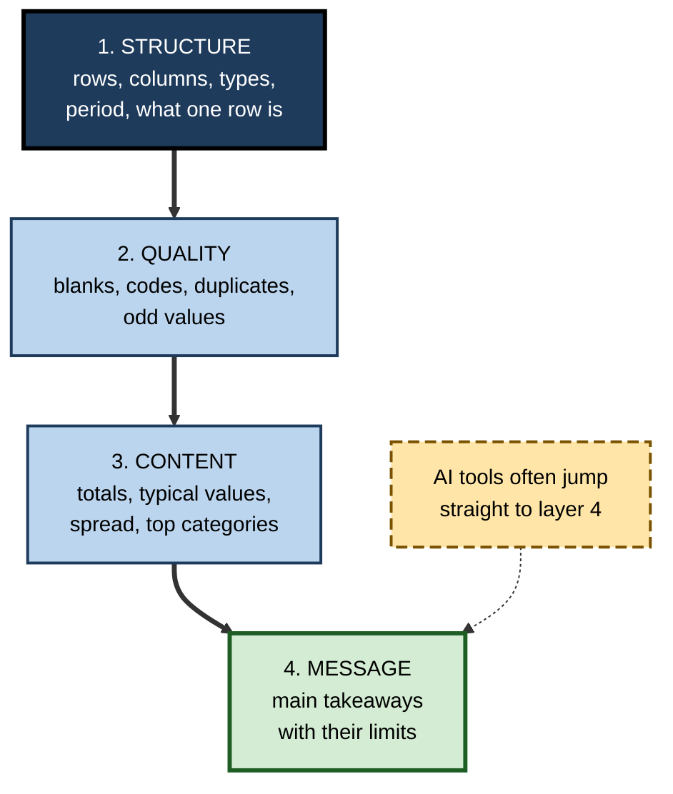
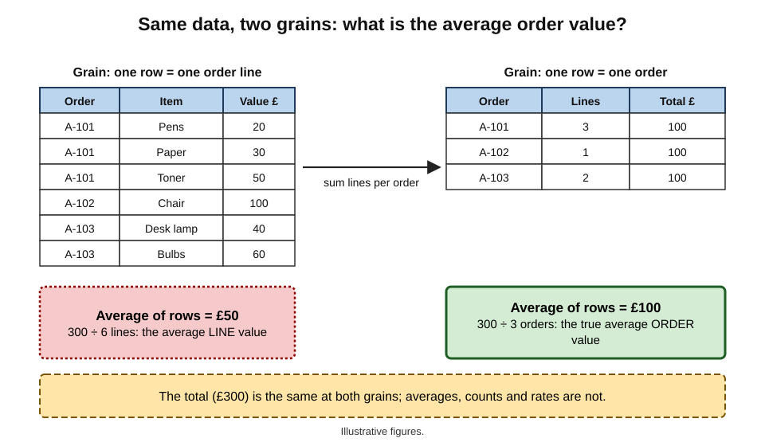
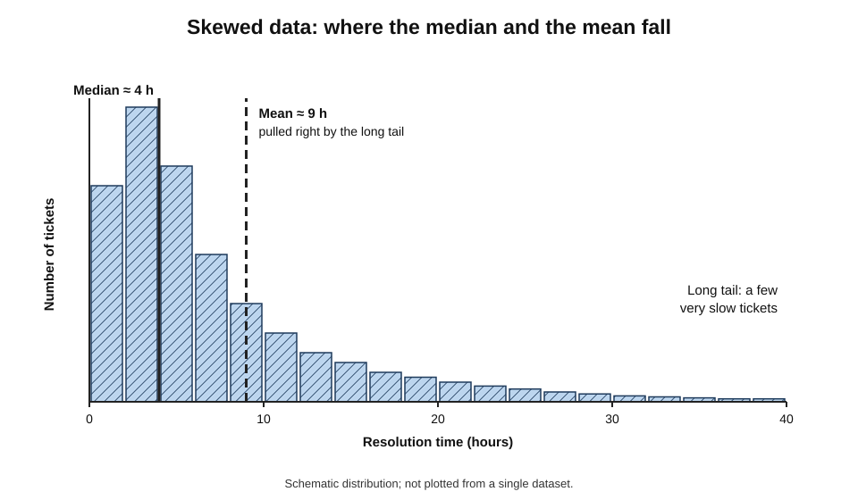
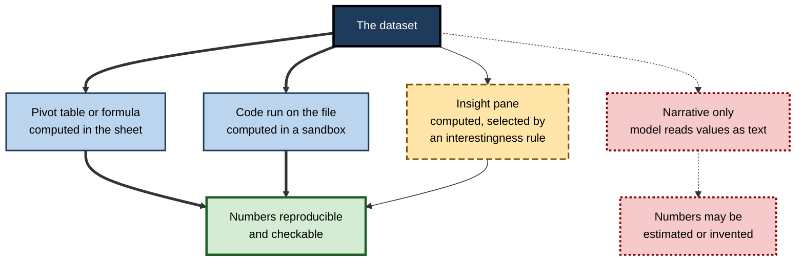
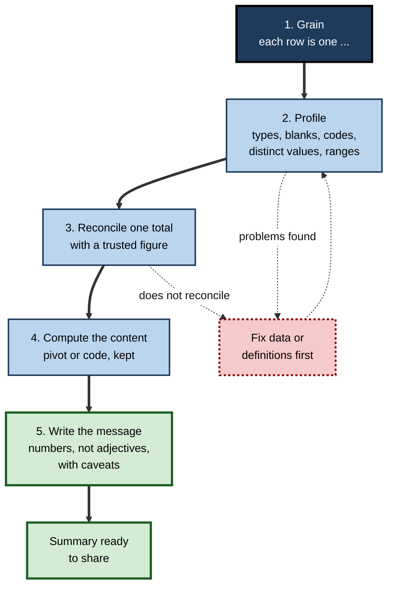

# E.4. Summarising a dataset

An HR adviser uploads an engagement-survey file with 4,800 rows and asks an AI assistant to "summarise the results". The reply is crisp: average satisfaction 2.9 out of 5, lowest in Engineering, with a confident paragraph about a "disengaged technical workforce". The adviser is alarmed until she notices that the survey tool recorded "prefer not to say" as 0 — and that Engineering had the most people declining to answer. The summary was fluent, well organised and arithmetically faithful to numbers that did not mean what it assumed.

> **Definition — Dataset summary:** a compact description of a dataset — what it contains, how good it is and what its main patterns are — produced so that a person can understand the data without reading every row.

**Why it matters**

- **Summaries are how most people meet data.** Managers rarely see rows; they see totals, averages, top-ten lists and a paragraph of interpretation.
- **"Summarise this" is one of the most common requests made of AI data tools** — and one of the vaguest.
- **A summary decides what is noticed.** Whatever it leaves out — a missing month, a minority group, a data-quality problem — tends to disappear from the conversation.
- **A wrong summary is persuasive.** It arrives in clean prose with precise-looking numbers.

---

## What a Summary Should Contain

### Four layers

**Figure 1.** The four layers of a complete dataset summary.

- **Structure** — what the dataset is.
  - number of rows and columns; column types; the period covered; the source and extract date;
  - **the grain** — what a single row represents.
- **Quality** — how far it can be trusted.
  - blanks per column; special codes ("99", "N/A", "-1"); duplicates; impossible values.
- **Content** — what the values show.
  - totals and counts; typical values and spread; the largest categories; changes over time.
- **Message** — what matters for the reader.
  - two or three takeaways, each with its caveat.

> **Key point:** a summary that starts at the message layer has skipped the checks that make the message trustworthy. Structure and quality come first, even if they are reported in a single line.

### The grain: what one row means

> **Definition — Grain:** the level of detail of a dataset — what a single row represents, such as one order, one order line, one customer per month, or one survey response.

- **Getting the grain wrong is the most common summarising error.**
  - *e.g.* in a file of order **lines**, "average order value" computed by averaging rows gives the average **line** value — much smaller than the true average order.
  - *e.g.* in a file of monthly customer snapshots, counting rows counts customer-months, not customers.
- **The grain determines which questions can be answered directly** and which need aggregation first.

**Figure 2.** The same orders at two grains, and how the grain changes an "average order value".

> **Remember:** before any summary, write one sentence: "Each row is one ___." If that sentence cannot be completed, the summary cannot be trusted.

---

## The Building Blocks of a Content Summary

Only the essentials are needed here; statistical depth belongs to data literacy more broadly.

### Counts and totals

- **Count of rows**, **distinct count** (how many different customers, products, sites), **sum** of amounts.
- **Distinct counts matter** because duplicates and repeated entities inflate plain counts.

> **Watch out:** summaries of rates and percentages cannot be added or simply averaged across groups. A team with a 90% on-time rate on 10 jobs and a team with 50% on 1,000 jobs do not average to 70%; the combined rate is (9 + 500) ÷ 1,010 ≈ 50.4%. When an assistant reports an "average rate" across groups, ask how it was weighted.

### Typical values

- **Mean** — the arithmetic average; pulled strongly by extreme values.
- **Median** — the middle value when sorted; robust to extremes.
- **Mode** — the most common value; useful for categories.

### Spread

- **Minimum and maximum** — quick checks for impossible values.
- **Percentiles** — the value below which a given share of observations fall; the 25th, 50th (median) and 75th are the **quartiles**.
- **Standard deviation** — the typical distance of values from the mean.

**Study card — John Tukey, *Exploratory Data Analysis* (1977)**

- **Argument:** before testing hypotheses, an analyst should **explore** data — looking at it from many angles with simple, robust summaries and plots.
- **Tools introduced or popularised:**
  - the **five-number summary** — minimum, lower quartile, median, upper quartile, maximum;
  - the **box plot**, which draws those five numbers and flags outlying values.
- **Influence:** made exploration a recognised stage of analysis, and showed that robust summaries (medians, quartiles) often describe real data better than means.
- **Lesson for AI summaries:** a five-number summary per key column is a compact, honest first description — far harder to mislead with than a single average.

> **Definition — Five-number summary:** minimum, lower quartile, median, upper quartile and maximum of a set of values.

| | Mean | Median |
|---|---|---|
| What it is | Sum divided by count | Middle value when sorted |
| Sensitivity to extreme values | High | Low |
| Suits | Symmetric data; totals that must reconcile | Skewed data: incomes, house prices, deal sizes, resolution times |
| Typical misuse | Average salary inflated by a few executives | Hiding a long tail that drives cost |
| Report both when | The two differ noticeably — the gap itself is information | — |

**Figure 3.** In skewed data the mean and the median tell different stories.

### Categories and time

- **Top categories with their share** — "the top three products make up 58% of revenue".
- **The long tail** — how many categories make up the rest.
- **Change over time** — period totals, growth, seasonality — and whether the latest period is complete.

> **Watch out:** a summary containing the current month is often misleading because the month is unfinished. "Sales fell 40% in October" may mean "it is 12 October".

---

## The Tools That Summarise

### Without AI

- **The status bar** — selecting a range shows its count, sum and average instantly.
- **Pivot tables** — the workhorse of spreadsheet summarising: totals, counts and averages by any combination of categories, recalculating from the data.
- **Filters and sorting** — the quickest way to see extremes and odd values.
- **Data profiling views** — Power Query and similar tools show, for each column, the share of valid, error and empty values and the distribution of values.

### With AI

- **Insight panes** — Excel's automatic insights feature (introduced in the late 2010s) and Google Sheets' Explore panel suggest summaries, pivot tables and charts and answer simple natural-language questions about a selected range.
- **Built-in assistants** — Copilot in Excel and Gemini in Google Sheets accept requests such as "summarise sales by region" or "what are the main trends?", usually producing a pivot table, a chart or a formula plus a short narrative.
- **Chat assistants with code execution** — load an uploaded file, run code (for example, a profile of every column) and write a narrative.
- **Business-intelligence tools** — Power BI, Tableau and similar platforms offer natural-language questions and automatic "key influencer" or anomaly summaries over governed datasets.

**Figure 4.** How different tools produce a summary, from computed to narrated.

| | Pivot table | Insight pane | Built-in assistant | Chat assistant with code |
|---|---|---|---|---|
| Who chooses what is summarised | The user | An algorithm ranking "interesting" patterns | The model, guided by the request | The model, guided by the request |
| Numbers computed? | Yes | Yes | Usually, via formulas or pivots it creates | Yes, if code was run |
| Can the method be inspected? | Fully | Partly | Partly — inspect what it inserted | Yes — read the code |
| Typical blind spot | Only the cuts the user thinks of | Highlights unusual over important | Narrative overstates; grain assumed | Grain and codes assumed; long files truncated or sampled |
| Best use | Reporting and reconciliation | Getting ideas | Fast first look in the sheet | Profiling large or messy files |

> **Watch out:** insight features rank patterns by how **statistically unusual** they are, not by how **important** they are to the business. A striking outlier in a minor product may be shown while a slow decline in the largest product is not.

---

## Asking for a Summary Well

### State what the summary is for

- **Audience and decision** — "for the operations director deciding where to add staff".
- **The grain** — "each row is one support ticket; reopened tickets appear as new rows with the same ticket ID".
- **The measures and segments wanted** — "count of tickets, median resolution time, by team and month".
- **Special codes and definitions** — "99 means 'prefer not to say'; status 'Void' rows should be excluded".
- **The form of the answer** — a pivot table, a table with row counts, a short narrative.

### Ask for the scaffolding, not just the conclusion

- "Before summarising, report the number of rows read, the columns and their types, blanks per column and any values that look like codes."
- "Show every number with how it was calculated."
- "List anything you excluded and why."
- "What in this data would make your summary misleading?"

> **In practice:** many analysts ask for the **profile first, summary second**. Reading a profile takes a minute and catches the problems — a 99 code, a missing month, a duplicated header row — that otherwise slip into the narrative.

### Distrust adjectives

- **Narratives add judgement words** — "strong", "significant", "sharp decline", "highly engaged" — that the numbers may not support.
- **"Significant" has a statistical meaning** that an AI narrative may use loosely; a difference between two small groups may be noise.
- **Replace adjectives with numbers** before passing a summary on: "rose from 31% to 34% (n = 180)" rather than "rose sharply".

---

## What a Good Profile Looks Like

A profile is the quality layer made concrete: one line per column, read in a minute.

**Example profile (illustrative figures)** — a customer-orders extract of 24,310 rows

| Column | Type found | Blanks | Distinct values | Minimum | Maximum | Note |
|---|---|---|---|---|---|---|
| Order ID | Text | 0 | 24,310 | — | — | Unique: grain is one order |
| Order date | Date | 0 | 273 | 2026-01-02 | 2026-10-01 | One day of October included |
| Region | Text | 112 | 9 | — | — | "N/A" appears 64 times |
| Amount (GBP) | Number | 0 | 9,841 | −250.00 | 48,900.00 | 41 negative amounts: refunds? |
| Discount % | Number | 3,207 | 12 | 0 | 99 | 99 likely a code, not a discount |

- **What it reveals at a glance:**
  - the grain — Order ID is unique, so each row is one order;
  - an incomplete final period — a single October day;
  - two kinds of missing region — blanks and "N/A";
  - negative amounts that need a definition decision;
  - a probable sentinel value in the discount column.
- **Every one of these would distort a summary** if unnoticed, and none would be visible in a paragraph of narrative.

> **In practice:** chat assistants with code execution can produce such a profile in seconds. Asking for it **as a table, with blanks, distinct counts, minimum and maximum for every column**, is the single most useful request before "summarise this".

---

## Where AI Summaries Go Wrong

- **Codes treated as quantities** — "99 = no answer", "-1 = unknown", employee IDs and postcodes averaged as if they were measurements.
- **Blanks treated as zeros**, or zeros treated as blanks.
- **The wrong grain** — averaging lines instead of orders; counting rows instead of distinct customers.
- **Subtotal and total rows** inside the data, double-counting.
- **Partial reading** — a long file sampled, truncated or read only for its first rows; the summary does not always say so.
- **Incomplete periods** treated as complete.
- **Selective emphasis** — the narrative highlights the most striking pattern, omitting quality problems and exceptions.
- **Plausible explanations** — "satisfaction is higher in Engineering because of recent investment in tools" — a cause the data cannot show, invented to make the story flow.

> **Definition — Sentinel value:** a special value such as 99, -1 or 9999 used to mean "missing", "not applicable" or "unknown" rather than a real quantity.

> **Watch out:** a summary's tidy structure — headings, bullet points, bold numbers — signals care and completeness. It is evidence of **formatting**, not of **correctness**.

---

## Worked Example (illustrative): The Survey With a Hidden Code

**Situation (illustrative figures):** ten responses to "How satisfied are you with your manager?" on a 1–5 scale, where 99 means "prefer not to say".

| Respondent | 1 | 2 | 3 | 4 | 5 | 6 | 7 | 8 | 9 | 10 |
|---|---|---|---|---|---|---|---|---|---|---|
| Answer | 4 | 5 | 3 | 99 | 4 | 2 | 5 | 99 | 4 | 3 |

**Step 1 — the naive average.** All ten values: (4 + 5 + 3 + 99 + 4 + 2 + 5 + 99 + 4 + 3) ÷ 10 = 228 ÷ 10 = **22.8** — obviously impossible on a 1–5 scale, so this error would be caught.

**Step 2 — the subtle version.** Suppose the survey tool coded "prefer not to say" as **0** instead. Then (4 + 5 + 3 + 0 + 4 + 2 + 5 + 0 + 4 + 3) ÷ 10 = 30 ÷ 10 = **3.0** — plausible, and wrong.

**Step 3 — the correct summary.** Exclude the two non-answers: 30 ÷ 8 = **3.75**, with **8 responses** and **2 declined**.

> **Formula — Mean excluding sentinel values:** sum of valid answers ÷ number of valid answers. Here 30 ÷ 8 = 3.75; the share declining (2 of 10, 20%) is reported alongside.

**Step 4 — what the full summary should say.** "Eight of ten respondents answered; mean 3.75, median 4; two declined to answer."

- **Conclusion:** the impossible result (22.8) is self-correcting; the plausible one (3.0) is dangerous. Codes that fall inside the range of real values produce errors that no glance will catch — only a profile of distinct values will.

> **Watch out:** a code of 0 also distorts comparisons between groups. In the opening example, the department where most people declined to answer appeared least satisfied — a finding about **willingness to answer**, presented as a finding about **satisfaction**.

---

## A Method for Trustworthy Summaries

**Figure 5.** A method for producing a summary that can be trusted.

1. **Grain** — complete the sentence "each row is one ___".
2. **Profile** — types, blanks, codes, distinct values, minima and maxima, period covered.
3. **Reconcile** one key total with an independent trusted figure.
4. **Compute** the content summary with a pivot table or code, and keep it.
5. **Write the message** — numbers rather than adjectives, each takeaway with its caveat, and a line on data quality.

> **Mnemonic — "Good People Rarely Cut Messages":** Grain, Profile, Reconcile, Compute, Message.

---

## Case Study (illustrative): The Support-Ticket Summary

- **Situation:** an IT service manager asked a built-in assistant to summarise a quarter of support tickets for the monthly operations review — 18,400 rows.
- **The AI summary:**
  - "18,400 tickets were raised, up 31% on the previous quarter";
  - "the Network team handled the most tickets, with a median resolution time of 9.5 hours";
  - "the increase is driven by growing demand from the new office".
- **What a colleague noticed:** the ticketing system had changed in the middle of the quarter. In the new system, every **reopening** of a ticket created a new row with the same ticket ID.
- **Diagnosis:**
  1. the grain had changed from "one ticket" to "one ticket episode" mid-quarter;
  2. the distinct count of ticket IDs was 14,900 — an increase of about 6%, not 31%;
  3. the Network team's apparent lead came from reopenings of a single recurring fault;
  4. the "new office" explanation was invented — the data held no location field.
- **Actions:**
  1. the summary was rebuilt on distinct ticket IDs, with reopenings reported separately as a quality measure;
  2. a grain statement and a profile were added to the top of every monthly summary;
  3. explanations in summaries were rephrased as questions for the team leads.
- **Result:** the review discussed a recurring network fault and the reopening rate — the real issues — rather than a staffing request for a demand surge that did not exist.
- **Lesson:** the assistant summarised correctly **what it was given**. The error was a **grain change** no summary tool could detect unaided, and a causal story the data could not support.

---

## Comparisons Inside a Summary

Most summaries compare — regions, months, teams. Comparisons fail in a few predictable ways, and AI narratives rarely flag them.

- **Counts versus rates.** The largest region has the most complaints; the question is usually complaints **per thousand customers**.
- **Unequal periods.** February has fewer days than March; a quarter with five reporting weeks is not comparable with one of four.
- **Changing populations.** "Average tenure rose" may reflect leavers, not loyalty.
- **Small groups.** A team of six moving from 50% to 67% satisfied is one person changing an answer.
- **Different definitions over time.** A redefined "active customer" breaks every trend that crosses the change.

> **Formula — Rate per thousand:** (count ÷ population) × 1,000. Example (illustrative figures): 420 complaints from 60,000 customers = 7.0 per thousand; 150 complaints from 12,000 customers = 12.5 per thousand — the smaller region has the worse rate.

| Comparison | Misleading form | Fair form |
|---|---|---|
| Regions of different size | Total complaints | Complaints per thousand customers |
| Months of different length | Monthly totals | Daily averages, or working-day adjusted |
| Small teams | Percentage change | Counts with the base ("4 of 6") |
| Before and after a definition change | One continuous trend | Two series, or restated history |

> **In practice:** a useful instruction to any assistant is "for every comparison, show the denominator". It forces rates where rates are needed and exposes small bases.

---

## Asking Questions of a Table in Plain Language

### Natural-language query

> **Definition — Natural-language query:** a question typed in ordinary words — "what were sales in the North last quarter?" — that a tool translates into a calculation, filter or query over a table or data model.

- **Long history in business tools.** Power BI's Q&A feature and Tableau's Ask Data offered typed questions over datasets in the 2010s. Tableau retired Ask Data in 2024 in favour of newer AI features, and Microsoft has announced that Power BI Q&A will be retired by December 2026, replaced by Copilot-based questioning.
- **In spreadsheets** the same idea appears in insight panes and built-in assistants: "which product had the largest increase?"
- **Behind the scenes** the tool must decide which column is "sales", which rows are "the North", and what "last quarter" means — each a possible misreading.

### Where questions are misread

- **Ambiguous measures** — "sales" may be gross or net, orders or revenue, including or excluding tax.
- **Ambiguous time** — "last quarter" may be the last calendar quarter, the last financial quarter or the last three months.
- **Ambiguous groups** — "the North" may be a region code, a sales territory or anything containing "North".
- **Silent defaults** — summing where averaging was intended; counting rows where distinct customers were intended.

| Question as typed | Possible readings | What a good tool does | What the user should do |
|---|---|---|---|
| "Sales last quarter" | Calendar or financial quarter; gross or net | States the interpretation it used | Name the measure and period explicitly |
| "Customers in the North" | Region code, territory, text match | Shows the filter applied | Use the exact field and value |
| "Average order" | Average line or average order | Shows the grain and calculation | State the grain |
| "Best product" | By revenue, units, margin, growth | Asks or states the ranking measure | Name the ranking measure |

> **Key point:** natural-language querying works best over a **governed data model** — where measures such as "Net revenue" are defined once by the organisation — and worst over a raw sheet, where the tool must guess what each column means.

> **Watch out:** an answer to a typed question should always show **how it was computed** — the measure, the filter, the period. An answer that gives only a number cannot be distinguished from a misreading.

---

## Summaries for Different Readers

- **Executives** — the message layer first, with one line on data quality and the key caveat; no more than three numbers per point.
- **Analysts and reviewers** — structure and quality layers in full; the method; the code or pivot.
- **Operational teams** — the breakdowns they act on (their team, their region), with definitions they recognise.
- **External audiences** — definitions, sources and periods stated; nothing that identifies individuals in small groups.

> **In practice:** asking an assistant for "a three-line summary for the director and a one-page profile for the analyst" from the same computation keeps the two consistent — both rest on one set of numbers, checked once.

---

## Summaries in Professional Settings

- **Board and management packs** — summaries must reconcile with official figures and state definitions; AI may draft commentary, but numbers come from controlled sources.
- **Due diligence and audit** — profiling a client's data before relying on it; summaries state population, period and exclusions.
- **Research and surveys** — response counts, non-response, sentinel codes and question wording are part of the summary, not footnotes.
- **Customer and operations reporting** — distinct counts, complete periods and stable definitions over time.

> **In practice:** a reliable summary often opens with a single "data note" line — source, extract date, grain, rows, exclusions — before any finding. It takes seconds to write and answers the first questions any careful reader will ask.

---

## Open Questions

- **Can AI tools detect the grain and sentinel codes unaided?**
  - Models can often guess from headers and values, but how reliably they flag ambiguity rather than assuming is not well established.
- **Should insight features rank by importance rather than unusualness?**
  - Importance depends on business context the tool rarely has; how to supply it is an open design problem.
- **How should summaries disclose partial reading?**
  - There is no common practice for an assistant to state that it sampled or truncated a file.
- **Will fluent narrative summaries crowd out tables?**
  - Readers may prefer prose, but prose hides denominators and caveats that tables show; the effect on decisions is unstudied.

---

## Summary

- A **dataset summary** has four layers: **structure, quality, content, message**; AI tools often jump straight to the message.
- The **grain** — what one row represents — is the first thing to establish; most summarising errors are grain errors.
- Content basics: counts, distinct counts, totals; mean, median, mode; minimum, maximum, quartiles; the **five-number summary** (Tukey, 1977).
- In skewed data, **mean and median differ**; report both when they do.
- Tools: status bar, pivot tables, profiling views, insight panes, built-in assistants, code-running chat assistants, BI tools. Insight features rank by unusualness, not importance.
- Ask with purpose, grain, measures, codes and form; ask for the **profile first**; replace adjectives with numbers.
- Errors: **sentinel codes** treated as values, blanks as zeros, wrong grain, subtotals, partial reading, incomplete periods, selective emphasis, invented causes.
- Method: **Grain, Profile, Reconcile, Compute, Message**.

---

## Self-Check

1. Define a dataset summary and name its four layers.
2. What is the grain of a dataset? Give two examples of grain errors.
3. Why might "average order value" from an order-lines file be wrong?
4. When should a summary report the median rather than, or as well as, the mean?
5. What is the five-number summary, and why did Tukey favour robust summaries?
6. Compare a pivot table and an insight pane on who decides what is summarised and their blind spots.
7. Why is an incomplete latest period dangerous in a summary?
8. What is a sentinel value? Show with numbers how one can produce a plausible but wrong average.
9. List five things to ask for before accepting an AI summary.
10. Why should adjectives in an AI narrative be replaced with numbers?
11. In the support-ticket case, what changed in the data, how was it detected, and what was invented?
12. A sales director wants an AI summary of a CRM export emailed to the board within the hour. What minimum steps would make it safe?
13. Write a one-line "data note" for a summary of a customer-complaints extract.
14. Region A has 420 complaints from 60,000 customers; Region B has 150 from 12,000. Which has the worse complaint rate?
15. Give three ways a natural-language question over a table can be misread, and explain why governed data models reduce the risk.

### Answer Key

1. A compact description of what a dataset contains, how good it is and its main patterns. Layers: structure, quality, content, message.
2. What one row represents. Errors: averaging order lines as if they were orders; counting rows of monthly snapshots as if they were customers.
3. Each row is a line, not an order; averaging rows gives the average line value. Orders must be aggregated first (sum lines per order), then averaged.
4. When data are skewed or have extreme values (incomes, deal sizes, resolution times); report both when they differ noticeably, since the gap is informative.
5. Minimum, lower quartile, median, upper quartile, maximum. Tukey favoured exploring data with robust summaries because means and standard deviations can be distorted by extremes and hide shape.
6. Pivot: the user chooses; blind spot — only the cuts the user thinks of. Insight pane: an algorithm chooses by unusualness; blind spot — important but unremarkable patterns.
7. A partial period looks like a fall (or distorts rates), producing false alarms or false comfort.
8. A special value meaning missing or unknown. Coding non-answers as 0 in ten answers summing to 30 gives a mean of 3.0; excluding them gives 30 ÷ 8 = 3.75.
9. Rows read; column types; blanks and codes; the grain assumed; exclusions; how each number was computed; whether the file was sampled; what could make the summary misleading.
10. Adjectives carry judgements ("sharp", "significant") the numbers may not support; numbers with denominators let readers judge size and uncertainty.
11. A system change made each reopening a new row, changing the grain mid-quarter; detected by a colleague and confirmed by counting distinct ticket IDs (6% growth, not 31%). The "new office" cause was invented — no location data existed.
12. State the grain; profile the export (blanks, duplicates, codes, period); reconcile one total with an official figure; compute numbers with a pivot or code; replace adjectives with numbers; add a data note and caveats; if checks cannot be done in time, label the summary provisional.
13. E.g. "Source: complaints system extract, 3 October 2026; one row per complaint; 6,214 rows, April–September 2026; 112 test records and 37 duplicates excluded; September figures complete to 30 September."
14. A: 420 ÷ 60,000 × 1,000 = 7.0 per thousand. B: 150 ÷ 12,000 × 1,000 = 12.5 per thousand. Region B is worse despite fewer complaints.
15. Ambiguous measure (gross or net sales), ambiguous period (calendar or financial quarter), ambiguous group (a region code or any text containing "North"), or a silent default (sum instead of average). A governed model defines measures and fields once, so the tool maps words to agreed definitions rather than guessing from column names.

---

## Glossary

| Term | Meaning |
|---|---|
| Distinct count | The number of different values in a column, such as unique customers. |
| Five-number summary | Minimum, lower quartile, median, upper quartile, maximum. |
| Grain | What a single row of a dataset represents. |
| Insight pane | A feature that automatically suggests summaries and charts for selected data. |
| Mean | Sum of values divided by their number. |
| Median | The middle value of sorted data. |
| Mode | The most frequent value. |
| Natural-language query | A typed question that a tool translates into a calculation over data. |
| Percentile | The value below which a given share of observations fall. |
| Pivot table | A table that summarises data by categories and recalculates from the source. |
| Profile | A column-by-column description of types, blanks, distinct values and ranges. |
| Quartile | The 25th, 50th or 75th percentile. |
| Sentinel value | A special value such as 99 or -1 meaning missing or unknown. |
| Skew | Asymmetry in a distribution, typically a long tail of high or low values. |
| Standard deviation | The typical distance of values from their mean. |
