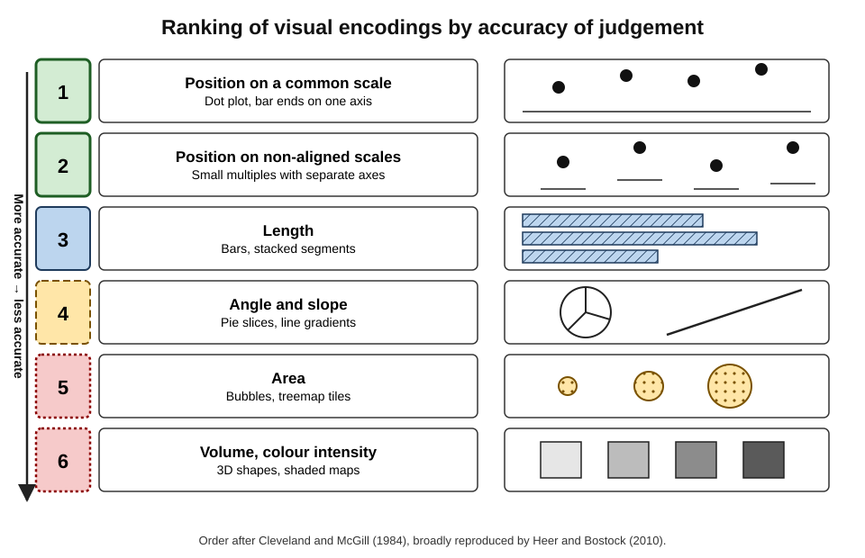
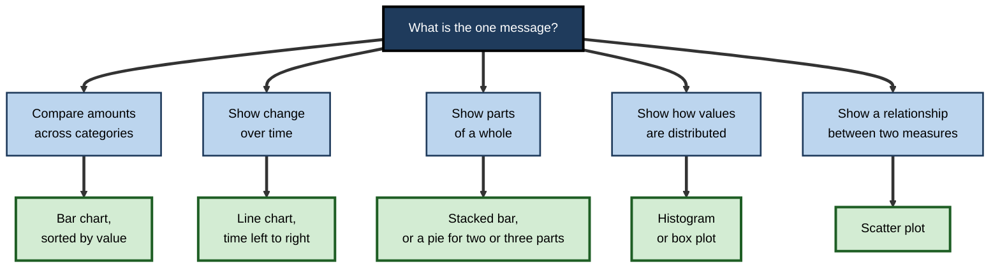
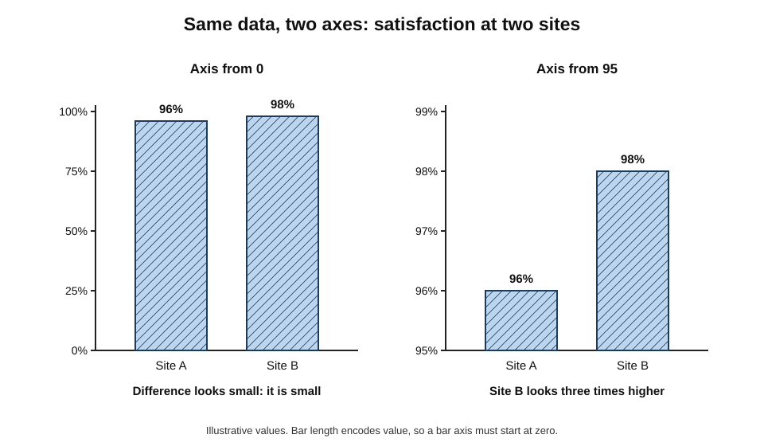
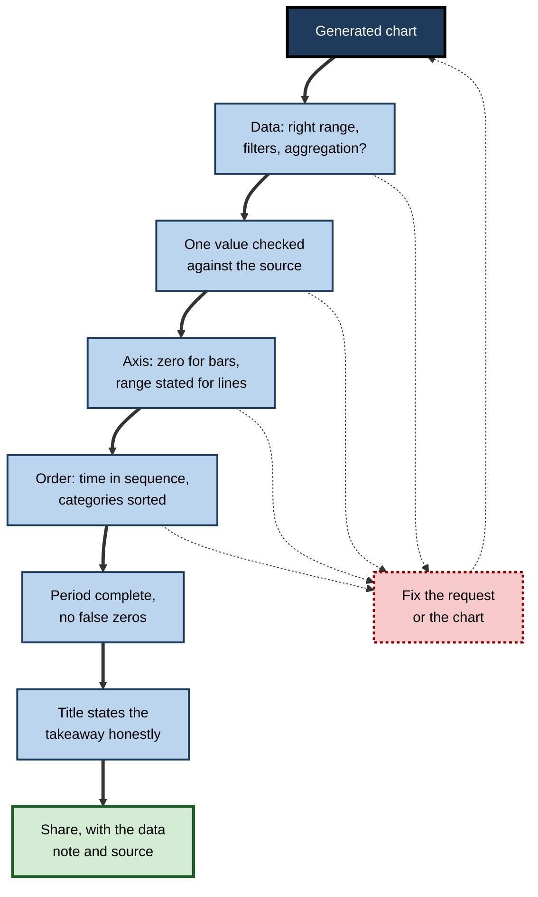
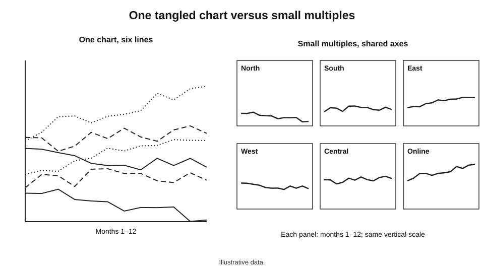

# E.5. Generating charts from a request

A regional manager types "chart monthly complaints for this year" into her spreadsheet's assistant and a bar chart appears at once. It shows complaints falling steeply — until a colleague notices that the months run April, August, December, February, and that the vertical axis starts at 380 rather than zero. Nothing in the data was wrong. The chart was produced in two seconds, and it told the wrong story in both of the ways charts most often do.

> **Definition — Generating a chart from a request:** using an AI tool to choose a chart type, select and aggregate data and produce a chart from a plain-language description, with the person responsible for whether the chart shows the data honestly and answers the intended question.

> **Definition — Chart:** a graphic that encodes data values as visual properties — position, length, angle, area, colour — so that patterns can be seen rather than read.

**Why it matters**

- **Charts are the most persuasive form data takes.** A reader absorbs a chart in seconds and rarely checks the numbers behind it.
- **AI removes the effort, not the decisions.** Choosing what to show, how to aggregate it and how to scale it are still decisions — now made silently by the tool unless the request makes them.
- **Default choices are not neutral.** Axis ranges, sort orders and chart types chosen automatically can exaggerate, hide or invert a pattern.
- **Speed multiplies output.** When a chart costs nothing, decks fill with charts nobody designed.

---

## How Charts Communicate

### Marks and channels

- **Marks** are the graphical elements: bars, points, lines, areas, slices.
- **Channels** are the visual properties that carry values: position, length, angle, area, colour hue, colour intensity.
- **The French cartographer Jacques Bertin** (*Semiology of Graphics*, 1967) first set out this grammar of "visual variables", and it underlies most modern charting tools.

> **Definition — Visual encoding:** the mapping of a data value to a visual channel, such as revenue to bar length or time to horizontal position.

### Not all channels are equally accurate

**Study card — William Cleveland and Robert McGill (1984), "Graphical Perception"**

- **Design:** participants judged the relative size of values shown through different encodings — positions on a common scale, lengths, angles, areas, shading — and their errors were measured.
- **Results:** judgement was most accurate for **position along a common scale**, then position on non-aligned scales, then **length**, then **angle and slope**, then **area**, with **volume, colour intensity and colour saturation** least accurate.
- **Conclusion:** charts should encode the most important comparison by **position or length** wherever possible.
- **Later work:** Jeffrey Heer and Michael Bostock (2010) largely reproduced the ranking with online participants, strengthening confidence in it.

**Figure 1.** How accurately people judge values encoded in different ways.

> **Key point:** this is why bar charts usually beat pie charts for comparison, and why a dot plot or bar chart usually beats a bubble chart — position and length are read accurately; angle and area are not.

---

## Choosing a Chart for the Message

**Figure 2.** Choosing a chart type from the message it must carry.

- **Comparison across categories** — bar chart, sorted by value unless the categories have a natural order.
  - *e.g.* revenue by region.
- **Change over time** — line chart, time running left to right; columns for a few discrete periods.
  - *e.g.* monthly complaints.
- **Part-to-whole** — stacked bar, or a pie only for two or three parts with clearly different sizes.
  - *e.g.* share of revenue from new and existing customers.
- **Distribution** — histogram or box plot.
  - *e.g.* spread of delivery times.
- **Relationship** — scatter plot, perhaps with a trend line.
  - *e.g.* advertising spend against sales by store.
- **Ranking** — sorted horizontal bars, which also leave room for long labels.

| Message | Good default | Common poor choice | Why the poor choice misleads |
|---|---|---|---|
| Compare categories | Sorted bar | Pie with many slices | Angles are judged inaccurately; small slices vanish |
| Change over time | Line | Unordered bars | Time order lost; trend hard to see |
| Part-to-whole | Stacked bar | 3D pie | Perspective distorts slice sizes |
| Distribution | Histogram, box plot | Bar of averages | Hides spread, outliers and skew |
| Relationship | Scatter | Two lines on dual axes | Axis scaling can manufacture or hide correlation |

> **Remember:** **message first, chart second.** If the message cannot be written as one sentence, no chart type will rescue it.

---

## How AI Tools Make Charts

### The main routes

- **Built-in assistants** — Copilot in Excel, Gemini in Google Sheets — create a **native chart** (often with a pivot table behind it) from a request such as "show sales by region as a bar chart".
- **Insight panes** — suggest ready-made charts for a selected range; the user picks one.
- **Chat assistants with code execution** — write and run plotting code and return an **image**.
- **Business-intelligence tools** — build visuals from natural-language questions over a governed data model.

> **Definition — Native chart:** a chart object inside the spreadsheet, linked to cells, which updates when the data change and can be edited.

| | Native chart from a built-in assistant | Image from a chat assistant | Visual in a BI tool |
|---|---|---|---|
| Linked to data | Yes | No — a snapshot | Yes, to the data model |
| Updates with new data | Yes | No — must regenerate | Yes |
| Editable by the user | Yes, fully | Only by editing code or regenerating | Yes |
| Method visible | Pivot or range visible | Code visible if requested | Query and fields visible |
| Main risk | Wrong range or aggregation chosen silently | Stale chart pasted into reports; code unread | Natural-language question misread as a different measure |

> **Watch out:** a chart image pasted from a chat assistant is frozen. When the source data are corrected next week, the chart in the slide deck will not be — and nothing on it says so.

### What the tool decides when the request does not

- **Which data** — the range, the columns, any filters.
- **How to aggregate** — sum, average or count; by month or by quarter.
- **Chart type** — often the tool's default for the data shape.
- **Axis scale and range** — including whether the value axis starts at zero.
- **Order** — alphabetical, by value or by time.
- **Labels, title, colours, legend placement.**

> **Key point:** every unstated decision is taken by the tool's defaults or the model's guess. A precise request **moves those decisions back to the person responsible for the chart**.

---

## Asking for a Chart Well

### The elements of a good request

- **The message** — "show that complaints peaked in March and have fallen since".
- **The data and aggregation** — "count of rows in the Complaints table by month of Received Date, January to September 2026".
- **The chart type**, or a request to justify the proposed type.
- **Axis rules** — "value axis from zero"; "months in calendar order".
- **Labels and title** — a title that states the takeaway; axis titles with units.
- **Audience and format** — a slide, a printed report, a small dashboard tile.
- **Accessibility** — direct labels instead of a legend where possible; a palette that works for colour-blind readers; alternative text.

> **Mnemonic — "My Data Can Always Look Accurate":** Message, Data and aggregation, Chart type, Axis rules, Labels and title, Audience and accessibility.

### Asking the tool to explain itself

- "What data range and aggregation did you use?"
- "Why this chart type rather than a bar or line?"
- "Does the value axis start at zero?"
- "Which periods or categories are missing or incomplete?"

---

## Where Generated Charts Mislead

### Scale and axis problems

- **Truncated value axis on bars** — bar length encodes value, so a bar chart whose axis starts above zero exaggerates differences.
  - *e.g.* bars of 96% and 98% on an axis starting at 95% look like a threefold difference.
- **Line charts may legitimately not start at zero** when the focus is change — but the axis range must be visible and the choice deliberate.
- **Dual axes** — two measures with independent scales on one chart; the apparent relationship depends entirely on how each axis is scaled.
- **Uneven intervals** — dates spaced evenly on the axis although the gaps between them differ.

**Figure 3.** The same two values with the value axis starting at zero and at 95.

> **Formula — Lie factor (Edward Tufte, 1983):** size of the effect shown in the graphic ÷ size of the effect in the data. Example: values 96 and 98 differ by about 2%. On an axis from 95, the bars are 1 and 3 units tall — a 200% difference. Lie factor = 200 ÷ 2.1 ≈ **95**. Tufte suggested that a lie factor far from 1 signals a distorting graphic.

### Order and aggregation problems

- **Months sorted alphabetically** — when a date column is treated as text, "April" comes before "February".
- **Categories in arbitrary order** — unsorted bars hide the ranking.
- **Wrong aggregation** — summing percentages or rates; averaging averages across groups of different sizes; counting rows instead of distinct entities.
- **Incomplete last period** shown as a sharp fall.
- **Missing values plotted as zero**, creating dips that never happened.
- **Cumulative charts** that always rise, presented as if they showed growth.

### Visual clutter and decoration

- **Chartjunk** — Edward Tufte's term (*The Visual Display of Quantitative Information*, 1983) for decoration that carries no data: 3D effects, heavy gridlines, shadows, background images.
- **Data-ink** — Tufte's principle that most of the ink in a chart should present data; non-data ink should be reduced.
- **Too many series** — a line chart with twelve lines ("spaghetti") in which no line can be followed.
- **Colour reliance** — about one man in twelve and one woman in two hundred, among people of Northern European descent, has a colour-vision deficiency; series distinguished only by red and green may be indistinguishable.

> **Watch out:** the claim that "chartjunk" always harms understanding is **contested**. Studies have found that some embellishment can improve memory of a chart without harming accuracy (Bateman and colleagues, 2010). The safer principle: decoration must never distort the data or compete with it.

> **Definition — Chartjunk:** visual elements in a chart that do not represent data and distract from it.

### Chart types that tools over-produce

- **Pie and doughnut charts** — offered readily for any "breakdown", though comparison of more than two or three slices is poor.
- **Three-dimensional effects** — perspective makes nearer elements look larger than further ones of equal value.
- **Gauges and speedometers** — use a lot of space to show one number against a target that a bullet chart or a single figure with a comparison shows more compactly.
- **Maps** — attractive for regional data but encode values by area, so large, sparsely populated regions dominate the eye; a sorted bar chart is often clearer unless geography itself is the message.
- **Stacked areas with many layers** — only the bottom layer has a flat baseline; the others cannot be compared over time.

> **Key point:** when a tool proposes a chart type, ask what comparison it makes easy. If the answer is "none in particular", a sorted bar or a line is almost always better.

---

## Checking a Generated Chart

**Figure 4.** Checks to run on a generated chart before sharing it.

1. **Data** — the range, filters and aggregation match the intended question.
2. **One value** — pick one bar or point and confirm it against the source data.
3. **Axis** — bars start at zero; line axes are deliberate and labelled.
4. **Order** — time in sequence; categories sorted unless naturally ordered.
5. **Completeness** — no partial last period presented as complete; missing values not shown as zero.
6. **Title and labels** — the title states what the chart shows, no more strongly than the data support.

> **In practice:** a useful habit is to write the chart's one-sentence takeaway **before** generating it, then check whether the chart shows that sentence honestly — not to generate a chart and then find a sentence it seems to support.

---

## Worked Example (illustrative): The Complaints Chart

**Situation (illustrative figures):** a table of 4,312 complaints, one row per complaint, with a Received Date column; the manager wants to show the trend for January to September 2026 to the leadership team.

**Step 1 — the vague request:** "Chart monthly complaints."

- Result: a column chart; months as text sorted alphabetically; value axis from 380 to 560; October included with 9 days of data.

**Step 2 — diagnose the defaults.**

| Problem | Effect on the reader | Cause |
|---|---|---|
| Months alphabetical | Trend unreadable; apparent fall | Month names treated as text |
| Axis from 380 | Small changes look dramatic | Automatic axis range |
| October partial | False collapse at the end | No period filter |
| Columns for a trend | Harder to see the shape | Default chart type |

**Step 3 — the precise request:** "Line chart of the count of complaints by month of Received Date, January to September 2026 only, months in calendar order, value axis from 0, title stating the takeaway, axis titles, data labels on the first and last points."

**Step 4 — check.**

- March, the peak, shows 552 complaints; a filter on the table for March gives 552 rows.
- Calendar order confirmed; axis from 0; October absent.
- **Takeaway written by the manager:** "Complaints peaked at 552 in March and have fallen in each month since, to 418 in September."

- **Conclusion:** the data never changed. The vague request produced a chart with four defaults the manager had not chosen; the precise request made each of those choices explicitly and produced a chart that can be defended.

> **Watch out:** the corrected trend — a fall from 552 to 418 — is real but modest. On the original truncated axis it would have looked like a collapse. The honest chart is less dramatic, and that is the point.

---

## Case Study: The Out-of-Order Dates

- **Situation:** in May 2020, early in the COVID-19 pandemic, the public health department of the US state of Georgia published a bar chart of confirmed cases in its most affected counties over the preceding weeks.
- **Problem:**
  - the dates along the horizontal axis were **not in chronological order**, and the order of counties within each date also varied;
  - arranged this way, the bars appeared to show a steady decline in cases.
- **Reaction:** commentators and journalists noticed the ordering; the department removed the chart and published a corrected version, saying the ordering had not been intended to mislead.
- **Lesson:** a single default or design decision about **order** — the kind a charting tool or an AI assistant makes silently when unconstrained — can reverse the apparent message of accurate data on a matter of public importance. Time must run in sequence, and someone must check that it does before publication.

---

## Refining a Chart in Conversation

A generated chart is a first draft. The fastest route to a good chart is usually a short sequence of specific instructions rather than a single perfect request.

### Useful refinements

- **Reduce** — "show only the five largest regions and group the rest as 'Other'".
- **Reorder** — "sort the bars from largest to smallest"; "put months in calendar order".
- **Re-scale** — "start the value axis at zero"; "use the same axis range on both panels".
- **Re-aggregate** — "show the median instead of the mean"; "show rates per thousand customers, not counts".
- **Re-label** — "replace the legend with labels at the end of each line"; "title: 'Returns fell after the new packaging'".
- **Highlight** — "grey all lines except the North".
- **Annotate** — "mark the date the new process started".

> **In practice:** **highlighting one series and greying the rest** is one of the most effective refinements available. It keeps the context while telling the reader where to look — and it is a one-sentence request.

### When to stop refining

- **When the chart shows the message honestly** and the checks pass.
- **When further refinement is styling, not meaning** — styling belongs to templates.
- **When the chart needs data the table does not hold** — refinement cannot fix a missing denominator or period.

---

## Many Series, Many Charts

### Small multiples

> **Definition — Small multiples:** a grid of small charts with the same axes and design, one for each category, so that patterns can be compared across categories at a glance.

- **When to use:** many series that would tangle in one chart — twelve regions' monthly sales, eight products' returns.
- **Key rule:** **shared axes**, so that panel heights can be compared directly. An assistant asked for small multiples may give each panel its own axis unless told otherwise.
- **The idea was popularised by Edward Tufte**, who argued that a series of small, consistent charts lets the eye compare without decoding a new design each time.

**Figure 5.** Six series drawn as one tangled chart and as small multiples with shared axes.

- **Why shared axes matter:** if each panel scales to its own data, a region with flat sales of £10,000 a month can look as dramatic as one swinging between £100,000 and £400,000. Shared axes keep the comparison honest; when one series dwarfs the others, it may deserve its own chart rather than a different scale.
- **Order the panels meaningfully** — by size, by geography, or by the value in the latest period — rather than alphabetically by default.
- **Label each panel directly** with its category, so no legend is needed.

### Dashboards

- **A dashboard** gathers several charts and figures on one screen for monitoring.
- **AI tools can draft a dashboard from a request**, choosing several charts at once — multiplying every default decision.
- **Good dashboards** answer a small number of stated questions, use consistent scales and colours, show the data date, and put the most important figure in the top left, where readers start.

| | One combined chart | Small multiples | Dashboard |
|---|---|---|---|
| Suits | Two to four series | Many comparable series | Several different measures |
| Main strength | Direct comparison on one axis | Pattern comparison without tangling | Overview for monitoring |
| Main risk | Clutter beyond a few series | Unshared axes mislead | Too many charts, no message |
| Request must state | Series to include and highlight | Shared axes, panel order | Questions to answer, data date |

---

## Describing a Chart in Words

### Alternative text

- **Purpose:** to give a reader who cannot see the chart the same **message** — not a description of colours and shapes.
- **A good pattern:** chart type and subject; the main finding with key numbers; the data source and period if relevant.
- **AI tools can draft it**, since they know the data behind the chart; the author checks that it states the finding accurately and no more strongly than the data support.

> **Example (illustrative figures):** weak alternative text — "Line chart with blue line." Better — "Line chart of monthly complaints, January to September 2026: complaints peaked at 552 in March and fell each month to 418 in September."

### Takeaway titles and captions

- **A takeaway title** states the finding: "Complaints have fallen every month since March".
- **A descriptive title** states the content: "Monthly complaints, January–September 2026".
- **Formal reports** often use descriptive titles with a takeaway in the text; presentations favour takeaway titles. Either way, the claim must match the evidence.

> **Watch out:** an AI-written takeaway title can claim more than the chart shows — "Complaints are falling thanks to the new process" asserts a cause no chart of one measure can establish.

---

## Charts in Professional Practice

### Standards and templates

- **House styles and templates** fix fonts, palettes, axis rules and title conventions so that generated charts are consistent.
- **Notation standards** — such as the International Business Communication Standards (IBCS), used by some finance teams — prescribe how actuals, plans and forecasts are drawn.
- **Approved palettes** tested for colour-vision deficiency.

### Accessibility

- **Alternative text** describing the chart's main message for screen-reader users — AI can draft it, but a person checks that it states the takeaway and key numbers.
- **Direct labels** on lines and bars reduce reliance on legends and colour.
- **Sufficient contrast** and text sizes readable when projected.

### Governance of numbers in charts

- **A chart in a board pack is a reported number.** It should come from the same controlled source as the tables beside it.
- **The same number, the same way, every time** — once a chart becomes a recurring exhibit, its type, scale, order and definitions should be fixed in a template, so that a change in the chart means a change in the data, not in how an assistant chose to draw it this month.
- **Source and date notes** under charts — "Source: complaints system, extract 3 October 2026" — make charts traceable.

> **In practice:** many analytics teams forbid pasting chart images from chat assistants into formal reports; charts must be rebuilt from the controlled dataset, so that they update and can be audited.

---

## Open Questions

- **Should AI chart tools refuse misleading defaults?**
  - Tools could enforce zero baselines on bars or warn about partial periods; how far tools should constrain users, rather than advise them, is unsettled.
- **Can tools infer the message from the request?**
  - Choosing the right chart depends on intent the user rarely states; asking clarifying questions slows the interaction that users value.
- **How should embellishment be judged?**
  - Evidence on decorated charts is mixed; whether AI-generated "engaging" styles help or harm understanding is little studied.
- **Will generated alternative text be reliable?**
  - Describing the main message of a chart requires judgement that automatic descriptions often lack.

---

## Summary

- **Generating a chart from a request** hands the tool decisions — data, aggregation, type, axis, order, labels — that the person remains responsible for.
- Charts encode values in **channels**; **position and length** are read most accurately, angle and area less so (Cleveland and McGill, 1984).
- Choose the chart from the **message**: bars to compare, lines for time, stacked bars for parts, histograms or box plots for distributions, scatter plots for relationships.
- AI routes: native charts from built-in assistants, images from chat assistants, insight panes, BI visuals — **native and linked** beats **frozen images** for anything reused.
- Misleading patterns: **truncated bar axes** (lie factor), dual axes, alphabetical months, unsorted categories, wrong aggregation, partial periods, false zeros, cumulative charts, chartjunk, colour-only distinctions.
- A precise request covers **Message, Data, Chart type, Axis, Labels, Audience** ("My Data Can Always Look Accurate").
- Check data, one value, axis, order, completeness and title before sharing; write the takeaway first.

---

## Self-Check

1. Define visual encoding and give two examples.
2. Summarise Cleveland and McGill's findings and their practical consequence.
3. Choose a chart for each message: revenue by region; weekly website visits over a year; distribution of invoice payment times; ad spend against sales by store.
4. Distinguish a native chart from a chart image, and explain why the difference matters for reports.
5. List six decisions a charting tool makes when the request does not.
6. Why must bar charts start at zero while line charts sometimes need not?
7. Compute the lie factor when values of 50 and 55 are shown as bars on an axis starting at 45.
8. Give four ways order and aggregation can mislead in a generated chart.
9. What is chartjunk, and why is the evidence on it described as contested?
10. Describe the six checks on a generated chart.
11. In the complaints example, which defaults caused problems, and what did the precise request specify?
12. What does the Georgia chart case teach about automatically chosen order?
13. A colleague's slide shows two lines — marketing spend and sales — on dual axes, with the title "Spend drives sales". Critique it and propose a better chart.

14. When are small multiples better than one combined chart, and what rule must a request for them state?
15. Write alternative text for a bar chart showing that the North region had the highest return rate (6.1%) of five regions in 2026.

### Answer Key

1. Mapping a data value to a visual channel: revenue to bar length; time to horizontal position; category to colour hue.
2. People judge position on a common scale most accurately, then length, then angle and slope, then area, with volume and colour intensity least accurate. Encode key comparisons by position or length.
3. Sorted bar chart; line chart; histogram or box plot; scatter plot.
4. A native chart is linked to cells, updates and is editable; an image is a frozen snapshot that will not reflect corrected data and cannot be audited from the chart itself.
5. Data range and filters; aggregation; chart type; axis range; order of categories; labels, title and colours.
6. Bar length encodes value, so a truncated baseline distorts the ratio of lengths. Line charts encode value by position, so a non-zero range can show change faithfully if deliberate and labelled.
7. Data effect: (55 − 50) ÷ 50 = 10%. Graphic: bars of 5 and 10 units, a 100% difference. Lie factor = 100 ÷ 10 = 10.
8. Months sorted alphabetically; categories unsorted; summing percentages or averaging averages; partial last period; missing values plotted as zero; cumulative totals presented as growth.
9. Non-data decoration that distracts from data (Tufte). Contested because some studies found embellished charts were remembered better without loss of accuracy; decoration must not distort or compete with data.
10. Data range and aggregation; one value against the source; axis rules; order; completeness and false zeros; title and labels honest.
11. Text months sorted alphabetically, an automatic axis from 380, a partial October and a column chart. The request specified a line chart, count by month for January–September, calendar order, axis from zero, a takeaway title, axis titles and labels.
12. A single ordering decision can reverse the apparent message of correct data; time must run in sequence and order must be checked before publication.
13. Dual axes let scaling manufacture apparent co-movement; "drives" claims causation the chart cannot show. Better: a scatter plot of spend against sales by period or store, each on clearly labelled axes, with a descriptive title ("Higher-spend months also had higher sales") and a note on other factors.
14. When there are many comparable series that would tangle on one chart. The request must state shared axes, so that panels can be compared directly.
15. E.g. "Bar chart of return rates by region in 2026: the North had the highest rate at 6.1%, above the other four regions." Further figures for the other regions can be added if they matter to the message.

---

## Glossary

| Term | Meaning |
|---|---|
| Alternative text | A text description of an image for readers who cannot see it. |
| Box plot | A chart of the five-number summary, flagging outlying values. |
| Channel | A visual property that carries data, such as position, length or colour. |
| Chartjunk | Decoration in a chart that represents no data. |
| Data-ink | The share of a graphic's ink that presents data. |
| Dual axes | Two value axes with independent scales on one chart. |
| Histogram | A bar chart of how many values fall into each range. |
| Lie factor | The size of an effect shown in a graphic divided by its size in the data. |
| Mark | A graphical element such as a bar, point or line. |
| Native chart | A chart object linked to cells, updating with the data. |
| Scatter plot | A chart plotting two measures against each other, one point per observation. |
| Small multiples | A grid of small charts with shared axes, one per category. |
| Takeaway title | A chart title that states the finding rather than the content. |
| Truncated axis | A value axis that starts above zero. |
| Visual encoding | The mapping of data values to visual channels. |
