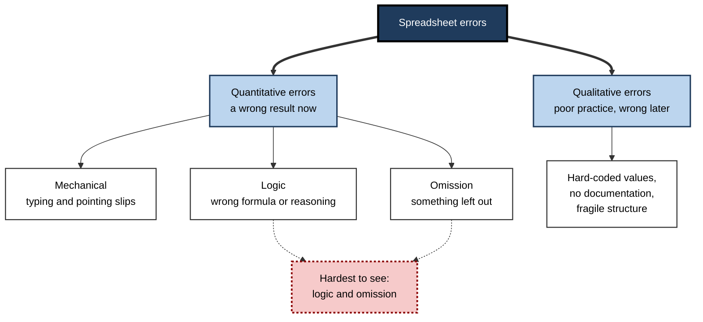
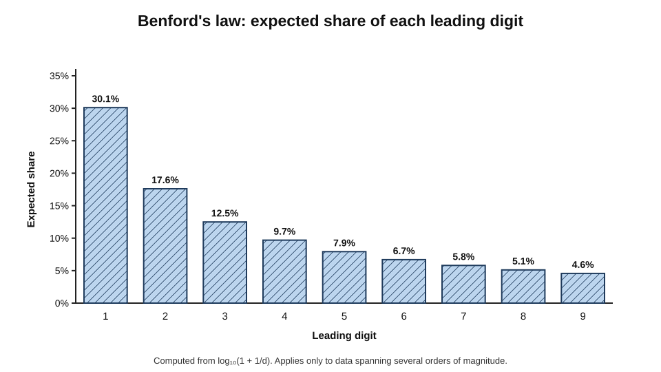
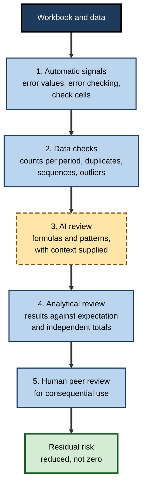
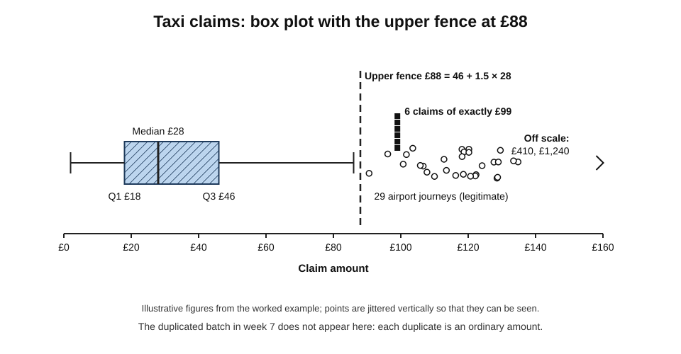
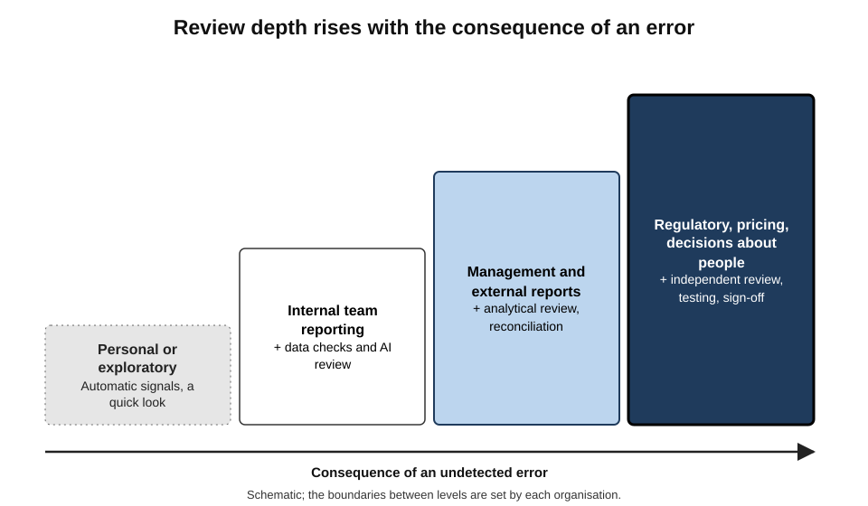

# E.6. Spotting errors and anomalies

A finance analyst asks an AI assistant to "check this expenses workbook for anything odd". It replies within seconds: three unusually large claims, a formula returning `#DIV/0!`, and a column of dates stored as text. All three findings are real and useful. What it does not mention is that one month's claims were pasted in twice, inflating the year's total by 8% — an error in which every individual number looks perfectly normal.

> **Definition — Spreadsheet error:** a flaw in a spreadsheet's formulas, structure or data entry that causes it to produce a result different from the one intended.

> **Definition — Anomaly:** a value, record or pattern that departs from what is expected — which may be an error, a fraud, or a genuine and important event.

**Why it matters**

- **Errors are normal, not exceptional.** Field audits of business spreadsheets have repeatedly found that most contain at least one error.
- **The consequences scale with the decision.** A wrong cell in a personal budget costs little; in a trading model, a bid or a public-health dataset it can cost millions or harm people.
- **AI adds a fast, tireless reviewer** — one that reads formulas and scans data in seconds but has characteristic blind spots.
- **Anomalies are double-edged.** Removing them as "errors" may delete the most important signal in the data.

---

## Two Things to Look For

- **Errors in the spreadsheet** — formulas, references, structure and entry mistakes.
  - *e.g.* a sum range that stops one row short; a hard-coded figure in a formula column.
- **Anomalies in the data** — unusual values or patterns in what the spreadsheet holds.
  - *e.g.* an expense claim ten times the usual size; a gap in invoice numbers; a sudden drop in daily orders.
- **The two overlap**: a data anomaly is often the symptom of a spreadsheet error, and a spreadsheet error often hides a data anomaly.

> **Key point:** error-spotting asks "is the workbook doing what was intended?"; anomaly-spotting asks "does the data look like the world it describes?" Both questions need answering.

---

## How Spreadsheet Errors Arise

### A taxonomy of errors

**Figure 1.** A taxonomy of spreadsheet errors.

- **Raymond Panko and colleagues**, studying spreadsheet errors from the 1990s onwards, distinguished:
  - **mechanical errors** — slips such as typing the wrong number or pointing to the wrong cell;
  - **logic errors** — the wrong formula or the wrong reasoning, such as averaging averages;
  - **omission errors** — leaving something out, such as a cost line or a month.
- **Qualitative errors** — practices that do not give a wrong answer today but make one likely later: hard-coded numbers, no documentation, inconsistent formulas.

> **Definition — Mechanical error:** a slip in typing or pointing, such as entering 1,500 instead of 15,000 or selecting the wrong range.

> **Definition — Logic error:** a formula or method that is wrong in principle, even when typed exactly as intended.

> **Definition — Omission error:** the absence of something that should be in the model, such as a cost category or a period.

### How common are errors?

**Study card — Raymond Panko's reviews of spreadsheet error research (1998, revised 2008)**

- **Evidence base:**
  - **field audits** of operational spreadsheets in organisations;
  - **laboratory experiments** in which people built spreadsheets from a specification.
- **Findings:**
  - across the field audits reviewed, most audited spreadsheets — in some summaries close to nine in ten — contained at least one error;
  - in experiments, errors occurred in a small percentage of formula cells — of the order of a few per cent — but large spreadsheets contain thousands of formulas, so a few per cent per cell makes an error somewhere almost certain;
  - developers were overconfident: they rarely believed their own spreadsheets contained errors.
- **Conclusion:** errors are a **base rate**, not an accident; spreadsheets need testing as programs do.

> **Watch out:** the audit figures come from samples that were not random and from studies defining "error" differently. The precise percentages are **uncertain**; the qualitative conclusion — errors are common and their authors underestimate them — is well supported.

**Study card — Felienne Hermans and Emerson Murphy-Hill (2015): the Enron spreadsheet corpus**

- **Data:** over 15,000 spreadsheets from the email archive of Enron, made public after the company's collapse — a rare collection of real business spreadsheets.
- **Findings:**
  - spreadsheets were central to daily work, frequently emailed and revised;
  - roughly a quarter of the spreadsheets containing formulas also contained a formula **error value** such as `#REF!` or `#N/A`.
- **Lesson:** even visible, flagged errors persisted in working business files; silent errors, which do not display an error value, can only be more common.

---

## Signals the Spreadsheet Already Gives

### Error values

| Error value | What it usually means | Typical cause |
|---|---|---|
| `#N/A` | A lookup found no match | Missing key; text versus number mismatch |
| `#REF!` | A reference points to a deleted cell | Rows, columns or sheets deleted |
| `#VALUE!` | Wrong type of argument | Text where a number was expected |
| `#DIV/0!` | Division by zero or blank | Empty denominator |
| `#NAME?` | Unrecognised name | Misspelled function; missing named range; function unavailable in this version |
| `#NUM!` | Invalid numeric result | Impossible calculation, such as a negative square root |
| `#SPILL!` | A dynamic array cannot spill | Cells in the spill range are occupied |

> **Watch out:** visible error values are the **easy** errors. Wrapping formulas in `IFERROR` removes the signal without removing the error; a workbook with no error values is not thereby a workbook with no errors.

### Built-in checks

- **Background error checking** — small markers on cells whose formula is inconsistent with its neighbours, that contain numbers stored as text, or that omit adjacent cells from a range.
- **Inconsistent-formula detection** — a formula that differs from the pattern in its row or column is a classic sign of an overwritten or mis-copied cell.
- **Circular reference warnings.**
- **Totals that do not foot** — row totals and column totals that should agree but do not.

> **Definition — Footing and cross-footing:** checking that a column adds to its total (footing) and that row totals and column totals agree (cross-footing).

### Check cells

- **A check cell** compares two numbers that must agree and shows TRUE/FALSE or a difference.
  - *e.g.* "Sum of regional revenue − total revenue = 0".
- **Good models gather check cells on one sheet** so that any failure is visible at a glance.

> **In practice:** professional modellers add check cells as they build — balance sheet balances, cash reconciles, sub-totals agree. A check that shows a difference of zero every month is unremarkable; the month it does not is the one that saves the report.

---

## How Data Anomalies Show Themselves

### Kinds of anomaly

- **Point anomalies** — single unusual values.
  - *e.g.* a £48,000 taxi claim; an age of 212.
- **Contextual anomalies** — values unusual only in context.
  - *e.g.* heating costs that are high for July but normal for January.
- **Collective anomalies** — patterns unusual as a group, even when each value is ordinary.
  - *e.g.* a whole month pasted twice; a run of round-number claims just below an approval limit.
- **Structural anomalies** — gaps and breaks.
  - *e.g.* missing invoice numbers; a sudden change in the number of rows per day.

> **Watch out:** the costliest anomalies are often **collective**. Outlier detection, which looks at values one at a time, cannot see a duplicated month in which every value is individually normal.

### Simple detection methods

- **Sorting and filtering** — the quickest way to see extremes and blanks.
- **Conditional formatting** — highlighting values above a threshold, duplicates or blanks.
- **Duplicate checks** on a key, and on combinations of fields (date + amount + claimant).
- **Sequence checks** — gaps and repeats in numbered documents.
- **Counts per period** — rows per day or per month, to reveal missing or doubled periods.
- **Comparison with expectation** — this month against last month, against budget, against the same month last year.

### The interquartile-range rule

> **Definition — Interquartile range (IQR):** the difference between the upper quartile (75th percentile) and the lower quartile (25th percentile) of a set of values.

> **Formula — Tukey's fences:** a value is flagged as an outlier if it lies below Q1 − 1.5 × IQR or above Q3 + 1.5 × IQR. Example: Q1 = £40, Q3 = £120, IQR = £80 → upper fence = 120 + 1.5 × 80 = **£240**.

- **Why this rule:** it uses quartiles, which extreme values barely move, so one huge value cannot hide itself by inflating the threshold — a weakness of rules based on the mean and standard deviation.

### Benford's law

- **Observation:** in many naturally occurring sets of numbers spanning several orders of magnitude, the leading digit is 1 about 30% of the time and 9 under 5% of the time.
- **History:** noticed by the astronomer Simon Newcomb (1881) and tested on many datasets by the physicist Frank Benford (1938).
- **Use:** forensic accountants, notably Mark Nigrini from the 1990s, compare the first digits of invoices, expenses or reported figures with Benford's distribution; large departures can point to fabricated numbers.

> **Formula — Benford's law:** the probability that the first digit is d equals log₁₀(1 + 1/d). For d = 1: log₁₀(2) ≈ **0.301**; for d = 9: log₁₀(10/9) ≈ **0.046**.

**Figure 2.** Expected share of each leading digit under Benford's law.

> **Watch out:** Benford's law applies only to data that span several orders of magnitude and are not constrained by rules. Prices set at £9.99, claims capped at £50 or assigned numbers do not follow it; a departure is a reason to look, never proof of fraud.

---

## What AI Brings to Error-Spotting

### Capabilities

- **Reading formulas at scale** — an assistant can review the formulas of a sheet and point out inconsistent patterns, suspicious hard-coded numbers, ranges that stop short, or logic that does not match labels.
- **Explaining why something looks wrong** — "column F divides by the total in F50, but the total is in F51".
- **Scanning data** — built-in insight and anomaly features flag unusual values and changes over time; business-intelligence tools include automatic anomaly detection on time series.
- **Writing detection logic** — conditional-formatting rules, duplicate-check formulas or scripts that run every month.
- **Suggesting what to check** — given the purpose of a workbook, listing the reconciliations and checks a reviewer would expect.

### Characteristic blind spots

- **Mechanical errors in data can be missed.** A recent evaluation of language models on spreadsheet error detection (mid-2020s) found that advanced models detected many **logic** errors well but often missed **mechanical** ones — obvious numeric anomalies, typos in headers, misspellings.
- **Collective anomalies** — duplicated blocks, missing periods — are missed unless specifically requested.
- **Partial view** — the assistant may read only the active sheet or a sample of a large range.
- **Confident false alarms** — normal but unusual values flagged as errors, and plausible explanations offered for them.
- **No knowledge of intent** — a formula that does exactly what was typed but not what the business needs is invisible without context.

| | Spotted well by AI review | Often missed by AI review |
|---|---|---|
| Formula errors | Inconsistent formulas; obviously wrong logic for the label; error values | Ranges one row short in long sheets; errors needing business rules to recognise |
| Data anomalies | Extreme single values; impossible values | Duplicated blocks; missing periods; plausible typing slips |
| Structure | Hard-coded numbers in formula areas, when asked | Hidden sheets; external links; overrides on other sheets |
| Context | Generic good practice | Whether a figure is right for this organisation |

> **Key point:** AI review is best treated as **one more reader with different blind spots** — valuable because it catches things people miss, unsafe as the only reader because it misses things people catch.

### Precision and recall of a reviewer

> **Definition — Precision (of flags):** the share of flagged items that are genuine problems.

> **Definition — Recall (of flags):** the share of genuine problems that are flagged.

- **A reviewer flooding the user with false alarms** has low precision — people stop reading the flags.
- **A reviewer that flags little** has low recall — problems pass.
- **Asking an AI to be "thorough"** usually raises recall and lowers precision; asking it to be "sure" does the reverse.

---

## A Layered Review

**Figure 3.** Layers of review, each catching errors the others miss.

1. **Automatic signals** — error values, the spreadsheet's error checking, check cells.
2. **Data checks** — rows per period, duplicates on key fields, sequence gaps, Tukey's fences on key amounts.
3. **AI review** — formulas and data, with the workbook's purpose and rules supplied; ask separately for formula problems, data anomalies and structural risks.
4. **Analytical review** — results compared with expectation: last period, budget, an independent total.
5. **Peer review** — another person reviews logic and assumptions where the stakes justify it.

> **Remember:** no single layer catches everything. The value of layers lies in their **different blind spots**.

### Using AI to build the checks, not only to run them

- **A one-off AI review** catches what it catches today; **checks written once** run every month.
- **Useful requests:**
  - "Write check cells for this model: every total that should equal another total."
  - "Write conditional-formatting rules that highlight duplicates on claimant, date and amount."
  - "Write a formula that counts rows per week and flags any week more than 50% above the median."
- **Then test the checks** by deliberately introducing an error — a duplicated row, a deleted month — and confirming that the check fires.

> **Remember:** a check that has never been seen to fail has not been shown to work.

### Asking an AI reviewer well

- **Give purpose and rules:** "This workbook calculates monthly commission; rates change on 1 April; cancelled sales earn nothing."
- **Ask in separate passes:** formula consistency; data anomalies including duplicated periods; hard-coded values; reconciliations that should hold.
- **Ask for locations:** "List each issue with its cell reference and why it matters."
- **Ask for what was not reviewed:** "Which sheets or ranges did you not read?"

---

## Worked Example (illustrative): Expense Claims

**Situation (illustrative figures):** 1,240 taxi-expense claims for a quarter; the reviewer wants to find unusual claims and check the total.

**Step 1 — Tukey's fences on claim amounts.**

- Q1 = £18, Q3 = £46, IQR = £28.
- Upper fence = 46 + 1.5 × 28 = **£88**; lower fence = 18 − 42 = negative, so no lower outliers.
- 37 claims exceed £88.

**Figure 4.** Claim amounts with Tukey's fences, and the flagged claims beyond them.

**Step 2 — review the flagged claims.**

| Group | Count | Explanation found | Action |
|---|---|---|---|
| Airport journeys at night | 29 | Legitimate, policy-compliant | None |
| Claims of exactly £99 | 6 | Just under the £100 receipt threshold, same claimant | Refer for review |
| One claim of £1,240 | 1 | Typing slip for £12.40 | Correct |
| One claim of £410 | 1 | Hire of a car for a day, wrong category | Recategorise |

**Step 3 — collective checks.**

- Rows per week: weeks 1–12 show 85–110 claims; **week 7 shows 196**.
- Duplicate check on claimant + date + amount: **96 exact duplicates**, all in week 7 — a batch imported twice.

**Step 4 — reconcile.**

> **Formula — Corrected taxi total:** £41,690 (as reported) − £3,800 (duplicated batch) − £1,227.60 (£1,240 slip corrected to £12.40) − £410 (moved to car hire) = **£36,252.40**, which agrees with the payments made from the expense system.

- **Conclusion:** the outlier rule found the typing slip and the suspicious £99 pattern; it could **never** have found the duplicated batch, which was the largest error. That needed counts per period and a duplicate check — collective tests.

> **Watch out:** 29 of the 37 "outliers" were legitimate. Treating outliers as errors and deleting them would have removed genuine costs and kept the duplicated batch.

---

## Case Study: The London Whale Spreadsheet

- **Situation:** in 2012, the Chief Investment Office of JPMorgan Chase, the largest US bank, built up a very large position in credit derivatives in a portfolio later associated with a trader nicknamed the "London Whale".
- **The model:** early in 2012 the office adopted a new value-at-risk (VaR) model — a measure of potential loss used to set and monitor risk limits. According to the bank's own internal task force report (January 2013), the model was operated through a series of spreadsheets, with data copied and pasted by hand between them.
- **The error:** in one step, a formula divided by the **sum** of two rates where it should have divided by their **average**. The effect was to roughly halve the measured volatility and so understate the risk.
- **Consequences:**
  - the understated VaR made the growing position look less risky than it was, contributing to weak oversight;
  - the portfolio lost about **6.2 billion US dollars** during 2012;
  - regulators in the United States and United Kingdom later fined the bank heavily for control failures.
- **Why it was not caught:**
  - the model was approved under time pressure, with limited testing;
  - manual, spreadsheet-based steps were not subject to the controls applied to production systems;
  - the result — lower risk — was the one people wanted to see.
- **Lesson:** a single logic error, in a formula that returned a perfectly plausible number, sat inside a model governing billions. **Plausible output is not evidence of correct logic**; important spreadsheets need testing, independent review and controls proportionate to their consequences.

> **Watch out:** the spreadsheet error was one contributor among several — trading strategy, governance and oversight failures all played a part. It is a lesson in how small errors combine with weak controls, not a claim that one formula caused the loss.

---

## Error, Event or Fraud?

A flagged item has three possible explanations, and the response differs for each.

- **An error** — a slip, a wrong formula, a duplicated import. Response: correct it, find the cause, add a check.
- **A genuine event** — a large legitimate order, a seasonal spike, a one-off cost. Response: keep it, explain it, perhaps report it separately.
- **A possible fraud or misconduct** — fabricated claims, split invoices to stay under an approval limit, payments to an unknown supplier. Response: preserve the evidence and refer it under the organisation's procedure; do not confront or alter.

**Common red flags in transactional data**

- **Round numbers** where amounts should vary.
- **Amounts just below approval thresholds**, especially repeated by one person.
- **Duplicate payments** — same supplier, amount and date, or same invoice number with small variations.
- **Weekend or holiday transactions** where none are expected.
- **New suppliers** sharing bank details or addresses with employees.

> **Watch out:** an AI assistant may offer a confident explanation for an anomaly — "likely a bulk purchase" — that is pure conjecture. Explanations must come from evidence: the invoice, the order, the person responsible. Where fraud is possible, the conjecture can also mislead an investigation.

| | Error | Genuine event | Possible fraud |
|---|---|---|---|
| Typical sign | Impossible value, broken pattern, duplicate | Unusual but documented | Pattern that avoids controls |
| Who resolves it | The workbook owner | The business owner | An investigator or compliance function |
| Right response | Correct and add a check | Keep and explain | Preserve, refer, do not alter |
| Wrong response | Leaving it because it "looks fine" | Deleting it as an outlier | Correcting or discussing it informally |

---

## Re-checking After Every Change

Errors are often introduced not when a workbook is built but when it is changed — a row inserted, a period added, a formula "improved" by an assistant.

- **Regression checks** — after a change, confirm that results that should not have changed did not.
  - *e.g.* last month's totals reproduced exactly after this month's formula edit.
- **Version comparison** — tools such as Spreadsheet Compare (in some Excel editions) or version history in Google Sheets list every changed cell and formula between two versions.
- **Test blocks** — fixed inputs with known outputs, kept beside critical calculations and rerun after changes.
- **Change notes** — what was changed, why, by whom, and how it was tested; AI-made changes noted as such.

> **Definition — Regression check:** a test after a change confirming that outputs which should be unaffected are unchanged.

> **In practice:** when an AI assistant edits a workbook — fixing formulas, restructuring a sheet, adding a calculation — compare the before and after versions cell by cell. Assistants sometimes change more than was asked, and an unrequested change is the hardest kind to notice.

---

## Professional Practice

- **Analytical review** — auditors and finance teams compare results with expectations before testing detail; AI can help generate the expectations and list the variances to explain.
- **Exception reporting** — recurring checks (duplicates, sequence gaps, threshold breaches) built into monthly processes, with flagged items reviewed and resolved.
- **Segregation** — the person who built a model should not be its only reviewer.
- **Recording reviews** — what was checked, by whom, with what result; AI-assisted reviews recorded as such, including what the assistant could not see.

**Figure 5.** Matching the depth of review to the consequence of an error.

---

## Open Questions

- **How reliable is AI as a spreadsheet reviewer?**
  - Early evaluations show a mixed profile — good at logic, weaker on mechanical slips — and results change with each model; standard benchmarks for review are only emerging.
- **Will AI review reduce or increase errors overall?**
  - It may catch more errors, or encourage complacency that removes human review; both effects are plausible and neither is well measured.
- **Can anomaly detection learn what is normal for a business?**
  - Generic rules flag seasonal peaks and rare legitimate events; tailoring detection to context remains hard.
- **How should AI-generated models be reviewed?**
  - When a model is built by an assistant, the reviewer faces logic nobody in the organisation wrote; review practice for such models is unsettled.

---

## Summary

- **Spreadsheet errors** are flaws in formulas, structure or entry; **anomalies** are departures from expectation, which may be errors, frauds or real events.
- Error types: **mechanical**, **logic**, **omission** (quantitative) and **qualitative** poor practice; logic and omission are hardest to see.
- Errors are a **base rate**: most audited spreadsheets contain some (Panko; percentages uncertain); visible error values persisted in a quarter of formula spreadsheets in the Enron corpus.
- Built-in signals: **error values**, error checking, inconsistent formulas, **check cells**, footing and cross-footing. `IFERROR` hides signals.
- Anomalies: **point, contextual, collective, structural**; collective ones are the costliest and invisible to outlier rules.
- Methods: sorting, conditional formatting, duplicate and sequence checks, counts per period, **Tukey's fences**, **Benford's law** (with caveats).
- AI review reads formulas at scale and explains issues, but misses mechanical slips and collective anomalies and sees partially; treat it as **one more reader**.
- Use a **layered review**: automatic signals, data checks, AI review, analytical review, peer review.
- The **London Whale** model error shows that plausible output is not evidence of correct logic.

---

## Self-Check

1. Distinguish a spreadsheet error from a data anomaly, with an example of each.
2. Define mechanical, logic and omission errors.
3. What did Panko's reviews conclude, and why are the exact percentages uncertain?
4. What did the Enron spreadsheet corpus reveal about error values?
5. Why is a workbook without error values not necessarily error-free?
6. What is a check cell? Give two examples.
7. Name the four kinds of anomaly and give an example of each.
8. Calculate Tukey's upper fence for Q1 = 200 and Q3 = 500.
9. State Benford's law and two conditions under which it should not be applied.
10. List three things AI review does well and three it often misses.
11. Define precision and recall for a reviewer's flags.
12. In the expenses example, why could outlier detection never find the largest error?
13. Summarise the London Whale spreadsheet error and its lessons.
14. Design a layered review for a monthly payroll-cost workbook used to post journals to the ledger.

15. A reviewer finds twelve claims of exactly £49 by one employee where receipts are required above £50. What are the possible explanations, and how should each be handled?

### Answer Key

1. Error: a flaw in the workbook (a sum range missing a row). Anomaly: an unexpected value or pattern in the data (a claim ten times the usual size).
2. Mechanical: slips in typing or pointing. Logic: a formula or method wrong in principle. Omission: something that should be included is missing.
3. Most audited spreadsheets contained errors; per-cell error rates of a few per cent make errors in large spreadsheets near certain; developers were overconfident. Samples were not random and definitions of error varied.
4. Spreadsheets were central to work, and roughly a quarter of those with formulas contained visible error values, showing that even flagged errors persisted.
5. Most errors are silent — wrong references, wrong logic, omissions — and `IFERROR` can suppress visible errors without fixing them.
6. A cell comparing two values that must agree. Examples: regional revenue sum minus total revenue equals zero; balance-sheet assets minus liabilities and equity equals zero.
7. Point (an age of 212); contextual (high heating cost in July); collective (a month pasted twice); structural (gaps in invoice numbers).
8. IQR = 300; upper fence = 500 + 450 = 950.
9. P(first digit d) = log₁₀(1 + 1/d). Not for data within a narrow range, data constrained by rules or thresholds, or assigned numbers such as IDs or prices.
10. Well: reading formulas and spotting inconsistencies; explaining issues; flagging extreme or impossible values. Missed: mechanical slips in data; collective anomalies such as duplicated blocks; content outside its view (hidden sheets, links).
11. Precision: share of flags that are genuine problems. Recall: share of genuine problems that are flagged.
12. Each duplicated claim was individually normal; only collective tests — counts per week and duplicate checks — could reveal the batch imported twice.
13. A VaR model run through manually linked spreadsheets divided by a sum instead of an average, roughly halving measured volatility and understating risk on a portfolio that lost about US$6.2 billion in 2012. Lessons: plausible output is not proof of correctness; consequential spreadsheets need testing, independent review and controls; wanted results attract less scrutiny.
14. E.g. check cells reconciling headcount and gross pay to the payroll system; counts of employees per cost centre against last month; duplicate checks on employee and pay period; Tukey's fences on individual pay changes; AI review of formulas with pay rules supplied, asked separately for formula, data and structural issues; analytical review of variances over a threshold; peer review and sign-off before posting, with the review recorded.
15. An entry error (unlikely if repeated), a genuine pattern (a fixed fare), or deliberate avoidance of the receipt rule. Check whether a fixed fare explains it from evidence; if not, preserve the records and refer under the expenses or fraud procedure without altering data or confronting the employee informally.

---

## Glossary

| Term | Meaning |
|---|---|
| Anomaly | A value or pattern departing from what is expected. |
| Benford's law | The expected distribution of leading digits in many natural datasets. |
| Check cell | A cell that tests whether two values that must agree do agree. |
| Collective anomaly | A group of values unusual together, though each is ordinary. |
| Contextual anomaly | A value unusual only in its context, such as season. |
| Cross-footing | Checking that row totals and column totals agree. |
| Error value | A visible error result such as `#REF!` or `#N/A`. |
| Footing | Checking that a column adds to its stated total. |
| Interquartile range | Upper quartile minus lower quartile. |
| Logic error | A formula or method wrong in principle. |
| Mechanical error | A slip in typing or pointing. |
| Omission error | Something missing that should be included. |
| Precision | The share of flagged items that are genuine problems. |
| Qualitative error | Poor practice that makes future errors likely. |
| Recall | The share of genuine problems that are flagged. |
| Regression check | A test after a change confirming that unaffected outputs are unchanged. |
| Tukey's fences | Outlier thresholds at Q1 − 1.5 × IQR and Q3 + 1.5 × IQR. |
| Value at risk | A statistical estimate of potential loss over a period at a given confidence level. |
