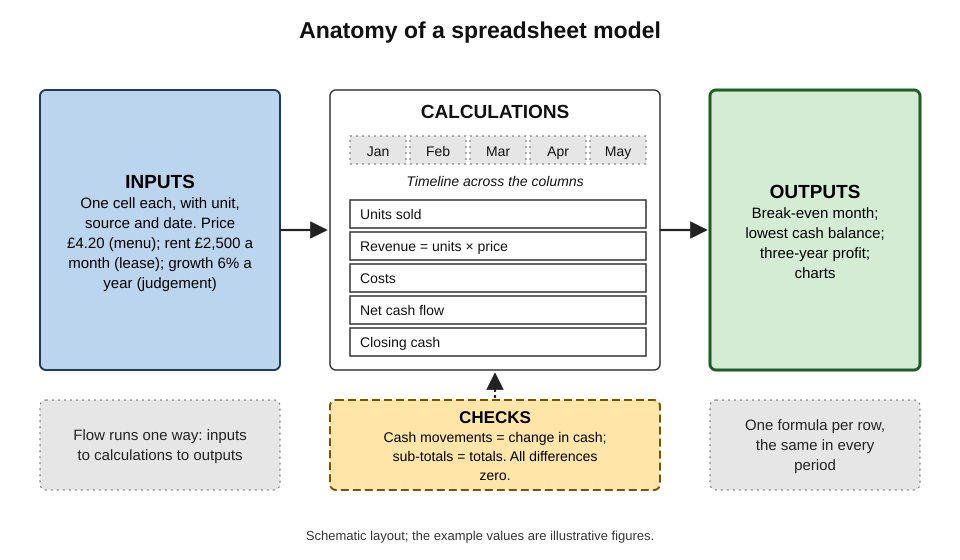
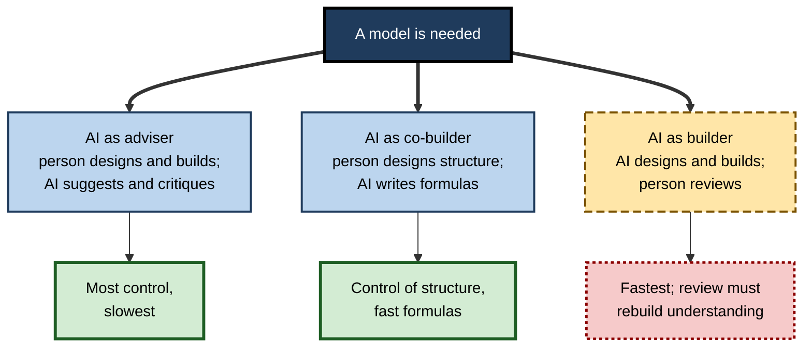
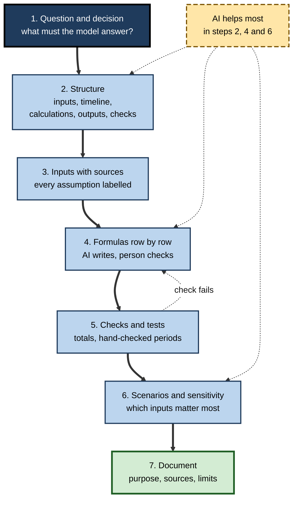
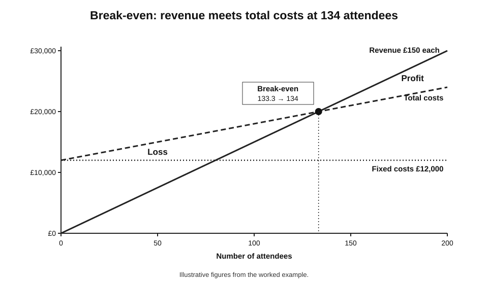
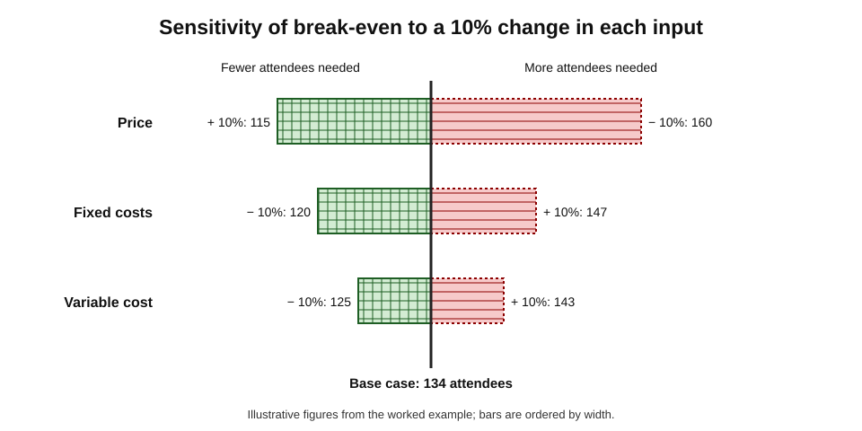

# E.7. Building simple models with help

The owner of a small café asks the AI assistant in her spreadsheet to "build a three-year cash-flow model". Within a minute there are six neatly formatted sheets, a chart of the cash balance and a summary saying the business turns cash-positive in month fourteen. It looks like the work of a professional.

Inside, the rent is typed directly into forty formulas, sales tax collected from customers is counted as income, and an annual growth rate of 6% is applied every month — so sales more than double each year. The model is beautiful, and its central answer is wrong.

> **Definition — Spreadsheet model:** a structured set of inputs, calculations and outputs in a spreadsheet that represents a real situation — a budget, a price, a cash flow, a capacity plan — so that the effect of different assumptions can be calculated and compared.

> **Definition — Assumption:** an input value that represents a belief about the world rather than a recorded fact, such as a growth rate, a conversion rate or a price.

**Why it matters**

- **Models turn opinions into numbers that drive decisions** — whether to hire, to open a site, to accept a price, to borrow.
- **AI can now build a whole model from a sentence.** The barrier to producing a model has almost vanished; the barrier to producing a **correct** one has not.
- **A model's errors are structural.** A wrong formula in one row repeats across every period; a wrong assumption flows through every output.
- **The builder must be able to defend the model.** A model that its owner cannot explain cannot be relied on, adjusted or challenged.

---

## What a Model Is Made Of

### The anatomy

**Figure 1.** The anatomy of a well-built spreadsheet model.

- **Inputs** — every assumption and fixed fact, each in one labelled cell with its unit and source.
  - *e.g.* price per unit £4.20; rent £2,500 per month; sales growth 6% per year.
- **Calculations** — formulas that turn inputs into results, period by period.
  - *e.g.* monthly revenue = units × price; cash at month end = opening cash + receipts − payments.
- **Outputs** — the figures and charts the decision depends on.
  - *e.g.* break-even month; lowest cash balance; three-year profit.
- **Checks** — cells confirming that the model is internally consistent.
  - *e.g.* the balance sheet balances; total cash movements equal the change in cash.
- **Timeline** — the sequence of periods (months, quarters, years) running across the columns, with dates and period flags.

> **Definition — Driver:** an input that most strongly determines the outputs, such as volume, price or conversion rate.

### The direction of flow

- **Inputs flow to calculations, calculations to outputs** — never backwards.
- **Left to right, top to bottom** — time across, logic down.
- **One calculation per row, the same formula across all periods** — so that one cell can be checked and the rest trusted.

> **Key point:** a model's structure is not cosmetic. It is what makes the model **checkable**: an input changed in one place, a formula read once, a result traced in a few steps.

### Modelling standards

- **The FAST Standard** — a published modelling standard whose name sets its goals: **Flexible, Appropriate, Structured, Transparent**.
- **The ICAEW Financial Modelling Code** (Institute of Chartered Accountants in England and Wales, 2018) — principles for clear, consistent, reviewable models.
- **Common rules across standards:**
  - inputs separate from calculations, and visually distinct;
  - **no hard-coded numbers in formulas**;
  - consistent formulas across each row;
  - units and sign conventions stated;
  - short formulas — split long ones into steps;
  - no unnecessary circular references;
  - checks gathered in one place.

> **Mnemonic — FAST:** Flexible, Appropriate, Structured, Transparent.

> **Definition — Hard-coding:** typing a number directly into a formula (`=B5*1.2`) instead of referring to a labelled input cell, so that the number is invisible and must be changed in every formula that contains it.

---

## Kinds of Simple Model

| Model | Question it answers | Key inputs | Characteristic trap |
|---|---|---|---|
| Budget | What will we spend and earn this year? | Headcount, rates, volumes, prices | Last year's figures copied without reasons |
| Break-even | How many sales cover the costs? | Fixed costs, price, variable cost | Costs wrongly split between fixed and variable |
| Pricing | What price meets a margin target? | Costs, target margin, volume | Confusing margin with mark-up |
| Cash flow | When will we run short of cash? | Timing of receipts and payments | Profit treated as cash; tax and payment terms ignored |
| Loan or lease | What will repayments be? | Principal, rate, term | Annual rate used as a monthly rate |
| Capacity | Do we have enough people or machines? | Demand, productivity, availability | Ignoring holidays, sickness, ramp-up |
| Business case | Is the investment worth it? | Costs, benefits, timing, discount rate | Benefits counted before they arrive |

> **Watch out:** margin and mark-up are different. A 25% **mark-up** on a £100 cost gives a £125 price and a **margin** of 20% (25 ÷ 125). Models that confuse them misprice consistently.

> **Formula — Price from a target margin:** price = cost ÷ (1 − margin). Example: cost £80, target margin 20% → £80 ÷ 0.8 = **£100**.

---

## How AI Can Help

### Five roles

- **Designer** — proposing a structure: "What sheets, inputs and calculations should a twelve-month staffing model have?"
- **Formula writer** — writing the formulas for each row of a structure the person has designed.
- **Builder** — creating a whole working model from a description. Agent-style assistants in spreadsheets — such as the agent mode Microsoft made generally available in Excel in January 2026 — plan the steps, create sheets, write formulas and format the result.
- **Critic** — reviewing an existing model: "Which inputs are hard-coded? Which formulas are inconsistent? What assumptions would a lender challenge?"
- **Explainer and documenter** — describing how a model works and drafting its documentation.

**Figure 2.** Three ways to share the work of building a model with AI, by who keeps control of the structure.

| | AI as adviser | AI as co-builder | AI as builder |
|---|---|---|---|
| Who designs the structure | Person | Person | AI |
| Who writes formulas | Person | AI, checked row by row | AI |
| Person's understanding afterwards | Complete | High | Must be rebuilt by review |
| Speed | Slowest | Fast | Fastest |
| Main risk | Slow; person's own errors | Formula errors in individual rows | Plausible structure hiding wrong logic and invented assumptions |
| Suits | Learning; high-stakes models | Most professional work | Prototypes; ideas to be rebuilt or reviewed thoroughly |

> **Key point:** when AI builds the whole model, the time saved in building is partly spent again in reviewing — because the reviewer must understand logic nobody in the organisation wrote. For a consequential model, **co-building** usually gives the best balance of speed and understanding.

---

## Where AI-Built Models Go Wrong

### Logic errors that look professional

- **Period mismatches** — an annual rate applied monthly, or a monthly cost multiplied by 12 twice.
- **Profit treated as cash** — ignoring that customers pay later, suppliers are paid later, and tax falls due at set dates.
- **Tax collected treated as income** — sales tax (VAT in the UK) collected on behalf of the government is not revenue.
- **Sign errors** — costs entered as positive in one sheet and negative in another, then added.
- **Fixed and variable costs confused** — rent scaling with sales; ingredients staying flat as volume doubles.
- **Timing errors** — new staff costs starting before the hiring date; benefits counted from day one.

> **Formula — Converting an annual growth rate to a monthly rate:** monthly rate = (1 + annual rate)^(1/12) − 1. Example: 6% a year → 1.06^(1/12) − 1 ≈ **0.487%** a month. Applying 6% **every month** instead compounds to 1.06¹² − 1 ≈ **101%** a year — more than doubling sales.

> **Watch out:** generated models sometimes contain **circular references** — interest that depends on a cash balance that depends on the interest — resolved by switching on iterative calculation. Circularity can be legitimate, but it makes a model harder to check and can hide errors that never settle; ask for it to be removed or isolated behind a clearly labelled switch.

### Invented assumptions

- **Asked to "fill in sensible assumptions"**, a model-building assistant will supply numbers — industry growth rates, conversion rates, average salaries — that look authoritative and may have no source.
- **The danger is that invented inputs look exactly like researched ones** once they sit in a labelled cell.

> **Watch out:** every input in a model needs a **source** — a contract, a quote, last year's actuals, a survey, a stated judgement. An input whose source is "the AI suggested it" is a guess and must be labelled as one.

### Structural weaknesses

- **Hard-coded numbers** inside formulas — common in generated models, because a formula with a constant is the shortest way to satisfy a request.
- **Inconsistent formulas** — the first period calculated differently from the rest, or a row edited partway across.
- **Over-complexity** — more sheets and features than the question needs, which the owner cannot maintain.
- **Regeneration drift** — asking the assistant to "rebuild with a new assumption" may produce a different structure, so results change for reasons unrelated to the assumption.

### Case study: a cut-and-paste bid

- **Situation:** in 2003 the Canadian power company TransAlta bid in an auction for contracts related to electricity transmission capacity in the United States.
- **What happened:** according to the company's own statements at the time, a cut-and-paste error in a spreadsheet used to prepare the bids led it to bid for more contracts, at higher prices, than intended.
- **Result:** the company reported a charge of about 24 million dollars — a large loss attributed to a single mechanical slip in a spreadsheet, without any AI involved.
- **Lesson:** models used for real commitments need checks that would make a slip visible — totals against intended quantities, a second person's review — however they were built.

---

## Building With AI: A Method

**Figure 3.** Building a model with AI while keeping control of its structure and assumptions.

1. **State the question and the decision** — "Can the café afford a second barista from March without the cash balance falling below £5,000?"
2. **Design the structure** — ask the assistant to propose it, then decide: which inputs, which periods, which calculations, which outputs, which checks.
3. **Enter inputs with sources** — one cell each, with unit, source and date; label judgements as judgements.
4. **Write formulas row by row** — the assistant writes, the person checks one period by hand and confirms the formula is consistent across the row.
5. **Add checks and test** — totals that must agree; one or two periods recomputed independently; extreme inputs tried (zero sales, double costs) to see if the model behaves sensibly.
6. **Explore scenarios and sensitivity** — find which inputs move the answer most.
7. **Document** — purpose, structure, sources, limitations, version.

> **Remember:** **question, structure, sourced inputs, checked formulas, tests, sensitivity, documentation.**

### Asking for structure

- "Propose the sheets, input list, timeline and calculation rows for a monthly cash-flow model of a café, with checks. Do not build it yet; list the structure and the assumptions I will need to supply."
- **Why "do not build it yet":** reviewing a proposed structure takes minutes; reviewing a built model takes hours.

### Asking for formulas

- "Row 14 is monthly revenue: units in row 12 times price in input cell C5. Write the formula for E14 so it can be filled right to AN14."
- **Then hand-check** E14 and one later column.

---

## Worked Example (illustrative): A Break-Even Model

**Situation (illustrative figures):** a training company plans a one-day workshop. Fixed costs (venue, trainer, marketing) are £12,000. Each attendee pays £150; catering and materials cost £60 per attendee.

**Step 1 — inputs, each in its own cell:** fixed costs £12,000; price £150; variable cost £60; capacity 200.

**Step 2 — calculations.**

> **Formula — Break-even volume:** fixed costs ÷ (price − variable cost per unit). Here £12,000 ÷ (£150 − £60) = £12,000 ÷ £90 = 133.3 → **134 attendees**.

- **Contribution per attendee** = £150 − £60 = £90.
- **Profit at a given volume** = volume × £90 − £12,000.
  - at 100 attendees: 9,000 − 12,000 = **−£3,000**;
  - at 160 attendees: 14,400 − 12,000 = **£2,400**.

**Figure 4.** Costs and revenue against the number of attendees, with the break-even point.

**Step 3 — sensitivity.** Which input matters most if each moves by 10%?

| Input changed by 10% | New break-even | Change from 134 |
|---|---|---|
| Price down to £135 | 12,000 ÷ 75 = 160 | +26 |
| Price up to £165 | 12,000 ÷ 105 = 115 (114.3 rounded up) | −19 |
| Variable cost up to £66 | 12,000 ÷ 84 = 143 (142.9 rounded up) | +9 |
| Variable cost down to £54 | 12,000 ÷ 96 = 125 | −9 |
| Fixed costs up to £13,200 | 13,200 ÷ 90 = 147 (146.7 rounded up) | +13 |
| Fixed costs down to £10,800 | 10,800 ÷ 90 = 120 | −14 |

**Figure 5.** How far the break-even volume moves when each input changes by 10%.

**Step 4 — interpret.** Price is the most powerful driver: a 10% price cut raises break-even by 26 attendees, because it erodes the £90 contribution by £15. Variable cost matters least.

- **Conclusion:** the model is four inputs and three formulas — small enough to check entirely by hand, which is exactly why it can be trusted. An AI asked for "a workshop profitability model" might produce five sheets; the question needed one.

> **Watch out:** a 10% fall in price and a 10% rise in price do not move break-even by the same amount, because the contribution changes proportionally more. Sensitivity results are rarely symmetric.

> **Definition — Sensitivity analysis:** changing one input at a time by a set amount and recording the effect on an output, to find which inputs matter most.

> **Definition — Scenario:** a coherent set of input values describing one possible future, such as "pessimistic: lower volume, higher costs", changed together rather than one at a time.

---

## Reviewing a Model Someone Else — or Something Else — Built

When an assistant has built a model, the reviewer is in the position of an auditor of a stranger's work. A structured review is faster and finds more than reading sheet by sheet.

### A review procedure

1. **Map the structure.** List the sheets and their roles; identify inputs, calculations, outputs and checks. If roles are mixed on the same sheet, note it as a risk.
2. **Audit the inputs.** For every input: value, unit, source, date. Mark any without a source. Use Go To Special (constants) on calculation sheets to find numbers hiding in formulas.
3. **Check formula consistency.** In each calculation row, confirm that one formula is copied across all periods; look especially at the first and last periods and at any year boundary.
4. **Trace the key outputs.** Follow each headline figure back to its inputs and check the logic at each step against the business reality — timing, tax, signs, units.
5. **Recompute one period by hand.** Pick a typical month and an unusual one (the first month, a month with a price change) and calculate them independently.
6. **Stress-test.** Set sales to zero, double the costs, push a growth rate to an extreme. A sound model produces sensible, explicable results; a broken one produces nonsense or errors.
7. **Compare with a simple independent estimate.** A back-of-envelope version of the answer — annual sales × margin − fixed costs — should land near the model's result; a large gap needs explaining.

> **Remember:** **map, inputs, consistency, trace, recompute, stress, compare** — seven steps, most of which take minutes for a simple model.

| Review step | What it typically finds in AI-built models | Tool or technique |
|---|---|---|
| Map the structure | Mixed sheets; missing checks | Sheet list; formula-display view |
| Audit the inputs | Unsourced or invented assumptions; hard-coded numbers | Go To Special for constants |
| Formula consistency | First period or year boundary calculated differently | Inconsistent-formula markers; Show Formulas |
| Trace outputs | Profit used as cash; tax treated as income | Trace Precedents; Evaluate Formula |
| Recompute by hand | Period mismatches; wrong rates | Calculator, paper |
| Stress test | Missing logic for edge cases | Extreme inputs |
| Independent estimate | Order-of-magnitude errors | Rough calculation |

> **In practice:** asking the building assistant to "list every assumption you made, every input without a source, and every place a number is typed inside a formula" is a useful first step — but its answer is itself generated text. The review must confirm it, not replace it.

---

## Scenarios, Sensitivity and Goal-Seeking

### Built-in tools

- **Data tables** — Excel's What-If data tables recalculate an output for a list of values of one or two inputs.
- **Goal Seek** — finds the input value that produces a target output: "what price gives a profit of zero?"
- **Scenario Manager** — stores named sets of input values and swaps between them.
- **Scenario switches** — a single input cell selecting "base", "low" or "high", with lookups pulling the matching values — the most transparent approach.

### What AI adds

- **Suggesting which scenarios matter** — "for a café, the main risks are footfall, staff costs and supplier prices".
- **Building scenario switches and data tables** from a description.
- **Narrating results** — with the usual caution about adjectives and causal claims.

> **In practice:** decision-makers rarely need dozens of scenarios. Three coherent scenarios and a sensitivity table of the four or five main drivers usually answer the real question — "how wrong can this go, and what would most change the answer?"

---

## Case Study (illustrative): The Café Cash-Flow Model

- **Situation:** a café owner applying for a bank loan used an agent-style assistant to build a three-year monthly cash-flow model from a description of her business.
- **What the model showed:** cash-positive from month 14; loan repaid comfortably by year three.
- **Review by her accountant found:**
  1. annual sales growth of 6% applied **monthly**, compounding to about 101% a year;
  2. sales tax collected on sales counted as income, overstating cash receipts by the tax rate;
  3. rent, wages and the loan repayment typed into dozens of formulas instead of input cells;
  4. a "market growth" input of 4.5% labelled "industry average", with no source;
  5. no allowance for the quarterly timing of tax payments.
- **Actions:**
  1. the assistant was asked to propose a structure only; the accountant and owner agreed it;
  2. inputs were rebuilt in one sheet, each with a source — the lease, payroll, the supplier price list, last year's takings;
  3. formulas were regenerated row by row and hand-checked for the first and thirteenth months;
  4. checks added: cash movements equal the change in cash; tax collected equals tax paid plus tax owed;
  5. three scenarios built — base, slow start, high costs.
- **Result:** in the corrected base case the café became cash-positive in month 26; in the slow-start scenario the cash balance fell below zero in month 9 unless the loan was increased. The owner applied for a larger loan with a stronger case, and the bank accepted the model because every input had a source.
- **Lesson:** the first model's **appearance** was professional; its **logic** was not. The value of AI lay in fast structure and formulas — once a person who understood cash flow controlled the structure and the inputs.

---

## Models in Organisations

### Model risk

- **Banking supervisors have long treated important spreadsheets as models.** US supervisory guidance on model risk management (SR 11-7, 2011) and the UK Prudential Regulation Authority's model risk principles (SS1/23, published in 2023) both expect models used for decisions — including spreadsheet tools — to be inventoried, validated and controlled in proportion to their risk.
- **Outside regulated industries**, the same ideas apply informally: the more a model influences money or people, the more review it needs.

### End-user computing controls

> **Definition — End-user computing (EUC):** applications such as spreadsheets and small databases built and run by business users rather than IT departments.

- **An EUC inventory** lists important spreadsheets, their owners and their risk ratings.
- **Controls** for high-risk models: version control, change logs, access restrictions, independent review, periodic testing.
- **AI-built models belong in the same inventory** — with a note of how they were generated and reviewed.

### The professional standard

- **Can the owner explain every row?**
- **Does every input have a source?**
- **Do the checks pass, and have they been seen to fail when they should?**
- **Has someone other than the builder reviewed it?**

---

## Open Questions

- **Will AI-built models be reviewable at scale?**
  - Agent-style tools can build large models quickly; whether review practice can keep up, or whether review itself will be delegated to AI, is unresolved.
- **How should invented assumptions be marked?**
  - Few tools distinguish sourced inputs from model-suggested ones; conventions are emerging.
- **Will users still learn to model?**
  - Building by hand teaches the logic that review requires; if fewer people build, fewer may be able to review.
- **How reliable are model-building agents on real tasks?**
  - Spreadsheet benchmarks show substantial progress but frequent failures on multi-sheet business workflows; performance on financial modelling specifically is still being measured.

---

## Summary

- A **spreadsheet model** turns **inputs** (assumptions and facts) into **outputs** through **calculations**, with **checks** and a **timeline**.
- Good structure — separate inputs, one-way flow, consistent row formulas, no **hard-coding**, units stated, checks — makes a model checkable (**FAST**: Flexible, Appropriate, Structured, Transparent).
- Common simple models: budget, break-even, pricing, cash flow, loan, capacity, business case — each with a characteristic trap (margin versus mark-up; profit versus cash; annual versus monthly rates).
- AI can act as **adviser, co-builder or builder**; co-building usually balances speed with understanding; builder mode needs a thorough review.
- Typical AI-model errors: period mismatches, profit as cash, tax as income, sign and timing errors, **invented assumptions**, hard-coded numbers, over-complexity, regeneration drift.
- Method: **question, structure, sourced inputs, checked formulas, tests, sensitivity, documentation**.
- **Sensitivity analysis** finds the drivers that matter; **scenarios** change inputs together; data tables, Goal Seek and scenario switches support both.
- Organisations treat consequential spreadsheets as **models** under model-risk and **end-user computing** controls; AI-built models belong in the same regime.

---

## Self-Check

1. Define a spreadsheet model and an assumption.
2. Name the five parts of a model's anatomy.
3. What does FAST stand for, and what does each word require?
4. Why is hard-coding dangerous? Give an example.
5. Distinguish margin from mark-up, and calculate the price for a cost of £60 and a target margin of 25%.
6. Convert an annual growth rate of 12% into a monthly rate, and explain the error of applying 12% each month.
7. Compare AI as adviser, co-builder and builder on control and risk.
8. Why are invented assumptions particularly dangerous in a model?
9. Describe the seven steps for building a model with AI.
10. Calculate the break-even volume for fixed costs of £9,000, a price of £45 and a variable cost of £15.
11. What is the difference between sensitivity analysis and scenario analysis?
12. In the café case, list the errors found and explain why the model still looked credible.
13. What did the TransAlta episode show about spreadsheet models without AI?
14. A manager wants to use an AI-built headcount model to decide redundancies next month. What would you require before the model is used?
15. List the seven steps for reviewing an AI-built model and say what each typically finds.

### Answer Key

1. A structured set of inputs, calculations and outputs representing a real situation so that the effects of assumptions can be calculated. An assumption is an input representing a belief about the world rather than a recorded fact.
2. Inputs, calculations, outputs, checks, timeline.
3. Flexible (easy to change and extend), Appropriate (fit for the question, no more complex than needed), Structured (consistent, logical layout), Transparent (easy to read, trace and check).
4. The number is invisible and must be found and changed in every formula containing it; e.g. a rent of 2,500 typed into forty formulas, one missed when the rent rises.
5. Mark-up is profit as a share of cost; margin is profit as a share of price. Price = 60 ÷ (1 − 0.25) = £80.
6. 1.12^(1/12) − 1 ≈ 0.949% a month. Applying 12% monthly compounds to 1.12¹² − 1 ≈ 290% a year.
7. Adviser: person designs and builds, full control, slow. Co-builder: person designs, AI writes formulas checked row by row, good control and speed. Builder: AI designs and builds; fastest; the person must rebuild understanding through review; risk of plausible structure hiding wrong logic.
8. Once in a labelled cell they look identical to researched inputs and flow through every output; their lack of a source is invisible unless recorded.
9. Question and decision; structure; inputs with sources; formulas row by row with checks; checks and tests; scenarios and sensitivity; documentation.
10. 9,000 ÷ (45 − 15) = 9,000 ÷ 30 = 300 units.
11. Sensitivity changes one input at a time to see which matters most; scenarios change several inputs together to describe coherent possible futures.
12. Monthly application of an annual growth rate; sales tax counted as income; hard-coded rent, wages and repayments; an unsourced "industry average"; no tax-payment timing. It looked credible because of professional formatting, many sheets and a clear chart and summary.
13. That a single mechanical slip in a spreadsheet used for real commitments can cost tens of millions; checks and review are needed regardless of how a model is built.
14. A stated question; a reviewed structure; every input sourced from HR and finance records; formulas checked; reconciliation of headcount and costs with payroll; sensitivity of the outcome to key assumptions; independent review by someone qualified; documentation; and, because decisions about people are involved, review by HR and legal for fairness and compliance.
15. Map the structure (mixed sheets, missing checks); audit inputs (unsourced assumptions, hard-coded numbers); check formula consistency (odd first periods or year boundaries); trace outputs (profit as cash, tax as income); recompute periods by hand (period mismatches); stress-test (missing edge-case logic); compare with a rough independent estimate (order-of-magnitude errors).

---

## Glossary

| Term | Meaning |
|---|---|
| Assumption | An input representing a belief about the world rather than a recorded fact. |
| Break-even volume | The number of units at which revenue equals total costs. |
| Check | A cell confirming that two values in a model that must agree do agree. |
| Contribution | Price minus variable cost per unit. |
| Data table | An Excel tool recalculating an output for a range of input values. |
| Driver | An input that strongly determines the outputs. |
| End-user computing | Applications such as spreadsheets built and run by business users. |
| FAST Standard | A modelling standard: Flexible, Appropriate, Structured, Transparent. |
| Goal Seek | A tool that finds the input value producing a target output. |
| Hard-coding | Typing a number into a formula instead of referring to an input cell. |
| Margin | Profit as a share of price. |
| Mark-up | Profit as a share of cost. |
| Model risk | The risk of loss from decisions based on incorrect or misused models. |
| Scenario | A coherent set of input values describing one possible future. |
| Sensitivity analysis | Changing one input at a time to see its effect on an output. |
| Spreadsheet model | A structured set of inputs, calculations and outputs representing a real situation. |
| Timeline | The sequence of periods across a model's columns. |
