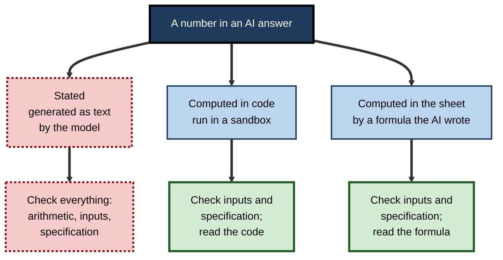
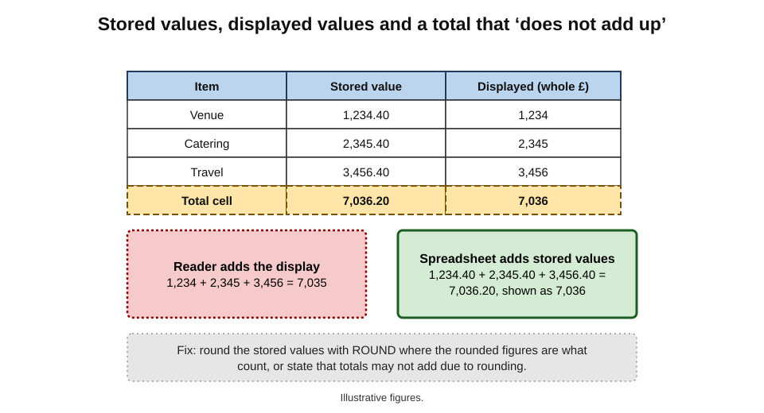
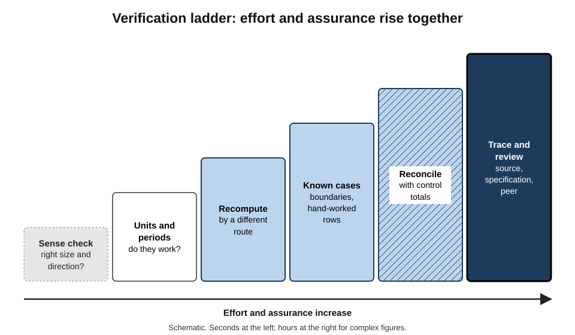
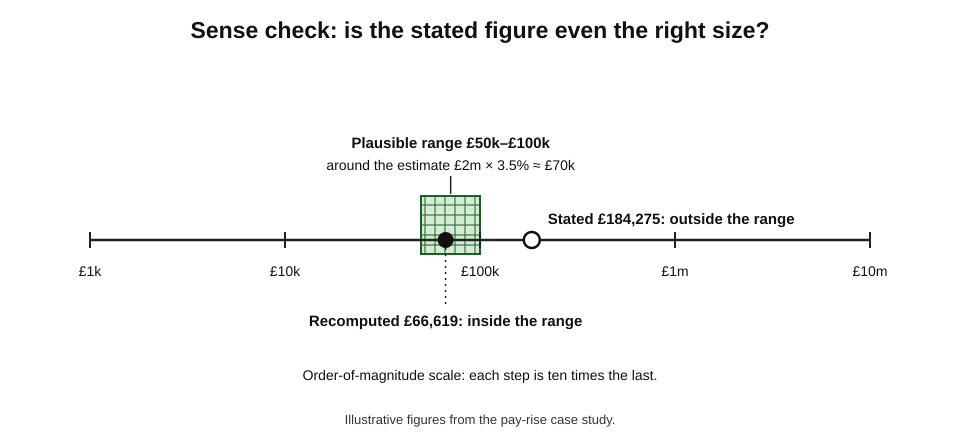
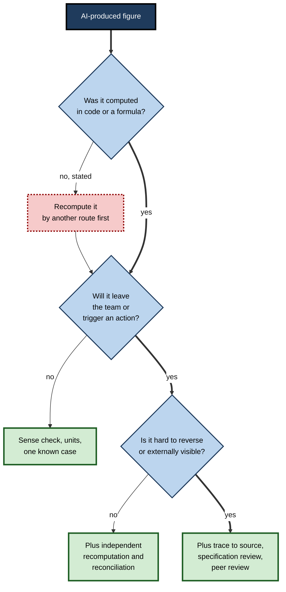

# E.8. Verifying AI-produced calculations

An HR manager asks a chat assistant what a 3.5% pay rise will cost for a team of 42 people whose salaries she pastes in. The answer comes back at once: "The total annual cost of the rise is £184,275." It is formatted to the pound and accompanied by a tidy explanation. The team's total payroll is £1.9 million, so a 3.5% rise should cost about £66,500. The assistant's figure is nearly three times too large — and nothing about its presentation suggests it.

> **Definition — Verifying a calculation:** establishing, by evidence independent of the tool that produced it, that a calculated figure is correct for its intended purpose — that the arithmetic is right, the inputs are right, and the calculation answers the question actually asked.

**Why it matters**

- **AI tools now produce numbers constantly** — in chat answers, in formulas, in generated code, in summaries and in narrative commentary.
- **A number carries no sign of its own reliability.** £184,275 and £66,500 look equally authoritative.
- **Errors arise in three different places** — the arithmetic, the inputs and the specification — and each needs a different check.
- **People tend to accept automated output.** Decades of research on automation bias show that a confident machine answer reduces the checking people would otherwise do.

---

## Where a Number Comes From

### Three provenances

**Figure 1.** Three ways an AI tool can produce a number, and what each needs checking for.

- **Stated** — the model writes the number as part of its text, predicting digits as it predicts words.
  - **Arithmetic is unreliable**, especially for long numbers, many terms and multi-step calculations.
- **Computed in code** — the assistant writes and runs a program (often Python) and reports its output.
  - **Arithmetic is reliable**; the code may still use the wrong inputs or answer the wrong question.
- **Computed in the sheet** — the assistant writes a formula that the spreadsheet evaluates.
  - **Arithmetic is reliable and the method is visible**; the formula may still be wrong.

> **Key point:** the first question to ask of any AI-produced number is **"was this computed, and where?"** A stated number deserves no trust until recomputed; a computed number deserves the trust that its inputs and method have earned.

### Why language models struggle with arithmetic

- **Numbers are broken into tokens** — fragments of digits — so the model does not "see" a number as a quantity.
- **The model predicts plausible continuations**, and plausible-looking digits are not necessarily correct digits.
- **Multi-step calculations compound errors** — one wrong intermediate value corrupts everything after it.
- **Improvement is real but uneven.** Newer models are much better at arithmetic, and many assistants now call a calculator or code tool automatically — but not always, and not always visibly.

> **Watch out:** an assistant's explanation of its working ("first I summed the salaries, then multiplied by 3.5%") is not evidence that the working was done. A model can describe a correct method and still state a wrong result.

| | Stated by the model | Computed in code | Computed by a sheet formula |
|---|---|---|---|
| Arithmetic reliable? | No | Yes | Yes |
| Method visible? | Only as a description | Yes, if the code is shown | Yes |
| Rerunnable? | No | Yes, if code is saved | Yes |
| Main residual risk | Everything | Wrong inputs, wrong question, unread code | Wrong formula, wrong range |
| Fit for decisions? | Never without recomputation | After checks | After checks |

---

## What Can Be Wrong

### The three layers of a calculation

- **Arithmetic** — the operations performed incorrectly.
  - *e.g.* a stated total that is simply wrong.
- **Inputs** — the right operations on the wrong data.
  - *e.g.* last year's salary file; 41 people instead of 42; monthly figures treated as annual.
- **Specification** — the right arithmetic on the right data answering the wrong question.
  - *e.g.* the cost of the rise excluding employer's pension and payroll taxes, when the budget needs the full cost.

> **Remember:** **arithmetic, inputs, specification** — a calculation can fail at any of the three, and checking one says nothing about the others.

### Errors that are correct arithmetic

- **Average of averages** — averaging three regional average prices ignores that the regions sold different volumes.
- **Percentages of percentages** — a rise "from 20% to 25%" is 5 **percentage points** and a **25% relative** increase.
- **Compounding** — three successive 10% rises are a 33.1% total rise, not 30%.
- **Reversing a percentage** — a 20% fall followed by a 20% rise leaves 96% of the start.
- **Sign conventions** — costs positive in one source and negative in another.
- **Units and periods** — thousands versus units; monthly versus annual; gross versus net.

> **Formula — Compounding successive changes:** total change = (1 + r₁)(1 + r₂)(1 + r₃) − 1. Example: three rises of 10% → 1.1 × 1.1 × 1.1 − 1 = **33.1%**.

> **Definition — Percentage point:** the arithmetic difference between two percentages, as distinct from the relative change between them.

### Spreadsheet arithmetic quirks

- **Floating-point representation** — spreadsheets store numbers in binary, so some decimals cannot be held exactly; `=0.1+0.2=0.3` can return FALSE in some contexts, and tiny differences appear in comparisons.
- **About 15 significant digits** — longer numbers are silently rounded.
- **Displayed versus stored values** — a cell formatted to show £1,234 may hold £1,234.4999; totals of displayed figures may not match displayed totals.
- **Rounding functions** — `ROUND` changes the stored value; formatting changes only the display.

**Study card — the Excel 2007 display bug (2007)**

- **What happened:** shortly after release, users found that Excel 2007 displayed the result of `=850*77.1` — correctly 65,535 — as **100,000**.
- **Scope:** a small set of results very close to 65,535 and 65,536 were displayed wrongly; the stored value was correct, so further calculations using the cell were right.
- **Response:** Microsoft issued a fix within weeks.
- **Lesson:** even the calculation engine can err in rare cases; more importantly, **what is displayed and what is stored can differ** — and verification must test the number actually used.

**Figure 2.** Why displayed figures do not always add up to the displayed total.

---

## A Ladder of Checks

**Figure 3.** A ladder of verification checks, from quick and cheap to thorough and costly.

### 1. Sense check: is it the right size?

- **Estimate first** — round the inputs and calculate roughly in the head.
  - *e.g.* payroll about £1.9 million × 3.5% ≈ £2 million × 3.5% = £70,000. A stated £184,275 fails immediately.
- **Order of magnitude** — is the answer in thousands, millions or billions?
- **Direction** — should it be higher or lower than last time?

**Figure 4.** A sense check: the stated figure against a rough estimate and a plausible range.

> **Definition — Fermi estimate:** a quick, rough calculation from rounded inputs, used to check the order of magnitude of an answer — named after the physicist Enrico Fermi, known for such estimates.

### 2. Units and dimensions

- **Do the units work?** £ per month × months = £; people × £ per person = £.
- **Are periods consistent?** An annual salary multiplied by a monthly rate is a warning sign.

### 3. Recompute independently

- **A different method or tool** — a calculator, a pivot table, a hand calculation for a sample, a second formula.
- **Independence matters** — asking the same assistant to "double-check" its own answer is not independent; it may repeat the error or change a right answer to a wrong one.

> **Watch out:** asking a chat assistant "are you sure?" often produces a different answer, which proves only that the first was not computed reliably. **Recomputation must use a different route**.

### 4. Known cases and boundaries

- **Test inputs with known outputs** — one employee whose rise can be worked out by hand; a zero salary; the highest salary.

### 5. Reconcile with control totals

> **Definition — Control total:** an independently known total — from a ledger, a payroll system or a source report — against which a calculated total is compared.

- *e.g.* the sum of salaries used must equal the payroll system's total for the same date; the headcount must equal HR's figure.

### 6. Trace to source and review the specification

- **Inputs** — which file, which date, which filter.
- **Specification** — does the calculation answer the question the decision needs? Full cost or base cost? Annual or for the remaining months?
- **Peer review** — another person, for consequential figures.

> **Mnemonic — "Some Useful Rules Keep Results True":** Sense check, Units, Recompute, Known cases, Reconcile, Trace and specification.

---

## Verifying Common Business Calculations

Some calculations recur so often in AI-assisted spreadsheet work — and go wrong in such predictable ways — that each deserves its own quick check.

### Tax included or excluded

- **The trap:** removing tax from a tax-inclusive price by subtracting the tax rate of the total.
- **The check:** tax-exclusive amount = inclusive amount ÷ (1 + rate).

> **Formula — Removing VAT from an inclusive price:** net = gross ÷ (1 + rate); VAT = gross − net. Example: £120 including 20% VAT → net £120 ÷ 1.2 = **£100**, VAT **£20** — not 20% of £120 (£24).

### Percentage change and growth

- **The trap:** dividing by the wrong base; mixing percentage points and percentages.
- **The check:** change = (new − old) ÷ old; recompute one case by hand.

> **Formula — Percentage change:** (new − old) ÷ old. Example: sales from £80,000 to £92,000 → 12,000 ÷ 80,000 = **15%**; dividing by the new value instead gives 13%, a common slip.

### Loan and lease repayments

- **The trap:** an annual rate used as a monthly rate, or the term in years used as months.
- **The check:** the total of all repayments must exceed the amount borrowed by a plausible amount of interest; a rough check is that total interest on a repayment loan is a little over half of (principal × annual rate × years).

> **Formula — Rough interest check for a repayment loan:** total interest ≈ principal × annual rate × years × about 0.5–0.6. Example: £20,000 over 5 years at 6% → 20,000 × 0.06 × 5 × 0.55 ≈ **£3,300**. A spreadsheet's `PMT` result of about £387 a month gives total repayments of about £23,200 — interest about £3,200, consistent. A result of £1,500 a month would signal a period mismatch.

### Dates and durations

- **The traps:** inclusive versus exclusive counting (1 to 31 March is 31 days inclusive, 30 by subtraction); working days with or without holidays; leap years; month-end dates.
- **The check:** count one short case on a calendar; confirm whether the business rule counts the first day, the last day or both.

### Averages and totals across groups

- **The trap:** averaging averages; summing rates; counting rows instead of distinct entities.
- **The check:** recompute from totals — total spend ÷ total units; total events ÷ total population.

| Calculation | Typical AI or spreadsheet slip | Quick independent check |
|---|---|---|
| Tax removal | Subtracting the rate from the gross | Gross ÷ (1 + rate) |
| Percentage change | Wrong base; points versus per cent | Recompute one case by hand |
| Loan repayment | Annual rate or years used per month | Total repaid against a rough interest estimate |
| Durations | Inclusive versus exclusive days | Count one case on a calendar |
| Group averages | Unweighted average of averages | Total ÷ total |
| Currency conversion | Rate applied the wrong way | Convert back and compare |

> **In practice:** many finance teams keep a short "known answers" sheet — a handful of these calculations worked out by hand — and run any new AI-written formula against it. It takes seconds and catches the commonest specification errors.

---

## How Much Checking Is Enough?

### Proportion to consequence

- **Materiality** — auditors' idea that an error matters if it could change a decision; checking effort should rise with the size and use of the figure.
- **Reversibility** — a figure in an internal draft can be corrected; a figure in a contract, a filing, a price list or a payroll run often cannot.
- **Exposure** — a figure quoted to a client, a regulator or the press attracts scrutiny and carries reputational risk.

**Figure 5.** Choosing the depth of verification for an AI-produced figure.

### The pull of automated answers

**Study card — automation bias (Skitka, Mosier and Burdick, 1999; reviewed by Parasuraman and Manzey, 2010)**

- **Design (1999):** participants monitored a simulated flight task with an automated aid that was usually, but not always, correct; a comparison group had no aid.
- **Findings:**
  - people with the aid made **omission errors** — missing problems the aid did not flag;
  - and **commission errors** — following the aid's incorrect recommendations even when other information contradicted it.
- **Review (2010):** across many studies, automation bias was found in experts as well as novices, was not easily removed by training, and grew with workload and with the aid's general reliability.
- **Lesson for AI calculations:** the more often an assistant is right, the less people check it — so the rare wrong answer is the one most likely to pass.

> **Definition — Automation bias:** the tendency to over-rely on automated output, missing errors it does not flag and accepting errors it makes.

> **In practice:** teams that use AI figures routinely build a **fixed check** into the process — a reconciliation, a second-method total — that runs whether or not anyone feels doubtful. A check that depends on feeling suspicious fails exactly when automation bias is strongest.

---

## Worked Example (illustrative): The Average That Was Not

**Situation (illustrative figures):** a buyer asks an assistant for the average price paid per kilogram of coffee across three suppliers last quarter. The assistant, given each supplier's average price, replies "£7.33 per kg".

| Supplier | Kilograms bought | Average price per kg | Spend |
|---|---|---|---|
| A | 9,000 | £6.00 | £54,000 |
| B | 2,000 | £8.00 | £16,000 |
| C | 1,000 | £8.00 | £8,000 |
| Total | 12,000 | — | £78,000 |

**Step 1 — sense check.** Most coffee came from Supplier A at £6.00, so the true average should be close to £6, not £7.33. Suspicious.

**Step 2 — identify the method.** (6.00 + 8.00 + 8.00) ÷ 3 = **£7.33** — an unweighted average of averages.

**Step 3 — recompute correctly.**

> **Formula — Weighted average price:** total spend ÷ total quantity. Here £78,000 ÷ 12,000 kg = **£6.50 per kg**.

**Step 4 — reconcile.** Spend of £78,000 agrees with the purchase ledger for the quarter.

- **Conclusion:** the assistant's arithmetic was correct; its **specification** was wrong. The error was caught by a sense check and fixed by recomputing with the right method.

> **Watch out:** the difference matters. Budgeting next year's 12,000 kg at £7.33 rather than £6.50 overstates the cost by about £10,000.

---

## Verifying Different Kinds of AI Output

### Numbers in narrative

- **AI-written commentary** ("revenue grew 12%, driven by the North") contains calculations: a growth rate, an attribution.
- **Check each number in the text** against the table it came from, and recompute any derived figure (growth rates, shares, differences).

### Numbers in generated code

- **Read the inputs and filters** — which file, which rows, which columns.
- **Print intermediate counts** — rows loaded, rows after each filter.
- **Rerun** and confirm the same result.

### Numbers in formulas written by AI

- **Hand-check one ordinary row** and the edge cases; reconcile a total.

### Numbers in AI functions in cells

- **Not computed by the spreadsheet** — the model writes text into the cell. Vendors' own guidance for in-cell AI functions has warned against using them for numerical calculations; such cells should not feed calculations at all.

---

### Many figures at once

- **When an output contains dozens of figures** — a table of regional results, a list of customer totals — checking every one is rarely possible.
- **Check the total and a sample:**
  - reconcile the grand total with a control total;
  - recompute a few figures chosen deliberately — the largest, the smallest, one in the middle, one that looks odd;
  - add a few chosen at random, so that the selection is not only the ones the checker expected to be right.
- **If any sampled figure is wrong, stop sampling** and find the cause; one error usually means a systematic problem affecting many.

> **Remember:** **total, extremes, random few** — and one failure means the method, not the cell, needs fixing.

### Numbers in workbooks built or edited by agents

- **Many calculations at once** — an agent that builds a model produces hundreds of formulas; checking each is impractical.
- **Check the structure and the outputs instead:**
  - recompute one or two periods of each key row by hand;
  - reconcile totals across sheets;
  - stress-test with extreme inputs;
  - compare key outputs with a rough independent estimate.
- **Compare versions** — when an agent edits an existing workbook, a cell-by-cell comparison of before and after shows every changed formula, including changes nobody asked for.

> **Watch out:** an agent's summary of what it changed ("I updated the growth formulas in rows 12–20") is generated text, not an audit log. The comparison of versions is the evidence.

---

## Recording What Was Verified

Verification that leaves no trace cannot reassure anyone else. A short record turns private checking into shared assurance.

- **What was checked** — the figure, its source and its purpose.
- **How** — sense check, recomputation by a named route, reconciliation to a named control total, review by a named person.
- **Result** — agreed, or the difference and its explanation.
- **When and by whom.**

> **Example (illustrative figures):** "Pay-rise cost £81,240 (full cost including on-costs). Recomputed in the costing template from the payroll extract of 30 September (42 employees, £1,903,400); headcount and base pay reconciled to the HR system; reviewed by the finance business partner, 6 October 2026."

- **Proportion** — a quick internal figure needs a phrase ("checked against the ledger total"); a figure for a board, a regulator or a contract needs the full record.
- **Placement** — next to the figure: a cell comment, a note under a table, a line in the working papers.

| Stakes | Record of verification |
|---|---|
| Internal, exploratory | None, or a brief note in the file |
| Team reporting | One line: method and control total |
| Management, board, client | Method, reconciliation, reviewer, date |
| Regulatory, contractual, payroll | Full working papers retained with the figure |

> **In practice:** a verification record also protects the person who did the work. When a figure is later questioned, "here is how it was checked, and by whom" ends many discussions before they begin.

---

## Case Study: A Missing Minus Sign

- **Situation:** in late 1994 Fidelity's Magellan Fund, then one of the largest mutual funds in the United States, told shareholders to expect a substantial year-end capital-gains distribution.
- **What happened:** the fund later announced that no such distribution would be made. A tax accountant had omitted the minus sign on a net capital loss of about 1.3 billion dollars, so it was recorded as a gain of the same size — an error of about 2.6 billion dollars in the reported figure.
- **Response:** the fund corrected the estimate and acknowledged the error publicly, with considerable embarrassment.
- **Lesson:** a single sign error passed into a figure communicated to millions of investors. A **sense check** against the fund's known performance, or a **reconciliation** of gains and losses with the underlying records, would have exposed it. The checks that matter are old; AI makes them more necessary, not less.

---

## Case Study (illustrative): The Pay-Rise Costing

- **Situation:** an HR manager used a chat assistant to cost a 3.5% pay rise for a team of 42, pasting in names and salaries.
- **What happened:** the assistant stated a total cost of £184,275 without running any code; the manager, under time pressure, put it in a budget paper.
- **Discovery:** the finance business partner noticed the figure was close to 10% of payroll, not 3.5%.
- **Diagnosis:**
  1. the figure was **stated**, not computed;
  2. recomputation in the spreadsheet — sum of salaries £1,903,400 × 3.5% — gave **£66,619**;
  3. the full cost, including employer pension contributions and payroll taxes, was about £81,000 — the figure the budget actually needed, and a **specification** error the original request had also missed.
- **Actions:**
  1. AI figures barred from budget papers unless computed in the spreadsheet or in saved code;
  2. salary data removed from the chat history and the incident reported under the data-protection procedure, since personal salary data had been pasted into a tool not approved for it;
  3. a costing template created with on-costs built in.
- **Lesson:** three failures in one figure — **arithmetic** (stated, not computed), **specification** (base cost instead of full cost) and **data handling** (personal data in an unapproved tool). A sense check would have caught the first in seconds.

---

## Open Questions

- **Will assistants always compute rather than state?**
  - Tool use is increasingly automatic, but users often cannot see whether a figure was computed; clear provenance labels are not yet standard.
- **Can AI verify AI?**
  - A second model or a separate check can catch some errors, but correlated errors and shared blind spots limit independence; the value of AI cross-checking is not well measured.
- **How can automation bias be reduced in practice?**
  - Training alone helps little; process design — mandatory checks, visible provenance — seems more effective, but evidence from office settings is thin.
- **What should count as adequate verification for routine work?**
  - Professions have standards for audits and models; everyday AI-assisted calculations fall between them.

---

## Summary

- **Verifying a calculation** means confirming with independent evidence that the **arithmetic, inputs and specification** are right for the purpose.
- AI numbers have three provenances: **stated** (untrustworthy until recomputed), **computed in code**, **computed in the sheet**. Ask "was this computed, and where?"
- Language models predict digits as text; explanations of working do not prove the working was done.
- Correct arithmetic can still mislead: average of averages, percentage points versus percentages, compounding, reversed percentages, signs, units and periods.
- Spreadsheet quirks: floating point, 15-digit precision, displayed versus stored values (Excel 2007 display bug).
- The ladder: **Sense check, Units, Recompute independently, Known cases, Reconcile with control totals, Trace and specification** ("Some Useful Rules Keep Results True").
- Scale checking with **materiality, reversibility and exposure**; build fixed checks into processes because **automation bias** grows with an aid's usual reliability.
- Real cases (Fidelity Magellan's missing minus sign) show the old checks remain the essential ones.

---

## Self-Check

1. Define verifying a calculation and name its three layers.
2. Distinguish stated, code-computed and formula-computed numbers, and what each needs checking for.
3. Why are language models unreliable at arithmetic when they state numbers?
4. Why is asking an assistant "are you sure?" not verification?
5. Calculate the total effect of a 20% fall followed by a 20% rise.
6. What is the difference between a percentage point and a percentage change? Give an example.
7. Explain why displayed figures may not add up to a displayed total.
8. Describe the six rungs of the verification ladder.
9. Estimate, without a calculator, the cost of a 4% rise on a payroll of £2.4 million.
10. Explain automation bias and its two kinds of error.
11. In the coffee example, what went wrong and how was it caught?
12. What does the Magellan Fund episode teach about verification?
13. Design the verification for an AI-assisted calculation of next year's software licence costs that will go into a signed contract.
14. A colleague says, "The assistant showed its working, so the figure must be right." Respond.
15. An assistant says the VAT on a £540 VAT-inclusive invoice at 20% is £108. Check it.
16. Sales rose from £250,000 to £275,000. What is the percentage change, and what figure results from dividing by the wrong base?

### Answer Key

1. Confirming, with evidence independent of the producing tool, that a figure is correct for its purpose. Layers: arithmetic, inputs, specification.
2. Stated: written as text by the model — check everything and recompute. Code-computed: arithmetic reliable — check inputs, specification and code. Formula-computed: arithmetic reliable and visible — check inputs, specification and the formula.
3. Numbers are split into tokens and the model predicts plausible digits rather than calculating; errors compound across steps.
4. It uses the same tool and route; a changed answer only shows the first was unreliable, and a repeated answer may repeat the error. Verification needs an independent route.
5. 0.8 × 1.2 = 0.96, a 4% net fall.
6. Points: arithmetic difference between percentages (20% to 25% is 5 points). Percentage change: relative change (25% ÷ 20% − 1 = 25%).
7. Cells may store unrounded values while displaying rounded ones; the total sums stored values, so the displayed parts and total can differ by rounding.
8. Sense check (size and direction); units and periods; independent recomputation; known cases and boundaries; reconciliation with control totals; trace to source and review the specification.
9. £2.4 million × 4% = £96,000.
10. Over-reliance on automated output: omission errors (missing problems the aid did not flag) and commission errors (following its wrong recommendations).
11. The assistant averaged three suppliers' average prices without weighting by volume (£7.33). A sense check showed most volume was at £6; recomputation as total spend ÷ total kilograms gave £6.50, reconciled with the ledger.
12. A sign error turned a loss into a reported gain of the same size; sense checks and reconciliation with records would have caught it. Basic checks matter most when figures go to many people.
13. Compute in a spreadsheet or saved code, not stated text; sense-check against this year's cost; check units (per user, per year) and periods; recompute independently from the vendor price list; reconcile user counts with the identity system; check the specification (tax, discounts, term, price escalators); peer review by finance and procurement; record the checks before signing.
14. A described method is not evidence the method was executed; the model can describe correct working and state a wrong result. Ask whether it was computed and where, then recompute by another route and reconcile.
15. Net = 540 ÷ 1.2 = £450; VAT = £90. £108 is 20% of the gross — the tax-inclusive trap.
16. (275,000 − 250,000) ÷ 250,000 = 10%. Dividing by the new value gives 25,000 ÷ 275,000 ≈ 9.1%.

---

## Glossary

| Term | Meaning |
|---|---|
| Automation bias | Over-reliance on automated output, missing or accepting its errors. |
| Commission error | Following an automated aid's incorrect recommendation. |
| Control total | An independently known total against which a calculation is compared. |
| Fermi estimate | A rough calculation from rounded inputs to check order of magnitude. |
| Floating point | The binary representation of numbers that cannot hold some decimals exactly. |
| Materiality | Whether an error is large enough to change a decision. |
| Omission error | Missing a problem that an automated aid did not flag. |
| Percentage change | (New − old) ÷ old. |
| Percentage point | The arithmetic difference between two percentages. |
| Provenance | Where and how a number was produced. |
| Reconciliation | Comparing a calculated figure with an independent trusted figure. |
| Sense check | A quick test of whether a number is the right size and direction. |
| Specification error | Correct arithmetic answering the wrong question. |
| Weighted average | An average in which each value counts in proportion to its weight. |
