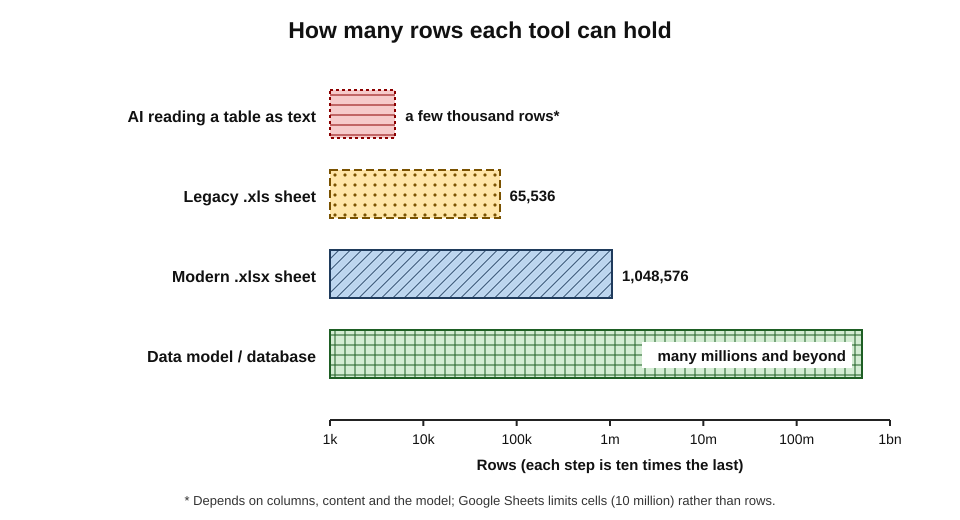
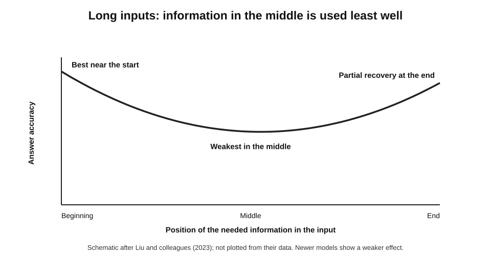
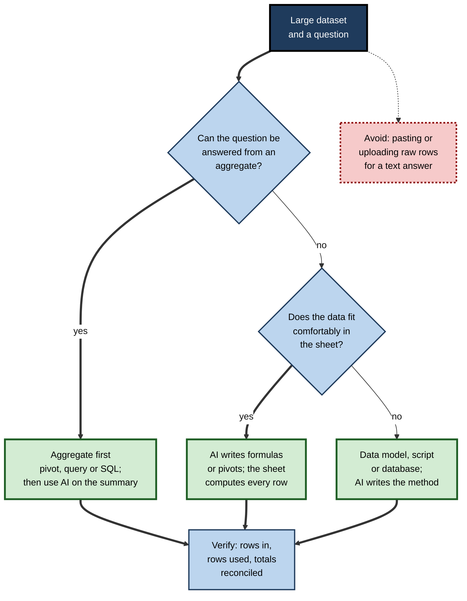
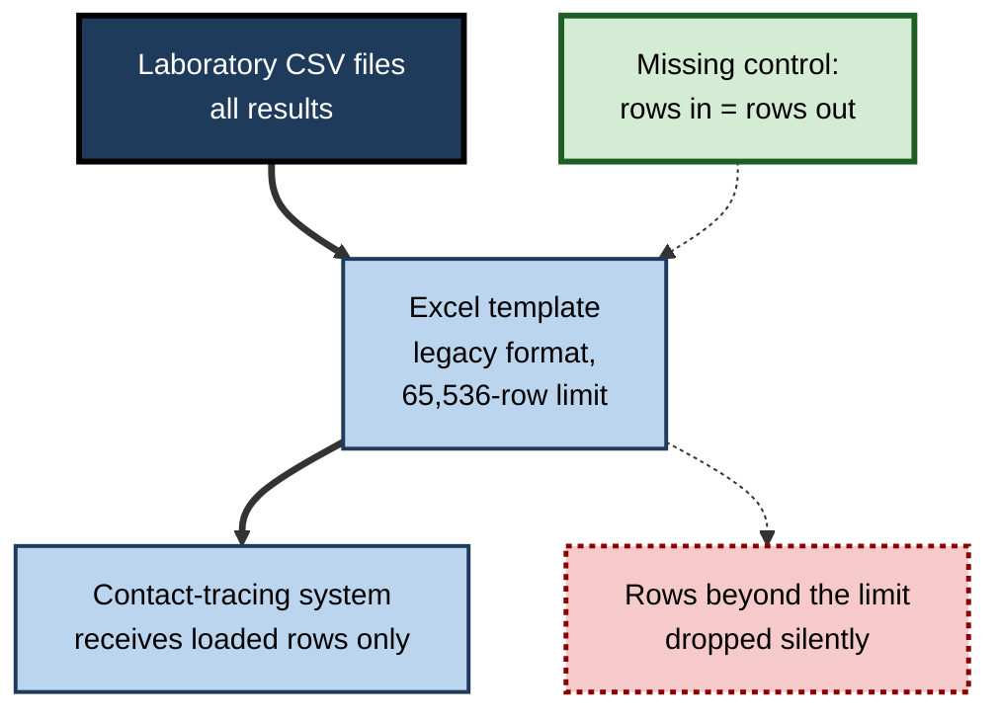
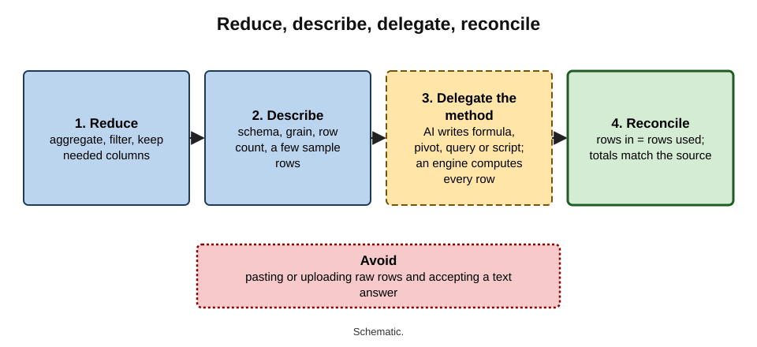

# E.9. Limits with large spreadsheets

A revenue analyst exports 600,000 card transactions and uploads the file to an AI assistant, asking for total spend per customer. The answer arrives as a neat table of the top twenty customers. It looks complete. In fact the assistant has worked from a portion of the file that fitted into what it could take in at once, and the customer at the top of the true ranking does not appear at all.

> **Definition — Large spreadsheet:** a workbook or data file big enough — in rows, columns, formulas or linked sources — that its size itself changes what tools can do with it reliably, whether by hitting hard limits, slowing calculation, or exceeding what an AI tool can read at once.

**Why it matters**

- **Size limits are often silent.** Data beyond a limit may be dropped, sampled or ignored without a clear warning to the reader of the result.
- **AI tools have their own, much smaller limits** than spreadsheets — on how much text a model can take in, how many cells an assistant will process and how many requests an account may make.
- **Errors at scale are hard to see.** No one can eyeball 600,000 rows; a missing tenth looks the same as a complete set.
- **Knowing the limits tells a professional when to change tools** — from the grid to a data model, a script, a database or a business-intelligence platform.

---

## The Hard Limits of the Grid

### Capacity of common formats

| Format or tool | Maximum rows | Maximum columns | Note |
|---|---|---|---|
| Legacy Excel file (.xls, before 2007) | 65,536 | 256 | Still produced by some older systems and templates |
| Modern Excel workbook (.xlsx) | 1,048,576 per sheet | 16,384 per sheet | Memory and performance limit usable size well before this |
| Google Sheets | Up to 10 million cells per spreadsheet | 18,278 | The cell limit binds first for wide tables |
| Excel data model (Power Pivot) | Many millions of rows | — | Compressed storage; analysed through pivot tables and measures |
| Database or data warehouse | Effectively unlimited for office purposes | — | Queried rather than displayed |

**Figure 1.** Capacity of common data tools, on a scale where each step is ten times the last.

> **Watch out:** when a CSV file with more rows than a sheet can hold is opened in a spreadsheet, the excess rows are not loaded. The application warns once, at opening; anyone who dismisses the warning, or later receives the saved file, sees only the truncated version — with no indication that data are missing.

### Practical limits long before the hard ones

- **Calculation time** — hundreds of thousands of lookups or array formulas can make every edit trigger seconds or minutes of recalculation.
- **Volatile functions** — `NOW`, `TODAY`, `OFFSET`, `INDIRECT`, `RAND` recalculate on every change, multiplying the cost.
- **Whole-column references** — `A:A` in thousands of formulas forces the application to consider a million rows each time.
- **File size and memory** — large files open slowly, crash older or 32-bit installations, and are hard to share or co-edit.
- **Human limits** — no reviewer can inspect what they cannot scroll through; structure and checks matter more as size grows.

> **Definition — Volatile function:** a spreadsheet function that recalculates whenever anything in the workbook changes, not only when its own inputs change.

---

## The Limits of AI Tools

### How much a model can read

> **Definition — Token:** the unit of text a language model processes — roughly a short word or a fragment of a word; numbers, dates and separators each take one or more tokens.

> **Definition — Context window:** the maximum amount of text, measured in tokens, that a model can take into account at once, including the request, any supplied data and its own reply.

- **Tables are expensive in tokens.** Every value, separator and header repeated in text form consumes tokens.
- **Context windows have grown enormously** — from a few thousand tokens in early chat assistants to hundreds of thousands or more in many current models — but even large windows hold only a fraction of a big spreadsheet.

> **Formula — Rough token estimate for a table:** rows × columns × tokens per cell. Example: 600,000 rows × 8 columns × about 3 tokens per cell ≈ **14 million tokens** — far beyond what any assistant reads at once. Even 20,000 rows × 8 columns ≈ 480,000 tokens.

> **Watch out:** tokens per cell vary with content — long text, many digits and dates use more. The estimate is for scale, not precision; its purpose is to show when a file **cannot** fit, which is most of the time for real business data.

### What tools do when data do not fit

- **Read only part** — the first rows, or as much as fits — sometimes without saying so.
- **Sample** — choose representative rows and generalise.
- **Summarise first** — build an internal summary and answer from it, losing detail.
- **Compute in code** — load the file into a sandbox and run calculations on all rows; this scales much further, within the sandbox's memory and time limits.
- **Work on the structure** — built-in assistants may read headers, types and a sample, then write formulas or pivot tables that the spreadsheet itself evaluates across all rows.

| Approach | Covers all rows? | What the model actually reads | Main risk |
|---|---|---|---|
| Paste table into chat | Only if it fits | All pasted text | Truncation, invented totals |
| Upload to chat, answered as text | Often not | Whatever fitted or was sampled | Partial answer presented as complete |
| Upload, computed in code | Yes, within sandbox limits | Code results, not raw rows | Wrong code or filter; memory limits |
| Built-in assistant writing formulas or pivots | Yes — the sheet computes | Headers, types, sample | Wrong field or aggregation chosen |
| Natural-language query on a data model | Yes — the model engine computes | Field names and definitions | Question mapped to the wrong measure |

> **Key point:** at scale, the safe pattern is for the AI to **write the method** — a formula, a pivot, a query, a script — and for a calculation engine to **apply it to every row**. A model reading rows as text does not scale.

### Usage limits and quotas

- **Per-request and per-period limits** apply to AI features in spreadsheets, and they change often.
  - *e.g.* as of 2026, Google's in-cell AI function in Sheets processes a limited batch of cells per generation (up to the first 350 selected cells) and carries monthly usage allowances that differ by plan; Microsoft's agent mode in Excel draws on a monthly allowance of AI credits for consumer plans.
- **Rate limits** — during its preview, Microsoft's in-cell `COPILOT` function was limited to a set number of calls per ten minutes and per hour.
- **Consequence:** a row-by-row AI operation over tens of thousands of rows may stop partway, leaving some rows processed and others blank or stale.

> **In practice:** before running any AI operation over many rows, count the rows it should touch, then count the rows that actually have output afterwards. The difference is the work that silently did not happen.

### Long inputs and attention

**Study card — Liu and colleagues (2023), "Lost in the Middle"**

- **Design:** language models were given long inputs containing many documents or key–value pairs, with the information needed to answer placed at different positions.
- **Results:** accuracy was highest when the relevant information was near the **beginning** or **end** of the input and fell markedly when it was in the **middle** — even for models designed for long inputs.
- **Conclusion:** a large context window does not guarantee that every part of the input is used equally well.
- **Status:** later models have reduced but not removed the effect; it remains a reason to distrust answers that depend on detail buried in a long input.

**Figure 2.** Accuracy by position of the relevant information in a long input.

### Complex workbooks, not just long ones

- **Size is also structure** — many sheets, cross-sheet references, named ranges and links.
- **Benchmarks show this is hard.** On SpreadsheetBench (2024), built from real help-forum questions, Microsoft reported in 2025 that its agent mode in Excel completed about 57% of tasks. On SpreadsheetBench 2 (2026), whose business workflows average nearly twelve worksheets and hundreds of cell changes each, the best system completed only about 35% of tasks end to end, and debugging tasks only about 12%.

> **Watch out:** benchmark scores are moving quickly, and vendors' own reported figures are not independent evaluations. The durable lesson is the **gap**: performance falls sharply as workbooks become larger and more interconnected.

---

## Strategies for Working at Scale

**Figure 3.** Choosing an approach for a large dataset.

### Reduce before you ask

- **Aggregate** — a pivot or query reduces 600,000 transactions to 9,000 customer totals or 12 monthly totals.
- **Filter** — only the period, region or product in question.
- **Select columns** — only those the question needs; drop free-text columns that consume tokens and may hold personal data.
- **Then ask** — an assistant summarising 12 monthly totals is working within its limits; one "reading" 600,000 rows is not.

### Give structure, not rows

- **Describe the schema** — column names, types, meanings, grain, row count — and a few sample rows.
- **Ask for the method** — "write a pivot table", "write a Power Query step", "write a Python script that groups by customer and sums Amount".
- **Run the method on the full data** in a tool built for it.

> **Example:** "Here are the column names and five sample rows of a 600,000-row transactions file. Write a script that totals Amount by Customer ID, excludes rows where Status is 'Reversed', prints the number of rows read and excluded, and outputs the top 50 customers."

### Move to the right tool

- **Power Query** — imports and reshapes large files repeatably, loading only what is needed.
- **The data model (Power Pivot)** — holds millions of rows in compressed form, analysed through pivot tables and measures.
- **Python in Excel** — Microsoft's integration (introduced in 2023) runs Python code in the cloud from a cell, useful for heavier analysis, within its own limits.
- **Databases and BI platforms** — for data that are shared, recurring, very large or governed.

### Chunk with reconciliation

- **When data must be processed in pieces** — by month, by region — each chunk's row count and totals are recorded, and the chunks' totals must add to the whole.

> **Remember:** **reduce, describe, delegate the method, reconcile.**

---

## Keeping Large Workbooks Fast and Sound

Before a workbook needs a new tool, it often needs better habits. Many "large spreadsheet" problems are problems of construction.

### Performance hygiene

- **Use tables and exact ranges** rather than whole-column references, so formulas consider only the rows that exist.
- **Replace volatile functions** — `INDIRECT` and `OFFSET` with `INDEX`; `TODAY` in one input cell rather than in thousands of formulas.
- **Use efficient lookups** — `XLOOKUP` or `INDEX`/`MATCH` on sorted keys, or a single helper column that computes a key once rather than in every formula.
- **Avoid repeated calculation** — compute an intermediate result once in a helper column and refer to it, rather than nesting the same sub-formula many times.
- **Prefer pivot tables and the data model** for summaries over thousands of `SUMIFS` formulas.
- **Save in an efficient format** — Excel's binary workbook format (.xlsb) opens and saves large files faster, though it suits some workflows less well.
- **Watch the calculation mode** — workbooks set to manual calculation for speed can be saved and shared showing out-of-date results.

> **Watch out:** a workbook left in **manual calculation** mode displays the results of its last calculation, not of its current inputs. AI assistants and people alike can read stale numbers from it without realising; recalculate fully before any figure is used.

### When AI asks to "optimise" a large workbook

- **Assistants can propose performance improvements** — replacing volatile functions, restructuring lookups, moving data into the model.
- **Every such change is a change to logic** and needs a regression check: key outputs must be identical before and after.

---

## When Sampling Is Acceptable

Sampling is not wrong in itself. Statisticians and auditors rely on it every day. What is wrong is **unstated, unplanned** sampling presented as a complete answer.

- **Acceptable when:**
  - the question is about proportions or typical values, not exact totals;
  - the sample is **random** (or stratified deliberately), not the first rows of a file;
  - the sample is large enough for the precision needed;
  - the result is labelled as an estimate, with its sample size.
- **Not acceptable when:**
  - the question needs exact totals — revenue, payroll, regulatory counts;
  - the answer concerns rare items — the largest customers, fraud, specific individuals;
  - the file is sorted, so the first rows are systematically different from the rest.

> **Definition — Random sample:** a subset in which every row has a known, usually equal, chance of selection, so that the sample represents the whole within a calculable margin of error.

> **Example:** the first 20,000 rows of a transactions file sorted by date are the earliest weeks of the year, not a sample of the year. A summary of "average transaction value" from them describes January, not the business.

| | Unplanned partial reading by an AI tool | Planned random sample |
|---|---|---|
| Which rows | Whatever fitted, usually the first | Chosen at random or by design |
| Represents the whole? | Unknown; often not | Yes, within a margin of error |
| Stated to the reader? | Often not | Yes, with the sample size |
| Suitable for exact totals? | No | No |
| Suitable for typical values and proportions? | Unreliable | Yes |

---

## Large Files, Many Hands

Size brings collaboration problems that AI can make worse or better.

- **Co-authoring limits** — very large files slow down or fail to sync when several people edit at once; people then work on copies, and the copies diverge.
- **Copies multiply the data** — every emailed or downloaded copy of a large extract is another uncontrolled store of what may be personal or confidential data.
- **AI requests on shared files** — an agent editing a large shared workbook may change areas others rely on; changes need to be visible and reviewable by the other users.
- **One source of truth** — for data that several people need, a governed source (a shared query, a data model, a database view) is better than many copies of a large sheet.

> **In practice:** when a team finds itself emailing a large spreadsheet "with this week's data", it is usually time to publish the data once — as a shared query or dataset — and let each person build their own view on it.

---

## Signs a Spreadsheet Has Outgrown Itself

- **Recalculation takes minutes**, or calculation is set to manual and forgotten.
- **Data are split across many sheets or files** to stay under limits — one per month, one per region.
- **The same data are pasted in every period** by hand.
- **Several people need to edit at once**, and copies multiply.
- **The file contains personal or sensitive data at scale** without access control.
- **Decisions of consequence depend on it** without testing or ownership.

> **In practice:** an organisation's most dangerous spreadsheets are often those that grew from a quick analysis into a production system — each step reasonable, the end state never designed. Size is frequently the first visible symptom.

---

## Worked Example (illustrative): Totals Per Customer

**Situation (illustrative figures):** a file of 600,000 transactions (8 columns) needs total spend per customer, excluding reversed transactions, for the top 50 customers.

**Step 1 — estimate whether it fits.** 600,000 × 8 × ~3 ≈ 14 million tokens. It does not fit in any assistant's context; a text answer would be partial.

**Step 2 — choose the approach.** The question is an aggregate. Options:

| Option | Covers all rows | Effort | Verdict |
|---|---|---|---|
| Upload and ask for a text answer | No | Lowest | Reject — partial and unverifiable |
| Upload to an assistant that runs code | Yes, if within its file and memory limits | Low | Acceptable for approved, non-sensitive data |
| Power Query and a pivot table, with AI writing the steps | Yes | Moderate | Preferred — repeatable inside the organisation |

**Step 3 — run and verify.**

- Rows loaded: 600,000 — matches the source system's export count.
- Rows excluded as reversed: 8,412.
- Sum of all customer totals: £41,276,330 — matches the source system's total for non-reversed transactions.
- Top customer: £612,400 — checked by filtering the raw data for that customer ID.

**Step 4 — ask AI to interpret the summary.** The 50-row result now fits easily; the assistant can describe concentration ("the top 50 customers account for 18% of spend") from data it can actually read.

- **Conclusion:** the AI's value moved from **reading** the data, which it could not do, to **writing the method** and **interpreting the result**, which it could. Every number was computed on all rows and reconciled.

---

## Case Study: The Lost Test Results

- **Situation:** in autumn 2020, during the COVID-19 pandemic, Public Health England (PHE) collected positive test results from commercial laboratories as CSV files and loaded them into Excel templates before passing them to the contact-tracing system.
- **What happened:**
  - the templates used the legacy .xls format, limited to **65,536 rows**;
  - each test result occupied several rows, so a file could hold only roughly 1,400 cases;
  - when daily volumes grew, rows beyond the limit were **silently left out**.
- **Discovery:** in early October 2020 it emerged that **15,841 positive cases** reported between 25 September and 2 October had not been passed on in time for contact tracing.
- **Response:** the missing cases were added to the figures; the process was changed to split files into smaller batches and then to replace the spreadsheet step altogether.
- **Lesson:** a hard limit of an old file format, in a step nobody regarded as critical, caused thousands of contacts of infected people to be traced late. The data were not wrong; they were **missing**, and nothing in the output said so. **Rows in must equal rows out** — and a check that compares them would have caught the loss on the first day.

**Figure 4.** How rows were lost in the pipeline from laboratory files to contact tracing.

---

## Professional Practice at Scale

- **Row counts at every hand-off** — exports, imports, merges, uploads, AI operations.
- **Control totals** — the sum of a key column checked against the source system.
- **Explicit statements of coverage** — "based on all 600,000 rows" or "based on a sample of 20,000 rows".
- **Ask AI tools what they read** — "How many rows did you process? Did you read the whole file?" — and verify the answer independently, since the reply is itself generated text.
- **Write coverage into every answer** — a habit of ending any AI-assisted result with a line such as "computed by query on all 600,000 rows; 8,412 reversed transactions excluded; totals reconciled to the source system" makes the scope of the result visible to every later reader.
- **Watch for "round" limits** — results that stop at exactly 1,000, 10,000 or 65,536 rows, or at a suspiciously tidy number of cells, often signal a tool limit rather than the true size of the data.
- **Escalate early** — when a recurring process approaches a limit, it is time to move it to a governed tool, not to split files further.

**Figure 5.** Reduce, describe, delegate and reconcile: the safe pattern for AI over large data.

---

## Open Questions

- **Will context windows make the problem disappear?**
  - Windows keep growing, but business data grow too, and evidence that models use long inputs evenly is mixed; computing on data, rather than reading it, is likely to remain the reliable route.
- **Can tools state their coverage reliably?**
  - Few assistants report clearly whether they read, sampled or truncated a file; making coverage visible is an open design problem.
- **How well do agents handle large, interlinked workbooks?**
  - Benchmarks show steep drops for multi-sheet tasks; how quickly this improves, and how to test it inside organisations, is uncertain.
- **Where should spreadsheets stop?**
  - Organisations still disagree on when an important spreadsheet must become a governed system.

---

## Summary

- A **large spreadsheet** is one whose size changes what tools can do reliably — through hard limits, slow calculation or AI reading limits.
- Hard limits: legacy **.xls 65,536 rows**; **.xlsx 1,048,576 rows × 16,384 columns** per sheet; **Google Sheets 10 million cells**; data models and databases go far beyond. Excess rows can be **dropped silently**.
- Practical limits: calculation time, **volatile functions**, whole-column references, file size, human review.
- AI limits: **tokens and context windows** (rows × columns × tokens per cell), sampling and truncation, usage quotas and rate limits, weaker use of the **middle** of long inputs, and falling accuracy on large interlinked workbooks.
- Safe pattern: **reduce, describe, delegate the method, reconcile** — AI writes formulas, pivots, queries or code; an engine computes every row; row counts and control totals confirm coverage.
- Know when to move to **Power Query, data models, Python, databases or BI tools**.
- The **PHE 2020** case: a legacy row limit silently dropped 15,841 positive cases — rows in must equal rows out.

---

## Self-Check

1. Define a large spreadsheet in functional terms.
2. State the row and column limits of legacy .xls, modern .xlsx and Google Sheets.
3. What happens when a CSV larger than the sheet limit is opened, and why is it dangerous?
4. Name three practical performance limits that arise before the hard limits.
5. Define token and context window, and estimate the tokens for 50,000 rows × 6 columns at about 3 tokens per cell.
6. List four things an AI tool may do when data do not fit, and their risks.
7. What did the "Lost in the Middle" study find, and what is its status?
8. What do spreadsheet benchmarks suggest about AI performance as workbooks grow more complex?
9. Explain "reduce, describe, delegate the method, reconcile".
10. Give five signs that a spreadsheet has outgrown its role.
11. In the worked example, why was a text answer rejected, and what verified the final result?
12. Summarise the PHE case and the single check that would have caught it.
13. A colleague plans to run an in-cell AI classification over 40,000 rows of customer comments. What risks and checks would you raise?

14. Give four performance-hygiene practices for a large workbook, and explain the risk of manual calculation mode.
15. When is a sample an acceptable basis for an answer, and why are the first rows of a file not a sample?

### Answer Key

1. A workbook or file whose size changes what tools can do reliably — by hitting hard limits, slowing calculation or exceeding what an AI tool can read at once.
2. .xls: 65,536 rows × 256 columns. .xlsx: 1,048,576 rows × 16,384 columns per sheet. Google Sheets: up to 10 million cells per spreadsheet, 18,278 columns.
3. Rows beyond the limit are not loaded; a warning appears once, then the saved or shared file contains only the truncated data with no sign of the loss.
4. Long recalculation from many lookups or arrays; volatile functions recalculating on every change; whole-column references; large file size and memory use.
5. Token: the unit of text a model processes. Context window: the maximum tokens a model can consider at once. 50,000 × 6 × 3 ≈ 900,000 tokens.
6. Read only part (partial answers), sample (unrepresentative results), summarise first (lost detail), compute in code (code or filter errors; sandbox limits); or work on structure (wrong field or aggregation).
7. Models used information at the beginning and end of long inputs better than in the middle. Later models reduced but did not remove the effect.
8. Performance falls sharply on large, multi-sheet workflows — about 57% on a forum-question benchmark for one vendor's agent (vendor-reported), about 35% at best on a harder multi-sheet benchmark in 2026.
9. Reduce the data (aggregate, filter, select columns); describe the structure rather than pasting rows; let AI write a method that a calculation engine applies to every row; reconcile row counts and totals.
10. Minutes-long recalculation; data split across many files to stay under limits; manual pasting each period; simultaneous editing needs; sensitive data at scale without access control; consequential use without testing.
11. 14 million tokens could not fit, so a text answer would be partial. Verified by matching rows loaded to the export count, excluded rows counted, the sum of customer totals reconciled to the source total, and the top customer checked against raw data.
12. Excel templates in the legacy .xls format dropped rows beyond 65,536, so 15,841 positive cases were not passed on for contact tracing in time. A check that rows in equal rows out at the template step.
13. Quotas and batch limits may stop partway; outputs may be inconsistent across rows and runs; results may change on recalculation; customer comments may contain personal data unsuitable for the tool. Checks: count rows with and without output; classify distinct values or a reviewed sample and apply by lookup where possible; spot-check a random sample; confirm the tool is approved for the data; freeze results as values with a record of the date and tool.
14. Tables and exact ranges instead of whole columns; replacing volatile functions; computing keys or intermediate results once in helper columns; pivots or the data model instead of thousands of conditional formulas; an efficient file format. In manual calculation mode, displayed results reflect the last calculation, so stale figures can be read and shared.
15. When the question concerns typical values or proportions, the sample is random or deliberately stratified, large enough, and labelled as an estimate. The first rows of a sorted file differ systematically from the rest (for example, the earliest dates), so they do not represent the whole.

---

## Glossary

| Term | Meaning |
|---|---|
| Chunking | Processing data in pieces whose counts and totals are reconciled to the whole. |
| Context window | The maximum number of tokens a model can consider at once. |
| Control total | A total from the source system used to confirm completeness. |
| Data model | Compressed in-workbook storage for large related tables, analysed with measures. |
| Large spreadsheet | A file whose size changes what tools can do with it reliably. |
| Manual calculation mode | A setting in which formulas recalculate only on request, so results can be stale. |
| Power Query | A tool that imports and reshapes data repeatably. |
| Python in Excel | An integration running Python code in the cloud from spreadsheet cells. |
| Random sample | A subset in which every row has a known chance of selection. |
| Rate limit | A cap on the number of requests allowed in a period. |
| Sampling | Using a subset of rows to represent the whole. |
| Token | The unit of text a language model processes. |
| Truncation | Silent loss of data beyond a limit. |
| Volatile function | A function that recalculates whenever anything in the workbook changes. |
