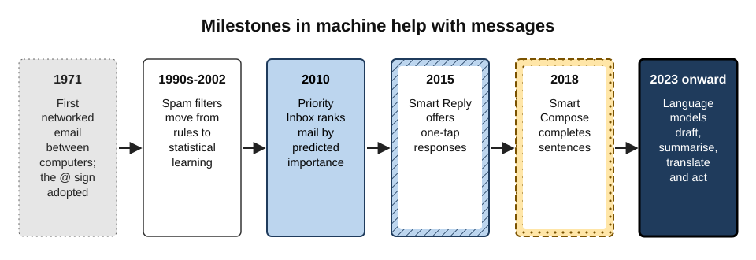
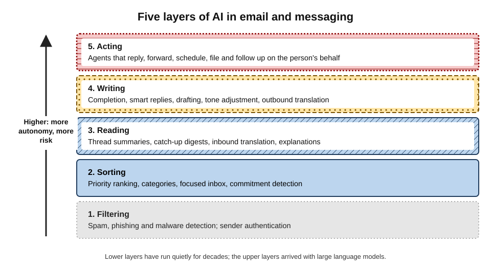
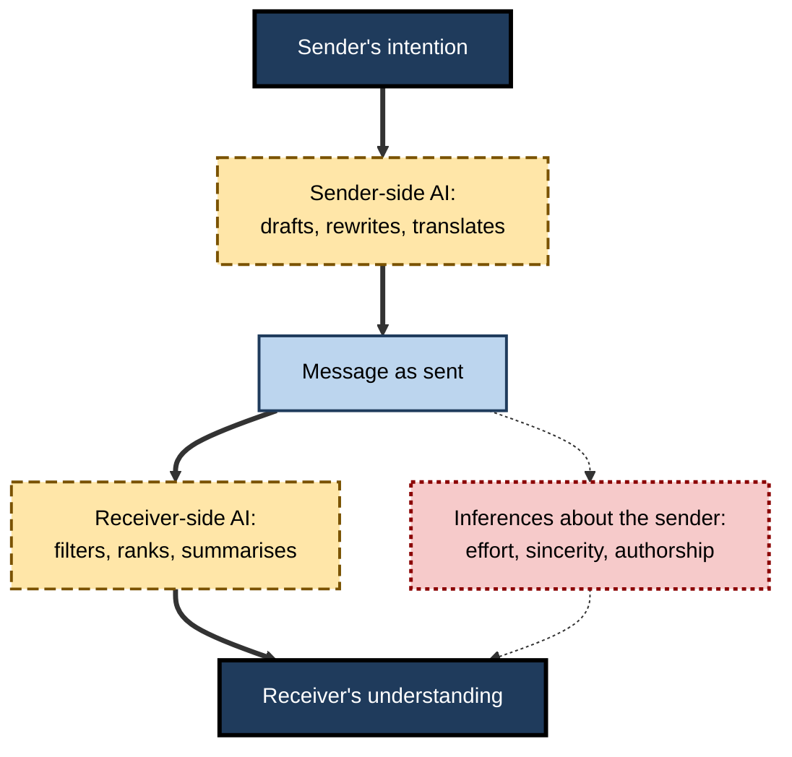
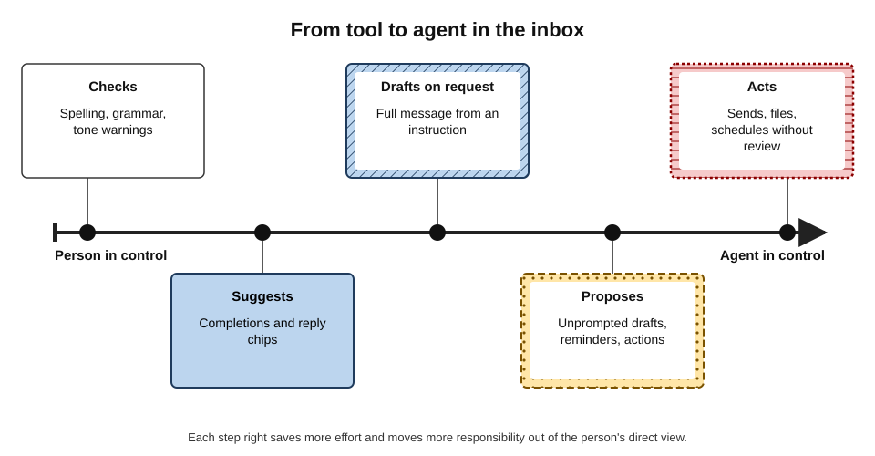
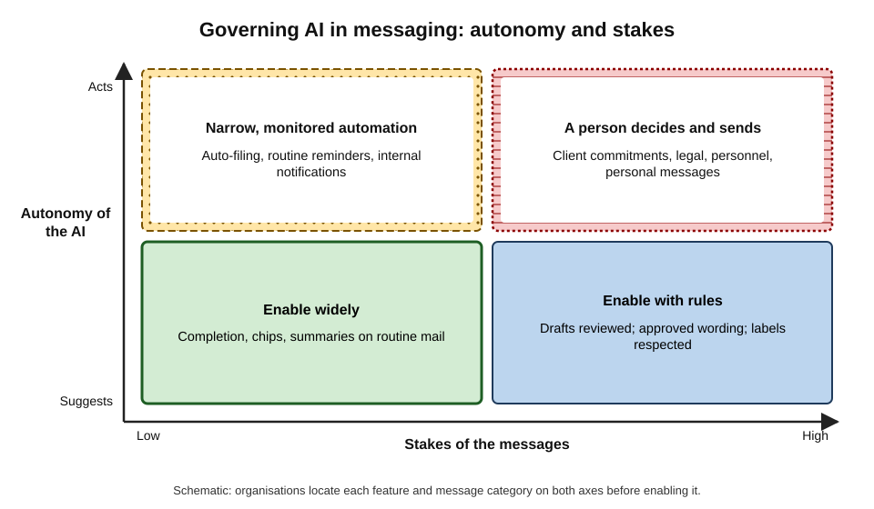
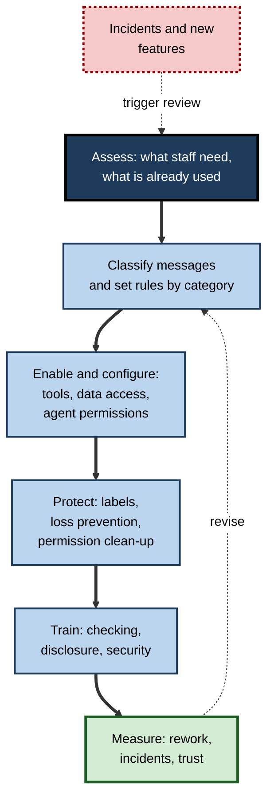

# F. AI in Email & Messaging

Every working day, billions of messages pass through a small number of mail and chat systems. Before a person sees any of them, software has already decided which are spam, which are dangerous and which matter most. As the person reads, the same software offers a summary; as they reply, it suggests words, whole drafts, a warmer tone or another language. Increasingly it can act on its own — filing, chasing, scheduling, answering. Email and messaging have become the place where most professionals meet artificial intelligence first and most often.

> **Definition — AI in email and messaging:** the use of machine-learning and generative AI systems inside mail, chat and messaging tools to filter, sort, read, write, translate and act on messages on behalf of the people who send and receive them.

> **Definition — AI-mediated communication (AI-MC):** interpersonal communication in which an intelligent agent operates on behalf of a communicator by modifying, augmenting or generating messages to accomplish communication goals — the definition proposed by Jeffrey Hancock, Mor Naaman and Karen Levy (2020).

**Why it matters**

- **Messages are where work is coordinated** — requests, commitments, decisions, relationships and records all run through them.
- **Volume exceeds attention.** Microsoft's 2025 Work Trend Index reported that the average worker received about 117 emails and 153 chat messages a working day and was interrupted about every two minutes during core hours.
- **The inbox is the main door for attacks** — phishing and fraud arrive by message, and AI has made them more convincing.
- **AI changes the relationship between sender and receiver** — what a message signals about effort, sincerity and authorship.
- **Organisations must govern it** — what tools may read, what they may write and what they may do without a person.

---

## From Filters to Agents

### A short history

- **1971 — networked email.** Ray Tomlinson sent messages between computers on the ARPANET and adopted the @ sign to separate user and host.
- **1978 — the first mass unsolicited message.** A marketing message from Digital Equipment Corporation was sent to a few hundred ARPANET users — later remembered as the first spam.
- **Late 1990s to early 2000s — learning filters.** Rule-based spam filters gave way to statistical ones; Paul Graham's essay "A Plan for Spam" (2002) popularised Bayesian filtering that learned from each user's own mail.
- **2010 — ranking.** Gmail's Priority Inbox learned from each person's behaviour which messages they were likely to read and answer; tabs (2013) and Outlook's Focused Inbox (2016) followed.
- **2015–2018 — suggesting words.** Smart Reply offered one-tap responses; Smart Compose completed sentences as people typed.
- **2023 onward — language models.** Mail and chat tools gained full drafting, thread summaries, tone rewriting, translation in context and, increasingly, agents that act.

**Figure 1.** Milestones in machine help with messages.

> **Key point:** AI did not arrive in the inbox in 2023. It has filtered and sorted mail for two decades; what is new is that it now **reads, writes and acts** in the person's name.

### Five layers of AI in messaging

**Figure 2.** Five layers of AI in email and messaging.

- **Filtering** — spam, phishing and malware detection; the oldest and least visible layer.
- **Sorting** — ranking, categorising and surfacing what matters; deciding where attention goes first is the subject of inbox triage and prioritisation.
- **Reading** — summaries, catch-up digests, inbound translation and explanations; condensing long threads is powerful and error-prone in specific, predictable ways.
- **Writing** — completion, smart replies, drafting, tone adjustment and outbound translation.
- **Acting** — agents that reply, forward, schedule, follow up and file.

| Layer | Typical feature | Main benefit | Main risk |
|---|---|---|---|
| Filtering | Spam and phishing detection | Safety, less noise | Legitimate mail lost; attackers adapt |
| Sorting | Priority ranking, focused inbox | Attention directed to what matters | Important but atypical mail hidden |
| Reading | Thread summaries, translation | Faster understanding | Omissions, stale positions, manipulation |
| Writing | Drafting, tone rewriting | Faster, clearer replies | Invented content, generic voice |
| Acting | Agents that send and schedule | Work done without effort | Errors reaching people unseen |

> **Remember:** each layer up adds **autonomy** — and moves more responsibility out of the person's direct sight.

---

## AI-Mediated Communication

### What changes when a machine stands between people

Communication theory once assumed two people and a channel. AI adds a third party that shapes the message — sometimes on both ends.

**Figure 3.** AI-mediated communication: where AI can stand between sender and receiver.

- **Sender-side AI** changes what is said — wording, tone, length, language, sometimes content.
- **Receiver-side AI** changes what is noticed and understood — whether the message is seen, how high it ranks, what its summary says.
- **Two AIs in one exchange.** A message drafted by one model may be summarised by another before a person reads it; neither person sees exactly what the other saw.
- **Inferences.** Receivers draw conclusions about senders from messages; AI changes the evidence those inferences rest on.

### What the research shows

**Study card — Hohenstein and Jung (2020), "AI as a moral crumple zone"**

- **Design:** pairs of people conversed using messaging with or without AI-suggested replies; some conversations were made to go badly.
- **Results:** when conversations went wrong, participants assigned part of the **blame to the AI**, and less to their human partner; when things went well, the AI received little credit.
- **Conclusion:** AI can absorb responsibility in failed interactions — a "moral crumple zone" — which can protect relationships but also blur accountability.

**Study card — Hohenstein and colleagues (2023), *Scientific Reports***

- **Design:** pairs discussed a policy issue by chat; smart replies were available to one, both or neither.
- **Results:** smart replies made conversations **faster** and more **positive**, and partners rated each other more warmly — but people who **believed** their partner used AI replies rated them as **less cooperative**.
- **Conclusion:** AI help improves the message; **suspected** AI help harms the relationship.

**Further consistent findings**

- **Suggestions shape content and views.** Predictive text makes writing more predictable (Arnold, Chauncey and Gajos, 2020); an opinionated writing assistant shifted both writing and stated opinions (Jakesch and colleagues, 2023).
- **Suggestions homogenise.** AI suggestions pulled Indian writers' style towards American conventions more than the reverse (Agarwal, Naaman and Vashistha, 2025).
- **Sincerity penalty.** Supervisors' relational messages written with heavy AI help were judged markedly less sincere (a 2025 study by researchers at the University of Florida and the University of Southern California).
- **Social evaluation penalty.** People known to use AI at work are judged lazier and less competent (Reif, Larrick and Soll, 2025).

> **Watch out:** most of this evidence comes from short laboratory or survey experiments. The direction is consistent; how large the effects are in years of real workplace correspondence — and how they change as AI use becomes normal — is not yet known.

---

## Help That Fails Silently

Across its uses, AI in messaging follows one pattern: it performs the routine part of a task quickly and fluently, and fails in a way that looks like success. The person must supply the judgement the system cannot see — the decision behind a reply, the turning point in a thread, the relationship behind a tone, the meaning behind a translated word.

| Function | What AI does well | How it fails silently | What the professional supplies |
|---|---|---|---|
| Composing replies | Turns a decided answer into clean words in seconds | Agreeable drafts with invented facts or promises | The decision, made before drafting |
| Condensing threads | Orients a reader returning to a long discussion | Reports the bulk, misses the reversal | Reading the latest message and the source of each decision |
| Adjusting tone | Removes heat from an angry draft | Softens criticism until the point disappears | A meaning lock on facts, impact and request |
| Translating | Makes cross-language mail routine | Fluent text hides wrong register, numbers or false friends | Checks of names, numbers and negations |
| Ranking and reminding | Directs attention; remembers commitments | Hides the atypical message; automates without context | A glance at the low-priority pile; human timing for people |
| Reusing text | Carries approved wording at scale | Carries outdated wording at scale | Owned, versioned, locked policy text |

- **Writing help** saves most time at the composing stage, but reviewing text one did not write adds work, and suggestion systems lean towards agreeable wording.
- **Reading help** saves the most catch-up time, but summaries can be manipulated by text hidden in the messages they read.
- **Organising help** — ranking, scheduling, follow-up — learns from what is typical, so the rare important case is the one most often mishandled.

> **Key point:** fluent output is not evidence of correct output. In messaging, the most dangerous AI errors are the ones that **read well**.

---

## Trust, Relationships and Authorship

### Impersonality

Messages whose value lies in attention — thanks, recognition, condolence, apology — lose much of that value when generated, because recipients use **perceived effort** as evidence of care (the "effort heuristic" of Kruger and colleagues, 2004). Specific detail is the most reliable sign that a person paid attention; generic polish is the most reliable sign that one did not.

### Disclosure

Whether to tell recipients that AI wrote or shaped a message turns on whether they **reasonably and materially assume** personal authorship. Routine mail rarely raises the question; references, expert opinions and personal messages do; automated agents must always identify themselves.

> **Definition — Disclosure dilemma:** the tension between the social penalty for admitting AI use and the larger penalty when undisclosed use is suspected or discovered; clear shared norms reduce both.

| Message kind | What the recipient values | Sensible AI role | Disclosure |
|---|---|---|---|
| Routine coordination | Speed, accuracy | Drafting, templates | Not expected |
| Client advice and deliverables | Accuracy, expert judgement | Drafting with expert review | Organisational statement; specific note where material |
| References and assessments | The writer's own knowledge | Proofreading only | Expected if AI shaped substance |
| Thanks, condolence, apology | Personal attention | None, or clarity checks | Better not to generate at all |
| Agent-sent replies | A correct answer and a route to a person | Automation within limits | Always identify as automated |

### Accountability

- **The sender owns the message.** Courts and regulators treat automated statements as the organisation's own — as a Canadian tribunal held in 2024 when an airline's chatbot misstated its bereavement-fare policy.
- **The moral crumple zone is not a defence.** Blaming "the AI" may soften a partner's judgement in the moment; it does not transfer professional or legal responsibility.

---

## Security: The Inbox as Attack Surface

Messages are the channel anyone in the world can write into. Generative AI has strengthened attackers in three ways.

- **Fluent, personalised phishing at scale.** In a 2024 study by Fred Heiding and colleagues, fully automated AI spear-phishing emails — built from public information about each volunteer — achieved click-through rates of about 54%, matching emails written by human experts and far above a generic control (about 12%).
- **Impersonation beyond text.** Business email compromise — impersonating executives or suppliers to divert payments — costs organisations billions of dollars a year; in 2024 an employee of the engineering firm Arup in Hong Kong was reported to have transferred about US$25 million after a video call with deepfaked colleagues.
- **Attacks on the assistant itself.** Hidden instructions in an email can try to make an AI summary mislead its reader (demonstrated against Gmail summaries in 2025) or, in the "EchoLeak" vulnerability in Microsoft 365 Copilot disclosed in June 2025, could have made an assistant gather and send out internal data with no click by the user.

> **Definition — Indirect prompt injection:** hiding instructions in content that an AI system will process, so that it follows the attacker rather than the user.

**Figure 4.** From a tool to an agent in the inbox.

- **The more an assistant can do, the more an attacker can make it do.** An assistant that only suggests can at worst mislead; one that sends, forwards and shares can be turned into an instrument of the attack.
- **Defences are layered:** authentication of senders, filtering, restricted agent permissions, labels and loss-prevention rules, and users who verify payment and credential requests by another channel.

> **Remember:** **urgent + secret + money or password = stop and verify by another channel** — however polished the message, and whatever an AI summary says about it.

---

## Confidentiality and Mistakes

### Where message content goes

- **AI features must read messages to help with them**, and the route matters: a built-in enterprise assistant under a negotiated contract, an add-in with full mailbox access, a browser extension and a consumer chatbot used on a phone may produce identical summaries under completely different terms.
- **Inboxes are full of other people's information** — clients' plans, colleagues' health, customers' personal data — so the question is never only whether the user minds.
- **Privacy and data protection** apply across all AI tools; in messaging they arise on every click.

### When messages reach the wrong people

Misdirected email has long been among the commonest causes of reported personal-data breaches. AI adds new routes — an assistant drafting a client reply that draws on internal documents, an unchecked summary forwarded outside, an agent sending without review — to the old ones of autocomplete, reply-all and forwarded history.

| Risk | Classic form | AI-era form | Key safeguard |
|---|---|---|---|
| Disclosure | Wrong recipient chosen by autocomplete | Draft includes content from other contexts | Scope the assistant to the thread; read for what should not be there |
| Leakage | Forwarding to personal accounts | Pasting into consumer AI tools | Approved enterprise route; labels; loss prevention |
| Manipulation | Phishing link | Hidden instructions to the assistant | Restrict actions; distrust outputs urging action |
| Wrong content | Typo in a figure | Invented figure or commitment | Decide first; check numbers and promises |
| Volume errors | Visible recipients in bulk mail | Agent sequences sent to everyone | Tested bulk tools; human approval for external sending |

> **Key point:** most AI-related incidents in messaging are not exotic: they are **old mistakes made faster and more completely**, plus a few genuinely new ones in which the assistant itself is the weak point.

---

## Governing AI in Messaging

Organisations decide, explicitly or by default, what AI in their mail and chat systems may do.

**Figure 5.** Governing AI in messaging by autonomy and stakes.

### The elements of a sound policy

- **Approved tools** — an enterprise assistant that meets real needs, so that staff do not turn to unapproved ones (**shadow AI**).
- **Configuration** — which features are on, for whom, and what data they may reach; permissions cleaned up before search-wide assistants are enabled.
- **Message categories** — routine, client, legal, personnel, personal — each with rules for AI drafting, review and disclosure.
- **Agent permissions** — what assistants may do without approval (file, remind) and what they may never do alone (send externally, forward, share, delete).
- **Protection** — sensitivity labels, data-loss prevention, external-recipient warnings, restricted distribution lists.
- **Records** — retention and discovery treatment of prompts, outputs and agent actions.
- **Norms** — response-time expectations, quiet hours and send-later defaults, so that faster tools do not produce an always-on culture.
- **Training** — checking, not only prompting; real examples of failures.
- **Measurement** — rework, misdirected messages, complaints and perceived trust, not only time saved.

**Figure 6.** A cycle for governing AI features in messaging.

### Case study (illustrative): rolling out an inbox assistant

- **Situation:** a 4,000-person engineering and consulting firm planned to enable an AI assistant across mail and chat.
- **Approach:**
  1. **Assessment** found heavy unapproved use of consumer chatbots for summarising client threads and drafting replies.
  2. **Classification:** four message categories with rules — routine (AI drafting allowed), client (drafting allowed, human review, no external sending by agents), legal and personnel (no AI processing without approval), personal and relational (no AI drafting).
  3. **Permissions clean-up:** three months reviewing shared sites revealed salary and bid files open to the whole firm, which were restricted before launch.
  4. **Agents:** allowed to file, label and remind; not to send outside the firm.
  5. **Training** used real incidents — a misdirected draft, a manipulated summary, a generated condolence note.
  6. **Measures:** time saved, rework, misdirected messages, client feedback, staff survey of after-hours pressure.
- **Result after a year:** consumer-chatbot use for client content fell sharply; reported time savings were real but smaller than vendor estimates once checking was counted; message volume rose by about a tenth, prompting new team norms on acknowledgements and copies.
- **Lesson:** the benefits arrived mostly where AI handled **routine** work under **clear rules**; the costs appeared where speed changed **behaviour** — volume, expectations and habits.

---

## Professional Mastery

### What experts do differently

- **They decide before they delegate.** The answer, the condition, the decision come first; the tool supplies words.
- **They scale help to stakes.** One-tap replies for the trivial; templates for the regulated; personal writing for the relational.
- **They read for absence as well as error.** What should not be in this draft? What is missing from this summary?
- **They keep the source within reach.** Summaries orient; originals decide.
- **They treat the inbox as hostile territory.** Polished messages and AI summaries prove nothing about legitimacy.
- **They protect other people's information** — choosing approved routes and the minimum necessary data.
- **They guard relationships.** Specific, personal messages where attention matters; honest disclosure where authorship matters.
- **They manage habits, not only messages.** Batching, send-later and fewer, better messages keep speed from becoming an always-on culture.
- **They keep their own skills alive** by writing the important messages themselves.

> **Mnemonic — "DRAFTS":** **D**ecide first; **R**ead sources for action; **A**pproved routes only; **F**ewer, better messages; **T**rust nothing urgent without verifying; **S**pecific and personal where it matters.

### Worked example (illustrative): one morning, every layer

- **Situation:** an account manager starts the day with 140 new messages.

| Time | Layer | What the AI does | What the person does |
|---|---|---|---|
| 08:45 | Filtering | Moves 22 messages to spam; flags one as suspected phishing | Reports the phishing message |
| 08:50 | Sorting | Ranks 30 as priority; digest lists 6 actions | Reads all VIP messages; scans the rest |
| 09:05 | Reading | Summarises a 40-message client thread | Reads the latest message; traces the one decision |
| 09:15 | Writing | Drafts three replies | Decides each answer first; checks numbers and promises |
| 09:30 | Translation | Translates a supplier's message from German | Checks the date and a possible false friend |
| 09:40 | Acting | Proposes reminders for two commitments | Accepts one, rewrites one with a real date |

*Illustrative scenario.*

- **Conclusion:** at every layer the AI saved time, and at every layer one human judgement — report, trace, decide, check, rewrite — prevented the characteristic failure.

---

## Open Questions

- **What happens when AI writes to AI?**
  - If both sides of a correspondence are drafted and summarised by models, the meaning people intend and receive may drift in ways neither sees; there is little research yet on such "machine-to-machine" exchanges between people.
- **Will the trust penalties for AI use fade?**
  - As AI becomes normal, recipients may assume it; personal messages may become either less valued or more.
- **Can prompt injection be contained?**
  - Assistants that read untrusted mail and can act remain vulnerable in principle; how much autonomy is safe is unresolved.
- **Does AI reduce or increase the burden of messaging?**
  - Per-message savings are clear; effects on total volume, expectations and well-being are uncertain.
- **How should law treat agents that correspond on people's behalf?**
  - Transparency duties for AI systems are new, and responsibility for agents' errors is only beginning to be tested.
- **What happens to writing skill?**
  - If professionals rarely draft their own messages, the ability to judge drafts may erode; evidence from education suggests the risk is real, but workplace evidence is thin.

---

## Summary

- **AI in email and messaging** filters, sorts, reads, writes and increasingly **acts** on messages; it has filtered and ranked mail for decades, and since 2023 it drafts, summarises, translates and acts through language models.
- **AI-mediated communication** places a machine between sender and receiver, sometimes on both sides; it changes what is said, what is noticed and what recipients infer.
- Evidence: AI help makes conversations faster and more positive but **suspected** AI use lowers perceived cooperation; AI absorbs blame as a **moral crumple zone**; suggestions shape and **homogenise** writing; heavy AI use in relational messages lowers perceived **sincerity**.
- Each use has a **characteristic silent failure**: invented commitments in drafts; stale positions in summaries; over-softening in tone tools; false certainty in translation; hidden important mail in ranking; context-blind automation in scheduling; frozen policy in templates.
- Relationships require **specific, personal** messages where attention matters, and **disclosure** where recipients materially assume personal authorship; agents must identify themselves; senders remain accountable.
- The inbox is an **attack surface**: AI-written spear phishing matched human experts; deepfakes extend impersonation; **indirect prompt injection** targets assistants themselves (EchoLeak, 2025).
- **Confidentiality** depends on the AI data route; misdirection has new AI routes added to old ones.
- **Governance** places features on two axes — autonomy and stakes — and combines approved tools, configuration, message categories, agent permissions, protection, records, norms, training and measurement.
- Mastery: **DRAFTS** — decide first, read sources for action, approved routes only, fewer and better messages, trust nothing urgent without verifying, specific and personal where it matters.

---

## Self-Check

1. Define AI-mediated communication and explain how it differs from ordinary computer-mediated communication.
2. Name the five layers of AI in messaging and give an example and a risk for each.
3. Outline the history of machine help with messages from 1971 to the present.
4. What is a "moral crumple zone", and what did Hohenstein and Jung find?
5. Summarise the paradox found by Hohenstein and colleagues (2023).
6. Give the characteristic silent failure of AI in drafting, summarising, translation and prioritisation.
7. Why do personal messages lose value when generated, and when is disclosure of AI use expected?
8. Describe three ways generative AI has strengthened attacks through the inbox.
9. Why does giving an assistant more autonomy increase security risk?
10. Explain why the "AI data route" matters for confidentiality.
11. List six elements of an organisational policy for AI in messaging.
12. Using the autonomy–stakes matrix, place: auto-filing newsletters; drafting client replies for review; an agent sending contract confirmations; reply chips on internal chat.
13. What does DRAFTS stand for?
14. A firm plans to let AI agents handle all routine correspondence end to end. Evaluate the plan across productivity, relationships, security, confidentiality and well-being.

### Answer Key

1. Interpersonal communication in which an intelligent agent modifies, augments or generates messages on a communicator's behalf (Hancock, Naaman and Levy, 2020). Ordinary computer-mediated communication only transmits messages; AI-MC changes their content, noticing and interpretation.
2. Filtering (spam detection; legitimate mail lost); sorting (priority ranking; atypical important mail hidden); reading (thread summaries; omissions and manipulation); writing (drafting; invented content); acting (agents sending; errors unseen).
3. 1971 networked email (Tomlinson, @); 1978 first mass unsolicited message; late 1990s–2002 statistical spam filtering; 2010 Priority Inbox, then tabs and Focused Inbox; 2015 Smart Reply; 2018 Smart Compose; 2023 onward language-model drafting, summarising, translating and agents.
4. The tendency for AI to absorb blame when AI-mediated interactions go wrong; participants blamed the AI partly and their human partner less, while giving the AI little credit for success.
5. Smart replies made conversations faster and more positive and improved partner ratings, but people who believed their partner used AI replies rated them as less cooperative.
6. Drafting: fluent invented facts and commitments. Summarising: stale positions and omissions. Translation: false certainty from false friends, wrong register. Prioritisation: hidden false negatives from new senders.
7. Recipients judge care by perceived effort and specific attention; generated text signals low effort. Disclosure is expected where recipients reasonably and materially assume personal authorship (references, expert opinions, personal messages) and always for automated agents.
8. Fluent, personalised spear phishing at scale (about 54% click-through in one study); deepfake voice and video impersonation (Arup, 2024); indirect prompt injection against assistants (Gmail summaries, EchoLeak).
9. An attacker who can instruct the assistant through content can make it do whatever it is allowed to do; suggesting tools can only mislead, acting tools can send, share or leak.
10. The route decides who processes message content, under what terms, retention and training use; identical-looking features can have completely different confidentiality.
11. Approved tools; configuration and permission clean-up; message categories with rules; agent permissions; labels and loss prevention; records; norms on response times; training; measurement.
12. Auto-filing newsletters: narrow monitored automation (acts, low stakes). Drafting client replies for review: enable with rules (suggests, high stakes). Agent sending contract confirmations: a person decides and sends (acts, high stakes). Reply chips on internal chat: enable widely (suggests, low stakes).
13. Decide first; Read sources for action; Approved routes only; Fewer, better messages; Trust nothing urgent without verifying; Specific and personal where it matters.
14. Productivity: gains on genuinely routine mail, but errors at scale and checking costs. Relationships: generic, unreviewed messages and disclosure duties; agents must identify themselves. Security: agents that act are targets for prompt injection and can be hijacked. Confidentiality: broad context access risks disclosure across clients. Well-being: agents running at all hours sustain always-on expectations. Better: agents draft, people approve external and high-stakes messages; automation limited to narrow categories with monitoring.

---

## Glossary

| Term | Meaning |
|---|---|
| Agent | An AI system that takes actions, such as sending or scheduling, on a person's behalf. |
| AI data route | The path message content takes when an AI feature processes it. |
| AI-mediated communication | Communication in which an AI modifies, augments or generates messages for a communicator. |
| Business email compromise | Fraud impersonating executives, suppliers or colleagues by email to obtain payments or data. |
| Disclosure dilemma | Tension between penalties for disclosing AI use and for concealing it. |
| Effort heuristic | Using perceived effort as a cue to quality and value. |
| Homogenisation | Convergence of writing towards a common style under AI suggestions. |
| Indirect prompt injection | Hidden instructions in content that hijack an AI system processing it. |
| Moral crumple zone | The tendency for AI to absorb blame when mediated interactions fail. |
| Priority Inbox | Gmail's 2010 feature ranking mail by predicted importance. |
| Shadow AI | Use of AI tools at work without organisational approval. |
| Smart Compose | Gmail's sentence-completion feature, introduced in 2018. |
| Smart Reply | One-tap suggested replies, introduced by Google in 2015. |
| Spam | Unsolicited bulk messages. |
| Spear phishing | A fraudulent message tailored to a specific person. |
