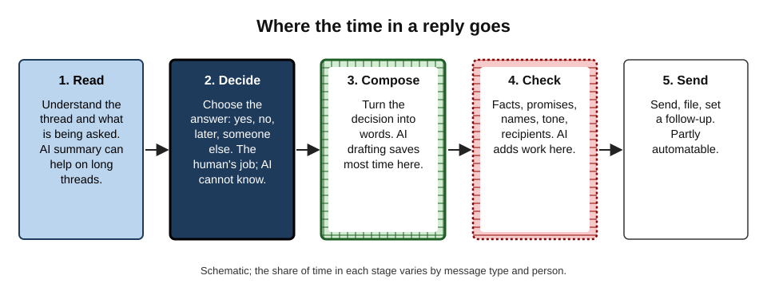
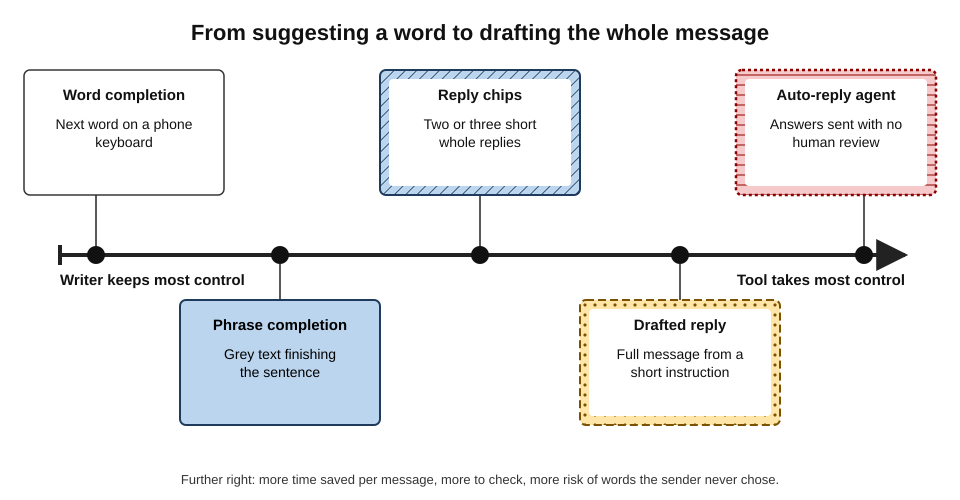
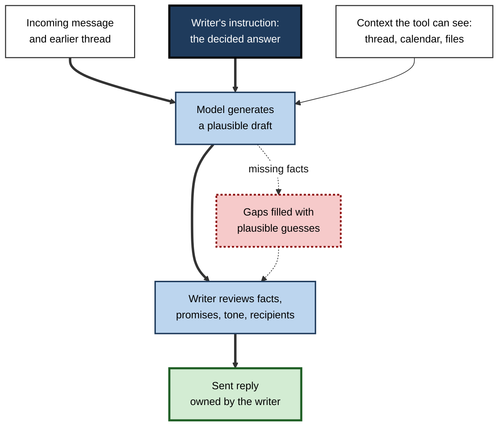
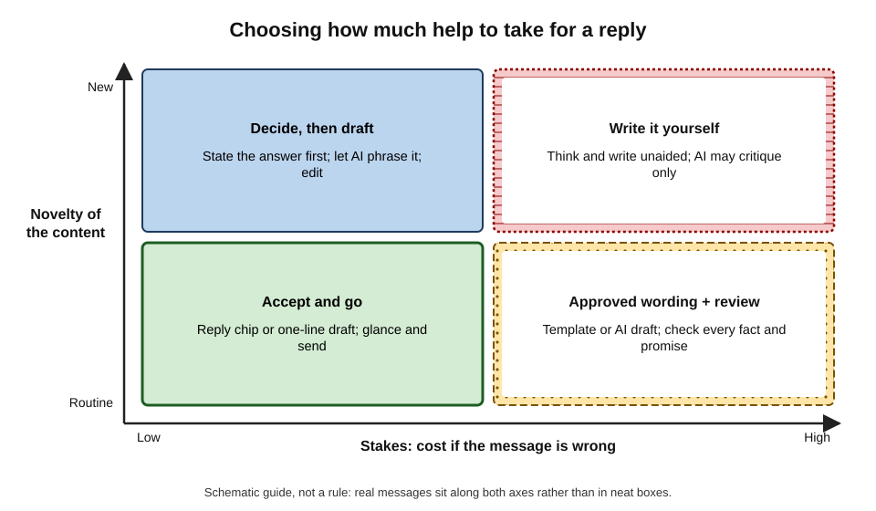
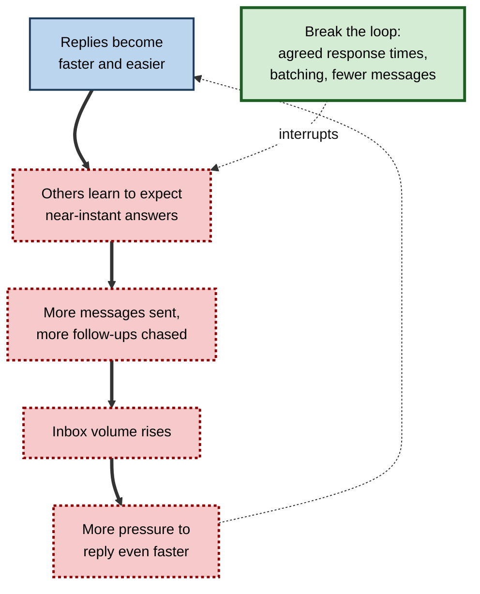

# F.1. Drafting and replying faster

A consultant opens her laptop to forty-three unread emails. Under each one her mail client offers one-tap replies — "Sounds good!", "Thanks, will do." — and a "Draft a reply" button that writes a polite answer in two seconds. Within half an hour she has answered thirty messages; two committed her team to dates nobody had agreed, and one thanked a client for a document he never sent. Replying faster is easy; replying faster **without losing accuracy, judgement or the relationship** is a skill.

> **Definition — AI reply assistance:** features built into email and messaging tools that propose some or all of the words of a reply — completing words and phrases, offering one-tap replies, or drafting a full message from the conversation — for the person to accept, edit or reject before sending.

**Why it matters**

- **Volume.** Microsoft's 2025 Work Trend Index, drawing on Microsoft 365 usage signals, reported that the average worker received about 117 emails and 153 chat messages a working day, most skimmed in under a minute. Small savings per reply add up.
- **Speed is part of service.** Clients, colleagues and managers judge reliability partly by how quickly a reply arrives.
- **Each reply is a commitment.** A faster reply that promises the wrong thing costs more than the minutes it saved.
- **The features are already switched on.** Reply suggestions are built into the main mail and chat products; the question is not whether to meet them but how to use them well.

---

## What Takes the Time in a Reply

A reply is not one task but a short chain. Speed comes from knowing which link is slow.

### The five stages of a reply

- **Read** — understand the message, the thread behind it and what is actually being asked.
  - Long threads with several voices are the slowest to read.
- **Decide** — choose the substance of the answer.
  - Yes, no, not yet, here is the information, someone else should answer.
  - This is a **judgement**; it depends on facts, priorities and relationships the tool cannot see.
- **Compose** — turn the decision into words of the right length and tone.
- **Check** — confirm names, numbers, dates, promises, attachments and recipients.
- **Send and track** — send, file, and set a reminder if an answer is expected back.

**Figure 1.** The stages of a reply and where AI assistance helps or adds work.

> **Key point:** AI tools mostly accelerate **composing**. They do not make the **decision**, and they add work at **checking**, because text the sender did not write must be read as carefully as someone else's text.

### Why composing feels slow

- **Blank-page friction** — starting is the hardest part; any first draft lowers the barrier.
- **Tone anxiety** — messages to senior people, clients or unhappy colleagues invite repeated rewording.
- **Second-language writing** — writers working in a second language spend extra effort on grammar and idiom.
- **Small screens** — typing on a phone is slow, so short suggested replies save proportionally more time.

> **Example:** declining a meeting politely takes many people several minutes of rewording; the decision itself ("I cannot attend; please send notes") took two seconds.

---

## Kinds of Reply Assistance

Reply assistance comes in sizes, from a single predicted word to a complete message. The larger the unit, the more time saved and the more there is to check.

> **Definition — Smart reply:** a set of short, complete reply options (typically two or three) generated for an incoming message and offered as buttons, so a reply can be sent with one tap.

> **Definition — Predictive completion:** in-line suggestions that finish the word or sentence being typed, accepted with a key press; Gmail's version is called Smart Compose.

> **Definition — Drafted reply:** a full message generated by a language model from the thread and a short instruction ("decline politely, offer Thursday"), placed in the compose window for editing.

### A short history

- **2015 — one-tap replies.** Google introduced Smart Reply in its Inbox app, offering short responses to mobile emails; it later came to Gmail and to messaging apps.
- **2018 — sentence completion.** Gmail's Smart Compose began suggesting the rest of a sentence as grey text while the person typed.
- **2023 onward — whole drafts from large language models.** Mail and chat tools added "help me write", "draft with Copilot" and similar commands that write or rewrite entire messages using the thread as context.
- **2024 onward — suggestions in every channel.** Phone operating systems and workplace chat tools began offering reply suggestions and drafts in messages as well as email.

**Study card — Kannan and colleagues (2016), Smart Reply at Google**

- **Design:** an engineering paper describing how Smart Reply chose its suggestions.
  - A neural network read the incoming email and scored possible responses.
  - Responses were drawn from a **fixed, curated set** of short replies, grouped by intent so that the three options shown were different in meaning ("yes", "no", "let me check"), not three ways of saying yes.
- **Results:** the system generated about **10% of replies** sent from Inbox on mobile in the period studied.
- **Conclusion:** short, constrained suggestions can carry a real share of everyday replies — precisely because most replies are short and routine.

> **Watch out:** a curated set of short replies is safe partly because it is **limited**. A large language model drafting freely can say anything, including things that are false.

**Figure 2.** Reply assistance arranged by the size of the suggestion.

### Comparing the forms

| | Predictive completion | Smart reply chips | Drafted reply | Automatic reply agent |
|---|---|---|---|---|
| Unit suggested | Word or sentence ending | Whole short reply | Whole message | Whole message, sent |
| Who triggers it | Appears while typing | Appears on opening | Writer asks | Rule or agent, often unattended |
| Typical saving | Seconds per message | Most of a short reply | Minutes on long replies | All composing time |
| What must be checked | Each accepted phrase | Meaning and tone of the chip | Every fact, promise and name | Everything, after the fact |
| Main risk | Predictable, generic wording | Over-brief or over-positive replies | Invented facts and commitments | Errors reaching people unseen |

> **Remember:** the bigger the suggestion, the **more** reading is needed before sending — not less.

---

## How Drafting Features Work

Knowing the mechanism explains most failures.

### What the model sees

- **The current message** and usually some or all of the earlier thread.
- **The instruction**, if any ("say yes but ask for the agenda").
- **Sometimes more context**: the sender's past emails, calendar, files or a "personal style" setting, depending on the product and the organisation's settings.
- **Never** the facts that live only in the writer's head — what the manager said in the corridor, the real deadline, the budget that is not yet approved.

> **Definition — Grounding:** tying generated text to specific, supplied source material (the thread, a document, a calendar), so that its claims can be traced and checked.

### What the model does

- It predicts a **plausible** reply given that context.
- Where a fact is missing, plausibility fills the gap: a date, a thank-you for an attachment, an agreement.
- It tends towards **politeness and positivity**: suggestions are trained on, and filtered towards, agreeable replies.

**Figure 3.** How a drafted reply is produced and where a person must intervene.

> **Key point:** the instruction is where the writer's decision enters. A draft requested with **no** instruction is the model's guess at what the writer wants to say.

---

## Decide First, Then Draft

The single most effective habit with reply tools is to **make the decision before asking for words**.

### The common reply types

- **Acknowledge** — "received, will respond by Friday".
- **Answer** — supply the information requested.
- **Agree or approve** — commit to something.
- **Decline or push back** — say no, not yet, or not like this.
- **Defer** — buy time, with a date.
- **Redirect** — hand to the right person, with context.
- **Ask** — request missing information before answering.

> **Mnemonic — "AAA-DDRA":** Acknowledge, Answer, Agree, Decline, Defer, Redirect, Ask — choose one (or a combination) before touching the draft button.

### Matching help to the reply type

| Reply type | Decision difficulty | Composing difficulty | Best use of AI |
|---|---|---|---|
| Acknowledge | Trivial | Trivial | Chip or completion |
| Answer (simple fact) | Low | Low | Chip, or type it; check the fact |
| Agree or approve | Medium to high | Low | Decide unaided; let AI phrase |
| Decline or push back | High | High (tone) | Decide unaided; AI draft, heavy edit |
| Defer | Low | Medium | Short AI draft with a real date |
| Redirect | Low | Medium | AI draft of the hand-over context |
| Ask | Medium | Low | Type the precise question |

### Instructions that carry the decision

- **Weak instruction:** "reply to this".
- **Better:** "decline the Thursday slot".
- **Strong:** "decline Thursday because of the board meeting; offer Monday 10.00 or Tuesday 15.00; keep it to three lines; no apology beyond one sentence".

> **In practice:** many experienced users type the answer as a rough note — "no thurs, board mtg; mon 10 or tue 3; short" — and let the tool turn it into a clean message. The thinking is theirs; only the phrasing is delegated.

### Worked example (illustrative): a supplier asks to move a deadline

- **Situation:** a supplier writes, at length, asking to move a delivery from the 12th to the 19th because of a staff shortage, and asks whether partial delivery on the 12th would help.
- **Approach A — "Draft a reply" with no instruction:**
  1. The draft thanks the supplier, says the team "understands completely", agrees to the 19th and welcomes partial delivery.
  2. The writer skims it, finds it polite, sends it.
  3. Problem: the project needed at least half the goods by the 12th; agreeing outright moved the project's own deadline.
- **Approach B — decide, instruct, review:**
  1. Decision (90 seconds, checking the project plan): accept the 19th **only if** at least half arrives by the 12th.
  2. Instruction: "Agree to 19th on condition at least 50% of units arrive by 12th; ask them to confirm by Wednesday; friendly, brief."
  3. Review (40 seconds): checks dates, the 50% figure, the supplier's name.
  4. Sends.

| | Approach A | Approach B |
|---|---|---|
| Time to send | About 1 minute | About 3 minutes |
| Decision made by | The model, implicitly | The writer |
| Outcome | Project deadline at risk | Constraint protected; clear request |
| Rework later | Likely an awkward retraction | None expected |

*Illustrative figures.*

- **Conclusion:** Approach B is slower per message and much faster per **outcome**.

> **Watch out:** "the draft looked fine" is the commonest explanation for a bad AI-assisted reply. A fluent message feels checked even when nobody checked it.

---

## Choosing How Much Help to Take

Two questions decide how much assistance is sensible: **how costly is an error**, and **how routine is the content**?

**Figure 4.** Choosing how much AI help to take for a reply, by stakes and novelty.

- **Routine, low stakes** — meeting confirmations, "thanks, received", quick factual answers to colleagues.
  - Chips and completions are ideal; a glance is enough.
- **Routine, high stakes** — standard client notices, contractual confirmations, regulated wording.
  - Approved templates beat free drafting; any AI draft is checked line by line.
- **Novel, low stakes** — a new kind of internal request, an unusual but harmless question.
  - Decide the answer, then let AI phrase it.
- **Novel, high stakes** — a complaint escalation, a negotiation move, bad news to a key client, anything personal.
  - Think and write without generation; at most ask the tool to **critique** the finished draft.

> **Definition — Critique mode:** asking an AI tool to comment on a message the person has written — clarity, tone, missing points — rather than to write it. The writer keeps authorship and the tool cannot insert unseen claims.

---

## What the Evidence Shows

Research on AI reply assistance has measured speed, the words people end up using, and how recipients react.

### Speed and sentiment

**Study card — Hohenstein and colleagues (2023), *Scientific Reports***

- **Design:** pairs of people chatted online about a policy question; in some pairs, one or both could use smart replies generated by a commercial-style system.
- **Results:**
  - smart replies made conversations **faster** (more messages per minute) and **more positive** in emotional tone;
  - partners rated each other as closer and more cooperative when smart replies were actually used;
  - but when a person **believed** their partner was relying on AI replies, they rated that partner as **less** cooperative and felt less affiliation.
- **Conclusion:** the suggestions themselves helped the interaction; **suspected** AI use hurt it.

> **Key point:** reply assistance has two kinds of effect — on the **message** (faster, more positive) and on the **relationship**, through what the recipient infers about the sender.

### The words people end up with

**Study card — Arnold, Chauncey and Gajos (2020), predictive text**

- **Design:** people wrote image captions with and without word-by-word predictive suggestions.
- **Results:** with suggestions, captions were **shorter and more predictable** — they used fewer unusual words that the system would not have predicted.
- **Conclusion:** suggestions do not only save keystrokes; they **pull writing towards what the system expects**.

**Study card — Jakesch and colleagues (2023), "co-writing with opinionated language models"**

- **Design:** participants wrote short arguments on whether social media is good for society, with a writing assistant secretly configured to favour one side.
- **Results:** participants' writing leaned towards the assistant's side, and their **own opinions**, measured afterwards, shifted in the same direction — mostly without awareness of the influence.
- **Conclusion:** suggestions can shape **what** people say and even think, not just how fast they say it.

> **Watch out:** both studies were short laboratory tasks, not workplace email. They show the direction of influence clearly; how large it is in daily professional messaging is not yet measured.

### Productivity in message-heavy work

**Study card — Brynjolfsson, Li and Raymond (2023; published 2025), customer support**

- **Setting:** over 5,000 customer-support agents at a software firm, given a generative AI tool that suggested replies in live chat, introduced in stages.
- **Results:**
  - issues resolved per hour rose by about **14%** on average;
  - the gain was around **34%** for the least experienced agents and close to zero for the most experienced;
  - customers were, on average, more polite to agents using the tool.
- **Conclusion:** suggested replies act partly as **transferred expertise** — the best agents' patterns reach new staff.

> **Watch out:** customer chat with a knowledge base behind it is the most favourable setting for reply suggestions: routine, repetitive and checkable. Gains in open-ended professional email are likely smaller and harder to measure.

---

## Hidden Costs of Speed

### The checking burden

- **Text not written must be read.** Reviewing a draft for wrong facts takes attention, and attention is exactly what is scarce in a busy inbox.
- **Fluency hides errors.** Well-formed sentences are read faster and trusted more; mistakes slide past.
- **Automation complacency** — after many good drafts, checking becomes a glance.

> **Definition — Automation complacency:** reduced monitoring of an automated system that has usually performed well, so that its occasional errors go unnoticed; described in human-factors research by Raja Parasuraman and Dietrich Manzey (2010), among others.

### Typical errors in fast AI-assisted replies

- **Invented commitments** — "we will send the revised figures by Friday".
- **Phantom references** — thanking someone for an attachment, call or decision that never happened.
- **Wrong answer to the wrong question** — the draft answers the first question in the thread, not the latest one.
- **Over-agreement** — suggestions skew towards yes; a "Sounds good!" chip can be read as approval of everything in the message.
- **Lost nuance** — a careful conditional ("only if the budget is approved") flattened into a plain yes.
- **Generic voice** — the reply sounds like nobody in particular, which recipients increasingly notice.

> **Example:** a one-tap "Sounds good!" sent to a message that proposed both a new date **and** a higher price is, on the page, agreement to both.

### The responsiveness spiral

Faster replying changes what others expect.

**Figure 5.** How faster replies can raise expectations and increase message volume.

- **Cheap messages multiply.** When replying costs almost nothing, people send more replies, more acknowledgements and more follow-ups.
- **Expectations reset.** A colleague who always answers in five minutes trains others to expect five minutes.
- **The remedy is social, not technical:** agreed response-time norms, fewer and better messages, and batching replies at set times.

> **Key point:** speed per message is only valuable if the **total** load does not grow to absorb it.

---

## Replies in Chat and on Mobile

Chat platforms and phones change the economics of a reply.

| | Email | Workplace chat | Mobile messaging |
|---|---|---|---|
| Typical length | Paragraphs | One or two lines | A few words |
| Expected speed | Hours | Minutes | Minutes, often less |
| Most useful help | Drafted replies, thread summaries | Thread catch-up, short drafts | Reply chips, dictation |
| Biggest risk | Invented detail in long drafts | Replying in the wrong thread or channel | Over-brief tone; wrong chat |
| Record value | High — often formal record | Medium — searchable, often retained | Variable |

- **Chat replies are short, so composing is rarely the bottleneck.** The value of AI in chat lies more in catching up on long channels than in drafting.
- **Emoji and chips carry tone.** A thumbs-up reaction or a chip such as "OK" can read as curt to some recipients and as perfectly friendly to others.
- **Wrong-thread risk.** Drafting tools in chat can reply in a channel when a private message was meant; speed amplifies this.

> **In practice:** in chat, treat AI mainly as a **reader** (catching up) and only occasionally as a **writer**.

---

## Reply Assistance at Professional Standard

### Setting up the tools

- **Personal style.** Many tools accept standing instructions or learn from past messages; supplying a short description ("brief, warm, British spelling, no exclamation marks, sign off 'Best, Priya'") reduces editing.
- **Sign-offs and signatures.** Make sure drafts do not duplicate or invent them.
- **Turn off what is not useful.** Chips that tempt over-brief replies to clients can be disabled for some accounts or devices.
- **Know where the data goes.** Organisational settings decide what the drafting feature may read; consumer and enterprise versions differ.

### A sound personal method

1. **Read the latest message fully**, not only the suggestion beneath it.
2. **Decide** the answer and note any conditions.
3. **Choose the tool size** — chip, completion, draft or none — by stakes and novelty.
4. **Instruct** with the decision, constraints and length.
5. **Review** in a fixed order: recipients → facts and numbers → commitments → tone → length.
6. **Send, then set a follow-up** if a reply is needed.

> **Mnemonic — "Read, Decide, Size, Instruct, Review, Send":** "Real Decisions Should Inform Reply Sending."

### Team and organisational practice

- **Agree which messages must not be AI-drafted** — for example personal feedback, condolences, disciplinary matters, negotiation positions.
- **Provide approved wording** for routine high-stakes messages so free drafting is not needed.
- **Measure the right thing.** Time to first response is easy to measure and easy to game; measure **resolution** and **rework** (corrections, retractions, escalations).
- **Train checking, not only prompting.** The scarce skill is spotting what is wrong with a fluent draft.

### Case study (illustrative): an account team that replied too fast

- **Situation:** an eight-person account management team at a logistics firm adopted AI drafting in its mail client; replies to clients became markedly faster within a month.
- **Problem:** within a quarter, three clients complained of "promises not kept"; two disputed invoices cited emails agreeing to terms the team had never approved.
- **Diagnosis:**
  - staff were pressing "draft a reply" with no instruction, then sending lightly edited drafts;
  - drafts tended to agree with whatever the client proposed;
  - time-to-reply had become the team's informal measure of good service.
- **Actions:**
  1. **Decide-first rule:** every drafted client reply must start from a typed instruction stating the answer.
  2. **Red-flag words:** a short list ("agree", "confirm", "guarantee", dates and prices) that trigger a second read.
  3. **Template library** for the ten most common client requests, with approved commitments.
  4. **New measure:** "replies needing correction" alongside response time.
- **Result:** response times rose slightly; corrections and disputes fell to near zero within two months; clients described the team as "clearer".
- **Lesson:** reply speed is worth having only when the decision behind each reply stays with a person.

---

## The Writer's Own Skill

- **What may weaken.** Constant drafting can reduce practice at structuring messages and choosing words, especially for new professionals still learning the conventions of their field.
- **What may strengthen.** Seeing many clean drafts can teach structure and tone, particularly to second-language writers — if they study the edits rather than simply accept them.
- **A sensible division.** Delegate the routine; write the important and the personal; read every AI suggestion as an editor, not as a typist.

> **Remember:** the person who presses Send is the author in the eyes of the recipient, the employer and, where it matters, the law.

---

## Open Questions

- **How much time do drafting tools save in real professional email?**
  - Controlled studies show clear gains on short, defined tasks; field evidence for open-ended email, once checking and rework are counted, is thin.
- **Do reply suggestions make workplace language more uniform?**
  - Laboratory work shows suggestions pull writing towards predictable wording; the long-term effect on organisational language and on individual voice is unmeasured.
- **Will recipients come to assume AI by default?**
  - If most messages are AI-assisted, the penalty for suspected AI use may fade — or the value of evidently personal messages may rise.
- **How far should automatic reply agents go?**
  - Agents that answer routine mail unattended are emerging; where accountability lies when they err is unsettled.
- **Does faster replying increase total workload?**
  - The responsiveness spiral is plausible and widely reported, but well-designed studies are lacking.

---

## Summary

- **AI reply assistance** ranges from **predictive completion** and **smart reply chips** to **drafted replies** and **automatic reply agents**; larger suggestions save more time and need more checking.
- A reply has five stages — **read, decide, compose, check, send**; AI accelerates composing, helps reading, adds checking and cannot make the **decision**.
- **Decide first, then draft**: put the decided answer and its conditions into the instruction; never let an uninstructed draft decide.
- Choose the amount of help by **stakes** and **novelty**: chips for routine low-stakes replies, templates for routine high-stakes ones, decide-then-draft for novel low-stakes ones, unaided writing with AI critique for novel high-stakes ones.
- Evidence: Smart Reply carried about one in ten mobile replies in its early form; smart replies speed conversation and make it more positive, but **suspected** AI use lowers perceived cooperation; predictive text makes writing more **predictable**; opinionated assistants can shift writers' **views**; reply suggestions raised support agents' productivity, most for novices.
- Hidden costs: **checking burden**, **automation complacency**, invented commitments, phantom references, over-agreement and a **responsiveness spiral**.
- In chat, AI is more valuable as a reader than as a writer.
- Professionally: set up style instructions, review in a fixed order, keep approved wording for high-stakes routine replies, and measure **rework** as well as speed.

---

## Self-Check

1. Define AI reply assistance and name four forms it takes.
2. List the five stages of a reply and explain which ones AI tools speed up and which they slow down.
3. Why did early Smart Reply draw its suggestions from a curated set, and what safety advantage did that give?
4. What does "decide first, then draft" mean? Give an example of a weak and a strong instruction.
5. Explain why a fluent draft can be more dangerous than a clumsy one.
6. Summarise the Hohenstein and colleagues (2023) findings and the paradox they reveal.
7. What did Arnold, Chauncey and Gajos find about predictive text, and why does it matter for professional email?
8. In the customer-support study, which agents gained most, and why might that be?
9. Describe the responsiveness spiral and two ways to interrupt it.
10. Using the stakes–novelty matrix, how should each of these be handled: confirming a room booking; telling a key client a launch will be late; a first reply to an unusual but harmless internal request; a standard contractual renewal notice?
11. Why is AI drafting less valuable in workplace chat than in email?
12. A team measures success by average time to first reply. What could go wrong, and what should be measured as well?
13. A one-tap "Sounds good!" is sent to a message proposing a new date and a revised fee. What has happened, and how could the habit be prevented?
14. A manager proposes that all routine client email be answered by an automatic agent without review. Set out the main risks and a safer alternative.

### Answer Key

1. Features in mail and chat tools that propose some or all of a reply for the person to accept, edit or reject. Forms: predictive completion, smart reply chips, drafted replies, automatic reply agents.
2. Read, decide, compose, check, send. AI speeds composing most and can help reading (summaries); it adds checking work because unwritten text must be verified; it cannot make the decision, which depends on information and judgement it lacks.
3. A curated set of short, intent-grouped replies limits what can be said, so suggestions cannot invent facts or make complex commitments; the cost is limited usefulness for anything beyond routine replies.
4. Make the substantive decision before asking for words, and put it into the instruction. Weak: "reply to this". Strong: "decline Thursday because of the board meeting; offer Monday 10.00 or Tuesday 15.00; three lines".
5. Fluent text is read quickly and trusted; errors such as invented dates or commitments slip through, whereas clumsy text invites careful reading.
6. Smart replies made chats faster and more positive and improved partner ratings when actually used, but people who believed their partner used AI replies rated them as less cooperative. The tool helped; the suspicion of the tool hurt.
7. Suggestions made writing shorter and more predictable. In email this can make messages generic and pull wording towards what the system expects, eroding personal voice and precision.
8. The least experienced agents gained most (around a third more issues resolved per hour), probably because the suggestions encoded the patterns of skilled agents, transferring expertise; experts already worked that way.
9. Faster replies raise others' expectations of speed, increasing message volume and pressure. Interrupt it with agreed response-time norms, batching replies at set times, and sending fewer, better messages.
10. Room booking: chip or quick completion. Late launch to key client: write it personally, AI only to critique. Unusual harmless request: decide the answer, then AI phrases it. Contract renewal notice: approved template or carefully reviewed draft.
11. Chat replies are short, so composing is seldom the bottleneck; the bigger gain is catching up on long channels, and the bigger risks are wrong-thread replies and curt tone.
12. Staff may send fast, lightly checked drafts with errors and unapproved commitments, and the measure rewards that. Also measure resolution, corrections, retractions and escalations.
13. The chip has signalled agreement to both proposals, including the fee. Prevent by reading the whole message before using chips, disabling chips for client accounts, and treating any message with numbers or terms as requiring a typed reply.
14. Risks: invented or unapproved commitments, wrong answers to unusual cases, errors unseen until clients complain, unclear accountability, relationship damage if discovered. Safer: agent drafts for human approval, approved templates for common cases, automatic sending only for narrowly defined, low-stakes categories with monitoring and sampling.

---

## Glossary

| Term | Meaning |
|---|---|
| AI reply assistance | Features in mail and chat tools that propose some or all of the words of a reply. |
| Automatic reply agent | A system that composes and sends replies without a person approving each one. |
| Automation complacency | Reduced checking of an automated system that has usually worked, so its errors go unnoticed. |
| Checking burden | The time and attention needed to verify text the sender did not write. |
| Critique mode | Using AI to comment on a person's own draft rather than to write it. |
| Drafted reply | A full reply generated by a language model from the thread and an instruction. |
| Grounding | Tying generated text to supplied source material so its claims can be checked. |
| Instruction | The short brief given to a drafting tool, ideally containing the decided answer. |
| Phantom reference | A generated mention of something that never happened, such as an unsent attachment. |
| Predictive completion | In-line suggestions that finish a word or sentence as the person types. |
| Responsiveness spiral | The cycle in which faster replies raise expectations and increase message volume. |
| Smart Compose | Gmail's sentence-completion feature, introduced in 2018. |
| Smart reply | Short, complete reply options offered as one-tap buttons. |
| Stakes | The cost to the sender or organisation if a message is wrong. |
