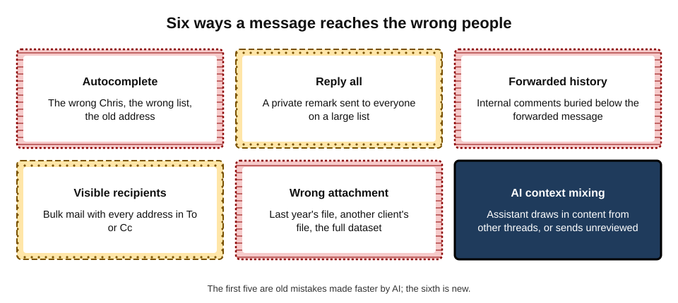
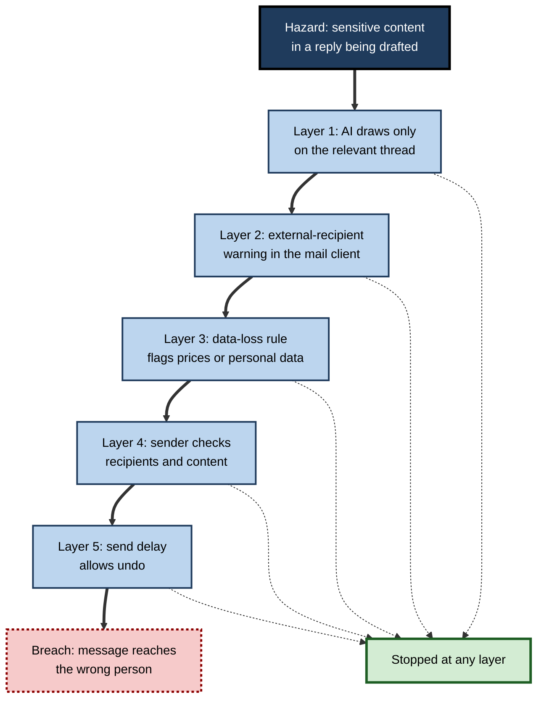
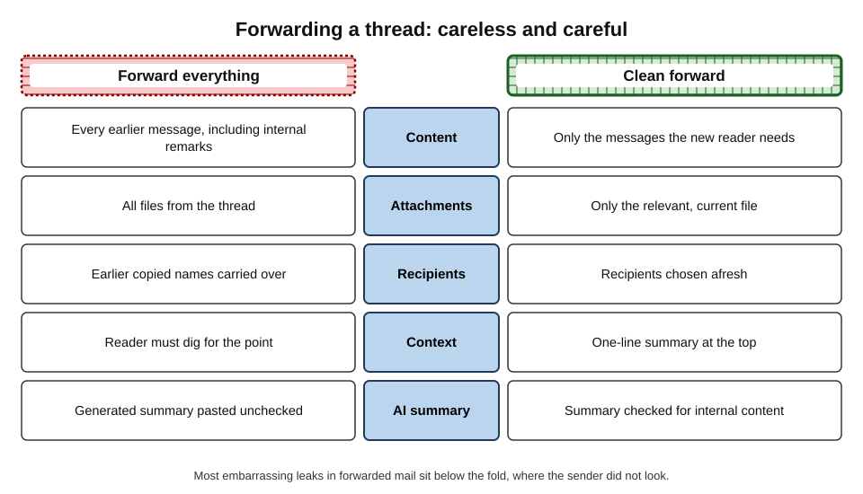
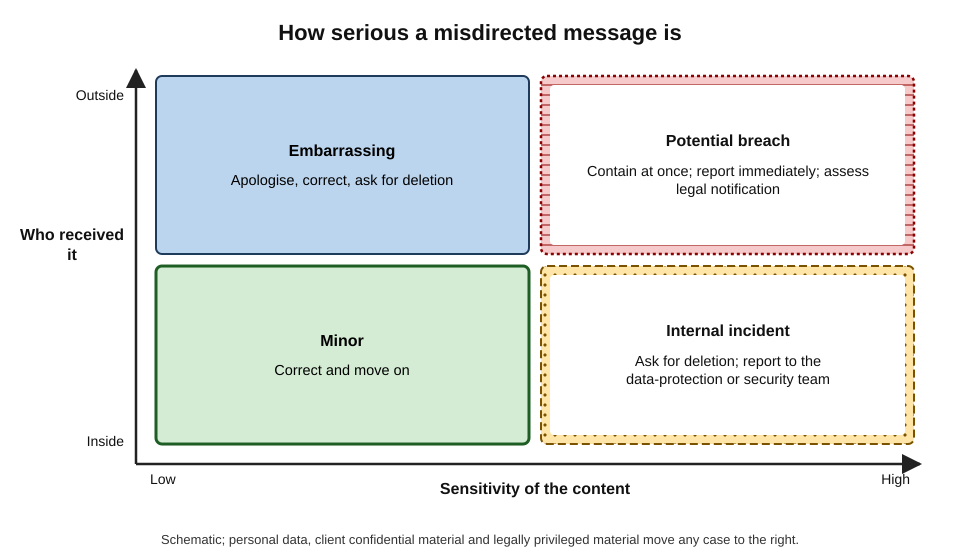
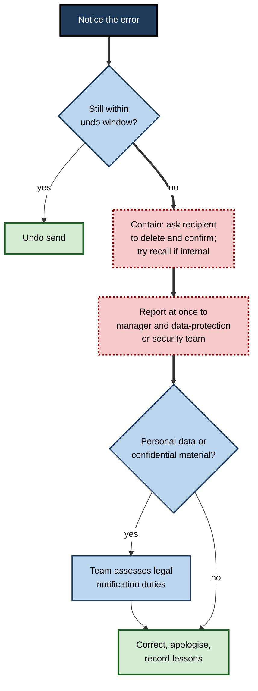

# F.10. Mistakes that reach the wrong people

A finance manager asks her mail assistant to "reply to Chris with a summary of where we are on the renewal". The assistant drafts a crisp reply, drawing on the internal thread — including the line "we can go as low as 18% discount if they push". Autocomplete fills in "Chris Taylor", the client's procurement lead, rather than "Chris Tayler", her colleague in sales. She glances at the draft, sees it is accurate, and presses Send.

Within a minute the client knows the company's negotiating floor. Every element of the mistake is ancient — a similar name, a hurried glance, internal detail in a reply — but AI assembled it faster and more completely than she would have done by hand.

> **Definition — Misdirected communication:** a message, attachment or post that reaches people who were not meant to receive it, or that carries content not meant for its recipients.

> **Definition — Personal data breach:** a breach of security leading to the accidental or unlawful destruction, loss, alteration, unauthorised disclosure of, or access to, personal data — the definition used in the EU and UK General Data Protection Regulation, which covers misdirected email containing personal data.

**Why it matters**

- **Misdirected messages are among the commonest data incidents.** The United Kingdom's Information Commissioner's Office has for years listed data "emailed to the incorrect recipient" among the most frequently reported causes of personal-data breaches.
- **Email cannot be unsent once delivered.** Recall features work only in narrow circumstances.
- **AI adds speed and assembly.** Assistants pull content from many places into one draft, suggest recipients, and in some setups send messages themselves.
- **Consequences can be severe** — lost negotiations, exposed patients, regulatory fines, damaged trust.

---

## How Messages Go Astray

**Figure 1.** Six routes by which a message reaches the wrong people.

### The classic routes

- **Autocomplete** — the mail client suggests a previously used address; a single keystroke selects the wrong person, an old address or a distribution list.
- **Reply all** — a remark meant for one person goes to everyone; on large lists this can start a **reply-all storm**.
- **Forwarded history** — the message forwarded is harmless; the thread beneath it contains internal comments, prices or personal remarks.
- **Visible recipients** — bulk mail sent with all addresses in "To" or "Cc", exposing everyone to everyone.
- **Wrong attachment** — a similarly named file, another client's version, or the full dataset instead of the extract.
- **Wrong channel** — in chat, a message posted to a public channel instead of a direct message, or to the client-shared channel instead of the internal one.

### The AI-specific routes

- **Context mixing** — an assistant drafting a reply draws on other threads, documents or notes that the user can access, including material not meant for the recipient.
- **Summaries forwarded unchecked** — an AI summary of an internal discussion, forwarded to a client, carries internal views.
- **Suggested recipients** — tools that propose "people you may want to include" can add the wrong person.
- **Agents that send** — assistants permitted to reply or forward automatically can act on misunderstood instructions without a human glance.
- **Automated recaps** — meeting and channel summaries sent to all participants, including external guests, may include content from parts of the discussion they were not meant to see.

> **Key point:** classic misdirection is usually **one wrong click**; AI-assisted misdirection is often **one wrong click plus content the person never consciously chose to include**.

---

## Why Careful People Make These Mistakes

### Slips, not ignorance

> **Definition — Slip:** an error in carrying out an intended action — the intention was right, the execution went wrong (choosing the wrong name from a list); distinguished by James Reason (1990) from **mistakes**, where the intention itself was wrong.

- **Capture errors** — a frequently performed action "captures" a less frequent one: typing "Chris" and accepting the usual Chris.
- **Automatic behaviour** — sending is highly practised; practised actions run with little attention.
- **Time pressure** — rushing removes the final check.
- **Fluency** — a well-written AI draft feels reviewed, so the reader's attention goes to the wording rather than to the recipients and the hidden content.

### The Swiss cheese model

**Figure 2.** Layers of defence against a misdirected message, each with gaps.

- **James Reason's Swiss cheese model** (1990) describes defences as layers of cheese, each with holes; an accident happens when holes in every layer line up.
- **Implication:** no single check is enough; several imperfect layers together are robust.
- **AI changes the layers** — it can add a hole (context mixing) or a defence (a tool that flags "this reply contains pricing and goes to an external address").

> **Watch out:** blaming the individual ("she should have checked") is natural but rarely fixes anything. The same slip will recur unless a layer is added or a hole closed.

---

## Documented Cases

### Case study: the clinic newsletter (2015)

- **Situation:** in September 2015 a London sexual-health clinic sent its regular newsletter about services to patients who had signed up for it, many of them living with HIV.
- **Problem:** the email was sent with recipients' addresses in the "To" field rather than hidden, exposing about 780 patients' email addresses — many including full names — to every other recipient.
- **Response:** the clinic apologised publicly; the Information Commissioner's Office later fined the NHS trust responsible £180,000, finding that it had failed to have adequate safeguards for sending bulk email containing such sensitive information.
- **Lesson:** a single routine send, without a technical safeguard, disclosed **special-category** health information about hundreds of people.

> **Definition — Special-category data:** personal data needing extra protection under data-protection law, such as health, sexual orientation, religion, ethnicity and biometric data.

### Case study: a reply-all storm on a national system (2016)

- **Situation:** in November 2016 a test email was sent by mistake to a distribution list covering the whole NHSmail system in England — hundreds of thousands of staff.
- **Problem:** many recipients pressed "reply all" to ask to be removed; each reply went to everyone, and the replies multiplied.
- **Effect:** the volume of messages slowed the email system for hours during a working day.
- **Lesson:** large distribution lists should restrict who may send to them and who may reply to all; one person's slip becomes everyone's problem.

### Case study: a chatbot's answer reaches a customer (2024)

- **Situation:** a customer asked Air Canada's website chatbot about bereavement fares after a death in his family; the chatbot told him he could apply for a reduced fare retrospectively.
- **Problem:** the airline's actual policy did not allow retrospective claims, and the airline refused the refund.
- **Outcome:** in February 2024 a Canadian tribunal (in *Moffatt v. Air Canada*) held the airline responsible for what its chatbot had said and ordered it to pay the difference; it rejected the argument that the chatbot was responsible for its own statements.
- **Lesson:** an automated message reaching a customer is the **organisation's** message. Wrong content reaching the right person is also a mistake that reaches people.

---

## Prevention

### Personal habits

- **Address last.** Write and check the message first, then add recipients — so nothing is sent half-checked.
- **Read the To and Cc lines aloud (in the head)** before sending anything sensitive; look at the domain, not only the name.
- **Strip the tail.** When forwarding, delete earlier messages the new reader does not need.
- **Open the attachment** before sending it — the file name is not the content.
- **Use BCC or mail merge** for messages to many external people; never put a list of customers in "To".
- **Pause on reply-all** — ask whether every recipient needs the reply.
- **In chat, check the channel name** and whether it includes external members before posting.

> **Mnemonic — "WAFT":** **W**ho exactly (names and domains); **A**ttachments opened; **F**orwarded tail removed; **T**hread or channel correct.

**Figure 3.** A careless and a careful way of forwarding a thread.

### AI-specific habits

- **Ask what the draft drew on.** Some assistants show sources; if a reply contains facts not in the thread being answered, find where they came from.
- **Read AI drafts for content that should not be there**, not only for quality: prices, internal opinions, other clients' names, personal remarks.
- **Check summaries before forwarding** — internal views ("legal thinks we'll lose") are easily included.
- **Keep sending in human hands** for anything external or sensitive; restrict agents to drafting.
- **Separate internal and external work** — avoid asking an assistant to draft external replies from a context full of internal discussion.

### Tool and organisational safeguards

- **Send delay or undo** — a short delay (mail clients commonly allow a few seconds up to about half a minute; delay rules can hold messages for longer) catches many slips.
- **External-recipient banners** — "This message will go to people outside your organisation" warnings.
- **Data-loss prevention rules** — flag or block messages with personal data, card numbers or labelled content going outside.
- **Autocomplete hygiene** — remove stale addresses from autocomplete lists; disable autocomplete for sensitive roles where practical.
- **Restricted distribution lists** — limit who can send to large lists and block reply-all on them.
- **Approved bulk-mail tools** for any message to many people.
- **Agent permissions** — assistants allowed to send only internally, or only after approval.

| Safeguard | Catches | Misses |
|---|---|---|
| Send delay or undo | Slips noticed within seconds | Errors noticed later |
| External-recipient warning | Wrong-domain recipients | Wrong person inside the same organisation |
| Data-loss prevention | Recognisable sensitive patterns | Context-dependent secrets such as negotiating positions |
| Address-last habit | Half-written or unchecked sends | Wrong choice of recipient if still rushed |
| Agent sending restrictions | Unreviewed AI-sent messages | Human-sent errors |

> **Remember:** **tools catch patterns; people catch meaning.** A negotiating floor or an internal opinion rarely matches a data-loss rule.

---

## When It Has Happened

### The first hour

**Figure 4.** How serious a misdirected message is, by sensitivity and recipient.

**Figure 5.** Steps after a message has reached the wrong people.

1. **Undo** if the send delay allows.
2. **Contain** — ask the wrong recipient, politely and promptly, to delete the message and any attachments and to confirm they have done so; for internal recipients, a recall may work if the message is unread.
3. **Report** immediately to the manager and the organisation's data-protection or security contact — even if embarrassed; speed matters.
4. **Assess** — the specialists decide whether legal notification is needed.
5. **Correct and apologise** — send the intended message to the right person; apologise to those affected where appropriate.
6. **Learn** — record what happened and which layer failed.

> **Watch out:** "recall" features generally work only within the same organisation's mail system and only if the message has not yet been read. To an external recipient, a recall attempt usually just sends a second message drawing attention to the first.

### Legal notification

- **Under the EU and UK GDPR**, a personal-data breach must be reported to the supervisory authority **within 72 hours** of the organisation becoming aware of it, unless it is unlikely to result in a risk to people's rights and freedoms.
- **Affected individuals** must be told without undue delay where the breach is likely to result in a **high** risk to them.
- **Other regimes** — sector regulators, contracts with clients, and other countries' laws — may impose their own duties.

> **Key point:** the 72-hour clock runs from **awareness**, which is why prompt internal reporting matters more than the individual's embarrassment.

### Worked example (illustrative): the wrong spreadsheet

- **Situation:** an HR adviser sends a supplier the file "staff_list_final.xlsx" instead of "site_list_final.xlsx". The file contains names, salaries and sickness absence for 140 employees.

| Question | Answer | Consequence |
|---|---|---|
| Undo possible? | No — noticed after ten minutes | Move to containment |
| Recipient external? | Yes — supplier | Higher severity |
| Personal data? | Yes; sickness absence is health data | Special-category data involved |
| Recipient trustworthy and responsive? | Supplier contact replies within 20 minutes confirming deletion | Reduces risk |
| Notification to regulator? | Assessed by data-protection officer within 24 hours | Decision recorded either way |
| Notification to staff? | Depends on assessed risk | Decided by the data-protection officer |

*Illustrative scenario.*

- **Steps taken:** phoned the supplier contact; obtained written confirmation of deletion from mailbox and deleted-items folder; reported to the data-protection officer within the hour; documented the incident; changed the file-naming convention and added a data-loss rule for files containing salary columns.
- **Conclusion:** prompt containment and reporting turned a serious slip into a well-managed incident.

---

## Wrong Content to the Right People

Not every mistake involves the wrong recipient. AI drafting makes another kind common: the **right** person receives **wrong** content — an invented figure, an unapproved promise, a misstatement of policy.

- **Hallucinated facts** — a date, price or reference number that appears plausible and is false.
- **Unapproved commitments** — "we will waive the fee", generated because it sounded helpful.
- **Outdated information** — drawn from an old document the assistant found.
- **Misattributed statements** — "as your colleague Ana confirmed" when Ana confirmed nothing.

### Sending a correction

- **Correct quickly and plainly.** "Correction to my email of this morning: the renewal price is £12,400, not £10,400 as I wrote."
- **Put the correction first**, not buried in a new paragraph.
- **Say what changed**, so the reader does not have to compare versions.
- **Do not over-explain** — a short apology is enough; long explanations draw more attention to the error than necessary.
- **Do not blame the tool** to the recipient — "the AI wrote it" signals that the sender did not read their own message.
- **Check whether the error spread** — was the message forwarded or relied on? Correct downstream too.

> **Example — a clean correction:** "Subject: Correction — renewal price. Apologies: my message at 10.12 gave the renewal price as £10,400. The correct figure is £12,400, as in the attached quotation. Everything else in that message stands."

| | Good correction | Poor correction |
|---|---|---|
| Timing | Within hours of noticing | Days later, or only when challenged |
| Position of the fix | Subject line and first sentence | Buried in a long new message |
| Clarity | States the wrong and right values | "Please disregard my previous email" with no detail |
| Tone | Brief apology, factual | Lengthy self-criticism or blame on tools |
| Follow-through | Checks who else relied on it | Assumes the matter is closed |

> **Key point:** an organisation is usually judged less by the error than by **how quickly and clearly it corrects it**.

---

## Slips in Chat and Collaboration Tools

Chat and shared workspaces have their own forms of misdirection.

- **Shared channels with external organisations** — many chat tools allow channels shared with clients or partners; an internal remark posted there is an external disclosure.
- **Similar channel names** — "#project-alpha" and "#project-alpha-client" differ by one word.
- **Screenshots** — a screenshot of a chat or inbox shared to illustrate one point often reveals other conversations, names and notifications.
- **Editing and deleting** — edits and deletions in chat may not remove what others have already seen, received as notifications or captured in compliance archives.
- **Mentions and notifications** — mentioning the wrong person can send them a notification containing the message's first line.
- **Screen sharing** — opening an inbox while sharing a screen in a meeting exposes subject lines and previews to everyone watching.

> **In practice:** many professionals keep distinct visual cues for external spaces (an "EXT" prefix or a different colour), turn off message previews when presenting, and crop screenshots tightly before sharing.

---

## A Reporting Culture

Misdirected messages are discovered and contained quickly only where people feel able to report their own errors.

- **The cost of silence** — an employee afraid of blame may hope the error goes unnoticed; the 72-hour clock runs regardless, and containment becomes harder.
- **Just culture** — an approach from safety-critical industries, associated with writers such as James Reason and Sidney Dekker, distinguishes honest errors (to be learned from) from reckless behaviour (to be addressed), so that people report freely.
- **Learning, not punishing** — each incident record asks which defence failed and what layer should be added, not merely who pressed Send.
- **Sharing lessons** — anonymised stories of near-misses and incidents train colleagues better than rules alone.

> **Definition — Just culture:** an organisational approach that treats honest errors as opportunities to improve systems, while still holding people accountable for reckless or deliberate wrongdoing.

> **Remember:** the person who reports a misdirected email **within minutes** has usually done the most important thing right.

---

## Case Study (illustrative): the assistant that answered from the wrong context

- **Situation:** an account director in a marketing agency used her mail assistant to draft replies to clients, asking it to "use everything relevant".
- **Problem:** a reply to Client A about campaign timing included a sentence about Client B's launch date, which the assistant had found in a planning document the director could access. Client A and Client B were competitors.
- **Diagnosis:**
  - the instruction invited the assistant to search widely;
  - the draft was fluent and largely correct, so the director skimmed it;
  - no layer flagged another client's name in an external message.
- **Actions:**
  1. apologised to both clients and informed Client B, as its information had been disclosed;
  2. agreed a rule: client replies are drafted from **the client's own thread only**;
  3. added a data-loss rule flagging other clients' names in external mail;
  4. introduced a ten-second "read for what shouldn't be there" check for AI-drafted external replies.
- **Result:** the agency kept both clients after the disclosure; no repeat in the following year.
- **Lesson:** an assistant's breadth of access is a feature for internal research and a hazard for external replies; **scope the context** to the recipient.

---

## Open Questions

- **Will AI assistants make misdirection more or less common?**
  - They add hazards (context mixing, agents) and defences (content-aware warnings); the net effect is not yet measured.
- **Can tools recognise context-dependent secrets?**
  - Data-loss rules catch patterns such as card numbers; recognising that a discount floor or an internal opinion is sensitive requires understanding that tools are only beginning to offer.
- **Who is responsible when an agent sends the wrong thing?**
  - Legal decisions such as the Air Canada case hold organisations responsible for automated statements; responsibility between individuals, vendors and employers is less clear.
- **How should send-delay and confirmation steps be balanced against speed?**
  - More friction prevents errors but annoys users; evidence on the best balance is limited.
- **Should email gain stronger "unsend" capabilities?**
  - True retraction would require changes to how email works across organisations; proposals exist but adoption is uncertain.

---

## Summary

- **Misdirected communication** reaches unintended people or carries unintended content; with personal data it is a **personal-data breach**, and misdirected email is among the commonest reported causes.
- Classic routes: **autocomplete, reply all, forwarded history, visible recipients, wrong attachments, wrong channels**. AI routes: **context mixing, unchecked summaries, suggested recipients, sending agents, automated recaps**.
- Careful people make **slips** (Reason, 1990), especially capture errors under time pressure; fluent AI drafts draw attention away from recipients and hidden content.
- Use layered defences (**Swiss cheese model**): scoped AI context, external warnings, data-loss rules, personal checks, send delay.
- Documented cases: the 2015 clinic newsletter (about 780 patients exposed; £180,000 fine), the 2016 NHSmail reply-all storm, and *Moffatt v. Air Canada* (2024) — organisations own their automated messages.
- Habits: **address last**; **WAFT** — who, attachments, forwarded tail, thread or channel; read AI drafts for what should not be there; keep sending in human hands.
- After an error: undo, contain, **report at once**, assess, correct, learn; recall rarely works externally; GDPR requires notification within **72 hours** of awareness where there is risk.

---

## Self-Check

1. Define misdirected communication and personal-data breach.
2. List the six classic routes by which messages go astray.
3. Name four routes that are specific to AI assistants.
4. Distinguish a slip from a mistake, and explain a capture error with an email example.
5. Explain the Swiss cheese model and how AI can add both holes and layers.
6. What happened in the 2015 clinic newsletter case, and which safeguard would have prevented it?
7. What does the 2016 NHSmail incident teach about distribution lists?
8. What did the tribunal decide in *Moffatt v. Air Canada*, and why is it relevant to AI in correspondence?
9. What does WAFT stand for?
10. Why should recipients be added last?
11. What do data-loss prevention rules catch, and what do they miss?
12. Describe the steps to take in the first hour after a misdirected email.
13. When must a personal-data breach be reported under GDPR, and to whom?
14. An agency wants its assistant to draft and send all routine client replies automatically, using "all available context". Identify the risks and propose safeguards.

### Answer Key

1. Misdirected communication: a message, attachment or post reaching unintended people or carrying unintended content. Personal-data breach: a security breach leading to accidental or unlawful destruction, loss, alteration, unauthorised disclosure of, or access to, personal data.
2. Autocomplete; reply all; forwarded history; visible recipients in bulk mail; wrong attachment; wrong chat channel.
3. Context mixing from other threads or documents; unchecked AI summaries forwarded; suggested recipients; agents that send without review (also automated recaps to external guests).
4. A slip is a correct intention badly executed; a mistake is a wrong intention. Capture error: a frequent action takes over — typing "Chris" and accepting the usual Chris when a different Chris was meant.
5. Defences are layers with holes; harm occurs when holes align. AI adds holes (context mixing, agents) but can add layers (content-aware warnings).
6. A clinic newsletter was sent with about 780 patients' addresses visible to all; the ICO fined the trust £180,000. Using BCC or a proper bulk-mail tool would have prevented it.
7. Restrict who can send to very large lists and block reply-all on them; otherwise one slip floods a whole system.
8. The airline was held responsible for its chatbot's incorrect statement about bereavement fares. Automated messages reaching customers are the organisation's statements.
9. Who exactly (names and domains); Attachments opened; Forwarded tail removed; Thread or channel correct.
10. So that the message cannot be sent before it is written and checked, and so the final act is a deliberate choice of recipient.
11. They catch recognisable patterns (card numbers, identity numbers, labelled content); they miss context-dependent secrets such as negotiating positions or internal opinions.
12. Undo if possible; contain by asking the recipient to delete and confirm (recall only internal and unread); report immediately to manager and data-protection or security team; specialists assess notification; correct and apologise; record lessons.
13. To the supervisory authority within 72 hours of becoming aware, unless unlikely to result in risk; affected individuals without undue delay if high risk.
14. Risks: other clients' information mixed in; unapproved commitments; wrong recipients; no human check; organisation liable for statements. Safeguards: draft only, human sends; context limited to the client's own thread; data-loss rules for other clients' names and prices; external warnings; sampling and audit of drafts.

---

## Glossary

| Term | Meaning |
|---|---|
| Autocomplete | A mail-client feature suggesting addresses as a name is typed. |
| BCC | Blind carbon copy: recipients hidden from one another. |
| Capture error | A slip in which a frequent action replaces an intended less frequent one. |
| Context mixing | An AI draft including content from sources other than the thread being answered. |
| Misdirected communication | A message reaching unintended people or carrying unintended content. |
| Personal-data breach | A security breach affecting personal data, including unauthorised disclosure. |
| Recall | An attempt to retract a sent email, effective only in limited conditions. |
| Reply-all storm | A cascade of replies to a large list, each sent to everyone. |
| Send delay | A short holding period allowing a sent message to be cancelled. |
| Slip | An error in executing a correct intention. |
| Special-category data | Personal data needing extra protection, such as health data. |
| Swiss cheese model | James Reason's model of layered defences with holes. |
| WAFT | Who, Attachments, Forwarded tail, Thread — a pre-send check. |
