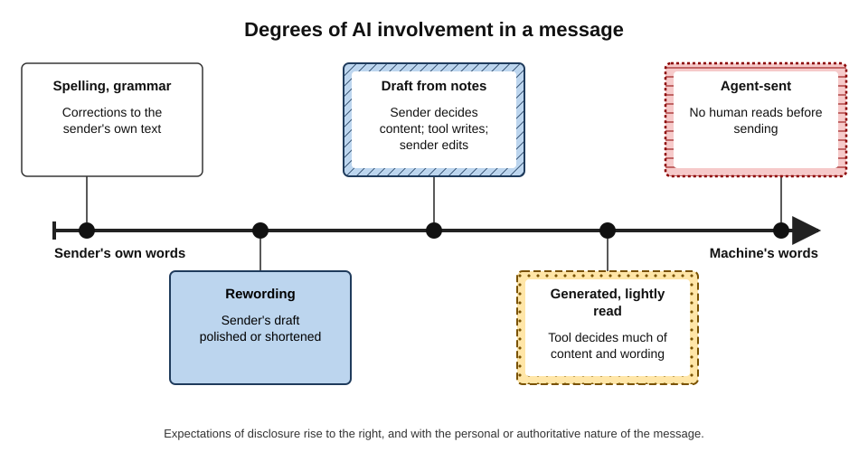
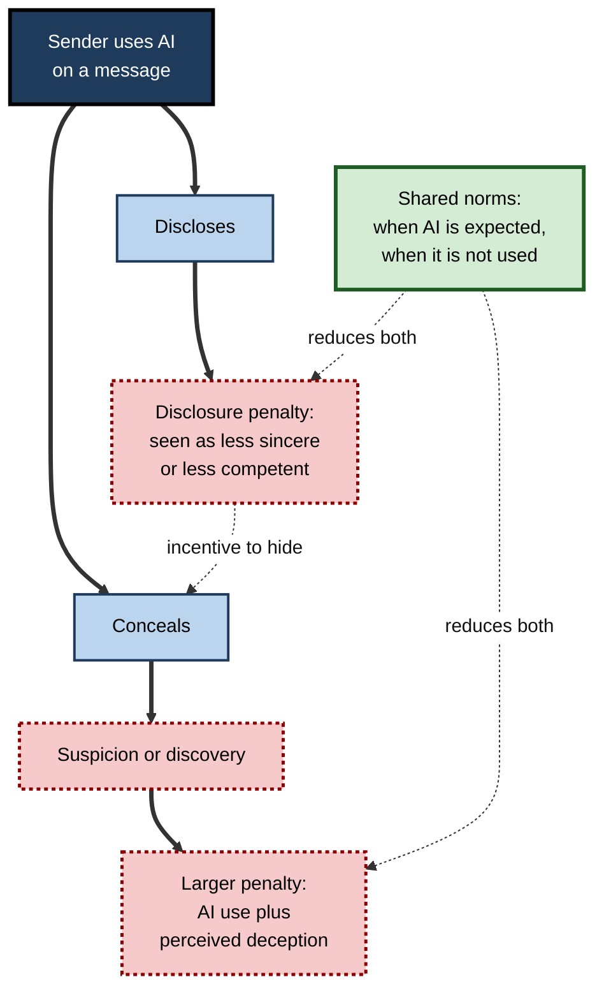
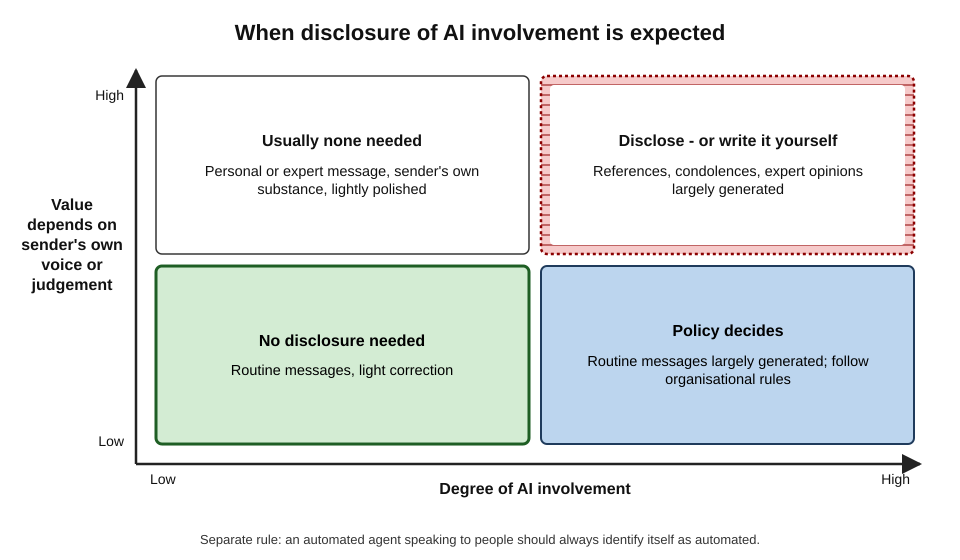
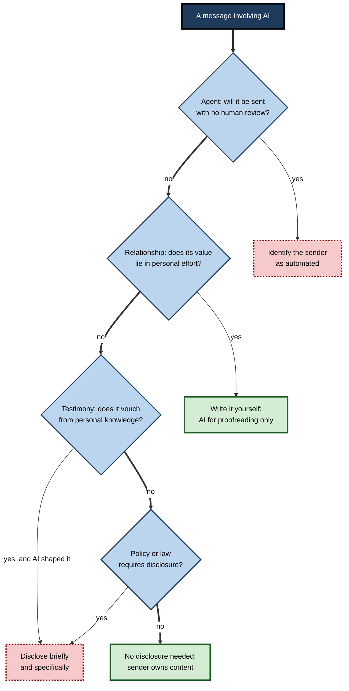
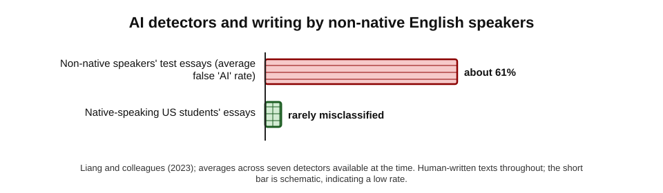

# F.11. Disclosure norms for AI-written mail

A hiring manager receives a reference letter for a candidate. It is articulate and warm — and its final paragraph begins "As an AI language model, I cannot personally attest to…". The referee had pasted the generated text without reading to the end. The manager now wonders how much of the letter reflects the referee's own knowledge of the candidate, and how much to trust the referee's other letters.

Nobody objects that the referee used a word processor or a spellchecker. Many would object to a reference the referee did not write. Somewhere between the two lies the question of **when people should say that AI wrote, or helped write, their mail**.

> **Definition — AI disclosure:** telling recipients that an AI system generated or substantially shaped a message, or that they are communicating with an automated system rather than a person.

> **Definition — Authorship (in correspondence):** responsibility for a message's content and the implied claim that it expresses the sender's own knowledge, judgement and intentions — distinct from who physically typed the words.

**Why it matters**

- **Trust depends on accurate beliefs.** Recipients act on assumptions about who wrote a message and what it represents.
- **Discovery is costly.** Undisclosed AI use, when discovered, damages trust more than disclosed use typically does.
- **Disclosure has costs too.** Research finds that people who disclose AI use are often judged as less competent or less sincere.
- **Rules are arriving.** Laws on AI transparency, professional rules and organisational policies increasingly address disclosure.
- **Agents blur the line.** Messages composed and sent by AI agents raise the question of whether the recipient is dealing with a person at all.

---

## Ghostwriting Before AI

Professional correspondence has never been purely self-written.

- **Secretaries and assistants** drafted letters that executives signed.
- **Speechwriters** write for politicians and chief executives.
- **Communications teams** draft announcements issued in a leader's name.
- **Form letters and templates** have long been sent under individual signatures.
- **Lawyers** draft letters that clients send.

**The convention:** a **signature signals endorsement**, not composition. The signer takes responsibility; few recipients assume the signer typed every word.

| | Human ghostwriting | AI drafting |
|---|---|---|
| Who composes | A person who knows the signer and context | A model with the context it is given |
| Who knows the facts | Usually both | Only the sender, unless supplied |
| Typical use | Formal, official, high-volume communication | Every kind of message, including personal ones |
| Recipient's expectation | Well established for official letters | Still forming |
| Accountability | Signer responsible | Sender responsible |

> **Key point:** the ghostwriting precedent supports AI help for **official and routine** messages. It never covered **personal testimony** — a reference, a condolence, a personal apology — where the recipient values the sender's own words and knowledge.

---

## Degrees of Involvement

**Figure 1.** Degrees of AI involvement in a message.

- **Correction** — spelling and grammar; nobody expects disclosure.
- **Rewording** — the sender's own content polished; rarely disclosed.
- **Draft from notes** — the sender decides content; the tool writes; the sender edits. Content is the sender's; wording is shared.
- **Generated, lightly read** — the tool decides much of the content and wording; the sender approves.
- **Agent-sent** — no human reads before sending; the recipient may be dealing with no person at all.

> **Remember:** the disclosure question turns on two things — **how much the machine decided** and **how much the recipient values the sender's own voice or judgement**.

---

## What the Evidence Shows

### The disclosure penalty

**Study card — Reif, Larrick and Soll (2025), *PNAS***

- **Design:** a series of experiments with several thousand participants examining how people expect to be judged, and are actually judged, for using AI tools at work.
- **Results:**
  - people **expected** to be seen as lazier, less competent and more replaceable if they used AI;
  - observers **did** rate AI users as lazier and less competent than people who received the same help from non-AI sources;
  - the penalty was smaller when the AI use was clearly useful for the task and when evaluators used AI themselves.
- **Conclusion:** a real **social evaluation penalty** for AI use exists, giving people a motive to conceal it.

**Study card — managers' messages: a 2025 study by researchers at the University of Florida and the University of Southern California**

- **Design:** about 1,100 professionals rated supervisors' messages described as written with differing levels of AI help.
- **Results:** heavy AI help left messages looking professional but lowered perceived sincerity sharply — especially for congratulations and motivational messages; people were more lenient about their own AI use than their managers'.
- **Conclusion:** **relational** messages from leaders carry the strongest disclosure penalty.

**Study card — Yin, Jia and Wakslak (2024), *PNAS***

- **Design:** people received supportive responses written by AI or by humans, with true or false labels about the source.
- **Results:** AI-written responses made people feel more heard on average, but **labelling** a response as AI reduced that feeling.
- **Conclusion:** disclosure can remove part of the benefit of supportive messages.

### The concealment penalty

- **Hohenstein and colleagues (2023)** found that people **suspected** of using AI replies were rated as less cooperative.
- **Jakesch and colleagues (2019)** found that texts **suspected** of being AI-written were trusted less when AI and human texts were mixed.
- **Discovery** — finding out later that a personal message was generated — combines the AI penalty with a perceived deception.

**Figure 2.** The disclosure dilemma: penalties for disclosure encourage concealment, which raises the cost of discovery.

> **Key point:** disclosure penalties push people to hide AI use; hiding raises the stakes of discovery. **Clear shared norms** — about which messages may use AI and which should not — reduce both penalties.

> **Watch out:** this research is new, mostly from survey experiments with hypothetical messages, and attitudes are changing quickly as AI use spreads. The direction of the findings is consistent; their size in two or three years' time is uncertain.

---

## Ethics: When Is Non-Disclosure Deceptive?

### A working test

Non-disclosure becomes a problem when **all three** hold:

1. the recipient **reasonably assumes** the sender personally wrote or judged the content;
2. that assumption **matters** to how the recipient interprets or acts on the message;
3. the assumption is **false** in a material way.

- **Routine operational mail** — recipients assume little about composition; non-disclosure is not deceptive.
- **References, assessments, expert opinions** — the recipient relies on the writer's own knowledge and judgement; heavy undisclosed generation is misleading.
- **Personal messages** — condolence, thanks, apology — the recipient values the sender's own effort and words; generation undermines the message's meaning, disclosed or not.
- **Automated agents** — the recipient assumes a person is responding; failure to say otherwise is deceptive.

> **Definition — Material assumption:** an assumption about a message that would change how the recipient interprets it or acts on it if they knew it was false.

### Arguments in the debate

| Position | Argument | Strongest where |
|---|---|---|
| Always disclose | Honesty; respects recipients' autonomy; builds trust over time | Agents, expert and testimonial messages |
| Disclose only when material | Tools are like spellcheckers; method is private if substance is owned | Routine operational mail |
| Do not use AI for some messages | The value lies in personal effort; disclosure cannot restore it | Condolences, personal apologies, references |
| Organisational disclosure | A general statement of tool use replaces per-message labels | Customer correspondence at scale |

> **Mnemonic — "TRAP" for when disclosure matters:** **T**estimony (the message vouches for something from personal knowledge), **R**elationship (its value lies in personal effort), **A**gent (no human composed or reviewed it), **P**olicy or law (rules require it).

**Figure 3.** When disclosure of AI involvement is expected.

**Figure 4.** Deciding whether to use AI on a message and whether to disclose it.

- **Agents first** — an unreviewed automated message must always say so.
- **Relationship second** — if the value lies in personal effort, the answer is usually not to disclose but to write it personally.
- **Testimony third** — references, assessments and expert opinions shaped by AI should say so, or be rewritten so the substance is genuinely the writer's.
- **Policy last** — organisational and legal rules can require disclosure even where ethics alone would not.

---

## Rules and Law

### Laws on AI transparency

- **The European Union's AI Act** (adopted 2024) sets transparency obligations in Article 50, scheduled to apply from August 2026:
  - providers must design systems that interact directly with people so that those people are informed they are dealing with an AI system, unless obvious;
  - deployers who publish AI-generated or manipulated text **to inform the public on matters of public interest** must disclose that it is AI-generated, unless it has undergone human review and someone holds editorial responsibility.
- **What this means for email:** private business correspondence is generally not "publication to the public", but **AI agents and chatbots** corresponding with people fall within the duty to inform them they are dealing with AI.
- **California's "BOT" law** (in force since 2019) makes it unlawful to use an automated online account to mislead people about its artificial identity in order to sell goods or influence a vote, unless the bot is disclosed.

> **Watch out:** the details and timing of AI transparency rules are still being refined in several jurisdictions, and guidance on how they apply to everyday correspondence is limited. Organisations should check current requirements with their legal advisers.

### Professional and institutional rules

- **Courts** — from 2023 some judges and courts began requiring lawyers to disclose or certify the use of generative AI in filings, after cases of fabricated citations.
- **Academic and recruitment settings** — some institutions ask referees not to use AI for reference letters, or to disclose its use.
- **Regulated advice** — financial and medical advice delivered in writing carries professional responsibility regardless of how it was drafted.
- **Organisational policies** — many employers now specify which messages may be AI-drafted, which must be disclosed, and which must not use AI.

---

## Forms of Disclosure

| Form | Example | Strengths | Weaknesses |
|---|---|---|---|
| Inline note | "I used an AI tool to help summarise the attached report." | Specific, honest, explains what was done | Can distract; may trigger penalty |
| Footer or signature line | "Drafted with AI assistance and reviewed by the sender." | Consistent; low effort | Becomes wallpaper; may be ignored |
| Agent identification | "I am an automated assistant for Acme Support; a person will review your case." | Required honesty for agents | None, if accurate |
| Organisational statement | Website or terms describe how AI is used in customer correspondence | Covers volume communication | Recipients may never see it |
| Disclosure on request | Answer honestly if asked | Minimal friction | Relies on recipients asking |

### Writing a good disclosure

- **Say what the AI did** — "summarised", "translated", "drafted from my notes" — rather than a vague "AI-assisted".
- **Say what the person did** — "I checked the figures against the source" — so responsibility is clear.
- **Keep it short** — one sentence.
- **Never use disclosure to shift blame** — "AI-generated, may contain errors" does not excuse errors in a message the sender chose to send.

> **Example — a useful disclosure:** "Note: the attached summary of the 60-page audit was produced with our AI assistant; I have checked every figure against the report."

> **Example — an unhelpful disclosure:** "This email may have been generated by AI and may contain inaccuracies." — it signals that the sender did not take responsibility.

---

## Detection and Accusation

People sometimes try to settle disclosure questions by **detecting** AI-written text. This is unreliable.

**Study card — Liang and colleagues (2023), AI detectors and non-native writers**

- **Design:** seven commercial and research "AI detectors" were tested on human-written essays — some by non-native English speakers written for an English-language proficiency test, some by native-speaking US school students.
- **Results:** the detectors misclassified the non-native speakers' essays as AI-generated on average about **61%** of the time, while rarely misclassifying the native speakers' essays.
- **Conclusion:** detectors penalise simpler, more predictable writing — typical of second-language writers — and are **not** a fair basis for accusations.

**Figure 5.** False "AI-generated" rates for human-written essays in the 2023 detector study.

> **Watch out:** accusing a colleague or candidate of using AI on the basis of a detector score, or of "AI-sounding" phrases, risks unfair harm — particularly to people writing in a second language. Judge messages by accuracy and appropriateness, and ask directly if it matters.

### Accidental disclosure

- **Leftover artefacts** — "As an AI language model…", "[Insert name]", "Here is a polished version of your email:" pasted at the top.
- **Mismatched details** — references to things the sender could not know, or wrong names inserted by the tool.
- **Style shifts** — a sudden change from a known informal voice to polished prose.

> **In practice:** read the **first and last lines** of every generated message before sending — that is where leftover instructions and tool commentary usually sit.

---

## Case Study: The University Condolence Message (2023)

- **Situation:** in February 2023, after a mass shooting at Michigan State University, an office at Vanderbilt University's Peabody College sent students an email about community and care.
- **Problem:** the email ended with the line "Paraphrase from OpenAI's ChatGPT AI language model, personal communication".
- **Reaction:** students criticised the use of a chatbot to write a message about a tragedy; the senders apologised, and two administrators temporarily stepped back from their roles while the matter was reviewed.
- **Analysis:**
  - the disclosure was honest, but it revealed that a message whose value lay in **personal care** had been generated;
  - disclosure could not repair the problem, because the problem was the **choice** to generate it.
- **Lesson:** for relational messages, the right question is not "should I disclose?" but "**should I be using AI for this at all?**"

### Case study (illustrative): writing a disclosure policy

- **Situation:** a professional-services firm with 2,000 staff found that some staff disclosed AI use in every email footer, others never did, and clients had begun asking which advice was "real".
- **Problem:** inconsistent practice confused clients; one client complained that an expert opinion letter appeared generated.
- **Actions:**
  1. **Categories:** routine operational mail (AI permitted, no disclosure); client deliverables and advice (AI permitted for drafting, expert must review and sign; disclosure in engagement terms); expert opinions and references (substance written by the expert; AI for proofreading only); personal and condolence messages (no AI drafting).
  2. **Agents:** any automated client communication identifies itself as automated.
  3. **Organisational statement:** engagement letters describe the firm's use of AI tools and its review standards.
  4. **No footers:** blanket "AI-assisted" footers were removed as uninformative.
- **Result:** client questions declined; staff reported less uncertainty about what was allowed.
- **Lesson:** disclosure works best as part of a **policy about use**, set by message category, rather than as a label added message by message.

---

## Worked Example (illustrative): six messages, six decisions

| Message | AI involvement | Recipient's material assumption | Decision |
|---|---|---|---|
| Meeting confirmation | Drafted by chip | None about composition | No disclosure |
| Summary of a long report for a client | Generated, checked against the report | That the figures are right | Brief inline note on method and checking |
| Reference letter for a former employee | Considered drafting with AI | Referee's own knowledge and judgement | Write it yourself; AI for proofreading only |
| Customer-service replies by an agent | Agent composes and sends | A person is answering | Agent identifies itself as automated |
| Condolence note to a colleague | Considered generating | Personal care and effort | Write it yourself; no AI |
| Translated message to a supplier | Machine-translated from English | That the wording is the sender's own command of the language | Note that it was translated; include the original |

*Illustrative scenario.*

- **Conclusion:** most messages need no disclosure; a few need a short, specific note; some should not be generated at all; agents always identify themselves.

---

## Disclosure in Chat, Translation and Customer Service

### Chat and informal messages

- **Expectations are lower** for routine chat; nobody discloses an autocorrected word.
- **But chat is where relationships live** in many teams; generated congratulations or sympathy in a team channel are noticed quickly, and colleagues compare messages.
- **Generated summaries posted to channels** ("AI recap of yesterday's discussion") should be labelled as such, because readers may otherwise treat them as one person's considered account.

### Translated messages

- **Translation is a special case of AI involvement.** A recipient who receives fluent German from an English speaker may assume the sender commands German — and reply with nuance the sender cannot follow.
- **Saying that a message was machine-translated** sets expectations, invites clarifying questions and avoids false impressions of fluency.

### Customer correspondence at scale

- **Customers increasingly expect AI involvement** in routine service replies; what they object to is **not being able to reach a person** when needed and **being misled about whether one is involved**.
- **Good practice:**
  - automated responses identify themselves;
  - replies drafted by AI and reviewed by an agent carry the agent's name, because the agent is responsible;
  - a clear route to a human is always available;
  - organisational statements explain how AI is used.

| Setting | Typical expectation | Sensible default |
|---|---|---|
| Internal routine chat | No disclosure expected | None |
| Channel recaps and summaries | Readers may assume human authorship | Label as AI-generated |
| Machine-translated correspondence | Readers may assume fluency | Note translation; include original |
| Agent-drafted, human-reviewed service replies | AI involvement increasingly assumed | Agent's name; organisational statement |
| Fully automated service replies | Recipient may assume a person | Identify as automated; offer a human |

> **Key point:** across settings, the constant principle is to avoid **false impressions that matter** — about who is speaking, what they know and what they can do.

---

## Norms at Professional Standard

### Personal practice

- **Own every message** — whatever the tool did, the sender answers for content.
- **Apply TRAP** — testimony, relationship, agent, policy.
- **Disclose specifically and briefly** where it matters; avoid blanket disclaimers.
- **Do not generate** messages whose value lies in personal effort.
- **Answer honestly if asked** whether AI was used.
- **Never accuse on detector scores.**

### Organisational practice

- **Set message categories** with rules for use and disclosure.
- **Identify automated agents** in every message they send.
- **Describe AI use** in customer and client terms where relevant.
- **Train with examples** of good and bad disclosure.
- **Review as norms change** — expectations are moving quickly.

---

## Open Questions

- **Will disclosure penalties fade?**
  - As AI use becomes universal, recipients may assume AI involvement by default, changing the meaning of both disclosure and silence.
- **Will watermarking or provenance labels become standard?**
  - Technical standards for marking AI-generated content exist, but text watermarks are fragile and rarely applied to email.
- **How will the law treat AI agents in correspondence?**
  - Transparency duties for systems interacting with people are new; how they apply to agents acting for individuals is unsettled.
- **Is personal authorship becoming a premium signal?**
  - Some predict "human-written" will become valued, like handwritten notes; evidence is anecdotal.
- **What counts as "substantial" AI involvement?**
  - The line between editing and generation is blurred by tools that do both; shared definitions are lacking.

---

## Summary

- **AI disclosure** tells recipients that AI generated or shaped a message, or that they are dealing with an automated system; **authorship** means responsibility and the implied claim that a message reflects the sender's own knowledge and judgement.
- **Ghostwriting** precedent supports AI help for official and routine mail; it never covered **personal testimony**.
- Involvement ranges from **correction** to **agent-sent** messages; disclosure expectations rise with involvement and with how much value depends on the sender's own voice or judgement.
- Evidence: a **social evaluation penalty** for AI use (Reif, Larrick and Soll, 2025); lower perceived **sincerity** for leaders' AI-assisted relational messages (a 2025 study by researchers at the University of Florida and the University of Southern California); AI labels reduce felt support (Yin and colleagues, 2024); **suspected** AI use also costs trust. The resulting **disclosure dilemma** is eased by shared norms.
- Non-disclosure is deceptive when the recipient's **material assumption** of personal authorship is false; use **TRAP**: Testimony, Relationship, Agent, Policy.
- Law: the **EU AI Act** Article 50 requires people to be informed when interacting with AI systems, with obligations scheduled from August 2026; California's BOT law covers deceptive bots; courts and institutions have their own rules.
- Disclose **specifically and briefly**; never as blame-shifting; agents always identify themselves.
- **AI detectors are unreliable** and unfair to second-language writers (Liang and colleagues, 2023); do not accuse on their basis.
- The Vanderbilt case shows that for relational messages the question is whether to use AI at all.

---

## Self-Check

1. Define AI disclosure and authorship in correspondence.
2. How does the ghostwriting precedent apply to AI drafting, and where does it stop applying?
3. Describe five degrees of AI involvement in a message.
4. What did Reif, Larrick and Soll (2025) find?
5. Explain the disclosure dilemma and how shared norms reduce it.
6. State the three-part test for when non-disclosure is deceptive, and apply it to a reference letter.
7. What does TRAP stand for?
8. What does Article 50 of the EU AI Act require, and how does it bear on email?
9. Write a good one-sentence disclosure for a client summary produced with AI, and explain why it is good.
10. Why is "This email may contain AI-generated inaccuracies" a poor disclosure?
11. What did Liang and colleagues (2023) find about AI detectors, and what follows for workplace practice?
12. What lesson does the 2023 Vanderbilt condolence email teach?
13. List three forms of accidental disclosure and a habit that prevents them.
14. Draft the main elements of a disclosure policy for a firm's client correspondence.

### Answer Key

1. AI disclosure: telling recipients that AI generated or substantially shaped a message, or that they are dealing with an automated system. Authorship: responsibility for content and the implied claim that it reflects the sender's own knowledge, judgement and intentions.
2. Signatures have long signalled endorsement rather than composition, supporting AI help for official and routine messages. It does not cover personal testimony — references, condolences, personal apologies — where recipients value the sender's own words and knowledge.
3. Correction of spelling and grammar; rewording the sender's draft; a draft from the sender's notes, edited; a largely generated message lightly read; an agent-sent message with no human review.
4. People expected to be judged lazier and less competent for using AI, and observers did judge AI users that way; the penalty was smaller when AI was clearly useful or evaluators used AI themselves.
5. Disclosure invites a penalty, encouraging concealment; concealment risks discovery with a larger penalty (AI use plus deception). Shared norms about when AI is expected or not used reduce both.
6. Recipient reasonably assumes personal authorship; the assumption matters; it is materially false. Reference letter: the reader assumes the referee's own judgement, it matters for hiring, and heavy generation makes it false — so non-disclosure is deceptive (better still, write it yourself).
7. Testimony, Relationship, Agent, Policy or law.
8. Providers must ensure people interacting with AI systems are informed, unless obvious; deployers publishing AI-generated text to inform the public on matters of public interest must disclose unless under human editorial responsibility. For email, AI agents and chatbots corresponding with people must identify themselves; ordinary private correspondence is generally outside the publication duty.
9. E.g. "The attached summary was produced with our AI assistant; I have checked every figure against the original report." It says what AI did, what the person did, and keeps responsibility with the sender.
10. It is vague, shifts responsibility to the tool, and signals that the sender did not check the message they chose to send.
11. Detectors misclassified non-native speakers' human-written essays as AI about 61% of the time on average. Detector scores should not be used to accuse anyone, especially second-language writers.
12. For relational messages, disclosure cannot fix the problem; the mistake was using AI to write a message whose value lay in personal care.
13. Leftover phrases such as "As an AI language model"; unfilled brackets; tool commentary at the top; also mismatched details and style shifts. Habit: read the first and last lines (and the whole message) before sending.
14. Message categories with rules (routine, deliverables, expert opinions and references, personal messages); agents always identify themselves; organisational statement in engagement terms; specific inline disclosure where material; no blanket footers; training and periodic review.

---

## Glossary

| Term | Meaning |
|---|---|
| AI Act | The European Union's 2024 regulation on artificial intelligence, including transparency duties. |
| AI detector | Software claiming to identify AI-generated text; unreliable, especially for second-language writers. |
| AI disclosure | Telling recipients that AI generated or shaped a message, or that they face an automated system. |
| Authorship | Responsibility for a message and the implied claim that it reflects the sender's own judgement. |
| Concealment penalty | Loss of trust when undisclosed AI use is suspected or discovered. |
| Disclosure dilemma | The tension between penalties for disclosing AI use and penalties for concealing it. |
| Ghostwriting | Writing text that is issued under another person's name. |
| Material assumption | An assumption that would change the recipient's interpretation or action if false. |
| Social evaluation penalty | Lower ratings of competence or effort given to people known to use AI. |
| TRAP | Testimony, Relationship, Agent, Policy — when disclosure matters. |
| Transparency obligation | A legal duty to inform people about the use of AI. |
