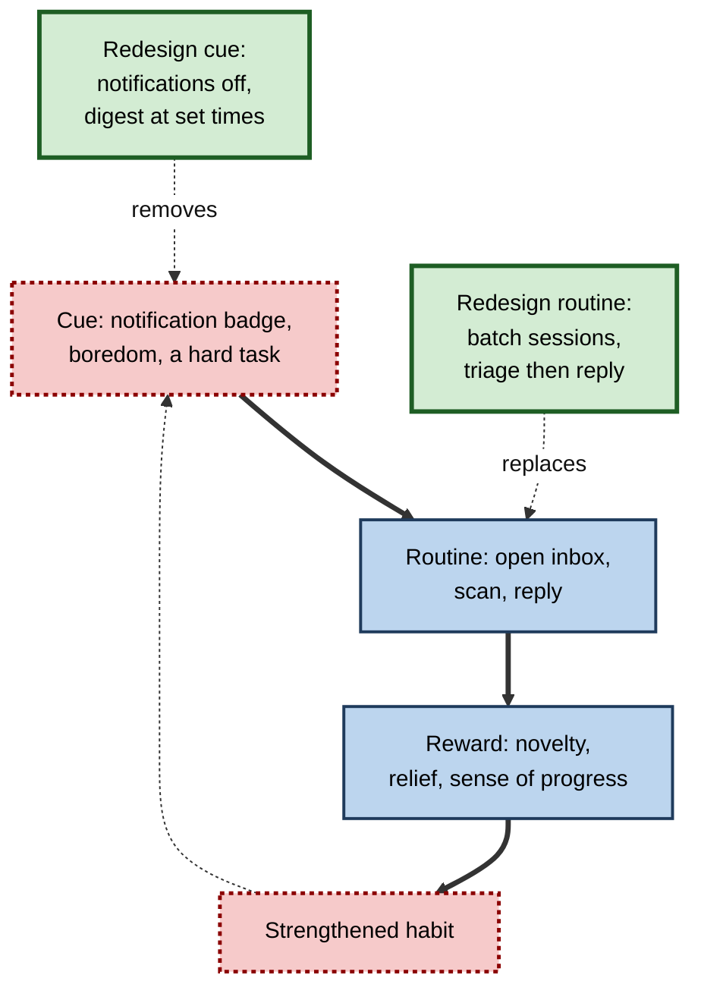
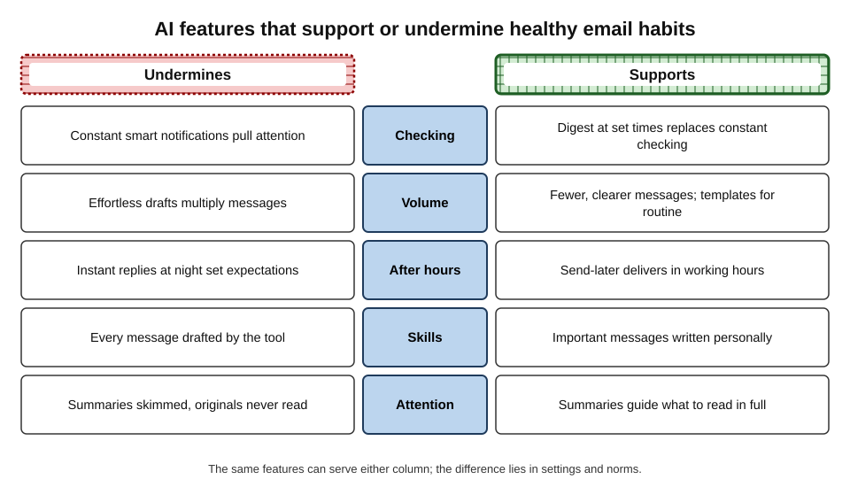
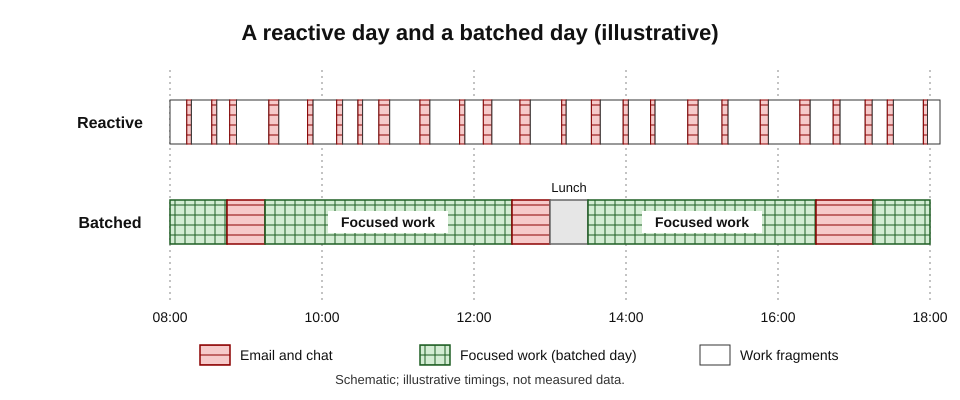
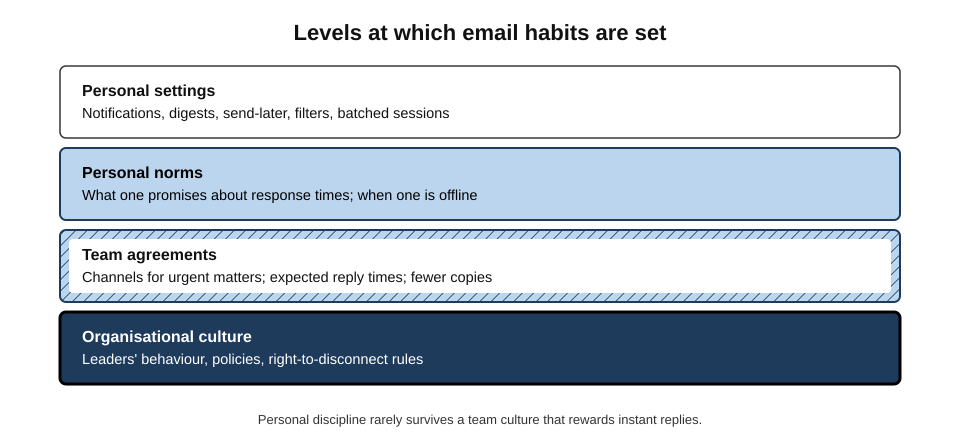
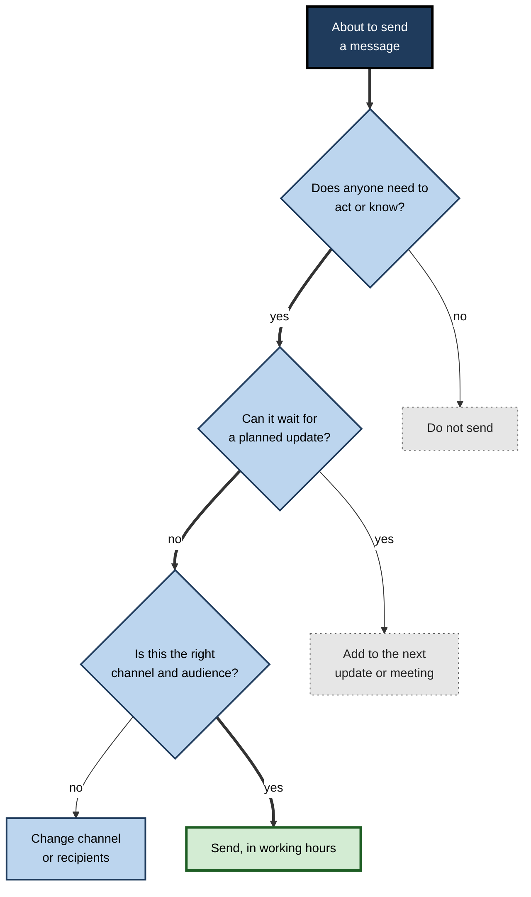

# F.12. Healthy email habits with AI

A product manager installs every AI feature her mail and chat tools offer. Within a month she answers messages twice as fast — and checks her inbox more often than ever, because the assistant's "3 things need you" banner is always worth a look. Her replies arrive within minutes at 10 p.m., so colleagues have started expecting that. She can no longer remember the last important message she wrote entirely herself.

The tools did exactly what they promised. What changed was her **habits** — and, through them, her team's expectations.

> **Definition — Email habit:** a largely automatic pattern of behaviour around messages — when and how often a person checks, how quickly they reply, how much they send, and how they write — triggered by cues rather than by deliberate decisions.

> **Definition — Healthy email habits:** patterns of message use that protect focused work, well-being and relationships while meeting genuine obligations to respond.

**Why it matters**

- **Email and chat fragment the day.** Microsoft's 2025 Work Trend Index reported that, during core working hours, the average worker was interrupted roughly every two minutes by a meeting, email or chat notification.
- **AI makes messaging easier** — and anything easier is done more.
- **After-hours expectations harm well-being** even when little time is actually spent on messages.
- **Writing and judgement are skills** that weaken when never exercised.
- **Habits spread.** One person's 10 p.m. replies become a team's norm.

---

## How Email Habits Form

### Cue, routine, reward

**Figure 1.** The email-checking habit loop and where it can be redesigned.

- **Cues** — notification sounds, badges, a pause in work, a difficult task one would rather avoid.
- **Routine** — opening the inbox or chat, scanning, replying.
- **Reward** — something new, a small sense of accomplishment, relief from a harder task.
- **Variable rewards** — sometimes there is something important, usually not; unpredictable rewards are especially habit-forming.

> **Key point:** checking email is often **not a decision** but a cued response. Changing it means changing the **cues and routines**, not just resolving to check less.

### How long new habits take

**Study card — Lally and colleagues (2010), habit formation in everyday life**

- **Design:** volunteers chose a new daily behaviour (such as drinking water with lunch or a short exercise) and reported each day how automatic it felt, for twelve weeks.
- **Results:** automaticity rose along a curve that flattened over time; the **median** time to reach a plateau was about **66 days**, with very wide variation (from under three weeks to well over the study period for some). Missing a single day did not materially harm progress.
- **Conclusion:** new habits take weeks to months; occasional lapses are normal.

> **In practice:** a new email routine — checking at set times, for example — should be judged after two or three months, not after a difficult first week.

---

## What the Evidence Says About Email and Well-Being

### Checking less often

**Study card — Kushlev and Dunn (2015), "Checking email less frequently reduces stress"**

- **Design:** adults were asked for one week to check email only three times a day with notifications off, and for another week to check as often as they liked (order randomised).
- **Results:** during the limited-checking week, participants reported **lower daily stress**, and lower stress predicted higher well-being on several measures.
- **Conclusion:** fewer checking sessions can reduce stress without harming responsiveness to what matters.

> **Watch out:** this was a short study with students and community members, using self-reported stress. Other research on **batching** has found that checking less often does not automatically raise productivity; the benefit is mainly to **stress and attention**, and depends on the job.

### Interruptions and stress

- **Gloria Mark and colleagues (2008)** found that people interrupted during tasks often finished them in the same or less time — by working faster — but reported **more stress, frustration and time pressure**.
- **Mark and colleagues (2016)**, logging office workers' computer use, found that more time spent on email in a day was associated with **lower rated productivity and higher stress**.

### Telepressure and after-hours expectations

**Study card — Barber and Santuzzi (2015), workplace telepressure**

- **Design:** survey studies developing a measure of **workplace telepressure** — the urge to respond quickly to work messages.
- **Results:** higher telepressure was associated with **poorer sleep quality, more burnout symptoms and more health-related absence**.
- **Conclusion:** the felt pressure to respond, not only the volume of messages, harms well-being.

> **Definition — Workplace telepressure:** a preoccupation with, and urge to respond quickly to, work-related messages.

- **Expectations alone matter.** Research by William Becker and colleagues (published 2021) found that **organisational expectations** of monitoring email after hours were linked to greater anxiety for employees — and lower relationship satisfaction for their partners — even when little time was actually spent on email.

> **Key point:** much of the harm comes from **being on call**, not from the minutes of replying. Faster AI replies do not remove it; they can intensify it.

### Rights to disconnect

- **France** introduced a legal "right to disconnect" from 2017, requiring larger employers to negotiate arrangements limiting out-of-hours digital contact.
- **Portugal** (2021) restricted employers from contacting employees outside working hours, with exceptions.
- **Australia** introduced a right for employees to refuse unreasonable out-of-hours contact from August 2024 (with later application to small businesses).
- **Effect:** these laws signal a shift in norms; how much they change daily behaviour is still being studied.

---

## How AI Changes Email Habits

**Figure 2.** AI features that support or undermine healthy email habits.

### Ways AI can undermine healthy habits

- **More reasons to check** — smart notifications, priority banners and "things that need you" summaries are designed to be compelling.
- **More messages** — effortless drafting makes it cheap to send replies, acknowledgements and follow-ups; volume rises.
- **Faster expectations** — instant, polished replies at any hour reset what colleagues expect.
- **Deskilling** — if every message is drafted by the tool, the person's own writing and judgement get less practice.
- **Shallow reading** — summaries replace reading, and understanding of the work thins.
- **Always-on agents** — automated replies and follow-ups continue at night and on holiday, sustaining the impression that the person is available.

### Ways AI can support healthy habits

- **Digests at set times** replace constant checking.
- **Triage and filtering** reduce what needs attention.
- **Send-later** delivers replies in the recipient's working hours.
- **Catch-up summaries** after leave make full disconnection less costly.
- **Templates and drafts for routine messages** free time for important ones.
- **Assistants that answer "is anything urgent?"** let people check once rather than scanning repeatedly.

> **Remember:** the same feature can serve either list. A digest checked at 09:00, 12:30 and 16:30 supports focus; a digest refreshed every ten minutes is a new slot machine.

---

## Designing a Day

**Figure 3.** A reactive day and a batched day.

### A batched routine

1. **Start with work, not email** — where the role allows, spend the first block on the most important task.
2. **Set email and chat sessions** — two to four a day, for example after the first focused block, after lunch and late afternoon.
3. **Use the AI digest at the start of each session** as a map; then triage with the four Ds.
4. **Close the inbox between sessions**; keep only an agreed urgent channel open.
5. **End the day with a short review** — commitments made, follow-ups set, tomorrow's first task chosen.
6. **Send-later for anything written after hours.**

> **Mnemonic — "FIRST":** **F**ocus before inbox, **I**nbox in sessions, **R**eview with the digest, **S**end in working hours, **T**riage before replying.

### Exceptions and roles

- **Some roles are reactive by design** — incident response, customer support, trading desks, clinical on-call. For them, healthy habits mean **clear shifts and handovers**, not batching.
- **Managers** may need more frequent checks, but can reduce others' pressure by **signalling** their own expectations clearly.
- **Time zones** — global teams need agreed overlap windows rather than constant availability.

### Worked example (illustrative): redesigning a week

- **Situation:** a consultant measures one week: 74 inbox checks a day on average, 46 messages sent a day, 9 messages sent after 20:00, and two hours of uninterrupted work across the whole week.
- **Changes for the next six weeks:**
  1. notifications off except for a VIP list and an urgent channel;
  2. four email sessions a day, starting with the AI digest;
  3. templates for six routine replies; AI drafts for routine messages, personal writing for client advice and team feedback;
  4. send-later after 19:00;
  5. one "no AI drafting" day a fortnight for important correspondence.

| Measure | Before | After six weeks |
|---|---|---|
| Inbox checks per day | 74 | 15 |
| Messages sent per day | 46 | 31 |
| Messages delivered after 20:00 | 9 per week | 0 (sent later) |
| Uninterrupted work per week | 2 hours | 9 hours |
| Client complaints about responsiveness | 0 | 0 |

*Illustrative figures.*

- **Conclusion:** fewer checks and fewer messages did not reduce responsiveness to what mattered; focused time grew substantially.

> **Watch out:** personal changes may be undone by team norms. If the team expects replies within minutes, the consultant's batching will cause friction unless expectations are agreed.

---

## Notifications, Phones and Attention

Much unhealthy checking starts on the phone.

- **Default settings favour engagement.** Mail and chat apps usually notify about everything unless told otherwise.
- **AI-ranked notifications** promise to show only what matters — useful when the threshold is set conservatively, harmful when the person keeps the general stream on as well.
- **Lock-screen previews** invite reading (and worrying about) messages that cannot be dealt with at that moment.
- **Work apps on personal phones** blur boundaries; separate profiles or scheduled "work off" modes help.

| Setting | Habit-forming default | Healthier alternative |
|---|---|---|
| Mail notifications | Every new message | VIPs only, or none |
| Chat notifications | All channel activity | Direct messages and mentions only |
| AI priority banners | Refreshed continuously | Read at session start |
| Lock-screen previews | Full text shown | Hidden previews |
| Evenings and weekends | Same as working hours | Scheduled quiet mode; work profile paused |

> **In practice:** a fifteen-minute review of notification settings across mail, chat and phone is one of the highest-return changes most professionals can make.

---

## Writing Fewer, Better Messages

Healthy habits concern sending as well as receiving. Every message sent creates work for someone else — and often a reply that returns to the sender.

- **Bottom line first** — the request and deadline in the first two lines.
- **One topic per message** — so it can be filed, delegated and closed.
- **Subject lines that work** — "Decision needed by Thu: supplier contract", "FYI only: Q3 figures".
- **Say when no reply is needed** — "No need to reply" prevents a stream of "Thanks!" messages.
- **Batch small items** — five questions in one message rather than five messages.
- **Choose the channel** — quick coordination in chat, decisions and records in email, sensitive or complex matters in conversation.

> **Watch out:** AI drafting tends to make messages **longer** — polite openings, restatements and closings. Asking the tool to "make it as short as possible, request first" reverses this.

---

## Leave, Holidays and Return

AI changes what is possible around absence.

- **Before leaving** — set an informative out-of-office message naming who covers what; pause automated sequences and agents; brief colleagues.
- **During absence** — the healthiest pattern is no checking at all; where some contact is unavoidable, a single agreed check-in time is better than ad hoc scanning.
- **On return** — AI catch-up summaries make it realistic to switch off fully, because returning is no longer an ordeal of reading hundreds of messages.
  - read the digest as a map;
  - read the latest message of each important thread;
  - deal with commitments due during the absence first.

> **Key point:** good catch-up tools are among AI's strongest contributions to healthy habits — **if** people use them to disconnect fully rather than to check "just a little" while away.

---

## Reviewing One's Own Habits

Habits are hard to see from the inside. Simple measures help.

- **Checking frequency** — many mail and phone tools report how often apps are opened.
- **After-hours sending** — how many messages were sent, or scheduled, outside working hours?
- **Focused time** — how many blocks of an hour or more without messages occurred this week?
- **Personal writing** — how many important messages were written without AI drafting?
- **Volume** — messages sent per day, and how many were acknowledgements that need not have been sent.

> **Remember:** review habits every few weeks with **two or three numbers**, not a dashboard of twenty; change one thing at a time.

---

## Keeping Skills Alive

AI drafting is valuable, but writing and judgement are professional skills that weaken without use.

- **What is at risk**
  - structuring an argument in writing;
  - choosing the right tone for a difficult relationship;
  - noticing what a message implies or omits;
  - remembering the details of one's own work, when summaries replace reading.
- **Evidence from learning research** — in a large 2025 field experiment in Turkish high schools (Bastani and colleagues), students who practised mathematics with unrestricted AI help did better during practice but **worse** on later tests without AI than students who never had it; an AI tutor designed to give hints rather than answers largely avoided the harm.
- **Implication** — use AI in ways that keep the person thinking: critique and suggestions rather than complete answers, for the messages that matter most.

### Habits for people early in their careers

- **Learn the conventions first.** New professionals benefit from writing their field's standard messages themselves — status updates, escalations, client replies — before delegating them, so they can judge AI drafts later.
- **Study the edits.** When AI improves a draft, notice what changed and why; this turns the tool into a writing tutor rather than a substitute.
- **Ask about norms.** Expected response times, channels and tone differ between teams; asking early prevents both over-responsiveness and unintended slowness.
- **Protect learning time.** The first years build the knowledge that later makes AI output checkable; constant messaging can crowd it out.

> **In practice:** many professionals keep a rule — "**I write the important ones**": client advice, feedback, apologies, recognition and anything personal are drafted by the person, with AI used afterwards to check clarity.

---

## Team and Organisational Habits

**Figure 4.** Levels at which email habits are set.

### Team agreements

- **Response-time expectations** — e.g. chat within a few hours, email within one working day, urgent matters by phone.
- **One urgent channel** — so people can close other streams without anxiety.
- **Fewer copies** — copy only people who must act or know; AI tools make adding recipients effortless.
- **Clear subject lines and first lines** — action needed, deadline, "for information only".
- **Quiet hours** — no expectation of replies outside working hours; send-later as default.
- **Summaries over threads** — owners close long threads with an outcome message.

**Figure 5.** Deciding whether a message needs to be sent at all.

### Organisational practice

- **Leaders set the norm** — a senior leader's 11 p.m. emails signal expectations louder than any policy.
- **Technical support for boundaries** — default send-later outside hours; holiday modes that pause automated follow-ups.
- **Measure load, not just output** — after-hours messaging and interruption data, used to improve conditions rather than to monitor individuals.
- **Guidance on AI use** — which messages to draft with AI, which to write personally, and how to avoid the responsiveness spiral.

### Case study: limiting out-of-hours email at Volkswagen and Daimler

- **Situation:** in the early 2010s German employers and works councils grew concerned about employees' constant smartphone access to work email.
- **Actions:**
  - from late 2011 **Volkswagen** agreed with its works council to stop forwarding email to the company smartphones of many employees covered by collective agreements from shortly after the end of their shift until shortly before the next one began;
  - in 2014 **Daimler** introduced an optional "Mail on Holiday" system that, when switched on, automatically deleted emails received during an employee's holiday and told senders whom to contact instead.
- **Reaction:** both measures attracted wide attention as examples of organisations treating constant availability as a problem to be designed out, not a personal failing.
- **Limits:** coverage was partial (management and many staff were outside the Volkswagen rule), and the effect on well-being was not rigorously evaluated.
- **Lesson:** **system-level design** — what the technology does by default — can protect boundaries more reliably than individual willpower. AI-era equivalents include holiday modes that pause agents and default send-later.

### Case study (illustrative): the team that agreed its norms

- **Situation:** a twelve-person analytics team using AI drafting and summaries saw message volume rise by about a third over six months; members reported feeling "always behind".
- **Diagnosis:** effortless drafting increased replies and acknowledgements; several members answered at night; the manager's own fast replies set the pace.
- **Actions:**
  1. agreed response times (chat: same day; email: next working day; urgent: phone);
  2. "no reply needed" and "for information" conventions in subject lines;
  3. send-later as default after 18:30, including for the manager;
  4. no AI-drafted acknowledgements ("thanks, received") — reactions or nothing;
  5. monthly ten-minute review of what was working.
- **Result:** message volume fell back below its starting level; members reported more focused time and less evening checking.
- **Lesson:** AI made messages cheap; **norms** made them valuable again.

---

## Open Questions

- **Do AI assistants reduce or increase total messaging time?**
  - Drafting and triage save minutes per message, but volume and checking may rise; long-term field evidence is lacking.
- **What skills must professionals keep in an AI-drafted world?**
  - Writing, judgement and close reading are likely essential; which can safely be delegated is unresolved.
- **How effective are right-to-disconnect laws?**
  - Early evaluations are mixed; enforcement and culture may matter more than the law itself.
- **Can AI help protect attention?**
  - Assistants that hold back non-urgent messages or negotiate response times are possible; whether they will be designed for well-being or engagement is open.
- **How should organisations measure healthy messaging without surveillance?**
  - Aggregate data can reveal overload, but individual monitoring raises privacy and trust concerns.

---

## Summary

- **Email habits** are cued, largely automatic patterns of checking, replying, sending and writing; healthy habits protect focus, well-being and relationships while meeting real obligations.
- Habits follow **cue → routine → reward**, with variable rewards making checking compelling; new habits take weeks to months (median about 66 days in Lally and colleagues, 2010).
- Evidence: checking three times a day lowered stress (Kushlev and Dunn, 2015); interruptions raise stress (Mark and colleagues, 2008); more email time links to more stress (Mark and colleagues, 2016); **telepressure** links to poor sleep and burnout (Barber and Santuzzi, 2015); after-hours **expectations** alone harm well-being.
- Rights to disconnect: France (2017), Portugal (2021), Australia (2024).
- AI can **undermine** habits (compelling notifications, more messages, faster expectations, deskilling, shallow reading, always-on agents) or **support** them (scheduled digests, triage, send-later, catch-up summaries, templates).
- Personal routine: **FIRST** — focus before inbox, inbox in sessions, review with the digest, send in working hours, triage before replying.
- Keep skills alive: **write the important ones yourself**; use AI for critique where learning matters.
- Teams need agreed **response times, an urgent channel, fewer copies, quiet hours**; leaders set norms; system defaults (as at Volkswagen and Daimler) protect boundaries better than willpower.

---

## Self-Check

1. Define an email habit and a healthy email habit.
2. Describe the cue–routine–reward loop for email checking and two ways to redesign it.
3. What did Lally and colleagues find about how long habits take to form?
4. Summarise the Kushlev and Dunn (2015) study and its limits.
5. What is workplace telepressure, and what is it associated with?
6. Why can after-hours expectations harm well-being even when little time is spent on email?
7. Name three countries with right-to-disconnect rules and when they were introduced.
8. List four ways AI can undermine healthy email habits and four ways it can support them.
9. What does FIRST stand for?
10. Why is batching inappropriate for some roles, and what replaces it?
11. What did the 2025 Bastani study suggest about AI help and skill, and how does it apply to writing email?
12. Propose five team agreements for healthy messaging.
13. What do the Volkswagen and Daimler measures illustrate?
14. A manager says, "AI lets us all reply instantly, so we should." Respond with evidence and an alternative.

### Answer Key

1. Email habit: a largely automatic pattern of checking, replying, sending and writing triggered by cues. Healthy habits: patterns that protect focus, well-being and relationships while meeting genuine obligations to respond.
2. Cue (badge, boredom) → routine (open, scan, reply) → reward (novelty, relief), strengthening the habit. Redesign: remove cues (notifications off, scheduled digests) and replace routines (batched sessions, triage first).
3. Automaticity grew along a flattening curve; the median time to plateau was about 66 days, with wide variation; single missed days did not matter much.
4. Checking email three times a day with notifications off for a week lowered daily stress compared with unlimited checking. Limits: short, self-reported, specific sample; benefits are mainly to stress, not proven productivity.
5. The preoccupation with and urge to respond quickly to work messages; associated with poorer sleep, burnout symptoms and absence.
6. Being on call creates anticipation and anxiety and prevents psychological detachment; research found expectations alone were linked to employee anxiety and partners' lower relationship satisfaction.
7. France (2017), Portugal (2021), Australia (2024).
8. Undermine: compelling notifications; more messages; faster expectations; deskilling (also shallow reading, always-on agents). Support: scheduled digests; triage and filtering; send-later; catch-up summaries (also templates for routine).
9. Focus before inbox; Inbox in sessions; Review with the digest; Send in working hours; Triage before replying.
10. Reactive roles (support, incident response, on-call) must respond quickly; clear shifts, rotas and handovers replace batching.
11. Unrestricted AI help raised practice performance but lowered later unaided performance; hint-based AI avoided the harm. For email, drafting everything with AI may erode writing and judgement; write important messages yourself and use AI for critique.
12. Response-time expectations by channel; one urgent channel; copy only those who must act or know; subject-line conventions; quiet hours with default send-later (also closing threads with outcome summaries).
13. That system-level defaults — stopping email to phones out of hours, deleting holiday mail — can protect boundaries more reliably than individual willpower.
14. Instant replies raise expectations and volume (the responsiveness spiral), increase interruptions and telepressure linked to stress and burnout, and do not improve outcomes for non-urgent work. Alternative: agreed response times, an urgent channel, batched sessions, send-later, and AI used for triage and routine drafting rather than speed for its own sake.

---

## Glossary

| Term | Meaning |
|---|---|
| Batching | Handling messages in planned sessions rather than continuously. |
| Deskilling | Loss of skill through lack of practice when tools do the work. |
| Digest | A periodic AI summary of what has arrived and what needs attention. |
| Email habit | A cued, largely automatic pattern of message behaviour. |
| FIRST | Focus before inbox, Inbox in sessions, Review with the digest, Send in working hours, Triage before replying. |
| Habit loop | The cycle of cue, routine and reward that sustains a habit. |
| Quiet hours | Agreed times when replies are not expected. |
| Right to disconnect | A legal or contractual right to ignore work contact outside working hours. |
| Send-later | Scheduling a message for delivery at a chosen time. |
| Variable reward | An unpredictable reward that makes a behaviour especially habit-forming. |
| Workplace telepressure | The urge to respond quickly to work messages. |
