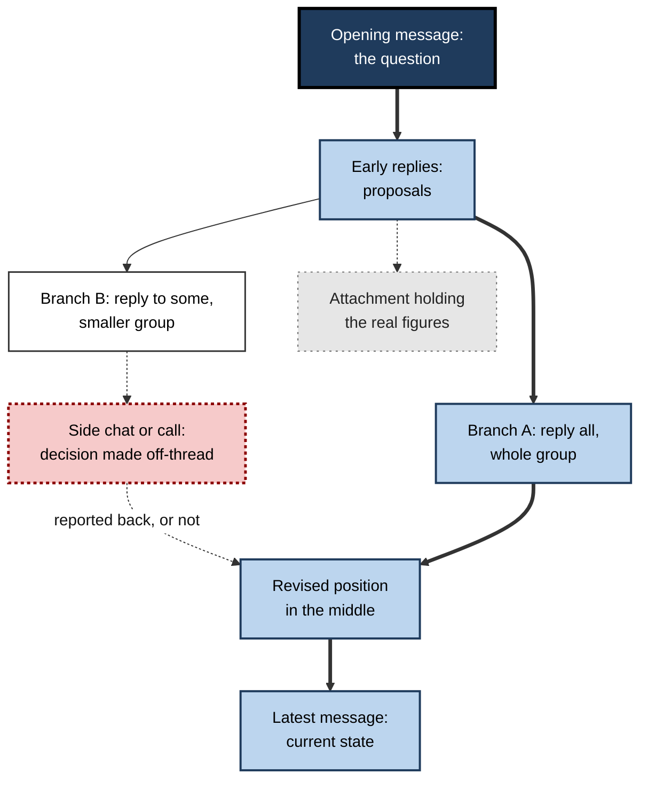
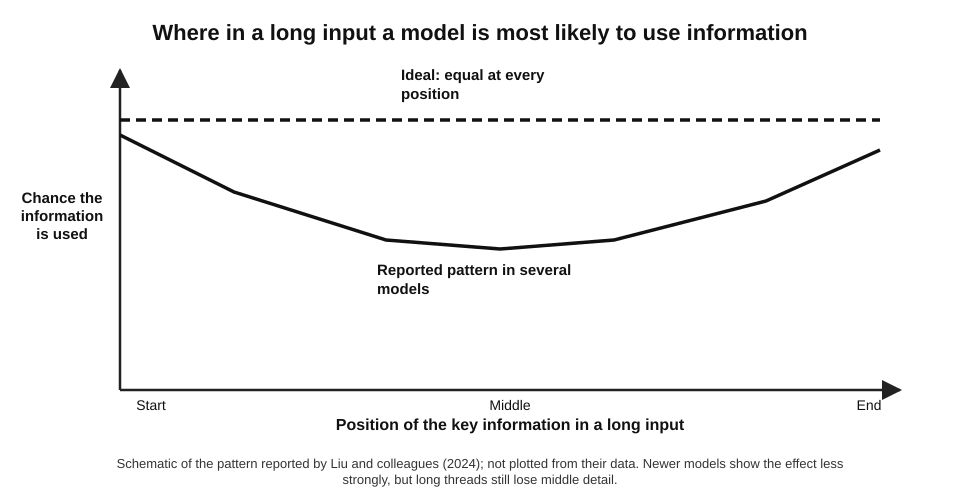
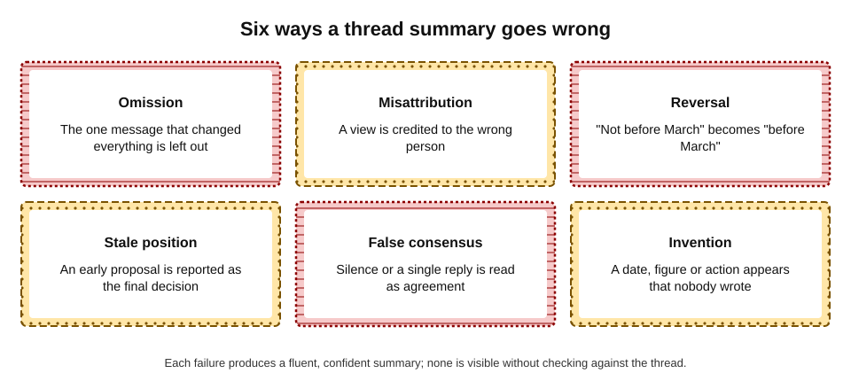
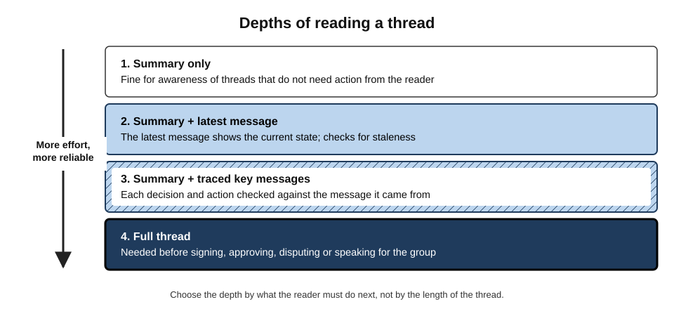
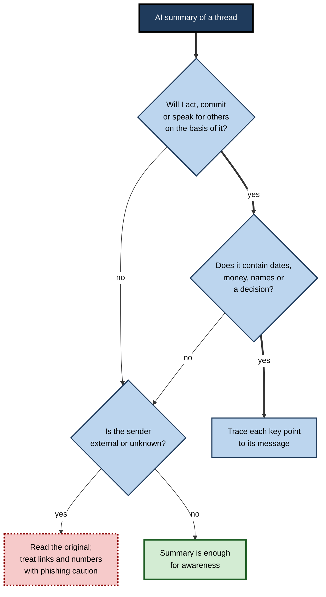
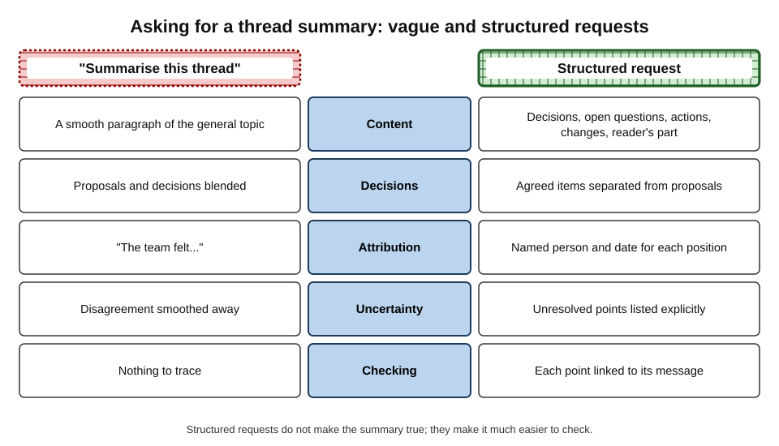

# F.2. Summarising long threads

A programme manager returns from two weeks' leave to a sixty-four-message email thread about choosing a software vendor. She clicks "Summarise" and reads five tidy lines: the team compared three vendors, preferred Vendor B, and will sign next week. She replies to the thread congratulating everyone on choosing B. Message 51, buried in the middle, recorded that B had failed the security review and the team had switched to C. The summary was fluent, confident and wrong in exactly the place that mattered.

> **Definition — Thread summarisation:** the condensing of a sequence of related messages — an email thread, a chat channel or a group conversation — into a shorter account of what was said, decided and left open, so that a reader can grasp its state without reading every message.

**Why it matters**

- **Threads are where work is negotiated.** Decisions, objections, approvals and changes of plan often exist nowhere else.
- **Catching up is a large hidden cost.** People returning from leave, joining a project or added to a thread late must reconstruct its state.
- **Built-in summaries are now everywhere.** Mail clients summarise threads at the top of a conversation; chat tools offer channel recaps and "what did I miss" digests.
- **Summaries become decisions.** People act on the summary — reply, approve, escalate — so its errors travel.

---

## What Makes a Thread Hard to Read

A long thread is not a document. It has many authors, no editor and a structure that grows by accident.

### The anatomy of a thread

- **Messages in time order**, each written for that moment, not for a later reader.
- **Quoted history** — each reply may carry the whole earlier thread beneath it, so the same text appears many times.
- **Forks** — "reply" and "reply all" create branches; some people see one branch, others another.
- **Side conversations** — someone removes recipients or starts a private chat; the decision is made there and only reported back, if at all.
- **Attachments and links** — the substance may sit in a spreadsheet or document that the thread merely mentions.
- **Changing positions** — people propose, revise and retract; early messages may no longer be true.

**Figure 1.** The structure of a typical long email thread, with forks and side conversations.

> **Key point:** the true state of a thread is usually in its **latest messages** and its **reversals**, not in its opening or its most repeated text.

### What a reader needs from a thread

- **Decisions** — what has been agreed, by whom, and when.
- **Open questions** — what is still unresolved or disputed.
- **Actions** — who will do what, by when.
- **Changes** — what was proposed and later revised or withdrawn.
- **The reader's own part** — what, if anything, is being asked of the person reading.

> **Mnemonic — "DO ACT":** **D**ecisions, **O**pen questions, **A**ctions, **C**hanges, **T**o me (what the reader must do).

---

## How AI Tools Summarise

### Two families of summary

> **Definition — Extractive summary:** a summary built by selecting and joining sentences that appear in the source.

> **Definition — Abstractive summary:** a summary written in new words that paraphrase and combine the source's content; the form produced by large language models.

| | Extractive | Abstractive |
|---|---|---|
| Wording | Copied from the messages | Newly generated |
| Readability | Often choppy | Smooth and natural |
| Faithfulness | Each sentence was really written by someone | Can state things nobody wrote |
| Attribution | Easy to trace | Must be requested and checked |
| Typical use today | Search snippets, highlights | Mail-client and chat summaries |

> **Watch out:** the smoothness of abstractive summaries is exactly what makes their errors hard to see. A choppy extract at least shows its sources.

### What happens inside a built-in summary

- **The tool gathers the thread** — sometimes all of it, sometimes only recent messages or a length-limited portion.
- **It strips or keeps quoted history**, signatures and disclaimers, depending on design.
- **It sends the text to a language model** with a hidden instruction such as "summarise the key points".
- **The model writes the most plausible summary** of what it was given.

**Limits that follow from this**

- **Truncation.** Very long threads may exceed what the tool sends; the earliest or middle messages can be dropped without notice.
- **Attachments.** Many summaries cover message text only, not the attached spreadsheet that holds the numbers.
- **Images and forwarded screenshots** are often ignored.
- **Branches.** A summary of the branch the reader can see says nothing about branches the reader was not copied on.

### Position effects in long inputs

**Study card — Liu and colleagues (2024), "Lost in the Middle"**

- **Design:** language models answered questions using long inputs (many documents or long lists of key–value pairs); the position of the one relevant item was varied.
- **Results:** accuracy was highest when the relevant information was at the **start** or **end** of the input and lowest when it was in the **middle** — a U-shaped pattern, found across several models.
- **Conclusion:** a model given a long input does not use all of it equally well.

**Figure 2.** The reported pattern of how position in a long input affects whether a model uses information.

> **Watch out:** newer models with longer context windows show this effect less strongly, and the size of the effect varies by task. The safe lesson is not a precise rule but a habit: **check the middle** of long threads, where reversals often sit.

### Faithfulness

> **Definition — Faithfulness (of a summary):** the extent to which every statement in a summary is supported by the source; an unfaithful statement is often called a **hallucination**.

**Study card — Maynez and colleagues (2020), faithfulness in abstractive summarisation**

- **Design:** human annotators checked summaries produced by several neural summarisation systems of the time against their source news articles.
- **Results:** a large share of summaries contained information **not supported** by the source; much of it was plausible background knowledge rather than nonsense.
- **Conclusion:** fluent summaries routinely mix source content with the model's own assumptions, and standard automatic scores did not detect this well.

> **Key point:** later language models are far more faithful than the systems of 2020, but the **kind** of error remains — plausible additions that "sound like" the thread.

---

## How Thread Summaries Go Wrong

**Figure 3.** Six common failure types in AI thread summaries.

- **Omission** — the summary drops the message that changed the outcome.
  - *e.g.* the security review failure in message 51.
- **Misattribution** — a view is credited to the wrong person or team.
  - *e.g.* "Finance approved" when Finance only asked a question.
- **Reversal** — negation or condition lost.
  - *e.g.* "not before March" summarised as "in March".
- **Stale position** — an early proposal reported as the current plan.
- **False consensus** — silence, a single "+1" or a thumbs-up read as group agreement.
- **Flattened uncertainty** — "we might", "subject to legal review" become plain statements.
- **Invention** — a deadline, figure or owner that no message contains.
- **Injected instructions** — text hidden in a message that tells the summarising model what to say.

### When summaries are attacked

Summaries can be manipulated deliberately, because the model treats the content it reads as possible instructions.

> **Definition — Indirect prompt injection:** hiding instructions inside content that an AI system will later process — an email, a web page, a document — so that the system follows the attacker's instructions instead of, or as well as, the user's.

**Documented event — hidden prompts in Gmail summaries (2025)**

- **What happened:** in July 2025 a security researcher, Marco Figueroa, reported through Mozilla's AI bug-bounty programme that text hidden in an email (for example, white text at zero font size) could instruct Gemini's "summarise this email" feature.
- **Demonstration:** the summary displayed a false security warning telling the reader their password was compromised and giving a phone number to call — content the reader never saw in the email itself.
- **Why it mattered:** the summary carried the authority of the mail provider's own interface, and the email contained no suspicious link or attachment for filters to catch.
- **Lesson:** a summary is only as trustworthy as the content it summarises; a summary of an untrusted email is still untrusted.

> **Watch out:** never act on a phone number, link or urgent instruction that appears **only** in an AI summary. Find it in the original message — and treat it with ordinary phishing caution there too.

### Case study: automatic notification summaries of news alerts (2024–2025)

- **Situation:** in late 2024 Apple introduced AI summaries of stacked phone notifications, including news alerts, as part of Apple Intelligence.
- **Problem:** several summaries misrepresented the underlying alerts. The BBC complained after a summary of its alerts falsely stated that the suspect in a high-profile killing in the United States had shot himself; another announced the winner of a darts championship before the final had been played.
- **Diagnosis:**
  - several short alerts were compressed into one line, combining and distorting them;
  - the summaries appeared under the publisher's name, so readers attributed the errors to the newsroom.
- **Actions:** in January 2025 Apple paused summaries for news and entertainment apps and said it would label AI summaries more clearly.
- **Lesson:** compressing several short messages is **riskier**, not safer, than summarising one long one: little text gives the model little to anchor on, and the summary inherits the source's credibility.

---

## Checking a Summary

### A fast verification routine

1. **Read the latest message in full.** It reveals stale positions at once.
2. **Trace each decision** in the summary to the message that made it — sender, date, exact words.
3. **Check every number, date and name** against the source.
4. **Search for reversal words** in the thread: "actually", "update", "correction", "no longer", "instead", "on reflection".
5. **Ask who is missing.** Is there a branch, a side chat or a call the summary cannot know about?
6. **Look at attachments** if the decision depends on figures.

> **Remember:** **latest message, trace decisions, check numbers, search reversals** — four steps catch most summary errors in a few minutes.

### Depth of reading by purpose

**Figure 4.** Four depths of reading a thread, chosen by what the reader must do next.

| Reader's next step | Acceptable depth | Why |
|---|---|---|
| Simply staying aware | Summary only | Low cost if slightly wrong |
| Replying with an opinion | Summary + latest message | Must not argue against a settled point |
| Taking an action or giving a date | Summary + traced key messages | Commitments must rest on real decisions |
| Approving, signing, disputing, reporting upward | Full thread | Accountability requires first-hand reading |

> **In practice:** a common professional rule is "**summaries for orientation, sources for action**".

**Figure 5.** Deciding whether a summary is enough.

### Worked example (illustrative): the vendor thread

- **Situation:** a sixty-four-message thread about choosing a software vendor; the AI summary says "the team preferred Vendor B and plans to sign next week".
- **Steps:**
  1. **Latest message (no. 64):** "Contract with C goes to legal Monday." — conflicts with the summary at once.
  2. **Search for reversals:** "security review" and "instead" find message 51: "B failed the pen test; moving to C instead."
  3. **Trace the original preference:** messages 12–30 did favour B — the summary reported the stale position.
  4. **Check numbers:** the summary's "£40k saving" appears nowhere; the thread mentions a saving only for B, now irrelevant.
  5. **Who is missing:** message 49 mentions "after our call with the CISO" — the reasoning lives in a call.

| Summary statement | What the thread actually shows | Failure type |
|---|---|---|
| Team preferred Vendor B | Preferred B until message 51, then switched to C | Stale position |
| Plans to sign next week | Contract with C going to legal Monday | Stale position |
| Saving of £40k | Not stated anywhere; a saving was discussed only for B | Invention |
| (Not mentioned) | B failed the security review | Omission |

*Illustrative figures.*

- **Conclusion:** five minutes of checking replaced an embarrassing reply-all with an accurate one.

> **Watch out:** the error was not random. The summary followed the **bulk** of the thread (many messages praised B) and missed the **turning point**. Long debates followed by short reversals are the classic trap.

---

## Asking for Better Summaries

Built-in summary buttons use a fixed, generic instruction. Where the tool allows a custom request, a structured request produces a summary that is far easier to check.

**Figure 6.** A vague request compared with a structured request for a thread summary.

### Elements of a strong summary request

- **Fields** — "list decisions, open questions, actions with owner and date, and positions that changed".
- **Attribution** — "for each point, give the sender's name and the date of the message".
- **Separation** — "distinguish what was agreed from what was only proposed".
- **Recency** — "state the current position as of the latest message".
- **Scope** — "what has changed since 3 June" (the reader's last visit).
- **Reader focus** — "what, if anything, is being asked of me".
- **Honesty about gaps** — "say if something is unclear or not stated rather than guessing".

> **Example — a structured request:** "Summarise this thread for someone returning from leave. Give: (1) decisions, each with who made it and when; (2) open questions; (3) actions with owner and due date; (4) any position that was later changed; (5) anything asked of me. Quote the key sentence for each decision. If something is not stated, say so."

> **Key point:** asking for **quotations and dates** turns an unverifiable paragraph into a set of claims that can each be checked in seconds.

---

## Summaries in Chat Channels

Chat channels pose different problems from email threads.

| | Email thread | Chat channel |
|---|---|---|
| Message size | Long, considered | Short, rapid, informal |
| Structure | Replies with quoted history | Streams, sub-threads, reactions |
| Meaning carried by | Words | Words plus emoji, reactions, timing, in-jokes |
| Typical summary feature | Thread summary at the top | Channel recap, unread digest, "catch me up" |
| Distinctive risk | Stale positions in long debates | Sarcasm and reactions misread; many topics merged |

- **Reactions are ambiguous.** A thumbs-up can mean "agreed", "seen" or "nice"; summaries often turn reactions into consensus.
- **Sarcasm and in-jokes** are frequently summarised literally.
- **Topic mixing.** A busy channel discusses several things at once; recaps can merge two separate decisions.
- **Volume tempts total reliance.** People in many channels may read only recaps — so recap errors spread widely.

> **In practice:** in chat, use recaps to decide **which conversations to open**, not as a substitute for opening them.

---

## Writing Summaries for Others

Professionals are often asked to summarise a thread **for someone else** — a manager, a new team member, a client. AI makes this easy and raises the stakes.

- **The summary becomes the record.** Once circulated, it may be relied on more than the thread itself.
- **The sender owns its accuracy.** Forwarding an AI summary under one's own name is vouching for it.
- **Audience changes what belongs.** A summary for a client must exclude internal discussion, prices for other clients and personal remarks that the thread may contain; an AI tool summarising the whole thread does not know this.
- **Fairness to participants.** Summaries compress disagreement; a colleague's carefully argued objection can become "some concerns were raised". Name significant dissent accurately.

> **Watch out:** the most damaging summary errors are not invented facts but **misrepresented people** — someone reported as agreeing to what they opposed.

### Case study (illustrative): the catch-up email for a new director

- **Situation:** a project lead asked an AI tool to summarise a three-month thread for a newly appointed director and forwarded the result unchanged.
- **Problem:** the summary described a delay as "caused by the data team's late delivery". The thread showed the data team had flagged a dependency on a supplier weeks in advance and had been overruled.
- **Diagnosis:** the summary took the framing of the most frequent and most recent senders, who were from the project side; the data team's early warning sat in the middle of the thread.
- **Actions:**
  1. the project lead corrected the summary to the director and copied the data team lead;
  2. the team adopted a rule: summaries sent upward must name decisions **with** their message dates and be read by one person from each team involved.
- **Result:** the director's first impression of the data team was repaired; the new rule added about ten minutes per upward summary.
- **Lesson:** a summary is an **account of people's conduct**, not just of facts; it deserves the care given to any report about colleagues.

---

## Thread Summaries at Professional Standard

### Personal practice

- **Orientation, then source.** Use summaries to decide what to read and in what order.
- **Always read the latest message** of any thread on which action depends.
- **Request structure and quotations** when the tool allows.
- **Distrust urgency** that appears only in a summary.
- **Keep a short "catch-up note"** after returning from leave: what was decided, what was asked of you, what you checked.

### Team practice

- **Write threads that summarise well.** Start important decisions with a clear line: "DECISION: we will use Vendor C (agreed by A, B, C on 14 May)."
- **Close threads explicitly.** A final "Summary of outcome" message by the owner gives every later reader — and every AI tool — an authoritative anchor at the end.
- **Move decisions out of threads.** Record final decisions in a decision log or project document, not only in email.
- **Agree what may be summarised by AI** — some organisations exclude legal, personnel or privileged threads from AI processing.

> **Key point:** the best defence against bad thread summaries is **better threads** — explicit decisions, explicit reversals and an explicit closing summary.

### Judging summary quality in an organisation

Organisations that switch on summaries for everyone rarely check whether they are accurate. A light audit is enough to learn where they can be trusted.

- **Sample real threads.** Each quarter, take a small set of long threads from different teams (with appropriate permissions) and compare the summary with the thread.
- **Score against DO ACT.** For each summary, record whether decisions, open questions, actions, changes and the reader's part were correct, missing or wrong.
- **Log the failure type.** Omission, stale position and false consensus usually dominate; knowing which helps target training.
- **Compare thread types.** Summaries of short, single-topic threads are usually reliable; long negotiations, multi-language threads and threads with key attachments are usually not.
- **Feed back to writing norms.** If summaries often miss decisions, the remedy may be explicit decision lines rather than a different tool.

> **Remember:** trust in summaries should be **earned per thread type**, not granted to the feature as a whole.

### Summaries across languages and formats

- **Multi-language threads** — a thread mixing, say, English and German may be summarised in one language, losing nuance from the other; check key points in the original language.
- **Tables and figures in the body** — numbers in pasted tables are a frequent source of transcription errors in summaries.
- **Forwarded chains** — a forwarded thread may contain only part of the original conversation; the summary cannot know what was cut.
- **Confidential content** — summarising sends the thread's content to the AI service; whether that is permitted depends on the organisation's settings and the material's sensitivity.

---

## Open Questions

- **How accurate are built-in thread summaries in real workplaces?**
  - Vendors report user satisfaction; independent measurements of error rates on real business threads are scarce.
- **Can summaries be made reliably resistant to injected instructions?**
  - Filtering hidden text helps, but indirect prompt injection is an unsolved problem for any system that reads untrusted content.
- **Does reliance on summaries change how people write threads?**
  - Writers may begin writing for the summariser — or may become careless, assuming summaries will tidy up.
- **Who is accountable for a misleading summary?**
  - The reader who acted on it, the colleague who forwarded it, or the provider whose interface displayed it — norms are unsettled.
- **Do summaries erode shared understanding?**
  - If each person reads a different, personalised summary, teams may lose the common reference that a shared thread provided.

---

## Summary

- **Thread summarisation** condenses a sequence of messages into what was said, decided and left open; it saves large amounts of catch-up time.
- Threads are hard because of **quoted history, forks, side conversations, attachments and changing positions**; the true state is usually in the **latest messages and reversals**.
- A reader needs **DO ACT**: Decisions, Open questions, Actions, Changes, and what is asked of the reader.
- AI tools write **abstractive** summaries — smooth but able to state things nobody wrote; long inputs may lose **middle** content; summaries may omit attachments and unseen branches.
- Failure types: **omission, misattribution, reversal, stale position, false consensus, flattened uncertainty, invention** and **injected instructions** (documented in 2025 for Gmail summaries).
- Apple's paused news notification summaries (2025) show that compressing many short messages is risky and that summaries borrow the source's credibility.
- Verify quickly: **latest message, trace decisions, check numbers, search reversals**; choose reading depth by the next action — **summaries for orientation, sources for action**.
- Ask for **structured, attributed, dated** summaries; in chat, use recaps to choose what to open.
- When summarising for others, the sender owns accuracy, must fit the audience, and must represent colleagues fairly.
- Teams make threads summarise well with explicit **decision lines** and **closing summaries**.

---

## Self-Check

1. Define thread summarisation and give three reasons it matters at work.
2. Name five structural features of email threads that make them hard to summarise.
3. What does the mnemonic DO ACT stand for?
4. Distinguish extractive from abstractive summaries and explain which is easier to verify.
5. What did Liu and colleagues find about position in long inputs, and what habit follows from it?
6. Define faithfulness and give two examples of unfaithful summary statements.
7. List six failure types of thread summaries with an example of each.
8. Explain indirect prompt injection using the 2025 Gmail summary example.
9. Why was compressing several short news alerts into one summary especially risky?
10. Describe the four-step fast verification routine.
11. For each, choose a reading depth and justify it: approving a budget discussed in a thread; staying aware of a project you are copied on; replying with an opinion on a design debate.
12. Write a structured request for a thread summary for someone returning from leave.
13. A colleague forwards an AI summary to a client. What three things might go wrong?
14. A team keeps finding that AI summaries report outdated decisions. Propose changes to how the team writes and closes threads.

### Answer Key

1. Condensing related messages into an account of what was said, decided and left open. It matters because threads hold decisions that exist nowhere else, catching up is costly, and people act on summaries.
2. Quoted history repeated many times; forks from reply and reply all; side conversations off-thread; substance in attachments; positions that change over time (also multiple authors with no editor).
3. Decisions, Open questions, Actions, Changes, To me (what the reader must do).
4. Extractive selects sentences from the source; abstractive writes new sentences. Extractive is easier to verify because each sentence was actually written by someone; abstractive can state things nobody wrote.
5. Models used information at the start and end of long inputs better than information in the middle (a U-shaped pattern). Habit: check the middle of long threads, where turning points often sit.
6. The extent to which every summary statement is supported by the source. Examples: an invented deadline; "Finance approved" when Finance only asked a question.
7. Omission (dropping the reversal message); misattribution (wrong person credited); reversal ("not before March" → "in March"); stale position (early proposal as final); false consensus (a thumbs-up as agreement); invention (a figure nobody wrote); also flattened uncertainty and injected instructions.
8. Hidden text in an email (e.g. white, zero-size font) contained instructions; when the user asked Gemini to summarise, the summary showed a fake security warning with a phone number. The model treated content as instructions; the summary looked authoritative.
9. Short alerts give little context to anchor the summary, combining them distorts meaning, and the result appeared under the publisher's name, borrowing its credibility.
10. Read the latest message; trace each decision to its message; check numbers, dates and names; search for reversal words (also check for missing branches and attachments).
11. Approving a budget: full thread — accountability needs first-hand reading. Staying aware: summary only — low cost of error. Replying with an opinion: summary plus latest message — to avoid arguing against a settled point.
12. E.g. "Summarise for someone back from leave: decisions with who and when; open questions; actions with owner and date; positions later changed; anything asked of me. Quote the key sentence for each decision; say if something is not stated."
13. Internal discussion or other clients' information may be included; errors become the client's record and the sender's responsibility; colleagues' positions may be misrepresented.
14. Use explicit "DECISION:" lines with names and dates; post explicit reversals; close each thread with an owner's outcome summary at the end; record final decisions in a decision log; read the latest message before acting on any summary.

---

## Glossary

| Term | Meaning |
|---|---|
| Abstractive summary | A summary written in new words that paraphrase the source. |
| Channel recap | A chat tool's summary of recent activity in a channel. |
| DO ACT | Decisions, Open questions, Actions, Changes, To me — what a thread summary should give. |
| Extractive summary | A summary made of sentences selected from the source. |
| Faithfulness | The degree to which a summary's statements are supported by the source. |
| False consensus | Reporting silence or a single reaction as group agreement. |
| Fork | A branch of a thread created when replies go to different sets of recipients. |
| Hallucination | A generated statement not supported by the source or by fact. |
| Indirect prompt injection | Hidden instructions in content that an AI system later processes. |
| Lost in the middle | The tendency of language models to use information in the middle of long inputs less well. |
| Quoted history | Earlier messages carried beneath each reply in a thread. |
| Stale position | An earlier proposal reported as the current state. |
| Thread | A sequence of related messages replying to one another. |
| Thread summarisation | Condensing a thread into what was said, decided and left open. |
| Truncation | Dropping part of a long input to fit a tool's limits. |
