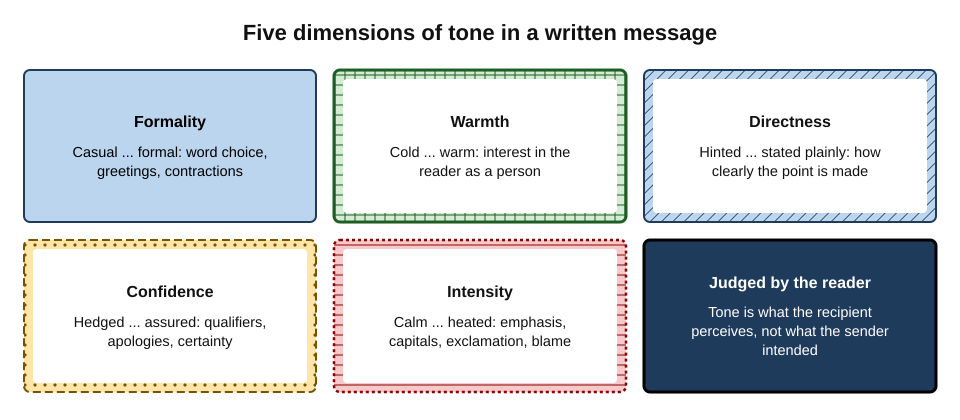
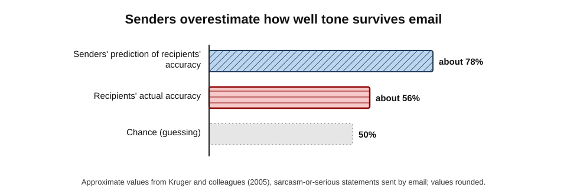
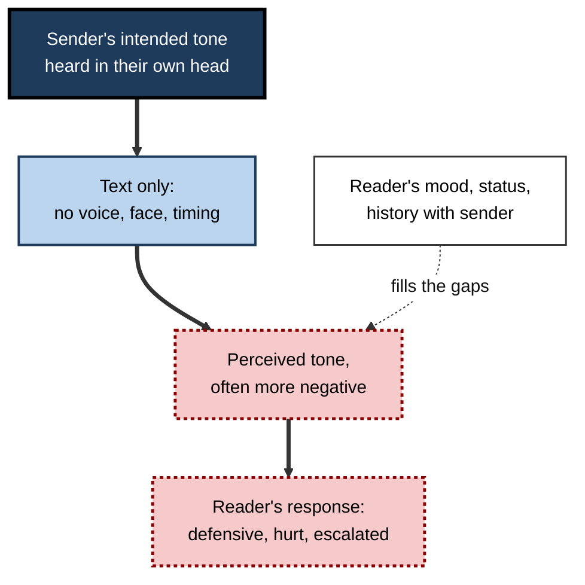
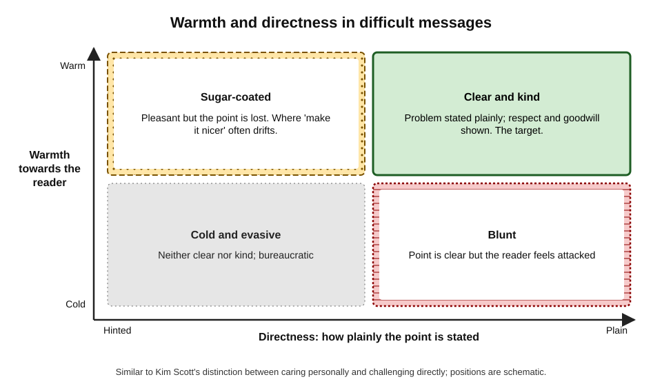
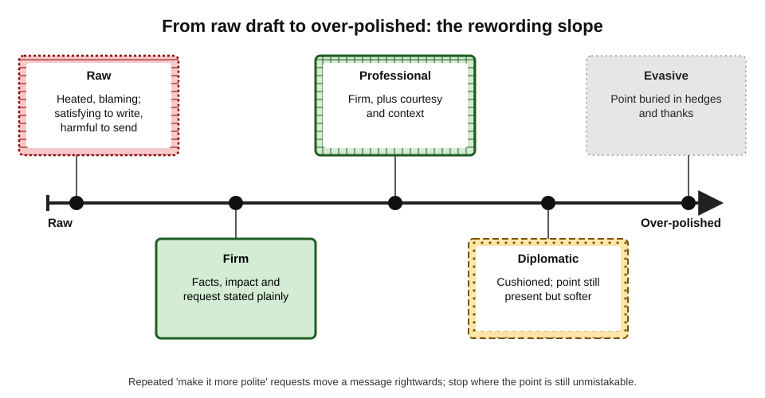
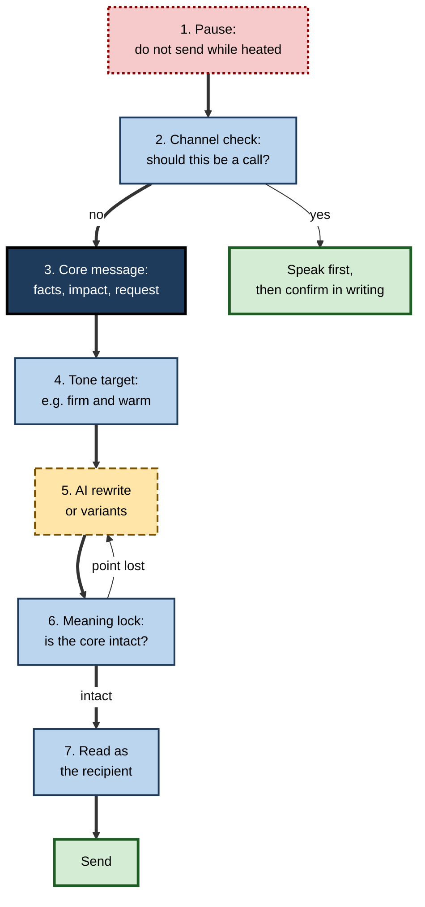

# F.3. Tone adjustment for difficult messages

At 11 p.m. a software lead finds that a colleague has, for the third time, broken the release with untested code. She types: "This is UNACCEPTABLE. Third time. Do you even read the process?" Her mail client's "make it more professional" option returns: "I hope you're well! I wanted to gently flag a small issue with the recent release when you have a moment." The first would have damaged the relationship; the second would have changed nothing.

Tone tools are powerful precisely because they can move a message too far in **either** direction.

> **Definition — Tone:** the attitude a message conveys towards its reader and its subject — formal or casual, warm or cold, direct or indirect, confident or hesitant, calm or heated — as perceived by the person who reads it.

> **Definition — AI tone adjustment:** using features in mail, chat and writing tools to detect the likely tone of a draft or to rewrite it towards a requested tone ("more formal", "friendlier", "more concise", "more confident") while, ideally, keeping its meaning.

**Why it matters**

- **Difficult messages carry the highest stakes** — bad news, refusals, criticism, complaints and apologies decide relationships and reputations.
- **Text strips out voice and face.** The reader supplies the missing tone, often more negatively than intended.
- **Tone tools are now one click away** in the main mail and chat products.
- **The common failure is not rudeness but vagueness.** Over-softened messages fail to deliver the point, so the problem continues.

---

## What Tone Is Made Of

Tone is not one setting but several, which can move independently.

**Figure 1.** Five dimensions of tone in a written message.

- **Formality** — vocabulary, greetings, contractions, sentence length.
  - *e.g.* "Can't make it, sorry" versus "Unfortunately I am unable to attend."
- **Warmth** — signs of goodwill and interest in the reader.
  - *e.g.* acknowledging their effort, using their name, a personal line.
- **Directness** — how plainly the main point is stated.
  - *e.g.* "The report is late" versus "I was wondering where things stand with the report."
- **Confidence** — certainty versus hedging.
  - *e.g.* "We will deliver on Friday" versus "We should hopefully be able to deliver around Friday."
- **Emotional intensity** — calm versus heated.
  - *e.g.* capitals, exclamation marks, absolute words ("always", "never"), blame.

> **Key point:** most difficult messages need **high directness and high warmth together**. Tools that offer only "more polite" tend to raise warmth by **lowering** directness.

### Tone is decided by the reader

- **Intended tone** — what the sender meant.
- **Perceived tone** — what the reader experiences.
- The two often differ, and only perceived tone has consequences.

> **Definition — Register:** the variety of language suited to a situation and relationship — from intimate and casual to formal and ceremonial.

---

## Why Tone Goes Wrong in Text

### Egocentrism: the sender hears a voice the reader cannot

**Study card — Kruger, Epley, Parker and Ng (2005), "Egocentrism over e-mail"**

- **Design:** participants wrote statements on everyday topics, some meant sarcastically and some seriously, and sent them by email; others read them. Senders predicted how many recipients would correctly tell sarcasm from seriousness.
- **Results:**
  - senders were confident that most recipients would interpret their tone correctly;
  - recipients did only a little better than chance;
  - recipients were also over-confident in their own interpretations;
  - when the same statements were spoken, accuracy was much higher.
- **Conclusion:** writers "hear" their own tone of voice as they write and assume the reader will too. Email removes the cues that carry it.

**Figure 2.** The gap between senders' expectations and recipients' accuracy in reading tone by email.

> **Definition — Egocentrism (in communication):** the tendency to judge how a message will be understood from one's own perspective, overlooking that the reader lacks the context and cues the sender has.

### The negativity effect

- **Kristin Byron (2008)** reviewed research on emotion in email and argued that:
  - emails are often read as **more negative** than intended — positive messages as neutral, neutral ones as slightly negative;
  - the effect is stronger when the reader is junior, under stress or already in conflict with the sender.
- **Why:** without voice and face, readers fill gaps with their own mood, expectations and the relationship's history.

**Figure 3.** How tone is lost and replaced between sender and reader.

> **Watch out:** the remedy is not to add exclamation marks and emoji everywhere. Warmth is conveyed most reliably by **content** — acknowledging the reader's situation, recognising effort, offering help — not by punctuation.

---

## Politeness, Face and the Difficult Message

### Face and face-threatening acts

> **Definition — Face:** the public self-image a person wants to keep; Penelope Brown and Stephen Levinson (1987) distinguished **positive face** (the wish to be liked and approved of) and **negative face** (the wish not to be imposed upon).

> **Definition — Face-threatening act:** a communicative act that challenges someone's face — criticising, refusing, requesting, correcting, complaining.

- **Every difficult message is a face-threatening act.** Criticism threatens positive face; requests and deadlines threaten negative face.
- **Politeness strategies** reduce the threat.

| Strategy | What it does | Example | When suitable |
|---|---|---|---|
| Bald on record | States the point with no softening | "Send the file today." | Emergencies; close, equal relationships |
| Positive politeness | Stresses goodwill and common ground | "We're in this together — could you send the file today?" | Colleagues, team settings |
| Negative politeness | Minimises imposition; offers options | "I know you're busy; would it be possible to send the file today?" | Seniors, clients, strangers |
| Off record | Hints without stating | "I'm still waiting on a couple of things." | Rarely in work; easily missed |

> **Key point:** AI "make it polite" rewrites usually add **negative politeness** — hedges, apologies, conditionals. In small doses this helps; in large doses it slides towards **off record**, where the point disappears.

### Kinds of difficult message

| Message type | What must survive the rewrite | Typical tone risk | Useful AI role |
|---|---|---|---|
| Bad news (delay, failure) | The fact, the new date, the plan | Defensive or grovelling | Draft structure; check for over-apology |
| Refusal | A clear "no" | Ambiguous "maybe" | Firm-but-kind variants |
| Critical feedback | The specific behaviour and its impact | Blame or vagueness | Check for absolute words and blame |
| Complaint (sent) | The problem and the remedy sought | Heated or passive-aggressive | Cool the intensity; keep the request |
| Reply to an angry message | Facts and next step | Mirroring the anger | Strip heat; keep it brief |
| Apology | Responsibility and repair | Non-apology or over-admission | Check structure; legal review if needed |
| Chasing (overdue item) | The deadline and consequence | Passive-aggressive | Neutral, specific reminders |

---

## What Tone Tools Do

### Forms of tone assistance

- **Rewrite commands** — "formalise", "make friendlier", "shorten", "make more confident", "polish".
- **Tone detection** — the tool labels a draft ("sounds: confident, slightly critical") or flags phrases that may read as harsh; some mail tools offer coaching on tone, clarity and likely reader reaction.
- **Free-form instruction** — "keep the request but make it warmer and remove any blame".
- **Variants** — several versions at different tones, so the writer can choose.

### What tools do well

- **Removing heat** — capitals, sarcasm, absolute words, rhetorical questions.
- **Adding structure** — opening acknowledgement, clear point, next step.
- **Second-language support** — idiomatic softeners and polite formulas that are hard to produce in a non-native language.
- **Breaking paralysis** — producing a starting version when emotion blocks writing.

### What tools do badly

- **Preserving the point.** Rewrites can turn "this must stop" into "it might be worth considering".
- **Knowing the relationship.** The tool does not know that this is the third incident, or that the reader is the sender's manager.
- **Knowing the culture.** A suitable directness level in one workplace or country is abrupt or vague in another.
- **Sincerity.** Generated empathy ("I completely understand how frustrating this must be") can read as formulaic, especially when repeated.

### The evidence on AI-generated warmth

**Study card — Ayers and colleagues (2023), *JAMA Internal Medicine***

- **Design:** licensed health professionals compared, without knowing the source, physicians' answers and chatbot (ChatGPT) answers to patient questions posted on a public online forum.
- **Results:** the chatbot's answers were preferred in a large majority of comparisons and rated **more empathetic** and of higher quality.
- **Conclusion:** generated text can **read** as warmer than hurried human text.

> **Watch out:** the physicians' answers were brief replies on a public forum, not consultations, and the raters judged the text alone. The study shows generated text can **look** empathetic; it does not show that patients felt better cared for.

**Study card — Yin, Jia and Wakslak (2024), *PNAS***

- **Design:** participants described a personal situation and received responses written either by AI or by people; some were told the true source, others a false one.
- **Results:**
  - AI-written responses made people feel **more heard** than human responses, on average;
  - but when a response was **labelled** as AI-written, people felt less heard — the label reduced the benefit.
- **Conclusion:** the emotional value of a supportive message depends partly on believing **a person** made the effort.

> **Key point:** AI can make a message sound warmer; whether the warmth **counts** depends on whether the recipient believes the sender meant it.

---

## The Over-Softening Problem

**Figure 4.** Warmth and directness: four kinds of difficult message.

- **Clear and kind** (warm, direct) — the target for nearly all difficult work messages.
- **Blunt** (cold, direct) — the point lands, but the reader defends instead of listening.
- **Sugar-coated** (warm, indirect) — pleasant, but the reader does not realise anything is wrong.
- **Cold and evasive** (cold, indirect) — bureaucratic language that neither informs nor respects.

> **Definition — Over-softening:** rewording a difficult message until its main point is no longer clear to the reader, usually by adding hedges, apologies, compliments and conditional phrasing.

- **Kim Scott's "Radical Candor" (2017)** made a similar distinction for managers' feedback: caring personally and challenging directly; failing to challenge out of kindness she called **ruinous empathy**.

**Figure 5.** How repeated rewording moves a difficult message from raw to over-polished.

### Signs a rewrite has gone too far

- The main point is no longer in the **first two sentences**.
- The word **"just"**, "maybe", "perhaps" or "when you have a moment" now governs the request.
- The message thanks or praises more than it asks.
- A deadline has become "soon" or disappeared.
- The reader could reasonably reply "No problem!" and change nothing.

> **Remember:** after every tone rewrite, ask: **"Would the reader know exactly what is wrong and what I need?"**

---

## A Method for Difficult Messages

**Figure 6.** A method for writing a difficult message with AI tone assistance.

1. **Pause.** Do not send a message written in anger; draft it, then wait — at least an hour, ideally overnight for serious matters.
2. **Check the channel.** Serious criticism, personal matters and anything likely to upset are usually better spoken first and confirmed in writing.
3. **Write the core message** in plain notes:
   - **facts** — what happened, specifically;
   - **impact** — why it matters;
   - **request** — what should happen next, by when.
4. **Choose a tone target** in words — "firm, warm, brief; no apology; no blame".
5. **Ask for a rewrite** or two or three variants against that target.
6. **Apply a meaning lock** — check that every fact, the impact and the request survive unchanged.
7. **Read as the recipient** — in their role, on a bad day. Remove anything that could be read as sarcasm or blame.

> **Mnemonic — "FIR":** **F**acts, **I**mpact, **R**equest — the core that no tone change may remove.

> **Definition — Meaning lock:** a deliberate check, after a rewrite, that the essential content (facts, impact, request, deadline) is unchanged.

### Worked example (illustrative): the broken release

- **Situation:** the software lead's colleague has broken the release for the third time by skipping the test process.

| Version | Text | Assessment |
|---|---|---|
| Raw | "This is UNACCEPTABLE. Third time. Do you even read the process?" | Heated, sarcastic; invites defence; no clear request |
| Tool: "more professional" | "I hope you're well! I wanted to gently flag a small issue with the recent release when you have a moment." | Over-softened; hides severity; no request; "small" is false |
| Instructed rewrite | "Last night's release failed because the change went in without the test run — the third time this quarter. Each failure costs the support team a morning. From now on please run the full test suite before every merge; if the suite is getting in the way, let's talk tomorrow about fixing it." | Clear and kind: facts, impact, request, an offer of help |

- **Instruction used for the third version:** "Rewrite: firm and respectful. Keep: release failed; no test run; third time this quarter; costs support a morning; request — run full tests before every merge. Offer a conversation. No sarcasm, no apology, no exclamation marks."
- **Meaning lock:** all five facts present; request specific; no blame words.
- **Conclusion:** the tool did its best work when told **what must not change**.

> **Watch out:** for a third incident, the right channel may be a conversation first. A well-toned email does not replace a manager's duty to talk.

---

## Special Cases

### Replying to an angry message

- **Do not mirror.** Anger in the incoming message tempts an angry reply; tone tools can help by stripping heat from the draft.
- **Bill Eddy's "BIFF" response**, developed for high-conflict situations, recommends replies that are:
  - **Brief** — short replies give less to argue with;
  - **Informative** — facts, not opinions about the other person;
  - **Friendly** — a courteous opening and close;
  - **Firm** — a clear end point, without inviting further argument.

> **Mnemonic — BIFF:** Brief, Informative, Friendly, Firm.

> **In practice:** "Make this a BIFF reply" is a useful instruction to a tone tool; then check that "firm" has survived.

### Apologies

- **What makes an apology work.** Research by Roy Lewicki, Beth Polin and Robert Lount (2016) on apology components found that **acknowledging responsibility** was the most important element, followed by an **offer of repair**; expressions of regret alone counted for less.
- **Non-apologies** — "I'm sorry if anyone was offended" — are often produced when a tool is asked to "apologise without admitting fault".
- **Legal care.** In some jurisdictions an apology is expressly not an admission of liability — for example, section 2 of the United Kingdom's Compensation Act 2006 says an apology does not of itself amount to one — but the rules differ by country and context. Customer-facing apologies about losses, injuries or contractual failures should follow the organisation's approved wording.

> **Watch out:** asking a tool to "sound more sorry" can introduce admissions ("this was entirely our fault") that the facts do not support.

### Feedback and criticism

- **Behaviour, not character** — "the report missed the deadline" rather than "you are unreliable".
- **Specific, not absolute** — "twice this month" rather than "always".
- **Forward-looking** — the change needed and the support offered.
- **Tone tools** are useful for **detecting** absolute and character words; they are poor judges of whether criticism is fair.

### Cultural expectations of directness

- **Directness norms differ** between countries, industries and organisations; Edward Hall's distinction between **low-context** cultures (meaning carried mainly in explicit words) and **high-context** cultures (meaning carried by context and relationship) is a common starting point.
- **AI tools default to a generic, often American-influenced professional register**, which may be too direct for some readers and too cushioned for others.
- **Instruct explicitly** — "for a Japanese client, very courteous, indirect refusal" or "for a Dutch colleague, plain and brief" — and treat the result as a hypothesis to check with someone who knows the reader.

---

## Tone at Professional Standard

### Personal practice

- **Use detection before rewriting.** Ask the tool how the draft is likely to be read; adjust the draft yourself where possible.
- **Prefer instructed rewrites** over one-click "polish".
- **Keep your voice.** A sudden switch to polished corporate language can itself signal distance or that a tool was used.
- **Never send a difficult message on the first pass.**

### Tone in chat and on mobile

- **Brevity reads as coldness.** A one-word chat reply ("Fine.") or a full stop at the end of a short message can read as curt to some readers, especially younger colleagues used to informal messaging.
- **Reactions are tone too.** A thumbs-up to a long, emotional message can feel dismissive; a short written line usually lands better.
- **Speed amplifies heat.** Chat invites instant replies, so the pause step matters even more; some people keep a rule of never answering a provocative chat message within ten minutes.
- **Tone tools in chat** are mostly used to shorten and soften; the same meaning lock applies.

### Organisational practice

- **Tone guidance, not tone scripts.** Organisations do better with short principles ("lead with the outcome; acknowledge the reader's situation in your own words; no blame") than with mandatory empathy formulas.
- **Review for the highest-stakes messages.** Redundancy notices, customer remediation letters and regulator correspondence should be reviewed by a second person, whatever tool was used.
- **Train the meaning lock.** Staff who use rewriting tools should be practised at checking that facts, impact and requests survive the rewrite.
- **Watch for drift.** If many messages begin to sound identical, recipients will notice; periodic sampling of real messages reveals it.

### When not to use tone tools

- **Grief, illness and personal crises** — sincerity outweighs polish; small imperfections signal a human wrote it.
- **Serious apologies** where the recipient will judge the effort itself.
- **Formal disciplinary or legal correspondence** — wording follows policy and advice, not a model's style.
- **Confidential personnel matters** — pasting them into an AI service may itself breach confidentiality rules.

### Case study (illustrative): the complaints team that sounded like a machine

- **Situation:** a utility company's complaints team adopted AI tone rewriting so that every response sounded "empathetic and professional".
- **Problem:** customer satisfaction with responses fell; customers described replies as "scripted" and "fake"; escalations to the regulator rose slightly.
- **Diagnosis:**
  - every response opened with near-identical empathy formulas ("I completely understand how frustrating this must be");
  - rewrites had softened the actual decisions — customers could not tell whether a refund was granted;
  - repeated contact from the same customers exposed the formulas.
- **Actions:**
  1. **Decision first:** each reply must state the outcome (refund granted, refused, or under review) in the first sentence.
  2. **Specific empathy:** acknowledge the customer's actual situation in the agent's own words, not a formula.
  3. **Tone tool for heat-checking only** — detecting blame and jargon — not for generating empathy.
- **Result:** within two quarters, satisfaction recovered above its earlier level and repeat contacts fell.
- **Lesson:** warmth that is generic stops reading as warmth; **clarity of the outcome** was what customers most needed.

---

## Open Questions

- **Will AI-polished tone become the default expectation?**
  - If most messages are smoothly polite, unpolished human messages may read as rude — or as refreshingly genuine.
- **Does AI softening reduce accountability?**
  - Over-softened criticism may let problems persist; how often this happens in real workplaces is unmeasured.
- **Can tone tools adapt to individual relationships and cultures?**
  - Tools that learn from a person's history might calibrate better, at a cost in privacy.
- **Does labelling AI assistance destroy the value of supportive messages?**
  - Early studies suggest labels reduce felt support; whether that persists as AI use becomes normal is open.
- **Do tone tools change how people handle conflict?**
  - They may prevent impulsive escalation — or help people avoid difficult conversations that should happen face to face.

---

## Summary

- **Tone** is the attitude a message conveys, judged by the **reader**; it has dimensions of **formality, warmth, directness, confidence and intensity**.
- Text strips voice and face: senders over-estimate how clearly tone carries (**egocentrism**, Kruger and colleagues, 2005), and readers often perceive emails as **more negative** than intended (Byron, 2008).
- Difficult messages are **face-threatening acts**; politeness strategies range from bald on record to off record. AI "polite" rewrites add hedges and can drift towards **off record**.
- Tools remove heat, add structure and help second-language writers; they cannot know the relationship, culture or how serious the matter is.
- AI-written responses can **read** as more empathetic, but **labelled** AI support is felt as less supportive (Yin, Jia and Wakslak, 2024).
- The main risk is **over-softening**: aim for **clear and kind** — high warmth **and** high directness.
- Method: pause; check channel; write **FIR** (facts, impact, request); set a tone target; rewrite; apply a **meaning lock**; read as the recipient.
- Special cases: **BIFF** replies to anger; apologies need **responsibility and repair** and legal care; criticism targets behaviour, specifically; directness norms differ by culture.
- Avoid tone tools for grief, serious apologies, formal disciplinary or legal letters and confidential personnel matters.

---

## Self-Check

1. Define tone and name its five dimensions.
2. Describe the Kruger and colleagues (2005) study and the concept it illustrates.
3. What is the negativity effect in email, and when is it strongest?
4. Explain positive face, negative face and face-threatening acts, with a workplace example of each.
5. Why do one-click "polite" rewrites often reduce clarity?
6. Distinguish "clear and kind", "blunt", "sugar-coated" and "cold and evasive" messages.
7. List four signs that a tone rewrite has gone too far.
8. What does FIR stand for, and how is it used with a tone tool?
9. What does the Yin, Jia and Wakslak (2024) study suggest about AI-written supportive messages?
10. Why should the Ayers and colleagues (2023) result not be read as proof that AI provides better care?
11. Write a tone instruction for replying to a client's angry email about a missed delivery, using BIFF.
12. What are the two most important components of an apology, and what legal care is needed?
13. A colleague asks a tool to make critical feedback "much nicer" three times in a row. What is likely to happen, and what should they do instead?
14. A team lead wants every sensitive message to staff to go through an AI tone rewriter. Give arguments for and against, and propose a policy.

### Answer Key

1. The attitude a message conveys towards reader and subject, as perceived by the reader. Dimensions: formality, warmth, directness, confidence, emotional intensity.
2. Senders emailed sarcastic or serious statements and predicted recipients' accuracy. Senders expected high accuracy; recipients were barely above chance (and over-confident), while spoken versions were understood better. It illustrates egocentrism — senders hear their own tone and assume readers do too.
3. Emails tend to be read as more negative than intended. It is strongest when the reader is junior, stressed or in conflict with the sender.
4. Positive face: wish to be approved of (threatened by criticism of a report). Negative face: wish not to be imposed upon (threatened by a weekend deadline request). Face-threatening acts: criticism, refusals, requests, complaints, corrections.
5. They mainly add negative politeness — hedges, apologies, conditionals — which reduces directness until the point is unclear.
6. Clear and kind: plain point, goodwill shown. Blunt: plain point, reader feels attacked. Sugar-coated: pleasant, point lost. Cold and evasive: neither clear nor respectful.
7. Main point not in first two sentences; request governed by "just/maybe/when you have a moment"; more praise than request; deadline softened or gone; reader could reply "No problem" and change nothing.
8. Facts, Impact, Request. Write them first, include them in the instruction as content that must not change, then check after the rewrite that all three survive.
9. AI-written responses made people feel more heard, but labelling them as AI reduced that effect — the value of support depends partly on believed human effort.
10. Raters judged text alone; physicians' answers were brief forum posts rather than consultations; it measures perceived empathy of text, not patient outcomes or care.
11. E.g. "Rewrite as a BIFF reply: brief (under 120 words), informative (delivery missed on 3 May because of a warehouse error; new delivery 7 May; credit of one month's fee applied), friendly (thank them for raising it), firm (this is the final arrangement; contact me directly). No blame of the client, no over-apology."
12. Acknowledging responsibility, then an offer of repair. Legal effects of apologies vary by jurisdiction; apologies about losses or contractual failures should follow approved wording to avoid unintended admissions.
13. The feedback will drift to sugar-coated or off-record, losing the point. Instead: write FIR, give an explicit tone target ("warm but direct"), request one rewrite, and apply a meaning lock.
14. For: removes heat, improves consistency, helps less confident writers. Against: over-softening, generic formulaic tone, loss of personal voice and sincerity, confidentiality concerns. Policy: tools used for heat-detection and suggestions; leader writes core content (FIR); meaning lock required; no AI for personal crises, disciplinary or confidential personnel matters; serious messages preceded by conversation.

---

## Glossary

| Term | Meaning |
|---|---|
| AI tone adjustment | Using tools to detect or rewrite the tone of a draft. |
| BIFF | Brief, Informative, Friendly, Firm — a structure for replying to hostile messages. |
| Directness | How plainly the main point of a message is stated. |
| Egocentrism | Judging how a message will be understood from one's own perspective. |
| Face | The public self-image a person wishes to maintain. |
| Face-threatening act | A communicative act that challenges someone's face, such as criticism or refusal. |
| FIR | Facts, Impact, Request — the core of a difficult message. |
| Meaning lock | A check after rewriting that essential content is unchanged. |
| Negative face | The wish not to be imposed upon. |
| Negative politeness | Softening that minimises imposition: hedges, options, apologies. |
| Negativity effect | The tendency for emails to be read as more negative than intended. |
| Off record | Hinting at a point without stating it. |
| Over-softening | Rewording until the main point is no longer clear. |
| Positive face | The wish to be liked and approved of. |
| Register | The variety of language suited to a situation and relationship. |
| Ruinous empathy | Kim Scott's term for failing to challenge someone out of a wish to be kind. |
| Tone | The attitude a message conveys, as perceived by its reader. |
