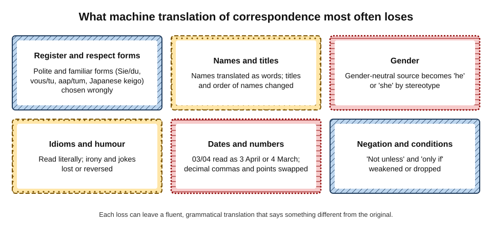
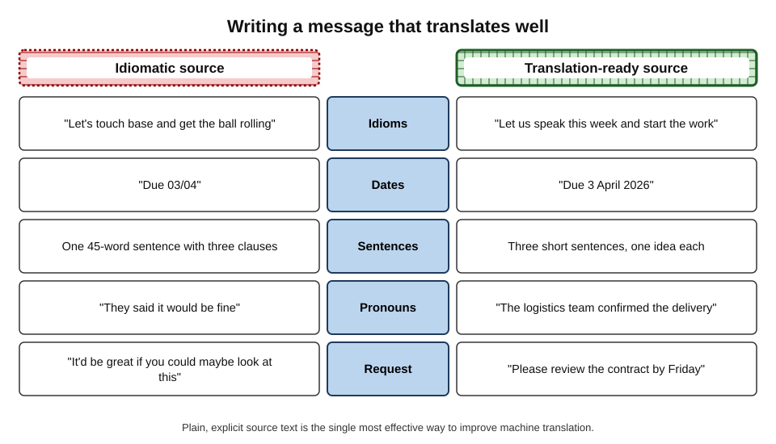
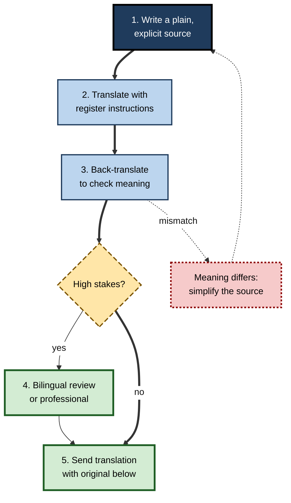
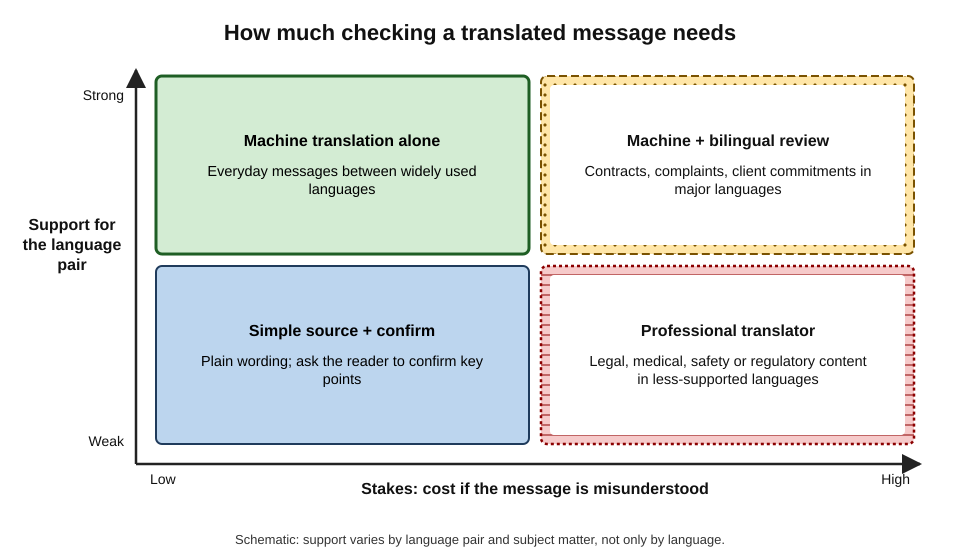

# F.4. Translating correspondence

A procurement manager in Pune emails a supplier in Stuttgart in English; the supplier reads it through the mail client's "Translate" button and replies in German, which the manager reads the same way. The exchange runs smoothly for weeks — until the supplier writes that a price increase is "eventuell" necessary, the translation renders it as "eventually", and the manager budgets for a rise next year. In German *eventuell* means "possibly". Translation inside the inbox has made cross-language correspondence routine; it has also made misunderstanding invisible.

> **Definition — Machine translation of correspondence:** the automatic translation of emails, chat messages and their attachments from one language to another by software built into, or used alongside, mail and messaging tools — to read incoming messages or to write outgoing ones.

**Why it matters**

- **Work crosses languages daily.** Suppliers, clients, colleagues and customers increasingly write in their own languages and expect to be understood.
- **Translation is now one click away** in the main mail clients, chat tools and phones, often offered automatically when a foreign-language message arrives.
- **Correspondence creates obligations.** Prices, dates, conditions and apologies translated wrongly become disputes.
- **Relationships depend on register.** Addressing a senior client with the familiar form, or a colleague with stiff formality, can sour a relationship before any fact is wrong.

---

## Two Directions, Two Kinds of Risk

Translating a message **in order to read it** and translating a message **in order to send it** are different activities with different risks.

> **Definition — Gisting:** using a rough translation to grasp the general meaning of a text, accepting that details may be wrong.

> **Definition — Outbound translation:** translating one's own message into the reader's language before sending it, so that the translation itself becomes the communication.

**Figure 1.** Inbound and outbound translation of correspondence and where errors land.

```mermaid
%%{init: {'theme':'base','themeVariables':{'fontFamily':'Arial, Helvetica, sans-serif','fontSize':'15px','primaryColor':'#FFFFFF','primaryTextColor':'#111111','primaryBorderColor':'#222222','lineColor':'#333333','secondaryColor':'#F2F2F2','tertiaryColor':'#FFFFFF','clusterBkg':'#FAFAFA','clusterBorder':'#555555','edgeLabelBackground':'#FFFFFF','titleColor':'#111111'}}}%%
flowchart TD
    classDef core    fill:#1F3B5C,stroke:#000000,stroke-width:3px,color:#FFFFFF
    classDef key     fill:#BCD5EE,stroke:#1F3B5C,stroke-width:2px,color:#000000
    classDef detail  fill:#FFFFFF,stroke:#333333,stroke-width:1.5px,color:#000000
    classDef caution fill:#F6CACA,stroke:#8B0000,stroke-width:2.5px,stroke-dasharray:3 3,color:#000000

    subgraph IN["Inbound: translating to read"]
        I1["Message arrives<br/>in another language"]
        I2["Translated for<br/>the reader only"]
        I3["Error misleads<br/>the reader"]
    end
    subgraph OUT["Outbound: translating to send"]
        O1["Writer drafts in<br/>own language"]
        O2["Translation sent<br/>as the message"]
        O3["Error misleads<br/>the recipient, in writing"]
    end

    I1 ==> I2 -.-> I3
    O1 ==> O2 -.-> O3

    class I1,O1 detail
    class I2 key
    class O2 core
    class I3,O3 caution
```

| | Inbound (to read) | Outbound (to send) |
|---|---|---|
| Who sees the translation | Only the reader | The recipient — it **is** the message |
| Who can catch errors | The reader, by asking | Often nobody, if the sender cannot read the target language |
| Typical consequence of error | Misunderstanding, wrong action | Offence, wrong commitment, written record |
| Accountability | Reader's interpretation | Sender's words |
| Good default | Gist, then verify key facts | Simple source, review if stakes are high |

> **Key point:** an inbound error can be corrected by asking a question. An outbound error is a **written statement in the sender's name** in a language the sender may not be able to read.

---

## How Inbox Translation Works

### From phrases to whole messages

- **Rule-based and statistical systems** (until the mid-2010s) translated phrase by phrase; output was often visibly broken, which warned readers.
- **Neural machine translation** (from around 2016, when Google moved its translation service to neural models) produced fluent whole sentences.
- **Large language models** (from around 2023) translate with the surrounding context — earlier messages, the subject, sometimes an instruction about register.

> **Watch out:** the shift from broken to fluent output removed the reader's main warning signal. Older translations **looked** wrong when they were wrong; modern translations look right either way.

### Quality depends on the language pair and the subject

- **Well-supported pairs** — such as English with French, German, Spanish, Portuguese or Chinese — have vast amounts of training text; everyday correspondence is usually translated well.
- **Less-supported languages** — many African, South Asian and Indigenous languages — have far less training text; errors are more frequent and harder to detect.
- **Pivoting** — some systems translate between two less common languages via English, compounding errors.
- **Domain matters** — legal, medical and technical vocabulary is translated less reliably than everyday language, whatever the pair.

> **Definition — Low-resource language:** a language for which relatively little digital text is available to train language technology, so automatic translation and other tools perform less well.

### Where translation appears

- **Mail clients** — a banner offering to translate a foreign-language email; settings to always translate a given language.
- **Chat tools** — translation of individual messages or whole channels; some offer automatic translation for multinational teams.
- **Drafting assistants** — "write this in Spanish" or "reply in the sender's language".
- **Phones** — translation of messages, notifications and, increasingly, voice calls.

---

## What Translation Loses in Correspondence

Letters and messages carry more than information: they carry **relationship signals** that are encoded differently in each language.

**Figure 2.** What machine translation of correspondence most often loses or distorts.

### Register and respect forms

- **Formal and familiar "you".** German *Sie/du*, French *vous/tu*, Spanish *usted/tú*, Hindi *aap/tum/tu* encode respect and closeness. English "you" does not, so a translator must guess.
- **Respect-marking grammar.** Japanese and Korean grammar marks the relative status of speaker, listener and subject; business Japanese (*keigo*) uses humble forms for oneself and respectful forms for the client.
- **Opening and closing formulas.** Many languages have conventional email openings and closings; a literal translation of "Hi Tom," to a senior German client can read as over-familiar.

> **Example:** an English message to a new Japanese client translated by a general-purpose tool may use plain forms suitable among friends — grammatically correct, socially jarring.

### Names, titles and terms of address

- **Names translated as words** — a surname that is also a common noun may be translated.
- **Name order** — family name first in Chinese, Japanese, Korean and Hungarian conventions; translation may reorder or confuse first and last names.
- **Titles** — *Herr Dr.*, *Maître*, *-san*, *ji* carry meaning about respect and profession.

### Gender

**Study card — Stanovsky, Smith and Zettlemoyer (2019), gender bias in machine translation**

- **Design:** sentences in English where a person's gender could be inferred only from a pronoun ("The doctor asked the nurse to help her") were translated into eight languages with grammatical gender, using several commercial systems.
- **Results:** all systems made many gender errors, and they performed markedly better when the gender matched a stereotype (male doctor, female nurse) than when it did not.
- **Conclusion:** translation systems fall back on **stereotypes** when grammar forces a choice the source does not make.

- **The reverse problem** — languages with gender-neutral pronouns (Turkish *o*, Finnish *hän*, Bengali *se*) must become "he" or "she" in English, and systems have historically chosen by stereotype.

### Idioms, humour and false friends

- **Idioms** — "touch base", "ballpark figure", "do the needful" are translated literally or oddly.
- **Irony and humour** — rarely survive; can become insults.
- **False friends** — words that look alike but differ in meaning:
  - German *eventuell* = possibly (not eventually);
  - Spanish *actualmente* = currently (not actually);
  - French *éventuellement* = possibly;
  - Dutch and German *bekommen* = to receive (not to become).

> **Definition — False friend:** a word in one language that resembles a word in another but has a different meaning.

### Dates, numbers and units

- **Dates** — 03/04/2026 is 3 April in the United Kingdom and India but 4 March in the United States.
- **Decimals** — 1.500 means one and a half in English but one thousand five hundred in German, where the comma is the decimal mark.
- **Currencies and units** — "dollars" may be US, Canadian or Australian; "tons" may be metric or imperial.

### Negation and conditions

- **Double negatives** and "not unless", "only if", "except where" are often flattened.
- **Hedges** ("we may be able to") can become firm statements, or the reverse.

> **Remember:** in any translated message, re-check the **four Ns**: **N**ames, **N**umbers, **N**egations and the **N**ature of the relationship (register).

---

## The Pull Towards a Default Style

AI translation and drafting do not only convert words; they also nudge writing towards the conventions most common in their training data.

**Study card — Agarwal, Naaman and Vashistha (2025), AI suggestions and cultural style**

- **Design:** participants in India and the United States wrote short pieces on culturally grounded topics, with or without AI writing suggestions.
- **Results:**
  - with suggestions, Indian participants' writing shifted towards **American conventions** — in topics, examples and style — more than American participants' writing changed;
  - Indian participants also gained less productivity from the suggestions, because they had to edit more.
- **Conclusion:** AI writing assistance can **homogenise** writing towards a dominant (often Western) norm.

> **Watch out:** this was a short writing task, not workplace correspondence. It does, however, match a common experience: messages translated or polished by AI can lose the local courtesy and voice that the reader would value.

---

## Writing Outbound Messages That Translate Well

The most effective way to improve translation is to improve the **source**.

> **Definition — Controlled language:** a deliberately simplified form of a language — short sentences, limited vocabulary, explicit grammar — designed to reduce ambiguity, often used in technical writing and to aid translation.

**Figure 3.** An idiomatic source message compared with a translation-ready version.

### Principles for a translation-ready source

- **One idea per sentence**; sentences under about twenty words.
- **No idioms, slang or jokes.**
- **Explicit subjects** — "the logistics team confirmed", not "they said".
- **Unambiguous dates** — "3 April 2026", never "03/04".
- **Numbers with units and currencies** — "EUR 1,500.00", "12 metric tonnes".
- **Clear requests** — "Please review the contract by Friday 10 April."
- **State the register** — instruct the tool: "formal; use *Sie*; address as Dr. Weber".

### An outbound workflow

**Figure 4.** A workflow for sending a message in a language the writer does not read well.

1. **Write a plain source** following the principles above.
2. **Translate with instructions** about register, names and terms.
3. **Back-translate** — translate the result back into the source language, ideally with a different tool, and compare meaning.
4. **Review** — for high stakes, a bilingual colleague or professional translator checks the text.
5. **Send** — many professionals include the original language beneath the translation, so a bilingual reader can resolve doubts.

> **Definition — Back-translation:** translating a translated text back into the original language to check whether the meaning has survived.

> **Watch out:** back-translation catches **gross** meaning errors but misses register and politeness problems — a rude translation can back-translate into a perfectly polite English sentence. It is a check on content, not on courtesy.

### Should the translation be disclosed?

- **Often helpful.** A line such as "This message was translated automatically; the English original is below" invites the recipient to ask about anything unclear and excuses odd phrasing.
- **Signals effort and respect** — writing in the reader's language, even imperfectly, is often appreciated.
- **Avoid false fluency.** Sending polished translated text can create the expectation that the sender reads and speaks the language — and confusion when a phone call follows.

---

## Reading Inbound Messages Safely

- **Gist first, then verify.** Use the translation to understand the general content; check the key facts.
- **Check the four Ns** — names, numbers, negations, nature of relationship.
- **Look at the original** for numbers, dates and names, which usually appear in recognisable form.
- **Ask, don't assume.** A short question ("To confirm: is the price increase certain, or only possible?") costs less than a mistaken budget.
- **Do not quote the translation back** as if it were the sender's words; quote the original, or paraphrase.
- **Treat legal, regulatory and medical messages differently** — use a professional translation before acting.

> **In practice:** the reply "Just to be sure I have understood correctly: …" followed by a plain restatement of the key points is the most reliable safeguard in cross-language correspondence.

### Worked example (illustrative): reading a German supplier's message

- **Situation:** the supplier writes: "Eine Preiserhöhung ist eventuell zum 01.03. notwendig. Die Liefermenge von 1.500 Stück bleibt unverändert."
- **Machine translation shown:** "A price increase is eventually necessary on 01.03. The delivery quantity of 1,500 pieces remains unchanged."

| Element | Machine translation | Correct reading | Risk if misread |
|---|---|---|---|
| *eventuell* | "eventually" (certain, later) | "possibly" (uncertain) | Budgeting for a price rise that may not happen |
| 01.03. | "01.03" (unclear) | 1 March (German day.month order) | Treated as 3 January by a US-trained reader |
| 1.500 Stück | "1,500 pieces" (correct here) | One thousand five hundred units | A naive conversion could read 1.5 |
| Register | Neutral English | Formal (*Sie* implied by the original) | Over-casual reply |

*Illustrative figures.*

- **Steps taken:**
  1. Noticed the uncertainty word was rendered as a certainty — checked the original word.
  2. Confirmed date convention from the sender's country.
  3. Replied: "To confirm: the price increase from 1 March is possible but not yet decided? Please let us know by 15 February."
- **Conclusion:** two minutes of checking turned a false certainty into a clear question.

---

## Writing in a Second Language With AI

A large share of business correspondence is written by people working in a second language, most often English. AI tools now help them in a way that is neither translation nor ordinary drafting.

- **Polishing** — the writer drafts in imperfect English and asks the tool to correct grammar and idiom.
- **Drafting in the first language, sending in the second** — the writer composes in Hindi, Portuguese or Arabic and asks for an English version.
- **Checking comprehension** — the writer asks the tool to explain an ambiguous incoming phrase ("what does 'let's park that' mean here?").

| | Polishing own English | Drafting in first language, then translating |
|---|---|---|
| Writer's control of meaning | High — they wrote the content in the target language | Lower — they may not judge the result well |
| Typical gain | Confidence, fewer errors, faster writing | Fuller expression of complex ideas |
| Main risk | Voice flattened into generic English | Meaning shifts the writer cannot detect |
| Good safeguard | Compare before and after; keep own phrasing where it is clear | Ask the tool to explain its version back in the first language |

> **Watch out:** polishing tools tend to replace distinctive but correct regional English — Indian, Nigerian, Singaporean usage — with a generic American or British register. Clear, correct regional English does not need "fixing".

> **In practice:** asking the tool to "correct only errors that would confuse a reader; keep my wording otherwise" preserves the writer's voice while removing real mistakes.

---

## Translation in Multilingual Chat

Workplace chat tools increasingly translate messages automatically for multinational teams, so that each member reads the channel in their own language.

- **Benefits** — faster participation by colleagues with limited English; less dominance of fluent speakers.
- **Risks:**
  - **short messages translate worst** — fragments, slang and abbreviations give the system little context;
  - **each reader sees a different text** — two colleagues may argue over wording neither of them actually saw;
  - **jokes and irony** misfire across languages, and chat is full of them.
- **Habits that help** — write complete sentences; avoid in-jokes in mixed-language channels; when a decision is reached, post it in a plain, explicit form that every reader's translation will render clearly.

> **Key point:** automatic chat translation makes participation easier but makes **shared wording** disappear; decisions need a plain, explicit statement that survives translation.

---

## Choosing the Level of Checking

**Figure 5.** How much checking a translated message needs, by stakes and language support.

| Situation | Suitable approach |
|---|---|
| Everyday internal chat in a widely used language | Machine translation alone; ask if unclear |
| Client commitments, prices, complaints in a major language | Machine translation plus review by a bilingual colleague |
| Simple messages in a less-supported language | Plain source; ask the reader to confirm key points |
| Contracts, legal notices, safety or medical content | Professional translator; certified translation where required |

> **Key point:** machine translation is a reliable **reading aid** and a useful **drafting aid**; it is not a substitute for a translator when meaning carries legal, financial, safety or medical consequences.

---

## Confidentiality and Translation Services

- **Free public translation websites** may keep or use submitted text under their terms; pasting a confidential contract into one can disclose it.
- **A reported example:** in 2017 the Norwegian broadcaster NRK reported that texts submitted to a free online translation site, including internal documents from companies, could be found through internet searches.
- **Enterprise translation** built into an organisation's licensed mail and chat tools is usually covered by its data-protection terms; free consumer tools may not be.

> **Watch out:** the "Translate" button inside an organisation's mail client and a free translation website opened in a browser can have **very different** data handling, even when the translation looks identical.

---

## Case Study: "Good morning" translated as "attack them" (2017)

- **Situation:** in October 2017 a Palestinian construction worker in the West Bank posted a photograph of himself next to a bulldozer on Facebook, captioned in Arabic with a colloquial "good morning".
- **Problem:** Facebook's automatic translation rendered the caption into Hebrew as "attack them" (and into English as "hurt them"). Israeli police, alerted to the post, arrested him on suspicion of incitement.
- **Diagnosis:**
  - the colloquial Arabic phrase closely resembled a verb meaning "to hurt";
  - a bulldozer had been used in previous attacks, so the context seemed to fit the wrong reading;
  - no Arabic-speaking officer checked the original before action was taken.
- **Result:** he was released after questioning when the error was recognised; Facebook apologised for the mistranslation.
- **Lesson:** a translation was treated as evidence; the original text, read by someone who knew the language, would have prevented the harm. **Never take serious action on a machine translation alone.**

### Case study (illustrative): a services firm and its Japanese client

- **Situation:** an Indian IT services team began corresponding with a new Japanese client, writing in English and sending machine-translated Japanese versions as a courtesy.
- **Problem:** the client's liaison manager politely asked the team to "please write in English only".
- **Diagnosis:**
  - the Japanese versions used plain forms rather than business respect forms, and translated the team's informal openings literally;
  - idioms such as "do the needful" and "revert back" produced odd phrases;
  - the client's staff read English well and found the translations less clear than the English.
- **Actions:**
  1. stopped automatic Japanese versions;
  2. adopted plain-English templates (short sentences, explicit dates, no idioms);
  3. asked a Japanese-speaking colleague to prepare a small set of correctly formal greetings and closings for occasional use.
- **Result:** the client's responses became faster and fuller; the relationship lead reported fewer clarification calls.
- **Lesson:** translating **into** a client's language is respectful only when the translation meets their standards of courtesy; otherwise, clear plain English may serve better.

---

## Translation at Professional Standard

### Personal practice

- **Know the direction** — gisting is low risk; sending translated text is a commitment.
- **Write translation-ready source** for any message that will be translated, by anyone.
- **Instruct on register** and names.
- **Re-check the four Ns** in every translated message.
- **Ask confirming questions** on anything with money, dates or obligations.

### Organisational practice

- **Approved tools** — specify which translation features may be used for which data.
- **Glossaries** — shared lists of product names, technical terms and preferred translations reduce inconsistency.
- **Language champions** — bilingual staff who review high-stakes messages and maintain greetings and templates.
- **Professional translation** for contracts, legal notices, safety information and anything that may be relied on in a dispute.
- **Customer service in many languages** — machine translation with human review for complaints, refunds and anything that commits the organisation.

---

## Open Questions

- **How good is inbox translation for less-supported languages in real business use?**
  - Benchmarks exist for many languages, but evidence on everyday correspondence quality and harm is limited.
- **Will automatic translation erode language learning at work?**
  - It may reduce the incentive to learn colleagues' languages — and with it, some of the trust and understanding that language learning builds.
- **Can systems handle register and respect forms reliably?**
  - Large language models follow register instructions better than earlier systems, but evaluation of politeness, rather than accuracy, is immature.
- **Who is responsible when a translated commitment is wrong?**
  - Contract law generally holds the sender to what was sent; how courts will treat obvious machine-translation errors is not settled in most jurisdictions.
- **Will AI homogenise international business writing?**
  - Evidence of drift towards Western conventions suggests a risk to linguistic and cultural diversity.

---

## Summary

- **Machine translation of correspondence** is now built into mail, chat and phones; fluent output hides errors that older systems made visible.
- **Inbound** translation (gisting) is a reading aid; **outbound** translation is a message in the sender's name that the sender may be unable to check.
- Quality depends on the **language pair** (low-resource languages fare worse) and the **subject** (legal and technical content is harder).
- Translation loses **register and respect forms**, **names and titles**, **gender** (stereotyped choices — Stanovsky and colleagues, 2019), **idioms and false friends**, **dates and numbers**, and **negations**.
- AI assistance can pull writing towards **dominant, often Western, conventions** (Agarwal and colleagues, 2025).
- Improve outbound translation with **controlled, translation-ready source**, register instructions, **back-translation** (which misses courtesy errors) and bilingual review for high stakes; consider sending the original too.
- Read inbound translations by checking the **four Ns** and asking confirming questions; never act seriously on a translation alone — as the 2017 "good morning" arrest showed.
- Choose checking by **stakes** and **language support**; use professionals for legal, medical, safety and contractual content.
- Free translation websites may not protect confidential text; use approved tools.

---

## Self-Check

1. Distinguish inbound and outbound translation and explain why their risks differ.
2. Why did the move to neural translation make errors harder to notice?
3. What is a low-resource language, and how does it affect translation quality?
4. Give three examples of register or respect distinctions that English does not mark.
5. Describe the Stanovsky and colleagues (2019) study and its main finding.
6. What is a false friend? Give two examples relevant to business email.
7. List the four Ns and explain why each matters.
8. What did Agarwal, Naaman and Vashistha (2025) find, and what does it imply for international correspondence?
9. Rewrite: "Let's touch base re: the 03/04 deadline — they said it'd be fine but maybe double-check?" as translation-ready source.
10. What can back-translation catch, and what does it miss?
11. What went wrong in the 2017 Facebook translation case, and what single safeguard would have prevented harm?
12. Choose an approach for each: a chat message to a Spanish colleague about lunch; a contract amendment for a French client; a safety notice for workers who speak a less-supported language; a price confirmation to a Chinese supplier.
13. Why might sending machine-translated Japanese to a client who reads English well be counter-productive?
14. Draft three organisational rules for translation in email and chat, with reasons.

### Answer Key

1. Inbound: translating received messages to read them — errors mislead the reader, who can ask. Outbound: translating one's own message to send — the translation is the message, in the sender's name, often uncheckable by the sender, and creates a written record.
2. Older systems produced visibly broken output that signalled unreliability; neural systems produce fluent text whether right or wrong, removing the warning.
3. A language with relatively little digital training text; tools perform worse, and errors are more frequent and harder to detect.
4. German Sie/du; French vous/tu; Hindi aap/tum/tu; Japanese keigo (respectful and humble forms).
5. English sentences with gender signalled only by pronouns were translated into eight gendered languages by commercial systems; all made many gender errors and did better when gender matched stereotypes — systems default to stereotypes.
6. A word resembling one in another language but with a different meaning: German eventuell (possibly), Spanish actualmente (currently).
7. Names (translated as words, reordered); Numbers (dates, decimals, units); Negations (conditions and "not" lost); Nature of relationship (register and respect forms wrong).
8. AI suggestions pulled Indian participants' writing towards American conventions and gave them less productivity benefit — AI help may erase local courtesy and voice in international messages.
9. E.g. "Let us speak this week about the deadline of 3 April 2026. The logistics team confirmed the date is achievable. Please check the delivery schedule and confirm by Friday 27 March."
10. Catches gross meaning errors (wrong facts, lost negation); misses register, politeness and tone errors, since a rude translation can back-translate politely.
11. A colloquial Arabic "good morning" was mistranslated as "attack them"/"hurt them" and police acted on it. Having an Arabic speaker read the original before acting would have prevented it.
12. Lunch chat: machine translation alone. Contract amendment: professional translation (or machine plus qualified review). Safety notice in a less-supported language: professional translator. Price confirmation: machine translation plus bilingual review, with figures and dates written unambiguously.
13. The translation may use wrong register or literal idioms that seem rude or odd, and may be less clear than plain English the client already reads well.
14. E.g. (1) Use only approved, enterprise-licensed translation tools for client data — free sites may retain text. (2) Contracts, legal, safety and medical content must be professionally translated — consequences of error are severe. (3) Translated outbound messages with commitments must include the original text and be reviewed by a bilingual colleague when stakes are high — enables error detection.

---

## Glossary

| Term | Meaning |
|---|---|
| Back-translation | Translating a translation back into the source language to check meaning. |
| Controlled language | A simplified form of a language designed to reduce ambiguity. |
| False friend | A word resembling one in another language but with a different meaning. |
| Four Ns | Names, Numbers, Negations, Nature of relationship — points to re-check in any translation. |
| Gisting | Using a rough translation to grasp general meaning. |
| Respect forms | Grammatical or lexical forms that mark respect and social status. |
| Keigo | The system of respectful and humble language in Japanese. |
| Low-resource language | A language with little digital text for training language tools. |
| Machine translation | Automatic translation of text by software. |
| Neural machine translation | Translation by neural networks producing whole fluent sentences; widespread from about 2016. |
| Outbound translation | Translating one's own message into the reader's language before sending. |
| Pivoting | Translating between two languages via a third, usually English. |
| Register | The level of formality and familiarity suited to a relationship. |
| Translation-ready source | Source text written plainly and explicitly so it translates accurately. |
