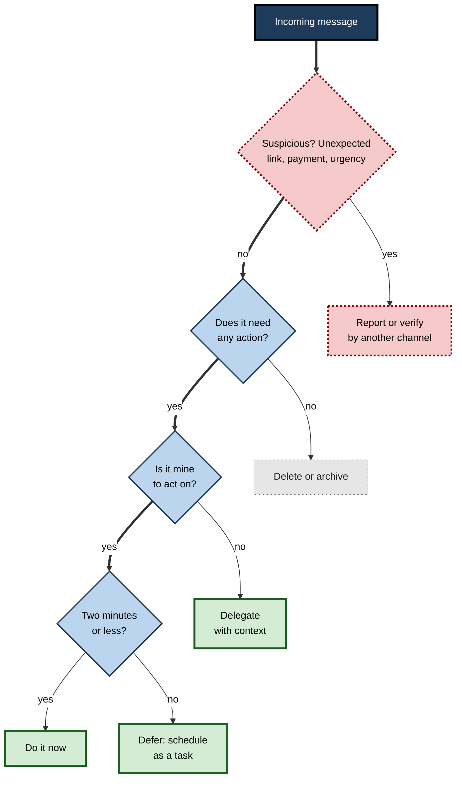
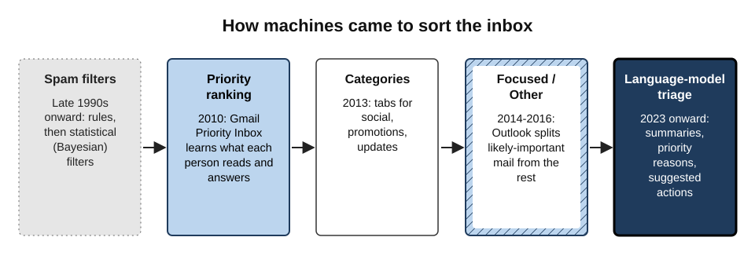
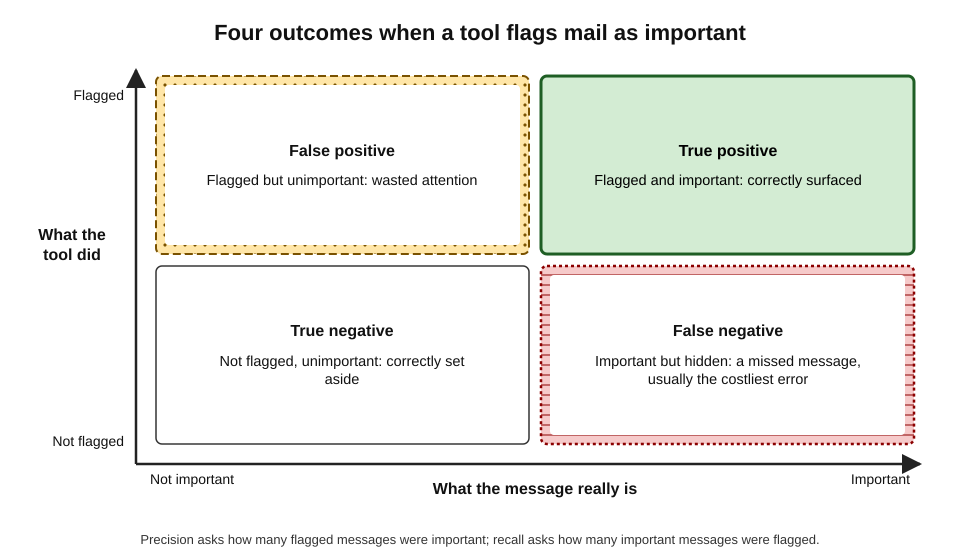
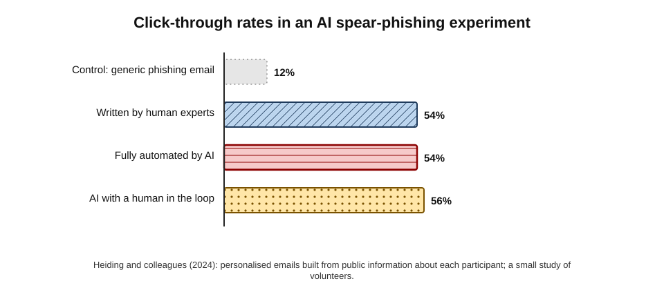
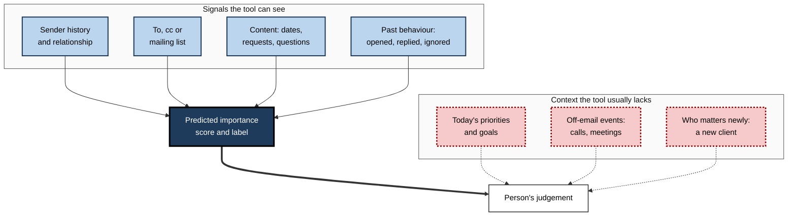

# F.5. Prioritising and triaging an inbox

An operations manager returns from a week away to 412 unread emails. Her mail client has sorted them: 38 in "Focused", the rest in "Other", with an AI digest headed "Top 5 things that need you". She clears the Focused list by lunch.

On Thursday a client's director calls, furious: a formal complaint, sent from a personal address the system had never seen, had been sitting in "Other" since Tuesday. The tool had done what it was designed to do — rank messages by past patterns — and the most important email of the week did not fit the pattern.

> **Definition — Inbox triage:** the rapid sorting of incoming messages into what needs action now, what can wait, what belongs to someone else and what can be discarded — before any of them is dealt with in full.

> **Definition — AI prioritisation:** the automatic ranking, flagging or sorting of incoming messages by predicted importance, using signals such as the sender, the person's past behaviour and the message's content.

**Why it matters**

- **Volume exceeds attention.** Microsoft's 2025 Work Trend Index reported that workers receive on average around 117 emails a day, plus a stream of chat messages, and are interrupted every two minutes or so during core hours.
- **The cost of a miss is uneven.** Ninety-nine ignored newsletters cost nothing; one ignored complaint, contract notice or security alert can cost a client.
- **Sorting is increasingly automated.** Mail clients split, rank and summarise mail by default; many people now meet their inbox through an algorithm's eyes.
- **The inbox is the main door for attacks.** Triage is also where phishing is caught — or let in.

---

## What an Inbox Is For

Before automating triage, it helps to see what people actually use email for.

**Study card — Whittaker and Sidner (1996), "Email overload"**

- **Design:** interviews and analysis of the mailboxes of office workers at a large technology company.
- **Findings:** email was used not only for communication but for:
  - **task management** — messages left in the inbox as reminders of things to do;
  - **personal archiving** — keeping information for later;
  - **contact management** — tracking who was involved in what.
- **Conclusion:** "email overload" arises because one tool is doing three jobs; the inbox becomes a to-do list nobody designed.

**Study card — Whittaker and colleagues (2011), filing versus searching for old email**

- **Design:** logged how hundreds of users at a technology company retrieved old emails — by searching, by scrolling, or by opening folders they had created.
- **Results:** people who filed carefully into folders were **not** faster or more successful at finding messages than those who relied on search and threads; folder filing cost time up front.
- **Conclusion:** elaborate filing is largely wasted effort when search works well; triage effort is better spent on **deciding actions** than on filing.

> **Key point:** the purpose of triage is **decisions about action**, not tidiness. An inbox can be untidy and well managed, or tidy and dangerous.

---

## The Logic of Triage

### Four decisions for every message

- **Delete or archive** — no action needed.
- **Do** — if it takes about two minutes or less, do it now (David Allen's "two-minute rule" from *Getting Things Done*, 2001).
- **Delegate** — someone else should act; forward with context.
- **Defer** — needs real work; turn it into a scheduled task and remove it from the inbox.

> **Mnemonic — "the four Ds":** Delete, Do, Delegate, Defer — every message gets exactly one.

**Figure 1.** A triage decision flow for each incoming message.

### Urgency, importance and source

- **Urgency** — how soon it matters.
- **Importance** — how much it matters to goals, clients, safety or obligations.
- **Source** — who sent it and in what role: a client, a manager, a regulator, a system, a stranger.
- AI tools mostly estimate **urgency** and **source** from patterns; **importance** often depends on context they do not have.

> **Watch out:** urgency words ("ASAP", "urgent", "immediately") are among the easiest signals for a tool to detect — and among the favourite tools of phishers. Detected urgency is not importance.

---

## How Machines Came to Sort Mail

**Figure 2.** How automatic sorting of mail developed.

### Spam filtering

- **Rules** (late 1990s) — block messages with certain words or from certain addresses; easily evaded.
- **Statistical filters** — Paul Graham's essay "A Plan for Spam" (2002) popularised **Bayesian filtering**, which learns from each user's own spam and legitimate mail the probability that a word indicates spam.
- **Large-scale machine learning** — major providers now combine content, sender reputation, authentication and the behaviour of millions of users.
- **Sender rules** — from February 2024, Google and Yahoo required bulk senders to authenticate their mail and offer one-click unsubscribing, shifting part of the burden from recipients to senders.

> **Definition — Email authentication:** technical checks (known as SPF, DKIM and DMARC) that let a receiving server verify that a message really comes from the domain it claims, making simple forgery harder.

### Priority ranking

**Study card — Aberdeen, Pacovsky and Slater (2010), Gmail Priority Inbox**

- **Design:** an engineering paper describing how Gmail predicted which messages each user would act on.
- **Method:**
  - signals from **social** relationships (how often the user writes to and reads the sender), **content**, **thread** activity and **labels**;
  - a global model combined with a small per-user model updated as each person read, replied to or ignored mail.
- **Results:** Google reported that users of the feature spent somewhat less time reading mail overall, with the larger saving on mail predicted to be unimportant.
- **Conclusion:** importance can be learned from **behaviour** — but only for patterns the user has already shown.

### Categories and focused inboxes

- **Tabs** (Gmail, 2013) — social, promotions, updates and forums separated from primary mail.
- **Clutter** (Outlook, 2014), later **Focused Inbox** (2016) — mail split into "Focused" and "Other".
- **Phone mail apps** later added their own categories and priority sections.

### Language-model triage

- **Summaries of the inbox** — a digest of what arrived and what needs attention.
- **Priority with reasons** — "flagged because it mentions a deadline tomorrow and you are the only recipient".
- **Suggested actions** — reply, schedule, create a task, unsubscribe.
- **Agents** — systems that, when allowed, archive, label or answer mail on the person's behalf.

> **Key point:** each generation saw **more** of the message's meaning — and each still learns mostly from what is **typical**. The atypical message remains the hardest case.

---

## How Well Does AI Triage Work?

### Two kinds of error

**Figure 3.** The four outcomes when a tool flags mail as important.

> **Definition — Precision:** of the messages a tool flagged as important, the share that really were.

> **Definition — Recall:** of the messages that really were important, the share the tool flagged.

> **Formula — Precision and recall:** precision = true positives ÷ (true positives + false positives); recall = true positives ÷ (true positives + false negatives). Example: a tool flags 40 messages, of which 30 are important (precision 30 ÷ 40 = **75%**); 35 important messages arrived in total (recall 30 ÷ 35 ≈ **86%**) — so 5 important messages were hidden.

| | False positive (unimportant mail flagged) | False negative (important mail hidden) |
|---|---|---|
| Effect | Wasted attention | Missed obligation |
| Visibility | Obvious — the person sees it | Invisible — the person never sees it |
| Typical cost | Seconds | From nothing to a lost client |
| Who notices | The recipient | Often the sender, later and angrily |

> **Key point:** because false negatives are **invisible**, people over-trust filters. A tool that seems excellent may be quietly hiding the rare messages that matter most.

### Why important messages get hidden

- **New senders** — no history, so low predicted importance (a new client, a regulator, a journalist, a personal address).
- **Unusual channels** — a complaint arriving at a general address or via a contact form.
- **Low-key wording** — serious matters written calmly ("I would like to raise a concern") lack urgency signals.
- **Being in copy** — tools down-rank mail where the person is copied, yet copied mail can carry escalations.
- **Personal patterns** — someone who ignores all legal notices teaches the tool to rank legal notices low.

> **Watch out:** a personalised ranking learns a person's habits — including **bad** habits. If someone routinely neglects a category of mail, the tool will help them neglect it further.

---

## Phishing, Scams and the Triaged Inbox

Triage is also defence. Attackers write to the same inbox, and generative AI has made their messages better.

**Study card — Heiding and colleagues (2024), AI-automated spear phishing**

- **Design:** in a study with volunteer participants, researchers sent four kinds of email: a generic control phishing email; emails written by human experts; emails produced fully automatically by AI agents that gathered public information about each participant; and AI emails with a human in the loop.
- **Results:** click-through rates were about **12%** for the control, **54%** for human experts, **54%** for fully automated AI emails and **56%** with a human in the loop. The AI-gathered profiles took minutes rather than the much longer time needed by a human researcher.
- **Conclusion:** fully automated, personalised phishing performed as well as experts — at a fraction of the cost.

**Figure 4.** Click-through rates in an AI spear-phishing experiment.

> **Watch out:** the sample was small and consisted of volunteers who knew they were in a study; real-world rates differ. The direction is clear: **good grammar and personal detail are no longer signs of a genuine email**.

> **Definition — Spear phishing:** a fraudulent message tailored to a specific person, using personal or organisational details to appear legitimate.

> **Definition — Business email compromise:** fraud in which attackers impersonate executives, suppliers or colleagues by email to obtain payments or sensitive data.

### How AI changes the threat

- **Fluency** — scam messages no longer have the spelling mistakes people were taught to look for.
- **Personalisation at scale** — details from public profiles, company websites and leaked data make each message plausible.
- **Thread hijacking** — replies inserted into real, compromised threads.
- **Voice and video** — in 2024 an employee of the engineering firm Arup in Hong Kong was reported to have transferred about US$25 million after a video call in which the "chief financial officer" and colleagues were deepfakes.
- **Attacks on the AI itself** — hidden instructions in an email can try to make an AI summary or assistant mislead the reader.

### Triage rules that hold up

- **Verify payment and credential requests by another channel** — a known phone number, not one in the message.
- **Treat urgency plus secrecy plus money as a red flag**, regardless of how polished the message is.
- **Do not let a "priority" label or an AI summary vouch for a message.** Ranking reflects predicted importance, not legitimacy.
- **Report** suspicious messages through the organisation's reporting button; reports train filters and warn colleagues.

> **Remember:** "**Urgent + secret + money or password = stop and verify**."

---

## A Personal Triage System With AI

### Set up the machinery

- **VIP or priority senders** — key clients, manager, direct reports, critical systems; always surface these.
- **Rules for the predictable** — receipts, notifications and newsletters to folders or labels automatically.
- **Unsubscribe** aggressively from mail never read; one-click unsubscribe now makes this quick.
- **Check the "Other" pile** daily, briefly — it is where false negatives live.
- **Tune the tool** — move misplaced messages; most tools learn from corrections.

### Run triage in batches

- **Set times** — two to four triage sessions a day rather than constant checking.
- **Triage first, then work** — sort everything into the four Ds before answering anything long.
- **Use the AI digest as a map**, then open the original of every item that needs action.
- **Empty the inbox of decisions, not of mail** — Merlin Mann's "Inbox Zero" (2006) referred to the attention spent on the inbox, not to a literal empty folder.

> **In practice:** a common pattern is "**digest → VIPs → Focused → glance at Other → defer the rest into tasks**".

### Signals AI uses, and what they miss

**Figure 5.** How an AI triage tool scores a message and where context is missing.

### Worked example (illustrative): Monday morning, 180 messages

- **Situation:** a project lead has 180 new messages after a long weekend and 45 minutes before a meeting.
- **Steps:**
  1. **Digest (3 minutes):** AI summary lists seven items needing action.
  2. **VIPs (8 minutes):** reads all 12 messages from the client and manager in full; two need replies today.
  3. **Focused (12 minutes):** 40 messages; 25 archived, 6 answered in under two minutes, 5 delegated, 4 deferred to tasks.
  4. **Other (5 minutes):** scans 120 subject lines; finds one from an unknown address titled "Concern about invoice 4471" — moves it to Focused and defers it to a task for 2 p.m.
  5. **Suspicious (2 minutes):** one "CEO" message asking for gift cards — reported.

| Pile | Messages | Time | Action items found |
|---|---|---|---|
| Digest | (overview) | 3 min | 7 flagged |
| VIP | 12 | 8 min | 2 |
| Focused | 40 | 12 min | 15 (do, delegate, defer) |
| Other | 120 | 5 min | 1 (missed by the digest) |
| Suspicious | 1 | 2 min | Reported |

*Illustrative figures.*

- **Conclusion:** the digest was a fast start, but one of the day's real issues appeared only in the human scan of "Other".

### How far to trust an AI digest

An AI digest — "five things that need you today" — is a summary of a summary: the tool first ranks the mail, then condenses the top of the ranking.

- **It inherits the ranking's blind spots.** A message hidden by the ranking never reaches the digest.
- **It compresses reasons.** "Client wants an update" may hide that the client is threatening to cancel.
- **It can be manipulated.** Hidden text in an incoming email can try to push that email into the digest, or insert a misleading instruction.
- **It is still useful** as a starting order of work, particularly after absence.

> **Remember:** a digest decides **where to start**, never **where to stop**.

---

## Triage Beyond Email

Most professionals now triage several streams at once: email, workplace chat, mentions, task tools and phone notifications.

| | Email | Workplace chat | Notifications |
|---|---|---|---|
| Typical volume | Dozens to hundreds a day | Often more than email | Constant |
| Urgency signal | Weak — expected reply in hours | Strong — expected reply in minutes | Designed to feel urgent |
| AI help available | Ranking, digest, summaries | Channel recaps, mention digests | Grouping and summaries of notifications |
| Main triage risk | Missed important message | Constant interruption | Attention fragmented by trivial alerts |
| Good default | Batch at set times | Mentions and direct messages only between batches | Turn off all but essential ones |

- **Choose one home for tasks.** Messages in many tools become tasks in one list; otherwise triage repeats endlessly across apps.
- **Separate "for awareness" channels** from "for action" channels; mute the former and read recaps.
- **Agree escalation routes.** If something is genuinely urgent, colleagues should know to call or use a specific channel, so other streams can be batched without anxiety.
- **Notification summaries** on phones group alerts; like any summary they can misstate the underlying messages.

> **Key point:** triage across streams is mainly a matter of **agreeing which channel carries what**; AI ranking within each stream cannot compensate for a team that sends urgent requests by every route at once.

### Triage after an absence

- **Start with what changed, not what arrived.** Ask colleagues covering, or read the digest, for decisions taken while away.
- **Sort by sender, not by date.** Reading all messages from key clients and the manager first catches the important ones fastest.
- **Read threads from the end.** The latest message usually shows the current state; earlier messages may be obsolete.
- **Bulk-archive notifications** that have since been superseded.
- **Tell people.** A short "I'm back; I am working through mail and will reply on X by Wednesday" buys time honestly.

### Measuring one's own triage

- **Misses** — how often did something important surface late? Where had it been sitting?
- **Corrections** — how often were messages moved between Focused and Other? Frequent corrections mean the tool is still learning, or the person's patterns are changing.
- **Time** — how long do triage sessions take, and how often is the inbox checked between them?
- **Spill-over** — how many messages are handled outside working hours?

> **In practice:** a fortnight of noting each "late discovery" — what it was, where it sat, why it was missed — usually reveals one or two rules or VIP entries that fix most problems.

---

## Shared Inboxes and Organisational Triage

Many teams handle shared mailboxes — support, sales enquiries, accounts payable, recruitment — where AI classification routes messages to people or queues.

| | Personal inbox | Shared or team inbox |
|---|---|---|
| Who decides priority | The individual | Rules, service levels, a coordinator |
| Typical AI role | Ranking, digest, suggested replies | Classification, routing, urgency scoring |
| Main risk | Missed messages for one person | Messages lost between people; nobody owns them |
| Measures | Personal judgement | Response times, misrouting rate, backlog age |
| Fairness concern | Low | Some senders systematically deprioritised |

- **Routing errors** — a complaint classified as a general enquiry waits in the wrong queue.
- **Ownership** — every message needs a named owner; classification without ownership creates orphans.
- **Fairness** — classifiers trained on past mail may rank messages written in non-standard English, or from smaller customers, as less urgent. Sampling decisions across customer groups reveals this.
- **Audit** — keep logs of how messages were classified and routed so mistakes can be traced.

### Case study (illustrative): the complaints that went to "General"

- **Situation:** a mid-sized insurer introduced AI classification for its customer-service mailbox, routing messages to claims, billing, complaints or general enquiries.
- **Problem:** after three months, the regulator's complaint-handling review found several formal complaints that had exceeded the required response time.
- **Diagnosis:**
  - messages that did not use words like "complaint" or "dissatisfied" were classified as general enquiries;
  - older customers and customers writing in a second language more often described problems indirectly;
  - the general queue had the longest waiting times.
- **Actions:**
  1. retrained the classifier with examples of indirectly worded complaints;
  2. added a rule: any message mentioning money lost, a previous unresolved contact or a deadline goes to a human reviewer within one working day;
  3. weekly sampling of the general queue by the complaints team.
- **Result:** late complaints fell sharply; the sampling caught residual errors early.
- **Lesson:** an organisation's legal obligations cannot be delegated to a classifier's **recall**; human sampling of the low-priority pile is essential.

---

## Open Questions

- **How often do AI triage tools hide important mail?**
  - Providers measure engagement; independent measurement of false negatives on real workplace mail is rare.
- **Will personal email agents take over triage entirely?**
  - Agents that archive and answer mail are emerging; accountability for what they miss is unsettled.
- **Will the attack–defence balance shift?**
  - AI improves both phishing and filtering; which side gains more is uncertain and may change from year to year.
- **Do ranked inboxes reduce or increase stress?**
  - Sorting may reduce overload, or may encourage more frequent checking of the "important" pile.
- **Are classifiers fair to all senders?**
  - Differences in how groups write may lead to systematic deprioritisation; evidence in workplace settings is limited.

---

## Summary

- **Inbox triage** sorts messages into actions before dealing with them; **AI prioritisation** ranks or sorts mail by predicted importance.
- Email serves as **task list, archive and contact tool** (Whittaker and Sidner, 1996); elaborate filing saves little when search works (Whittaker and colleagues, 2011).
- Every message gets one of the **four Ds**: Delete, Do (two minutes or less), Delegate, Defer.
- Machine sorting developed from **spam filters** (Bayesian filtering) to **priority ranking** (Gmail Priority Inbox, 2010), **categories**, **Focused/Other** and **language-model triage** with summaries and suggested actions.
- Tools learn from **typical** patterns; **false negatives** — hidden important mail — are invisible and usually costliest. Know **precision** and **recall**.
- Important mail is hidden when it comes from **new senders**, unusual channels, is calmly worded, arrives in copy, or falls in a category the person habitually ignores.
- AI has made phishing **fluent and personalised**: automated spear phishing matched human experts (about 54% click-through) in one study. **Urgent + secret + money or password = stop and verify**; priority labels and summaries do not vouch for legitimacy.
- Personal system: VIPs, rules, unsubscribing, daily glance at "Other", batch triage, digest as a map.
- Shared inboxes need **ownership, audit, fairness checks** and **human sampling** of low-priority queues.

---

## Self-Check

1. Define inbox triage and AI prioritisation.
2. What three jobs did Whittaker and Sidner find email doing, and why does that cause overload?
3. What did Whittaker and colleagues (2011) find about filing into folders?
4. Name the four Ds and the rule that decides "Do".
5. How did Gmail Priority Inbox predict importance, and what limitation follows?
6. Define precision and recall. A tool flags 50 messages, 40 of them important; 60 important messages arrived. Calculate both.
7. Why are false negatives more dangerous than false positives in triage?
8. List four reasons an important message might be hidden by a ranking tool.
9. Summarise the Heiding and colleagues (2024) study and its implications for spotting phishing.
10. What is business email compromise, and what single habit defeats most of it?
11. Why should an AI priority label or summary never be treated as a sign that a message is genuine?
12. Describe a daily triage routine that uses AI without relying on it blindly.
13. What extra risks arise when AI classifies messages in a shared inbox?
14. A firm wants to let an AI agent automatically archive any message it ranks as unimportant. Assess the proposal and suggest safeguards.

### Answer Key

1. Triage: rapid sorting of incoming messages by what action they need. AI prioritisation: automatic ranking or sorting by predicted importance from sender, behaviour and content signals.
2. Task management, personal archiving, contact management. One tool doing three jobs turns the inbox into an undesigned to-do list and archive, overwhelming it.
3. Careful folder filers were not faster or more successful at retrieving messages than people who used search; filing cost time for little benefit.
4. Delete, Do, Delegate, Defer. Do it now if it takes about two minutes or less.
5. It combined social, content, thread and label signals in a global model with per-user models learned from each person's reading and replying. It can only learn patterns the user has already shown, so new or atypical important mail is ranked low.
6. Precision: flagged messages that were important — 40 ÷ 50 = 80%. Recall: important messages flagged — 40 ÷ 60 ≈ 67%. Twenty important messages were hidden.
7. False positives are visible and cost seconds; false negatives are invisible, so they go unnoticed until the consequence — often a missed obligation — arrives.
8. New sender with no history; arrival through an unusual channel; calm wording without urgency signals; the person was only in copy; or the person habitually ignores that category.
9. Fully automated AI spear-phishing emails using public information achieved about 54% click-through, equal to human experts and far above a 12% control. Fluency and personal detail are no longer signs of legitimacy.
10. Impersonation of executives, suppliers or colleagues by email to obtain payments or data. Verifying payment and credential requests through a separate, known channel.
11. Labels reflect predicted importance from patterns, not authenticity; attackers write to look urgent and important, and hidden instructions can even manipulate summaries.
12. E.g. batch sessions at set times; read the digest as a map; read VIP messages in full; triage Focused with the four Ds; scan subject lines in Other; report suspicious mail; open originals before acting.
13. Messages misrouted to the wrong queue, orphans with no owner, systematic deprioritisation of some senders, and breaches of service or regulatory deadlines; mitigated by ownership, audit logs, fairness sampling and human review of low-priority queues.
14. Risky: false negatives become permanent and invisible; new senders, calm complaints and legal notices may be archived. Safeguards: archive only narrow categories (newsletters, notifications); never auto-archive mail from new external senders addressed directly; keep an "auto-archived" view reviewed daily; log actions; measure recall by sampling.

---

## Glossary

| Term | Meaning |
|---|---|
| AI prioritisation | Automatic ranking or sorting of messages by predicted importance. |
| Bayesian filtering | Statistical spam filtering that learns word probabilities from a user's mail. |
| Business email compromise | Impersonation fraud by email to obtain payments or data. |
| Email authentication | Technical checks (SPF, DKIM, DMARC) that verify a message's sending domain. |
| False negative | An important message the tool failed to flag. |
| False positive | An unimportant message the tool flagged as important. |
| Focused Inbox | Outlook's split of mail into likely-important "Focused" and "Other". |
| Four Ds | Delete, Do, Delegate, Defer — the triage decisions. |
| Inbox triage | Rapid sorting of incoming messages by required action. |
| Precision | Share of flagged messages that were truly important. |
| Priority Inbox | Gmail's 2010 feature ranking mail by predicted importance. |
| Recall | Share of truly important messages that were flagged. |
| Spear phishing | A fraudulent message tailored to a specific person. |
| Two-minute rule | Do a task immediately if it takes about two minutes or less. |
