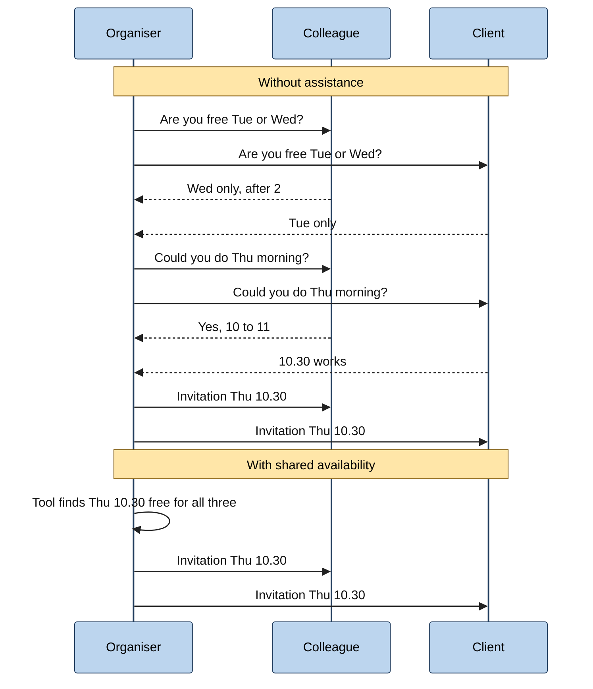
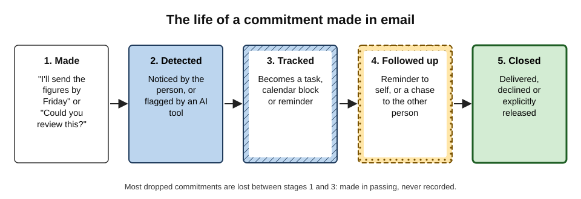
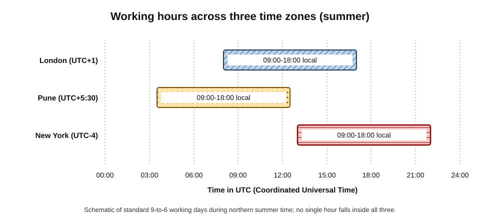
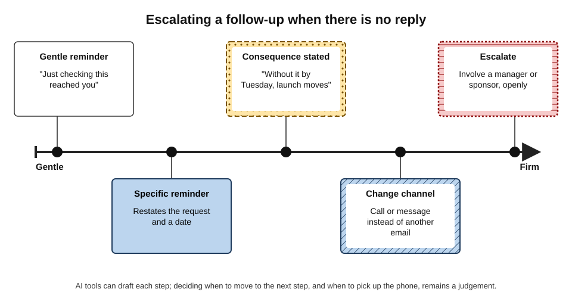
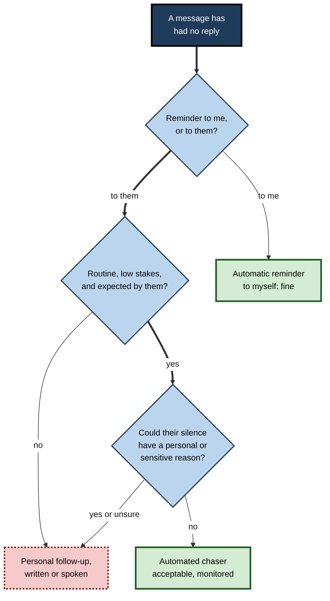

# F.6. Scheduling and follow-up help

"Let's find time next week to go through the numbers," writes a client at the end of a long email. The account manager means to reply, gets pulled into a call and forgets. Ten days later the client books the meeting with a competitor.

The next quarter, her mail client starts noticing such lines: it offers to propose times, and three days after she promises "I'll send the revised plan by Friday" it reminds her. Once, however, it proposes 3 a.m. Singapore time to a colleague in Singapore, and once it sends a client an automatic "just following up" while the client is on bereavement leave. Scheduling and follow-up help removes a great deal of forgetting — and adds new ways to be thoughtless at speed.

> **Definition — Scheduling assistance:** features in mail, chat and calendar tools that detect meeting requests in messages, find mutually free times, propose or book slots, and handle the replies that follow.

> **Definition — Follow-up assistance:** features that detect commitments and unanswered messages, remind the person at a suitable time, and draft or send reminders to others.

**Why it matters**

- **Coordination is a large share of email.** Arranging meetings and chasing replies generate many short messages, each an interruption.
- **Dropped commitments damage trust** more than slow work does: "I'll send it Friday" followed by silence is remembered.
- **Time zones and calendars are error-prone** for people and software alike.
- **Automated follow-ups speak in the sender's name** — badly timed or badly toned, they cost goodwill.

---

## The Hidden Work of Coordination

### Scheduling "ping-pong"

Arranging a meeting by email can take many messages, especially with several people.

**Figure 1.** Scheduling by email exchange compared with scheduling from shared availability.

- **Without help:** many messages, several days, each one a context switch.
- **With shared availability:** the tool proposes a slot from calendars; one invitation goes out.
- **The limit:** calendars show **busy or free**, not **preference**, travel, focus time or the importance of the meeting.

### Commitments hidden in messages

> **Definition — Commitment (in correspondence):** a statement in a message that creates an expectation of future action — a promise by the writer ("I'll send the draft tomorrow") or a request accepted from someone else ("Could you check the figures?" — "Sure").

- **Outbound commitments** — promises the person has made.
- **Inbound commitments** — things others have promised the person.
- **Requests not yet answered** — the person has been asked and has not replied.

**Figure 2.** The life of a commitment made in email.

> **Key point:** most dropped commitments are not refused or forgotten in a dramatic way; they are made **in passing**, inside a message about something else, and never recorded anywhere.

---

## Why People Forget to Follow Up

### Prospective memory

> **Definition — Prospective memory:** remembering to carry out an intended action at the right future moment — "remembering to remember".

- **It fails often**, even for capable people, because the cue to act (Friday afternoon) arrives while attention is elsewhere.
- **Event-based intentions** ("when I see Ravi, mention the invoice") rely on noticing a cue; **time-based intentions** ("send it on Friday") rely on self-initiated checking, which is harder.
- **External reminders** — calendars, tasks, flagged messages, AI nudges — are the classic remedy: they turn a time-based intention into an event-based one ("when the reminder appears, do it").

### Turning intentions into actions

**Study card — Gollwitzer and Sheeran (2006), implementation intentions**

- **Design:** a meta-analysis of 94 studies of **implementation intentions** — plans of the form "If situation X arises, I will do Y".
- **Results:** forming such plans had a medium-to-large positive effect on reaching goals compared with goal intentions alone ("I intend to do Y").
- **Conclusion:** specifying **when, where and how** an action will happen substantially increases the chance that it does.

> **In practice:** a reminder that says "Friday 15.00: send revised plan to Leila — file in project folder" works better than a flag on a message, because it carries the **when** and the **what**.

### Underestimating time

**Study card — Buehler, Griffin and Ross (1994), the planning fallacy**

- **Design:** students predicted when they would finish their theses and other tasks, including best-case and worst-case estimates.
- **Results:** most finished **later** than predicted — on average later even than their own worst-case estimates in some conditions.
- **Conclusion:** people base predictions on plans and imagined smooth progress, neglecting past delays; Daniel Kahneman and Amos Tversky had named this the **planning fallacy** in 1979.

> **Watch out:** promising dates in quick replies is where the planning fallacy meets reply speed. "By Friday" typed in seconds becomes a commitment the person did not plan for.

---

## What the Tools Do

### Forms of scheduling help

- **Meeting detection** — recognising "let's meet next week" and offering to propose times or create an event.
- **Time suggestions** — inserting a list of free slots into a reply.
- **Booking links** — a link to a page where the other person picks a free slot from the owner's calendar.
- **Finding a time for groups** — comparing several calendars and working hours.
- **Scheduling agents** — software addressed like a person ("copying my assistant to find a time") that negotiates by email.
  - *e.g.* the start-up x.ai offered an AI scheduling assistant called "Amy" from the mid-2010s before closing the service in 2021; such agents are now reappearing inside large language-model assistants.
- **Event extraction** — flights, hotel bookings and appointments in emails turned into calendar entries automatically.

### Forms of follow-up help

- **Nudges** — the mail client resurfaces a message the person sent without reply, or received and did not answer; Gmail introduced such nudges in 2018.
- **Commitment detection** — the tool notices "I'll send…" in sent mail and suggests a reminder or task.
- **Snooze and send later** — a message returns to the inbox at a chosen time; a reply is scheduled to arrive during the recipient's working hours.
- **Drafted chasers** — the tool writes a polite follow-up.
- **Automated sequences** — sales and recruiting tools send a series of follow-ups until there is a reply.

| | Booking link | Time suggestions in a reply | Scheduling agent | Manual negotiation |
|---|---|---|---|---|
| Effort for organiser | Very low | Low | Very low | High |
| Effort for recipient | Low, but shifted to them | Low | Low | Medium |
| Signals | Can seem transactional or status-laden | Courteous, personal | Efficient; may feel impersonal | Most personal |
| Handles preferences | Poorly | Partly — the person chooses which slots | Partly | Fully |
| Best for | Many external bookings, equals or customers | Most one-to-one scheduling | High-volume calendars | Senior or sensitive meetings |

> **Watch out:** sending a booking link to someone more senior, or to a client, can read as "fit around me". Offering two or three specific times is usually more courteous.

### How commitment detection goes wrong

Tools that read sent and received mail for promises face a hard language problem: commitments are often implicit, conditional or polite rather than literal.

| Message text | What the tool may record | What was actually meant | Error type |
|---|---|---|---|
| "Leave it with me." | Nothing | A promise to act | Missed commitment |
| "I'll try to look at it next week." | Firm task due next week | A soft, conditional intention | Overstated commitment |
| "We should catch up sometime." | Meeting to schedule | A pleasantry | False commitment |
| "Could you send the figures? No rush." | Urgent request | Low-priority request | Wrong urgency |
| "I'll send it once legal approves." | Task due now | Task dependent on another event | Missing condition |

- **Missed commitments** are the most harmful: the tool's silence feels like reassurance.
- **False commitments** clutter task lists and train people to ignore suggestions.
- **Conditions** ("once legal approves") are often dropped, creating reminders that cannot yet be acted on.

> **Watch out:** "the tool would have reminded me" is not a system. Commitments that matter should be captured deliberately, with the tool as a back-up.

### Writing invitations that work

An invitation is itself a message, and AI tools now draft invitation text and agendas from the email thread.

- **Purpose in the title** — "Decide: Q3 supplier shortlist" rather than "Catch-up".
- **Agenda and pre-reading** in the body, with links to documents rather than attachments that go stale.
- **Desired outcome** — the decision or output expected by the end.
- **Who is needed and why** — optional attendees marked as optional.
- **Local times** for every time zone involved.

> **In practice:** asking the tool "draft an invitation from this thread with purpose, three agenda items and the decision needed" produces a usable first version; the organiser checks that the attendee list and the decision are right.

---

## Absence, Handover and Return

Follow-up breaks down most often around absence: holidays, sick leave, parental leave, role changes.

- **Before absence:**
  - list open commitments from sent mail and hand each over by name;
  - set an out-of-office reply that names who to contact **for what**, rather than "I have limited access to email";
  - snooze or pause automated chasers and sequences.
- **During absence:**
  - colleagues covering should have access to the relevant threads, not just a forwarding rule;
  - AI digests prepared for the person's return should not trigger actions in their name.
- **On return:**
  - read the digest as a map; then review sent-mail commitments due during the absence;
  - send short "I'm back; here is where things stand" messages to the people most affected.

> **Key point:** automated follow-up tools continue running while their owner is away; pausing them is part of preparing for absence.

---

## Time Zones, Calendars and Their Traps

### Common errors

- **Time-zone confusion** — "3 p.m." without a zone; the tool's assumption differs from the reader's.
- **Daylight-saving mismatches** — the United States moves clocks on the second Sunday in March, the United Kingdom and the European Union on the last Sunday; for a few weeks each spring the gap between New York and London is four hours instead of five. Similar windows occur in the autumn. Many countries, including India, do not change clocks at all.
- **Half-hour and quarter-hour offsets** — India (UTC+5:30) and Nepal (UTC+5:45) catch out tools and people that assume whole hours.
- **Working hours and weekends** — the working week differs; in several Middle Eastern countries the weekend falls wholly or partly on Friday.
- **Calendar "free" is not free** — focus time, travel and personal commitments may not appear.

**Figure 3.** Working hours in London, Pune and New York shown on one clock.

### Worked example (illustrative): one meeting, three cities

- **Situation:** a project lead in London must hold a one-hour review with a colleague in Pune and a client in New York in July.
- **The problem:** standard 9-to-6 days overlap pairwise but not across all three.
- **Options considered:**

| Slot (UTC) | London (UTC+1) | Pune (UTC+5:30) | New York (UTC-4) | Assessment |
|---|---|---|---|---|
| 08:00 | 09:00 | 13:30 | 04:00 | Impossible for New York |
| 12:00 | 13:00 | 17:30 | 08:00 | Early for New York, late-ish for Pune; workable |
| 13:00 | 14:00 | 18:30 | 09:00 | Inside New York hours; after hours in Pune |
| 16:00 | 17:00 | 21:30 | 12:00 | Unreasonable for Pune |

- **Decision:** 12:00 UTC, with the invitation showing local times for all three; rotate the inconvenience at the next review (13:00 UTC).
- **Conclusion:** a tool can compute these columns instantly; deciding **who bears the inconvenience**, and rotating it fairly, is a human choice.

> **Remember:** in any cross-border invitation, write times **with zones** for every party — "12:00 UTC / 13:00 London / 17:30 Pune / 08:00 New York".

---

## Following Up Well

### Following up on oneself

- **Capture every promise** made in messages as a dated task or calendar block — by hand, or by accepting the tool's suggestion.
- **Promise realistically** — add buffer to dates typed in quick replies; the planning fallacy is reliable.
- **Renegotiate early** — if a promise will be missed, say so before the deadline, with a new date.
- **Close explicitly** — "Attached is the revised plan, as promised" tells the other person the loop is closed.

### Following up on others

**Figure 4.** Escalating a follow-up when there is no reply.

1. **Gentle reminder** — after a reasonable interval, a short note that assumes good faith.
2. **Specific reminder** — restates exactly what is needed and by when.
3. **Consequence stated** — explains what happens without it, neutrally.
4. **Change channel** — a call or chat message often unblocks what three emails could not.
5. **Escalate openly** — involve a manager or sponsor, telling the person you are doing so.

- **Intervals** depend on urgency and relationship: hours in an incident, days for routine work, a week or more for external contacts with no obligation.
- **Each chaser should add value** — a summary, a deadline, an easier way to answer ("a yes or no is enough").

> **Example — a good second chaser:** "Following up on the supplier contract: we need your approval by Thursday to keep the 1 May start. A simple 'approved' reply is enough; if you have concerns, I can call tomorrow."

> **Watch out:** chasers drafted by AI often start with "Just following up…" and "I hope this email finds you well" — formulas recipients have learned to skim. Lead with the request.

### When to automate a follow-up

**Figure 5.** Deciding whether a follow-up may be automated.

- **Reminders to oneself** — automate freely.
- **Chasers to others** — automate only when routine, expected and low-stakes (an overdue timesheet reminder, a standard document request).
- **Personal touch** whenever silence might have a human reason — illness, bereavement, a dispute, a change of role.

### Follow-up in chat

Chat changes the rhythm of follow-up.

- **Requests scroll away.** A question asked in a busy channel can disappear within an hour; tools that save messages for later or set reminders on a message help.
- **Mentions create obligations.** Being named in a channel is a request for attention; leaving mentions unanswered is the chat equivalent of an unanswered email.
- **Reactions as acknowledgements.** A tick or "eyes" reaction can signal "seen, will act" — but only if the team agrees what each means.
- **Move commitments out of chat.** Anything with a due date belongs in a task tool or tracker, not only in a message.

| | Email follow-up | Chat follow-up |
|---|---|---|
| Natural interval | Days | Hours |
| Typical tool help | Nudges, snooze, commitment detection | Reminders on messages, saved items, mention digests |
| Risk of over-chasing | Moderate | High — repeated pings feel like pressure |
| Best escalation | Change to a call or a direct message | Change to a call, or a direct message from a channel |

> **In practice:** after a decision is reached in chat, a one-line summary — "Agreed: Priya sends the draft by Thursday; Tom reviews by Monday" — turns loose talk into trackable commitments that people and tools can follow up.

- **After meetings**, the same principle applies: actions agreed in a call need an owner and a date in writing, whether drafted by a person or a meeting assistant.

---

## Risks and Courtesies

| Risk | Example | Safeguard |
|---|---|---|
| Wrong time zone | Invitation at 3 a.m. for one attendee | Show all local times; check working hours |
| Automatic acceptance | Assistant accepts an invitation that clashes with an unrecorded commitment | Keep acceptance manual for external invitations |
| Calendar exposure | Tool reveals meeting titles or attendees to outsiders | Share free/busy only; mark private events |
| Unwanted chasers | Automated "following up" to a grieving client | Automate only routine chasers; check context |
| Over-scheduling | Tool fills every free slot | Block focus time; set meeting limits |
| Invitation to wrong people | Auto-complete adds a namesake or a distribution list | Check the attendee list before sending |

- **Calendar privacy.** An assistant that reads calendars to schedule can reveal more than intended — the title of a medical appointment, a confidential client name. Organisations usually share only free/busy information externally.
- **Booking-link etiquette.** Offer links to people who book many slots (customers, candidates), not as a default to seniors or clients.
- **Respect for the recipient's hours.** "Send later" so that messages arrive in the recipient's working day reduces after-hours pressure.

---

## Case Study (illustrative): the sales team's automatic sequences

- **Situation:** a business-software sales team set every new enquiry to receive an automated sequence: a reply, then follow-ups at three, seven and fourteen days until the prospect answered.
- **Problem:** reply rates rose at first; then complaints arrived. One prospect, a hospital procurement officer, received four chasers while on medical leave and forwarded them to the vendor's chief executive; several prospects marked the messages as spam, harming the domain's delivery rates.
- **Diagnosis:**
  - sequences ignored out-of-office replies and changes in context;
  - every chaser was a generic "just bumping this to the top of your inbox";
  - spam complaints led mail providers to filter the firm's messages more aggressively.
- **Actions:**
  1. sequences stop automatically on any reply, including out-of-office messages;
  2. maximum of two automated follow-ups; any further contact is personal;
  3. each follow-up must add something — a relevant case, an answer to a likely question;
  4. weekly review of spam-complaint and unsubscribe rates.
- **Result:** fewer messages sent; reply rates held; complaints and spam reports fell to near zero; the domain's delivery rate recovered over the following months.
- **Lesson:** automated follow-ups multiply both **persistence** and **rudeness**; the limit should be set by the relationship, not by the software's capacity.

---

## Scheduling and Follow-Up at Professional Standard

### Personal practice

- **Accept commitment suggestions** from the tool, but rewrite them as implementation intentions — when, what, where.
- **Propose specific times** rather than open questions ("Tuesday 10.00 or Wednesday 15.00 London time?").
- **Write time zones** for every party on cross-border invitations.
- **Protect focus time** in the calendar so scheduling tools do not fill it.
- **Keep acceptance of external invitations manual.**
- **Chase with value** and escalate step by step.
- **Close loops** explicitly, including releasing commitments that are no longer needed.

### Team practice

- **Shared norms** — expected reply times for internal requests; when to call rather than chase.
- **Meeting hygiene** — agendas in invitations; default durations of 25 or 50 minutes to leave gaps; fair rotation of inconvenient times across time zones.
- **Rules for automated follow-ups** — what may be automated, how many, and when sequences stop.
- **Calendar sharing policy** — free/busy externally; details internally only where needed.

> **Key point:** the tools excel at **remembering** and **computing**; people remain responsible for **judging** — whose time is inconvenienced, when silence deserves patience, and when a call beats a chaser.

---

## Open Questions

- **Will scheduling agents negotiate with each other?**
  - If both parties' assistants arrange meetings, preferences and power dynamics may be encoded in software defaults that nobody chose.
- **Do reminders strengthen or weaken personal reliability?**
  - External cues help prospective memory; heavy reliance may reduce the habit of planning commitments at all.
- **How should automated follow-ups be regulated?**
  - Anti-spam and marketing laws cover some sequences; the boundary between persistence and harassment in business email is unsettled.
- **Can tools detect commitments accurately?**
  - Commitment language is varied and often implicit ("leave it with me"); error rates in real mail are not well measured.
- **Does easier scheduling create more meetings?**
  - Lower coordination costs may increase meeting volume, offsetting time saved.

---

## Summary

- **Scheduling assistance** detects meeting requests, finds times and books slots; **follow-up assistance** detects commitments and unanswered messages and reminds or chases.
- Coordination by email is costly **ping-pong**; shared availability cuts it, but calendars show free/busy, not preference.
- **Commitments** made in passing are the ones most often dropped; they need capture as dated tasks.
- Follow-ups fail because of **prospective memory** limits; external reminders help, and **implementation intentions** (Gollwitzer and Sheeran, 2006) make action much more likely. The **planning fallacy** (Buehler, Griffin and Ross, 1994) makes quick promises over-optimistic.
- Tools include meeting detection, time suggestions, booking links, scheduling agents, nudges, commitment detection, snooze, send-later and automated sequences.
- Traps: **time zones**, daylight-saving windows, half-hour offsets, differing weekends, "free" that is not free.
- Follow up on others with a ladder: gentle → specific → consequence → change channel → escalate openly; every chaser should add value.
- Automate reminders to oneself freely; automate chasers only for routine, expected, low-stakes cases; be personal whenever silence may have a human reason.
- Courtesies: specific times over booking links for seniors and clients; local times for all; send-later into the recipient's hours; protect calendar privacy.

---

## Self-Check

1. Define scheduling assistance and follow-up assistance.
2. What is scheduling "ping-pong", and what is the main limitation of tools that replace it?
3. Distinguish outbound and inbound commitments, with examples.
4. What is prospective memory, and why do time-based intentions fail more often than event-based ones?
5. What did Gollwitzer and Sheeran's meta-analysis find, and how should a reminder be worded as a result?
6. Explain the planning fallacy and its relevance to quick email replies.
7. Compare booking links with offering specific times. When is each appropriate?
8. Name three time-zone or calendar traps that scheduling tools and people fall into.
9. A meeting must include London, Pune and New York in July. Explain why no slot fits everyone's 9-to-6 day and how to choose fairly.
10. Describe the five steps of the follow-up ladder.
11. Rewrite "Just following up on my last email!" as an effective chaser for an overdue approval.
12. When is an automated chaser to another person acceptable, and when should follow-up be personal?
13. What calendar-privacy risk arises from AI scheduling, and how is it reduced?
14. A team proposes that its assistant automatically accept all meeting invitations that fit free slots. Assess the idea.

### Answer Key

1. Scheduling assistance: detecting meeting requests, finding mutually free times and proposing or booking slots. Follow-up assistance: detecting commitments and unanswered messages, reminding at the right time, and drafting or sending reminders to others.
2. Many back-and-forth messages to arrange a meeting. Tools see busy/free but not preferences, travel, focus time or priority.
3. Outbound: the person's own promises ("I'll send the draft by Friday"). Inbound: promises made to the person ("The supplier will confirm on Monday").
4. Remembering to act at the right future moment. Time-based intentions require self-initiated checking without an external cue, which competes with ongoing attention.
5. Implementation intentions ("if X, then I will Y") had a medium-to-large effect on goal attainment. Reminders should specify when, what and where — e.g. "Friday 15.00: send revised plan to Leila".
6. People predict completion from imagined smooth progress and finish later than predicted. Quick replies tempt promised dates without planning, creating over-optimistic commitments.
7. Booking links: least effort, but can seem transactional or status-laden; suitable for customers, candidates, many bookings among equals. Specific times: courteous and personal; better for seniors, clients and most one-to-one scheduling.
8. Times written without zones; daylight-saving windows when offsets change; half-hour offsets such as India's; differing weekends; calendar "free" that is not really free.
9. London's day is 08:00–17:00 UTC, Pune's 03:30–12:30, New York's 13:00–22:00 — no common hour. Choose a slot like 12:00 UTC that is least bad, show local times, and rotate inconvenience in later meetings.
10. Gentle reminder; specific reminder with date; consequence stated; change channel (call or chat); escalate openly.
11. E.g. "We need your approval of the supplier contract by Thursday to keep the 1 May start. A one-word 'approved' is enough; if you have concerns, I can call tomorrow at 10."
12. Acceptable when routine, expected and low-stakes (e.g. timesheet reminders), stopping on any reply. Personal when the relationship or stakes are high, or silence might have a personal or sensitive reason.
13. The assistant may expose meeting titles, attendees or private appointments to outsiders. Share only free/busy externally, mark private events, and limit what assistants can reveal.
14. Risky: calendars omit unrecorded commitments, focus and travel; acceptance commits the person; external or unsolicited invitations may be inappropriate or malicious; meetings multiply. Better: auto-accept only narrow internal categories (e.g. recurring team meetings), keep external acceptance manual, protect focus blocks, and review weekly.

---

## Glossary

| Term | Meaning |
|---|---|
| Booking link | A link letting others choose a free slot in a person's calendar. |
| Commitment | A statement in a message creating an expectation of future action. |
| Commitment detection | Automatic recognition of promises and requests in messages. |
| Daylight-saving window | A period when clock changes in different countries alter the usual time difference. |
| Follow-up assistance | Tools that remind, nudge or chase on unanswered messages and commitments. |
| Free/busy | Calendar information showing only whether time is occupied, not what for. |
| Implementation intention | A plan of the form "if situation X arises, I will do Y". |
| Nudge | A mail-client prompt resurfacing a message that may need a reply or follow-up. |
| Planning fallacy | The tendency to underestimate how long tasks will take. |
| Prospective memory | Remembering to perform an intended action in the future. |
| Scheduling agent | Software that arranges meetings by corresponding on a person's behalf. |
| Scheduling assistance | Tools that detect meeting requests, find times and book slots. |
| Send later | Scheduling a message to be delivered at a chosen time. |
| Sequence | A series of automated follow-up messages sent until a reply arrives. |
| UTC | Coordinated Universal Time, the reference time standard. |
