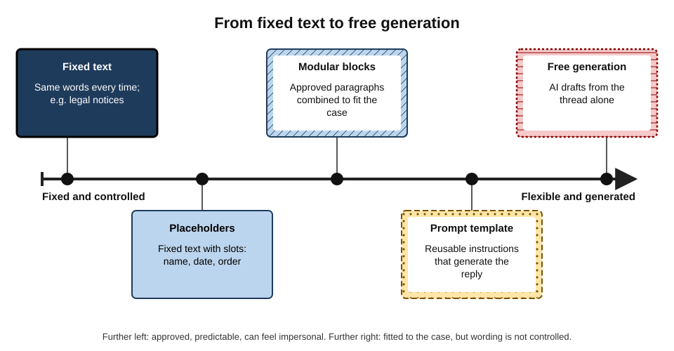
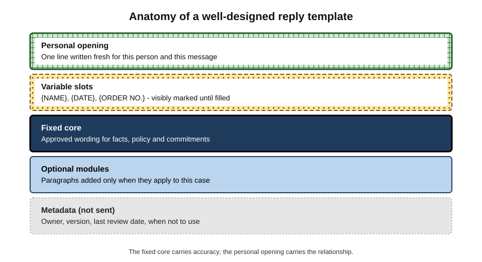
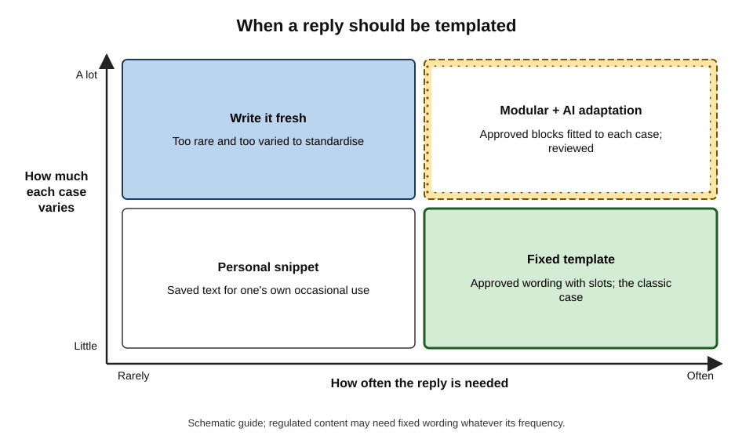
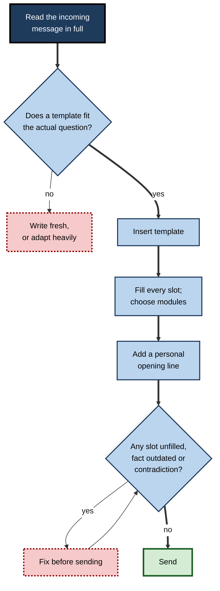
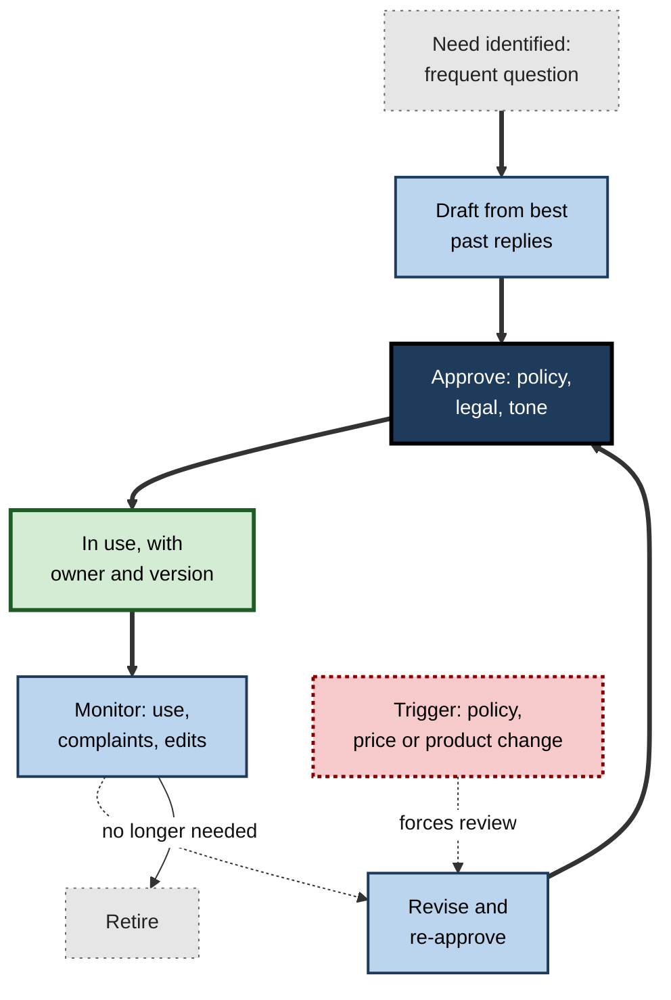

# F.7. Templates and reusable replies

A customer writes to an online retailer asking to return a jacket bought three weeks earlier. Within a minute she receives a reply that begins "Dear [Customer Name]," and promises a full refund "within 30 days of purchase" — a policy the company had shortened to fourteen days two months before.

The template that produced the reply had saved its agents thousands of hours. It had also, every day since the policy changed, been promising refunds the company would not give. Reusable replies are among the most powerful tools in professional correspondence and among the most quietly dangerous.

> **Definition — Reply template:** a stored, reusable message — fixed text, text with fill-in slots, or a set of approved paragraphs — used to answer a recurring kind of message quickly and consistently.

> **Definition — Prompt template:** a stored, reusable set of **instructions** to an AI tool ("reply to a refund request using our 14-day policy; be warm and brief; ask for the order number") that generates a fresh reply each time.

**Why it matters**

- **Most correspondence is repetitive.** Support desks, recruiters, account managers, administrators and many individuals answer the same questions repeatedly.
- **Templates set a quality floor** — the best answer, written once, reused many times.
- **Templates carry policy and law.** Refund terms, data-protection wording and contractual language must be exact.
- **They can also carry errors at scale** — one outdated sentence repeated thousands of times.
- **AI is changing what a template is** — from fixed text to instructions that generate tailored replies.

---

## Kinds of Reusable Reply

**Figure 1.** Reusable replies arranged from fixed text to free generation.

- **Fixed text** — identical every time.
  - *e.g.* a regulatory notice; an out-of-office message.
- **Templates with placeholders** — fixed text with slots for names, dates, reference numbers.
  - *e.g.* "Dear {NAME}, your order {ORDER NO.} was dispatched on {DATE}."
- **Snippets and text expansion** — short saved phrases inserted by a shortcut.
  - *e.g.* typing ";addr" inserts the office address.
- **Modular blocks** — approved paragraphs, combined to fit a case.
  - *e.g.* "late delivery" + "compensation offered" + "how to complain further".
- **Help-desk macros** — templates that also perform actions (set status, add tags, assign).
- **Mail merge** — one template sent to many recipients with personal fields filled from a list.
- **Prompt templates** — reusable instructions that make an AI tool generate a fresh reply.
- **AI-adapted templates** — approved text that an AI tool fits to the incoming message, within limits.

> **Definition — Placeholder:** a marked slot in a template, such as {NAME}, that must be replaced with case-specific content before sending.

> **Definition — Mail merge:** sending one template to many recipients, with fields such as name and account details filled automatically from a data source.

### Where templates live

- **Mail clients** — saved templates or "quick parts" inserted while composing.
- **Text expanders** — operating-system or browser tools that work in any application.
- **Help desks and customer-relationship systems** — shared libraries, often with macros and analytics.
- **AI assistants** — saved prompts, custom instructions and "skills" that produce replies.
- **Shared documents** — a team's phrase bank; simple but easily out of date.

---

## Why Templates Work

### Consistency and correctness

- **Approved once, right every time** — legal, policy and technical wording checked by the right people.
- **Same answer for every customer** — fairness and defensibility.
- **Fewer omissions** — the template remembers the step a tired person forgets.

### Structured communication in high-stakes settings

Templates are an everyday form of a wider idea: **structuring communication** so that critical content is never left out.

> **Definition — SBAR:** Situation, Background, Assessment, Recommendation — a structured format for hand-overs and urgent communication, adapted from military practice for healthcare in the early 2000s (notably at Kaiser Permanente).

**Study card — Müller and colleagues (2018), SBAR and patient safety**

- **Design:** a systematic review of studies on the SBAR communication tool in healthcare.
- **Results:** moderate evidence that SBAR improved patient safety outcomes, especially when used for **telephone communication** between clinicians; many studies were small or before-and-after designs.
- **Conclusion:** structure helps most where messages are short, high-stakes and sent between people who cannot see each other — conditions shared with much professional email.

> **Watch out:** structured formats work as **aids to thinking**, not as substitutes for it. Studies of checklists and structured tools repeatedly find that benefits depend on how faithfully and thoughtfully they are used.

### Personalisation still matters

**Study card — Sahni, Wheeler and Chintagunta (2018), personalisation in email**

- **Design:** field experiments in which marketing emails from a company were sent with or without the recipient's name in the subject line.
- **Results:** adding the name **increased** the probability of opening the email and of later engagement, and **reduced** unsubscribes, even though it added no information.
- **Conclusion:** a small personal element changes how a templated message is received.

> **Key point:** templates win on **accuracy and speed**; personal elements win on **attention and goodwill**. The best reusable replies combine both.

---

## Why Templates Fail

| Failure | Example | Cause |
|---|---|---|
| Unfilled placeholder | "Dear [Customer Name]" | No visible marker; no check before sending |
| Outdated content | Old refund period quoted | No owner or review date |
| Wrong template | "Sorry for the delay" sent to a customer whose order was early | Chosen by keyword, not by reading |
| Mismatched tone | Cheerful template to a bereaved customer | Template ignores context |
| Detectably generic | "Dear Valued Customer, we appreciate your feedback" | No personal element |
| Contradiction | Template says "no charge"; agent's added line says "small fee" | Template and free text not reconciled |
| Merge error | Wrong names or balances in bulk mail | Faulty data or mapping |

- **Recipients recognise templates.** Repeated phrases, mismatched details and stilted formality signal that nobody read their message.
- **Templates freeze the past.** Policies, prices, product names and contacts change; templates do not update themselves.
- **Templates invite autopilot.** The faster a reply can be sent, the less likely its sender read the incoming message carefully.

> **Watch out:** a template answers the question it was written for. Many complaints escalate because a template answered the **expected** question rather than the one actually asked.

---

## Designing a Good Template

**Figure 2.** The parts of a well-designed reply template.

### The parts

- **Personal opening** — one line written fresh: acknowledging the person's specific situation.
- **Variable slots** — clearly marked, in a form that looks obviously wrong if left unfilled: {NAME}, not "Name".
- **Fixed core** — the approved facts, policy and commitments; short and plain.
- **Optional modules** — paragraphs that apply only in some cases, chosen deliberately.
- **Clear next step** — what the recipient should do, or what will happen next.
- **Metadata** (never sent) — owner, version, date of last review, and when **not** to use the template.

> **Mnemonic — "POSCAM":** Personal opening, Obvious slots, Settled core, Chosen modules, Action, Metadata.

### Writing the core

- **Write for the confused reader**, not the expert: short sentences, defined terms.
- **One message, one purpose** — avoid templates that try to answer five questions at once.
- **No promises beyond policy** — every commitment in the core should be one the organisation will honour.
- **Avoid hollow phrases** — "we value your feedback", "please do not hesitate" — that mark text as templated.
- **Test with real cases** — try the template on ten recent messages; does it fit, and where does it not?

### Worked example (illustrative): turning a frequent reply into a template

- **Situation:** an account manager answers "can I add users to my plan mid-contract?" about five times a week, typing a slightly different answer each time.
- **Steps:**
  1. **Collect** the last ten answers she sent.
  2. **Find the stable core:** users can be added at any time; billed pro rata from the next invoice; done in the admin console or by request.
  3. **Find the variables:** customer name, plan name, current user count, price per user.
  4. **Find the optional parts:** a note on volume discounts (only above 50 users); a link to the admin guide (only for self-service customers).
  5. **Check policy** with the billing team: confirm pro-rata wording and price.
  6. **Write metadata:** owner (her), review every six months, do not use for enterprise contracts (separate terms).

| Template part | Content | Changes per case? |
|---|---|---|
| Personal opening | Written fresh — e.g. congratulating them on team growth | Always |
| Slots | {NAME}, {PLAN}, {CURRENT USERS}, {PRICE PER USER} | Always |
| Fixed core | Users can be added any time; billed pro rata from next invoice | Never, until policy changes |
| Module A | Volume discount above 50 users | Only if relevant |
| Module B | Self-service instructions | Only for self-service customers |
| Next step | "Reply with the number of users and I'll arrange it" | Rarely |

- **Conclusion:** the reply now takes about two minutes instead of ten, is consistent with billing policy, and still opens personally.

---

## Templates Meet AI

### Three ways AI changes templates

- **AI-adapted templates** — the tool fits approved text to the incoming message: fills slots from the thread, selects modules, adds a personal opening.
- **Prompt templates** — instead of storing words, the team stores instructions, and the AI writes each reply.
- **AI-mined templates** — the tool analyses past replies to propose templates for the most frequent questions.

| | Static template | AI-adapted template | Prompt template | Free AI draft |
|---|---|---|---|---|
| Wording controlled | Fully | Core controlled, edges adapted | Instructions controlled, words vary | Not controlled |
| Fit to the case | Poor to fair | Good | Good | Good |
| Risk of policy error | Low if maintained | Low in core, moderate at edges | Moderate | High |
| Feels personal | Rarely | Often | Often | Often |
| Review needed | Slots and fit | Edges and slot values | Every reply | Every reply |

### Keeping approved wording approved

- **Locked sections.** Mark the fixed core as unchangeable; let AI adapt only the opening, slots and module selection.
- **Instruction discipline.** Prompt templates should include the policy facts verbatim ("refunds within 14 days of delivery"), not "use our refund policy".
- **Comparison checks.** For high-stakes replies, compare the generated reply with the approved core before sending.

> **Watch out:** an AI tool asked to "make this template friendlier" may rewrite the policy sentence along with everything else. Approved wording must be marked as **not for rewriting**.

> **Key point:** with AI, the thing to govern shifts from **text** to **instructions and boundaries** — what the tool may change and what it may not.

**Figure 3.** Choosing whether and how to template a recurring reply.

---

## Using a Template Well

**Figure 4.** Steps in replying with a template.

1. **Read first.** Read the incoming message before choosing a template — never choose by subject line alone.
2. **Check fit.** If the template answers a different question, write fresh.
3. **Fill and choose.** Every slot filled; modules chosen for this case.
4. **Personalise.** One fresh line that shows the message was read.
5. **Check.** Search the draft for brackets and placeholder markers; confirm facts are current; reconcile any free text with the template.
6. **Send** — and if the template did not fit well, tell its owner.

> **Remember:** "**Read, fit, fill, personalise, check**" — the five seconds of checking are what make a template safe.

---

## Running a Template Library

A shared library is a small information system and needs management like one.

**Figure 5.** The life cycle of a template in a shared library.

- **Ownership** — every template has a named owner responsible for its accuracy.
- **Versioning** — changes recorded; old versions retired, not left beside new ones.
- **Change triggers** — any change in policy, price, product, law or contact details triggers a search of the library for affected templates.
- **Review dates** — even without a trigger, review on a fixed cycle (for example every six months).
- **Usage data** — templates never used are retired; templates heavily edited by users need redesign.
- **Feedback** — complaints, escalations and "this didn't fit" reports go to the owner.
- **Access** — some templates (legal, HR) restricted to trained users.

> **In practice:** the most effective single control is a **search of the whole library** whenever a policy changes — the refund-period failure in the opening example would have been caught by it.

### Case study (illustrative): the HR team's leave templates

- **Situation:** an HR shared-service team used about 120 templates to answer employee questions on leave, pay and benefits; an AI assistant had recently been added to adapt them to each query.
- **Problem:** after a change to parental-leave policy, employees received inconsistent answers — some correct, some quoting the old entitlement, some a blend of the two.
- **Diagnosis:**
  - three templates mentioned parental leave; only one had been updated;
  - the AI assistant, asked to "answer using our templates", drew on whichever template matched best, sometimes combining old and new wording;
  - templates had no owners or review dates.
- **Actions:**
  1. assigned an owner to every template and added review dates;
  2. merged duplicate templates; retired 40 unused ones;
  3. marked policy sentences as locked so the assistant could not rephrase or combine them;
  4. created a rule that any policy change triggers a library-wide search before the change takes effect;
  5. sent corrected answers to affected employees.
- **Result:** inconsistent answers stopped; the library became smaller and easier to maintain.
- **Lesson:** AI adaptation **multiplies** the effect of a messy library: it can draw on any template, current or obsolete. Clean the library before adding AI.

---

## Bulk Messages and Mail Merge

When one template goes to hundreds or thousands of people, small errors become large incidents.

### What goes wrong at scale

- **Field mapping errors** — the "first name" column holds surnames, or every recipient receives the first row's balance.
- **Empty fields** — "Dear ," or "Dear {FIRST NAME}," where data is missing.
- **Wrong segment** — the list for "customers in arrears" is used for "all customers".
- **Visible recipients** — addresses placed in "To" or "Cc" instead of being sent individually, exposing every recipient to every other.
- **Timing** — messages sent at night in recipients' time zones, or during an incident when they look tone-deaf.

> **Watch out:** exposing a list of recipients' email addresses can itself be a personal-data breach — for example, a list of patients of a particular clinic. Bulk messages should be sent individually or with recipients hidden.

### A safe bulk-sending routine

1. **Check the list** — count, segment and a sample of rows against the source.
2. **Preview several merged messages** — including rows with missing or unusual data (long names, accented characters).
3. **Send a test** to oneself and a colleague, from the real sending system.
4. **Send in a small first batch** and check replies and bounces before sending the rest.
5. **Keep a record** of what was sent, to whom and when.

### Worked example (illustrative): a merge with missing data

- **Situation:** a renewal notice is to go to 2,400 customers; the data file has a "first name" column.
- **Checks:**

| Check | Finding | Fix |
|---|---|---|
| Row count | 2,400 rows, as expected | — |
| Empty first names | 180 rows (7.5%) | Fallback greeting: "Dear customer of [company]" |
| Names in capitals | 300 rows entered as "PRIYA" | Convert to normal capitalisation |
| Segment | 40 rows are customers who already cancelled | Remove them |
| Test send | Renewal date displayed in US format | Change date format to "3 April 2026" |

*Illustrative figures.*

- **Conclusion:** without the checks, 180 customers would have been greeted with a blank, 40 former customers told to renew, and every customer shown an ambiguous date.

---

## Templates in Chat and Messaging

Chat tools have their own forms of reusable reply.

- **Saved replies and snippets** for frequent answers in support channels.
- **Workflow forms** — a request channel that asks for structured information ("what system, what error, how urgent") instead of free text.
- **Bots** that answer common questions from a knowledge base and hand over to a person when unsure.
- **Pinned messages** with standard information, so the same answer is not typed repeatedly.

| | Email template | Chat saved reply | Chat bot answer |
|---|---|---|---|
| Who sends it | A person, after choosing it | A person, often in seconds | Software, automatically |
| Length | Paragraphs | One to three lines | Varies |
| Main risk | Outdated policy text | Curt or mismatched tone | Wrong answer with no human check |
| Key safeguard | Owner and review date | Personal line before or after | Clear hand-over to a person; logged answers |

> **Key point:** in chat, a template should usually **shorten** the answer and point to fuller information, not paste a long block of text into a conversation.

---

## Accessibility and Language in Templates

- **Plain language** — templates are read by people of every background, under stress, often on phones; short sentences and common words help everyone.
- **Structure for screen readers** — clear headings and lists in longer templates; avoid conveying meaning only through colour or images.
- **Translated templates** — prepared and checked by competent speakers rather than translated on the fly each time; kept in step with the source when the policy changes.
- **Inclusive wording** — neutral greetings where gender or title is unknown ("Dear Sam Taylor" rather than "Dear Sir").

---

## Personal Templates

Templates are not only for teams. Individuals benefit from a small personal library.

- **Frequent factual answers** — directions, availability, standard requirements.
- **Phrase bank for hard moments** — a set of tested sentences for declining, pushing back, apologising and chasing, which can be adapted quickly.
- **Multilingual greetings and closings** — checked by a native speaker for correspondents in other languages.
- **Prompt templates** — saved instructions for recurring AI tasks ("summarise this thread for my manager in five bullet points with dates").
- **Signatures and disclaimers** — kept current and used consistently.

> **Watch out:** personal templates saved in an AI tool or a text expander may sync to a cloud service; avoid storing confidential client details in them.

---

## Open Questions

- **Will prompt templates replace text templates?**
  - They fit replies to each case better, but they make wording less predictable and harder to audit; regulated industries are cautious.
- **How should AI-adapted templates be audited?**
  - When every reply differs slightly, sampling and comparison with approved wording become essential; good methods are still being developed.
- **Do recipients now assume every reply is templated?**
  - If templated and AI replies become the norm, genuinely personal messages may gain value — or go unrecognised.
- **Who is accountable when a generated reply departs from the template?**
  - The agent who sent it, the template owner, or the tool's configuration — practice varies.
- **How much personalisation is enough?**
  - Evidence that a name or one personal line improves response exists in marketing; its value in professional service correspondence is less studied.

---

## Summary

- **Reply templates** store reusable messages — fixed text, placeholders, snippets, modular blocks, macros, mail merge; **prompt templates** store reusable instructions for AI.
- Templates give **consistency, correctness, speed and a quality floor**, and carry policy and law; structured formats such as **SBAR** show the value of structure in high-stakes communication (moderate evidence, Müller and colleagues, 2018).
- **Personal elements** — even a name — improve attention and goodwill (Sahni and colleagues, 2018).
- Templates fail through **unfilled placeholders, outdated content, wrong selection, mismatched tone, generic phrasing, contradictions and merge errors**; they freeze the past and invite autopilot.
- Good design: **POSCAM** — personal opening, obvious slots, settled core, chosen modules, action, metadata.
- Choose by **frequency and variability**: snippets, fixed templates, modular blocks with AI adaptation, or fresh writing.
- With AI, govern **instructions and boundaries**: lock approved wording, put policy facts verbatim in prompts, compare generated replies with the core.
- Use: **read, fit, fill, personalise, check**.
- Run libraries with **owners, versions, change triggers, review dates, usage data and feedback**; clean the library before adding AI.

---

## Self-Check

1. Distinguish a reply template from a prompt template.
2. Name six kinds of reusable reply and give an example of each.
3. What advantages do templates bring to an organisation?
4. What is SBAR, and what did the systematic review by Müller and colleagues conclude?
5. What did Sahni, Wheeler and Chintagunta find, and why does it matter for templates?
6. List five ways templates fail, with causes.
7. What does POSCAM stand for?
8. Why should placeholders look obviously wrong when unfilled?
9. Using the frequency–variability matrix, choose an approach for: an annual audit request; a weekly "how do I reset my password" question; a rare, complex contract query; a frequent complaint type that varies by circumstance.
10. How can approved wording be protected when AI adapts templates?
11. Describe the five steps of using a template well.
12. What controls keep a shared template library accurate?
13. Why did adding an AI assistant make the HR team's template problem worse?
14. A support manager proposes replacing all 200 static templates with ten prompt templates. Assess the proposal.

### Answer Key

1. A reply template stores the words of a reusable message; a prompt template stores instructions that make an AI tool generate a fresh reply each time.
2. Fixed text (regulatory notice); placeholders (dispatch confirmation with order number); snippets (office address); modular blocks (late delivery + compensation paragraphs); help-desk macros (reply plus status change); mail merge (renewal notices to all customers); also prompt templates and AI-adapted templates.
3. Consistency, correctness of policy and legal wording, speed, fairness across customers, fewer omissions, a quality floor.
4. Situation, Background, Assessment, Recommendation — a structured hand-over format. The review found moderate evidence of improved patient safety, especially for telephone communication, with many weak study designs.
5. Adding the recipient's name to subject lines increased opening and engagement and reduced unsubscribes, despite adding no information — small personal elements improve reception of templated messages.
6. Unfilled placeholders (no visible marker or check); outdated content (no owner or review); wrong template (chosen by keyword); mismatched tone (context ignored); generic phrasing (no personal element); also contradictions and merge errors.
7. Personal opening, Obvious slots, Settled core, Chosen modules, Action, Metadata.
8. So that a missed slot is spotted before sending (and can be searched for), rather than producing a plausible but wrong message.
9. Annual audit request: personal snippet (rare, uniform). Password reset: fixed template. Rare complex contract query: write fresh. Frequent varied complaint: modular blocks with AI adaptation and review.
10. Lock the fixed core so AI can change only openings, slots and module choice; include policy facts verbatim in prompts; compare generated replies with approved wording for high-stakes cases.
11. Read the incoming message; check the template fits the actual question; fill slots and choose modules; add a personal line; check for unfilled slots, outdated facts and contradictions — then send.
12. Named owners, versioning, change triggers with library-wide searches, review dates, usage data, feedback routes, and restricted access to sensitive templates.
13. The assistant drew on any matching template, including outdated duplicates, and combined old and new wording; AI multiplied the effect of an unmaintained library.
14. Benefits: better fit, more personal replies, smaller library. Risks: wording less predictable, policy errors at the edges, harder auditing, every reply needs review. Better: keep fixed templates for regulated or policy-heavy replies; use prompt templates with verbatim policy facts and locked sections for varied cases; pilot, sample and compare before replacing.

---

## Glossary

| Term | Meaning |
|---|---|
| AI-adapted template | Approved text that an AI tool fits to the incoming message within set limits. |
| Fixed core | The approved, unchanging part of a template carrying facts and policy. |
| Help-desk macro | A template that also performs actions such as setting status or tags. |
| Locked section | Template wording marked as not to be changed by people or AI. |
| Mail merge | Sending one template to many recipients with personal fields filled from data. |
| Modular blocks | Approved paragraphs combined to fit a case. |
| Placeholder | A marked slot in a template to be replaced with case-specific content. |
| POSCAM | Personal opening, Obvious slots, Settled core, Chosen modules, Action, Metadata. |
| Prompt template | Reusable instructions that make an AI tool generate a reply. |
| Reply template | A stored, reusable message for a recurring kind of correspondence. |
| SBAR | Situation, Background, Assessment, Recommendation — a structured communication format. |
| Snippet | A short saved phrase inserted by a shortcut. |
| Template library | A managed collection of shared templates. |
| Text expander | A tool that replaces a short code with longer saved text. |
