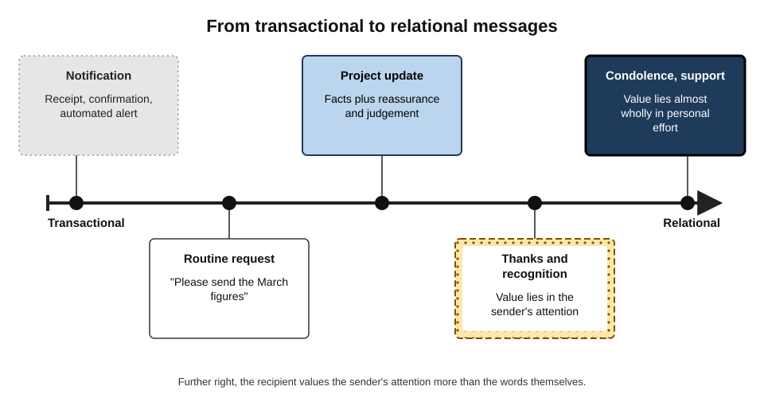
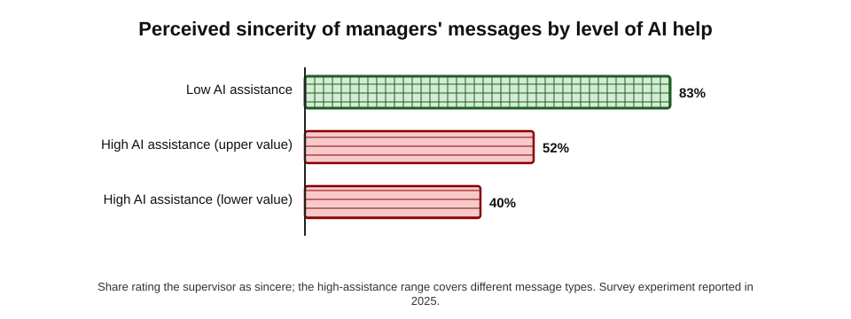
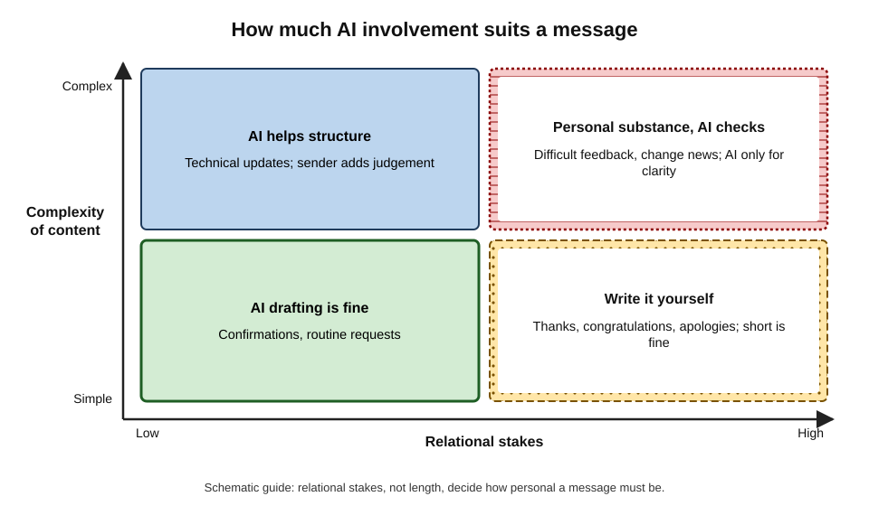
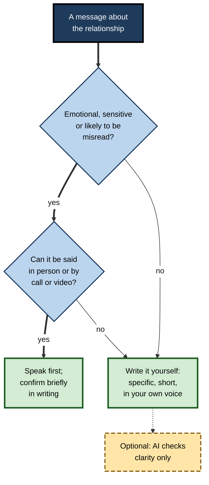
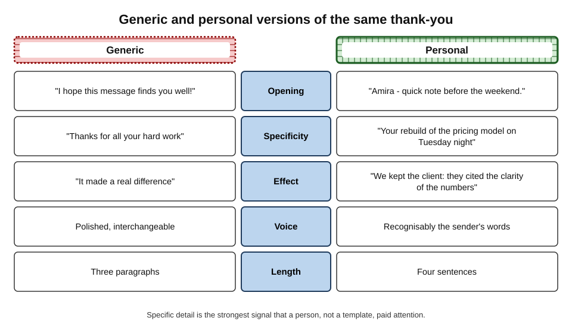

# F.8. Avoiding impersonal communication

A team leader wants to thank an analyst who worked through the night to rescue a client presentation. She asks her mail assistant to "write a warm thank-you" and sends the result: three polished paragraphs about "dedication", "going above and beyond" and "invaluable contributions". The analyst reads it twice, notices that nothing in it refers to what he actually did, and forwards it to a friend with the comment "she couldn't even write this herself".

A message intended to strengthen the relationship weakened it. The words were fine; what was missing was evidence that **a person had paid attention**.

> **Definition — Impersonal communication:** messages that could have been sent to anyone, by anyone — lacking specific detail, recognisable voice or signs of the sender's attention — so that the recipient does not feel personally addressed.

**Why it matters**

- **Relationships run on attention.** Thanks, recognition, apologies, feedback and support work because the recipient believes the sender cared enough to think about them.
- **AI makes generic text effortless.** Polished, interchangeable messages can now be produced for every occasion in seconds.
- **Recipients are learning to notice.** People increasingly recognise formulaic AI phrasing and draw conclusions about the sender.
- **Trust in leaders is at stake.** Research on managers' messages finds that heavy AI assistance can reduce perceived sincerity.

---

## What Makes a Message Feel Personal

### Signals of attention

- **Specific detail** — names, events, particular contributions: "your rebuild of the pricing model on Tuesday".
- **Shared history** — references only this sender and recipient would understand.
- **Recognisable voice** — the sender's usual phrasing, length and humour.
- **Timeliness** — a message sent soon after the event, at a sensible time.
- **Proportion** — a length and channel that fit the occasion; a short note can be more personal than a long one.
- **Effort the recipient can see** — taking time, choosing words, sometimes choosing a harder channel (a call, a handwritten card, a visit).

> **Key point:** recipients judge personal messages less by **how well they are written** than by **what they reveal about the sender's attention**.

### Why effort matters: signals and heuristics

**Study card — Kruger, Wirtz, Van Boven and Altermatt (2004), "the effort heuristic"**

- **Design:** participants rated poems, paintings and suits of armour; some were told the work took a long time to produce, others that it took little time.
- **Results:** the same work was rated as **better and more valuable** when people believed more effort had gone into it — especially when quality was hard to judge directly.
- **Conclusion:** people use **perceived effort** as a cue to quality and value.

- **Applied to messages:** a recipient who believes a thank-you was generated in a click infers low effort — and therefore low value — whatever its wording.
- **Costly signals.** In biology and economics, signals are credible when they are costly to fake. A personal message's "cost" — time, thought, specificity — is part of what makes it believable. AI drafting lowers the cost and so weakens the signal.

> **Definition — Costly signal:** a signal whose credibility comes from the effort or resources needed to produce it, so that it cannot easily be faked.

### Senders undervalue personal messages

**Study card — Kumar and Epley (2018), "Undervaluing gratitude"**

- **Design:** participants wrote letters of gratitude to people who had helped them, predicted how recipients would feel, and the recipients then reported how they actually felt.
- **Results:** writers **underestimated** how positive recipients would feel and **overestimated** how awkward the recipients would find it.
- **Conclusion:** personal expressions of appreciation are worth more to recipients than senders expect — so people send fewer than they should.

> **In practice:** the temptation to outsource a thank-you to AI often rests on underestimating how much a short, genuine note is worth.

**Study card — Liu, Rim, Min and Min (2023), "The surprise of reaching out"**

- **Design:** a series of experiments in which people sent short messages or small gifts to someone in their social network they had not been in touch with recently, and recipients reported how much they appreciated the contact.
- **Results:** senders consistently **underestimated** how much recipients appreciated being contacted; the underestimate was larger when the contact was **unexpected**.
- **Conclusion:** brief personal outreach is valued more than senders think — a reason to send such messages, and to send them personally.

### Social presence in written communication

- **Social presence theory** (John Short, Ederyn Williams and Bruce Christie, 1976) describes how far a medium conveys the sense that another person is "really there". Text conveys less than voice or video.
- **Joseph Walther's work on computer-mediated communication** (from the 1990s) showed that text relationships can become warm, even unusually close ("hyperpersonal"), because people compensate — with careful wording, self-disclosure and attention to detail — given time.
- **The implication for AI:** text can carry real personal warmth, but it does so through **the sender's investment** in specific, considered words. Delegating those words removes the compensation that makes written relationships work.

> **Key point:** written messages are not inherently impersonal; they become personal through **effort that the reader can see in the content**.

---

## Personal Communication in Remote and Hybrid Teams

In distributed teams, much of the relationship lives in messages. Impersonal communication there has a larger effect than in an office where people also meet in corridors.

- **Fewer informal cues.** Without casual conversation, written messages carry most of the signals of appreciation, inclusion and trust.
- **Chat versus email.** Short chat messages often feel more personal than formal email because they are spontaneous; AI-polished chat can lose that quality.
- **Visibility.** Public recognition in a team channel is seen by everyone — generic praise is noticed by many, and comparisons between messages are easy.
- **New joiners.** People who have never met their colleagues form impressions almost entirely from written messages; generic welcomes and templated onboarding notes set a cool tone.

| | Office-based team | Remote or hybrid team |
|---|---|---|
| Main carriers of warmth | Conversation, body language, shared spaces | Written messages, calls, video |
| Cost of a generic message | Moderate — offset by personal contact | High — little else to offset it |
| Good practice | Personal notes for significant moments | Short personal messages often; calls for important ones |
| AI risk | Polished messages feel formal | Polished messages replace most of the relationship's signals |

> **In practice:** in remote teams, a short, specific, slightly informal message from a manager — "Saw your fix to the build last night — saved us a day. Thanks." — does more for the relationship than a polished paragraph.

---

## Customer Correspondence

Customers also notice impersonal communication, and the stakes are commercial as well as relational.

- **Formula empathy** — "We understand how frustrating this must be" repeated in every reply reads as scripted.
- **Ignoring the customer's words** — replies that do not refer to what the customer actually said signal that nobody read it.
- **Over-personalisation** — referencing the customer's purchase history or social profile can feel intrusive.
- **What works:**
  - restating the customer's issue in a sentence that shows it was understood;
  - one specific, honest acknowledgement of their situation;
  - a named person who takes responsibility;
  - clear next steps and a way to reach that person.

> **Watch out:** "personalisation" in marketing often means inserting data; "personal" in communication means **showing attention**. The two can conflict.

### Cultural expectations

- **Formality and warmth are expressed differently.** In some cultures, a personal message is marked by elaborate courtesy and formal respect; in others, by informality and directness.
- **Relationship-first cultures** — where business relationships are expected to rest on personal acquaintance — may react more strongly to evidently generic messages.
- **The safest universal signal is specificity** — references to the actual person, event and contribution are recognised as personal across cultures.

---

## When Personal Effort Matters Most

---

## How AI Makes Messages Impersonal

### Generic by construction

- **Language models write the most probable text** for a request. "Write a warm thank-you" produces the most typical warm thank-you — which is, by definition, generic.
- **Without specifics, the model invents or omits them.** It cannot know what the analyst did on Tuesday night.
- **Polish signals process, not person.** Flawless, balanced paragraphs in an informal relationship can themselves feel distant.

### Formulas recipients now recognise

- **Openers** — "I hope this email finds you well."
- **Inflated praise** — "invaluable contributions", "truly above and beyond", "testament to your dedication".
- **Symmetrical structure** — three neat paragraphs; lists of three adjectives.
- **Hollow closers** — "Please don't hesitate to reach out."

> **Watch out:** lists of "AI giveaway words" are unreliable — people used these phrases long before AI, and newer tools avoid them. The real giveaway is **absence of specific, checkable detail**, not any particular word.

### Homogenisation

- **Arnold, Chauncey and Gajos (2020)** found that predictive suggestions made writing more predictable.
- **Agarwal, Naaman and Vashistha (2025)** found AI suggestions pulled writers' style towards dominant Western conventions.
- **Effect on correspondence:** if many senders use the same tools, messages converge on a shared, recognisable style — and individual voices become harder to hear.

**Figure 1.** Messages arranged from transactional to relational.

---

## The Evidence on AI-Assisted Personal Messages

### Leaders' messages

**Study card — A 2025 study by researchers at the University of Florida and the University of Southern California**

- **Design:** a survey experiment with about 1,100 working professionals, who read workplace messages (such as congratulations and motivational notes) described as written by a supervisor with low, medium or high levels of AI assistance.
- **Results:**
  - messages with heavy AI assistance were still seen as **professional and effective**;
  - but perceptions of the supervisor's **sincerity, caring and confidence** fell sharply — about 83% judged the low-assistance supervisor sincere, against roughly 40–52% for high assistance;
  - people were more lenient about AI use for **their own** messages than for their supervisors'.
- **Conclusion:** AI help with factual messages is accepted; AI help with **relational** messages from leaders costs trust.

**Figure 2.** Perceived sincerity of supervisors' messages by level of AI assistance.

> **Watch out:** participants were **told** the level of AI assistance. In everyday life recipients often do not know — the penalty applies when they find out or suspect.

### Suspected AI use

- **Hohenstein and colleagues (2023)** found that when people **believed** a conversation partner was using AI-suggested replies, they rated the partner as less cooperative — even though actual AI use made conversations more positive.
- **Jakesch and colleagues (2019)** studied self-descriptions on a home-sharing site: when readers believed some profiles were AI-written, they **trusted those profiles less** — a "replicant effect" that appeared only when AI and human texts were mixed and readers had to guess.

> **Key point:** the cost of AI help in personal messages comes less from the words than from the **inference** the recipient draws: "this person did not take the time".

**Figure 3.** How much AI involvement suits a message, by relational stakes and complexity.

| Message type | What the recipient values | Sensible AI role |
|---|---|---|
| Confirmation, routine request | Speed, clarity | Drafting, templates |
| Project update | Accuracy, judgement | Structure and clarity checks; sender adds judgement |
| Thanks and recognition | Specific, sincere attention | None, or a check for clarity after writing |
| Congratulations, farewells | Personal warmth, shared history | None, or ideas only |
| Apology | Ownership and repair | Structure check; words the sender's own |
| Condolence, illness, personal crisis | Human presence | None |
| Difficult feedback | Fairness, specificity, respect | Sender writes; AI checks tone and clarity |

> **Remember:** **the more a message is about the relationship, the less it should be about the tool.**

### Choosing the channel

- **Media richness theory** (Richard Daft and Robert Lengel, 1986) holds that channels differ in their capacity to carry cues — face-to-face richest, then video, phone, personal written notes, and impersonal written documents.
- **Rich channels suit ambiguous and emotional messages**; lean channels suit clear, routine information.
- **Choosing a richer channel is itself a personal signal** — calling to thank someone, or saying it in person and confirming in writing.

**Figure 4.** Choosing how to deliver a relational message.

---

## Writing Personally With and Without AI

### The specificity method

1. **Name the person and the act** — what exactly they did, when.
2. **Name the effect** — what changed because of it, for whom.
3. **Say what it meant to you** — one honest sentence.
4. **Keep it short** — four or five sentences are usually enough.
5. **Send promptly** — within a day or two of the event.

> **Mnemonic — "Act, Effect, Meaning":** **A**ct — what they did; **E**ffect — what it changed; **M**eaning — what it meant to the sender.

**Figure 5.** A generic and a personal version of the same thank-you.

### Worked example (illustrative): rewriting the night-shift thank-you

- **Situation:** the team leader's AI-drafted thank-you read: "I want to express my heartfelt gratitude for your dedication and invaluable contributions. Your willingness to go above and beyond is a testament to your commitment…"
- **Steps:**
  1. **Act:** "You rebuilt the pricing model overnight on Tuesday after the client changed the volumes."
  2. **Effect:** "In Wednesday's meeting the client's finance director said it was the first time our numbers made sense to her — and they signed the extension."
  3. **Meaning:** "I know what that night cost you, and I won't forget it."
  4. **Proportion:** add one line offering time back: "Take Friday afternoon off."
- **Result:** "Amira — quick note before the weekend. You rebuilt the pricing model overnight on Tuesday after the client changed the volumes. In Wednesday's meeting their finance director said it was the first time our numbers made sense to her, and they signed the extension. I know what that night cost you, and I won't forget it. Take Friday afternoon off. — Jo"

| | AI-drafted version | Personal version |
|---|---|---|
| Specific act | None | Pricing model rebuild, Tuesday night |
| Effect | "Invaluable" | Client understood the numbers; extension signed |
| Sender's voice | Interchangeable | Recognisably the leader's |
| Length | About 110 words | About 70 words |
| Time to write | Under a minute | About four minutes |

*Illustrative figures.*

- **Conclusion:** four minutes of specific writing did what a minute of generated warmth could not.

### Using AI without losing the person

- **AI for preparation, not expression** — ask the tool to remind you of the facts (from the thread) or to list what the person contributed; then write in your own words.
- **AI for checking** — "is anything here unclear or likely to be misread?"
- **Your own draft first** — a rough personal draft, lightly corrected, keeps voice; a generated draft lightly personalised usually does not.
- **Keep imperfections** — a slightly informal, human message is often better than a polished one.
- **Never add AI-invented specifics** — a fabricated detail in a personal message is worse than none.

> **Watch out:** asking a tool to "personalise" a message by adding details from the recipient's profile or past emails can produce text that is specific but **not sincere** — and can feel intrusive if it references things the recipient did not expect the sender to know.

---

## Impersonality at Scale

### Organisational messages

- **All-staff announcements** drafted by AI tend towards corporate abstraction ("we remain committed to our people"); staff notice when hard news is wrapped in generic language.
- **Recognition programmes** that auto-generate praise lose value quickly.
- **Customer communications** — generic empathy formulas reduce trust when customers see the same phrases repeatedly.

### Case study (illustrative): the auto-generated recognition programme

- **Situation:** a 3,000-person services firm added an AI feature to its recognition platform: managers selected an employee and a value ("teamwork"), and the system generated a personalised-sounding message posted to a public feed.
- **Problem:** within six months, use of the platform had risen but employee survey scores for "I feel recognised for my work" had fallen.
- **Diagnosis:**
  - messages across managers became near-identical, and staff began comparing them;
  - many referred to qualities rather than actions;
  - some employees felt recognition had become a box-ticking exercise.
- **Actions:**
  1. removed the generation feature; replaced it with a prompt: "What did they do? What difference did it make?";
  2. set a minimum of one specific fact in each recognition;
  3. encouraged managers to deliver significant recognition in person first.
- **Result:** the number of recognitions fell, but survey scores for feeling recognised recovered over the following year.
- **Lesson:** making a relational act easier can **remove the effort that made it meaningful**; volume of messages is not a measure of recognition.

### Organisational practice

- **Guidance on relational messages** — leaders write recognition, condolence and significant feedback themselves.
- **Voice over polish** — encourage short, plain, personal messages rather than polished corporate prose.
- **Measure what matters** — perceived recognition and trust, not counts of messages.
- **Model it from the top** — senior leaders' personal notes set the norm.

---

## Open Questions

- **Will the sincerity penalty fade as AI use becomes normal?**
  - Penalties may shrink if everyone uses AI, or personal messages may become more valuable by contrast.
- **Can AI help people be more personal?**
  - Tools that prompt for specifics, rather than generating warmth, might increase sincere communication; evidence is limited.
- **How do recipients detect AI-written personal messages?**
  - Detection by readers is unreliable; the role of suspicion versus actual detection is not well understood.
- **Does homogenisation affect workplace culture?**
  - If messages converge on one style, team identity and individual voice may weaken; this is plausible but unmeasured.
- **What counts as "personal enough"?**
  - Norms differ across cultures, generations and organisations, and are shifting.

---

## Summary

- **Impersonal communication** could be sent to anyone by anyone; it lacks specific detail, voice and signs of attention.
- Messages feel personal through **specific detail, shared history, recognisable voice, timeliness, proportion and visible effort**.
- People use **perceived effort** as a cue to value (the **effort heuristic**, Kruger and colleagues, 2004); personal messages act as **costly signals**, which AI drafting cheapens.
- Senders **undervalue** personal gratitude (Kumar and Epley, 2018).
- AI produces **generic** text by construction; formula phrases are recognisable, but the real giveaway is **absence of specifics**; suggestions **homogenise** style.
- Heavy AI help in supervisors' relational messages lowered perceived **sincerity** from about 83% to roughly 40–52% (a 2025 study by researchers at the University of Florida and the University of Southern California); **suspected** AI use lowers perceived cooperation and trust.
- The more relational the message, the less AI: write thanks, recognition, condolence and apologies yourself; use AI for preparation and clarity checks.
- Use **Act, Effect, Meaning**; keep it short and prompt; consider a **richer channel** (media richness theory).
- At scale, auto-generated warmth erodes recognition and trust; organisations should value **voice over polish** and measure perceived recognition, not message counts.

---

## Self-Check

1. Define impersonal communication and list five signals that make a message feel personal.
2. Describe the effort heuristic study and explain its relevance to AI-written messages.
3. What is a costly signal, and why does AI weaken the signal of a personal message?
4. What did Kumar and Epley find about gratitude letters?
5. Why are AI drafts generic "by construction"?
6. Why are lists of AI giveaway words unreliable, and what is a better indicator?
7. Summarise the findings of the 2025 University of Florida and University of Southern California study of managers' messages.
8. What is the "replicant effect"?
9. Using the stakes–complexity matrix, how should these be handled: a technical status update; a farewell message to a retiring colleague; a meeting confirmation; difficult feedback on a missed deadline?
10. What does media richness theory say about choosing a channel for relational messages?
11. Apply Act, Effect, Meaning to write a short thank-you to a colleague who covered your shift at short notice.
12. Why can "personalising" a message with AI-gathered details backfire?
13. What went wrong in the recognition-platform case, and what is the general lesson?
14. A chief executive wants AI to draft all her messages to staff, including condolences. Advise her.

### Answer Key

1. Messages that could be sent to anyone by anyone, lacking specifics, voice and attention. Signals: specific detail, shared history, recognisable voice, timeliness, proportion, visible effort.
2. People rated identical work as better when told it took more effort. Recipients who infer that a message took one click infer low effort and therefore low value.
3. A signal credible because it is costly to produce. AI makes polished personal-sounding text cheap, so the text no longer proves attention.
4. Writers underestimated how positive recipients felt and overestimated how awkward recipients would find it — personal gratitude is undervalued.
5. Models produce the most probable text for a request; without specific facts, the most probable thank-you is the most typical one.
6. People used such phrases before AI and newer tools avoid them; the better indicator is absence of specific, checkable detail.
7. Professionals rated supervisors' messages with heavy AI assistance as professional but saw the supervisors as less sincere, caring and confident (about 83% sincere at low assistance versus roughly 40–52% at high); they were more lenient towards their own AI use.
8. Jakesch and colleagues found that when AI-written and human profiles were mixed, readers trusted profiles they suspected were AI-written less.
9. Technical update: AI helps structure; sender adds judgement. Farewell: write it yourself. Meeting confirmation: AI drafting is fine. Difficult feedback: sender writes the substance; AI checks clarity and tone.
10. Channels differ in capacity for cues; rich channels (face-to-face, video, phone) suit emotional or ambiguous messages; choosing a richer channel signals care.
11. E.g. "Ravi — you took my Saturday shift with two hours' notice when my father was taken to hospital. Because of you the site handover went ahead and the client never noticed. It meant a great deal that I didn't have to choose. Thank you."
12. It can produce specific but insincere text, include inaccurate details, or feel intrusive by referring to information the recipient did not expect the sender to know.
13. Generated recognition became uniform and quality-based rather than action-based, so it felt like box-ticking; perceived recognition fell. Making relational acts effortless can remove the effort that gave them meaning.
14. Use AI for factual announcements and for clarity checks; write condolences, recognition and significant personal messages herself, briefly and specifically; where possible speak first; never send generated condolences — sincerity matters more than polish, and discovery would damage trust.

---

## Glossary

| Term | Meaning |
|---|---|
| Act, Effect, Meaning | A method for personal messages: what was done, what it changed, what it meant. |
| Costly signal | A signal credible because it requires effort or resources to produce. |
| Effort heuristic | Using perceived effort as a cue to quality and value. |
| Homogenisation | Convergence of writing towards a common style under AI suggestions. |
| Impersonal communication | Messages lacking specific detail, voice and signs of attention. |
| Media richness theory | The theory that channels differ in their capacity to carry cues and suit different messages. |
| Relational message | A message whose main purpose is the relationship, such as thanks or condolence. |
| Replicant effect | Reduced trust in texts suspected of being AI-written when AI and human texts are mixed. |
| Sincerity penalty | Lower perceived sincerity when a sender is known or suspected to have used AI. |
| Transactional message | A message whose main purpose is information or action, such as a confirmation. |
| Voice | The recognisable style and phrasing of a particular writer. |
