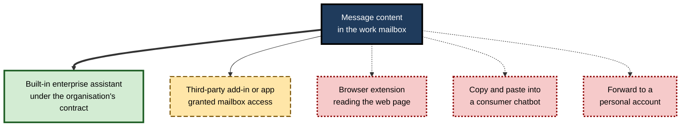
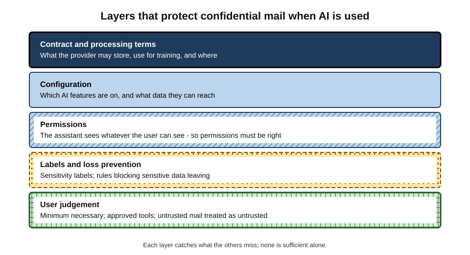
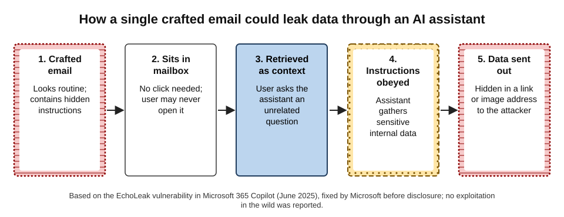
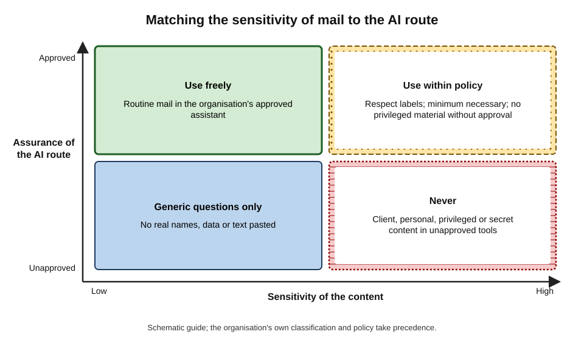
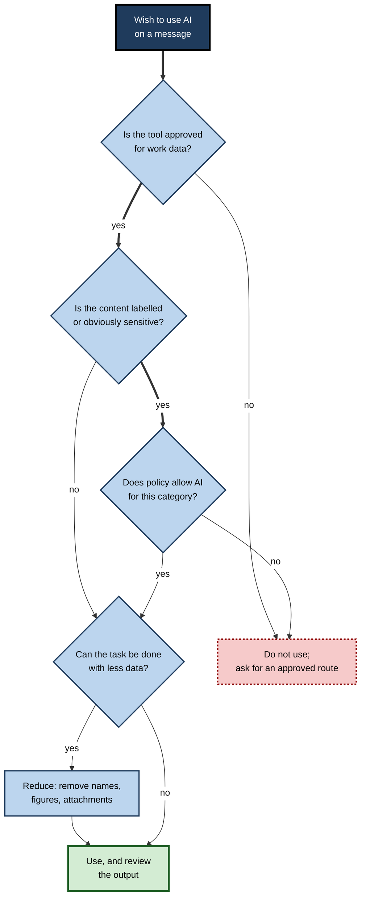

# F.9. Confidentiality in email tools

An associate at a law firm has a forty-message email chain with a client about a pending acquisition. Late at night, on her phone, she copies the whole chain into a free chatbot app and asks for a summary of the open issues. The summary is excellent.

It is also the first time the target company's name, the price range and the client's negotiation limits have left the firm's systems — sent to a service whose terms she has never read, under a personal account the firm cannot see.

The next morning the firm's own mail client offers to summarise the same thread with its built-in assistant, under a contract the firm negotiated. Two buttons do the same job; what happens to the data is completely different.

> **Definition — Confidentiality (in correspondence):** the duty and practice of keeping the content of messages — and the information about people, clients and organisations they contain — available only to those entitled to see it.

> **Definition — AI data route:** the path that message content takes when an AI feature processes it — which service receives it, under what terms, where it is stored, for how long, and whether it may be used to improve the service.

**Why it matters**

- **Inboxes are dense with other people's secrets.** Client plans, colleagues' health and pay, customers' personal data, legal advice and passwords all pass through email and chat.
- **AI features read mail by design.** Summaries, drafts, triage and search assistants need access to message content to work.
- **Routes differ enormously.** An enterprise assistant under a negotiated contract and a free consumer app pasted into from a phone may look identical to the user.
- **Assistants can be attacked through mail.** A crafted email can turn an assistant against its user.
- **Breaches carry legal and professional consequences** — data-protection penalties, loss of privilege, regulatory sanctions and lost clients.

---

## Whose Information Is in an Inbox

An inbox is not one person's property in any simple sense. It holds information **about** and **belonging to** many people.

- **The user's own information** — their plans, opinions, personal matters.
- **The employer's information** — strategy, finances, intellectual property, internal disputes.
- **Clients' and customers' information** — deals, accounts, complaints, often under contractual confidentiality.
- **Colleagues' personal information** — absence reasons, performance discussions, salary.
- **Third parties' personal data** — names, addresses, identity documents, health details of people who never chose to share them with the user's AI tools.
- **Legally privileged material** — communications with lawyers, which may lose protection if disclosed.

> **Key point:** the question is never only "do **I** mind this going to an AI service?" but "would **everyone whose information is in this message** be entitled to object?"

> **Definition — Personal data:** information relating to an identified or identifiable living person; under data-protection laws such as the EU and UK General Data Protection Regulation, processing it requires a lawful basis and appropriate safeguards.

---

## Where Message Content Goes

**Figure 1.** The main routes by which email content can reach an AI service.

| Route | Who processes the content | Governing terms | Typical risk |
|---|---|---|---|
| Built-in enterprise assistant | Mail provider, within the organisation's service | Organisation's contract and data-processing terms | Oversharing through wrong permissions; injection attacks |
| Approved third-party add-in | Add-in vendor, often its own cloud | Vendor contract, if the organisation reviewed it | Broad access scopes; vendor's own security |
| Unapproved add-in or app | Unknown vendor | User clicked "allow" | Full mailbox access to an unvetted party |
| Browser extension | Extension developer | Extension's privacy policy | Reads everything shown in the browser |
| Copy-paste into consumer chatbot | Consumer AI provider | Consumer terms (may allow retention and training unless switched off) | Content leaves the organisation entirely |
| Forward to personal account | Personal mail provider, then any tool | None from the organisation | Loss of control; breach of policy |

> **Definition — Shadow AI:** use of AI tools at work without the organisation's knowledge or approval — the AI equivalent of "shadow IT".

### What to know about any AI feature in a mail tool

- **What data it can reach** — the open message, the thread, the whole mailbox, calendars and files?
- **Where processing happens** — in the provider's service, a vendor's cloud, the device?
- **Whether content is retained**, for how long, and whether prompts and outputs are logged.
- **Whether content may train models** — enterprise terms usually exclude this; consumer terms often allow it by default.
- **Who can see the logs** — administrators, auditors, courts in litigation.

> **Watch out:** "the AI feature is built into our mail client" does not by itself mean the data stays inside the organisation's agreement. Some built-in features call third-party models; some are enabled only for certain licences. The organisation's IT or data-protection team knows which is which.

---

## Permissions and Oversharing

Enterprise assistants generally respect existing access rights: they show a user only what that user is already allowed to see. That is a sound principle — and a trap.

> **Definition — Oversharing (in information systems):** files, mailboxes or sites accessible to more people than should see them, often because of permissive default settings or forgotten sharing links.

- **Before AI**, overshared files were hidden by obscurity: nobody knew the salary spreadsheet in an old project site was open to everyone.
- **With AI search and assistants**, a question such as "what are the salaries in my team?" can surface it in seconds.
- **The assistant is not breaking rules** — it is revealing that the rules were wrong.

> **In practice:** many organisations ran **permission clean-ups** before switching on enterprise assistants — reviewing sharing links, restricting sensitive sites and applying sensitivity labels.

### Sensitivity labels and loss prevention

- **Sensitivity labels** — classifications such as "Public", "Internal", "Confidential", "Highly confidential" attached to messages and files; they can restrict who opens them and whether AI features may use them.
- **Data-loss prevention (DLP)** — rules that detect sensitive patterns (card numbers, identity numbers, health terms) and block or warn when they would leave the organisation, including when pasted into web tools.
- **Retention and records policies** — decide how long messages, and AI interactions about them, are kept.

**Figure 2.** Layers that protect confidential mail when AI is used.

> **Remember:** an assistant sees **what the user can see**. Protecting mail from AI misuse starts with getting ordinary permissions right.

---

## Attacks Through the Inbox

Email is a channel anyone in the world can write into. When an AI assistant reads email, anyone in the world can try to give it instructions.

> **Definition — Indirect prompt injection:** instructions hidden in content that an AI system processes — an email, a document, a web page — designed to make the system act for the attacker rather than the user.

> **Definition — Data exfiltration:** the unauthorised transfer of data out of an organisation's control.

### Documented event: EchoLeak (2025)

- **What it was:** a vulnerability in Microsoft 365 Copilot, disclosed by researchers at the security firm Aim Security in June 2025 and tracked as CVE-2025-32711, rated critical.
- **How it worked:**
  1. an attacker sent an ordinary-looking email containing hidden instructions;
  2. no click was needed — the email simply sat in the mailbox;
  3. when the user later asked Copilot a question, the assistant retrieved that email as relevant context;
  4. the hidden instructions directed the assistant to collect sensitive data available to the user;
  5. the data was embedded in a link or image address that, when loaded, sent it to a server controlled by the attacker.
- **Outcome:** Microsoft fixed the flaw on its servers before public disclosure; no exploitation in the wild was reported.
- **Why it matters:** it was described as the first known "zero-click" prompt-injection exploit against a production AI assistant — the user did nothing wrong.

**Figure 3.** How a single crafted email could leak data through an AI assistant.

### Other forms

- **Summary manipulation** — in 2025 researchers showed that hidden text in an email could make Gmail's Gemini summary display a fake security warning with a scam phone number.
- **Agent hijacking** — assistants allowed to send mail, create rules or share files could be instructed by a malicious email to do so.
- **Poisoned attachments** — documents containing hidden instructions, processed when the user asks for a summary.

> **Key point:** prompt injection is not a bug that can be patched once. Any system that both **reads untrusted content** and **can act or reveal data** is exposed in principle; defences reduce, but do not remove, the risk.

### Practical defences for users

- **Be cautious about letting assistants act** (send, forward, share, delete) on the basis of external mail.
- **Distrust outputs that urge action** — call this number, click this link, reset this password — especially when they appear only in an AI summary.
- **Report strange assistant behaviour** — an unexpected link or instruction in an AI answer is a security event.
- **Prefer approved tools**, whose providers monitor and patch such attacks.

---

## Third-Party Apps With Mailbox Access

Many productivity tools — AI email clients, schedulers, CRM plug-ins, "unsubscribe" services — ask for access to a whole mailbox.

> **Definition — OAuth scope:** the specific permissions a user grants an external app when signing in with a work or personal account — for example "read all your email" or "send email as you".

### Case study: developers reading Gmail users' messages (2018)

- **Situation:** many consumers had granted third-party apps — email organisers, shopping-receipt trackers, travel planners — access to their Gmail accounts.
- **Event:** in July 2018 *The Wall Street Journal* reported that employees of some of these app developers had read thousands of users' emails, for example to train automated systems, as permitted by broadly worded user agreements.
- **Response:** Google stated that such access was disclosed and consented to, and later tightened its review of apps requesting access to Gmail data, requiring security assessments for some.
- **Lesson:** a single click on "allow" can grant a third party — and sometimes its staff — access to **everything** in a mailbox. The same applies to AI email tools today.

### Questions before granting mailbox access

- **What scope is requested?** "Read, compose, send and permanently delete all your email" is far more than most features need.
- **Is the vendor approved** by the organisation?
- **Where does the vendor process and store data**, and does it use content for training?
- **How is access revoked**, and does revocation delete stored data?

> **Watch out:** personal-account apps connected to a phone that also holds a work mailbox can sometimes reach work content. Organisations often block this through device management.

---

## Case Study: Source Code Pasted Into a Chatbot (2023)

- **Situation:** in early 2023 Samsung Electronics allowed engineers in its semiconductor division to use ChatGPT.
- **Problem:** within weeks, Korean media reported several incidents in which employees had pasted confidential material into the chatbot — including source code to be debugged and notes from an internal meeting to be summarised.
- **Diagnosis:**
  - the tools were used for ordinary productivity tasks — summarising, fixing, condensing;
  - consumer chatbot terms at the time allowed providers to retain inputs and, by default, to use them to improve models;
  - employees had no approved alternative for the same tasks.
- **Actions:** Samsung restricted the use of generative AI tools on company devices and networks in May 2023 and moved towards developing internal tools.
- **Lesson:** leaks through AI usually come from **well-meaning people doing their jobs**; prohibition without a safe alternative pushes use into the shadows.

---

## Regulated and Privileged Correspondence

### Legal privilege

- **Privilege** protects certain communications between lawyers and clients from disclosure.
- **Disclosure to third parties can waive it** — so pasting privileged advice into an external service raises a real question about whether privilege survives.

> **Watch out:** how courts will treat privileged material processed by AI services is **not settled** and differs between jurisdictions. Many law firms and legal departments therefore restrict privileged material to approved tools under strict contracts, or prohibit AI processing of it altogether.

### Health, finance and other regulated sectors

- **Healthcare** — patient information is subject to specific legal protections in most countries; services processing it typically need specific contractual agreements.
- **Financial services** — firms must keep records of business communications. In 2022 United States regulators (the SEC and CFTC) fined a group of major financial firms a combined total of more than a billion dollars for staff using unapproved messaging apps such as WhatsApp for business — a reminder that **off-channel** communication is a compliance issue as well as a security one.
- **Public sector** — official correspondence may be subject to freedom-of-information requests and records laws; AI-generated drafts and summaries may themselves be records.

### AI interactions as records

- **Prompts and outputs may be stored** — in logs, in the assistant's history, in compliance archives.
- **They may be discoverable** in litigation or investigations like other business records.
- **Implication:** a prompt such as "summarise why this client is likely to sue us" is itself a document someone may later read.

> **Remember:** **anything typed to an AI assistant at work should be written as if it might be read by a colleague, a regulator or a court.**

---

## Deciding Before Using AI on a Message

**Figure 4.** Matching the sensitivity of mail to the AI route.

**Figure 5.** Questions to ask before using an AI feature on a message.

### The minimum-necessary principle

- **Share only what the task needs.** A tone check on a reply does not need the forty-message history beneath it.
- **Remove identifiers** where possible — names, account numbers, prices — when using any tool outside the approved enterprise route.
- **Leave attachments out** unless they are the subject of the task.
- **Prefer local or device-based features** for sensitive drafts where the organisation offers them.

> **Mnemonic — "A-S-P-M":** **A**pproved tool? **S**ensitive content? **P**olicy allows? **M**inimum necessary?

### Worked example (illustrative): five messages, five decisions

- **Situation:** a project manager in a consultancy wants AI help with five messages on a Monday morning; her firm has an approved enterprise assistant and prohibits consumer chatbots for client data.

| Message | Sensitivity | Route chosen | Reason |
|---|---|---|---|
| Team lunch arrangements | Low | Enterprise assistant drafts reply | Routine, internal |
| Client thread on project scope | Confidential (client) | Enterprise assistant summary, labelled thread | Approved tool, within policy |
| Colleague's message about a health issue affecting deadlines | Personal, sensitive | No AI; personal reply | Health data; relationship |
| Draft press release before announcement | Highly confidential | Enterprise assistant only with communications team approval | Label restricts AI use |
| Proposal text to polish for tone, on her phone at home | Confidential | Waits for work device | Consumer chatbot on phone not permitted |

*Illustrative scenario.*

- **Conclusion:** the same assistant was right for some messages and wrong for others; the decision depended on **content and route**, not on the task.

---

## Organisational Practice

- **Provide an approved assistant** — the strongest protection against shadow AI is a safe tool that meets real needs.
- **Configure deliberately** — decide which features are enabled, for whom, and with what data access.
- **Clean up permissions** before enabling assistants that search across mail and files.
- **Label and protect** — sensitivity labels, DLP rules for pasting into web tools, blocks on unvetted add-ins.
- **Vet add-ins and OAuth apps** — review requested scopes; maintain an allow-list.
- **Write clear rules** — what may never be processed by AI (privileged, health, highly confidential), and what may with care.
- **Train with examples** — people remember the Samsung and EchoLeak stories better than policy clauses.
- **Monitor and respond** — treat unexpected assistant behaviour as a security incident; review logs.

### Case study (illustrative): the consultancy that offered a safe route

- **Situation:** a 600-person consultancy discovered, through network monitoring, that staff were pasting client email extracts into several consumer AI tools daily.
- **Problem:** a client's security questionnaire asked whether client data was ever processed by unapproved AI tools; the honest answer was yes.
- **Actions:**
  1. enabled an enterprise assistant in the mail and document suite, under a contract excluding training on customer data;
  2. ran a two-month permissions clean-up of shared sites;
  3. applied "Client confidential" labels by default to client-related mailboxes;
  4. used DLP to warn when client names or project codes were pasted into unapproved web tools;
  5. published a one-page guide with examples of allowed and forbidden uses.
- **Result:** monitored use of consumer tools for work content fell sharply within a quarter; the firm could answer the client's questionnaire accurately.
- **Lesson:** confidentiality improved mainly because staff were given a **better route**, not because they were told to stop.

---

## Open Questions

- **Can prompt injection be solved?**
  - Researchers have proposed separating instructions from content, restricting assistants' actions and filtering outputs; none yet offers complete protection.
- **How will courts treat privilege and AI processing?**
  - Whether sending privileged material to an AI provider waives privilege is unsettled in most jurisdictions.
- **Are AI interactions records like any other?**
  - Retention, disclosure and freedom-of-information treatment of prompts and outputs is still being worked out by organisations and regulators.
- **Will on-device AI change the picture?**
  - Processing on the user's device reduces data leaving the organisation but may weaken central oversight.
- **How should consent work for third parties?**
  - People whose data appears in others' inboxes rarely know it may be processed by AI; norms and law are developing.

---

## Summary

- **Confidentiality** means keeping message content available only to those entitled to it; inboxes hold many people's information, not only the user's.
- AI features need message content; the **AI data route** — enterprise assistant, add-in, extension, consumer chatbot, personal forwarding — decides who processes it and under what terms. Unapproved use is **shadow AI**.
- Enterprise assistants show users what they can already see, so **oversharing** becomes visible; protection starts with correct **permissions**, then **sensitivity labels** and **data-loss prevention**.
- Email is open to anyone, so assistants reading it face **indirect prompt injection**; **EchoLeak** (2025) showed a zero-click route to **data exfiltration**; summaries can be manipulated too.
- Third-party apps can gain full mailbox access through broad **OAuth scopes** — as the 2018 reports of developers reading Gmail messages showed.
- The **Samsung** incidents (2023) show leaks come from well-meaning productivity use; safe alternatives work better than bans.
- **Privilege**, health, financial and public-sector rules add obligations; off-channel messaging drew over a billion dollars in US fines in 2022; prompts and outputs may be **records**.
- Before using AI on a message: **Approved tool? Sensitive content? Policy allows? Minimum necessary?**

---

## Self-Check

1. Define confidentiality in correspondence and an AI data route.
2. List five kinds of information about other people that typically sit in a work inbox.
3. Compare a built-in enterprise assistant with pasting into a consumer chatbot on four attributes.
4. What is shadow AI, and why does it arise?
5. Explain why enterprise assistants can expose overshared files without breaking any access rule.
6. What are sensitivity labels and data-loss prevention, and how do they relate to AI features?
7. Define indirect prompt injection and describe the five steps of EchoLeak.
8. Why is prompt injection described as a structural rather than a one-off problem?
9. What is an OAuth scope, and what lesson does the 2018 Gmail third-party app case teach?
10. What happened at Samsung in 2023, and what is the main organisational lesson?
11. Why is AI processing of privileged legal correspondence risky?
12. Why might a prompt typed to a work assistant matter in later litigation?
13. Apply A-S-P-M to: summarising a client thread in the approved assistant; polishing a confidential proposal in a phone chatbot; drafting a reply about a colleague's illness.
14. A firm wants to ban all AI use with email. Advise it.

### Answer Key

1. Confidentiality: keeping message content and the information in it available only to those entitled to see it. AI data route: the path content takes when an AI feature processes it — which service, terms, storage, retention and training use.
2. Clients' commercial information; colleagues' health or performance details; customers' personal data; salary information; legally privileged advice (also identity documents, passwords).
3. Processor: provider within the organisation's service versus a consumer provider. Terms: negotiated contract versus consumer terms. Training use: usually excluded versus often allowed by default. Visibility: organisation can govern and audit versus none.
4. Use of AI tools at work without approval; it arises when people need help with real tasks and no approved tool exists or is convenient.
5. Assistants respect permissions, showing what users can access; if files were wrongly shared, the assistant surfaces them quickly where obscurity once hid them.
6. Labels classify content and can restrict access and AI use; DLP detects sensitive patterns and blocks or warns on leakage, including pasting into web tools; together they limit what AI features may process.
7. Hidden instructions in content an AI processes, making it act for an attacker. EchoLeak: crafted email sent; sits in mailbox; retrieved as context for an unrelated question; instructions make assistant gather data; data embedded in a link or image address sent to the attacker.
8. Any system that reads untrusted content and can act or reveal data can in principle be instructed by that content; defences reduce but cannot fully eliminate the risk.
9. The permissions an external app receives on sign-in. In 2018 developers' staff read users' emails under broad consented access; one click can give a third party full mailbox access.
10. Engineers pasted source code and meeting notes into ChatGPT; Samsung restricted generative AI use. Lesson: leaks come from well-meaning productivity use; provide safe approved tools rather than relying on bans.
11. Disclosure to third parties can waive privilege, and how courts treat AI processing is unsettled; many organisations therefore restrict it.
12. Prompts and outputs may be retained and discoverable like other business records, revealing reasoning or admissions.
13. Client thread in approved assistant: approved, sensitive but policy allows, minimum necessary — use and review. Proposal in phone chatbot: not approved — do not use; wait for an approved route. Colleague's illness: approved tool perhaps, but sensitive personal data and relational — no AI; reply personally.
14. A blanket ban pushes use into unapproved tools. Better: provide an approved enterprise assistant; clean up permissions; apply labels and DLP; vet add-ins; set clear rules for prohibited categories; train with examples; monitor.

---

## Glossary

| Term | Meaning |
|---|---|
| AI data route | The path message content takes when an AI feature processes it. |
| Confidentiality | Keeping information available only to those entitled to it. |
| Data exfiltration | Unauthorised transfer of data out of an organisation's control. |
| Data-loss prevention (DLP) | Rules that detect and block sensitive data leaving the organisation. |
| EchoLeak | A 2025 zero-click prompt-injection vulnerability in Microsoft 365 Copilot. |
| Indirect prompt injection | Hidden instructions in processed content that hijack an AI system. |
| Minimum necessary | Sharing only the data a task requires. |
| OAuth scope | The permissions granted to an external app on sign-in. |
| Off-channel communication | Business messages sent through unapproved channels. |
| Oversharing | Content accessible to more people than should see it. |
| Personal data | Information relating to an identifiable living person. |
| Privilege | Legal protection of certain lawyer–client communications from disclosure. |
| Sensitivity label | A classification on content that can restrict access and AI use. |
| Shadow AI | Use of AI tools at work without organisational approval. |
