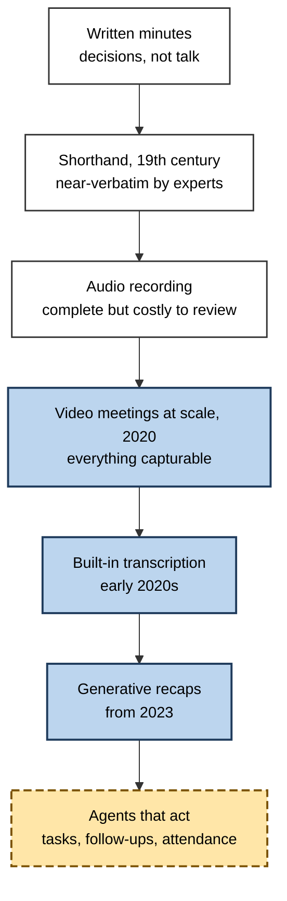
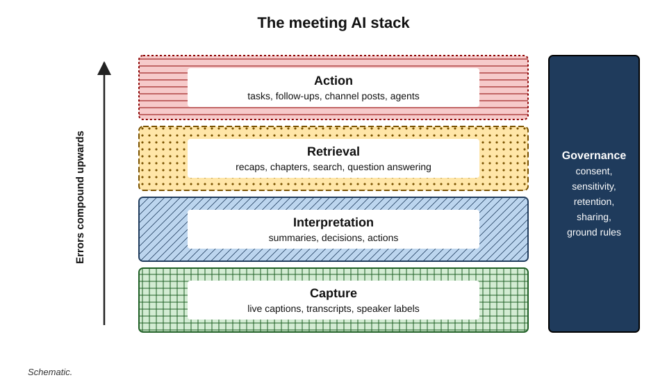
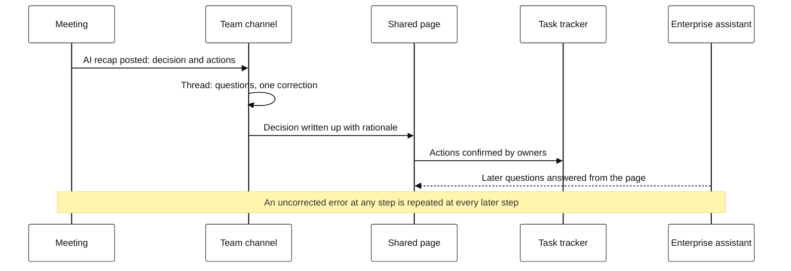
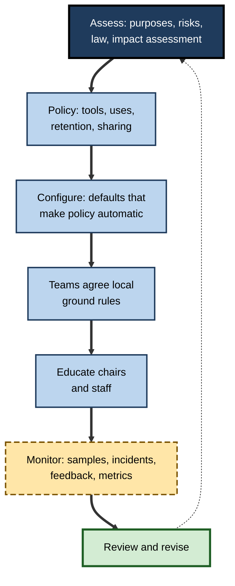
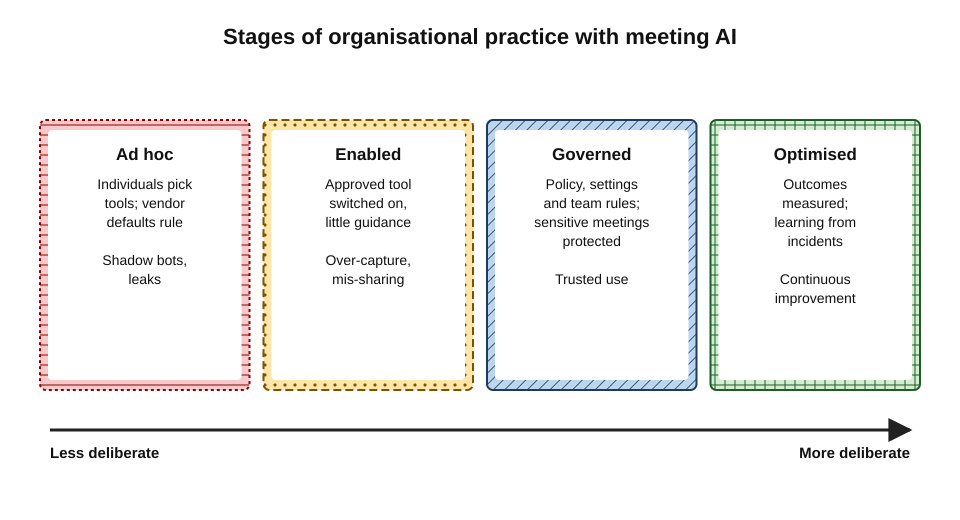

# G. AI in Meetings & Collaboration

A product team's Tuesday: the morning stand-up is transcribed and summarised before anyone has refilled their coffee; the summary lands in the team's chat channel, where an assistant has already condensed the overnight thread from colleagues in another time zone.

In the afternoon, a design review happens in a shared document in which an AI drafts options and records comments. A client call is captioned live for a hard-of-hearing designer; afterwards, an assistant answers a manager's question — "what did the client say about pricing?" — from three weeks of meeting records. Nobody on the team chose most of this. It arrived, feature by feature, inside the tools they already used.

> **Definition — AI in meetings and collaboration:** the use of speech recognition, language models and related AI systems inside meeting, chat and shared-workspace tools to capture, interpret, retrieve and act on what people say and write when they work together.

> **Definition — Collaboration platform:** software in which people work together — video meetings, team chat channels, shared documents and pages, task trackers — increasingly combined into a single environment with a shared store of content.

**Why it matters**

- **Collaboration is where work is coordinated** — decisions, commitments, disagreements and relationships live in meetings and channels.
- **The volume is overwhelming** — Microsoft's 2025 Work Trend Index special report found that, during core hours, the average user of its software was interrupted by a meeting, email or message about every two minutes, and that around 60% of meetings were ad hoc.
- **AI now keeps the record** — transcripts, recaps and channel summaries are becoming the organisation's memory of what was said and decided.
- **Records shape behaviour and power** — what is captured, by whom, how accurately and who can read it affects candour, fairness and accountability.
- **Governance is new and unsettled** — consent, retention, sharing and permitted uses of collaboration data are being decided now, often by default settings.

---

## From Minutes to Machine Records

### A short history of meeting records

- **Minutes** — written accounts of meetings by a secretary have been kept for centuries by councils, companies and societies; they record decisions, not conversations.
- **Shorthand** — systems such as Isaac Pitman's (1837) let trained writers record speech nearly verbatim; parliamentary reporting, court records and journalism relied on them.
- **Recording** — tape and later digital recording made full audio records possible, but expensive to review; few organisations recorded routine meetings.
- **Video meetings at scale** — the shift to remote work in 2020 moved meetings onto platforms that could capture everything; one major platform reported daily meeting participants rising from around 10 million in December 2019 to around 300 million by April 2020.
- **Built-in transcription** — from the early 2020s, live captions and transcripts became standard platform features.
- **Generative recaps** — from 2023, the main platforms added language-model assistants that summarise meetings, list actions, answer questions about them and, increasingly, take notes during them.
- **Agents** — the frontier: assistants that create tasks, draft follow-ups, post to channels and, in some proposals, attend meetings on a person's behalf.

**Figure 1.** From written minutes to AI agents in meetings.

> **Key point:** for most of history, meeting records were **selective and written by a person** who decided what mattered. AI records are **comprehensive and written by a machine**, with a person — at best — reviewing them afterwards.

---

## The Meeting AI Stack

AI in collaboration can be understood as five layers. Each adds value and each adds a distinct kind of risk.

**Figure 2.** Five layers of AI in meetings and collaboration.

- **Capture** — live captions and transcripts.
  - Turning speech into text depends on audio quality and recognition models, and the chain of capture, recognition and speaker labelling fails in characteristic ways.
  - Accuracy is never uniform: errors cluster on names, numbers and negations, and on speakers whose accents or speech are less represented in training data; who said what is a separate and often weaker link.
- **Interpretation** — summaries, decisions and actions.
  - The value of a meeting record lies mostly in its decisions and commitments, which are exactly what automatic summaries most often distort — by dropping conditions, smoothing disagreement or guessing owners.
- **Retrieval** — catching up and asking questions.
  - Recaps, chapters and question answering let absent colleagues recover much of a meeting's content, though not its tone or the chance to influence it.
- **Action** — tasks, follow-ups, posts and agents.
  - Systems increasingly act on what they interpret, so an error in the record becomes an error in the work.
- **Governance** — consent, sensitivity, retention, sharing and ground rules.
  - The rules that decide whether the other layers are trusted.

| | Capture | Interpretation | Retrieval | Action | Governance |
|---|---|---|---|---|---|
| What AI does | Speech to text, speaker labels | Summaries, decisions, actions | Recaps, search, question answering | Creates tasks, drafts follow-ups, posts | Enforces settings and policies |
| Typical value | Accessibility, searchable record | Time saved, clearer outcomes | Catch-up across time and zones | Faster follow-through | Trust, legal compliance |
| Typical failure | Mis-heard words, wrong speaker | Dropped conditions, invented owners | Answers from the wrong passage | Phantom tasks, wrong recipients | Defaults left unexamined |
| Human safeguard | Good audio, vocabulary, checking key items | Review before sending | Ask for timestamps, verify | Owner confirmation | Agreed rules, review cycles |

> **Remember:** errors **compound up the stack** — a mis-heard word becomes a wrong summary, which becomes a wrong task, which becomes wrong work.

---

## Collaboration Beyond the Meeting

Meetings are only one part of collaboration. Much coordination now happens in chat channels and shared documents, and AI connects them all.

### Channels, threads and shared pages

- **Channel and thread recaps** — assistants summarise long chat threads and busy channels for people returning from absence; the techniques resemble those used for long email threads, but channels mix many topics and people at once.
- **Shared pages and canvases** — documents that several people edit at once, sometimes with an AI that drafts sections, tidies notes or answers questions about the page.
- **Meeting–channel–document loops** — a decision made in a meeting is summarised into a channel, debated in a thread, written up in a shared page and turned into tasks. Each step is an opportunity for AI help — and for drift.
- **Enterprise assistants** — assistants with access to an organisation's meetings, chats, files and email can answer questions across all of them, but only as accurately as the underlying records and only as safely as the permissions on them.

**Figure 3.** A decision travelling through the collaboration space.

> **Definition — Single source of truth:** the one agreed place where an authoritative version of a record — such as a decision — is kept, so that copies elsewhere can be checked against it.

> **In practice:** teams that collaborate well with AI choose **one home for decisions** — a decision log or project page — and treat recaps, channel posts and threads as working material that feeds it, not as the record itself.

### Decision records across tools

- **Decisions are scattered** — part in the meeting, part in a thread, part in a document comment.
- **AI can assemble them** — but it may merge a proposal with a decision or miss a later reversal.
- **Explicit decision records** — stating decision, authority, conditions, rationale and date — remain the human contribution that makes the rest of the AI-generated material trustworthy.

---

## Collective Memory

### Transactive memory

**Study card — Daniel Wegner (1985–1987), transactive memory**

- **Idea:** groups — couples, teams, organisations — remember collectively by distributing memory among members and knowing **who knows what**.
- **Evidence:** in studies of couples, partners who were allowed to divide memory tasks naturally recalled more together than pairs of strangers; disrupting the natural division reduced recall.
- **Later work:** research on work teams found that well-developed transactive memory — specialisation, credibility and coordination — predicted team performance.

> **Definition — Transactive memory:** a shared system in which group members encode, store and retrieve knowledge collectively, relying on knowing which member, or which resource, holds which information.

- **AI records join the system** — the meeting archive becomes a member that "knows" everything that was said.
- **Benefits** — less dependence on one person's memory; easier onboarding; continuity when people leave.
- **Risks:**
  - **outsourced remembering** — individuals stop holding knowledge they used to hold;
  - **"the record says"** — a machine summary overrides people's memory, even when the summary is wrong;
  - **homogenised memory** — everyone reads the same recap and forgets the details it omitted.

### Organisational memory

- **James Walsh and Gerardo Ungson (1991)** described organisational memory as stored information from an organisation's history that can be brought to bear on present decisions, held in individuals, culture, procedures, structures and records.
- **AI changes the balance** — far more is now held in records, and far more can be retrieved, but its quality depends on what was captured, how accurately, and whether it was corrected.

> **Watch out:** a large archive is not the same as a good memory. Tens of thousands of unreviewed transcripts can make the important decision **harder** to find, not easier.

---

## Attention and Participation

AI changes how people behave in meetings — what they attend to, how much they speak, and who is heard.

### Attention

**Study card — Cao and colleagues (2021), multitasking in remote meetings**

- **Design:** a large-scale analysis of meeting and email activity in a technology company, combined with a diary study.
- **Findings:** email multitasking occurred in a substantial share of remote meetings — roughly a third — and was more common in large, long and recurring meetings and in morning meetings.
- **Interpretation:** people multitask when meetings seem less relevant to them; multitasking can help productivity but also reduces attention and engagement.

- **AI notes can increase multitasking** — "it's all being captured" makes half-attention feel safe.
- **AI notes can reduce note-taking burden** — the person who used to type notes can now participate fully.
- **Videoconference fatigue** — Jeremy Bailenson (2021) proposed four causes of fatigue in video meetings: prolonged close-up eye gaze, constant self-view, reduced mobility, and the extra effort of reading and sending non-verbal cues.

### Participation and responsibility

- **Social loafing** — people tend to exert less effort in groups when individual contributions are less identifiable; research going back to Bibb Latané and colleagues (1979), who found that people clapped and shouted less loudly per person in larger groups.
- **Diffused note-taking responsibility** — when "the AI is taking notes", nobody feels responsible for making decisions explicit or checking them.
- **Inclusion gains** — captions, translated captions and transcripts let deaf and hard-of-hearing colleagues, second-language speakers and people in other time zones take part more fully, and benefit many others besides.
- **Chilling** — recorded meetings may become more guarded, especially those that depend on candour.

| | Effects that help | Effects that harm |
|---|---|---|
| Attention | Note-taker freed to participate; live captions support following | Multitasking feels safe; half-listening |
| Memory | Fuller, searchable record | Less personal encoding; reliance on recaps |
| Participation | Captions and translation include more people; absentees catch up | Absent people lose influence; quiet people less heard if not prompted |
| Candour | Accurate record protects against misquotation | Guarded speech in recorded meetings |
| Accountability | Clear owners when decisions are explicit | Diffused responsibility; guessed owners |

> **Key point:** AI changes the **social economics** of meetings. Teams that benefit most deliberately counter the harms: explicit decisions, invited contributions, personal key points, and unrecorded space for candour.

---

## Meetings Across Languages and Cultures

Collaboration increasingly spans countries, languages and meeting cultures. AI both helps and complicates it.

- **Translated captions and summaries** — colleagues can follow meetings held in a language they read better than they hear, and read recaps in their own language.
- **Uneven accuracy** — recognition and translation are generally best for widely spoken, well-resourced languages and varieties; speakers of others are more likely to be misrepresented in the record.
- **Different meeting cultures** — in some cultures disagreement is expressed indirectly, and decisions are confirmed after the meeting rather than in it; summaries trained on direct, explicit speech may read polite reservation as agreement.
- **Hierarchy and voice** — where junior people rarely contradict seniors in meetings, the transcript records the silence, not the doubt; written channels and pre-input may surface views that meetings hide.
- **Time zones** — recaps make it possible to work across zones, but decisions still favour those who attend live.

| | What AI helps with | What AI can distort |
|---|---|---|
| Language | Translated captions and summaries | Errors in less-resourced languages and in names |
| Indirect communication | Recording what was said | Reading polite reservation as agreement |
| Hierarchical cultures | Written channels for quieter voices | Silence recorded as consent |
| Time zones | Catch-up for those who cannot attend | Influence still concentrated among attendees |

> **In practice:** in cross-cultural teams, chairs **ask explicitly** for objections and confirm decisions in writing afterwards, giving people time to respond in the way their culture makes comfortable — and do not let a recap's "the team agreed" stand in for that confirmation.

---

## Trust, Consent and Power

- **Consent** — recording and transcription are regulated in many jurisdictions, some requiring every participant's agreement, and AI note-takers that join meetings automatically have prompted litigation in the United States since 2025 over whether such services are third-party eavesdroppers.
- **Sensitive content** — health, personnel matters, legal advice and confidential transactions need different handling, from visible pauses to no AI capture at all.
- **Control of the record** — whoever controls the transcript and summary shapes the account of what happened; this is a form of power, especially between employer and employee, client and supplier, or interviewer and candidate.
- **Use of the record** — using transcripts for individual performance evaluation, or analysing employees' emotions from voices and faces, damages trust; workplace emotion recognition based on biometric data has been prohibited in the European Union since February 2025.
- **Sharing** — summaries that travel to the wrong audience, especially after external participants have left a call, are among the most damaging failures; the safest default is that a summary has no audience until a person chooses one.

> **Watch out:** the presence of a note-taker is now a social signal. In some settings it signals diligence and inclusion; in others — a first client meeting, a difficult conversation — it signals distrust. Reading the room remains a human skill.

---

## Fewer and Better Meetings

- **Notes as a precondition** — people skip meetings when they trust that they can find out what happened; good records can make attendance optional and status meetings unnecessary.
- **The writing alternative** — written proposals, pre-reads and status digests replace much meeting time in organisations that write well.
- **The rebound risk** — cheap capture can make meetings cheaper and therefore more numerous, and add a new burden of reading recaps.
- **Evidence** — company experiments such as Shopify's 2023 removal of recurring meetings from calendars show both the appetite for fewer meetings and the debate about whether blanket cuts remove good meetings along with bad ones.

> **Remember:** AI can make meetings **cheaper**; only people can make them **fewer and better**.

---

## Enterprise Governance of Meeting Data

### What must be governed

- **Which tools** — approved built-in features; third-party note-takers; bots belonging to external parties.
- **Which meetings** — capture modes by meeting type and sensitivity.
- **Consent and notice** — standard announcements, invitation wording, records of consent for external meetings.
- **Retention** — how long each artefact is kept: recordings, transcripts, summaries, chat, copies and indexes; legal holds that override expiry.
- **Sharing** — distribution defaults, link permissions, sensitivity labels, readiness for enterprise assistants.
- **Permitted uses** — what records may and may not be used for.
- **Accessibility** — captions available without storing transcripts; human captioning and interpreting when needed.
- **Vendors** — data location, training use, deletion, sub-processors.

**Figure 4.** A cycle for governing meeting and collaboration AI.

### Roles

- **Executive owner** — accountable for the overall approach.
- **IT and security** — tool approval, configuration, vendor management.
- **Legal and data protection** — consent, lawful basis, impact assessments, retention, disclosure, holds.
- **HR** — permitted uses relating to employees; sensitive meetings.
- **Accessibility lead** — captions, captioning services, inclusive meeting practice.
- **Records management** — retention schedules and decision records.
- **Team leaders and chairs** — local rules and practice in the room.

### Stages of organisational practice

**Figure 5.** Stages in an organisation's practice with meeting AI.

- **Ad hoc** — individuals use whatever tools they like; vendor defaults decide practice.
- **Enabled** — an approved tool is switched on, often everywhere, with little guidance.
- **Governed** — policy, configuration and team agreements shape use; sensitive meetings are protected; retention is set.
- **Optimised** — the organisation measures outcomes (decision quality, actions completed, meeting hours, inclusion), learns from incidents, and adapts as tools change.

### Measuring whether it works

- **Record quality** — sampled accuracy of decisions, owners and figures; correction rates.
- **Follow-through** — share of actions completed on time.
- **Meeting load** — hours per person; focus time; share of meetings with optional attendance.
- **Inclusion** — caption availability and quality; participation of remote and second-language colleagues.
- **Trust** — staff confidence about when they are recorded and how records are used.
- **Incidents** — mis-sharing, unconsented recording, retention failures.

> **In practice:** "minutes saved" is the most commonly reported benefit of meeting AI and the least informative. Organisations learn more from **decision accuracy, action completion and trust**.

---

## Professional Mastery

### What experts do differently

- **They run meetings that AI can record well** — explicit decisions, named owners, read-back, one voice at a time.
- **They treat AI records as drafts** — reviewed, corrected and sent deliberately.
- **They match capture to purpose** — captions only, transcript, outcome notes, or nothing.
- **They protect candour** — some meetings are left unrecorded on purpose.
- **They keep decisions in one home** — and let raw transcripts expire.
- **They write for audiences** — internal records, client follow-ups and management updates are different documents.
- **They include deliberately** — captions on, pauses for caption readers and interpreters, written input from absent colleagues, rotating meeting times.
- **They keep their own memory** — a few lines of personal notes, so that understanding is not entirely outsourced.

> **Mnemonic — "CRISP":** **C**apture only what the purpose needs, **R**eview before sending, **I**nclude everyone, **S**hare to the right audience, **P**rotect candour and sensitive content.

### Worked example (illustrative): one project week with AI in every channel

**Situation:** a project lead runs a five-person team with a client sponsor. In one week there are three stand-ups, a client review, a retrospective, a busy chat channel and a shared design page.

| Moment | AI involvement | Professional practice |
|---|---|---|
| Stand-ups | Transcribed; recap posted to channel | Facilitator checks actions before posting; transcripts expire after 30 days |
| Client review | Transcribed with client's agreement | Chair reads back decisions; client follow-up written separately; internal views kept internal |
| Retrospective | No AI capture | Facilitator writes agreed improvements only |
| Chat channel | Assistant summarises long threads | Summaries used to catch up; decisions confirmed in the decision log, not in the thread |
| Shared design page | AI drafts options from notes | Decision recorded with rationale and authority by the lead |
| Hard-of-hearing designer | Live captions in every meeting | Vocabulary list loaded; pauses before decisions; no transcript needed for captions |
| Friday | Assistant asked "what changed this week?" | Answer checked against the decision log before sending a status update to the sponsor |

*Illustrative example.*

- **Result:** the team uses AI in nearly every interaction, yet each record that matters — decisions, client commitments, improvements — is human-confirmed and kept in one place.

### Case study (illustrative): rolling out meeting AI in a professional-services firm

- **Situation:** a 5,000-person firm enabled built-in transcription and AI recaps across all meetings.
- **First quarter:**
  - strong uptake; staff praised catch-up and accessibility;
  - three incidents: an internal debrief summary sent to a client; HR meetings captured by default; a recap misattributing a concession in a negotiation.
- **Diagnosis:** the firm had moved from ad hoc to enabled without becoming governed — defaults ruled.
- **Actions:**
  1. policy: approved tools, prohibited uses (no performance evaluation, no emotion analytics), retention by artefact;
  2. configuration: review-before-send, internal-only distribution, HR and legal calendars blocked from AI capture, 30-day transcript expiry with a "keep" option;
  3. team ground rules adopted from a template;
  4. chair training on explicit decisions, read-back and pausing;
  5. quarterly sampling of record accuracy and incident review.
- **Result after a year:** incidents fell to isolated cases; surveys showed higher trust in meeting records; decision logs became the default reference for project audits.
- **Lesson:** the technology was ready on day one; the organisation needed a year to become ready for it.

---

## Open Questions

- **Will AI attend meetings for us?**
  - Agents that listen, speak and commit on a person's behalf raise questions of authority, consent and accountability that neither law nor etiquette has settled.
- **What happens to collective memory?**
  - Comprehensive records may strengthen organisational memory or weaken the individual and shared understanding that made it useful; long-term evidence is lacking.
- **Who owns collaboration data?**
  - Organisers, participants, organisations and vendors all have claims; litigation and regulation are only beginning to define them.
- **Does meeting AI reduce or increase meeting load?**
  - Mechanisms point both ways; independent measurement of net effects is scarce.
- **Can records be fair to everyone?**
  - Accuracy gaps across accents, speech conditions and languages mean records can under-represent some people; closing them requires both better models and better meeting habits.
- **How should regulation treat workplace collaboration AI?**
  - Consent, biometric and emotion-recognition rules already apply in places; comprehensive frameworks for collaboration data are still forming.

---

## Summary

- **AI in meetings and collaboration** captures, interprets, retrieves and acts on what people say and write together, inside meeting, chat and shared-workspace tools.
- Meeting records have moved from **selective human minutes** to **comprehensive machine records**, through shorthand, recording, the 2020 shift to video meetings, built-in transcription and generative recaps.
- The **stack** — capture, interpretation, retrieval, action, governance — adds value at each layer, and errors **compound** upwards.
- Collaboration spans **meetings, channels, shared pages and trackers**; decisions should have **one home**, with AI material feeding it.
- AI records join a team's **transactive memory** and the organisation's memory, bringing continuity and the risks of outsourced, homogenised remembering.
- AI changes **attention and participation**: freeing note-takers and including more people, but inviting multitasking, diffused responsibility and chilled candour.
- **Consent, sensitivity, control, permitted use and sharing** determine whether meeting AI is trusted.
- AI makes meetings cheaper; people must make them **fewer and better**.
- **Enterprise governance** covers tools, meetings, consent, retention, sharing, uses, accessibility and vendors, through a cycle of assess, policy, configure, agree, educate, monitor and review; organisations progress from **ad hoc** to **optimised**.
- Mastery — **CRISP**: capture only what is needed, review before sending, include everyone, share to the right audience, protect candour.

---

## Self-Check

1. Define AI in meetings and collaboration, and name the five layers of the meeting AI stack.
2. How do AI meeting records differ from traditional minutes?
3. Explain why errors compound up the stack, with an example.
4. Why should decisions have a single home, and what role do recaps and threads play?
5. What is transactive memory, and how do AI records change it?
6. Summarise the findings on multitasking in remote meetings and explain how AI notes might affect it.
7. How does social loafing relate to AI note-taking?
8. Describe two ways AI improves inclusion in meetings and two ways it can reduce participation or candour.
9. Why is control of the meeting record a form of power?
10. List eight areas enterprise governance of meeting data must cover.
11. Describe the four stages of organisational practice with meeting AI.
12. Why is "minutes saved" a poor measure of meeting AI's value? Propose better measures.
13. An organisation has enabled AI recaps everywhere and has suffered three incidents. Recommend a plan.

### Answer Key

1. The use of speech recognition, language models and related AI in meeting, chat and workspace tools to capture, interpret, retrieve and act on collaborative work. Layers: capture, interpretation, retrieval, action, governance.
2. Minutes were selective, written by a person who judged what mattered, and focused on decisions. AI records are comprehensive, machine-written, include the conversation, and are reviewed by a person afterwards — if at all.
3. Each layer builds on the one below without checking it. A mis-heard "can't" becomes "can" in the transcript; the summary reports a commitment; an automatic task is created; someone does work that was never agreed.
4. Decisions scattered across meetings, threads and documents are hard to find and easy to distort; a single authoritative home lets copies be checked. Recaps and threads are working material that feeds the home, not the record itself.
5. A shared system in which group members remember collectively by knowing who knows what. AI archives become a member that holds everything said — aiding continuity but encouraging outsourced remembering, deference to "the record" and homogenised memory.
6. Multitasking occurred in roughly a third of remote meetings, more in large, long, recurring and morning meetings. AI notes may increase it by making half-attention feel safe, or reduce the burden on note-takers so they can participate.
7. People exert less effort when individual contributions are less identifiable; when "the AI is taking notes", responsibility for making decisions explicit and checking records diffuses, and nobody does it.
8. Improve: captions for deaf and hard-of-hearing colleagues and second-language speakers; recaps and written input for absent and distant colleagues. Reduce: absent people lose influence; recorded meetings become more guarded.
9. The record becomes the accepted account of what happened; whoever controls its creation, correction and distribution shapes that account — significant between employer and employee, client and supplier, interviewer and candidate.
10. Tools; meeting types and capture modes; consent and notice; retention; sharing; permitted uses; accessibility; vendors.
11. Ad hoc — individuals choose tools, defaults rule. Enabled — an approved tool is on, often everywhere, with little guidance. Governed — policy, configuration and team rules shape use. Optimised — outcomes are measured and practice adapts.
12. It is usually self-reported, ignores review time and the cost of errors, and says nothing about outcomes. Better: decision and action accuracy, action completion, correction rates, meeting hours and focus time, inclusion, trust and incidents.
13. Move from enabled to governed: policy on tools, uses and retention; configuration for review-before-send, internal-only distribution, blocked capture for sensitive calendars and short expiry; team ground rules; chair training; monitoring and quarterly review.

---

## Glossary

| Term | Meaning |
|---|---|
| AI in meetings and collaboration | AI in meeting, chat and workspace tools that captures, interprets, retrieves and acts on collaborative work. |
| Collaboration platform | Software combining meetings, chat, shared documents and tasks. |
| Enterprise assistant | An AI assistant with access to an organisation's meetings, chats, files and email. |
| Meeting AI stack | The layers of capture, interpretation, retrieval, action and governance. |
| Minutes | A selective written record of a meeting's decisions, traditionally by a secretary. |
| Multitasking (in meetings) | Doing other work, such as email, during a meeting. |
| Organisational memory | Stored information from an organisation's history used in present decisions. |
| Single source of truth | The one agreed place where the authoritative version of a record is kept. |
| Social loafing | Reduced individual effort in groups when contributions are less identifiable. |
| Transactive memory | A group's shared system of remembering, based on knowing who knows what. |
| Videoconference fatigue | Tiredness associated with video meetings, linked to gaze, self-view, immobility and cue effort. |
