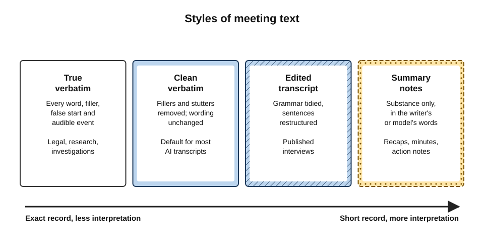
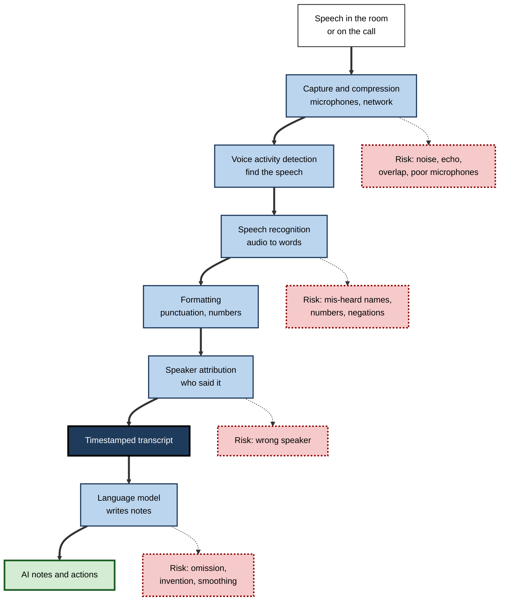
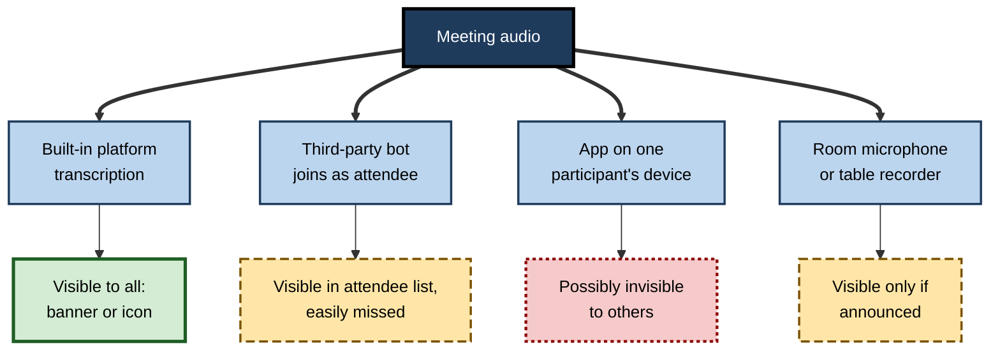
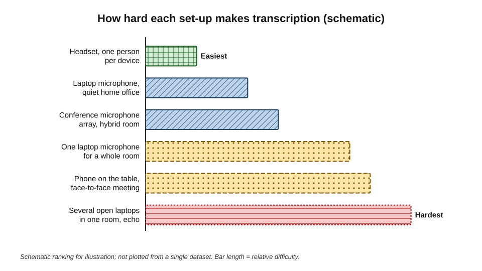
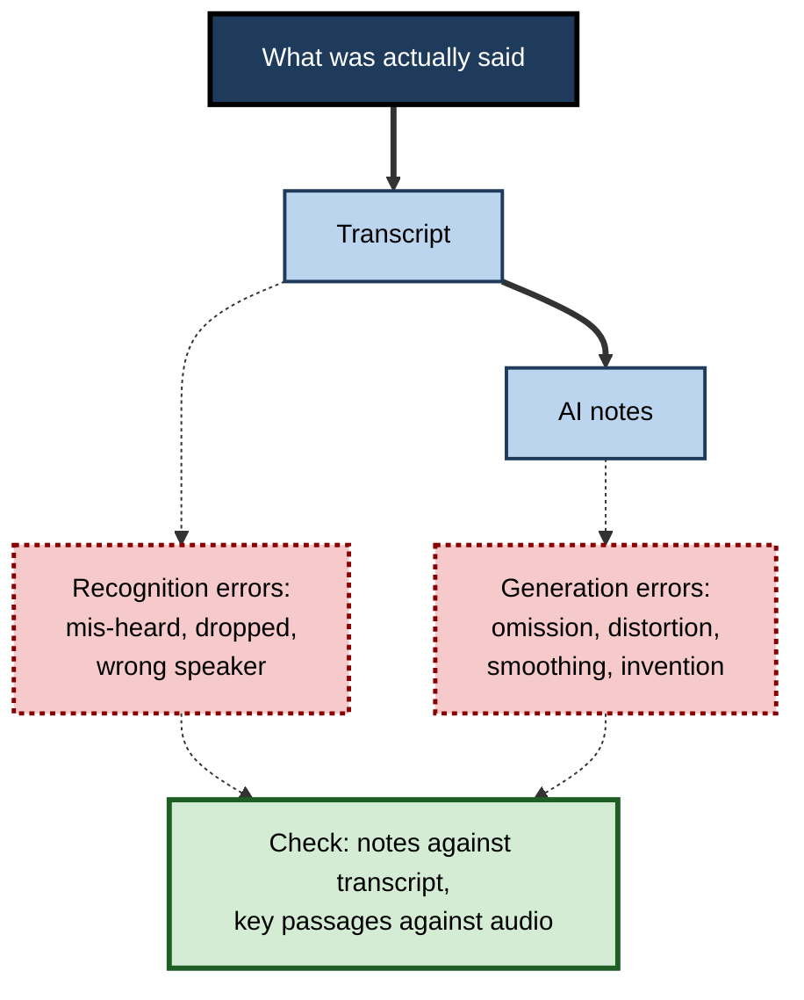
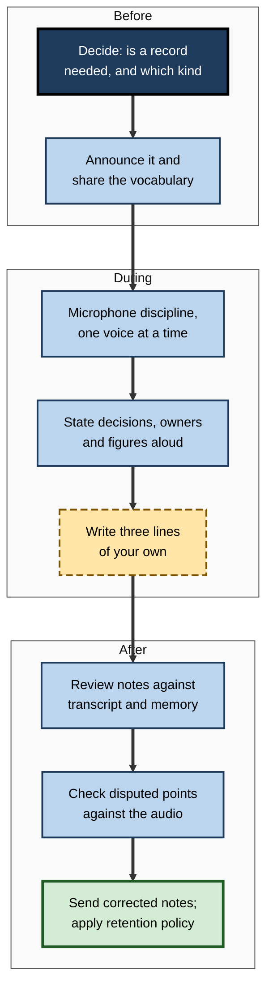

# G.1. Automatic transcription and notes

A project manager clicks one button at the start of a video call. Words begin to scroll across the screen as people speak, each line tagged with a name. Ten minutes after the call ends, a tidy page of notes arrives — topics, decisions, next steps — though nobody in the meeting wrote a word. What happened in between is a chain of machine processes, each of which can succeed or fail, and each of which shapes what the organisation will later believe was said.

> **Definition — Automatic transcription:** the conversion of spoken audio into written text by software, usually with timestamps and an indication of who was speaking.

> **Definition — AI meeting notes:** a condensed written account of a meeting generated by a language model from a transcript (or directly from audio), typically organised into topics, decisions and follow-up actions.

**Why it matters**

- **Scale** — transcription is now built into the main video-meeting platforms and switched on in millions of meetings a day; for many professionals it is the first AI tool they use without choosing to.
- **Records** — a transcript looks objective and complete, so it quietly becomes "what was said", even where it is wrong.
- **Attention** — when a machine keeps the record, people change how they listen, speak and remember.
- **Skill** — knowing how the chain works lets a professional set it up well, read its output critically and decide when not to use it at all.

---

## What a Meeting Record Can Be

Spoken meetings leave nothing behind unless someone deliberately creates a record. Modern tools offer several distinct records, and they are often confused.

### Four kinds of machine record

- **Live captions** — text shown on screen while people speak.
  - Temporary by default; built for following the conversation, not for keeping it.
  - *e.g.* a colleague in a noisy open-plan office reads along instead of turning up the volume.
- **Transcript** — the full text of the meeting, saved with timestamps and speaker labels.
  - Searchable afterwards; usually editable by the organiser.
- **Recording** — the audio, or audio and video, saved as a file.
  - The richest record: it keeps tone, hesitation, laughter and silence.
- **AI notes or recap** — a model-written summary, generated from the transcript.
  - The shortest record and the most interpreted one.

> **Definition — Live captions:** text generated in real time from speech and displayed on screen during a meeting, normally not stored unless transcription is also enabled.

| | Live captions | Transcript | Recording | AI notes |
|---|---|---|---|---|
| When produced | During the meeting | During or just after | During | After (sometimes during) |
| Kept by default | Usually not | Yes | Yes | Yes |
| Length relative to meeting | Same as speech | Same as speech | Same as meeting | A small fraction |
| Degree of interpretation | Low | Low to moderate | None | High |
| Main use | Following along, accessibility | Search, checking exact words | Evidence, nuance, training | Catching up, actions |
| Main risk | Mis-hearing in the moment | Errors treated as fact | Over-collection, candour | Omission and invention |

> **Key point:** each step from recording to transcript to notes **shrinks the record and adds interpretation**. The shorter the record, the more it depends on judgements the reader cannot see.

### How faithful is "verbatim"?

Professional transcribers distinguish styles of transcript, and AI tools quietly choose one.

- **True verbatim** — every word, false start, filler ("um", "you know"), repetition and audible event ("[laughs]").
  - Used in legal proceedings, research interviews and investigations.
- **Clean verbatim** — fillers, stutters and false starts removed; wording otherwise unchanged.
  - The default for most AI meeting transcription.
- **Edited transcript** — grammar tidied, sentences restructured for reading.
  - Closer to minutes than to a transcript.
- **Summary notes** — the substance only, in the note-taker's words.

**Figure 1.** From exact record to interpreted account: styles of meeting text.

> **Watch out:** "clean verbatim" deletes hesitation — and hesitation is sometimes the message. "I, er… I suppose we could hit the date" becomes "I suppose we could hit the date", which reads as far more confident than it sounded.

---

## How Meeting Transcription Works

### The processing chain

A meeting transcript is the product of several stages. Each has its own failure modes, which is why errors in transcripts are so varied.

1. **Capture** — microphones turn sound into a digital signal; the meeting platform compresses and transmits it.
2. **Voice activity detection** — the system finds stretches that contain speech and ignores silence, music and noise.
3. **Speech recognition** — an acoustic and language model converts each stretch of speech into the most probable sequence of words.
4. **Formatting** — punctuation, capital letters, numbers ("twenty-five" → "25") and paragraph breaks are added.
5. **Speaker attribution** — each segment is labelled with a speaker, from the meeting platform's knowledge of who is talking or from the voices themselves.
6. **Alignment** — words are tied to timestamps so a reader can jump to the moment in the recording.
7. **Note generation** — a language model reads the transcript and writes summaries, topics and actions.

> **Definition — Voice activity detection (VAD):** the process of deciding which parts of an audio signal contain human speech.

> **Definition — Speaker attribution:** assigning each stretch of transcribed speech to the person who said it; when done from the audio alone it is called **speaker diarisation**.

**Figure 2.** The processing chain from meeting audio to AI notes.

### Streaming and batch recognition

Live captions and post-meeting transcripts are often produced by different processes.

- **Streaming recognition** works on audio as it arrives, a fraction of a second at a time.
  - It must commit to words before hearing how the sentence ends.
  - Captions sometimes visibly "rewrite" themselves as later words change the likeliest reading.
- **Batch recognition** processes the whole recording after the meeting.
  - It can use the full context in both directions and larger models.
  - It is usually more accurate, but nothing is available until it finishes.

| | Streaming (live) | Batch (after the meeting) |
|---|---|---|
| Delay | Under a second to a few seconds | Minutes after the meeting ends |
| Context used | Mainly words already heard | The whole conversation |
| Typical accuracy | Lower | Higher |
| Typical uses | Captions, live notes, real-time translation | Saved transcript, final notes |
| Correction | Self-revision of the last few words | Re-processing; human editing |

> **In practice:** if live captions looked poor, the saved transcript may still be acceptable — and vice versa. Judge each record on its own.

### What the recogniser actually knows

- **Acoustic knowledge** — how speech sounds map onto units of language, learned from very large collections of recorded speech.
- **Language knowledge** — which word sequences are likely; it is why "recognise speech" beats "wreck a nice beach" in most contexts.
- **Context knowledge** — anything extra the system is given: meeting title, participant names, a custom vocabulary of product names and acronyms.

> **Definition — Custom vocabulary (phrase list):** a list of words and names supplied to a speech recogniser so that it treats them as likely, improving recognition of specialised terms.

**Study card — Whisper (OpenAI, 2022)**

- **What it was:** an open speech-recognition model trained on about 680,000 hours of audio collected from the web, paired with existing transcripts.
- **Approach:** "weak supervision" — large amounts of imperfectly transcribed audio rather than small, carefully checked datasets.
- **Results:** robust performance across accents, background noise and technical language, and recognition and translation in many languages, without tuning for each dataset.
- **Significance:** made high-quality transcription cheap and widely available, and is the basis of many meeting tools and research systems.
- **Limit:** it is a *generative* model — it predicts text — and can produce fluent text that was never spoken, especially over silence or noise.

### A short history

- **1952 — Bell Laboratories "Audrey"** recognised spoken digits from a single speaker.
- **1970s–1990s** — statistical methods, especially **hidden Markov models**, made continuous speech recognition practical; consumer dictation software appeared in the late 1990s.
- **2010s** — deep neural networks cut error rates sharply; in 2016–2017 Microsoft researchers reported error rates on a standard telephone-conversation benchmark comparable to professional human transcribers — a claim others disputed by showing that skilled transcription teams did better still.
- **2020s** — large end-to-end models and cloud platforms made transcription a standard feature of meeting software; language models were added to turn transcripts into notes.

> **Watch out:** "human parity" was claimed on one benchmark of clear telephone conversations between two people. Multi-party meetings with overlapping speech, poor microphones and specialist vocabulary remain much harder.

---

## How AI Note-Takers Join a Meeting

The route by which a tool hears a meeting determines who knows it is there, how well it labels speakers, and where the data goes.

### Four capture routes

- **Built-in platform feature** — transcription and recap provided by the meeting software itself.
  - Participants normally see a banner or icon when it starts.
  - Speakers are labelled from their sign-in, so attribution is strong for one person per device.
  - Data stays within the organisation's existing platform agreement.
- **Bot participant** — a third-party service that joins the call as an extra attendee, often named "Notetaker" or after its owner.
  - Visible in the participant list, but easily overlooked in a large call.
  - May be invited automatically to every meeting in a user's calendar.
  - Data goes to a separate vendor.
- **Device capture** — an application on one participant's computer or phone records the audio it plays and hears.
  - May be **invisible** to everyone else.
  - Hears only what that device hears; speaker labels must be inferred.
- **In-room systems and recorders** — room microphones, conference devices or a phone on the table in a face-to-face meeting.
  - Several people share one microphone, so labelling relies on voices alone.

**Figure 3.** Capture routes and their visibility to other participants.

| | Built-in feature | Bot participant | Device capture | Room or table recorder |
|---|---|---|---|---|
| Visibility to others | High | Moderate | Low | Depends on announcement |
| Speaker labels | Strong (per sign-in) | Moderate (platform signals) | Weak (voices only) | Weak (voices only) |
| Where data goes | Organisation's platform | Separate vendor | App vendor or device | Device or vendor |
| Who controls it | Organiser and administrators | The person who invited it | The individual user | Whoever owns the device |
| Typical governance gap | Default settings left on | Auto-joining every meeting | Undisclosed recording | Forgotten after the meeting |

> **Key point:** the most convenient capture routes for an individual — a personal bot or a device app — are the ones the other participants and the organisation can least see or control.

> **In practice:** many organisations allow the built-in feature, block unapproved bots from the meeting lobby, and forbid undisclosed device capture. The reasons are consent, security and record-keeping rather than technology.

---

## Audio Quality Decides Transcript Quality

No model can transcribe words it cannot hear clearly. Most poor transcripts are caused before the software receives any audio.

### What degrades the signal

- **Distance from the microphone** — a laptop microphone two metres away captures the room's echo as much as the voice.
- **Reverberation** — hard walls and glass make syllables smear into each other.
- **Background noise** — air conditioning, traffic, keyboards, café chatter.
- **Overlapping speech** — two people talking at once; recognition of both suffers.
- **Shared microphones** — in a hybrid room, one device for eight people means quiet speakers at the far end are barely captured.
- **Echo and feedback** — several laptops open in the same room, each with microphone and speakers on.
- **Compression and dropped packets** — weak connections remove fragments of speech before recognition.

> **Definition — Far-field audio:** speech captured by a microphone at a distance from the speaker, as in a meeting room, as opposed to **close-talk** audio from a headset.

**Figure 4.** Recording set-ups ranked by how hard they make transcription.

### Simple habits that improve capture

- **Headsets or close microphones** for remote participants, especially those who speak most.
- **One active microphone per room**, preferably a purpose-built conference device; other laptops in the room muted with speakers off.
- **One speaker at a time** — the chair intervenes when people talk over each other.
- **Names before contributions** in large rooms — "Priya here — I'd add that…" helps both listeners and attribution.
- **Spell out key terms** on first use or put them in the chat; supply a vocabulary list if the tool accepts one.
- **Numbers said clearly**, with units: "fifteen thousand pounds", not "fifteen K".

> **Remember:** good transcripts are made by good meeting habits. Microphone discipline improves the record more than switching to a more expensive tool.

---

## From Transcript to Notes

### What note generation adds

A language model given a transcript can produce many different outputs. The core techniques of turning a transcript into decisions and actions are the same as for any document summary; what is distinctive in meetings is the range of formats the tools now offer.

- **Recap** — a short narrative of what the meeting covered.
- **Topic chapters** — the transcript divided into labelled segments with timestamps, so a reader can jump to "Budget" or "Hiring".
- **Highlights** — key quotations or moments, sometimes marked by participants during the meeting.
- **Decisions and actions** — the items people most need, and the ones most often wrong.
- **Question answering** — a chat box that answers questions such as "What did the client say about price?" from the transcript.
- **Live notes** — notes building up during the meeting, so late joiners can catch up without interrupting.
- **Personal notes** — a private summary for one participant, focused on what concerns them.

### Two layers of error

Errors in AI notes come from two separate machines, and a reader has to keep both in mind.

- **Recognition errors** — the transcript itself is wrong: words mis-heard, dropped or wrongly attributed.
- **Generation errors** — the transcript is right, but the notes misrepresent it:
  - **omission** — an important point left out;
  - **distortion** — a tentative suggestion reported as a decision;
  - **smoothing** — disagreement summarised as consensus;
  - **invention** — content, owners or dates that appear nowhere in the transcript.
- The two **compound**: a mis-heard "can't" becomes "can", and the notes then confidently report a commitment nobody made.

**Figure 5.** Two layers of error between the meeting and the notes.

> **Watch out:** checking the notes against the transcript catches generation errors but not recognition errors. For anything disputed or consequential, the **audio** is the primary record.

### Real-time notes inside the meeting

Since 2023 the major platforms have added assistants that work *during* the meeting: answering "what have I missed?", listing points raised so far, or drafting a follow-up while the call continues.

- **Benefits:**
  - late joiners catch up silently instead of asking for a recap;
  - the chair can check, before closing, whether every agenda item produced an outcome.
- **Costs:**
  - participants reading summaries are not listening to colleagues;
  - questions to the assistant may themselves be stored and visible to the organiser, depending on settings.

---

## Notes, Memory and Attention

Taking notes has never been only about the record. Research on note-taking shows that the act of writing notes changes what the note-taker learns — which matters once a machine does the writing.

### Two functions of notes

**Study card — Di Vesta and Gray (1972)**

- **Question:** do notes help because of the act of taking them, or because they can be reviewed later?
- **Approach:** students listened to lectures under conditions that separated taking notes from reviewing them.
- **Distinction proposed:**
  - the **encoding function** — selecting and rephrasing ideas while listening strengthens memory and understanding;
  - the **external storage function** — the notes can be reviewed later.
- **Later research:** both functions help, and reviewing notes is especially valuable; reviews over many decades (notably by Kenneth Kiewra) support the distinction.

> **Definition — Encoding function of notes:** the benefit to memory and understanding that comes from selecting, condensing and writing ideas down while listening.

- **AI note-taking keeps the storage function** — arguably improves it, since the record is fuller.
- **It removes the encoding function** unless the person does something to replace it.

> **Watch out:** a widely reported 2014 study by Pam Mueller and Daniel Oppenheimer found that students taking notes by hand understood lectures better than those typing on laptops, apparently because typists transcribed word for word. A 2019 replication by Kayla Morehead, John Dunlosky and Katherine Rawson did **not** find a clear advantage for longhand. The safer conclusion is narrower: notes that *process* ideas help more than notes that *copy* them.

### What changes when nobody takes notes

- **Listening may become shallower** — "it is all being captured" invites half-attention and multitasking.
- **Memory of the meeting may weaken** — each participant remembers less, trusting the record to remember for them.
- **Shared understanding may shrink** — when notes are read rather than made, fewer people have actively decided what mattered.
- **Participation can improve** — the person who used to type notes can now contribute fully.

| | Human note-taker | Raw transcript | AI notes, unreviewed | AI notes plus personal key points |
|---|---|---|---|---|
| Encoding benefit for the note-taker | High | None | None | Moderate |
| Completeness of record | Partial | Very high | High | High |
| Interpretation quality | Depends on the person | None (raw) | Variable | Good once checked |
| Burden on one participant | High | None | None | Low, shared |
| Who decides what mattered | The note-taker | Nobody | The model | Each participant, then checked against the model |

> **In practice:** many experienced professionals keep a habit of writing **three lines** of their own during or just after an AI-recorded meeting — the decision, their own action, the one thing that surprised them. It costs a minute and restores most of the encoding benefit.

---

## Language, Accent and Multilingual Meetings

- **Language setting** — most tools must be told, or must detect, the spoken language. A wrong setting produces a phonetic garble in the wrong language or a confident "translation" of what was never said.
- **Code-switching** — many professionals move between languages in one sentence (for example English and Hindi in an Indian team, or English and Spanish in a US one). Many recognisers handle a single language per segment better than mixed speech.
- **Accents and varieties** — recognition is usually best for the varieties most represented in training data. Speakers of less-represented varieties, second-language speakers and people with speech differences tend to see more errors.
- **Translated captions** — some platforms translate captions live. They add a translation error layer on top of recognition errors; names and idioms suffer most.
- **Technical and local vocabulary** — place names, personal names from many cultures and internal acronyms are frequent casualties.

> **Example:** a speaker says "the Pune team will own the UAT cycle"; the transcript reads "the poon team will own the you 80 cycle". Each word sounded plausible to a recogniser that had never been told about Pune or user-acceptance testing.

> **Key point:** uneven accuracy means uneven representation. If one person's contributions are transcribed badly, they are also summarised badly — and the AI notes quietly under-represent that person.

---

## Worked Example (illustrative): Setting Up Transcription for a Hybrid Steering Meeting

**Situation:** a monthly steering meeting has six people in a glass-walled meeting room and four joining remotely. Last month's AI notes attributed most of the room's comments to "Meeting Room 3", misspelled the client's name throughout and recorded a budget figure of "50,000" instead of "15,000".

**Steps taken by the meeting owner**

1. **Diagnose by stage** — the errors were attribution (one room microphone), vocabulary (client name) and numbers (spoken quickly as "fifteen K").
2. **Fix capture** — book a room with a ceiling microphone array; agree that in-room laptops stay muted with speakers off.
3. **Fix attribution** — ask in-room speakers to say their name before their first contribution on each item; where the platform supports it, have each in-room participant join on their own device with audio off so the system can link voices to people more reliably.
4. **Fix vocabulary** — add the client's name, programme names and acronyms to the meeting invitation and to the tool's vocabulary list.
5. **Fix numbers** — the chair restates any figure that drives a decision: "So that is fifteen thousand pounds — one-five."
6. **Fix the output** — set a notes template of Decisions, Actions (owner, date), Risks, Open questions; review within the hour.

**Result after two meetings (illustrative figures)**

| | Before | After |
|---|---|---|
| Comments attributed to "Meeting Room 3" | Most in-room remarks | A few, mainly during cross-talk |
| Client name spelled correctly | Never | Always |
| Figures needing correction in notes | 3 | 0 |
| Owner's review time | About 25 minutes | About 8 minutes |

- **Conclusion:** none of the fixes involved a new tool. Each targeted one stage of the processing chain.

> **Watch out:** the restated figure only helps if the transcript catches the restatement. The owner still checks every number that appears in a decision.

---

## Transcription in Professional Practice

### A personal method

**Figure 6.** A personal routine for meetings with automatic transcription.

- **Before** — decide whether the meeting needs a record at all, which kind (captions only, transcript, notes) and who owns it.
- **During** — protect audio quality and make outcomes explicit.
- **After** — treat AI notes as a **draft by an unreliable but tireless junior colleague**: useful, fast, and never sent unchecked when it matters.

> **Mnemonic — "HEAR":** **H**ear well (capture), **E**xplicit outcomes (say decisions aloud), **A**udit the draft (review), **R**etain wisely (keep only what is needed).

### What organisations decide

- **Default settings** — whether transcription starts automatically, for which meeting types, and who may switch it on.
- **Approved tools** — which built-in features and third-party note-takers are permitted; whether unapproved bots are blocked at the lobby.
- **Language and vocabulary** — organisation-wide vocabulary lists of product and client names improve every meeting's transcript.
- **Quality checks** — periodic sampling of transcripts for error rates on names, numbers and particular speakers' contributions.
- **Training** — teaching staff the processing chain, so that they diagnose a poor transcript rather than simply distrust or over-trust it.

> **In practice:** the cheapest quality improvement most organisations can make is a vocabulary list and a microphone standard for meeting rooms. Both are invisible in vendor comparisons and decisive in daily use.

### Case study (illustrative): transcription in a consulting practice

- **Situation:** a consulting firm switched on automatic transcription and AI recaps for all internal and client meetings.
- **Early benefits:** consultants stopped typing during calls; partners could catch up on meetings they missed; proposal teams searched old transcripts for client requirements.
- **Problems after three months:**
  1. a client complained that a recap circulated internally misquoted their finance director on a sensitive figure;
  2. junior consultants admitted they now "zoned out" during long calls, relying on the recap;
  3. several consultants had installed personal device-capture apps that recorded client meetings without any visible indicator.
- **Diagnosis:**
  - the misquote was a recognition error on a number, compounded by the recap stating it as fact;
  - the loss of attention reflected the lost encoding function of note-taking;
  - personal capture apps sat outside the firm's governance entirely.
- **Actions:**
  1. built-in transcription only; personal capture apps banned for client work; unapproved bots blocked;
  2. a rule that any figure quoted from a client is checked against the audio before it is repeated in writing;
  3. junior staff asked to write their own three-line summary before reading the AI recap, then compare;
  4. a firm-wide vocabulary list of client and project names maintained by each engagement lead.
- **Result:** complaints about misquotation stopped; partners reported that junior staff contributed more in client debriefs.
- **Lesson:** automatic transcription is not a neutral recorder. Its value depends on the capture route, the meeting's habits and the reader's discipline.

---

## Open Questions

- **Will transcription become the default for every meeting?**
  - Convenience pushes towards "always on"; consent, candour and storage cost push back. Norms differ sharply between organisations and countries.
- **What happens to collective memory when no one takes notes?**
  - Research on note-taking predicts weaker individual encoding, but there is little direct evidence yet on teams that rely wholly on AI notes.
- **Can accuracy become even across speakers?**
  - Gaps by accent, dialect and speech condition have narrowed but not closed; independent, published measurements on real meeting audio are scarce.
- **Should notes come from audio directly?**
  - Newer models can summarise straight from audio, skipping the transcript. That may reduce compound errors — or remove the checkable intermediate record.
- **Who owns a meeting record?**
  - The organiser, every participant, the organisation and the vendor all have claims; law and practice are still settling.

---

## Summary

- **Automatic transcription** turns meeting speech into timestamped, speaker-labelled text; **AI notes** condense it into topics, decisions and actions.
- Four distinct records — **live captions, transcript, recording, AI notes** — differ in permanence, length and degree of interpretation; each step shrinks the record and adds judgement.
- Transcript styles range from **true verbatim** to **summary**; most tools use **clean verbatim**, which removes hesitation that can carry meaning.
- The processing chain — **capture, voice activity detection, recognition, formatting, speaker attribution, alignment, note generation** — has failure points at every stage.
- **Streaming** recognition is fast but less accurate than **batch** processing after the meeting.
- Tools join by **built-in feature, bot, device capture or room recorder**; the most convenient for individuals are the least visible to others.
- **Audio quality** is the biggest single determinant of transcript quality; microphone discipline, spoken names and clear numbers improve it.
- AI notes carry **two layers of error** — recognition and generation — which compound; the audio is the primary record for disputed points.
- Notes have an **encoding function** as well as a **storage function**; AI note-taking keeps storage but removes encoding unless participants write a few lines of their own.
- Accuracy is uneven across **languages, accents and speakers**, so the record can under-represent some people.

---

## Self-Check

1. Distinguish live captions, a transcript, a recording and AI notes in terms of permanence and interpretation.
2. Why can a clean-verbatim transcript misrepresent a speaker's confidence? Give an example.
3. List the stages of the transcription processing chain and one typical failure at each.
4. Why are live captions often less accurate than a transcript produced after the meeting?
5. What is a custom vocabulary, and which kinds of word does it help most?
6. What did the Whisper model demonstrate, and what risk comes with generative transcription?
7. Compare built-in transcription and device capture in terms of visibility, speaker labels and governance.
8. A hybrid meeting's transcript attributes most comments to the room device. Explain why and propose three fixes.
9. Explain the two layers of error in AI meeting notes and why checking against the transcript is not always enough.
10. What are the encoding and storage functions of notes, and which does AI note-taking remove?
11. What does the failed replication of the 2014 longhand-versus-laptop study suggest about note-taking advice?
12. How can uneven recognition accuracy lead to unfair meeting records?
13. A manager proposes switching on transcription for every meeting by default. Identify the benefits, the risks and two conditions you would attach.

### Answer Key

1. Live captions are shown in real time and usually not stored; low interpretation. A transcript is the stored full text; low to moderate interpretation (formatting, clean-up). A recording keeps the audio or video itself; no interpretation. AI notes are a short model-written summary; high interpretation and the greatest risk of omission or invention.
2. Clean verbatim removes fillers and false starts. "I, er… I suppose we could hit the date" becomes "I suppose we could hit the date", which reads as a confident commitment rather than a reluctant possibility.
3. Capture (noise, echo, distance); voice activity detection (quiet speech treated as silence); recognition (mis-heard names, numbers, negations); formatting (wrong numbers or punctuation changing meaning); speaker attribution (wrong person); alignment (timestamps off, making checking hard); note generation (omission, distortion, smoothing, invention).
4. Streaming recognition must commit to words using only what has been heard so far, often with smaller models for speed; batch processing uses the whole conversation and larger models after the meeting.
5. A list of names and specialised terms supplied to the recogniser so it treats them as likely. It helps most with personal and client names, product names, acronyms and jargon that rarely appear in general training data.
6. That a model trained on very large amounts of imperfectly transcribed web audio could be robust across accents, noise and languages without per-dataset tuning. Because it generates text, it can produce fluent text that was never spoken, especially over silence or noise.
7. Built-in transcription is visible to all (banner), labels speakers from sign-ins and keeps data within the organisation's platform under administrator control. Device capture may be invisible, infers speakers from voices alone and sends data to the app vendor, outside organisational governance.
8. Several people share one microphone, so the platform knows only that the room device is speaking and must separate voices acoustically, which is unreliable. Fixes: a microphone array in the room; in-room participants joining on their own devices with audio off where supported; names stated before contributions; one speaker at a time.
9. Recognition errors make the transcript wrong; generation errors make the notes misrepresent a correct transcript. Checking notes against the transcript finds generation errors but cannot reveal that the transcript itself mis-heard a word, so consequential or disputed passages must be checked against the audio.
10. Encoding: selecting and condensing ideas while listening strengthens memory and understanding. Storage: the notes can be reviewed later. AI note-taking keeps and improves storage but removes the encoding benefit unless participants write some notes themselves.
11. That the popular advice "always take notes by hand" rests on a finding that did not clearly replicate. The more robust conclusion is that notes which process and rephrase ideas help more than verbatim copying, whatever the medium.
12. Speakers whose accents, dialects or speech patterns are less represented in training data are transcribed less accurately; their points are then summarised less faithfully or dropped, so the record under-represents them without anyone noticing.
13. Benefits: less note-taking effort, better catch-up for absentees, searchable records, accessibility. Risks: consent and legal exposure, chilling of candour, large stores of sensitive data, over-reliance on unchecked notes, weaker attention. Conditions: e.g. sensitive meeting types (personnel, legal, retrospectives) excluded by default; notes reviewed by the organiser before circulation; retention limited by policy; external participants asked before recording.

---

## Glossary

| Term | Meaning |
|---|---|
| AI meeting notes | A language-model-written summary of a meeting, generated from a transcript or audio. |
| Automatic transcription | Software conversion of speech into text, usually with timestamps and speaker labels. |
| Batch recognition | Speech recognition run on a complete recording after the event. |
| Bot participant | A third-party note-taking service that joins a meeting as an extra attendee. |
| Clean verbatim | A transcript with fillers, stutters and false starts removed but wording otherwise unchanged. |
| Close-talk audio | Speech captured by a microphone near the mouth, such as a headset. |
| Code-switching | Moving between two or more languages within a conversation or sentence. |
| Custom vocabulary | A list of names and terms supplied to a recogniser to improve their recognition. |
| Device capture | Recording meeting audio through an application on one participant's device. |
| Encoding function | The memory and understanding benefit of taking notes oneself. |
| External storage function | The benefit of being able to review notes later. |
| Far-field audio | Speech captured by a microphone at a distance from the speaker. |
| Generation error | An error introduced when a language model turns a transcript into notes. |
| Live captions | Real-time on-screen text of speech, usually not stored. |
| Recognition error | An error in converting speech to text. |
| Speaker attribution | Assigning each stretch of transcribed speech to the person who said it. |
| Speaker diarisation | Determining who spoke when from the audio itself. |
| Streaming recognition | Speech recognition performed on audio as it arrives, with low delay. |
| True verbatim | A transcript recording every word, filler, repetition and audible event. |
| Voice activity detection | Identifying which parts of an audio signal contain speech. |
