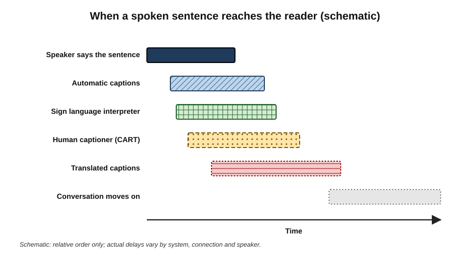
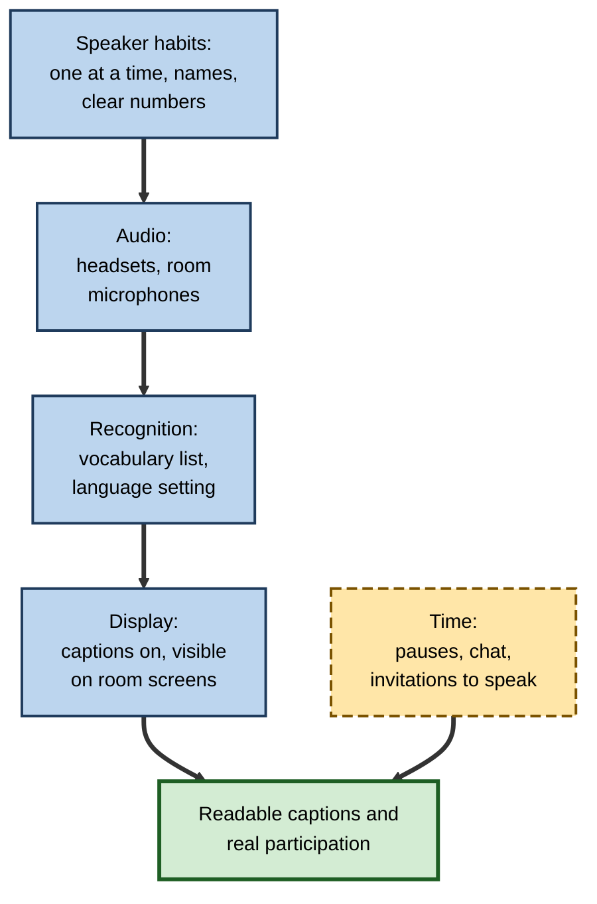
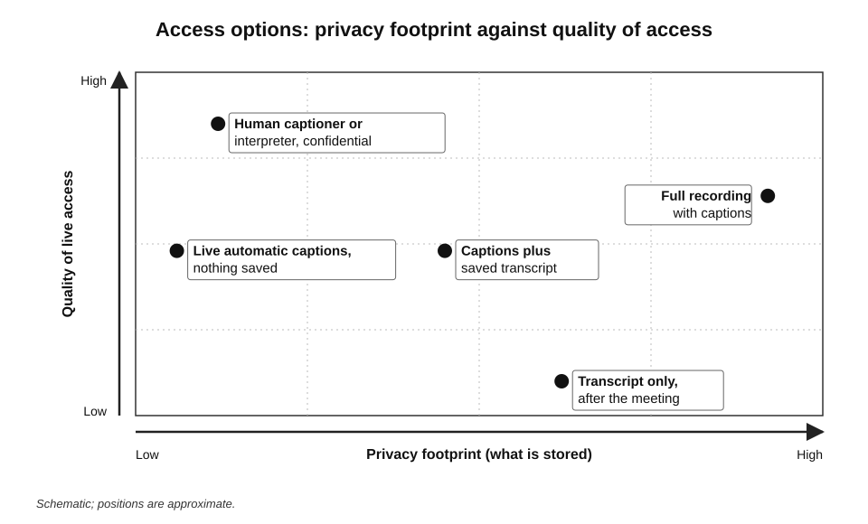
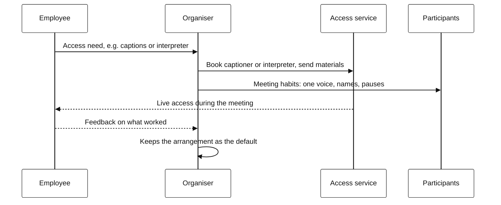

# G.10. Accessibility benefits of captions

For years, a hard-of-hearing data engineer coped with team calls by lip-reading the few colleagues who kept their cameras on, guessing at the rest and checking with a friend afterwards. When her company switched on live captions, she followed a whole meeting unaided for the first time in her career.

A month later, a colleague from Brazil mentioned that he too now read the captions — they helped with fast speakers. So did a manager with ADHD, and an analyst who joined calls from a noisy train. A feature built for a few had quietly become a feature for many.

> **Definition — Captions:** on-screen text that conveys the speech and other important sounds in audio or video, synchronised with it, so that people who cannot hear it — or cannot hear it well — can follow.

> **Definition — CART (Communication Access Realtime Translation):** live captioning produced by a trained human captioner, usually a stenographer or re-speaker, for people who are deaf or hard of hearing.

**Why it matters**

- **Scale** — the World Health Organization's 2021 World Report on Hearing estimated that more than 1.5 billion people live with some degree of hearing loss, about 430 million of them with disabling hearing loss.
- **Inclusion at work** — meetings are where decisions are made; people who cannot follow them are excluded from influence as well as information.
- **Wider benefit** — captions help second-language speakers, people with attention or processing differences, and anyone in a noisy place.
- **Duty** — accessibility law in many countries requires reasonable adjustments, and captions are among the most common.

---

## Who Benefits from Captions

### The people captions were designed for

- **Deaf people** — some use captions as their main access; others whose first language is a sign language may prefer an interpreter, since written English is a second language for them.
- **Hard-of-hearing people** — often combine residual hearing, lip-reading and captions.
- **People with progressive or acquired hearing loss** — including many older workers, who may not identify as disabled.

### The wider group who benefit

- **Second-language speakers** — reading reinforces listening, especially with fast speech, accents and jargon.
- **People with auditory processing differences** — who hear normally but find it hard to process spoken language in real time.
- **People with ADHD and others who find it hard to sustain attention** — text gives a second channel and a way to recover a missed sentence.
- **People in difficult listening situations** — noisy environments, poor connections, quiet places where audio cannot be played.
- **People with temporary conditions** — ear infections, fatigue, migraine.
- **Everyone, for names and terms** — seeing an unfamiliar name or number written helps.

**Figure 1.** Groups who benefit from meeting captions.

```mermaid
%%{init: {'theme':'base','themeVariables':{'fontFamily':'Arial, Helvetica, sans-serif','fontSize':'15px','primaryColor':'#FFFFFF','primaryTextColor':'#111111','primaryBorderColor':'#222222','lineColor':'#333333','secondaryColor':'#F2F2F2','tertiaryColor':'#FFFFFF','clusterBkg':'#FAFAFA','clusterBorder':'#555555','edgeLabelBackground':'#FFFFFF','titleColor':'#111111'}}}%%
flowchart TD
    classDef core    fill:#1F3B5C,stroke:#000000,stroke-width:3px,color:#FFFFFF
    classDef key     fill:#BCD5EE,stroke:#1F3B5C,stroke-width:2px,color:#000000
    classDef detail  fill:#FFFFFF,stroke:#333333,stroke-width:1.5px,color:#000000
    classDef good    fill:#D3ECD3,stroke:#1E5E24,stroke-width:3px,color:#000000

    C["Meeting captions"]
    subgraph PRIMARY["Designed for"]
        P1["Deaf people"]
        P2["Hard-of-hearing people"]
        P3["Acquired or progressive<br/>hearing loss"]
    end
    subgraph WIDER["Also benefit"]
        W1["Second-language<br/>speakers"]
        W2["Auditory processing<br/>differences"]
        W3["Attention differences<br/>such as ADHD"]
        W4["Noisy or silent<br/>environments"]
        W5["Everyone: names,<br/>numbers, jargon"]
    end

    C ==> P1
    C ==> P2
    C ==> P3
    C --> W1
    C --> W2
    C --> W3
    C --> W4
    C --> W5

    class C core
    class P1,P2,P3 key
    class W1,W2,W3,W4,W5 detail
```

> **Definition — Curb-cut effect:** the observation that features designed for disabled people — named after the dropped kerbs built for wheelchair users — often benefit many others, such as people with prams, luggage or bicycles.

### The evidence on captions and comprehension

**Study card — Morton Ann Gernsbacher (2015), "Video captions benefit everyone"**

- **Scope:** a review of more than a hundred empirical studies of captioned video.
- **Findings:** captions improved comprehension of, attention to and memory for video, across children, students, adults learning languages and adults generally — not only deaf and hard-of-hearing viewers.
- **Explanation:** text and speech together give two routes to the same information; captions also help with unfamiliar words and poor audio.
- **Limit:** most studies concerned recorded video with accurate captions; live meeting captions are less accurate and arrive with a delay.

> **Key point:** captions are an **accessibility necessity** for some people and a **comprehension aid** for many others. Treating them as a niche feature misses most of their value.

---

## Kinds of Live Access

### Automatic captions, human captioning and interpreting

- **Automatic (ASR) captions** — generated by speech recognition, built into meeting platforms.
  - Instant, free at the point of use, available in every meeting.
  - Accuracy varies with audio, accents, names and overlap.
- **CART** — a human captioner, usually remote, producing live text.
  - Typically more accurate on names, technical terms and multiple speakers; can mark speaker changes and sounds.
  - Must be booked and paid for.
- **Sign language interpreting** — a qualified interpreter translating between spoken language and a sign language such as British, American or Indian Sign Language.
  - Essential for many Deaf people whose first language is a sign language.
- **Post-meeting transcripts** — useful for review, not a substitute for live access.

| | Automatic captions | CART (human captioning) | Sign language interpreter | Post-meeting transcript |
|---|---|---|---|---|
| Availability | Instant, every meeting | Booked in advance | Booked in advance | After the meeting |
| Typical accuracy | Variable; weak on names, jargon, overlap | High, including names and terms if prepared | Depends on interpreter and subject | As the transcription |
| Delay | Short | Short to moderate | Short | Not live |
| Language | Written form of spoken language | Written form of spoken language | Sign language | Written |
| Allows live participation | Partly | Yes | Yes, two-way | No |
| Cost | Included in platform | Per hour | Per hour, often two interpreters for long sessions | Included |

> **Watch out:** automatic captions are not a substitute for a sign language interpreter. For a Deaf person whose first language is a sign language, reading fast, error-prone English captions may be a poor form of access; the person's own preference should decide.

---

## What Makes Captions Usable

### Quality dimensions

- **Accuracy** — especially of meaning-carrying words.
- **Latency** — the delay between speech and text; too long and the reader cannot join the conversation.
- **Completeness** — nothing omitted, including quiet speakers and side remarks.
- **Speaker identification** — who is speaking; essential when the reader cannot hear voices.
- **Non-speech information** — [laughter], [inaudible], [music] — which explain reactions.
- **Display** — readable size and contrast, a position that does not hide slides, enough lines to re-read a missed phrase.

**Study card — Kafle and Huenerfauth (2017), usability of automatic captions**

- **Question:** does word error rate predict how usable automatic captions are for deaf and hard-of-hearing readers?
- **Design:** deaf and hard-of-hearing participants judged caption texts containing errors of different kinds.
- **Findings:** word error rate was only a weak predictor of judged quality; errors on **important words** mattered far more than errors on minor words.
- **Contribution:** the authors proposed measures that weight errors by the importance of the words affected.

- **Laboratory versus real conditions** — a 2024 comparison of eleven commercial speech-recognition services found that accuracy in real-world conditions, especially live streaming, fell noticeably short of results in controlled tests — the conditions caption users actually face.
- **Human correction** — research prototypes in which a human corrects automatic captions as they appear aim to combine the speed of automation with the accuracy of human captioning.
- **Preferences in later research** — studies with deaf and hard-of-hearing participants have found strong preferences for **low delay** and for **verbatim** text, with tidied captions acceptable only if they do not add delay.

> **Remember:** for caption readers, an error on a **name, number or negation** can make a sentence useless, while a dropped "um" is irrelevant. Quality is about the words that matter, delivered quickly.

### Display and design

How captions look matters almost as much as what they say. Broadcasters' subtitling guidelines, developed over decades, offer principles that apply to meetings.

- **Two or three lines at a time** — enough to re-read a missed phrase, not so many that the text becomes a scrolling wall.
- **Readable size and strong contrast** — light text on a dark band, or the reverse, with a font size adjustable by the reader.
- **Position** — captions should not cover the speaker's face or the slide being discussed; many platforms let the reader move them.
- **Speaker labels** — a name or label whenever the speaker changes; without it, a caption reader cannot tell who is agreeing with whom.
- **Stable text** — live captions that constantly rewrite themselves are tiring to read; some readers prefer a slight delay for steadier text, others the opposite.
- **Transcript panel** — a side panel with the running transcript lets readers scroll back without losing the live captions.

> **In practice:** the person who relies on captions should be able to **control** size, position and the transcript panel themselves. Organisers can help by checking that room displays show captions large enough to read from the back of the room.

### Latency and participation

**Figure 2.** Delay between speech and text for different forms of live access.

- **Turn-taking depends on timing** — by the time a caption reader sees a question, the conversation may have moved on.
- **Remedies:**
  - chairs pause briefly before moving on and invite comment by name;
  - the chat is used as a parallel channel for questions;
  - important questions are repeated or written.

> **Key point:** captions provide **access to information**; participation also needs **time**. A meeting that moves too fast for caption readers excludes them even if every word is captured.

---

## Law and Standards

- **Web Content Accessibility Guidelines (WCAG) 2** — success criterion 1.2.4 requires captions for live audio content in synchronised media at Level AA, the level most organisations and public bodies adopt.
- **United Kingdom** — the Equality Act 2010 requires employers and service providers to make reasonable adjustments for disabled people; captions, CART and interpreters are common adjustments.
- **United States** — the Americans with Disabilities Act requires reasonable accommodation for employees and effective communication in many settings.
- **India** — the Rights of Persons with Disabilities Act 2016 requires reasonable accommodation and accessible communication.
- **European Union** — the European Accessibility Act, applicable from June 2025, sets accessibility requirements for many products and services, alongside national employment duties.

> **Definition — Reasonable adjustment (or accommodation):** a change to work arrangements, equipment or practice that removes a disadvantage faced by a disabled person, required by law where reasonable.

> **In practice:** the legal minimum is rarely the professional standard. The person who needs access is the best judge of what works for them; ask, and keep asking as tools and needs change.

---

## Meeting Habits That Make Captions Work

Automatic captions are only as good as the audio and the conversation they receive.

- **One speaker at a time** — overlap is the main cause of lost captions.
- **Say your name** in large meetings before speaking, especially from a shared room microphone.
- **Use good microphones** — headsets for remote speakers; a proper conference microphone in rooms.
- **Speak names, numbers and terms clearly**; type them in the chat.
- **Describe what is on screen** — "the red bar on the right shows…" rather than "as you can see here".
- **Do not talk over video** — play shared videos with their own captions.
- **Pause** before moving on, so caption readers can catch up and respond.
- **Share materials in advance** — slides and documents let readers prepare vocabulary and context.
- **Check that captions are on and visible** — including on meeting-room screens for in-room participants who need them.

**Figure 3.** From speaker habits to readable captions.

> **Mnemonic — "CLEAR":** **C**aptions on and visible, **L**isten to one speaker at a time, **E**nunciate names and numbers, **A**void "as you can see", **R**oom to respond — pause.

---

## Translated Captions and Multilingual Teams

- **Live translated captions** — some platforms translate captions into the reader's language in real time.
- **Benefits** — colleagues with limited proficiency in the meeting language can follow; multilingual teams can each read in their strongest language.
- **Risks** — translation errors add to recognition errors; idioms, names and technical terms suffer most; delays increase.
- **Good practice** — use translated captions for following, not for commitments; confirm important decisions in writing in a language everyone reads well.

---

## Transcripts as an Accessibility Aid

- **Review at one's own pace** — people who need more time to process spoken information can read the transcript afterwards.
- **Recovering missed parts** — for people who lost attention or whose captions failed.
- **Search** — finding where a topic was discussed without replaying the meeting.
- **Pairing with summaries** — a reviewed summary plus the transcript serves both quick understanding and detailed checking.

> **Watch out:** a transcript after the meeting is useful but not equivalent to live access. Someone who could not follow the meeting live also could not take part in it.

---

## Accessibility and Privacy

Accessibility and privacy can seem to conflict: a deaf colleague needs captions in a meeting that others would prefer not to be transcribed.

- **Live captions without storage** — many platforms can show live captions without saving a transcript; this meets the access need with a small privacy footprint.
- **Personal captioning** — captions shown only to the person who needs them, on their own device.
- **Human captioners and interpreters** — bound by professional confidentiality; appropriate for sensitive meetings.
- **Never make access depend on recording** — the choice is not "record everything or exclude someone".

**Figure 4.** Access options compared by quality of access and privacy footprint.

> **In practice:** when someone objects to transcription in a meeting where a colleague relies on captions, the usual solution is **live captions, nothing saved** — or a human captioner for sensitive discussions.

---

## Worked Example (illustrative): Planning Access for a Company Town Hall

**Situation:** a 600-person organisation holds a quarterly town hall, hybrid, with questions from the floor. Known needs: two Deaf employees who use British Sign Language, five hard-of-hearing employees who use captions, and many colleagues working in a second language.

| Need | Provision | Reason |
|---|---|---|
| Deaf BSL users | Two BSL interpreters, visible in the stream | First language is BSL; long event needs two interpreters |
| Hard-of-hearing caption users | CART captioner, with names and terms supplied in advance | Accuracy on names, questions from the floor and technical terms |
| Everyone | Automatic captions available as back-up; translated captions enabled | Wider benefit; fallback if CART connection fails |
| Questions from the floor | Roving microphone; questions repeated by the host | Floor audio is poorly captured |
| After the event | Reviewed transcript and recording with corrected captions | Review at own pace; colleagues who missed it |

*Illustrative example.*

**Steps**

1. **Ask** the people affected what they need, well in advance.
2. **Book** interpreters and captioner; send them the agenda, slides, speakers' names and acronyms.
3. **Brief speakers** — microphones, pace, describe visuals.
4. **Test** caption display in the room and in the stream.
5. **During** — host repeats floor questions; pauses for interpretation.
6. **After** — publish corrected captions; ask the users what worked.

- **Conclusion:** automatic captions are part of the solution but not the whole of it; the highest-stakes access needs human provision.

---

## Captions Across Meeting Formats

- **Small video calls** — built-in captions usually work well if everyone uses a headset and speaks one at a time.
- **Hybrid meetings** — in-room voices captured by a shared microphone are captioned worst; in-room participants who need captions should see them on the room screen or their own device.
- **Face-to-face meetings** — captions can be produced by a phone or laptop app placed near speakers, or by a human captioner; wearable caption displays are emerging but not yet widespread.
- **Large events and webinars** — human captioning is usually justified; automatic captions serve as back-up and for recordings.
- **Telephone calls** — relay and captioned-telephone services, provided in many countries for deaf and hard-of-hearing callers, are a long-standing form of the same access.
- **Recorded video** — training videos and recorded presentations should carry corrected captions, since they will be watched many times.

| | Small video call | Hybrid meeting | Face-to-face meeting | Large event |
|---|---|---|---|---|
| Best default | Built-in automatic captions | Automatic captions plus good room microphones | App or human captioner | Human captioner plus automatic back-up |
| Main weakness | Overlap, names | Room voices poorly captured | Distance from the microphone | Cost and booking |
| Key habit | One speaker at a time | Captions shown in the room | Microphone close to speakers | Materials sent to captioner in advance |

---

## Processing Time and Neurodiversity

Captions and transcripts help many people whose difficulty is not hearing but processing.

- **Auditory processing differences** — the person hears normally but struggles to separate speech from noise or to follow fast speech; captions give a second, steadier channel.
- **ADHD** — attention may drift; captions and a running transcript let the person recover a missed sentence without asking.
- **Autism** — some autistic people find unstructured group discussion demanding; agendas in advance, captions and written summaries reduce uncertainty.
- **Dyslexia** — captions can help or hinder; fast-moving text may be hard to read, so the person's preference matters.
- **Anxiety and fatigue** — being able to review the transcript reduces the pressure to catch everything live.

> **Watch out:** disclosure is personal. Many people who benefit from captions will never say why. Making captions **available to everyone by default** lets people use them without having to explain themselves.

---

## Requesting and Providing Adjustments

**Figure 5.** Arranging communication access for a meeting.

- **Ask once, remember** — a person should not have to request the same adjustment for every meeting; organisers and systems should remember it.
- **Book early** — human captioners and interpreters are in short supply.
- **Prepare the provider** — agendas, names, acronyms and slides improve accuracy.
- **Confidentiality** — professional captioners and interpreters work under confidentiality obligations, which makes them suitable for sensitive meetings.
- **Review** — needs and tools change; check periodically what works.

> **In practice:** the most common failure is not a lack of technology but **forgetting** — the captioner not booked for the reorganised meeting, the room screen not showing captions, the interpreter not sent the slides.

---

## Accessibility in Organisational Practice

- **Captions on by default** — or available to every participant at a click, in every meeting platform the organisation uses.
- **Budgets and processes** for CART and interpreters, bookable without lengthy approval.
- **Room equipment** that captures speech well enough for captions, with displays that show captions to people in the room.
- **Vocabulary lists** for organisation names, products and acronyms, improving captions for everyone.
- **Meeting norms** — CLEAR habits included in meeting guidelines and chair training.
- **Feedback loops** — caption users asked regularly what works; caption quality reported to vendors.

### Case study (illustrative): a hard-of-hearing engineer and an engineering team's meetings

- **Situation:** a senior engineer with progressive hearing loss struggled in fast design discussions; automatic captions were available but missed technical terms and cross-talk.
- **Problem:** she began to skip design meetings and rely on written specifications; her influence on design decisions fell.
- **Actions agreed with her:**
  1. a team vocabulary list added to the captioning tool — system names, libraries, acronyms;
  2. one-speaker-at-a-time rule, enforced by a rotating facilitator;
  3. in-room participants on headsets or personal laptops, not a shared speakerphone;
  4. a CART captioner for monthly architecture reviews;
  5. the facilitator pauses and invites her comment on each decision.
- **Result:** she returned to design meetings; colleagues reported that the meetings were also clearer for them, and two second-language engineers said they now contributed more.
- **Lesson:** the adjustments that made captions work for one person improved the meeting for everyone — the curb-cut effect in practice.

---

## Open Questions

- **Will automatic captions reach the quality of human captioning?**
  - On clear speech they are close; on names, overlap and specialist terms the gap remains, and evaluations with caption users are few.
- **How should caption quality be measured?**
  - Word error rate is a weak guide to usability; importance-weighted measures exist but are not standard.
- **Can captions support participation, not just following?**
  - Delay and pace remain barriers; meeting practices may matter more than technology.
- **How should sign language be supported?**
  - Automatic sign language translation is at an early research stage; Deaf communities stress that quality and cultural competence matter.
- **Does captioning everything create pressure to transcribe everything?**
  - Live captions without storage avoid this; whether organisations keep the distinction is uncertain.

---

## Summary

- **Captions** convey speech and important sounds as synchronised text; **CART** is human live captioning; sign language interpreting is distinct and essential for many Deaf people.
- Over **1.5 billion** people live with some hearing loss (WHO, 2021); captions also help **second-language speakers**, people with **processing or attention differences**, and anyone in difficult listening conditions — the **curb-cut effect**.
- Research (Gernsbacher, 2015) shows captions improve **comprehension, attention and memory** broadly.
- Caption quality means **accuracy on important words, low latency, completeness, speaker identification, non-speech cues and good display**; WER is a weak predictor of usability.
- Law — Equality Act, ADA, Rights of Persons with Disabilities Act, WCAG 1.2.4, European Accessibility Act — supports captions and other adjustments; the person's own preference should guide provision.
- Meeting habits — **CLEAR** — make captions work; participation also needs **time**.
- Translated captions help multilingual teams but add errors; confirm important decisions in writing.
- Each format — small calls, hybrid rooms, face-to-face meetings, large events — needs a different **default** for access.
- Captions and transcripts support people with **processing, attention and anxiety** differences; making captions available to everyone avoids forced disclosure.
- Adjustments should be **asked for once and remembered**, booked early, and providers prepared with names and materials.
- Accessibility and privacy are reconciled by **live captions without storage**, personal captioning and human captioners.

---

## Self-Check

1. Distinguish captions, CART and sign language interpreting.
2. Why are automatic captions not a substitute for an interpreter for some Deaf people?
3. List five groups beyond deaf and hard-of-hearing people who benefit from captions.
4. What did Gernsbacher's 2015 review find, and what is its main limitation for live meetings?
5. What did Kafle and Huenerfauth find about word error rate and caption usability?
6. Name six dimensions of caption quality.
7. How does caption latency affect participation, and what can a chair do about it?
8. Explain the CLEAR mnemonic.
9. A colleague objects to a meeting being transcribed, but another colleague relies on captions. What do you do?
10. What legal duties support caption provision in the UK, US and India?
11. Plan access provision for a hybrid all-staff meeting with deaf, hard-of-hearing and second-language participants.
12. What is the curb-cut effect, and how does the engineering case study illustrate it?
13. Why should captions be available to everyone by default rather than only on request?
14. What access default would you choose for a hybrid meeting, and what is its main weakness?

### Answer Key

1. Captions: synchronised on-screen text of speech and sounds, automatic or human. CART: live captions produced by a trained human captioner. Sign language interpreting: live translation between spoken language and a sign language.
2. For Deaf people whose first language is a sign language, written English is a second language; fast, error-prone captions may give poor access. Their own preference should decide.
3. Any five: second-language speakers; people with auditory processing differences; people with ADHD or attention differences; people in noisy or silent environments; people with temporary conditions; everyone, for names and terms.
4. Across more than a hundred studies, captions improved comprehension, attention and memory for many groups. Most studies used accurate captions on recorded video; live meeting captions are less accurate and delayed.
5. WER was only a weak predictor of judged usability; errors on important words mattered much more, so they proposed importance-weighted measures.
6. Accuracy (especially on important words), latency, completeness, speaker identification, non-speech information, display.
7. Delay means caption readers see questions after the conversation has moved on. The chair can pause before moving on, invite comment by name, use the chat, and repeat important questions.
8. Captions on and visible; Listen to one speaker at a time; Enunciate names and numbers; Avoid "as you can see"; Room to respond — pause.
9. Use live captions without saving a transcript, or personal captions for the user, or a human captioner bound by confidentiality; never make access depend on recording.
10. UK: Equality Act 2010 reasonable adjustments. US: ADA reasonable accommodation and effective communication. India: Rights of Persons with Disabilities Act 2016 reasonable accommodation and accessible communication.
11. Ask people's needs in advance; interpreters for sign language users; CART with prepared vocabulary for caption users; automatic and translated captions as wider support and back-up; good microphones and repeated floor questions; briefed speakers; tested displays; corrected captions and transcript afterwards.
12. Features designed for disabled people benefit many others. The changes made for the hard-of-hearing engineer — vocabulary list, one speaker at a time, better microphones, pauses — also helped second-language colleagues and made meetings clearer for everyone.
13. Many people who benefit — with processing, attention or hearing differences — will not disclose why; default availability lets them use captions without explaining themselves, and also benefits others.
14. Automatic captions with good room microphones, and captions shown on the room screen or personal devices for in-room users. Its main weakness is that in-room voices on a shared microphone are captioned less accurately.

---

## Glossary

| Term | Meaning |
|---|---|
| ASR captions | Captions generated automatically by speech recognition. |
| Auditory processing difference | Difficulty processing spoken language despite normal hearing. |
| Captions | Synchronised on-screen text conveying speech and important sounds. |
| CART | Communication Access Realtime Translation: live captioning by a trained human. |
| Curb-cut effect | Features designed for disabled people benefiting many others. |
| Latency | The delay between speech and the appearance of its caption. |
| Reasonable adjustment | A change to remove a disadvantage faced by a disabled person, required by law where reasonable. |
| Sign language interpreter | A professional translating between spoken and sign language. |
| Translated captions | Captions automatically translated into another language in real time. |
| WCAG | Web Content Accessibility Guidelines, the international standard for accessible digital content. |
