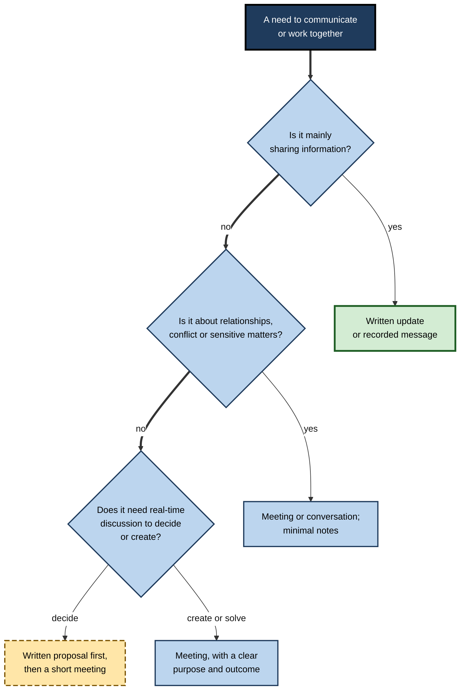
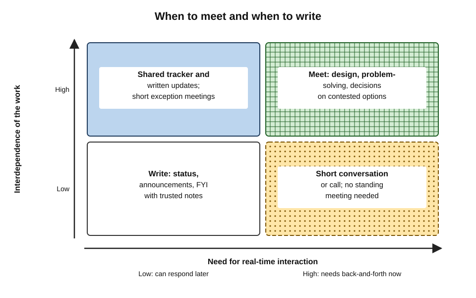
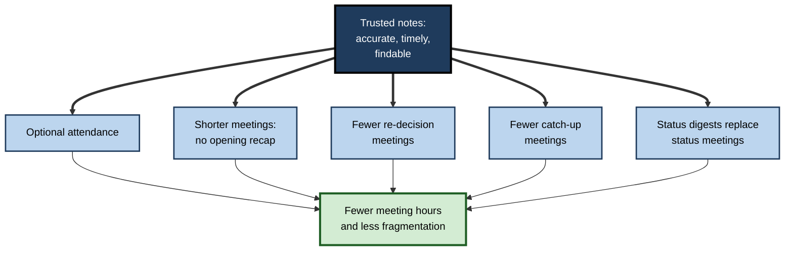
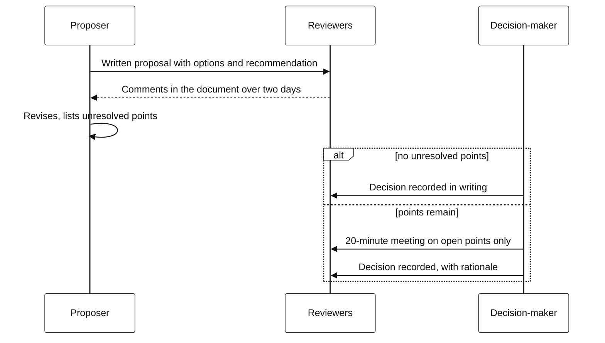
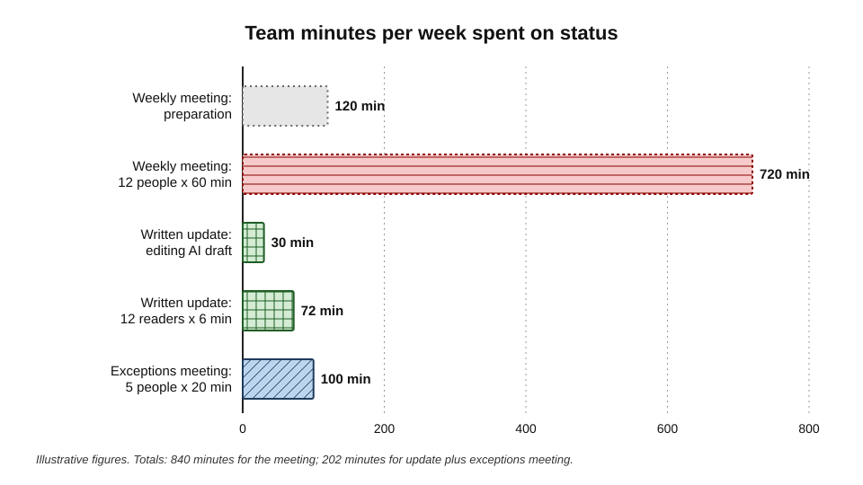

# G.11. Reducing meetings with better notes

A department head counts her calendar: 27 hours of meetings in a week. Eleven of those hours are status updates in which people read out progress that could have been written down. Four more are meetings convened to settle "what did we actually decide last time?". If good notes existed — accurate, timely, findable — she estimates she could give back a third of those hours to the people in them. AI makes such notes cheap. Whether they actually reduce meetings depends on what the organisation does next.

> **Definition — Meeting load:** the total time people spend in meetings, often measured in hours per person per week, together with the fragmentation of the remaining time between meetings.

> **Definition — Asynchronous communication:** communication in which people contribute and respond at different times — written updates, documents, recorded messages — rather than all being present at once.

**Why it matters**

- **Meetings are expensive** — every hour-long meeting of ten people consumes ten hours of working time, plus preparation and recovery.
- **Meeting overload is widespread** — surveys of managers and large-scale analyses of workplace software show heavy, fragmented meeting loads.
- **Notes are the precondition for fewer meetings** — people skip meetings only if they trust that they can find out what happened.
- **AI can cut both ways** — cheap notes can replace meetings, or make it so easy to hold and record meetings that more of them happen.

---

## The Meeting Problem

### How heavy is the load?

**Study card — Perlow, Hadley and Eun (2017), survey of senior managers**

- **Design:** a survey of 182 senior managers across industries, published in the *Harvard Business Review*.
- **Findings:**
  - about 71% said meetings were unproductive and inefficient;
  - about 65% said meetings kept them from completing their own work;
  - about 64% said meetings came at the expense of deep thinking.
- **Interpretation:** the authors argued that meeting overload is a systemic problem that individuals cannot solve alone, because each meeting seems justified on its own.

**Study card — Microsoft Work Trend Index special report (June 2025)**

- **Source:** aggregated, anonymised signals from use of Microsoft's workplace software, combined with surveys.
- **Findings:**
  - during core hours, the average user was interrupted — by a meeting, email or message — roughly every **two minutes**;
  - about **60% of meetings were ad hoc** rather than scheduled;
  - meetings after 8 p.m. had risen by about 16% in a year, driven by work across time zones.
- **Caveat:** the data come from one vendor's users and one vendor's analysis; they describe patterns, not causes.

### Why meetings multiply

- **Each meeting is locally rational** — the organiser has a real need; the total cost is nobody's problem.
- **Information sharing defaults to talk** — reading out updates feels easier than writing them.
- **Visibility and belonging** — being present signals commitment; absence feels risky.
- **Fear of missing decisions** — people attend in case something affecting them is decided.
- **Diffuse decisions** — unclear decision rights mean more people must be "in the room".
- **Calendar mechanics** — recurring meetings never expire; invitations are forwarded; nobody removes themselves.
- **Distrust of records** — if notes are poor or late, the only way to know is to attend.

> **Key point:** the last two causes — **fear of missing decisions** and **distrust of records** — are exactly what good notes address. A trusted, timely record makes absence safe.

### The hidden costs

- **Fragmentation** — a day broken into 30-minute gaps leaves little time for focused work.
- **Recovery** — meeting researchers describe a period after poor meetings in which people take time to refocus and may vent frustration — sometimes called **meeting recovery syndrome**.
- **Opportunity cost** — the work not done during the meeting.

### Who bears the cost

- **Makers and managers** — the programmer and essayist Paul Graham argued in 2009 that people who make things (code, designs, writing) need long uninterrupted blocks, while managers work in hour-long slots; a single meeting in the middle of a maker's afternoon can cost far more than its hour.
- **Junior and distributed staff** — often invited "for visibility", and least able to decline.
- **People in distant time zones** — bear early-morning and late-evening meetings disproportionately.
- **Caption and interpreter users** — for whom each meeting requires extra concentration and, often, arrangements.

> **Key point:** the cost of a meeting is not shared equally. A meeting that is cheap for its organiser can be expensive for the people whose focused work it interrupts.

> **Formula — Direct meeting cost:** number of attendees × duration in hours × average loaded hourly cost. Example: 12 attendees × 1 hour × £60 = **£720** per meeting; held weekly, about **£37,400** a year.

---

## What Meetings Are For

Not every meeting can be replaced by notes. The purpose decides.

- **Inform** — status updates, announcements, reporting.
  - Often replaceable by a written update or a recorded message.
- **Coordinate** — aligning dependencies, sequencing work.
  - Partly replaceable by shared trackers and written updates, with short meetings for exceptions.
- **Decide** — choosing among options with accountability.
  - Often needs real-time discussion; a written proposal can shorten it greatly.
- **Create and solve** — brainstorming, design, problem-solving.
  - Benefits from real-time interaction.
- **Connect** — building relationships, trust, morale, onboarding.
  - Hard to replace; in-person or synchronous time matters.
- **Handle conflict or sensitive matters** — difficult conversations, negotiations, feedback.
  - Should not be replaced by documents.

| Purpose | Replaceable by notes or written updates? | What good notes change |
|---|---|---|
| Inform | Largely | Written update or recap replaces the meeting |
| Coordinate | Partly | Short exception-only meeting; tracker and notes carry the rest |
| Decide | Rarely fully | Pre-read proposal shortens the meeting; decision record prevents re-litigation |
| Create and solve | Rarely | Notes preserve outputs; fewer follow-up meetings |
| Connect | No | Notes irrelevant to the purpose |
| Conflict and sensitive matters | No | Notes should be minimal and human-written |

**Figure 1.** Deciding whether a meeting is needed.

**Figure 2.** Meetings and written work placed by interdependence and need for real-time interaction.

---

## How Better Notes Reduce Meetings

### Five mechanisms

- **Optional attendance** — when a reviewed summary reliably follows, people attend only for the items they are needed for.
  - *e.g.* "Attendance optional; summary within two hours; join for item 3 if you own the migration."
- **Shorter meetings** — outcome-first notes from the previous meeting replace the opening recap; pre-reads replace presentations.
- **Fewer "what did we decide?" meetings** — decision records end re-litigation.
- **Fewer catch-up meetings** — absentees read instead of asking for a re-run.
- **Status digests instead of status meetings** — written updates, sometimes drafted by AI from task trackers and documents, replace round-the-table reporting.

**Figure 3.** How trusted notes make meetings optional, shorter or unnecessary.

> **Example (illustrative):** a weekly operations review lists, against each agenda item, who must attend and who may rely on the summary: "Item 1, incident trends — attendance optional, summary by 2 p.m. · Item 2, capacity plan — infrastructure leads required · Item 3, supplier change — procurement and finance required". Attendance falls by half; nobody required is absent.

> **Key point:** notes reduce meetings only when people **trust** them. Trust comes from accuracy (reviewed, not raw), timeliness (same day) and findability (one known place).

### Writing instead of meeting

Organisations that meet less tend to write more — and better.

- **The written proposal** — a short document stating the problem, options, recommendation and decision needed, circulated before any meeting.
- **Silent reading at the start** — at Amazon, Jeff Bezos replaced slide presentations in senior meetings with narrative memos, read silently by everyone at the start of the meeting, so discussion begins from shared understanding.
- **Comment-first review** — people comment on the document asynchronously; the meeting, if held, addresses only unresolved points.
- **Written status** — a standard format (progress, next steps, risks, help needed) posted at a regular time.

> **Definition — Pre-read:** material circulated before a meeting that participants are expected to read, so that meeting time is spent on discussion and decision rather than presentation.

**Figure 4.** Reaching a decision with a written proposal and a short meeting.

---

## The Rebound Risk

Making something cheaper often increases its use. Cheap notes can make meetings cheaper — and so more numerous.

- **"It's recorded, so invite everyone"** — large invitation lists become harmless-seeming, but attendance follows invitations.
- **"It's recorded, so we can meet about it"** — meetings convened because they can be captured, not because they are needed.
- **Summary overload** — dozens of AI recaps a week become a new reading burden.
- **Meetings about meetings** — reviewing summaries, correcting them, discussing what they said.
- **Bots attending instead of people** — meetings continue with fewer humans and more recorders, without anyone asking whether the meeting should exist.

> **Definition — Rebound effect:** an increase in the use of something when it becomes more efficient or cheaper, which offsets some or all of the expected savings; an idea first described for coal by the economist William Stanley Jevons in 1865.

> **Watch out:** AI notes do not reduce meetings on their own. Without a deliberate decision to **cancel, shorten or make optional**, they can increase total meeting-related time — attending, plus reading about meetings not attended.

---

## Worked Example (illustrative): Replacing a Weekly Status Meeting

**Situation:** a 12-person programme team holds a 60-minute weekly status meeting. Average loaded cost: £60 an hour. The team considers replacing it with a written update drafted by AI from the tracker, edited by the programme manager, and a 20-minute exceptions meeting for the five people involved in blocked items.

| | Current: weekly meeting | Proposed: written update plus exceptions meeting |
|---|---|---|
| Preparation | 12 people × 10 min = 120 min | Programme manager edits AI draft: 30 min |
| Meeting | 12 people × 60 min = 720 min | 5 people × 20 min = 100 min |
| Reading | — | 12 people × 6 min = 72 min |
| **Total time per week** | **840 min (14 hours)** | **202 min (about 3.4 hours)** |
| **Direct cost per week** | **£840** | **about £202** |
| Over 48 working weeks | about £40,300 | about £9,700 |

*Illustrative figures.*

**Figure 5.** Weekly time spent on status: meeting compared with written update.

- **Saving** — about 10.6 hours of team time a week, plus less fragmentation.
- **What was kept** — a monthly synchronous review to discuss direction and maintain relationships.
- **What made it work** — the update was **reviewed**, posted at the same time every week, in one place, with a clear "help needed" section; blocked items always went to the exceptions meeting.

> **Watch out:** the calculation ignores what the meeting did beyond status — social connection, informal problem-solving, quieter people being heard. Replace the meeting's **functions**, not just its **content**.

---

## Better Meetings for Those That Remain

Reducing meetings is half the task; the meetings that remain should be shorter, smaller and sharper. Research on meetings offers several well-supported levers.

### Evidence-based design

- **Shorter by default** — work tends to expand to fill the time available (an observation popularised by C. Northcote Parkinson in 1955); 25- or 50-minute defaults leave gaps and focus discussion.
- **Smaller groups** — every extra attendee adds cost and reduces each person's share of airtime; invite the people needed for the decision and inform the rest through notes.
- **Agendas as questions** — "Which vendor do we choose?" focuses discussion better than "Vendor update".
- **Clear roles** — a chair who manages time and turn-taking, a decision-maker, and an owner for the record.
- **Ending with outcomes** — decisions and actions read back, so that the record — human or AI — captures them correctly.

**Study card — Bluedorn, Turban and Love (1999), stand-up meetings**

- **Design:** an experiment comparing groups that held meetings standing up with groups that sat down, solving the same problem.
- **Findings:** stand-up meetings were roughly a third shorter, and the quality of decisions was about the same; sit-down groups reported slightly more satisfaction.
- **Lesson:** meeting length is partly a product of format and comfort, not only of the work to be done.

> **Watch out:** a single experiment with students does not make stand-up meetings right for every purpose. The broader point is robust: meeting design choices change meeting length without necessarily changing the outcome.

| | Typical meeting | Redesigned meeting |
|---|---|---|
| Length | 60 minutes by habit | 25 or 50 minutes by default |
| Invitees | Everyone who might be interested | Those needed to decide or contribute; others get notes |
| Agenda | Topics | Questions to answer |
| Opening | Recap of last meeting | Read the previous summary beforehand |
| Close | Runs out of time | Decisions and actions read back |
| Record | Unreviewed recap, or nothing | Reviewed, outcome-first notes the same day |

---

## Writing-First Organisations

Some organisations make writing, not meeting, their default way of coordinating.

- **Remote-first companies** — the software company GitLab, which has operated fully remotely for most of its history, maintains a very large public handbook and expects processes and decisions to be written there first, so that people in many time zones can work without waiting for meetings.
- **Design documents and requests for comment** — common in software engineering: a proposal is written, colleagues comment asynchronously, and meetings are held only for unresolved disagreements.
- **Narrative memos** — at Amazon, senior meetings begin with silent reading of a written narrative rather than a slide presentation.

### What writing-first requires

- **Writing skill** — clear, structured, concise documents; AI can help draft, but the thinking must be the author's.
- **Reading discipline** — people actually read pre-reads and updates; otherwise meetings revert to presentations.
- **Findability** — documents kept in known places, with decisions easy to locate.
- **Response norms** — expectations about how quickly people comment on proposals.
- **Psychological safety in writing** — written disagreement can feel harsher than spoken disagreement; norms for constructive comments matter.

> **Key point:** AI meeting notes are a **bridge** between meeting culture and writing culture. They turn talk into text; the organisation must still learn to read, decide and coordinate through text.

---

## AI-Drafted Status Updates

Replacing status meetings often means asking AI to draft updates from task trackers, documents and channel activity.

- **What AI does well** — gathering completed tasks, listing changes since last week, formatting consistently.
- **What it does badly:**
  - it reports **ticket states**, not reality — a task marked "in progress" for three weeks may be stuck;
  - it misses **unrecorded work** and **unrecorded problems**;
  - it rarely conveys **judgement** — whether the project is actually healthy.
- **Watermelon reporting** — a status that is green on the outside and red inside; AI drafts built from optimistic ticket states can make it worse.

> **Definition — Watermelon reporting:** status reporting that shows a project as on track ("green") while the underlying reality is troubled ("red").

> **In practice:** the most useful part of a written status update is the human-written line: "**What worries me this week is…**". AI can draft the rest.

### Meeting-free days

- **What they are** — one or more days a week with no internal meetings, to protect focused work.
- **Evidence** — widely adopted and generally popular; survey-based studies report improvements in self-rated productivity, autonomy and stress, but most evidence is **self-reported** and from organisations that chose to adopt the practice.
- **Notes make them workable** — when meetings are concentrated into fewer days, reliable records matter more, because more decisions are made while some people are absent.

---

## Auditing Meetings

### A calendar audit

1. **List recurring meetings** — owner, attendees, length, frequency, purpose.
2. **Classify by purpose** — inform, coordinate, decide, create, connect, sensitive.
3. **Estimate cost** — attendees × hours × cost, per year.
4. **Ask attendees** — is this meeting valuable to you? Could you get what you need from notes?
5. **Decide for each** — keep, shorten, reduce attendees, make optional with notes, replace with written updates, or cancel.
6. **Set notes standards** for meetings that remain — reviewed, outcome-first, same day, one location.
7. **Review after a quarter** — did meeting hours fall? Did focus time rise? Did decisions slow down?

### Measures

- **Meeting hours per person per week.**
- **Focus time** — uninterrupted blocks of two hours or more.
- **Decision latency** — time from a decision being needed to its being made.
- **Re-decision rate** — how often settled decisions are reopened because nobody can find or trust the record.
- **Attendee value** — a quick rating of each meeting by those attending.

> **In practice:** pair any reduction in meetings with a measure of **decision speed**. Cutting meetings that were doing real work simply moves the work into chat threads and corridors.

### Case study: a company-wide meeting reset (2023)

- **Situation:** in January 2023, the e-commerce company Shopify, with around 10,000 staff working remotely, announced a reset of its meeting culture.
- **Actions:**
  - software automatically removed recurring meetings with three or more people from employees' calendars;
  - staff were asked to wait two weeks before adding any back, and to add back only those clearly needed;
  - meeting-free Wednesdays were reinstated;
  - large meetings of more than 50 people were confined to a window on Thursdays.
- **Reported result:** the company reported removing around 322,000 hours of meetings from calendars.
- **Debate:**
  - supporters saw a bold reset of habits that individuals could not change alone;
  - meeting researchers, including Steven Rogelberg, cautioned that meetings themselves are not the problem — **badly designed** meetings are — and that blanket cancellation can remove valuable meetings along with poor ones.
- **Lesson:** removing meetings creates space; whether the work goes well afterwards depends on the written practices and notes that replace them.

### Case study (illustrative): optional attendance in a product organisation

- **Situation:** a product organisation's weekly cross-team review had 45 invitees; most attended "in case".
- **Change:**
  1. attendance made optional except for item owners;
  2. reviewed, outcome-first summary posted in a fixed channel within two hours, with timestamps;
  3. decisions added to the product decision log the same day;
  4. anyone affected by a decision notified directly.
- **Result after a quarter:** average attendance fell to about 18; post-meeting questions fell; a survey showed more trust in the summary than in previous hand-written notes.
- **Side effect:** some junior staff felt less visible; the team created a monthly open forum for questions and introductions.
- **Lesson:** optional attendance works when the record is trusted and when the social functions of the meeting are replaced deliberately.

---

## Open Questions

- **Do AI notes reduce or increase meeting time overall?**
  - Both effects are plausible; there is little independent evidence on net change in organisations that adopted AI notes.
- **What is lost when fewer people attend?**
  - Serendipitous information, relationships and the voice of quieter members may suffer; these are hard to measure.
- **Can AI write status updates people trust?**
  - Drafting from trackers is easy; ensuring the update reflects reality, not just ticket states, still needs a person.
- **How much writing can people absorb?**
  - Replacing meetings with documents moves the burden to reading; summary overload is a growing complaint.
- **Are meeting-free days effective?**
  - Widely adopted and well liked, but evidence on their effects on output is limited and mixed.

---

## Summary

- **Meeting load** is heavy and fragmenting: senior managers report meetings crowd out their own work and thinking; large-scale workplace data show frequent interruptions and many ad hoc meetings.
- Meetings multiply because each is **locally rational**, information sharing defaults to talk, and people fear **missing decisions** and **distrust records**.
- Direct meeting cost = **attendees × hours × hourly cost**; add fragmentation, recovery and opportunity cost.
- Purpose decides replaceability: **inform** largely replaceable; **coordinate** partly; **decide** shortened by proposals; **create**, **connect** and **sensitive** matters need meetings.
- Trusted notes enable **optional attendance, shorter meetings, fewer re-decision and catch-up meetings, and status digests**.
- Writing practices — **written proposals, pre-reads, silent reading, comment-first review** — replace meeting time.
- Beware the **rebound effect**: cheap notes can make meetings cheaper and more numerous.
- Meetings that remain should be **shorter, smaller, question-led and outcome-closed**; stand-up meetings were about a third shorter with similar decision quality (Bluedorn and colleagues, 1999).
- **Writing-first** organisations — handbooks, design documents, narrative memos — need writing skill, reading discipline and findability; AI notes are a bridge to them.
- AI-drafted status updates report **ticket states, not reality**; add a human line on what worries the author, to avoid **watermelon reporting**.
- Audit calendars by purpose and cost; measure **meeting hours, focus time, decision latency and re-decision rate**; replace a meeting's **functions**, not just its content.

---

## Self-Check

1. What did Perlow, Hadley and Eun's survey find, and why did they call meeting overload systemic?
2. Give five reasons meetings multiply, and identify which two good notes address.
3. Calculate the annual direct cost of a 90-minute fortnightly meeting with 8 attendees at £50 an hour (26 meetings a year).
4. For each meeting purpose — inform, coordinate, decide, create, connect, sensitive — state whether notes can replace it.
5. Describe five mechanisms by which trusted notes reduce meetings.
6. What makes notes trusted enough to make attendance optional?
7. What is a pre-read, and how did Amazon use written memos in meetings?
8. Explain the rebound effect as it applies to AI meeting notes.
9. List the steps of a calendar audit.
10. Why should a reduction in meetings be paired with a measure of decision speed?
11. Summarise the Shopify meeting reset and the main criticism of it.
12. A team wants to replace its weekly status meeting with AI-drafted written updates. What should it keep, and what could go wrong?
13. Name five design changes that make the remaining meetings shorter and sharper.
14. What is watermelon reporting, and why can AI-drafted status updates make it worse?

### Answer Key

1. Large majorities said meetings were unproductive, kept them from their own work and came at the expense of deep thinking. Each meeting seems justified individually, so the overload arises from the system and cannot be solved by individuals alone.
2. Locally rational meetings; talk as the default for information; visibility and belonging; fear of missing decisions; diffuse decision rights; recurring-meeting mechanics; distrust of records. Good notes address fear of missing decisions and distrust of records.
3. 8 × 1.5 × £50 = £600 per meeting; × 26 = £15,600 a year.
4. Inform — largely replaceable; coordinate — partly; decide — rarely fully, but shortened; create — rarely; connect — no; sensitive — no.
5. Optional attendance; shorter meetings without an opening recap; fewer "what did we decide?" meetings; fewer catch-up meetings; status digests replacing status meetings.
6. Accuracy (reviewed, not raw), timeliness (same day), findability (one known place), plus decisions notified directly to affected people.
7. Material circulated before a meeting for participants to read, so time is spent on discussion. Amazon replaced slide presentations in senior meetings with narrative memos read silently at the start, so discussion began from a shared understanding.
8. When notes make meetings cheaper — anyone can catch up, everything is captured — organisations may hold more meetings and invite more people, and add summary reading, offsetting the savings.
9. List recurring meetings; classify by purpose; estimate cost; ask attendees; decide keep, shorten, reduce, make optional, replace or cancel; set notes standards; review after a quarter.
10. Because meetings that were doing real decision work, if cut, may slow decisions or push work into less visible channels; decision latency reveals whether the reduction harmed effectiveness.
11. Shopify removed recurring meetings with three or more people from calendars, imposed a two-week cooling-off period, reinstated meeting-free Wednesdays and limited large meetings to a Thursday window, reporting about 322,000 hours removed. Critics such as Rogelberg argued that bad meetings, not meetings as such, are the problem, and blanket cancellation removes valuable meetings too.
12. Keep a periodic synchronous meeting for direction, relationships and problems; an exceptions meeting for blocked items; a human review of the AI draft. Risks: updates reflecting ticket states rather than reality; loss of informal problem-solving and connection; quieter members less heard; reading overload.
13. Any five: shorter default lengths; fewer invitees with notes for the rest; agendas framed as questions; clear chair, decision-maker and record owner; previous summary read beforehand instead of an opening recap; decisions and actions read back at the close.
14. Reporting a project as on track while it is actually in trouble. AI drafts built from task-tracker states report what tickets say, not whether work is stuck, and miss unrecorded problems — so they can look healthier than reality unless a person adds judgement.

---

## Glossary

| Term | Meaning |
|---|---|
| Asynchronous communication | Contributing and responding at different times rather than together. |
| Calendar audit | A systematic review of recurring meetings by purpose, cost and value. |
| Decision latency | Time from a decision being needed to its being made. |
| Direct meeting cost | Attendees × duration × hourly cost. |
| Focus time | Uninterrupted blocks of time for concentrated work. |
| Meeting load | Total time in meetings and the fragmentation of remaining time. |
| Meeting recovery syndrome | The time and frustration involved in refocusing after a poor meeting. |
| Optional attendance | Attendance not required because a trusted record will follow. |
| Pre-read | Material circulated for reading before a meeting. |
| Rebound effect | Increased use of something when it becomes cheaper, offsetting savings. |
| Re-decision rate | How often settled decisions are reopened. |
| Status digest | A written summary of progress replacing a status meeting. |
| Watermelon reporting | Status shown as on track while the underlying reality is troubled. |
| Writing-first | A way of working in which coordination and decisions happen mainly through documents. |
