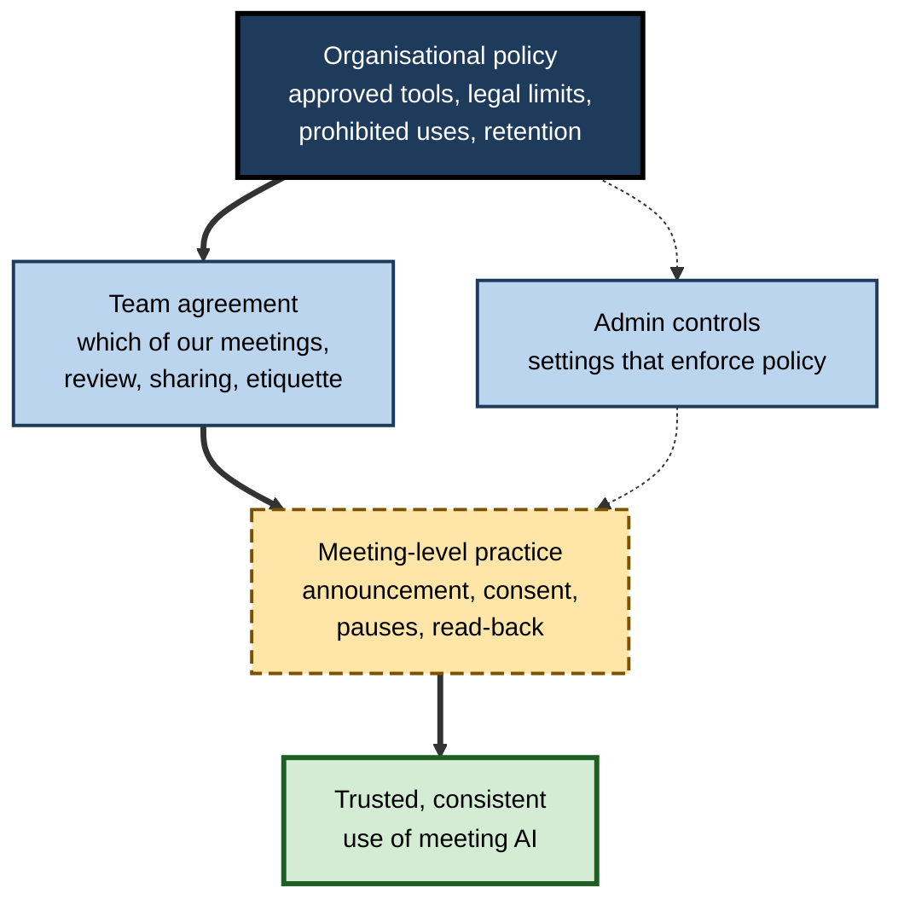
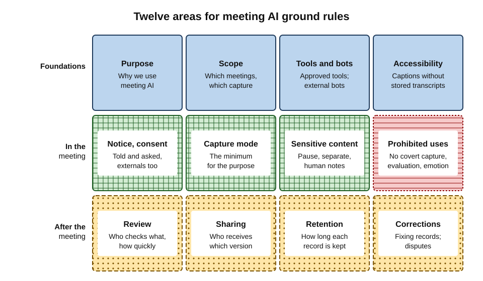
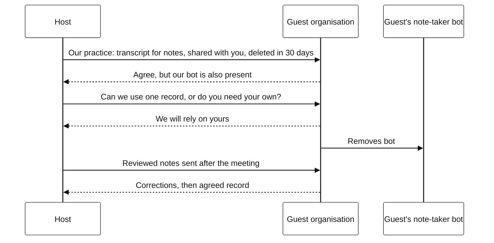
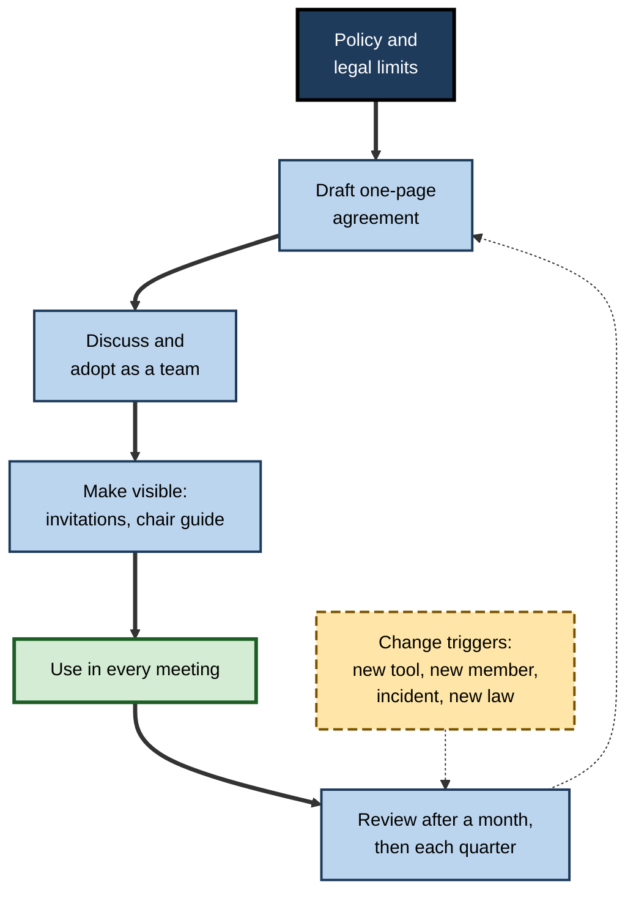
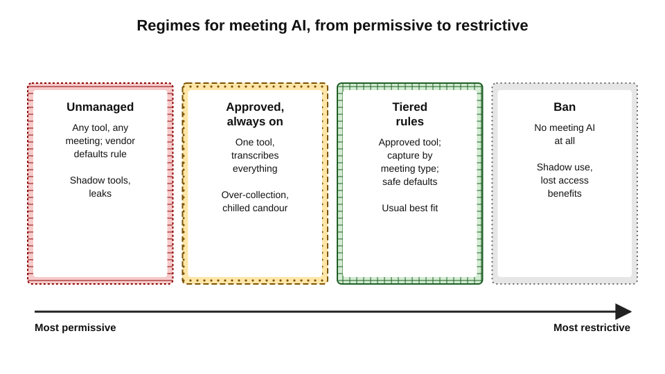

# G.12. Meeting AI ground rules

Two colleagues join the same weekly meeting with different assumptions. One switches on her personal note-taker because "everyone does now". The other, who chairs the meeting, assumes nothing is recorded and speaks frankly about a struggling team member. Neither is wrong by their own lights; the team simply never agreed how AI would be used in its meetings. Most of the problems that AI creates in meetings — awkward bots, leaked remarks, wrong summaries treated as fact — come not from the technology but from the absence of shared rules.

> **Definition — Meeting AI ground rules:** an explicit, shared agreement within a team or organisation about how AI tools may be used in meetings — what is captured, with whose knowledge, how outputs are checked, shared and kept, and which uses are not allowed.

> **Definition — Working agreement:** a short set of norms that a team writes and adopts for how it will work together, reviewed and revised over time.

**Why it matters**

- **Meeting AI is social technology** — it changes what people say, remember and are held to; it needs social rules, not just settings.
- **Individual choices affect everyone** — one person's note-taker records all participants.
- **Defaults are not decisions** — without rules, the vendor's default settings become the team's practice.
- **Rules make benefits safe** — accessibility, catch-up, accurate records and fewer meetings are easier to gain when people trust how the tools are used.

---

## Why Explicit Norms Work

### Norms in groups

- **Every group has norms** — expectations about behaviour that members share, whether stated or not.
- **Implicit norms diverge** — new members, different teams and new tools bring different assumptions.
- **Daniel Feldman (1984)** argued that groups enforce norms that help the group survive, make behaviour predictable, avoid embarrassment and express the group's values — all of which apply to recording: predictability (knowing when one is recorded), embarrassment (remarks circulated) and values (candour, inclusion).

> **Definition — Norm:** a shared expectation within a group about how members should behave.

### Evidence on team charters

**Study card — Mathieu and Rapp (2009), team charters and performance**

- **Design:** a study of teams of business students working together over a semester on a complex simulation.
- **Findings:** teams that wrote **high-quality charters** early — clear agreements on how they would work — together with good performance strategies tended to perform better over time.
- **Limit:** student teams in a simulation; the quality of the charter, not its mere existence, mattered.
- **Relevance:** explicit agreements written early, and taken seriously, help teams coordinate — the logic behind meeting AI ground rules.

> **Key point:** ground rules work when they are **specific**, **agreed by the people they bind**, **visible** at the moment of use, and **reviewed** when circumstances change.

---

## Three Levels of Rules

**Figure 1.** Organisational policy, team agreement and meeting-level practice.

- **Organisational policy** — set by leadership with legal, data protection, security, HR and accessibility input.
  - Approved tools; legal requirements; prohibited uses; retention schedules; admin settings.
- **Team agreement** — written by each team within the policy.
  - Which of its meetings use which forms of capture; how notes are reviewed and shared; local etiquette.
- **Meeting-level practice** — what the chair does each time.
  - Announcement, consent, pauses, read-back of decisions, review before sending.

| | Organisational policy | Team agreement | Meeting-level practice |
|---|---|---|---|
| Set by | Leadership with specialist functions | The team itself | The chair, each meeting |
| Typical content | Approved tools, prohibited uses, retention, legal duties | Meeting types, review owners, sharing norms | Announcement, consent, pauses, read-back |
| Enforced by | Admin settings, audits, discipline | Team habits, chair, manager | The chair and participants |
| Changes | Annually or when law or tools change | Quarterly or when the team changes | Every meeting |
| Failure if missing | Inconsistent risk across the organisation | Policy ignored or misapplied locally | Rules exist but nothing happens in the room |

> **Remember:** policy says **what is allowed**; the team agreement says **what we actually do**; the chair makes it **happen in the room**.

---

## What Ground Rules Should Cover

**Figure 2.** Twelve areas a set of meeting AI ground rules should address.

- **Purpose** — why the team uses meeting AI: accurate records, accessibility, catch-up, fewer meetings.
- **Scope** — which meetings use which capture: captions only, transcript, AI notes, none.
- **Notice and consent** — how people are told and asked, including external participants.
- **Capture mode** — the minimum needed for the purpose.
- **Tools and bots** — approved tools only; personal note-takers; bots belonging to external participants.
- **Review and accuracy** — who reviews notes, how quickly, what is checked.
- **Sharing** — who receives what; no automatic distribution.
- **Retention** — how long transcripts, recordings and summaries are kept.
- **Sensitive content** — pausing, separate sessions, human-only notes.
- **Prohibited uses** — covert recording, performance evaluation from transcripts, emotion or sentiment scoring, using bots to "attend" instead of people.
- **Accessibility** — captions available on request without needing a stored transcript.
- **Corrections and disputes** — how anyone can correct a record, and what happens when people disagree about it.

> **Mnemonic — "RECORD":** **R**eason stated, **E**veryone informed, **C**apture the minimum, **O**wner reviews, **R**estrict sharing and retention, **D**on't misuse — no covert recording, evaluation or emotion scoring.

---

## Rules on Use of the Data

Some of the most important ground rules concern what meeting records may be **used for** after the meeting.

- **Not for individual performance evaluation** — transcripts and talk-time statistics should not be used to judge individuals' performance.
  - Attribution errors, uneven accuracy and context loss make them unfair evidence; their use would chill candour across the organisation.
- **Not for emotion or sentiment scoring of employees** — scientifically weak and, where based on voice or face analysis in the workplace, prohibited in the European Union since February 2025.
- **Not for purposes nobody was told about** — model training, analytics or monitoring require their own legal basis and notice.
- **Disciplinary use only under defined conditions** — where a recording is the only evidence of serious misconduct, its use should follow a defined, fair process, not ad hoc searching.

> **Watch out:** the fastest way to destroy trust in meeting AI is for one manager to quote a transcript in someone's performance review. A clear rule against it — stated before anyone asks — protects the whole system.

---

## External Parties and Their Tools

Ground rules must address meetings with people from other organisations, whose tools and norms may differ.

- **Our tools in their meetings** — ask before transcribing; offer to share the record; respect refusal.
- **Their tools in our meetings** — a client's or supplier's bot may join; the host should ask whose it is and whether its use is agreed.
- **Different rules on each side** — agree at the start which record, if any, will be the shared one.
- **Contractual rules** — some clients prohibit recording or third-party AI in contracts; the team must know.

**Figure 3.** Agreeing record-keeping at the start of a meeting with another organisation.

> **In practice:** a single **agreed record** — usually the host's reviewed notes, shared with the guests for correction — avoids two diverging AI summaries of the same meeting.

---

## Designing Ground Rules

### A process

1. **Start from policy** — know what the organisation allows, requires and forbids.
2. **List the team's meeting types** — stand-ups, planning, client calls, one-to-ones, retrospectives, workshops.
3. **Decide capture per type** — the minimum that serves the purpose.
4. **Agree review, sharing and retention** — names and times, not "someone".
5. **Name prohibited uses** explicitly.
6. **Write it on one page** — plain language, specific, short.
7. **Agree it as a team** — discuss objections; adjust; adopt.
8. **Make it visible** — in meeting invitations, team pages, chair guides.
9. **Trial for a month**, then review: what is ignored, what is unclear, what has changed.

**Figure 4.** The cycle of agreeing, using and revising ground rules.

### What makes a rule good

- **Specific** — "Summaries go to the organiser first and are sent within 24 hours" rather than "Use summaries responsibly".
- **Actionable at the moment of use** — something the chair can do in the meeting.
- **Proportionate** — strict for sensitive meetings, light for routine ones.
- **Explained** — each rule has a reason the team understands.
- **Owned** — someone is responsible for each practice.

| | Weak rule | Strong rule |
|---|---|---|
| Consent | "Be respectful about recording" | "Chair announces capture at the start; anyone may object; human notes then" |
| Review | "Check AI notes" | "Organiser checks decisions, owners and figures before sending, same day" |
| Sharing | "Share appropriately" | "Summaries to attendees only; client follow-ups written separately" |
| Retention | "Delete when no longer needed" | "Transcripts expire after 30 days; decisions copied to the decision log" |
| Prohibited use | "Don't misuse transcripts" | "Transcripts are never used in performance reviews" |

---

## Worked Example (illustrative): A Product Team's Ground Rules

**Situation:** a 14-person product team, with members in two countries and one hard-of-hearing designer, drafts its agreement within the company's policy, which approves the platform's built-in transcription, blocks third-party bots and sets 30-day transcript expiry.

**The agreed rules (one page)**

- **Purpose** — we use meeting AI for accurate decisions and actions, catch-up across time zones and accessibility.
- **Captions** — always available in every meeting; turning on captions never requires saving a transcript.
- **Stand-ups and planning** — transcribed, AI notes reviewed by the facilitator and posted in the team channel within two hours.
- **Design critiques and retrospectives** — not transcribed; a facilitator writes outcomes only.
- **One-to-ones** — not transcribed unless both people ask.
- **Client calls** — transcribed only with the client's agreement; client follow-ups written by the product manager, not forwarded AI summaries.
- **Personal note-takers** — not used; the shared record is the team's.
- **Sensitive moments** — anyone may ask to pause; the chair pauses visibly and announces resumption.
- **Decisions** — read back at the end of each meeting and copied to the decision log the same day.
- **Never** — performance evaluation from transcripts; sentiment or engagement scores; sending a bot instead of attending a meeting where one's input is needed.
- **Corrections** — anyone may correct a summary; the facilitator updates the stored version.
- **Review** — this agreement is reviewed every quarter and when someone joins the team.

| Rule | Reason |
|---|---|
| Captions without transcripts | Access for the hard-of-hearing designer, without recording every conversation |
| Retrospectives not transcribed | Candour about mistakes |
| Client follow-ups written separately | Keeps internal views internal |
| No personal note-takers | One reviewed record; consistent consent |
| No performance use | Trust in the whole system |
| Quarterly review | Tools and team change |

*Illustrative example.*

- **Outcome after a quarter:** the team found the retrospective rule most valued; the client-call rule needed one clarification (who asks the client); the rest held.

### Introducing rules without bureaucracy

- **Start from a template** — a one-page organisational template with blanks for each team's choices saves hours and keeps teams consistent.
- **Spend fifteen minutes, not a workshop** — most teams can agree their rules in one short agenda item, then refine them in use.
- **Use real examples** — "Last month a summary went to the client; what rule would have stopped it?" produces better rules than abstract debate.
- **Put the rules where they are used** — a line in recurring meeting invitations ("Transcribed; summary to attendees after review; ask to pause at any time") reminds everyone without extra effort.
- **Make the chair's job easy** — a short opening script and a closing read-back prompt.

### The chair's words

Ground rules come alive in a few sentences spoken at the start and end of each meeting.

> **Example — opening:** "This meeting is transcribed for our notes. The summary goes to attendees after I've checked it, and the transcript is deleted after 30 days. Anyone can ask me to pause at any point. Is everyone happy with that? — Thanks. I can see one note-taker, which is ours."

> **Example — closing:** "Before we finish, decisions: we're moving the launch to 2 June, subject to security sign-off. Actions: Ahmed — risk register by Thursday; Priya — client email today. Anything I've missed or got wrong?"

- **Why it matters** — the opening makes consent and notice real; the closing makes the record accurate; together they take under a minute.

### Signs that the rules are working

- **People ask to pause** — and the pause happens without fuss.
- **Summaries arrive reviewed** — corrections are rare and made openly.
- **No surprises** — nobody discovers they were recorded, or that a summary reached someone unexpected.
- **Candid meetings stay candid** — retrospectives and one-to-ones remain open.
- **New members learn the rules quickly** — because they are written down and visible.

---

## Ground Rules in Different Settings

The same twelve areas apply everywhere, but the right answers differ by setting.

| Setting | Typical capture | Distinctive rules |
|---|---|---|
| Internal product or engineering team | Transcripts for stand-ups and planning; none for retrospectives | Decisions copied to a log; no talk-time analytics |
| Client-facing consulting or sales | Transcripts only with client agreement | Written follow-ups for clients; no personal bots; respect client contracts |
| HR and people management | No AI capture by default | Notes in HR systems only; agreed records for formal hearings |
| Legal and compliance | No third-party capture of privileged advice | Lawyer-controlled notes; legal holds respected |
| Healthcare | Clinical documentation tools only under clinical governance | Patient consent; clinical record rules; clinician verifies every note |
| Education and research | Lecture captions widely; research interviews with ethics approval | Informed consent; data management plans |
| Public sector | Formal minutes; transcripts as public records | Freedom-of-information and records duties; transparency notices |

*Illustrative patterns; actual rules depend on law, sector and organisation.*

- **Client-facing work** — the client's rules usually prevail; many contracts restrict recording and third-party AI.
- **Regulated sectors** — some recording is mandatory, some prohibited; ground rules must follow compliance requirements, not team preference.
- **Education** — captions and transcripts serve accessibility for students; recording seminars may chill discussion in the same way as workplace retrospectives.

---

## When Rules Are Broken

Rules will sometimes be broken — usually by accident, occasionally by choice. How the team responds decides whether the rules keep working.

- **Just culture** — an approach developed in safety-critical industries such as aviation and healthcare, and described by the safety researcher James Reason in the late 1990s: honest mistakes are treated as learning opportunities, while reckless or deliberate breaches are held to account.
- **Graduated responses:**
  - **accidental** — a note-taker left on auto-join: fix the setting, delete what should not exist, inform those affected;
  - **careless** — summaries forwarded externally without review: a conversation and a reminder;
  - **deliberate** — covert recording or using a transcript against a colleague: formal process.
- **Learning from incidents** — each incident asks: was the rule unclear, impractical, unknown, or ignored? Fix the cause, not only the case.

> **Definition — Just culture:** an organisational approach that distinguishes honest error, at-risk behaviour and reckless conduct, responding to each differently so that people report mistakes rather than hide them.

> **Watch out:** if every mistake with meeting AI is punished, people will stop reporting accidental recordings and mis-sent summaries — and the organisation will learn about them only when a client or regulator does.

---

## Rules for AI That Acts

Ground rules written for note-takers must stretch to assistants and agents that act in and around meetings.

- **Disclosure of AI participants** — if an AI speaks, posts or answers in a meeting or channel, everyone should know it is an AI and whose it is.
- **Human accountability** — every action an AI takes — creating a task, sending a follow-up, posting a summary — has a named human owner.
- **No AI commitments** — an AI may draft, but commitments to clients, colleagues or partners are made by people.
- **No AI attendance in place of required people** — a bot can record a meeting for someone who cannot attend; it cannot represent them.
- **Limits on autonomy** — automatic actions are confined to low-stakes, reversible steps; anything external or consequential needs confirmation.

> **Key point:** as meeting AI moves from **recording** to **acting**, the central rule becomes: **a person is always accountable for what the AI does on their behalf**.

---

## Enterprise Governance

At organisational scale, ground rules sit inside a wider governance system.

- **Ownership** — a named owner for meeting AI policy, usually spanning IT, legal, data protection, HR and accessibility.
- **Tool approval** — assessment of vendors for security, data location, retention, training use and contract terms before use.
- **Impact assessment** — a data protection impact assessment for organisation-wide transcription or new analysis features.
- **Configuration as policy** — admin settings that make the rules the default: notification banners, bot blocking, expiry periods, sensitivity labels, no automatic external distribution.
- **Training** — for chairs, assistants and client-facing staff.
- **Audit and incident handling** — periodic sampling of practice; a route for reporting misuse or mistakes.
- **Review** — at least annually, and whenever tools, law or incidents require.

**Figure 5.** Regimes for meeting AI, from permissive to restrictive.

> **Key point:** the best-governed organisations make the **safe behaviour the default** through configuration, and use ground rules for the judgements configuration cannot make.

### Case study (illustrative): from shadow note-takers to agreed rules

- **Situation:** a 3,000-person engineering firm had no policy on meeting AI. Within a year, staff were using a dozen different note-taking services; bots appeared in client meetings; summaries were forwarded freely.
- **Trigger:** a client found its confidential design discussion summarised in a supplier's note-taking service it had never agreed to, and complained formally.
- **Diagnosis:**
  1. no approved tool, so people chose their own;
  2. no rules on consent, external meetings or sharing;
  3. defaults of personal tools — auto-join, auto-share — set the firm's practice.
- **Actions:**
  1. built-in platform transcription approved; third-party bots blocked at the lobby; existing personal services wound down with data deleted;
  2. a one-page organisational policy with prohibited uses and retention;
  3. each team asked to adopt its own agreement within the policy, using a template;
  4. chair training and a short guide for client meetings;
  5. quarterly review by a small cross-functional group.
- **Result:** within six months, bot sightings in client meetings stopped; staff surveys showed higher confidence about when they were recorded; usage of the approved tool rose rather than fell.
- **Lesson:** banning tools without offering a good alternative drives them underground; **approved tools plus agreed rules** bring use into the open.

---

## Open Questions

- **How should rules handle AI that speaks in meetings?**
  - Assistants that answer questions aloud or agents that represent absent people raise questions of authority, consent and accountability that current rules rarely address.
- **Can rules keep pace with features?**
  - Vendors add capabilities monthly; quarterly rule reviews may lag.
- **Who arbitrates disputed records?**
  - When participants disagree about a summary, few organisations have a defined process.
- **Will norms converge across organisations?**
  - Professional bodies and regulators are beginning to issue guidance; cross-organisation meetings still meet mismatched rules.
- **Do ground rules change behaviour?**
  - Evidence on team charters is encouraging, but specific evidence on meeting AI rules is not yet available.

---

## Summary

- **Meeting AI ground rules** are explicit shared agreements about capture, notice, review, sharing, retention and prohibited uses; they make benefits safe and behaviour predictable.
- Groups enforce **norms** that create predictability and avoid embarrassment (Feldman, 1984); high-quality **team charters** are associated with better team performance (Mathieu and Rapp, 2009).
- Rules operate at three levels: **organisational policy**, **team agreement** and **meeting-level practice**, with **admin controls** enforcing policy.
- Twelve areas: purpose, scope, notice and consent, capture mode, tools and bots, review, sharing, retention, sensitive content, prohibited uses, accessibility, corrections — **RECORD**.
- Rules on **use of data** matter most: no performance evaluation from transcripts, no emotion scoring, no undisclosed purposes.
- Meetings with **external parties** need an agreed single record and attention to their tools and contracts.
- Good rules are **specific, actionable, proportionate, explained and owned**; written on one page, adopted by the team, visible, trialled and reviewed.
- Settings differ — client-facing, HR, legal, healthcare, education and public-sector teams need different answers to the same twelve questions.
- Respond to breaches with a **just culture**: learn from honest errors, hold deliberate misuse to account.
- For AI that acts: **disclose AI participants**, keep a **named human accountable**, allow **no AI commitments** and limit autonomy to reversible steps.
- Enterprise governance combines ownership, tool approval, impact assessment, configuration, training, audit and review; **safe defaults** do most of the work.

---

## Self-Check

1. Define meeting AI ground rules and a working agreement.
2. Why are meeting AI tools described as social technology needing social rules?
3. Using Feldman's account of norms, explain why groups would enforce rules about recording.
4. What did Mathieu and Rapp find, and what limits apply?
5. Describe the three levels of rules and what happens if each is missing.
6. List the twelve areas ground rules should cover.
7. Explain the RECORD mnemonic.
8. Why should transcripts not be used for individual performance evaluation?
9. A client's bot joins your meeting. What should the ground rules say?
10. Rewrite "Use AI notes responsibly" as two strong rules.
11. Outline a process for a team to adopt ground rules.
12. In the engineering firm case, why did approving a tool reduce risk more than banning tools would have?
13. What is a just culture, and how should a team respond to an accidental, a careless and a deliberate breach of its rules?
14. State four ground rules for AI assistants that act in meetings and channels.

### Answer Key

1. Ground rules: an explicit, shared agreement on how AI tools may be used in meetings — capture, notice, review, sharing, retention and prohibited uses. Working agreement: a short set of norms a team writes, adopts and revises for how it works together.
2. They change what people say, remember and are held to, and one person's choice affects everyone recorded; settings alone cannot resolve questions of trust, consent and use.
3. Groups enforce norms that make behaviour predictable, avoid embarrassment, help the group survive and express its values. Recording rules make it predictable when one is recorded, prevent embarrassing leaks and express values such as candour and inclusion.
4. Teams with high-quality early charters and good performance strategies tended to perform better over time. The study involved student teams in a simulation, and charter quality, not mere existence, mattered.
5. Organisational policy (approved tools, legal limits, prohibited uses, retention) — without it, risk varies across teams. Team agreement (which meetings, review, sharing) — without it, policy is ignored or misapplied. Meeting-level practice (announcement, consent, pauses, read-back) — without it, rules exist but nothing happens in the room.
6. Purpose; scope; notice and consent; capture mode; tools and bots; review and accuracy; sharing; retention; sensitive content; prohibited uses; accessibility; corrections and disputes.
7. Reason stated; Everyone informed; Capture the minimum; Owner reviews; Restrict sharing and retention; Don't misuse — no covert recording, evaluation or emotion scoring.
8. Attribution errors, uneven accuracy and loss of context make transcripts unfair evidence, and their use would chill candour and destroy trust in the whole system.
9. The host asks whose it is and whether its use is agreed; the parties agree on a single shared record if possible; if the bot is not agreed, it is removed; contractual restrictions are respected.
10. For example: "The organiser checks decisions, owners and figures in AI notes before sending them, on the same day." "AI summaries go to attendees only; follow-ups to clients are written separately."
11. Start from policy; list meeting types; decide capture per type; agree review, sharing and retention; name prohibited uses; write one page; discuss and adopt; make visible; trial and review regularly.
12. Without an approved tool, staff used many unvetted services with risky defaults; an approved tool with safe settings gave people a legitimate option, brought use into the open and let the firm enforce consent, sharing and retention through configuration.
13. An approach that distinguishes honest error, at-risk behaviour and reckless conduct, so that people report mistakes. Accidental (auto-join left on): fix the setting, delete what should not exist, inform those affected. Careless (summary forwarded externally without review): conversation and reminder. Deliberate (covert recording, using a transcript against a colleague): formal process.
14. Any four: disclose AI participants and their owners; a named human is accountable for every AI action; AI drafts but people make commitments; bots may record but never represent a person whose presence is required; automatic actions limited to low-stakes, reversible steps.

---

## Glossary

| Term | Meaning |
|---|---|
| Admin controls | Platform settings that enforce organisational policy. |
| Agreed record | A single meeting record accepted by all parties, usually reviewed notes. |
| Data protection impact assessment | An assessment of privacy risks before high-risk processing. |
| Ground rules (meeting AI) | Explicit shared agreements on how AI is used in meetings. |
| Just culture | An approach that learns from honest errors and holds deliberate misconduct to account. |
| Norm | A shared expectation about behaviour within a group. |
| Organisational policy | Rules set at organisation level on approved tools, uses and retention. |
| Prohibited use | A use of meeting AI or its data that the rules forbid. |
| Team charter | A written agreement by a team on how it will work together. |
| Working agreement | A short, revisable set of team norms. |
