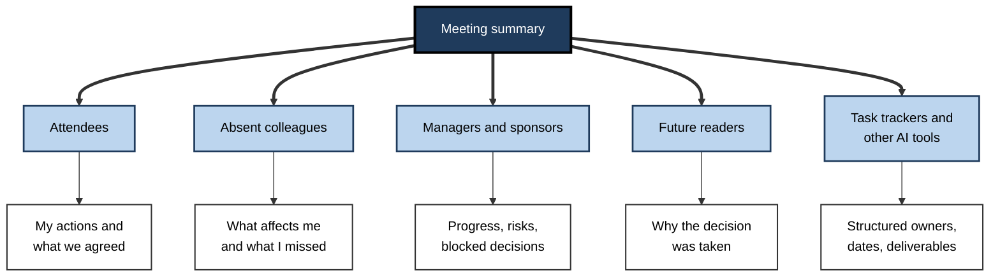
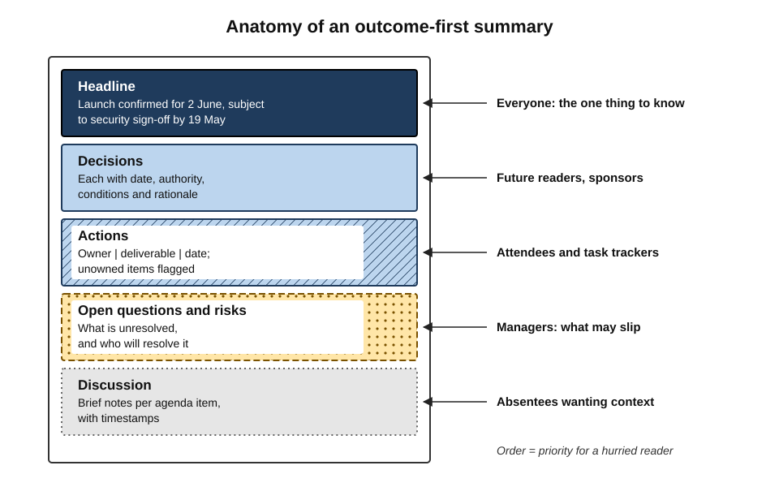
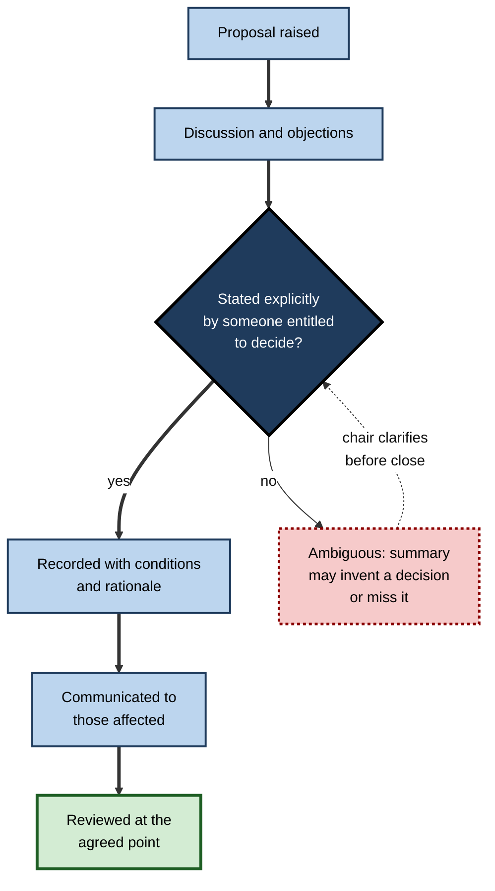
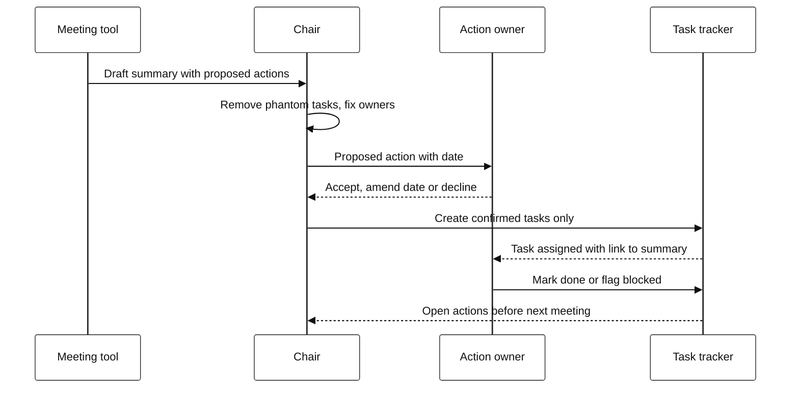
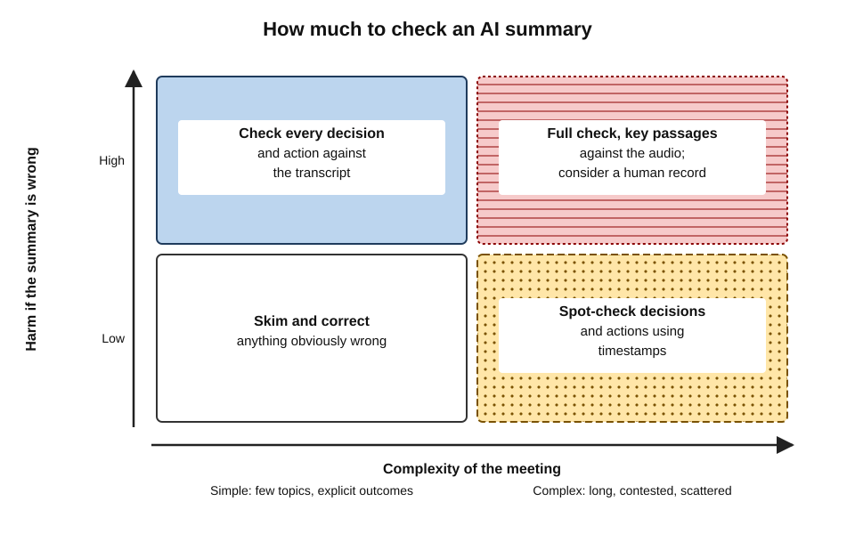

# G.2. Meeting summaries and actions

Three weeks after a planning meeting, two managers disagree about what was agreed. One remembers a firm commitment to launch in June; the other remembers "June if testing goes well". Both open the AI summary. It says: "The team agreed to target a June launch." Neither the condition nor the person who set it appears. The summary has not lied — it has simply become the version of events that wins, because it is the only one written down.

> **Definition — Meeting summary:** a condensed written account of a meeting that states what was covered, what was decided and what happens next, for readers who need the outcome without the full discussion.

> **Definition — Decision record:** a written statement of a decision, giving what was decided, when, by whom or by what authority, with any conditions and the reasons for it.

> **Definition — Action item:** a specific task arising from a meeting, with one named owner, a clear deliverable and a due date.

**Why it matters**

- **Summaries outlive meetings** — the meeting lasts an hour; its summary is read, forwarded and quoted for months.
- **AI makes summaries universal** — meetings that never had notes now produce them automatically, so the quality of summaries shapes the organisation's memory.
- **Decisions and actions are where value is** — a meeting that produces no clear decision or action has usually produced only cost.
- **Errors are silent** — a wrong owner or a dropped condition looks exactly like a correct one.

---

## What a Summary Is For

### Different readers, different needs

The same meeting is summarised for people who want very different things from it.

- **Attendees** — a memory aid: "what did we agree, and what do I owe?"
- **Absent colleagues** — a substitute for being there: "what happened that affects me?"
- **Managers and sponsors** — oversight: "are we on track, and is anything stuck?"
- **Future readers** — institutional memory: "why did we decide this?" months or years later.
- **Systems** — automation: task trackers, project dashboards and other AI tools that read the summary and act on it.

**Figure 1.** Readers of a meeting summary and what each needs from it.

> **Key point:** a summary that serves every reader equally serves none of them well. Good summaries are organised so that each reader finds their part quickly — usually by putting **outcomes first**.

### The outcome-first summary

- **Headline** — one or two sentences: the most important outcome and anything urgent.
- **Decisions** — each as a decision record, with conditions.
- **Actions** — owner, deliverable, date; unowned items flagged as such.
- **Open questions and risks** — what remains unresolved, and who will resolve it.
- **Discussion** — brief topic-by-topic notes, last, for those who want context.

**Figure 2.** Anatomy of an outcome-first meeting summary.

> **Definition — Outcome-first summary:** a summary structured so that decisions, actions and open questions come before any account of the discussion; related to the military and business convention of "bottom line up front".

> **Watch out:** many AI tools default to a **chronological** recap — "First the team discussed…, then…". It reads naturally but buries the decisions in the middle, where hurried readers miss them.

---

## Kinds of Meeting Summary

Summaries differ in what they organise around. Choosing the right kind matters more than polishing the wording.

| | Chronological | Topical | Agenda-anchored | Outcome-first | Query-focused |
|---|---|---|---|---|---|
| Organised by | Order of discussion | Themes, regrouped | The agenda items | Decisions, actions, open items | A question asked by the reader |
| Best for | Short meetings; narrative events such as incidents | Wide-ranging discussions | Formal and recurring meetings | Almost all working meetings | Catching up on one issue |
| Strength | Faithful to the flow | Pulls scattered points together | Shows which items reached an outcome | Fast to act on | Precise and short |
| Weakness | Buries outcomes | May merge separate points | Misses off-agenda business | Loses nuance of debate | Silent about everything not asked |

- **Agenda-anchored summaries** are particularly useful because they expose **gaps**: an agenda item with no outcome is visible at once.
- **Query-focused summaries** — "what did legal say about the contract?" — are now offered by most meeting tools as a chat box over the transcript.
- **Role-tailored summaries** — a different summary for the finance lead and the engineering lead — spare each reader irrelevant detail but split the shared record into private versions.

> **In practice:** a team can ask its tool for an outcome-first, agenda-anchored summary by default: decisions and actions first, then one short paragraph per agenda item, ending with "Items with no outcome".

---

## Why Meetings Are Hard to Summarise

Researchers have studied automatic meeting summarisation for two decades, and meetings remain one of the hardest kinds of text to condense.

### Evidence from research

**Study card — The AMI Meeting Corpus (2005 onwards)**

- **What it is:** about 100 hours of recorded meetings, many of them role-played design-team meetings, with transcripts, speaker labels and human-written summaries, created by a European research consortium.
- **Use:** a standard test bed for transcription, speaker identification and summarisation.
- **Lesson from two decades of use:** human summarisers themselves often disagree about what matters in a meeting, so there is no single "correct" summary to measure against.

**Study card — QMSum (Zhong and colleagues, 2021)**

- **Design:** a benchmark of query-based meeting summarisation built from product, academic and parliamentary committee meetings; annotators wrote questions and the summaries that answered them.
- **Findings:** models had to first **locate** the relevant parts of long transcripts before summarising them; locating was a major source of failure.
- **Lesson:** a summary is only as good as the system's ability to find all the places where a topic was discussed — which, in meetings, are often scattered.

**Study card — "Lost in the middle" (Liu and colleagues, 2023)**

- **Design:** language models were given long inputs with the relevant information placed at different positions.
- **Finding:** performance was best when the information was near the **beginning or end** of the input and dropped noticeably when it was in the **middle**.
- **Relevance to meetings:** in a long meeting, decisions made in the middle hour may be under-represented in a summary. Newer models have reduced but not eliminated position effects.

### Features of meeting talk that defeat summaries

- **Decisions are distributed** — a proposal at minute 10, an objection at minute 25, a compromise at minute 50.
- **Decisions are implicit** — agreement is signalled by silence, "fine", or moving on.
- **References are local** — "let's do the second option" means nothing without the slide that was on screen.
- **Speakers revise themselves** — the final position may contradict an earlier statement that a summary also reports.
- **Social softening** — people disagree politely ("that's an interesting idea, but…"), and models tend to report polite disagreement as agreement.
- **Off-agenda business** — the most important point may come in the last two minutes, as people are leaving.

> **Definition — Consensus smoothing:** the tendency of automatic summaries to present a discussion as more harmonious and settled than it was, by omitting or softening disagreement.

> **Watch out:** a summary that never records disagreement should be treated with suspicion. Real working meetings almost always contain some.

---

## Recording Decisions Properly

Most organisations are better at recording actions than decisions. Yet decisions are what future readers most need — and what AI summaries most often get subtly wrong.

### What a good decision record contains

- **The decision** — stated precisely, in one sentence.
- **Date and forum** — when, and in which meeting or by which person.
- **Authority** — who had the right to decide, and whether they did.
- **Conditions** — "subject to…", "unless…", "provided that…".
- **Options considered** — the main alternatives rejected.
- **Rationale** — the reasons, especially trade-offs accepted.
- **Dissent** — notable disagreement and who held it, where the forum records that.
- **Review point** — when or under what circumstances the decision will be revisited.

> **Example:** "Decision (Steering Group, 12 March): the customer portal launches on 2 June **provided** the security test closes all high-severity findings by 19 May; otherwise launch moves to 30 June. Options considered: phased launch (rejected — support cost). Decided by the programme sponsor. Finance lead recorded concern about June marketing spend. Review: 20 May."

### Decision logs and decision records

- **Decision log** — a running list of decisions for a project or team, separate from any single meeting's notes, so decisions can be found without reading every summary.
- **Architecture decision records** — proposed by the software engineer Michael Nygard in 2011: short documents recording one significant technical decision, its context and its consequences, kept alongside the code. The practice spread widely because later engineers otherwise could not tell why a design was chosen.
- **Board and committee resolutions** — the formal equivalent: precise wording, recorded votes, approved minutes.

> **Definition — Decision log:** a maintained register of decisions for a team, project or body, each with date, owner and rationale, independent of individual meeting notes.

### Who has the decision?

- AI summaries cannot see **decision rights** — whether the person who said "let's do it" was entitled to decide.
- **Paul Rogers and Marcia Blenko (2006)**, of the consultancy Bain, described the **RAPID** framework to make decision roles explicit:
  - **Recommend** — proposes the decision;
  - **Agree** — must sign off (a veto);
  - **Perform** — carries it out;
  - **Input** — consulted;
  - **Decide** — makes the final call.
- **Lesson:** where decision rights are clear before the meeting, a summary can record decisions accurately; where they are unclear, the summary will record whatever *sounded* like a decision.

**Figure 3.** The life of a decision from proposal to review.

---

## From Actions to Work

### How actions leave the meeting

Actions recorded in a summary are only useful if they become work someone actually does. Meeting tools increasingly connect directly to task trackers.

- **Manual transfer** — someone copies actions from the notes into a tracker or email.
  - Slow, but every action passes a human check.
- **Suggested tasks** — the tool proposes tasks; owners accept or reject them.
  - Fast, with a confirmation step.
- **Automatic creation** — the tool creates tasks and assigns them without confirmation.
  - Fastest; errors become live work immediately.

| | Manual transfer | Suggested, owner confirms | Automatic creation |
|---|---|---|---|
| Speed | Slow | Fast | Immediate |
| Wrong-owner risk | Low | Low | High |
| Duplicate and phantom tasks | Rare | Occasional | Common |
| Owner awareness | Depends on follow-up | High — owner accepted | Low — owner may not notice |
| Best for | High-stakes, low-volume meetings | Most working meetings | Low-stakes internal routines only |

> **Definition — Phantom task:** a task created from a meeting summary for work that was only mentioned, not agreed — "we could look at the pricing page some time".

### The acceptance handshake

An action is not real until the owner has accepted it. A simple confirmation step prevents most errors.

**Figure 4.** Confirming actions before they enter the task tracker.

- **Why it works:** it converts a model's inference ("Raj will probably do this") into a person's commitment ("I will do this by Friday").
- **The link back** — each task should link to the summary or timestamp it came from, so anyone can check its origin.

> **Remember:** **inferred** actions are proposals; **accepted** actions are commitments. Only commitments belong in the tracker.

### Recurring meetings and continuity

Weekly team meetings, project boards and client check-ins produce a series of summaries. Their value lies in continuity.

- **Open actions carried forward** — the start of each meeting reviews what the previous summary assigned.
- **"What changed since last time"** — some tools can compare the current meeting with earlier ones in the series.
- **Drift detection** — a decision quietly reversed over several meetings becomes visible only when summaries are read side by side.

> **Watch out:** cross-meeting summaries ("summarise the last six steering meetings") compound errors: each underlying summary or transcript may already contain mistakes, and the synthesis cannot see them.

---

## Checking a Summary

### Faithfulness and coverage

Two separate questions decide whether a summary can be trusted.

- **Faithfulness** — is everything in the summary supported by what was said?
  - Failures: invented owners, wrong dates, suggestions reported as decisions.
- **Coverage** — is everything important in the meeting present in the summary?
  - Failures: dropped conditions, missing dissent, last-minute decisions omitted.

> **Formula — Faithfulness rate:** statements in the summary supported by the transcript ÷ total statements checked. Example: of 20 statements checked, 17 are supported, 2 are distorted and 1 is unsupported → 17 ÷ 20 = **85%**.

- A summary can be **fully faithful yet badly incomplete** — every sentence true, the key decision missing.
- Checking faithfulness is quick (look up each statement); checking coverage needs someone who was there or a read of the transcript.

### Worked example (illustrative): auditing a project-board summary

**Situation:** a project lead checks an AI summary of a 60-minute board meeting before circulating it. She checks each decision and action against the transcript, using the timestamps the tool provides.

| Summary statement | Check against transcript | Verdict |
|---|---|---|
| "Board approved the revised budget of £420,000" | Sponsor said "approved, subject to finance confirming the contingency line" | **Distorted** — condition dropped |
| "Vendor contract to be signed by end of month" | Said by procurement as a target; legal raised an unresolved clause | **Distorted** — target reported as decision |
| "Ahmed to update the risk register" | Ahmed volunteered and gave a date | **Supported** |
| "Team agreed the training plan" | Training lead presented; nobody objected; sponsor said "fine" | **Supported**, though weakly decided |
| "Data migration to start 3 June" | Speaker said "the third of July" | **Recognition error** — wrong month |
| (Not in summary) | Finance lead warned the contingency may not cover vendor price rise | **Omission** — material risk missing |

*Illustrative figures.*

- **Result:** of five statements, two are supported, two distorted, one wrong; one material risk is missing.
- **Corrections:** condition restored to the budget decision; contract recorded as a target with an open legal question; migration date corrected; risk added with an owner.
- **Time taken:** about ten minutes — far less than writing the summary, and enough to change its meaning.

> **Watch out:** "the board approved the budget" and "the board approved the budget subject to finance" are different decisions. Conditions are the single most common casualty of automatic summaries.

### How much checking is enough?

The right amount of checking depends on two things: how much harm an error would do, and how hard the meeting was to summarise.

**Figure 5.** Matching the depth of checking to stakes and complexity.

- **Low stakes, simple meeting** — skim; correct anything obviously wrong.
- **Low stakes, complex meeting** — spot-check decisions and actions against timestamps.
- **High stakes, simple meeting** — check every decision and action against the transcript.
- **High stakes, complex meeting** — full check, including key passages against the audio; consider a human-written record.

> **In practice:** asking the tool to give a **timestamp or short quotation** for each decision and action makes checking several times faster, because each statement can be verified with one click.

---

## Asking for Better Summaries

Most tools accept a custom instruction or template. Good instructions follow the purpose of the meeting.

- **Structure** — "Decisions first, then actions as a table of owner, deliverable, date; then open questions; then one paragraph per agenda item."
- **Evidence** — "Give a timestamp for every decision and action."
- **Conditions** — "Keep every condition, dependency or 'subject to' attached to its decision."
- **Disagreement** — "Record any point on which participants disagreed and who held each view."
- **Uncertainty** — "If an owner or date was not stated, write NOT STATED; do not infer."
- **Gaps** — "List agenda items that reached no outcome."
- **Length** — "No more than one page; the headline in two sentences."

> **Mnemonic — "DECODE":** **D**ecisions first, **E**vidence (timestamps), **C**onditions kept, **O**wners only if stated, **D**isagreement recorded, **E**mpty items listed.

| | Default prompt ("summarise this meeting") | Purpose-built instruction |
|---|---|---|
| Order | Chronological | Outcomes first |
| Conditions | Often dropped | Kept with each decision |
| Unclear owners | Guessed | Marked "not stated" |
| Disagreement | Smoothed | Recorded with names |
| Checking effort | High — no evidence links | Low — timestamps given |

---

## Summaries in the Wider Collaboration Space

Meeting summaries rarely stay in the meeting tool. They are posted into team chat channels, pasted into shared documents and project pages, and read by other AI assistants.

- **Living documents** — some workspaces place the summary in an editable shared page, so attendees correct it together; the risk is that nobody owns the final version.
- **Channel posts** — a summary posted to a team channel reaches people who were not invited; what is appropriate to share depends on the meeting's content and audience.
- **Assistants reading summaries** — enterprise assistants answer questions such as "what did we decide about pricing?" by searching stored summaries. An uncorrected error in one summary becomes the answer to many future questions.
- **Email follow-ups** — the summary often becomes the body of a follow-up email to external parties, where it acquires the weight of a formal statement.

> **Key point:** once a summary enters the shared workspace, it is no longer a private aide-memoire; it is part of the organisation's knowledge base, and its errors propagate.

---

## Professional Practice

### Making meetings summarisable

The single most effective way to get accurate summaries is to run meetings whose outcomes are explicit.

- **Agenda with intended outcomes** — "Item 2: decide launch date" rather than "Item 2: launch".
- **Decision rights stated** — "Maria decides; we are here to advise."
- **Explicit closure on each item** — "So the decision is… Does anyone disagree?"
- **Actions assigned aloud** — "Ahmed, can you own that by Thursday?" — "Yes."
- **Read-back in the last minutes** — decisions and actions read aloud.

> **Remember:** a summary records what the meeting made explicit. **Vague meetings produce confident but wrong summaries.**

### Organisational habits

- **Decision logs** maintained separately from meeting summaries for programmes and teams.
- **Summary templates** per meeting type set centrally and available in the tool.
- **Confirmation before automation** — task creation from summaries requires owner acceptance.
- **Summary quality sampling** — a periodic check of faithfulness and coverage on a few meetings, to know how far the tool can be trusted.
- **Corrections policy** — anyone may request a correction; corrections are made to the stored summary, not only in replies.

### Case study (illustrative): a programme office rebuilds its decision log

- **Situation:** a 200-person transformation programme relied on AI summaries of about forty meetings a week; the summaries were stored but never consolidated.
- **Problem:** an external review asked when and by whom the decision to drop a reporting module had been made. Nobody could find it.
- **Diagnosis:**
  1. the decision had emerged across three meetings and appeared in no summary as a decision;
  2. summaries were chronological and long, so readers skimmed;
  3. decision rights were unclear — several "decisions" in summaries had been made by people without authority.
- **Actions:**
  1. a decision log owned by the programme office, with RAPID roles for major decision types;
  2. outcome-first, agenda-anchored templates for all governance meetings, with timestamps;
  3. chairs required to read back decisions; the programme office added them to the log within two days;
  4. task creation from summaries switched from automatic to owner-confirmed.
- **Result:** the next external review traced each major decision to its meeting, owner and rationale in minutes; phantom tasks in the tracker fell sharply.
- **Lesson:** summaries record meetings; **decision logs record the organisation's choices**. AI makes the first cheap, but the second still needs an owner.

---

## Open Questions

- **Can summary quality be measured reliably?**
  - Automatic metrics compare wording with reference summaries, but humans disagree about what matters; faithfulness checking by models is improving but is itself fallible.
- **Should summaries record who said what?**
  - Attribution aids accountability and context but may discourage candour; practice varies widely.
- **Will automatic task creation become safe?**
  - Better models reduce phantom tasks, but whether an inference becomes a commitment is a social question, not a technical one.
- **What happens when assistants summarise summaries?**
  - Cross-meeting and cross-project synthesis is spreading; how errors propagate through layers of summary is little studied.
- **Who is accountable for a wrong summary?**
  - The tool, the organiser who circulated it, or the readers who relied on it — norms are unsettled.

---

## Summary

- A **meeting summary** serves attendees, absentees, managers, future readers and downstream systems; **outcome-first** structure serves them best.
- Summary kinds — **chronological, topical, agenda-anchored, outcome-first, query-focused** — suit different meetings; agenda-anchored summaries expose items with no outcome.
- Meetings are hard to summarise: decisions are **distributed, implicit and revised**; research benchmarks such as **AMI** and **QMSum** and the **"lost in the middle"** finding show why.
- Summaries tend towards **consensus smoothing** and drop **conditions** — the most common distortion.
- A **decision record** states the decision, date, authority, conditions, options, rationale, dissent and review point; **decision logs** and **architecture decision records** keep decisions findable.
- AI cannot see **decision rights**; frameworks such as **RAPID** make them explicit.
- Actions move from notes to work by manual transfer, suggestion or automatic creation; an **acceptance handshake** turns inferences into commitments and prevents **phantom tasks**.
- Check summaries for **faithfulness** and **coverage**, scaling effort to **stakes and complexity**; timestamps make checking fast.
- Purpose-built instructions (**DECODE**) improve summaries; explicit meetings improve them more.

---

## Self-Check

1. Name five kinds of reader of a meeting summary and what each needs.
2. What is an outcome-first summary, and why is it usually better than a chronological one?
3. Compare agenda-anchored and query-focused summaries.
4. Give four features of meeting talk that make summarisation difficult.
5. What did the "lost in the middle" study find, and why does it matter for long meetings?
6. What is consensus smoothing? How can it be detected and prevented?
7. List the elements of a good decision record.
8. Why can an AI summary not determine whether a decision was valid? How does RAPID help?
9. Compare manual transfer, suggested tasks and automatic creation of actions.
10. Define faithfulness and coverage, and explain why a summary can score well on one and badly on the other.
11. In a summary of 25 statements, 21 are supported by the transcript. Calculate the faithfulness rate and say what it does not tell you.
12. Write a custom instruction for summarising a weekly client check-in.
13. A programme sponsor wants AI summaries to be automatically turned into tasks for the whole programme. Advise them.

### Answer Key

1. Attendees — their own actions and what was agreed; absent colleagues — what affects them; managers and sponsors — progress, risks, blocked decisions; future readers — rationale; task trackers and AI tools — structured owners, dates and deliverables.
2. A summary that puts decisions, actions and open questions before any account of discussion. Readers find what they need immediately; chronological recaps bury outcomes in the middle, where hurried readers miss them.
3. Agenda-anchored summaries follow the agenda and show which items reached outcomes, suiting formal and recurring meetings but missing off-agenda business. Query-focused summaries answer a reader's specific question precisely but say nothing about anything not asked.
4. Any four: decisions distributed across the meeting; implicit agreement; local references to slides or earlier remarks; speakers revising positions; polite disagreement; important business at the end.
5. Language models used information placed at the beginning or end of long inputs better than information in the middle. In a long meeting, decisions made in the middle may be under-represented or missed.
6. Presenting a discussion as more harmonious and settled than it was. Detect it by comparing the summary with known disagreements or the transcript; prevent it by instructing the tool to record disagreements and who held each view, and by chairs stating dissent explicitly.
7. The decision itself; date and forum; authority; conditions; options considered; rationale; dissent; review point.
8. Decision rights are not in the transcript — the model cannot know whether the speaker was entitled to decide. RAPID assigns Recommend, Agree, Perform, Input and Decide roles in advance, so the record can show who decided.
9. Manual transfer is slow but checked; suggested tasks are fast with owner confirmation; automatic creation is immediate but creates wrong-owner, duplicate and phantom tasks that owners may not notice. Confirmation suits most meetings; automation only low-stakes routines.
10. Faithfulness: every statement in the summary is supported. Coverage: everything important is included. A summary of five true but minor points is fully faithful but omits the key decision.
11. 21 ÷ 25 = 84%. It says nothing about coverage — what important points were left out — or about how serious the four unsupported statements are.
12. For example: "Summarise outcome-first. Headline in two sentences. Commitments made by each side as a table (party, owner, commitment, date). Client concerns and requirements stated, with timestamps. Open questions. Mark any owner or date not explicitly stated as NOT STATED. Record any disagreement."
13. Recommend owner-confirmed suggestions instead: automatic creation produces phantom tasks and wrong owners at scale. Require summaries to carry timestamps; keep a separate decision log; sample quality periodically; allow automation only for low-stakes internal routines.

---

## Glossary

| Term | Meaning |
|---|---|
| Acceptance handshake | Confirmation by the owner that a proposed action is accepted before it becomes a task. |
| Action item | A task from a meeting with one owner, a deliverable and a due date. |
| Agenda-anchored summary | A summary organised by agenda item, showing each item's outcome. |
| Architecture decision record | A short document recording one significant technical decision, its context and consequences. |
| Chronological summary | A summary following the order of discussion. |
| Consensus smoothing | The tendency of summaries to present discussion as more harmonious than it was. |
| Coverage | The extent to which a summary includes everything important. |
| Decision log | A maintained register of decisions with date, owner and rationale. |
| Decision record | A written statement of a decision, its authority, conditions and reasons. |
| Decision rights | Who is entitled to make, approve or contribute to a decision. |
| Faithfulness | The extent to which everything in a summary is supported by the source. |
| Meeting summary | A condensed account of what a meeting covered, decided and assigned. |
| Outcome-first summary | A summary that puts decisions, actions and open items before discussion. |
| Phantom task | A task created for work that was mentioned but never agreed. |
| Query-focused summary | A summary answering a specific question about a meeting. |
| RAPID | A decision-role framework: Recommend, Agree, Perform, Input, Decide. |
