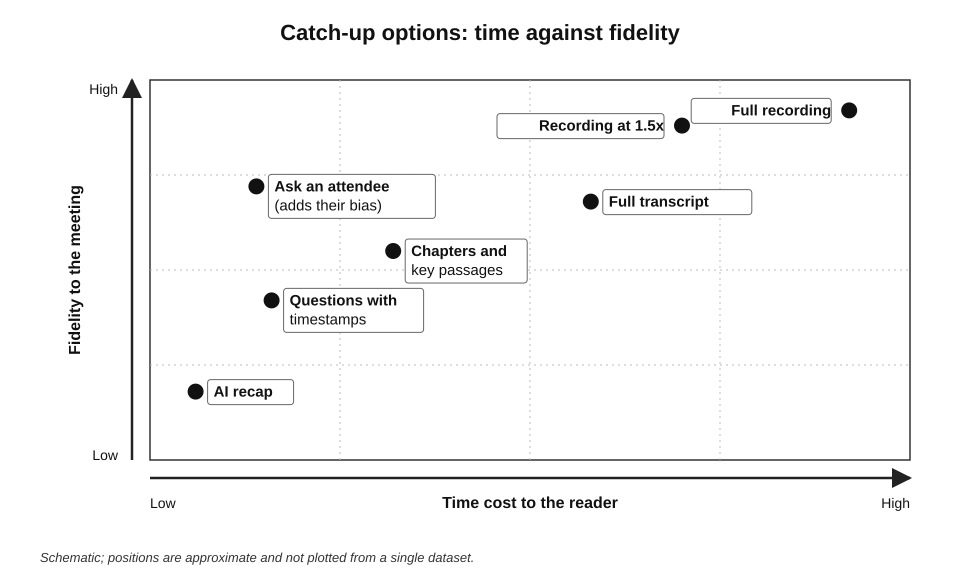
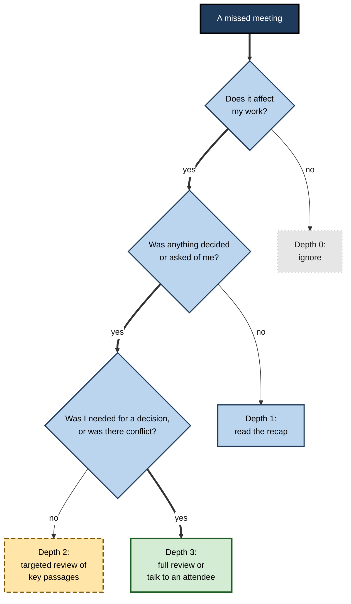
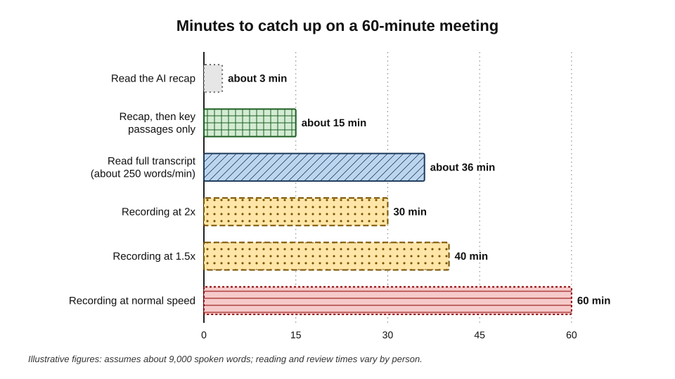
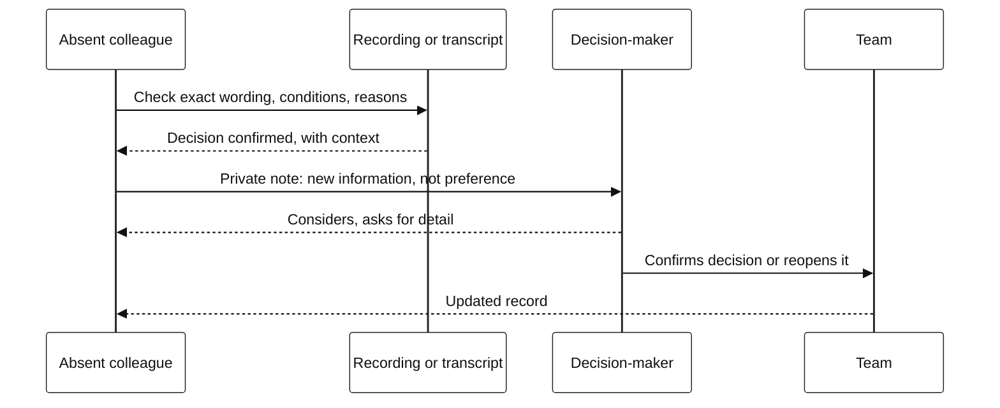
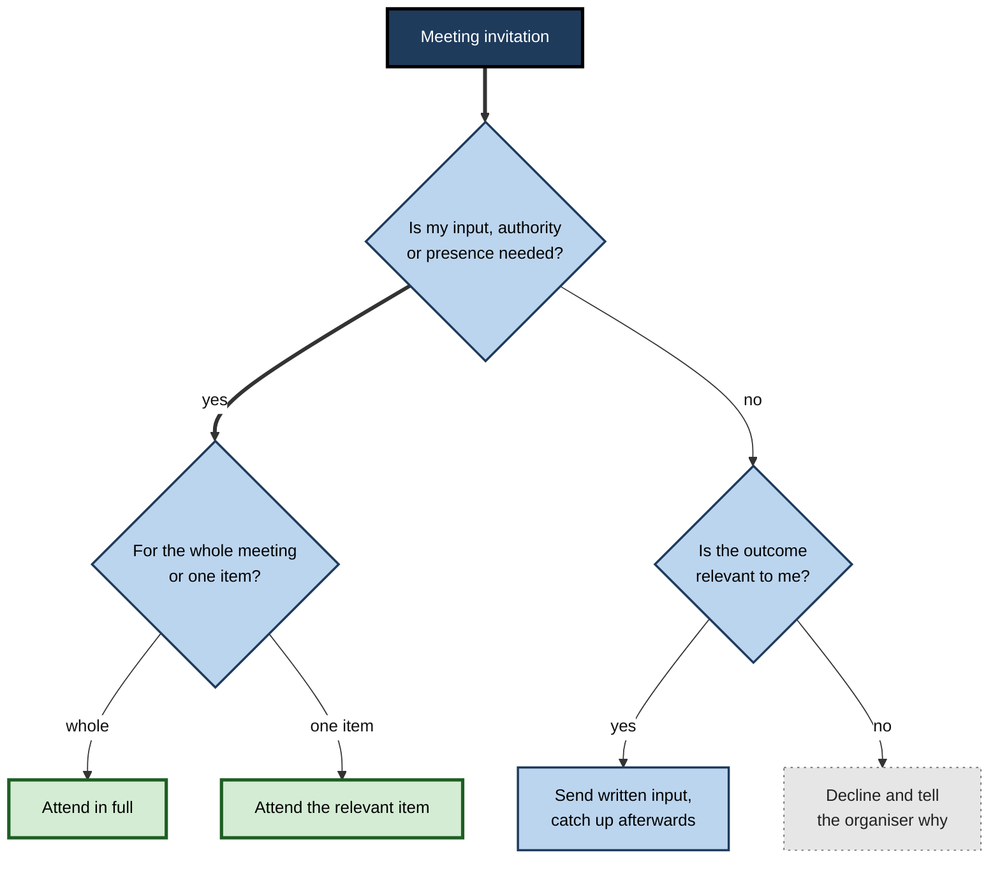

# G.3. Catching up on a missed meeting

An analyst returns from a week of leave to find fourteen recorded meetings waiting, each with an AI recap. Reading every recap takes forty minutes and leaves her with a vague sense of what happened. Watching every recording would take two working days. Somewhere in those fourteen meetings is the one decision that changes her next month — and the recaps describe it in a single, harmless-sounding sentence.

> **Definition — Asynchronous catch-up:** finding out what happened in a meeting one did not attend, after the event, from its records — recap, transcript, recording or colleagues — rather than by taking part.

> **Definition — Catch-up triage:** deciding, for each missed meeting, how much time and depth of review it deserves, from ignoring it to watching the recording in full.

**Why it matters**

- **Missing meetings is normal** — leave, illness, clashes, time zones and deliberate choices mean most professionals miss many meetings that affect them.
- **AI records make catch-up cheap** — a recap takes minutes to read, so people skip more meetings, and more of their knowledge of the organisation comes second-hand.
- **Second-hand knowledge is thinner** — tone, conflict, hesitation and the reasons behind decisions are the first things a summary loses.
- **Absence costs influence** — the people in the room shape decisions; those catching up can only react to them.

---

## What Is Lost When a Meeting Is Missed

### Four kinds of loss

- **Content** — what was said and decided.
  - The part AI records capture best.
- **Context** — why it was said: the slide on screen, the incident last week, the client's mood.
  - Often missing from transcripts and almost always from recaps.
- **Signals** — tone, hesitation, laughter, a long silence, who looked uncomfortable, who stayed quiet.
  - Lost entirely from text; partly kept in recordings.
- **Participation** — the chance to ask, object, add information or volunteer.
  - Lost permanently: no record restores the ability to influence what already happened.

> **Key point:** AI records can restore much of the **content**, some of the **context**, little of the **signals** and none of the **participation**. Catching up is always a partial substitute for attending.

### What each record captures

| | AI recap | Topic chapters and highlights | Transcript | Recording | Asking an attendee |
|---|---|---|---|---|---|
| Decisions and actions | Usually, sometimes wrongly | Yes, located | Yes, scattered | Yes | Yes, as they understood them |
| Reasons and context | Weak | Partial | Good if spoken | Good, plus visuals | Good, filtered by their view |
| Tone and conflict | Smoothed or absent | Weak | Partial (words only) | Strong | Strong, but subjective |
| Shared screen and chat | Rarely | Sometimes | Chat sometimes | Screen yes | Yes |
| Time to review | 2–5 minutes | 5–15 minutes | Roughly half the meeting length | The meeting length, or less at speed | 5–10 minutes of their time |

*Typical review times are rough guides.*

> **Watch out:** what is **absent** from a recap was not necessarily absent from the meeting. A recap that does not mention a risk does not prove the risk was not raised.

---

## The Catch-up Toolkit

Modern meeting tools offer several ways into a missed meeting. Each trades time against fidelity.

- **Recap** — the AI summary.
  - Fastest; the most interpreted.
- **Topic chapters** — the recording split into labelled sections with timestamps.
  - Lets the reader jump straight to the item that concerns them.
- **Highlights and mentions** — moments flagged by attendees, and points where the reader's name or team was mentioned.
  - Excellent for "what was said about me or my work?"
- **Question answering** — a chat box that answers questions from the transcript.
  - Precise when the question is precise; silent on what was not asked.
- **Transcript search** — finding every occurrence of a word or name.
  - Reliable for terms that are recognised correctly; useless for terms the recogniser mis-heard.
- **Recording playback** — watching or listening, often at increased speed.
  - Highest fidelity; highest cost.
- **A colleague** — five minutes with someone who was there.
  - Adds judgement, politics and emphasis — and that colleague's own bias.

**Figure 1.** Catch-up options compared by time cost and fidelity.

> **In practice:** the most efficient combination for an important missed meeting is usually **recap first, then chapters or questions to locate the key passages, then the recording for those passages only** — fidelity where it matters, speed everywhere else.

---

## Triage: How Deep to Go

### Four depths of catch-up

- **Depth 0 — ignore.** The meeting does not affect the person's work.
- **Depth 1 — read the recap.** Useful to know what happened; nothing requires action.
- **Depth 2 — targeted review.** Read the recap, then use chapters, mentions or questions to examine the parts that affect the person, checking key passages in the transcript or recording.
- **Depth 3 — full review.** Watch or read the whole meeting, or speak to an attendee; reserved for meetings that changed the person's work, where they were needed for a decision, or where conflict or nuance matters.

**Figure 2.** Deciding how deeply to catch up on a missed meeting.

### Signals that a recap is not enough

- **The recap mentions the reader's team, project or name** — especially with an action attached.
- **Words of contest** — "concerns", "pushback", "debate", "alternatives considered".
- **Vague outcomes** — "the team discussed options", "to be revisited" — often a sign that something important was unresolved.
- **A senior person or client spoke at length** — their emphasis rarely survives summary.
- **The recap is unusually short for a long meeting** — something has been compressed heavily.
- **The reader's own expertise was relevant** — they may spot an error that attendees missed.

> **Remember:** **mention, contest, vagueness, seniority, brevity, expertise** — any one of them moves a meeting from Depth 1 to Depth 2.

---

## Asking Good Questions of a Meeting

Question answering over transcripts is the most powerful catch-up tool, and the easiest to misuse.

### Questions that work

- **Personal relevance** — "What was asked of me or my team? Give timestamps."
- **Outcome** — "What was decided about the supplier contract, and with what conditions?"
- **Dissent** — "Who disagreed about the timeline, and what were their reasons?"
- **Open issues** — "Which questions were raised but not answered?"
- **Change** — "What changed compared with the plan presented last week?"
- **Verbatim** — "Quote exactly what the client said about pricing."

### How the answers go wrong

- **Answering from the wrong passage** — the tool finds a similar discussion and answers from it.
- **Filling gaps** — when the transcript does not address the question, a model may produce a plausible answer anyway.
- **Missing scattered content** — a topic discussed in three places is answered from one.
- **Mis-heard terms** — if the transcript turned "Kowalski" into "cow ski", a question about Kowalski finds nothing.

> **Watch out:** "The meeting did not discuss X" from an assistant may mean the topic was not discussed — or that it was discussed in words the transcript or the search did not catch. Ask for timestamps, and check them.

> **In practice:** ending every question with "**cite timestamps; say 'not found' if the transcript does not address this**" converts many silent errors into visible gaps.

---

## Listening Faster

Playing recordings at increased speed is the most common way to cut the cost of a full review. The research on accelerated speech is older and more reassuring than many expect, within limits.

**Study card — Foulke and Sticht (1969), review of accelerated speech**

- **Scope:** a review of decades of research on comprehension of speech played faster than normal, much of it motivated by recorded books for blind readers.
- **Findings:** comprehension declined only slightly as rates rose from ordinary conversational speed (around 150 words a minute) to roughly 250–275 words a minute, then fell more steeply.
- **Conclusion:** listeners can absorb speech considerably faster than people normally speak, up to a limit.

**Study card — Murphy and colleagues (2022), "Learning in double time"**

- **Design:** university students watched recorded lectures at normal speed or faster, then took a test.
- **Results:** performance was broadly similar at speeds up to about twice normal; at faster speeds it declined.
- **Caveats:** short lectures, test soon after watching, clear speakers; a meeting with many voices, accents and crosstalk is harder to follow at speed.

> **Formula — Playback time:** meeting length ÷ playback speed. Example: a 60-minute meeting at 1.5× takes 60 ÷ 1.5 = **40 minutes**; at 2× it takes **30 minutes**.

**Figure 3.** Time needed to catch up on a 60-minute meeting by different methods.

- **Where speed works well** — presentations, status updates, one clear speaker at a time.
- **Where it works badly** — fast cross-talk, heavy accents unfamiliar to the listener, technical detail, emotionally charged discussion where tone matters.
- **A practical rule** — play at speed by default; drop to normal speed for the passages that matter.

> **Watch out:** the comfortable feeling of "getting through" a recording at 2× is not evidence of understanding. Fluency while listening can mask what was missed — the same illusion that makes re-reading feel like learning.

---

## The Social Side of Catching Up

### Reacting to decisions made without you

Catching up often reveals a decision the person would have challenged.

- **Check before reacting** — confirm the decision in the transcript or with an attendee; recaps distort conditions and certainty.
- **Distinguish disagreement from information** — "I disagree" and "there is a fact you did not have" call for different responses.
- **Use the right channel** — a private word with the decision-maker usually works better than a reply-all to the recap.
- **Respect the decision process** — re-opening a settled decision because one was absent is legitimate when new information exists; not merely because one would have preferred otherwise.

**Figure 4.** Raising new information about a decision made in one's absence.

### Telling people directly

- **Recaps are not notification.** People affected by a decision deserve to hear it from a person, not discover it in a summary.
- **A two-line personal message** — "We decided X in Tuesday's meeting; it affects your team because Y; happy to talk" — prevents the shock of finding out second-hand.
- **Leaders carry this duty** — especially for decisions about people, priorities or workloads.

> **Key point:** AI recaps make information *available* to absent people. They do not make sure it *arrives*, or that its significance is understood.

### Absence and influence

- **Decisions are shaped by those present** — proposals evolve in conversation; by the time absent people read the recap, the options have narrowed.
- **Distributed teams feel this most** — colleagues in time zones far from where most meetings are held catch up far more often than they take part, and may gradually lose influence.
- **Pre-input helps** — a short written view sent before a meeting one cannot attend ("my view on item 3 is…") can be read out and recorded, so absence does not mean silence.

---

## Choosing Not to Attend

Good records make it reasonable to skip some meetings deliberately. The choice should be made consciously.

### Options for a meeting one is invited to

- **Attend** — when one's input, authority or relationships are needed.
- **Attend part** — join for the relevant agenda item only.
- **Send input and catch up** — submit views beforehand; review the record afterwards.
- **Delegate** — send a colleague who can speak with authority.
- **Decline** — when the meeting is irrelevant; say so, so the organiser can adjust the invitation list.

**Figure 5.** Choosing how to engage with a meeting.

### Sending an AI in one's place

Some note-taking services let a person send their bot to a meeting they will not attend, and technology leaders have publicly suggested a future in which AI "digital twins" attend meetings on a person's behalf.

- **What it does** — records and summarises for the absent person.
- **What it does not do** — answer questions, object, commit, or represent the person's views.
- **Why others may object:**
  - the meeting is recorded for someone who is not present and has not agreed to the group's norms;
  - colleagues speak to an empty seat that is listening;
  - consent and data-protection obligations fall on the bot's owner, often without their realising.

> **Watch out:** sending a bot is not attending. If a meeting genuinely needs someone, a bot is a poor substitute; if it does not, a request for the recap is more courteous than an unannounced recorder.

---

## Returning After a Long Absence

After leave, illness or a project elsewhere, the backlog may run to dozens of meetings.

1. **Group by series** — weekly team meetings, project boards and client calls are read as series, latest first.
2. **Start with the latest meeting in each series** — it usually reflects the current state; earlier meetings explain how it got there.
3. **Query across meetings, carefully** — "what decisions affecting the data platform were made in the last three weeks?" saves time, but each answer must be traced to its meeting.
4. **Read decision logs and trackers** — where they exist, they are more reliable than a stack of recaps.
5. **Book one conversation** — fifteen minutes with a well-informed colleague often reveals what the records cannot: what is tense, who is unhappy, what is really going on.
6. **Announce return and confirm actions** — check with each action owner whether items assigned in one's absence are understood and accepted.

> **Watch out:** catch-up after a long absence is the moment when stale or wrong recaps do most harm, because the returning person has no memory of the meetings with which to spot errors. Verify anything that will change what you do.

> **Mnemonic — "LAST":** **L**atest first in each series, **A**sk across meetings with care, **S**peak to one person, **T**rack your own actions.

### Worked example (illustrative): budgeting a catch-up after a week away

**Situation:** a product manager returns from five days' leave. Twelve meetings were recorded, totalling 9 hours. She has a half-day — 240 minutes — for catch-up before her first meeting.

| Meetings | Count | Triage depth | Time each | Total |
|---|---|---|---|---|
| Unrelated all-hands and other teams' reviews | 4 | Depth 0 — ignore | 0 min | 0 min |
| Routine stand-ups | 3 | Depth 1 — recap | 3 min | 9 min |
| Design and engineering syncs | 3 | Depth 2 — recap, chapters, key passages at 1.5× | 20 min | 60 min |
| Pricing decision meeting (her area, decided in her absence) | 1 | Depth 3 — full recording at 1.5× (60 min) | 40 min | 40 min |
| Client escalation call | 1 | Depth 3 — key passages plus call with the account lead | 35 min | 35 min |
| **Total** | **12** | | | **144 min** |

*Illustrative figures.*

- **Remaining time** — 96 minutes, used to confirm actions with owners and to send a note to the pricing lead.
- **Comparison** — watching all 9 hours at 1.5× would take 360 minutes; reading every recap and nothing else would take about 40 minutes but would have missed the conditions on the pricing decision and the client's tone.
- **Conclusion:** triage puts most of the time into the two meetings that changed her work.

---

## Catching Up Beyond the Meeting

A meeting rarely ends when the call ends. Discussion continues in the team channel, in comments on a shared document and in side conversations.

- **The post-meeting thread** — clarifications, objections and corrections often appear in chat within hours; a recap read without the thread may be out of date.
- **Document comments** — decisions referred to in a meeting may be qualified in comments on the proposal.
- **Channel recaps** — assistants can summarise a busy channel for a returning colleague, with the same strengths and weaknesses as meeting recaps: good on content, weak on tone and on what changed late.
- **The decision log** — where one exists, it is the quickest route to what actually stands now.

> **In practice:** after reading a meeting recap, check the **team channel for the following day** and the **decision log**. The most important correction to a meeting often appears after it.

| | Meeting recap | Channel recap | Decision log |
|---|---|---|---|
| Covers | One meeting | Days of mixed conversation | Settled decisions only |
| Strength | Detail of discussion | Later clarifications and reactions | Authoritative current position |
| Weakness | Stale if decisions changed afterwards | Mixes topics; misses tone | Omits context and open issues |
| Best use | Understanding how a decision was reached | Seeing what changed since | Knowing what stands now |

---

## Designing Meetings for Absent Colleagues

Organisers can make catch-up far better at almost no cost.

- **A "for those absent" line** at the top of the summary — one or two sentences written by a person: what matters and why.
- **Decisions notified to those affected**, not just recorded.
- **Explicit open points** for absent people — "Priya to confirm on her return whether her team can absorb this."
- **Chapters aligned to the agenda**, so absent people can jump to their item.
- **Screen content preserved** — slides or documents shared in the meeting linked from the summary.
- **Written input invited** in advance from those who cannot attend.
- **Meeting times rotated** in distributed teams, so the same people are not always the ones catching up.

| | Meeting designed only for attendees | Meeting designed for attendees and absentees |
|---|---|---|
| Summary | Generic recap | Outcome-first, with a human line for absentees |
| Decisions | Recorded | Recorded and notified to those affected |
| Pre-input | Not invited | Invited and read into the record |
| Shared content | Lost after the call | Linked from the summary |
| Time zone burden | Falls on the same people | Rotated |

### Case study (illustrative): a distributed analytics team across three time zones

- **Situation:** an analytics team was split across Bengaluru, London and New York. Most decision meetings were held in the London afternoon, which suited London and New York; Bengaluru colleagues usually caught up next morning from AI recaps.
- **Problem:** after six months, Bengaluru analysts said they "found out about decisions, rather than making them"; two had applied for internal transfers.
- **Diagnosis:**
  1. decisions were made by those present, and recaps arrived after options had narrowed;
  2. recaps smoothed disagreements, so Bengaluru staff could not see that their concerns, when raised by others, had been considered;
  3. no one notified affected people directly.
- **Actions:**
  1. meeting times rotated monthly;
  2. written input invited 24 hours before decision meetings and read into the record;
  3. summaries carried a "for those absent" line written by the chair;
  4. decisions affecting a location notified personally to its lead.
- **Result:** within two quarters, Bengaluru staff's survey scores on "my views are considered" rose to match the other sites; the transfer requests were withdrawn.
- **Lesson:** AI recaps solved the information problem of absence, but not the **influence** problem. That needed changes to how the meetings were run.

---

## Open Questions

- **Does easy catch-up reduce attendance — and does that matter?**
  - Records make skipping cheap; whether this frees time or erodes shared understanding is not yet well studied.
- **How much do people actually learn from recaps?**
  - Little direct evidence exists on how well people who read recaps understand decisions compared with attendees.
- **Will AI representatives attend meetings?**
  - Bots that record already attend; agents that speak for a person raise questions of authority, consent and trust that are unresolved.
- **How should cross-meeting questions be trusted?**
  - Answers synthesised across many transcripts are convenient but hard to verify; good practices for tracing them are still emerging.
- **Can influence be shared fairly across time zones?**
  - Rotating times and written input help, but the advantage of being in the room persists.

---

## Summary

- **Asynchronous catch-up** recovers a missed meeting from its records; **catch-up triage** decides how much time each meeting deserves.
- Absence costs **content, context, signals and participation**; AI records restore much content, some context, few signals and no participation.
- The toolkit — **recap, chapters, highlights, question answering, transcript search, recording, a colleague** — trades time against fidelity.
- Four **depths** of catch-up, from ignore to full review; triggers for going deeper are **mention, contest, vagueness, seniority, brevity, expertise**.
- Questions to transcripts should ask for **timestamps** and permit "**not found**"; absence from a recap does not prove absence from the meeting.
- Accelerated playback is workable up to about **1.5–2×** for clear speech; slow down for what matters.
- Recaps are **not notification**; affected people should hear decisions directly; absence reduces **influence** as well as information.
- Choosing not to attend should be deliberate; **sending a bot is not attending**.
- After long absences: **LAST** — latest first, ask across meetings carefully, speak to one person, track your own actions.
- Organisers can design meetings for absentees: human lines, notification, pre-input, linked content, rotated times.

---

## Self-Check

1. What are the four kinds of loss from missing a meeting, and which can AI records restore?
2. Why does the absence of a topic from a recap not prove it was not discussed?
3. Compare a recap, a transcript and a recording as catch-up sources.
4. Describe the four depths of catch-up triage.
5. List six signals that a recap is not enough.
6. Write three good questions to ask of a missed meeting's transcript, and explain how to guard against wrong answers.
7. What does research on accelerated speech suggest, and what are its limits for meetings?
8. How long does a 90-minute meeting take to review at 1.5×? At 2×?
9. You discover from a recap that a decision affecting your team was made in your absence. What should you do before reacting?
10. Why is a recap not the same as notifying people of a decision?
11. Give two reasons colleagues might object to an absent person's bot attending a meeting.
12. Describe the LAST method for returning after a long absence.
13. A team spread across three time zones finds that one location always catches up rather than participates. Propose four changes.

### Answer Key

1. Content, context, signals and participation. AI records restore much of the content, some context, few signals (only recordings keep tone) and none of the participation.
2. Recaps compress and omit; the topic may have been discussed briefly, in scattered places, or in words the transcript mis-heard. Only the transcript or recording can confirm absence, and even then mis-recognition can hide it.
3. A recap is fastest but most interpreted, weak on reasons and tone. A transcript holds the words, including reasons if spoken, at moderate time cost, but no tone or visuals. A recording has the highest fidelity — tone, screen, emphasis — at the highest time cost.
4. Depth 0 — ignore irrelevant meetings; Depth 1 — read the recap; Depth 2 — targeted review of passages that affect one, checked in transcript or recording; Depth 3 — full review or conversation with an attendee, for meetings that changed one's work, needed one's decision or involved conflict.
5. One's name, team or project mentioned; words of contest; vague outcomes; a senior person or client speaking at length; a recap unusually short for the meeting; one's own expertise being relevant.
6. For example: "What was asked of me or my team? Give timestamps." "What was decided about X, with conditions?" "Who disagreed and why?" Guard by requiring timestamps, allowing "not found", and checking cited passages.
7. Comprehension holds up well to around 250–275 words a minute and, in lecture studies, to roughly twice normal speed, then declines. Meetings have multiple speakers, accents, crosstalk and tone that matter, so speed should be reduced for important passages.
8. 90 ÷ 1.5 = 60 minutes; 90 ÷ 2 = 45 minutes.
9. Confirm the exact wording, conditions and reasons from the transcript or an attendee; decide whether you have new information or only a preference; raise it privately with the decision-maker rather than replying to all.
10. A recap makes information available to anyone who looks; it does not ensure that affected people see it, understand its significance, or hear it from someone accountable. Direct notification does.
11. Any two: the meeting is recorded for someone not present, who has not agreed to the group's norms; people speak to a silent listening seat; consent and data-protection duties are triggered, often unknowingly; it substitutes recording for participation.
12. Latest meeting first in each series; Ask across meetings, tracing each answer to its source; Speak to one well-informed colleague; Track one's own actions by confirming items assigned during the absence.
13. Rotate meeting times; invite written input before decision meetings and read it into the record; add a human-written "for those absent" line to summaries; notify decisions personally to affected leads; hold some decisions for discussion at times that suit the missing location.

---

## Glossary

| Term | Meaning |
|---|---|
| Accelerated playback | Playing a recording faster than real time to save review time. |
| Asynchronous catch-up | Learning what happened in a missed meeting from its records afterwards. |
| Catch-up triage | Deciding how much review each missed meeting deserves. |
| Digital twin (meeting) | A proposed AI agent that would attend meetings on a person's behalf. |
| Highlights | Moments in a meeting flagged by participants or the tool as important. |
| Mentions | Points in a meeting where a particular person, team or topic was named. |
| Notification | Directly telling affected people about a decision, as opposed to recording it. |
| Pre-input | A written view submitted before a meeting by someone unable to attend. |
| Question answering (meetings) | An assistant that answers questions using a meeting's transcript. |
| Recap | An AI-generated summary of a meeting. |
| Topic chapters | Labelled, timestamped segments of a meeting recording. |
| Transcript search | Finding words or names in a meeting's transcript. |
