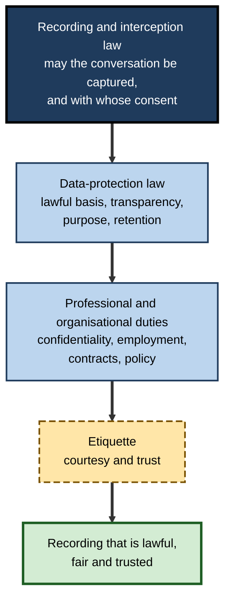
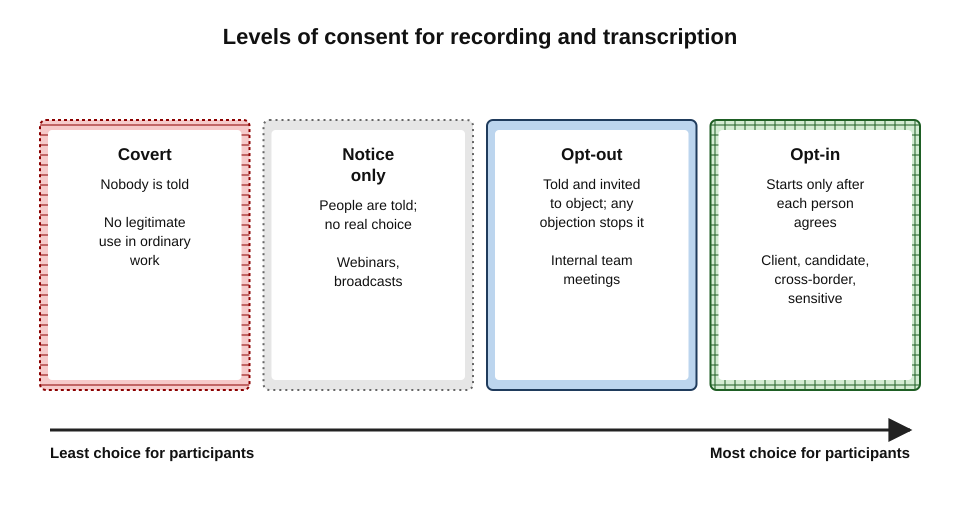
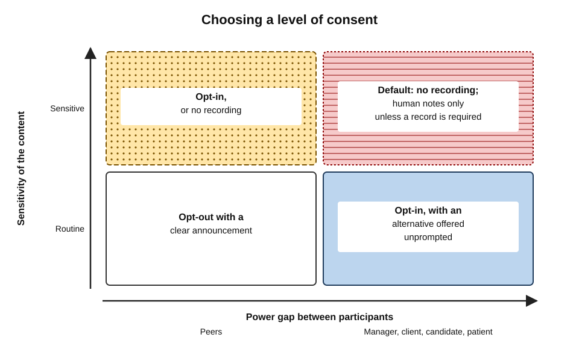
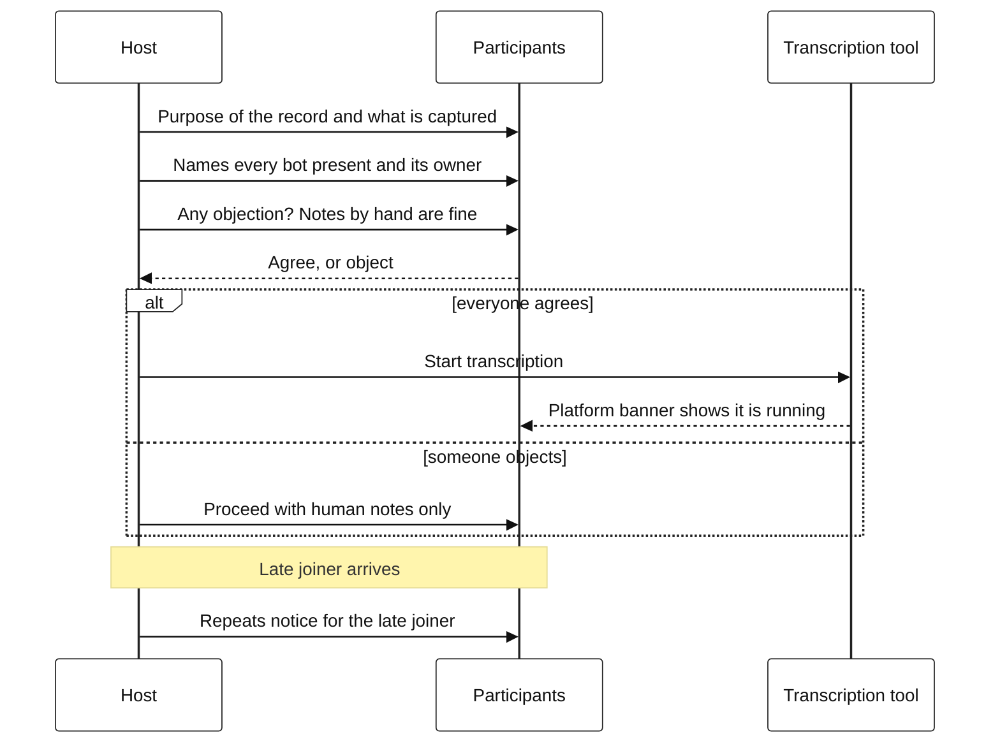
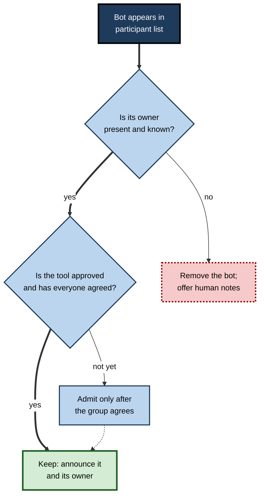

# G.4. Consent and recording etiquette

Five minutes into a sales call, a prospective client notices an extra name in the participant list: "Daniel's Notetaker". Nobody mentioned it. She asks, coolly, whether the call is being recorded, and by whom, and where the recording goes. Daniel does not know — the bot joins all his meetings automatically. The deal survives, but the relationship starts on the back foot, and depending on where she is sitting, Daniel's company may have broken the law.

> **Definition — Recording consent:** agreement by the people in a conversation to its being recorded or transcribed, given with enough information to understand what will be captured, by whom, for what purpose and for how long.

> **Definition — Notice:** informing people that a meeting is or will be recorded or transcribed, whether or not their agreement is sought.

**Why it matters**

- **Law** — recording a conversation without the right consent can be a criminal offence or give rise to damages in some jurisdictions, and transcripts are personal data under data-protection law almost everywhere.
- **Trust** — people who discover they were recorded without being told rarely trust the recorder again.
- **Scale** — AI note-takers that join meetings automatically have turned a rare, deliberate act into a constant, often unnoticed one.
- **Fairness** — consent given to a manager, a client or an interviewer is not always freely given; recording etiquette must account for power.

---

## Three Layers of Obligation

Whether and how a meeting may be recorded depends on three separate sets of rules. Satisfying one does not satisfy the others.

- **Recording and interception law** — whether capturing the conversation at all is lawful, and whose consent is required.
- **Data-protection law** — whether processing the resulting personal data is lawful, transparent, limited to its purpose and retained no longer than needed.
- **Professional and organisational duties** — confidentiality rules of professions, employment law, contracts and the organisation's own policies.
- **Etiquette** sits on top: what is courteous and trust-preserving even where the law is silent.

**Figure 1.** Layers of obligation when recording or transcribing a meeting.

> **Key point:** "everyone said yes" may satisfy recording law and still fail data-protection law — for example if the transcript is kept indefinitely or used for a purpose nobody was told about.

---

## Recording and Interception Law

Laws differ greatly between countries and, in federal systems, within them. What follows describes the main patterns; it is not legal advice for any particular situation.

### One-party and all-party consent

> **Definition — One-party consent:** a legal rule under which a conversation may be recorded if at least one participant — which can be the person recording — agrees.

> **Definition — All-party consent:** a legal rule under which every participant must agree before a private conversation is recorded; sometimes called "two-party consent".

- **United States, federal law** — the federal Wiretap Act generally permits recording where one party to the conversation consents.
- **United States, state law** — a minority of states, about a dozen, require the consent of all parties to a confidential conversation; they include **California, Florida, Illinois, Maryland, Massachusetts, Pennsylvania and Washington**.
  - Penalties can include criminal liability and statutory damages per violation.
  - **Cross-state calls:** in *Kearney v. Salomon Smith Barney* (2006), the California Supreme Court applied California's all-party rule to calls recorded in Georgia with clients in California. The prudent assumption is that the strictest rule among the participants' locations applies.
- **Germany** — the criminal code protects the "confidentiality of the spoken word": secretly recording a private, non-public conversation is an offence.
- **United Kingdom** — there is no general all-party consent rule for a participant who records a conversation they are part of; however:
  - interception of communications in transmission by a third party is regulated;
  - organisations recording calls and meetings must meet data-protection requirements, including telling people;
  - covert recording may be unlawful in other ways, or damage trust and employment relationships.
- **India** — there is no general statutory all-party consent rule for participant recording, but the constitutional right to privacy recognised by the Supreme Court in *Puttaswamy* (2017), and the **Digital Personal Data Protection Act 2023**, which requires notice for the processing of digital personal data, shape how organisations may record and use meetings.

| | One-party consent | All-party consent |
|---|---|---|
| Who must agree | Any one participant (can be the recorder) | Every participant in the conversation |
| Examples | US federal law; most US states | California, Florida, Illinois, Pennsylvania, Washington and others |
| Covert recording by a participant | Generally lawful under recording law | Generally unlawful |
| Practical rule for mixed-location calls | Do not rely on it if anyone may be in an all-party jurisdiction | Treat as the default for multi-location meetings |
| Remaining obligations | Data protection, professional duties, etiquette | The same |

> **Watch out:** the location that matters is often where each **participant** is, not where the recorder or the server is. In a call with people in several places, the safest assumption is that the strictest rule applies.

### Who is the recorder when a bot joins?

AI note-takers complicate an old question: if a third-party service listens to a meeting, is it a participant, the agent of a participant, or an eavesdropper?

- **The participant's tool** — if the service is merely the user's instrument, like a tape recorder, the user's consent may be what counts.
- **A third party** — if the service uses the recordings for its own purposes, such as improving its models, courts may treat it as a separate listener needing its own consent.
- **Biometric questions** — if the service creates **voiceprints** to recognise speakers, biometric privacy laws may apply. Illinois's **Biometric Information Privacy Act (2008)** requires written consent before collecting biometric identifiers, including voiceprints, and gives individuals a right to sue.

### Case study: the AI note-taker litigation in the United States (2025–2026)

- **Situation:** in August 2025 a California man filed a proposed class action against the maker of a widely used AI note-taker. He said his sales call had been recorded and transcribed by the service because **another participant** had it enabled; he had never used the service and was not asked for consent.
- **Allegations** (not findings):
  - the service joined meetings through users' calendars and recorded all participants, without seeking consent from people who were not its users;
  - it allegedly used recordings to train its speech-recognition models;
  - it allegedly collected voiceprints without the written consent required in Illinois.
- **Procedure:** several similar suits were consolidated in a federal court in California.
- **Ruling, August 2026:** the judge dismissed some claims but allowed the core claims under the federal Wiretap Act, California's privacy statute and Illinois's biometric privacy law to proceed, finding it plausible that the service acted as a **third-party eavesdropper** rather than a mere tool of its users. Liability has not been decided.
- **Lesson:** the convenience of auto-joining note-takers transfers legal risk to everyone involved — the vendor, the user who enabled it, and potentially the organisation that allowed it. Consent from the person who installed the bot is not consent from the people it records.

> **Watch out:** the case is unresolved. It shows the legal theories in play, not their outcome; other courts may decide differently.

---

## Data-Protection Requirements

Even where recording is lawful, a recording or transcript of identifiable people is **personal data**. In the UK, the European Union, India and many other jurisdictions, this brings obligations.

### Lawful basis

- **Consent** — under the EU and UK General Data Protection Regulation, consent must be freely given, specific, informed and unambiguous, and as easy to withdraw as to give.
  - Regulators generally regard consent as a **weak basis in employment**, because employees may not feel free to refuse their employer.
- **Legitimate interests** — the organisation has a genuine interest (accurate records, accessibility), recording is necessary for it, and it is not outweighed by participants' rights; this requires a documented balancing test.
- **Legal obligation or contract** — for example, regulated firms required to record certain communications.

> **Definition — Lawful basis:** the legal ground on which an organisation processes personal data; under the GDPR, one of six grounds such as consent, contract, legal obligation or legitimate interests.

### Transparency, purpose and minimisation

- **Tell people** — who is recording, why, what is captured (audio, video, transcript, AI summary), who can see it, how long it is kept, and their rights.
- **Purpose limitation** — a recording made "for accurate notes" should not later be used for performance evaluation or model training without a new legal basis and fresh notice.
- **Data minimisation** — capture no more than needed: a transcript without video, notes without a transcript, or nothing at all.
- **Special categories** — health, trade-union membership, religious beliefs and other sensitive data often arise in meetings; their processing needs additional justification. **Voiceprints used to identify people** are biometric data, a special category.
- **Impact assessment** — large-scale or systematic recording of employees, or new AI analysis of meetings, may require a **data protection impact assessment** before deployment.

> **In practice:** a short, standard **recording notice** — in the meeting invitation, in the platform's banner, and spoken at the start — meets much of the transparency duty and sets the right tone.

---

## The Consent Spectrum

In practice, organisations and individuals choose among several levels of consent. The right level depends on law, on the relationship and on the sensitivity of the meeting.

**Figure 2.** Levels of consent for recording and transcription.

- **Covert** — recording without telling anyone.
  - Unlawful in all-party jurisdictions; a breach of trust almost everywhere.
- **Notice only** — participants are told; no option to object is offered.
  - May satisfy one-party rules; weak for trust and data protection.
- **Opt-out** — participants are told and invited to object; recording stops or the person's audio is excluded if anyone objects.
  - Common for internal meetings.
- **Opt-in** — recording starts only after each participant actively agrees.
  - Appropriate for external, sensitive and cross-border meetings.

| | Covert | Notice only | Opt-out | Opt-in |
|---|---|---|---|---|
| Participants know | No | Yes | Yes | Yes |
| Can refuse | No | Not really | Yes, by objecting | Yes, by not agreeing |
| Fit with all-party consent laws | Fails | Doubtful | Usually adequate if objection is real | Strong |
| Effect on trust | Severe damage if discovered | Neutral to negative | Generally positive | Positive, slightly slower |
| Typical use | None legitimate in ordinary work | Large broadcasts, webinars | Internal team meetings | Client, candidate, cross-border, sensitive meetings |

> **Watch out:** silence is weak consent. A banner that appears while people are talking, or a line buried in a calendar invitation, may technically be "notice" but rarely produces a real choice.

---

## Power and Voluntariness

Consent depends on the freedom to say no. In many meetings that freedom is limited.

- **Employees and managers** — "Do you mind if I record our one-to-one?" from a manager is hard to refuse.
- **Candidates and interviewers** — a job applicant will rarely object to anything an employer asks.
- **Suppliers and large customers** — a small supplier may not risk annoying a major client.
- **Patients, students and members of the public** — dependence on the service makes refusal difficult.

> **Key point:** the greater the power gap, the more the person with power must make refusal **easy and costless** — by offering an alternative (notes only, no recording) without being asked, and by not asking for reasons.

**Figure 3.** Choosing a level of consent by power gap and sensitivity.

- **Peers, routine content** — opt-out with a clear announcement is usually enough.
- **Peers, sensitive content** — opt-in, or no recording at all.
- **Power gap, routine content** — opt-in, with an alternative offered unprompted.
- **Power gap, sensitive content** — default to no recording; human notes only, unless law or regulation requires a record.

> **Example:** "We usually transcribe these interviews so we can concentrate on the conversation. It is entirely up to you — if you would rather we did not, we will take notes by hand, and it will make no difference to the process."

---

## Recording Etiquette

### Before the meeting

- **Decide** whether a record is needed and of what kind; the default should not simply be "whatever the tool does".
- **State it in the invitation** — "This meeting will be transcribed for notes; let the organiser know if you would prefer it not to be."
- **Check bot settings** — know which tools join meetings on one's behalf and switch off automatic joining for external or sensitive meetings.
- **Ask external participants in advance** where possible, especially in cross-border calls.

### At the start

- **Announce** what is being captured and why — recording, transcript, summary.
- **Ask** and pause for a real answer; look at the participant list, not only at faces.
- **Name every bot** in the call and whose it is.
- **Offer an alternative** if anyone hesitates.

**Figure 4.** Opening a meeting that will be transcribed.

### During the meeting

- **Repeat the notice** for anyone who joins late.
- **Pause on request** — "Could we go off the record for this?" should be honoured at once, and the pause visible to all.
- **Do not resume silently** — announce when transcription restarts.

### Unknown bots

- **Ask whose it is** — "I see a note-taker called Assistant — whose is that?"
- **Remove it if unclaimed**, or if its owner is not present.
- **Hosts are responsible** for who is in their meeting, including bots; lobbies and admission controls exist for this purpose.

**Figure 5.** Handling an unknown note-taking bot in a meeting.

### After the meeting

- **Share the record only with those entitled to it** — usually the participants.
- **Honour the stated purpose and retention.**
- **Correct and delete on request** where appropriate.

> **Mnemonic — "ANNOUNCE":** **A**sk before, **N**ame every bot, **N**otice in the invitation, **O**ffer an alternative, **U**nderstand the law where each person is, **N**ever resume silently, **C**over late joiners, **E**nd by sharing only with those entitled.

### Face-to-face meetings

Recording is less visible in a room than on a call: there is no banner, no participant list and no platform indicator.

- **Phones and laptops on the table** — an app may be recording without anyone noticing.
- **Wearable devices** — smart glasses and recording pendants can capture conversations with little or no visible sign.
- **Etiquette** — say so before starting, place the device visibly, and stop it when asked; in shared spaces such as cafés or open-plan offices, remember that people outside the meeting may also be captured.

> **Watch out:** the absence of a platform banner makes face-to-face recording **more** dependent on the recorder's honesty, not less. The duty to announce is greater, because nothing else will.

---

## Professional Duties

Several professions have rules that go beyond general law.

- **Lawyers** — duties of confidentiality and candour to clients.
  - The New York City Bar's ethics committee concluded in 2025 that lawyers should tell clients and obtain consent before recording or transcribing calls with AI tools, and in 2026 extended the guidance to calls with witnesses, opposing counsel and other third parties.
  - Recording privileged discussions through a third-party service raises questions about confidentiality and privilege.
- **Healthcare** — patient consent and confidentiality; clinical records rules apply to any transcript that becomes part of care.
- **Human resources** — investigations, grievances and disciplinary meetings have their own fairness requirements; covert recording by either side can damage the process.
- **Recruitment** — interview recordings and AI summaries raise questions of fairness and of candidates' rights to their data.
- **Research** — ethics approval normally requires informed consent for recording participants.
- **Journalism** — norms on recording sources vary by country and outlet; recording law still applies.

---

## Worked Example (illustrative): A Cross-Border Client Workshop

**Situation:** a consultant in London plans a two-hour workshop with a client team in Munich, a client executive in San Francisco and a colleague in Mumbai. She would like an AI transcript and summary.

| Participant location | Relevant rule (simplified) | Implication |
|---|---|---|
| London (consultant) | Data protection; organisation's policy | Lawful basis and notice needed; policy requires opt-in for client meetings |
| Munich (client team) | Criminal protection of the private spoken word; GDPR | Explicit agreement before recording; transparency on use and retention |
| San Francisco (client executive) | California all-party consent | Every participant must agree |
| Mumbai (colleague) | Data-protection notice duties; employer policy | Notice and policy compliance |

**Steps**

1. **Assume the strictest rule** — opt-in from every participant.
2. **Ask in advance** — the invitation explains the purpose (accurate workshop outputs), what is captured (audio transcript, no video), who sees it (participants only), retention (deleted after the report is agreed, within 30 days) and the alternative (human notes).
3. **Confirm at the start** — each participant agrees aloud; the agreement is noted at the top of the transcript.
4. **Use the approved built-in tool**, not a personal bot.
5. **Pause for sensitive items** — the client executive asks to discuss headcount off the record; transcription is paused visibly and resumed with an announcement.
6. **Deliver and delete** — reviewed notes shared with participants; transcript deleted on schedule.

- **Conclusion:** opt-in from everyone, with a clear purpose and short retention, satisfies the strictest jurisdiction and builds the client's confidence.

> **Watch out:** a single participant's objection must stop recording for everyone, or that person's contributions must be excluded reliably. If neither is possible, the meeting proceeds with human notes.

---

## Organisational Practice

- **A recording policy** stating which meetings may be recorded, which level of consent applies to each, and which tools are approved.
- **Platform configuration:**
  - visible indicators whenever recording or transcription is running;
  - where available, settings that require each participant to agree before their audio or video is captured;
  - lobbies that hold unapproved bots;
  - automatic joining by personal note-takers disabled for external meetings.
- **Notices** — standard wording for invitations and spoken announcements.
- **Records** of consent for external and sensitive meetings.
- **Training** — especially for sales, recruitment, HR and client-facing staff.
- **Incident response** — what to do when a meeting is found to have been recorded without proper consent: stop, assess, delete if appropriate, inform those affected.

### Case study (illustrative): a recruitment team rethinks interview recording

- **Situation:** a recruitment team began transcribing all interviews to produce AI summaries for hiring managers.
- **Problem:** candidates were told in small print in the invitation; several withdrew; one complained that she had not realised the interview would be summarised by AI and shared with people she had not met.
- **Diagnosis:**
  1. notice without real choice, in a relationship with a large power gap;
  2. purpose drift — notes for the interviewer became summaries for a wider panel;
  3. no alternative offered.
- **Actions:**
  1. candidates asked before the interview, with a clear statement that declining makes no difference;
  2. summaries shared only with the hiring panel named in the invitation;
  3. structured scoring by interviewers kept as the basis for decisions, with AI summaries as aids only;
  4. transcripts deleted when the hiring decision is made, except where retention is legally required.
- **Result:** most candidates agreed; withdrawals stopped; complaints ceased.
- **Lesson:** consent works when refusing is genuinely free and the use matches what people were told.

---

## Open Questions

- **Is an AI note-taker a participant or an eavesdropper?**
  - Courts are only beginning to answer this; the answer may depend on how vendors use the data.
- **Can consent work at the scale of automatic transcription?**
  - Asking every time creates fatigue; not asking creates legal and trust risk. Platform-level consent prompts are one attempt at a middle path.
- **How should consent work when the record is reused?**
  - Transcripts used later for training, analytics or search go beyond the original purpose; how far one consent stretches is unsettled.
- **How should mixed-jurisdiction meetings be governed?**
  - "Strictest rule" is safe but blunt; there is no international standard.
- **Will recording become a social default?**
  - If most meetings are recorded, refusing may come to look suspicious, eroding the freedom on which consent depends.

---

## Summary

- **Recording consent** means informed agreement to capture; **notice** means telling people. Both are needed in most professional settings.
- Three layers apply: **recording law**, **data-protection law** and **professional duties**, with **etiquette** on top.
- **One-party** consent rules (US federal law, most US states) contrast with **all-party** rules (California, Florida, Illinois, Pennsylvania, Washington and others); in mixed-location meetings, assume the **strictest** applies.
- AI note-takers raise the question whether the vendor is a **third-party listener**; US litigation from 2025 tests wiretap and **biometric (voiceprint)** claims, unresolved as of 2026.
- Data protection requires a **lawful basis**, **transparency**, **purpose limitation**, **minimisation** and care with **special-category** data; consent is a weak basis in employment.
- The **consent spectrum** runs covert → notice → opt-out → opt-in; external, cross-border and sensitive meetings call for opt-in.
- **Power gaps** limit voluntariness; the more powerful party must make refusal easy and costless.
- Etiquette — **ANNOUNCE** — covers invitations, announcements, bots, pauses, late joiners and sharing.
- Professions such as law, healthcare, HR, recruitment and research add their own duties.

---

## Self-Check

1. Distinguish consent from notice in the context of meeting recording.
2. Name the three layers of obligation and explain why satisfying one does not satisfy the others.
3. Explain one-party and all-party consent, with examples.
4. Why should a call between participants in Texas and California be treated as requiring all-party consent?
5. What legal question does an AI note-taker joining meetings through a user's calendar raise?
6. Summarise the allegations and the procedural status of the 2025–2026 US note-taker litigation.
7. Why is consent usually a weak lawful basis for recording employees under the GDPR?
8. Describe the four levels of the consent spectrum and when opt-in is appropriate.
9. How does a power gap affect consent? Give an example and a remedy.
10. A bot named "Notetaker" appears in your meeting and nobody claims it. What do you do?
11. A participant asks to go off the record for ten minutes. How should the host respond?
12. List the steps you would take before transcribing a cross-border client workshop.
13. Draft a two-sentence recording notice for a meeting invitation.

### Answer Key

1. Notice tells people that recording will happen; consent is their informed agreement to it. Notice can be given without seeking agreement; consent requires a real choice.
2. Recording or interception law (may it be captured and with whose consent), data-protection law (lawful basis, transparency, purpose, retention) and professional or organisational duties. Lawful capture does not make indefinite retention or new uses lawful, and neither satisfies professional confidentiality rules.
3. One-party: a conversation may be recorded if one participant agrees (US federal law, most states). All-party: every participant must agree (California, Florida, Illinois, Pennsylvania, Washington and others).
4. Courts may apply the law of the place where a participant is located; California's Supreme Court applied its all-party rule to calls recorded elsewhere. The safe assumption is that the strictest rule applies.
5. Whether the vendor is merely the user's tool, so the user's consent suffices, or a separate third party listening for its own purposes, needing consent from all those recorded; and whether voiceprints trigger biometric laws.
6. A non-user alleged his call was recorded because another participant used the service; claims included recording without all-party consent, using recordings to train models, and collecting voiceprints without written consent. Cases were consolidated; in August 2026 the core wiretap, California privacy and Illinois biometric claims were allowed to proceed. Liability is undecided.
7. Consent must be freely given; employees may feel unable to refuse their employer, so their agreement may not be free. Organisations usually rely on legitimate interests with a balancing test instead.
8. Covert (no notice — illegitimate), notice only (told, no real choice), opt-out (told, can object), opt-in (recording only after each person agrees). Opt-in suits external, cross-border, sensitive and high-power-gap meetings.
9. People dependent on the requester may agree without wanting to — e.g. a job candidate. The powerful party should offer an alternative unprompted, make clear that refusal has no consequence and not ask for reasons.
10. Ask whose it is; if unclaimed or its owner is absent, remove it; if claimed, check it is approved and that everyone agrees before continuing; offer human notes as an alternative.
11. Pause transcription immediately and visibly, confirm it is paused, and announce clearly when it resumes; ensure the paused section is not captured by any other tool.
12. Assume the strictest rule; ask everyone in advance with purpose, scope, access, retention and alternative; use an approved tool; confirm agreement at the start; pause for sensitive items; share only with participants; delete on schedule.
13. For example: "This meeting will be transcribed using our approved meeting tool so that we can produce accurate notes; the transcript will be shared only with attendees and deleted after 30 days. If you would prefer it not to be transcribed, tell the organiser and we will take notes by hand."

---

## Glossary

| Term | Meaning |
|---|---|
| All-party consent | A rule requiring every participant to agree before a conversation is recorded. |
| Biometric data | Personal data from physical or behavioural characteristics, such as voiceprints, used to identify a person. |
| Covert recording | Recording without the knowledge of those recorded. |
| Data minimisation | Collecting no more personal data than necessary for the purpose. |
| Data protection impact assessment | A structured assessment of privacy risks before high-risk processing begins. |
| Lawful basis | The legal ground for processing personal data. |
| Legitimate interests | A lawful basis requiring a genuine interest, necessity and a balancing test against individuals' rights. |
| Notice | Informing people that recording or transcription will occur. |
| One-party consent | A rule allowing recording if any one participant agrees. |
| Opt-in | Recording only after each participant actively agrees. |
| Opt-out | Recording after notice unless someone objects. |
| Purpose limitation | Using personal data only for the purposes people were told about. |
| Recording consent | Informed agreement to a conversation being recorded or transcribed. |
| Special-category data | Sensitive personal data, such as health or biometric data, needing extra justification. |
| Voiceprint | A digital model of a person's voice used to recognise them. |
