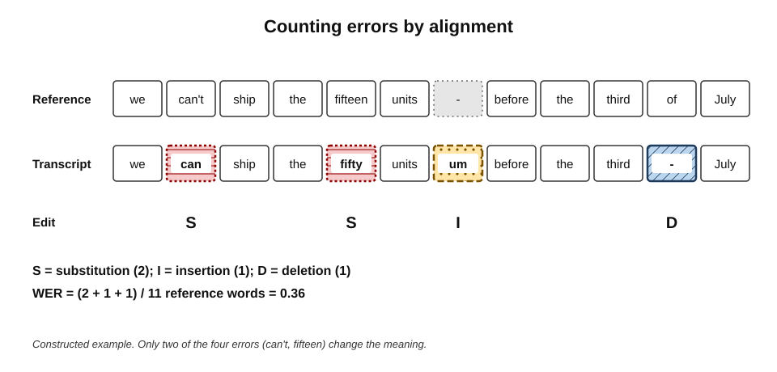
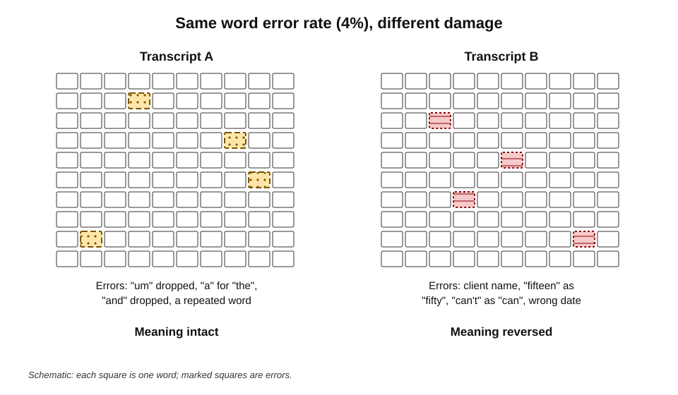
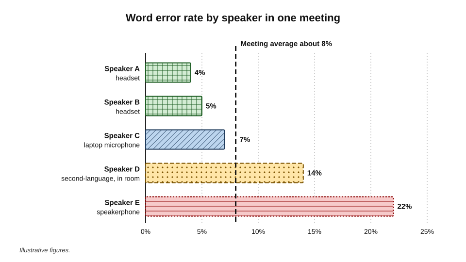
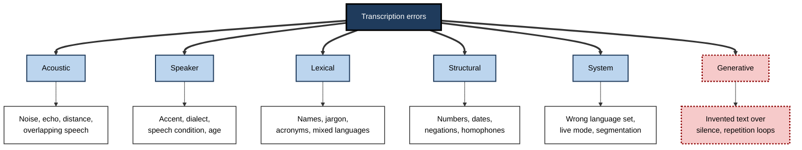
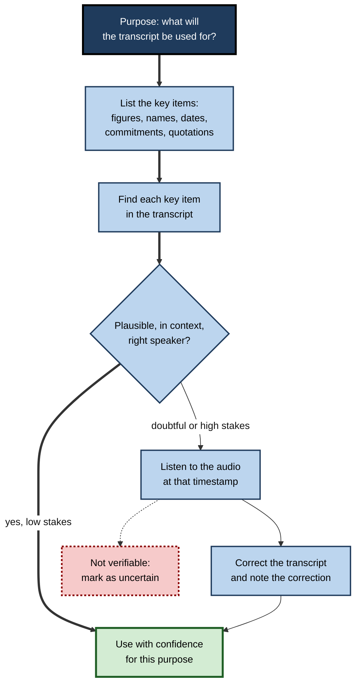

# G.5. Accuracy limits of transcription

A finance director says, "We can't commit more than fifteen thousand." The transcript reads, "We can commit more than fifty thousand." Two words out of eight are wrong — and the sentence now means the opposite of what was said, with a figure more than three times larger. A vendor's brochure might describe the same system as "over 95 per cent accurate", and on average it may well be.

> **Definition — Transcription accuracy:** the degree to which a transcript reproduces the words actually spoken, usually measured by comparing it word by word with a carefully checked reference transcript.

> **Definition — Word error rate (WER):** the number of word substitutions, deletions and insertions needed to turn an automatic transcript into the reference transcript, divided by the number of words in the reference.

**Why it matters**

- **Transcripts are trusted** — text looks authoritative; readers rarely suspect that the words on the page were never said.
- **Errors are not random** — they cluster on names, numbers, negations, technical terms and particular speakers, which are exactly what matter most.
- **Average accuracy hides risk** — a good average can coexist with a terrible transcript for one person or one meeting.
- **Judgement depends on knowing the limits** — a professional must know when a transcript is good enough for its purpose and when the audio must be checked.

---

## Measuring Accuracy

### How word error rate is calculated

1. **Prepare a reference** — a human transcribes the audio carefully, usually checked by a second person.
2. **Normalise both texts** — remove punctuation and capitals; make numbers, contractions and spellings consistent.
3. **Align** — find the smallest set of edits that turns the automatic transcript into the reference.
4. **Count the edits:**
   - **substitution (S)** — a wrong word in place of the right one;
   - **deletion (D)** — a spoken word missing;
   - **insertion (I)** — a word added that was not spoken.
5. **Divide** by the number of words in the reference (N).

> **Formula — Word error rate:** WER = (S + D + I) ÷ N. Example: reference "we can't ship the fifteen units before the third of July" (11 words); automatic transcript "we can ship the fifty units um before the third July" → 2 substitutions (can't → can; fifteen → fifty), 1 insertion (um), 1 deletion (of) → (2 + 1 + 1) ÷ 11 = **0.36**, or 36%.

**Figure 1.** Aligning an automatic transcript with the reference to count errors.

- **Accuracy** is often quoted as 1 − WER: a WER of 5% is described as "95% accurate".
- **WER can exceed 100%** — if a system inserts many words that were not spoken, insertions can outnumber the words in the reference.
- **Normalisation changes results** — whether "15" matches "fifteen", or "gonna" matches "going to", can move WER by several points. Comparisons are only fair under the same normalisation.

> **Watch out:** "95% accurate" is meaningless without knowing **on what audio**, **against what reference** and **with what normalisation**. Vendors often quote results on clean, single-speaker benchmark recordings.

### Other measures

| | Word error rate | Character error rate | Entity error rate | Meaning-based measures |
|---|---|---|---|---|
| Counts | Wrong, missing and extra words | Wrong, missing and extra characters | Errors on names, numbers, dates, terms | Whether the meaning is preserved |
| Best for | Languages written with spaces between words | Chinese, Japanese and other languages without word spaces; spelling of names | Business and legal records | Summaries and notes |
| Strength | Standard, comparable across studies | Fine-grained | Targets what matters most | Matches reader's concern |
| Weakness | Treats all words as equally important | Harder to interpret | Needs a list of key items | Harder to define and automate |

> **Definition — Entity error rate:** the proportion of important items — names, numbers, dates, product terms — that are transcribed wrongly; a practical measure for business records.

---

## Why a Single Number Misleads

### All errors are not equal

WER counts "um" deleted and "can't" turned into "can" as one error each. A reader cares about the second and not at all about the first.

- **Harmless errors** — fillers, repeated words, "a" for "the", minor function words.
- **Meaning-changing errors** — negations ("can" / "can't"), numbers ("fifteen" / "fifty"), names, dates, units, technical terms.
- **Attribution errors** — correct words assigned to the wrong speaker; WER does not count them at all.

**Figure 2.** Two transcripts with the same word error rate but very different consequences.

> **Key point:** the right question is not "how accurate is the transcript?" but "**how accurate is it on the words that matter for this purpose?**"

### Averages hide distributions

- **Across speakers** — a meeting transcript with an overall WER of 8% might be 4% for the two people with headsets and 25% for the person on a speakerphone.
- **Across meetings** — the same tool can produce near-perfect transcripts of a quiet one-to-one and poor transcripts of a lively workshop.
- **Across groups** — systems are generally more accurate for the accents, dialects and voices most represented in their training data.

**Figure 3.** Error rates vary by speaker around an apparently acceptable average.

> **Remember:** the error rate that matters is the error rate **for this speaker, in this meeting, on these words**.

### Benchmarks and real meetings

- **Read speech benchmarks** — such as recordings of audiobooks — give the lowest error rates and dominate published comparisons.
- **Conversational telephone speech** is harder: hesitations, overlaps, informal language.
- **Meeting benchmarks** are harder still, especially with distant microphones; research corpora of meetings recorded with room microphones show far higher error rates than the same meetings recorded with headsets.
- **Field conditions** — real offices, real accents, real jargon — are harder than any benchmark, and are rarely published.

**Study card — "Human parity" on conversational speech (2016–2017)**

- **Claim:** Microsoft researchers reported that their system matched professional human transcribers on a standard benchmark of telephone conversations between strangers, at an error rate of around 5–6%.
- **Response:** IBM researchers, using a team of skilled transcribers with multiple checks, measured a lower human error rate and argued that parity had not yet been reached.
- **Lessons:**
  - human transcription is not error-free either — careful humans make errors of a few per cent on conversational speech;
  - "parity" depends on which humans, which audio and which normalisation;
  - two-party phone calls are far easier than multi-party meetings.

---

## Where Errors Come From

**Figure 4.** Sources of transcription error.

### Acoustic sources

- **Signal-to-noise ratio** — the louder the voice relative to background noise, the better the recognition.
- **Distance and reverberation** — room microphones capture echoes that blur speech.
- **Overlap** — when two people speak at once, both are usually transcribed worse, and one may vanish.
- **Compression and packet loss** — weak connections delete fragments before recognition starts.

> **Definition — Signal-to-noise ratio:** the strength of the wanted signal (speech) relative to background noise; higher is better.

### Speaker sources

- **Accent and dialect** — varieties under-represented in training data are recognised less accurately.
- **Second-language speakers** — pronunciation patterns from a first language can confuse recognisers.
- **Speech conditions** — stammering, dysarthria (speech affected by neurological conditions), aphasia, or a voice affected by illness.
- **Age and voice** — children's and some older adults' speech is often less well recognised.

**Study card — Tatman (2017), automatic captions and dialect**

- **Design:** an analysis of automatic captions on online videos of speakers reading the same word list, comparing accuracy across speakers' gender and regional dialect.
- **Findings:** accuracy differed across dialect groups and was lower for women's voices in that sample.
- **Significance:** one of the first studies to show systematic differences in commercial speech recognition by speaker group. Later studies, including a 2020 study of five commercial systems that found error rates for Black American speakers roughly double those for white speakers, extended the finding.

> **Watch out:** findings about **which** groups are disadvantaged depend on the system, the year and the sample; some later studies did not find the gender gap. What is consistent is that accuracy is **uneven**, and that the unevenness follows the make-up of training data.

### Lexical sources

- **Names** — personal names from many languages, client names, place names.
- **Jargon and acronyms** — "KYC", "EBITDA", "UAT", "SOC 2", internal project code names.
- **New words** — products launched after the model was trained.
- **Code-switching** — speakers moving between languages mid-sentence.

### Structural sources

- **Numbers** — "fifteen" and "fifty", "a hundred and twenty" and "120" or "1,020", "eight to ten" and "8:10".
- **Negations** — "can" and "can't" differ by a faint final consonant; "won't" and "want" by a vowel.
- **Homophones** — "their" and "there", "principal" and "principle", "affect" and "effect".
- **Units and currencies** — "K", "mil", "bips" (basis points), "lakh" and "crore".

### Numbers, dates and conventions

Numbers cause a disproportionate share of serious errors because the **spoken form** must be converted into a **written convention**, and conventions differ.

- **Scale words** — "lakh" (one hundred thousand) and "crore" (ten million) in Indian English; "a yard" or "a bar" in some trading slang; "K" and "mil" in casual speech. A recogniser may transcribe the word correctly but format it wrongly, or convert it into the wrong number.
- **Digit grouping** — 15,00,000 (Indian grouping) and 1,500,000 (international grouping) are the same number; a transcript or summary may switch between them inconsistently.
- **Dates** — "the third of the fourth" or "3/4" means 3 April in the UK and India but 4 March in the United States; summaries that reformat dates can silently change them.
- **Ranges and times** — "eight to ten" may be a range, a time (9:50) or "8 to 10 per cent".
- **Decimals and percentages** — "point five per cent" and "five per cent" differ only by a short, easily lost word.

> **Example:** a speaker in Mumbai says "around one and a half crore"; the transcript reads "around 1.5 crore"; a summary written by a model trained mostly on international text reports "around 1.5 million" — a figure ten times too small.

> **In practice:** for meetings where money, quantities or dates matter, the chair **restates key figures with units and an unambiguous date format** — "fifteen million rupees, that is one and a half crore, by 3 April" — and the reviewer checks every figure in the summary against the transcript and, if needed, the audio.

### System sources

- **Wrong language setting** — the system tries to fit speech into the wrong language.
- **Streaming mode** — live recognition commits early and is generally less accurate than post-meeting processing.
- **Segmentation** — sentences split or merged wrongly, attaching words to the wrong speaker or turn.

### Generative sources: hallucination

Modern recognisers are generative models: they predict likely text. When the audio gives them little to work with, they can predict text that was never spoken.

**Study card — Koenecke and colleagues (2024), "Careless Whisper"**

- **Design:** audio from speakers with and without aphasia was transcribed by a widely used open speech-recognition model; researchers compared transcripts with the audio.
- **Findings:**
  - around 1% of transcriptions contained **invented phrases or sentences**;
  - a substantial share of these inventions were harmful — invented violence, false associations or made-up medical information;
  - hallucinations were more frequent for speech with longer pauses, as in aphasia.
- **Conclusion:** generative transcription introduces a failure type older systems rarely showed — fluent, plausible additions.

- **Typical triggers:** long silences, music, background chatter, very poor audio.
- **Typical forms:** stock phrases ("Thank you for watching"), repetitions of an earlier sentence, or invented continuations of the topic.

> **Definition — Transcription hallucination:** text in a transcript that corresponds to no speech in the audio, generated by the model's prediction of likely words.

> **Watch out:** hallucinated text is usually **fluent and on topic**, so it does not look like an error. Mis-heard words often look odd; invented sentences often look perfectly normal.

---

## Reading a Transcript Critically

### Red flags

- **Odd phrases** that make no sense in context — usually mis-heard words.
- **Sentences that are too fluent** for the speaker or the audio quality.
- **Repeated sentences** — a sign of a model looping.
- **Text where there should be silence** — check timestamps against pauses.
- **Numbers, names, negations and dates** — always suspect until checked.
- **Speaker labels that change mid-sentence**, or a quiet person who seems to say nothing.
- **Low-confidence markings** — some tools shade or underline words they are unsure of.

> **Definition — Confidence score:** a recogniser's estimate of how likely a word or segment is to be correct; useful as a guide, but systems can be confidently wrong, especially when hallucinating.

### A checking routine

**Figure 5.** A routine for checking a transcript before relying on it.

- **Scope the check by purpose** — a transcript used for search needs little checking; one used for a quotation in a contract dispute needs every quoted word verified against the audio.
- **Check items, not everything** — a list of the ten things that matter takes minutes to verify.
- **Record corrections** — so that others know the transcript has been edited, and why.

> **In practice:** the audio is the **primary record**; the transcript is an index to it. Anything quoted, disputed or relied upon in a decision should be checked against the audio before it is repeated.

---

## Correcting and Improving Accuracy

### Before the meeting

- **Custom vocabulary** — names, clients, products and acronyms.
- **Correct language setting** — and for multilingual meetings, a tool that supports the languages in use.
- **Microphone discipline** — headsets, one microphone per room, one speaker at a time.

### After the meeting

- **Human editing** — the organiser or a transcriber corrects key passages.
- **Language-model clean-up** — a model can fix many errors using context ("the poon team" → "the Pune team").
  - Useful for obvious mis-hearings.
  - Risky because a model "corrects" towards what is **plausible**, which may differ from what was **said** — for example changing an unusual but correct figure into a more typical one.

> **Watch out:** automatic correction makes transcripts **read** better, which makes remaining errors **harder to spot**. Corrections to figures, names and quotations should come from the audio, not from a model's guess.

| | Custom vocabulary | Better audio | Human editing | Language-model correction |
|---|---|---|---|---|
| Effort | Low, once | Moderate, ongoing habits | High per meeting | Low |
| Best at fixing | Names, terms, acronyms | Everything acoustic | Anything, including meaning | Obvious mis-hearings in context |
| Risk | Over-matching similar words | Little | Human error, cost | Plausible but wrong "corrections" |
| When to use | Always | Always | High-stakes records | Readability, with key items verified |

---

## Measuring a Tool on One's Own Meetings

Published accuracy figures rarely match a particular organisation's meetings. A small internal evaluation tells more.

1. **Choose a sample** — five to ten meetings representative of real use: rooms, remote calls, accents, languages, jargon.
2. **Create references** — have a careful human transcribe a 5–10 minute segment of each, checked by a second person.
3. **Normalise consistently** — agree rules for numbers, fillers and spellings.
4. **Compute WER per segment and per speaker** — not just an overall average.
5. **Compute entity error rate** — for names, numbers and terms listed in advance.
6. **Look at the errors** — classify them by source to decide what to fix.
7. **Repeat** after any change of tool, model version or room equipment.

### Worked example (illustrative): evaluating transcription for a sales team

**Situation:** a sales operations manager evaluates transcription of customer calls before allowing transcripts to be used in account planning. She transcribes ten-minute segments from eight calls.

| Measure | Result | Interpretation |
|---|---|---|
| Overall WER | 7% | Looks acceptable |
| WER for internal staff (headsets) | 4% | Good |
| WER for customers (speakerphones, varied accents) | 13% | Customer statements — the most important — are least accurate |
| Entity error rate: product names | 22% | Vocabulary list needed |
| Entity error rate: prices and quantities | 9% | Every figure must be checked |
| Hallucinated sentences found | 2, both during hold music | Hold-music segments to be excluded or checked |

*Illustrative figures.*

**Conclusions**

- **Overall WER understated the problem** — the customer's words, which matter most, were transcribed about three times worse than the sales staff's.
- **Fixes** — product vocabulary list; prices quoted in plans verified against audio; segments with music or silence flagged.
- **Policy** — transcripts may be used for account planning as an index, but no customer quotation or figure is repeated without checking the audio.

### Accuracy changes over time

- **Model updates** — vendors update recognition models, sometimes without notice; accuracy for a particular accent or vocabulary can improve or, occasionally, worsen.
- **Vocabulary drift** — new products, clients and projects introduce terms the system has never heard; a vocabulary list that was complete last year may not be now.
- **Equipment changes** — new rooms, headsets or conferencing devices change the audio the system receives.
- **Practice** — repeat a small evaluation after major updates or changes, and keep the vocabulary list maintained by someone who owns it.

> **Formula — Entity error rate:** key items transcribed wrongly ÷ key items spoken. Example: 45 prices and quantities spoken, 4 wrong → 4 ÷ 45 = **0.089**, about 9%.

---

## Fit for Purpose

The acceptable level of error depends on what the transcript is for.

| Purpose | Tolerance for error | Practical requirement |
|---|---|---|
| Live captions to follow a discussion | Moderate | Low delay matters as much as accuracy |
| Searching past meetings | Fairly high | Key terms recognised; vocabulary list |
| Personal memory aid | Moderate | Reader was present and can spot errors |
| Shared notes and summaries | Low on key items | Decisions, figures and owners verified |
| Formal minutes, clinical or legal records | Very low | Human verification against audio |
| Quotation in a dispute or publication | None | Every quoted word checked against audio |

> **Key point:** transcription is very good for **finding** and **following** and much less reliable for **proving**. The more a transcript is used as evidence, the more it must be checked.

### Case study (illustrative): a figure that was never said

- **Situation:** an insurer's claims team used AI transcripts of calls with policyholders to prepare claim files.
- **Incident:** a claim file stated that the policyholder had reported water damage "fifteen days" before the call; the policy excluded damage reported after fourteen days. The claim was declined.
- **Complaint:** the policyholder insisted she had said "five days". The audio confirmed it: background noise had turned "five" into "fifteen".
- **Diagnosis:**
  1. a number in a decision-critical position was taken from the transcript without checking the audio;
  2. the transcript's fluent formatting ("15 days") gave it unwarranted authority;
  3. no rule identified decision-critical items for verification.
- **Actions:**
  1. any fact on which a claim decision depends must be verified against the audio and the verification logged;
  2. transcripts marked as "unverified index" in the claim system;
  3. quarterly sampling of transcripts for entity error rates on dates and amounts.
- **Result:** the decision was reversed with an apology; similar errors were caught at verification in later claims.
- **Lesson:** a transcript is evidence of what a machine **heard**, not of what a person **said**.

---

## Open Questions

- **Will hallucination be eliminated?**
  - Better training and silence detection reduce it, but generative models will always be able to predict unspoken text; detection may matter more than prevention.
- **Can accuracy become even across speakers?**
  - Projects collecting speech from under-represented groups — including people with speech disabilities — have improved results, but independent measurements on real workplace audio remain scarce.
- **What is the right accuracy metric for business use?**
  - WER is standard but blind to meaning; entity- and meaning-based measures are more useful but less standardised.
- **Should transcripts carry visible uncertainty?**
  - Showing confidence would help readers, but cluttered transcripts are harder to read and confidence scores are imperfect.
- **What happens when models summarise straight from audio?**
  - Skipping the transcript may reduce compounding errors but removes the checkable text; accuracy of such systems is poorly understood.

---

## Summary

- **Word error rate** = (substitutions + deletions + insertions) ÷ reference words; "95% accurate" means a WER of about 5% — on some audio, against some reference, with some normalisation.
- **Character error rate**, **entity error rate** and **meaning-based measures** complement WER; entity error rate targets what business records need.
- WER treats all errors equally; **meaning-changing errors** on negations, numbers, names and dates matter far more, and **attribution errors** are not counted.
- Averages hide **distributions** across speakers, meetings and groups; benchmarks overstate field accuracy; "**human parity**" claims concerned easy two-party telephone speech.
- Errors come from **acoustic, speaker, lexical, structural, system and generative** sources; accuracy is **uneven** across accents, dialects and speech conditions.
- Generative recognisers can **hallucinate** fluent text over silence or noise; such errors look normal.
- Read critically: red flags, confidence markings, a **purpose-scoped checking routine**; the **audio is the primary record**.
- Improve with vocabulary, audio quality and human editing; treat language-model "corrections" with caution.
- Evaluate tools on one's own meetings, **per speaker** and **per entity type**.
- Transcripts are good for **finding and following**, weak for **proving**.

---

## Self-Check

1. Define WER and calculate it for a reference of 20 words where the transcript has 2 substitutions, 1 deletion and 2 insertions.
2. Why can WER exceed 100%?
3. Why does normalisation matter when comparing tools?
4. Give two examples of errors that change meaning and two that do not, and explain why WER treats them alike.
5. What is entity error rate, and why is it useful for business transcripts?
6. Why might a meeting with an overall WER of 6% still have a seriously misleading record for one participant?
7. What did the "human parity" debate show about accuracy claims?
8. List six sources of transcription error with an example of each.
9. What is transcription hallucination, when is it most likely, and why is it hard to spot?
10. Describe a routine for checking a transcript before quoting a client's figure in a report.
11. What is the risk of using a language model to clean up a transcript?
12. Design a small evaluation of a transcription tool for your team's meetings.
13. For which purposes is transcription well suited, and for which must it be verified?

### Answer Key

1. WER = (S + D + I) ÷ N = (2 + 1 + 2) ÷ 20 = 5 ÷ 20 = 0.25, or 25%.
2. Insertions are counted against the number of reference words; a system that adds many unspoken words — for example hallucinating over silence — can produce more errors than there were words.
3. Different rules for numbers, contractions, fillers and spelling change the error count; unless both tools are scored with the same rules on the same audio, differences may reflect scoring, not accuracy.
4. Meaning-changing: "can't" → "can"; "fifteen" → "fifty". Harmless: "um" deleted; "the" → "a". WER counts each as one edit regardless of its effect on meaning.
5. The proportion of key items — names, numbers, dates, terms — transcribed wrongly. It measures accuracy on what business decisions depend on, which overall WER can hide.
6. The average may combine low error for most speakers with very high error for one — e.g. a speakerphone user or a speaker with a less-represented accent — whose contributions are then mis-recorded and mis-summarised.
7. That claims depend on which humans, which audio and which normalisation; skilled human teams outperformed the claimed parity; and the benchmark (two-party phone calls) was much easier than multi-party meetings.
8. Acoustic — speakerphone in an echoing room; speaker — under-represented accent; lexical — client name; structural — "fifteen" vs "fifty"; system — wrong language setting; generative — invented sentence during hold music.
9. Text corresponding to no speech, produced by the model predicting likely words. Most likely over silence, music, noise or long pauses. It is fluent and on topic, so it does not look like an error.
10. Identify the figure and its timestamp; check it is plausible and attributed to the right speaker; listen to the audio at that point; correct the transcript if needed and note the correction; only then quote it.
11. The model corrects towards what is plausible, not what was said, possibly changing correct but unusual figures or names; the cleaner text makes remaining errors harder to see.
12. Sample representative meetings; create checked human references for short segments; normalise consistently; compute WER per speaker and per segment; compute entity error rates for listed key items; classify errors by source; repeat after changes.
13. Well suited to live following, searching and personal memory aids. Must be verified against audio for shared decisions and figures, formal minutes, clinical and legal records, and any quotation used as evidence.

---

## Glossary

| Term | Meaning |
|---|---|
| Character error rate | Edits needed at character level divided by reference characters. |
| Code-switching | Moving between languages within a conversation or sentence. |
| Confidence score | A recogniser's estimate of how likely a word or segment is correct. |
| Deletion | A spoken word missing from the transcript. |
| Entity error rate | The proportion of key items — names, numbers, dates, terms — transcribed wrongly. |
| Human parity | A claim that a system matches professional human transcribers on a benchmark. |
| Insertion | A word in the transcript that was not spoken. |
| Normalisation | Making reference and automatic transcripts consistent before scoring. |
| Reference transcript | A carefully checked human transcript used as the standard for scoring. |
| Signal-to-noise ratio | Strength of speech relative to background noise. |
| Substitution | A wrong word in place of the spoken one. |
| Transcription accuracy | How closely a transcript reproduces the words spoken. |
| Transcription hallucination | Transcript text corresponding to no speech in the audio. |
| Word error rate | (Substitutions + deletions + insertions) ÷ reference words. |
