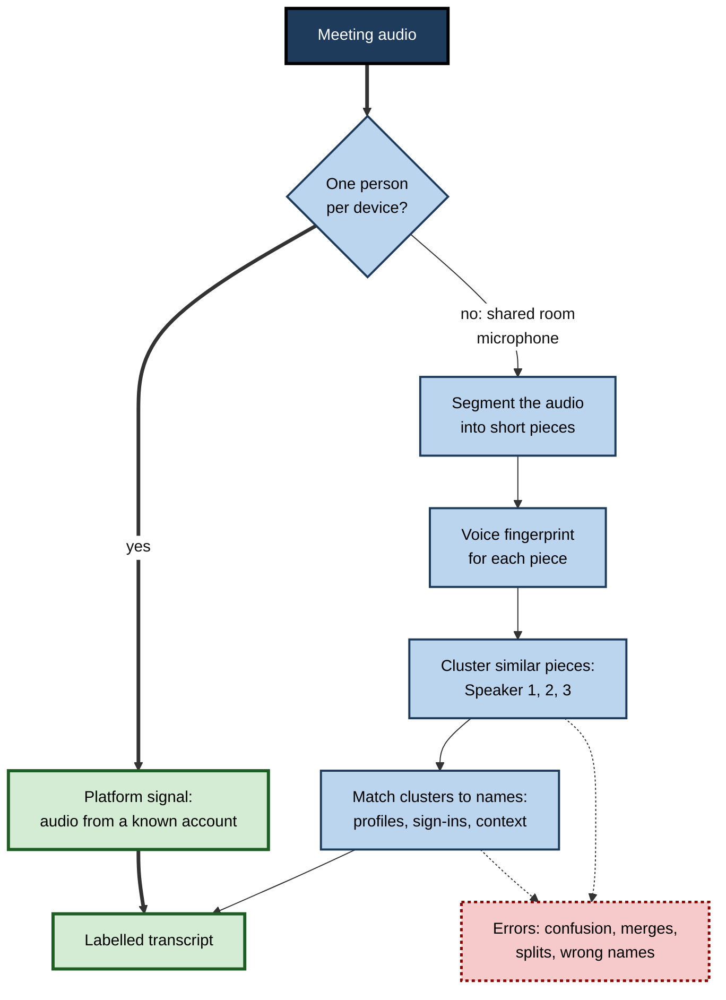
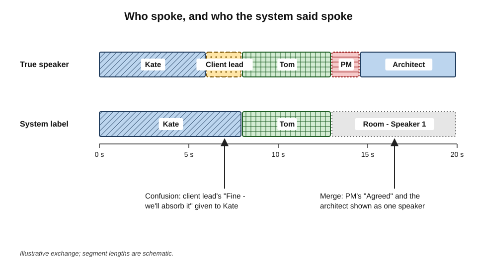
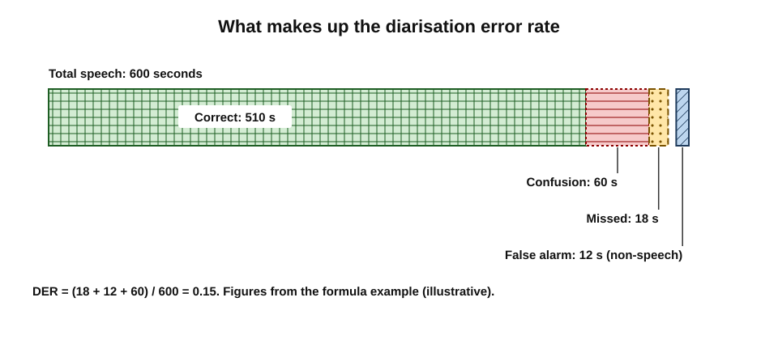
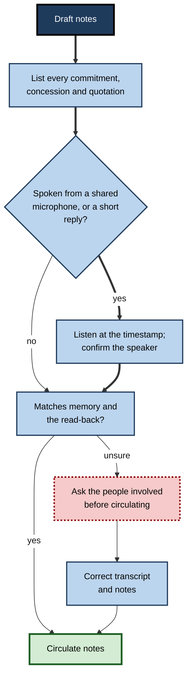

# G.6. Speaker attribution errors

In a hybrid project meeting, the client's commercial lead says quietly, "Fine — we'll absorb the licence cost." The AI notes record: "Kate (supplier) agreed to absorb the licence cost." Every word is right. Only the name is wrong — and with it, who owes whom several thousand pounds. Nobody notices for a month, until the invoice arrives.

> **Definition — Speaker attribution:** assigning each stretch of transcribed speech to the person who said it.

> **Definition — Speaker diarisation:** the process of dividing an audio recording into segments according to who is speaking — answering "who spoke when" — without necessarily knowing the speakers' names.

> **Definition — Speaker identification:** recognising which known person is speaking, usually by comparing the voice with stored voice profiles or by using information such as a participant's sign-in.

**Why it matters**

- **Commitments belong to people** — an action, a concession or a promise is meaningless without the right name attached.
- **Credit and blame** — who proposed an idea, who raised a risk, who made a mistake — shape reputations and careers.
- **Quotations** — a client's words attributed to a colleague, or the reverse, can damage relationships and create legal exposure.
- **Invisible to word-accuracy measures** — a transcript can be word-perfect and still wrong about who said everything.

---

## How Systems Decide Who Spoke

### Four sources of information

- **Platform signals** — in a video call, each participant's audio arrives through their own connection, so the platform knows which account is producing sound.
  - Very reliable when one person uses one device.
- **Acoustic diarisation** — the system analyses the voices themselves: it cuts the audio into short segments, converts each into a numerical "voice fingerprint", and groups similar segments into clusters, one per presumed speaker.
  - Needed whenever several people share a microphone.
- **Voice profiles** — some systems let users record a sample of their voice so that clusters can be matched to named people.
  - More accurate naming, but raises biometric privacy questions.
- **Naming by context** — the system maps clusters to names using the invitation list, who signed in, or phrases such as "Thanks, Priya".
  - Useful but error-prone.

> **Definition — Speaker embedding:** a compact numerical representation of the characteristics of a voice in a short segment of audio, used to compare segments and group them by speaker.

**Figure 1.** How a meeting tool works out who said what.

| | Platform signal | Acoustic diarisation | Voice profiles | Naming by context |
|---|---|---|---|---|
| Works when | One person per device | Several people share a microphone | Speakers have enrolled | Names are spoken or listed |
| Reliability | High | Moderate to low | Fairly high for enrolled voices | Low to moderate |
| Main failure | Shared devices; someone speaking near another's microphone | Similar voices, overlap, short turns | Unenrolled guests; changed voice | Wrong guesses from context |
| Privacy cost | Low | Moderate (voice features analysed) | High (biometric data stored) | Low |

> **Key point:** attribution is strong when **each person has their own microphone and account**, and weak whenever people share one. Most attribution errors in practice come from hybrid rooms and shared devices.

---

## Kinds of Attribution Error

- **Speaker confusion** — a segment is assigned to the wrong person.
  - *e.g.* the client's concession credited to the supplier.
- **Merging** — two people are treated as one speaker.
  - Common when voices are similar — same sex, age and accent — or when they speak from the same end of a room.
- **Splitting** — one person appears as two or more speakers.
  - Common when someone moves, changes tone, coughs, or switches microphone.
- **Boundary errors** — the first words of a new speaker are attached to the previous one.
  - "…so that's the plan. **Agreed, but** not before June" — "Agreed, but" ends up with the wrong person.
- **Missed speech** — a short interjection is lost entirely.
- **Overlap loss** — when two people speak at once, the system usually assigns the overlap to one of them.
- **Naming error** — the clusters are right, but "Speaker 3" is given the wrong name.
- **Device labels** — everyone in a meeting room appears as "Room 4B".

**Figure 2.** True speakers compared with system labels across a short exchange.

> **Watch out:** the most decision-relevant words — "yes", "agreed", "fine", "I'll do it", "no" — are **short**, often spoken **over** someone else, and come at **turn boundaries**. They are exactly the words diarisation handles worst.

---

## Measuring Attribution Accuracy

### Diarisation error rate

> **Formula — Diarisation error rate (DER):** (missed speech + false alarm speech + speaker confusion) ÷ total speech time. Example: in 600 seconds of speech, 18 seconds are missed, 12 seconds of non-speech are labelled as speech and 60 seconds are given to the wrong speaker → (18 + 12 + 60) ÷ 600 = **0.15**, or 15%.

- **Missed speech** — speech not assigned to anyone.
- **False alarm** — noise or silence labelled as someone speaking.
- **Speaker confusion** — speech assigned to the wrong speaker.
- **A short tolerance** (often a quarter of a second) is usually allowed at turn boundaries, so small timing differences are not counted — which also means some boundary errors are invisible to the score.

**Figure 3.** What makes up the diarisation error rate.

### What results look like

- **Broadcast speech and clean calls** — low error rates; speakers take turns and use good microphones.
- **Meeting recordings** — much harder. On the widely used AMI meeting corpus, in which roughly a sixth of speech overlaps with another speaker, one popular open-source toolkit has reported error rates of around one-fifth; challenging mixed collections give higher figures still.
- **Commercial systems** often report lower figures on their own test sets; results depend heavily on the audio.
- **Real hybrid rooms** — overlapping talk, distant microphones and similar voices — commonly produce more errors than published benchmarks.

> **Watch out:** DER measures "who spoke when", not "was the right **name** attached". A system can cluster voices perfectly and still label the client as the supplier. Naming errors need separate checking.

### Comparing the two kinds of accuracy

| | Word accuracy | Attribution accuracy |
|---|---|---|
| Question answered | Were the right words captured? | Were they assigned to the right person? |
| Standard measure | Word error rate | Diarisation error rate, plus naming checks |
| Typical cause of failure | Noise, accents, vocabulary | Shared microphones, similar voices, overlap, short turns |
| Visible to a reader? | Often — odd words look wrong | Rarely — a wrong name looks normal |
| Most damaging consequence | Wrong figures, reversed meaning | Wrong owner, wrong credit, misquotation |

---

## Where Attribution Fails Most

- **Hybrid meeting rooms** — several people on one microphone, while remote participants are labelled from their own devices. Remote voices are attributed well; the room is a blur.
- **Similar voices** — two colleagues of similar age, sex and accent sitting together.
- **Short turns** — "yes", "no", "agreed", "me too", "that works".
- **Cross-talk** — animated discussion, interruptions, laughter.
- **Shared devices** — two people huddled around one laptop.
- **Telephone dial-ins** — several people on one dial-in number appear as a single caller.
- **Interpreted meetings** — the interpreter's voice may be attributed as the speaker's, or the reverse.
- **Speaking near another person's microphone** — in a room where several laptops are open, a voice may be picked up most strongly by a neighbour's device.

### Interpreted and multilingual meetings

- **Interpreters speak in the first person** — "I agree to the revised price" from an interpreter means the client agrees; a transcript may attribute the commitment to the interpreter, or the interpreter's words to the wrong party.
- **Two language streams** — when interpretation runs on a separate channel, the transcript may capture one language, the other, or both, with inconsistent labels.
- **Code-switching speakers** — a person who changes language mid-meeting may be split into two speakers.
- **Practice** — label interpreters clearly in the participant list; in the record, attribute statements to the **principal** ("the client, through the interpreter"), not the interpreter.

> **Example:** in a room with four engineers and one ceiling microphone, the transcript shows "Room 2 — Speaker 1", "Speaker 2" and "Speaker 3" for four people. Two quiet engineers with similar voices have been merged into Speaker 2, so every comment either of them made appears to come from one person.

**Figure 4.** Hybrid-room set-ups and the attribution they allow.

```mermaid
%%{init: {'theme':'base','themeVariables':{'fontFamily':'Arial, Helvetica, sans-serif','fontSize':'15px','primaryColor':'#FFFFFF','primaryTextColor':'#111111','primaryBorderColor':'#222222','lineColor':'#333333','secondaryColor':'#F2F2F2','tertiaryColor':'#FFFFFF','clusterBkg':'#FAFAFA','clusterBorder':'#555555','edgeLabelBackground':'#FFFFFF','titleColor':'#111111'}}}%%
flowchart TD
    classDef key     fill:#BCD5EE,stroke:#1F3B5C,stroke-width:2px,color:#000000
    classDef good    fill:#D3ECD3,stroke:#1E5E24,stroke-width:3px,color:#000000
    classDef accent  fill:#FFE6A8,stroke:#7A5200,stroke-width:2px,stroke-dasharray:8 4,color:#000000
    classDef caution fill:#F6CACA,stroke:#8B0000,stroke-width:2.5px,stroke-dasharray:3 3,color:#000000

    subgraph S1["One laptop for the whole room"]
        A1["All in-room speech<br/>from one device"]
        A2["Room labelled as one<br/>speaker, or voices guessed"]
    end
    subgraph S2["Microphone array in the room"]
        B1["Direction of each<br/>voice detected"]
        B2["Separate speakers,<br/>names still to be matched"]
    end
    subgraph S3["Each person on own device,<br/>room audio from one array"]
        C1["Platform knows who<br/>is in the room"]
        C2["Voices linked to<br/>signed-in people"]
    end

    A1 --> A2
    B1 --> B2
    C1 --> C2

    class A1 key
    class A2 caution
    class B1 key
    class B2 accent
    class C1 key
    class C2 good
```

---

## Consequences of Wrong Attribution

### Commitments and obligations

- **Wrong owner** — an action credited to the wrong person goes undone or is done twice.
- **Wrong party** — in client and supplier meetings, a concession attributed to the wrong side changes commercial obligations.
- **Wrong authority** — an instruction appearing to come from a senior person carries weight it never had.

### Credit, blame and fairness

- **Ideas credited to others** — when a junior person's suggestion is attributed to a senior colleague, a long-standing workplace problem — people's contributions being overlooked or credited to someone more prominent — is reproduced by the machine.
- **Blame misplaced** — in incident reviews, a wrong name can attach a mistake to the wrong person.
- **Uneven errors** — people whose voices are less well modelled, or who speak more briefly, are attributed less accurately.

### Analytics built on attribution

- **Talk-time statistics** — some tools report how long each person spoke or how often they were interrupted.
- **Participation dashboards** — used by some managers to judge engagement.
- **Problem:** every attribution error distorts these figures; merging two people doubles one person's apparent talk time and erases the other's.

> **Watch out:** talk-time and participation analytics should never be used to evaluate individuals without checking attribution — and many organisations decide not to use them for individual evaluation at all, because talking more is not the same as contributing more.

### Quotations and records

- **Quotes to external parties** — a misattributed remark in a follow-up email can embarrass both sides.
- **Formal records** — minutes, investigation notes and legal records require correct attribution; errors may undermine the record's credibility.

### Credit and existing biases

**Study card — Heilman and Haynes (2005), credit in mixed-sex teams**

- **Design:** a series of experiments in which participants evaluated the members of successful two-person teams of a man and a woman, with varying information about who had contributed what.
- **Findings:** when individual contributions were **ambiguous**, the woman was rated as less competent, less influential and less likely to have played a leading role; when her contribution was made clear, the bias largely disappeared.
- **Relevance:** credit in teams depends on **clear attribution**. When records are ambiguous — or wrong — existing biases fill the gap.

- **Implication for AI records** — accurate attribution can protect people whose contributions are routinely overlooked; inaccurate attribution can entrench the very pattern it might have corrected.
- **Short contributions** — people who speak briefly, are interrupted more often or speak from a shared room microphone are the most exposed to misattribution and to losing credit.

> **Key point:** attribution is not a technical detail. It decides **whose ideas count** in the written history of a team.

---

## How a Summary Should Attribute

Not every summary needs names on every point. The right level of attribution depends on purpose.

- **Named attribution** — "Priya proposed moving the launch."
  - Best for commitments, decisions with accountable owners and formal records.
- **Role-based attribution** — "The client's finance lead raised a concern about cost."
  - Useful when sharing beyond the meeting, and when the role matters more than the person.
- **Unattributed** — "A concern was raised about cost."
  - Suits brainstorming, retrospectives and sensitive discussions where candour matters more than credit.
- **Mixed** — actions and decisions named; discussion unattributed.
  - A common, sensible default for team meetings.

| | Named | Role-based | Unattributed | Mixed |
|---|---|---|---|---|
| Accountability | High | Moderate | Low | High for actions |
| Exposure to attribution errors | High | Moderate | None | Limited to actions |
| Effect on candour | Can chill | Less chilling | Protective | Balanced |
| Typical use | Formal records, commitments | External follow-ups, wide sharing | Retrospectives, brainstorming | Routine team meetings |

> **In practice:** instructing the tool to "**name owners for actions and decisions only; do not attribute discussion points**" removes most opportunities for damaging misattribution while keeping accountability.

---

## Resolving an Attribution Dispute

Sometimes a participant says, "I never said that."

1. **Take it seriously** — the person may well be right; attribution errors are common.
2. **Find the passage** — locate the timestamp in the transcript.
3. **Listen to the audio** — voices are usually recognisable to colleagues even when the system confused them.
4. **Ask other participants** if the audio is unclear — especially in shared rooms.
5. **Correct the transcript and summary**, and notify everyone who received the original.
6. **If still unresolved**, record the disagreement rather than forcing one version.

> **Watch out:** "the transcript says you said it" is not an argument. A transcript records what the system **inferred**, not what was **proved**.

---

## Voice Profiles and Biometric Privacy

Voice enrolment improves naming but turns ordinary meetings into biometric processing.

- **What a voice profile is** — a stored model of a person's voice, used to recognise them in future recordings.
- **Legal status** — when used to identify individuals, voice profiles are **biometric data**:
  - under the EU and UK GDPR, a special category requiring an additional legal condition, typically explicit consent;
  - under Illinois's Biometric Information Privacy Act, written consent is required before collection, with a private right to sue;
  - other jurisdictions are adding similar rules.
- **Employment** — consent from employees is rarely free; enrolment should be genuinely optional, with no disadvantage for those who decline.
- **Guests** — external participants should never be enrolled without their explicit agreement.

> **In practice:** many organisations allow voice profiles only for employees who opt in, keep profiles within their own platform, delete them when employment ends, and never create profiles for external participants.

---

## Preventing and Correcting Attribution Errors

### Before and during the meeting

- **One person, one device** — in hybrid rooms, in-room participants can join on their own laptops with audio muted, so the platform can link their speech more reliably where it supports this.
- **Room systems** with multiple microphones that can tell which direction a voice comes from.
- **Names before contributions** — "Ravi here — I'd disagree…" helps both the system and remote listeners.
- **Explicit assignments** — "Kate, you'll own that?" — "Yes, I'll own it." Full sentences with names are attributed far better than a nod or "yep".
- **Read-back** — decisions and actions restated with names at the end.

### After the meeting

- **Relabel speakers** — most tools let the organiser rename speakers, merge clusters or split them.
- **Check the high-stakes items** — every commitment, concession and quotation, against the audio.
- **Correct the stored transcript**, not just the summary, so later searches and assistants use the right names.

**Figure 5.** Checking attribution of commitments before circulating notes.

### Research on interactive correction

- Researchers have begun testing systems in which participants can correct speaker labels **during** the meeting — for example by tapping their own name when mislabelled — with the system updating its model of their voice as it goes.
- Early work, reported in 2025, suggests such feedback can reduce errors for the rest of the meeting; the approach is not yet common in mainstream tools.

---

## Worked Example (illustrative): Repairing a Hybrid Meeting Transcript

**Situation:** a supplier–client review meeting: three client staff in a meeting room on one ceiling microphone, two supplier staff (Kate and Tom) remote on headsets. The AI notes list five actions.

**Step 1 — Identify high-risk segments.** The organiser lists every action and concession and notes which came from the room.

**Step 2 — Check each against the audio.**

| Item in AI notes | Speaker label | Check against audio | Correct speaker |
|---|---|---|---|
| "Will absorb the licence cost" | Kate (supplier) | Voice from the room; Kate had just finished speaking | Client commercial lead |
| "Will send revised schedule by Friday" | Tom (supplier) | Tom's headset | Tom — correct |
| "Agreed to extend testing by a week" | Room 3 — Speaker 1 | Two client voices overlapping; "agreed" from the second | Client project manager, not the client architect |
| "Will confirm data-access approval" | Room 3 — Speaker 2 | Clear single voice | Client architect — correct, but needs naming |
| "Raised concern about migration risk" | Kate (supplier) | Kate's headset | Kate — correct |

*Illustrative figures.*

**Step 3 — Compute what went wrong.**

- Of five items, **two** had the wrong person (40%); **one** had no name; **two** were right.
- **All** errors came from the shared room microphone; both remote headsets were attributed correctly.

**Step 4 — Correct and prevent.**

- Relabel the room speakers in the transcript; correct the notes; send to both sides with a request for confirmation of commitments.
- For the next meeting: client staff join on their own laptops with audio muted; actions restated with names at the end.

> **Remember:** in hybrid meetings, **check every commitment that came from the room**. Remote headsets are rarely the problem.

---

## Attribution in Organisational Practice

- **Room standards** — meeting rooms equipped with microphone arrays; guidance on joining from personal devices in hybrid meetings.
- **Policy on voice profiles** — opt-in only, employees only, deleted on departure.
- **Use of attribution-based analytics** — restricted or prohibited for individual evaluation.
- **Attribution checks** in templates — "Commitments verified against audio: yes/no" for client and governance meetings.
- **Training** — chairs taught to make commitments explicit and named.

### Case study (illustrative): the wrong name in an incident review

- **Situation:** after a service outage, an engineering team held a blameless incident review, recorded and transcribed. The room had one microphone for six engineers.
- **Problem:** the AI summary stated that "Arjun deployed the configuration change without review". In fact Arjun had described the change; a colleague had deployed it under an approved emergency procedure. The summary circulated to senior management before anyone checked.
- **Effect:** Arjun was questioned by a director; trust in the "blameless" process collapsed; two engineers said they would not speak in future reviews.
- **Diagnosis:**
  1. two similar voices merged into one speaker cluster, later named "Arjun";
  2. the summary turned description into action;
  3. a blameless review was being recorded and summarised by name — inviting exactly the blame it was designed to avoid.
- **Actions:**
  1. correction circulated to everyone who had received the summary, with an apology;
  2. incident reviews no longer transcribed by name; the facilitator writes a timeline of events and actions, not of people;
  3. attribution of any action to a named person checked against the audio before circulation in all other meetings.
- **Result:** participation in reviews recovered over the following quarter.
- **Lesson:** attribution errors are not cosmetic; they assign responsibility. Where responsibility is sensitive, decide whether names should be in the record at all.

---

## Open Questions

- **Can attribution in shared rooms become reliable?**
  - Microphone arrays and better models help, but overlap and short turns remain hard; whether "one person, one device" will remain necessary is unclear.
- **Should transcripts show attribution confidence?**
  - Marking uncertain labels would help readers, but few tools do it and users may ignore it.
- **Is voice enrolment worth its privacy cost?**
  - Better naming versus biometric data stored at scale — organisations and regulators weigh this differently.
- **Should meeting records attribute at all?**
  - Named records aid accountability; anonymous records aid candour. Practice varies by meeting type, and evidence on the effects is limited.
- **How should participation analytics be governed?**
  - Talk-time data can reveal patterns of exclusion — or be misused to judge individuals on flawed measures.

---

## Summary

- **Speaker attribution** assigns speech to people; **diarisation** answers "who spoke when"; **identification** puts names to voices.
- Systems use **platform signals**, **acoustic diarisation**, **voice profiles** and **context**; attribution is strong with one person per device and weak with shared microphones.
- Error types: **confusion, merging, splitting, boundary errors, missed speech, overlap loss, naming errors, device labels**.
- The most decision-relevant words — short **agreements and refusals** — are the hardest to attribute.
- **Diarisation error rate** = (missed + false alarm + confusion) ÷ speech time; it ignores **naming** errors. Meeting audio is much harder than broadcast speech.
- Wrong attribution misassigns **commitments, credit, blame and quotations**, and distorts **talk-time analytics**.
- When contributions are **ambiguous**, existing biases decide credit (Heilman and Haynes, 2005); accurate attribution protects people whose contributions are often overlooked.
- Choose the level of attribution by purpose: **named, role-based, unattributed or mixed** — naming owners of actions only is a sound default.
- Resolve disputes from the **audio**, correct openly, and record unresolved disagreement.
- **Voice profiles** are **biometric data**; enrolment should be opt-in, employee-only and deleted on departure.
- Prevent errors with **one person per device**, microphone arrays, **names before contributions**, explicit named assignments and read-back; correct the stored transcript.
- In hybrid meetings, **check every commitment that came from the room**.

---

## Self-Check

1. Distinguish speaker attribution, diarisation and identification.
2. Why is attribution usually reliable for remote participants on their own devices but not for people in a meeting room?
3. Name six kinds of attribution error.
4. Why are short replies such as "agreed" particularly vulnerable?
5. Calculate DER: 900 seconds of speech; 27 seconds missed; 18 seconds false alarm; 45 seconds confused.
6. What does DER fail to measure?
7. Compare word accuracy and attribution accuracy in terms of visibility to a reader.
8. How can attribution errors distort talk-time analytics?
9. Why are voice profiles a privacy concern, and what policy would you recommend?
10. List four steps to reduce attribution errors in a hybrid meeting.
11. A summary says a supplier agreed to absorb a cost. What should you check before relying on it?
12. Why might an organisation choose not to attribute remarks by name in some meetings?
13. What did Heilman and Haynes find about credit in teams, and what does it imply for AI meeting records?
14. A colleague says a summary wrongly attributes a remark to them. Describe how to resolve it.

### Answer Key

1. Attribution assigns each stretch of speech to a person. Diarisation segments audio by speaker ("who spoke when") without names. Identification recognises which known person is speaking, using voice profiles or sign-in information.
2. Remote participants' audio comes through their own accounts, so the platform knows who is speaking. In a room, several people share one microphone and the system must separate voices acoustically, which is error-prone.
3. Any six: speaker confusion; merging; splitting; boundary errors; missed speech; overlap loss; naming errors; device labels.
4. They are brief, often spoken over others and at turn boundaries — conditions where diarisation is weakest — yet they signal agreement to decisions and commitments.
5. (27 + 18 + 45) ÷ 900 = 90 ÷ 900 = 0.10, or 10%.
6. Whether the right name was attached to each cluster; it also hides small boundary errors within the tolerance allowed at turn changes.
7. Word errors often look odd and catch the reader's eye; attribution errors look perfectly normal, so readers rarely notice them.
8. Merging two people doubles one person's apparent talk time and erases the other's; confusion moves contributions between people; the statistics then misrepresent participation.
9. Voice profiles used to identify people are biometric data, a special category requiring explicit consent in many jurisdictions, with risks of misuse and breach. Recommend opt-in only, employees only, no profiles of guests, stored within the organisation's platform, deleted on departure.
10. Any four: in-room participants join on their own devices with audio muted; use a microphone array; say names before contributing; make assignments in full named sentences; read back decisions and actions with names.
11. Who actually said it — by listening at the timestamp, especially if it came from a shared microphone or was a short reply — and whether the read-back or the people involved confirm it.
12. Named records can chill candour and invite blame — for example in blameless incident reviews, brainstorming or retrospectives — and attribution errors can wrongly assign responsibility.
13. When contributions in a mixed-sex team were ambiguous, the woman received less credit; when contributions were clear, the bias largely disappeared. Accurate attribution in records can protect people from being overlooked, while errors or ambiguity let existing biases decide credit.
14. Take it seriously; find the timestamp; listen to the audio; ask other participants if unclear; correct the transcript and summary and notify all recipients; if still unresolved, record the disagreement.

---

## Glossary

| Term | Meaning |
|---|---|
| Boundary error | Words at the start of one speaker's turn attached to the previous speaker. |
| Diarisation error rate | (Missed speech + false alarm + speaker confusion) ÷ total speech time. |
| False alarm | Non-speech labelled as someone speaking. |
| Merging | Two speakers treated as one. |
| Missed speech | Speech not assigned to any speaker. |
| Naming error | Correctly grouped speech given the wrong person's name. |
| Overlap | Two or more people speaking at the same time. |
| Platform signal | Information from the meeting service about which account is producing audio. |
| Speaker attribution | Assigning transcribed speech to the person who said it. |
| Speaker confusion | Speech assigned to the wrong speaker. |
| Speaker diarisation | Segmenting audio by speaker: who spoke when. |
| Speaker embedding | A numerical representation of a voice segment used to compare speakers. |
| Speaker identification | Recognising which known person is speaking. |
| Splitting | One speaker treated as two or more. |
| Talk-time analytics | Statistics on how long and how often each person spoke. |
| Voice profile | A stored model of a person's voice used to recognise them. |
