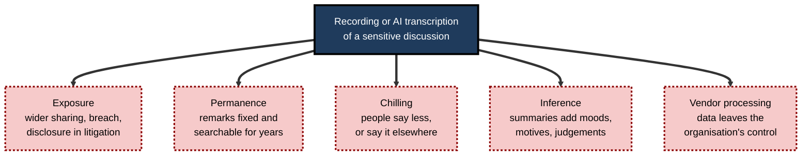
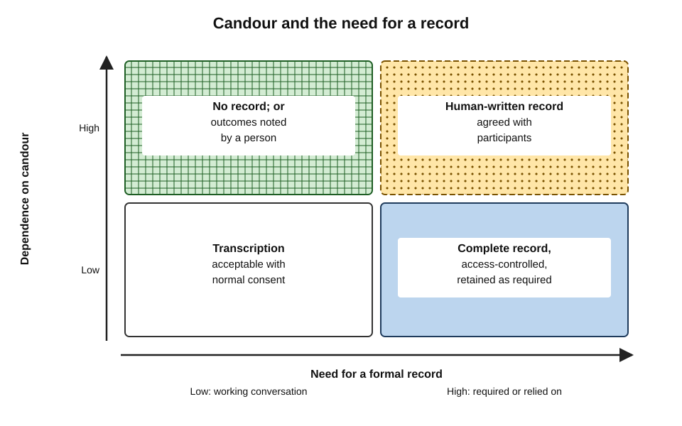
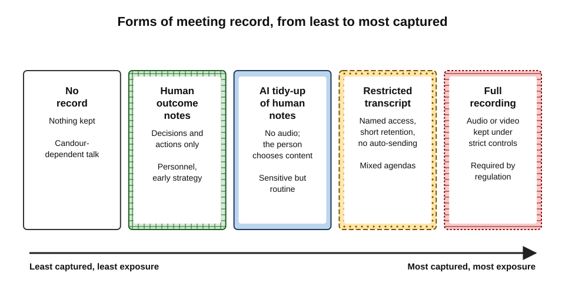
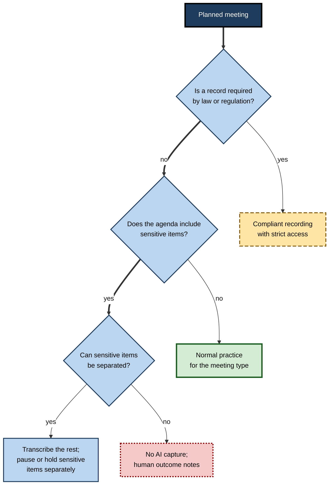
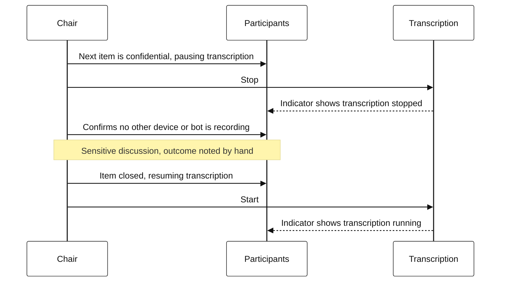

# G.7. Sensitive discussions and recording

An HR adviser and a line manager meet to discuss an employee's long-term sickness absence. The manager's calendar automatically invites an AI note-taker. Twenty minutes later, a neat summary — including the employee's diagnosis, the manager's frustrated remark that "she's probably not coming back", and a note that the manager "seemed stressed" — is emailed to everyone on the invitation, which also included a project lead who dropped off after five minutes. Nothing about the tool malfunctioned. The failure was deciding to record at all.

> **Definition — Sensitive discussion:** a conversation whose content could cause serious harm to individuals or the organisation if recorded, retained, disclosed or misinterpreted — for example about health, personnel matters, legal advice, confidential transactions or security.

> **Definition — Chilling effect:** the tendency of people to speak less freely, or avoid certain topics, when they know they are being recorded or observed.

**Why it matters**

- **Records outlast context** — a remark made in confidence becomes a permanent, searchable, forwardable text.
- **AI adds content** — summaries can infer things nobody said, such as moods, motives or judgements, and record them as fact.
- **Some records create legal exposure** — loss of legal privilege, disclosure in litigation, breach of data-protection rules.
- **Some meetings depend on candour** — once people feel recorded, the honest conversation moves elsewhere or stops.

---

## What Makes a Discussion Sensitive

### Categories of sensitive content

- **Special-category personal data** — health, ethnicity, religion, sexual orientation, trade-union membership, biometric data.
  - *e.g.* a discussion of an employee's medical condition and adjustments.
- **Personnel matters** — performance concerns, discipline, grievances, investigations, redundancy, pay and promotion decisions.
- **Legal advice and disputes** — conversations with lawyers, litigation strategy, regulatory investigations.
- **Confidential transactions and inside information** — mergers, acquisitions, results before publication, pricing negotiations.
- **Security matters** — vulnerabilities, incident details, access credentials, physical security.
- **Whistleblowing and safeguarding** — reports of wrongdoing, risks to children or vulnerable adults.
- **Negotiations** — positions, limits and fall-backs.
- **Early-stage thinking** — strategy options, half-formed ideas, frank assessments of people or partners.

| | Harm if recorded and exposed | Typical rule | Who usually decides |
|---|---|---|---|
| Health and other special-category data | Discrimination, distress, legal breach | Record minimally; restrict access | HR, data protection officer |
| Personnel matters | Unfairness, legal claims, damaged trust | Human-written notes, agreed with participants | HR, line manager |
| Legal advice | Loss of privilege, disclosure | Do not transcribe with third-party tools; lawyer keeps notes | Legal team |
| Inside information | Market abuse, leaks | Strict access; sometimes mandatory recording under controls | Compliance |
| Security | Exploitation by attackers | No AI transcription; restricted notes | Security team |
| Whistleblowing | Retaliation, identification of the reporter | Confidential channel; minimal records | Designated officer |
| Early-stage thinking | Chilled candour; remarks quoted out of context | Usually not recorded; outcomes noted | Meeting owner |

> **Key point:** sensitivity is about **content and context**, not meeting type. A routine team meeting becomes sensitive the moment someone mentions a colleague's illness.

---

## How Recording Changes Sensitive Discussions

**Figure 1.** Five ways recording can harm a sensitive discussion.

- **Exposure** — recordings and summaries travel: auto-sent to invitation lists, posted to channels, found by enterprise search, disclosed in litigation or freedom-of-information requests.
- **Permanence** — a frank remark, harmless in the room, reads very differently in a transcript months later and out of context.
- **Chilling** — participants self-censor; the real conversation moves to unrecorded corridors and private messages.
- **Inference** — AI summaries characterise tone and intent ("the manager seemed frustrated with the employee's attitude"), creating new sensitive statements that nobody made.
- **Vendor processing** — third-party tools may store and process content outside the organisation's security controls.

> **Watch out:** "we'll delete it later" does not undo exposure. By the time a recording is deleted, its summary may have been emailed, forwarded and indexed.

---

## Candour and Psychological Safety

Many important meetings work only if people can admit mistakes, voice doubts and think aloud.

**Study card — Amy Edmondson (1999), psychological safety in work teams**

- **Background:** an earlier study of hospital teams by Edmondson had found, unexpectedly, that better-led teams **reported more** medication errors — because people felt safe to report them, not because they made more.
- **Design (1999):** a study of 51 work teams in a manufacturing company, combining surveys, interviews and observation.
- **Findings:** teams whose members believed it was safe to take interpersonal risks — to ask questions, admit errors, challenge ideas — engaged more in **learning behaviour**, which in turn predicted team performance.
- **Concept:** **psychological safety** — a shared belief that the team is safe for interpersonal risk-taking.

> **Definition — Psychological safety:** a shared belief among team members that they will not be punished or humiliated for speaking up with ideas, questions, concerns or mistakes.

**Evidence of chilling**

- **Surveillance research** — studies of behaviour after public revelations of government surveillance, such as a 2016 analysis by Jonathon Penney showing a drop in visits to Wikipedia articles on terrorism-related topics after the 2013 surveillance disclosures, suggest that awareness of monitoring changes what people do, even when they have done nothing wrong.
- **Workplace experience** — teams commonly report that recorded retrospectives and incident reviews become shorter, more guarded and less self-critical.

> **Watch out:** the effect of recording on candour is widely reported by practitioners and consistent with research on monitoring, but there are few controlled studies of AI meeting transcription specifically. The size of the effect is **uncertain** and probably varies with trust in how records are used.

### Meetings that depend on candour

- **Retrospectives and post-incident reviews** — admitting what went wrong.
- **Brainstorming and early strategy** — floating ideas that may be bad.
- **One-to-ones and coaching** — personal concerns, career worries, feedback.
- **Peer support and mentoring** — vulnerability is the point.
- **Frank assessments** — of candidates, partners, competitors, colleagues.

**Figure 2.** Balancing dependence on candour against the need for a record.

> **In practice:** for candour-dependent meetings, a common rule is **"record the outcome, not the conversation"**: a person writes the decisions and actions; the discussion itself is not captured.

### Reducing the chill when a record is needed

When a meeting must be recorded but also depends on candour, the chilling effect can be reduced, though rarely removed.

- **State the purpose and limits of use** — "This transcript is for producing the action list; it will not be used to evaluate anyone and is deleted in 30 days."
- **Keep retention short** — people speak more freely when remarks do not last.
- **Restrict access** — the fewer people who can read the transcript, the less guarded the speech.
- **Record outcomes, not attributions** — summaries that list conclusions without naming who said what.
- **Honour pauses** — a reliable "off the record" option makes the recorded parts more honest too.
- **Keep promises** — a single case of a transcript used against someone undoes all of the above.

> **Key point:** the chilling effect depends less on whether a meeting is recorded than on **what people believe the record will be used for**. Clear, kept promises about use are the strongest remedy.

---

## Legal Privilege and Disclosure

### Privilege at risk

> **Definition — Legal professional privilege:** a legal protection that keeps confidential communications between a lawyer and client — and in some cases material prepared for litigation — from compelled disclosure.

- **Confidentiality is essential** — privilege generally depends on the communication remaining confidential. Sharing it with third parties can weaken or waive it.
- **Third-party transcription** — routing a privileged conversation through an external AI service may be argued to compromise confidentiality, depending on the service's terms and the law that applies.
- **Summaries are new documents** — an AI summary of legal advice, emailed to a wide group, is a fresh document whose privileged status may be contested.
- **Professional guidance** — legal ethics bodies have begun to address AI note-takers; the New York City Bar's ethics committee, for example, advised in 2025 that lawyers obtain client consent before recording calls with AI tools and consider where data is stored and whether it could be disclosed.

### Disclosure in disputes and investigations

- **Litigation** — transcripts, recordings and summaries are documents that may have to be disclosed to the other side.
- **Regulatory investigations** — regulators may demand meeting records.
- **Public bodies** — freedom-of-information laws may cover meeting transcripts and AI notes.
- **Data subject requests** — individuals can ask for personal data about them, which can include transcripts of meetings where they were discussed.

> **Key point:** anything recorded may one day be read by a judge, a regulator, a journalist or the person being discussed. The test is not "is this private?" but "**would we be content for this record to be read by them?**"

---

## When Recording Is Required

Sensitivity does not always mean "do not record". Some sensitive discussions **must** be recorded — under strict controls.

- **Financial services** — European and UK rules require investment firms to record telephone conversations and electronic communications relating to client transactions, so that market abuse and mis-selling can be investigated.
- **Formal governance** — boards must keep minutes of decisions; some regulators require evidence of how decisions were reached.
- **Formal disciplinary and grievance hearings** — a careful, agreed record protects both the employee and the employer.
- **Clinical consultations** — a clinical record is required, though not necessarily a transcript.

| | Must not record (or only human notes) | Choose deliberately | Must record, under controls |
|---|---|---|---|
| Examples | Privileged legal advice via third-party tools; security vulnerabilities; whistleblower identities | Team meetings with occasional sensitive items; one-to-ones; strategy sessions | Regulated trading communications; formal hearings; board decisions |
| Who decides | Legal, security, designated officers | Meeting owner, guided by policy | Regulation and compliance |
| Form of record | None, or minimal human notes | Outcomes only; pause for sensitive items | Complete, secure, access-controlled, retained as required |
| AI tools | Not used | Used for non-sensitive parts | Only approved, compliant systems |

> **Remember:** the question is not "record or not?" but "**what record, of what, accessible to whom, kept for how long?**"

---

## Three Sensitive Settings in Depth

### Inside information and confidential transactions

- **What it is** — non-public information that would be likely to affect the price of a company's shares or other financial instruments if made public, such as unannounced results, mergers or major contracts.
- **Legal regime** — market-abuse rules in the UK, the EU, India and elsewhere prohibit dealing on inside information and disclosing it unlawfully; listed companies keep **insider lists** of people with access.
- **Why AI capture matters:**
  - a transcript of a deal meeting is itself inside information, stored wherever the transcript is stored;
  - automatic summaries distributed to an invitation list can widen the circle of insiders without anyone deciding to;
  - enterprise search may surface deal content to colleagues not on the insider list.
- **Practice** — deal meetings use code names, restricted participant lists and no AI recaps; any record is kept in access-controlled deal rooms.

### Whistleblowing and investigations

- **Protection of reporters** — many jurisdictions protect people who report wrongdoing from retaliation; confidentiality of their identity is central.
- **Risks of AI capture:**
  - a transcript of a report names the reporter and the people reported;
  - a summary routed to the wrong people can expose the reporter;
  - attribution errors can wrongly implicate someone.
- **Practice** — reports and investigation interviews are handled through designated confidential channels, with human-written, access-restricted records; routine meeting tools are not used.

### Legal advice

- **Who decides** — whether a meeting with lawyers is recorded, and how, should be the lawyers' decision.
- **Separate the advice** — legal advice is best given in a separate session from general business discussion, so the general meeting can be recorded while the advice is not.
- **Labels and storage** — any notes of legal advice are labelled as such and stored where the legal team directs.

> **Remember:** in deal, investigation and legal settings, the question is not "should we pause the transcript?" but "**should this conversation be in a meeting tool at all?**"

---

## Inferences, Emotions and Sentiment

Some meeting tools go beyond transcription: they score "sentiment", "engagement" or "emotion" from voices, faces or words.

- **Why it is sensitive** — these outputs are judgements about people's inner states, created without their knowledge, and may be used to evaluate them.
- **Why it is unreliable** — a major 2019 review by Lisa Feldman Barrett and colleagues concluded that facial movements do not reliably and specifically reveal emotions across people and situations; a scowl can mean concentration as well as anger.
- **Why it may be unlawful** — the **EU AI Act** prohibits, from **February 2025**, AI systems that infer the emotions of people in the **workplace** or in education from biometric data such as faces or voices, except for medical or safety reasons. Meeting features that infer employees' emotions from their voices or faces fall squarely within the concern.

**Study card — Barrett and colleagues (2019), "Emotional expressions reconsidered"**

- **Scope:** a review of research on whether emotions can be reliably inferred from facial movements.
- **Findings:** people do sometimes scowl when angry or smile when happy, but far less consistently than commonly assumed; the same expression has different meanings in different contexts and cultures.
- **Conclusion:** technologies claiming to "read" emotions from faces rest on weak scientific foundations.

> **Watch out:** text-based summaries can produce similar inferences without any biometric analysis — "the client seemed unhappy", "Raj was defensive". Such statements are interpretations, not records; instructions to AI tools should forbid them in sensitive meetings.

---

## Handling Sensitive Content in Practice

### Choosing the right form of record

**Figure 3.** Forms of meeting record, from least to most captured.

- **No record** — for candour-dependent or highly sensitive conversations where no record is required.
- **Human outcome notes** — a person writes decisions and actions; nothing else.
- **AI tidy-up of human notes** — the person's rough notes are cleaned up by an approved tool; no audio is captured.
- **Restricted transcript** — transcription with access limited to named people, short retention and no automatic summary distribution.
- **Full recording** — only where required or clearly justified, with strict controls.

### Deciding for a meeting

**Figure 4.** Deciding how to record a meeting that may include sensitive content.

### Techniques

- **Split the agenda** — hold sensitive items in a separate, unrecorded session, or at the end after transcription stops.
- **Pause visibly** — stop transcription for a sensitive item, confirm it is stopped, announce when it resumes.
- **Disable automatic distribution** — summaries go to the organiser for review, never straight to the invitation list.
- **Use sensitivity labels** — many platforms let organisers mark meetings as confidential, which can block recording, AI recaps or external sharing.
- **Instruct the tool** — "Record decisions only; do not characterise anyone's mood or attitude; omit health information."
- **Check the participant list** — no unknown bots; no personal note-takers.
- **Keep sensitive notes in restricted locations** — HR systems, legal files, secure repositories — not general team spaces.

**Figure 5.** Pausing transcription for a sensitive agenda item.

> **Mnemonic — "PAUSE":** **P**lan sensitive items separately, **A**nnounce stops and starts, **U**nknown bots removed, **S**ummaries reviewed before sending, **E**motions never inferred.

---

## Worked Example (illustrative): Planning a Restructuring Programme's Meetings

**Situation:** a regional director is planning six weeks of meetings for a restructuring that may affect 40 roles. Meetings include a weekly steering group, HR planning sessions, consultations with staff representatives, individual consultation meetings and project team stand-ups.

| Meeting | Sensitive content | Form of record | Reason |
|---|---|---|---|
| Project stand-ups | Rarely; logistics | Transcript and AI notes, internal only | Routine coordination |
| Steering group | Options, named roles, legal advice | Human-written decision minutes; AI not used | Inside information about staff; legal advice; candour |
| HR planning | Individuals' circumstances, health, pay | Notes in HR system only | Special-category and personnel data |
| Collective consultation | Proposals, representatives' responses | Agreed minutes, shared with representatives | Legal consultation duties; both sides need an agreed record |
| Individual consultations | Personal circumstances | Notes agreed with the employee; no AI capture | Fairness, trust, special-category data |

*Illustrative example.*

**Steps**

1. **Classify** each meeting type by its most sensitive likely content, not its typical content.
2. **Set platform controls** — confidential label on steering and HR meetings, blocking AI recaps and recording.
3. **Brief chairs** — pause rules and the "record the outcome" principle.
4. **Assign owners** for each formal record and its storage location.
5. **Review** at week two — are sensitive topics appearing in "routine" meetings?

- **Outcome:** in week two, a stand-up transcript included a remark about which teams "were for the chop". The transcript was deleted, the team reminded that restructuring is not discussed in stand-ups, and stand-up transcription paused for the programme's duration.

> **Watch out:** sensitive content leaks into routine meetings. Controls set by meeting type must be backed by people who notice and stop.

---

## Sensitive Content and Public AI Tools

### Case study: confidential material pasted into a public chatbot (2023)

- **Situation:** in spring 2023, shortly after a large electronics manufacturer allowed staff to use a public generative-AI chatbot, Korean media reported that employees had entered confidential material into it — including source code and, in one reported instance, the content of an internal meeting, to have it turned into minutes.
- **Problem:** material entered into the public service left the company's control and, under the service's terms at the time, could be retained by the provider.
- **Response:** the company restricted the use of generative-AI tools on its devices and networks while it developed internal alternatives.
- **Lesson:** the risk with sensitive meetings is not only the recorder in the room; it is any route by which a transcript or recording reaches a tool outside the organisation's control — including well-meaning attempts to tidy notes.

### Case study (illustrative): the sickness-absence meeting

- **Situation:** the meeting described at the start — an HR adviser and a manager discussing an employee's sickness absence, recorded by an auto-joining note-taker.
- **Harms:**
  1. health data distributed to a project lead with no need to know;
  2. the manager's speculative remark recorded as part of a formal-looking document;
  3. an inferred judgement — "seemed stressed" — about the manager;
  4. the summary became disclosable in any later employment claim.
- **Response:**
  1. recipients asked to delete the summary; the transcript deleted; the incident logged with the data protection officer, who assessed whether it was a reportable breach;
  2. the employee informed, in line with data-protection duties and good faith;
  3. auto-joining disabled for all HR meetings; HR calendars set to block AI note-takers;
  4. managers trained that health and personnel matters are discussed without AI capture.
- **Lesson:** sensitive meetings need protection **by default**, not by remembering to switch things off.

---

## Organisational Practice

- **A sensitivity policy for meetings** — categories, default forms of record, who decides.
- **Default protections** — HR, legal, security and board calendars block AI note-takers and recording unless deliberately enabled.
- **Sensitivity labels** — applied to meetings, documents and channels, with technical effects on recording and sharing.
- **Prohibitions** — no emotion or sentiment scoring of employees; no AI transcription of privileged legal advice through third-party tools.
- **Incident handling** — what to do when sensitive content is captured by mistake: stop distribution, delete where lawful, assess breach obligations, inform people affected.
- **Training** — chairs and assistants learn to recognise sensitive content as it arises and to pause.

> **In practice:** the most effective single control is to make **AI capture opt-in** for meetings involving HR, legal, security and leadership — so the protective state is the default, and recording requires a deliberate decision.

---

## Open Questions

- **How large is the chilling effect of AI transcription?**
  - Widely observed, rarely measured; it may depend on trust in how records are used and on team culture.
- **Will privilege survive routine AI processing?**
  - Courts have yet to settle how third-party AI processing affects confidentiality and privilege in many jurisdictions.
- **Can tools detect sensitivity automatically?**
  - Some systems flag health or financial terms, but sensitivity depends on context; automatic detection risks both false alarms and false comfort.
- **Where is the line on inference?**
  - Emotion recognition from biometrics is restricted in the EU workplace; text-based characterisations of mood in summaries are less clearly governed.
- **Should some meetings be guaranteed unrecorded?**
  - "Recording-free" spaces could protect candour, but conflict with accountability and regulated recording duties.

---

## Summary

- **Sensitive discussions** involve content that could seriously harm people or the organisation if recorded, kept, disclosed or misread: health, personnel, legal, inside information, security, whistleblowing, negotiations, early thinking.
- Recording harms sensitive meetings through **exposure, permanence, chilling, inference and vendor processing**.
- **Psychological safety** (Edmondson) underpins candour; monitoring can **chill** speech, though the size of the effect for AI transcription is uncertain.
- **Legal privilege** depends on confidentiality; third-party transcription and widely sent summaries put it at risk; records may be **disclosed** in disputes and investigations.
- **Inside information**, **whistleblowing** and **legal advice** need dedicated channels and restricted, human-controlled records; AI recaps can silently widen the circle of people who know.
- Some sensitive conversations **must** be recorded under controls — regulated communications, formal hearings, board decisions.
- **Emotion and sentiment inference** is scientifically weak and, for biometric-based workplace emotion recognition, **prohibited in the EU** since February 2025.
- Choose the **form of record**: none, human outcome notes, AI tidy-up of human notes, restricted transcript, full recording.
- Techniques: split agendas, visible pauses, no automatic distribution, sensitivity labels, instructions forbidding inference — **PAUSE**.
- Protect sensitive meetings **by default**, not by memory.

---

## Self-Check

1. Define a sensitive discussion and give six categories of sensitive content.
2. Name the five ways recording can harm a sensitive discussion.
3. What did Edmondson's research find about psychological safety, and why is it relevant to recording?
4. How confident can we be about the chilling effect of AI transcription? Explain.
5. How can AI transcription put legal privilege at risk?
6. Give three examples of sensitive discussions that must be recorded, and explain how the record should be controlled.
7. Why are emotion and sentiment scores from meeting tools problematic scientifically and legally?
8. Describe the five forms of meeting record from least to most captured.
9. A team meeting unexpectedly turns to a colleague's health. What should the chair do?
10. Explain the PAUSE mnemonic.
11. What lessons does the 2023 chatbot case teach about sensitive meeting content?
12. Design default protections for an HR department's meetings.
13. Why can an automatic summary of a deal meeting create a market-abuse risk?

### Answer Key

1. A conversation whose content could cause serious harm if recorded, kept, disclosed or misinterpreted. Categories: special-category personal data, personnel matters, legal advice, inside information, security, whistleblowing, negotiations, early-stage thinking.
2. Exposure, permanence, chilling, inference and vendor processing.
3. Teams whose members felt safe to take interpersonal risks engaged more in learning behaviour, which predicted performance; better teams even reported more errors. Recording can reduce that felt safety, discouraging admissions of error and frank discussion.
4. Moderately: chilling under monitoring is consistent with research and widely reported by practitioners, but few controlled studies examine AI meeting transcription specifically, so the size of the effect is uncertain.
5. Privilege generally requires confidentiality; routing privileged conversations through a third-party service, and creating summaries that are widely distributed, may compromise confidentiality and create new documents of contested status, exposing them to disclosure.
6. Regulated trading communications in financial services; formal disciplinary or grievance hearings; board decisions. Records should be complete, securely stored, access-restricted, retained only as long as required and created with approved, compliant systems.
7. Scientifically, emotional states cannot be reliably inferred from facial movements or voices across people and contexts. Legally, the EU AI Act prohibits AI inference of emotions from biometric data in the workplace (with narrow exceptions) from February 2025; such scores can also be unfair if used to evaluate people.
8. No record; human outcome notes; AI tidy-up of human notes (no audio); restricted transcript; full recording.
9. Stop or pause transcription visibly, ask that the topic be continued privately with the right people, ensure the captured portion is deleted or excluded from the summary, and remind participants of the norm.
10. Plan sensitive items separately; Announce stops and starts; Unknown bots removed; Summaries reviewed before sending; Emotions never inferred.
11. Sensitive content can leave the organisation by any route — including staff pasting meeting content into public AI tools to make minutes. Controls must cover the whole chain, and approved internal tools reduce the temptation.
12. For example: AI note-takers and recording blocked by default on HR calendars; confidential sensitivity labels applied; any recording requires deliberate approval; summaries never auto-distributed; notes stored only in the HR system; no emotion or sentiment features; training on pausing; an incident procedure for accidental capture.
13. The summary itself contains inside information; distributing it to an invitation list, or storing it where enterprise search can surface it, widens the circle of people with access beyond the controlled insider list, creating a risk of unlawful disclosure or dealing.

---

## Glossary

| Term | Meaning |
|---|---|
| Chilling effect | Reduced willingness to speak freely when recorded or observed. |
| Disclosure | Compelled production of documents in litigation or investigations. |
| Emotion recognition | AI inference of emotional states from faces, voices or other signals. |
| Inference (in summaries) | Statements about mood, motive or attitude that nobody actually made. |
| Inside information | Non-public information likely to affect the price of financial instruments. |
| Insider list | A record kept by a listed company of people with access to inside information. |
| Legal professional privilege | Protection of confidential lawyer–client communications from compelled disclosure. |
| Psychological safety | A shared belief that a team is safe for interpersonal risk-taking. |
| Record the outcome, not the conversation | A rule of writing only decisions and actions for candour-dependent meetings. |
| Sensitive discussion | A conversation whose content could cause serious harm if recorded or disclosed. |
| Sensitivity label | A classification applied to meetings or files that triggers protective controls. |
| Special-category data | Sensitive personal data such as health, ethnicity, religion or biometrics. |
