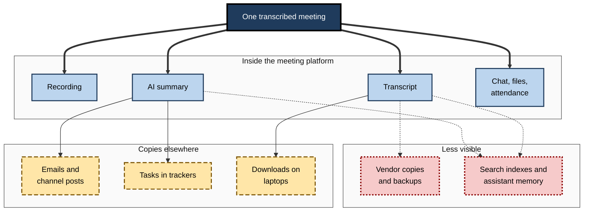
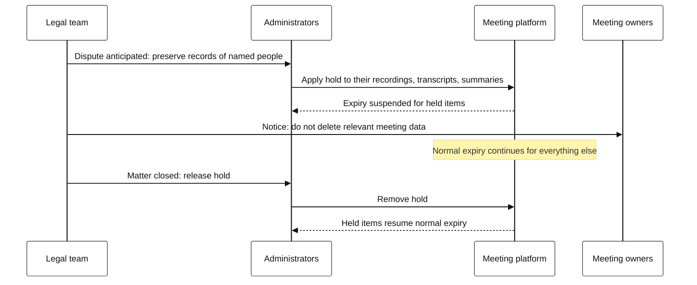
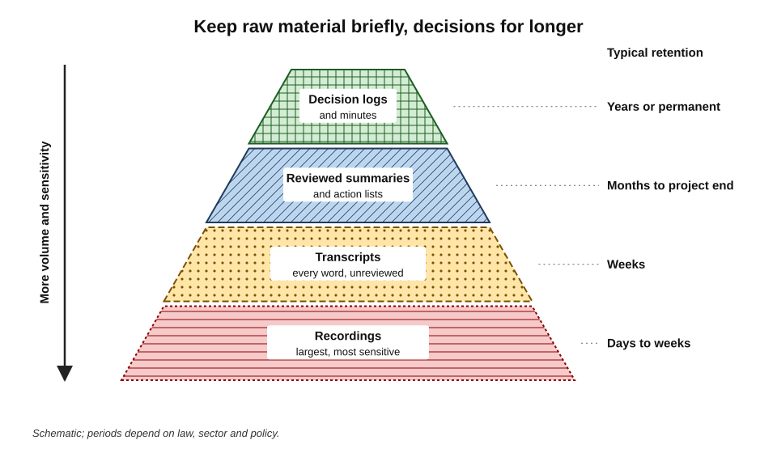
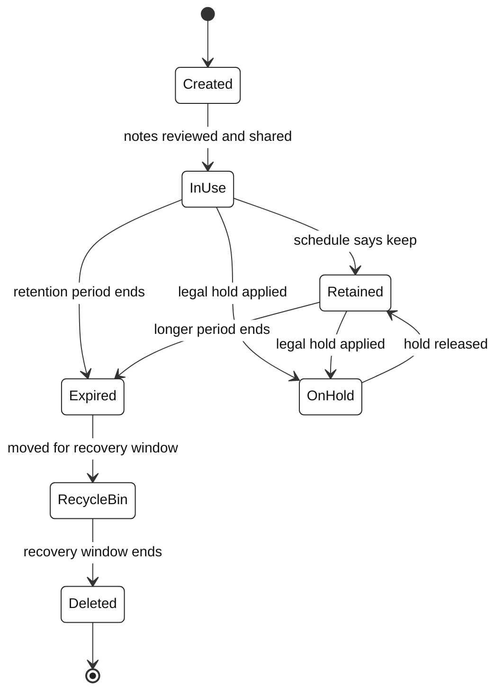
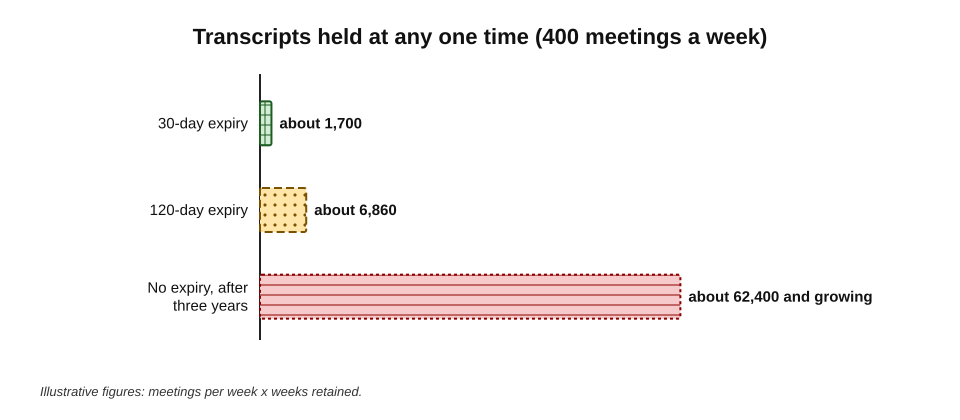

# G.8. Retention of meeting data

During an employment dispute, a company's lawyers search its systems for documents about the claimant. They find over three hundred meeting transcripts mentioning him, going back two years — including a project retrospective in which a manager called his work "sloppy" and a planning call where colleagues joked about his accent. Nobody remembered these meetings had been transcribed, and nobody had decided to keep the transcripts. They had simply never been deleted.

> **Definition — Retention period:** the length of time a record is kept before it is deleted or archived, set by law, regulation, policy or default settings.

> **Definition — Storage limitation:** the data-protection principle that personal data should be kept in a form that identifies people for no longer than is necessary for the purposes for which it is processed.

> **Definition — Legal hold:** an instruction to preserve records relevant to actual or reasonably anticipated litigation or investigation, suspending normal deletion.

**Why it matters**

- **AI multiplies meeting data** — every transcribed meeting leaves a recording, a transcript, a summary and copies in several places.
- **Defaults decide** — most meeting data is kept for exactly as long as the platform's default setting, whether or not anyone chose it.
- **Old records carry risk** — they can be breached, disclosed in litigation, requested by individuals, or misread long after their context is forgotten.
- **Some records must be kept** — decisions, regulated communications and formal minutes have legal and practical value.

---

## What a Meeting Leaves Behind

A single transcribed meeting can produce a dozen separate pieces of data, stored in different places and governed by different settings.

- **Recording** — audio, or audio and video, often the largest file.
- **Transcript** — the full text with speaker labels and timestamps.
- **AI summary or recap** — sometimes stored separately from the transcript, for example in the organiser's personal storage.
- **Meeting chat** — messages, links and files shared during the call.
- **Shared content** — slides, documents, whiteboards and polls.
- **Attendance reports** — who joined, when and for how long.
- **Assistant interactions** — questions asked of the meeting assistant during or after the call.
- **Tasks** — actions exported to task trackers.
- **Copies** — summaries emailed, pasted into documents, posted to channels, downloaded to laptops.
- **Vendor copies** — data held by third-party note-takers, including backups and, under some terms, data used to improve models.
- **Derived indexes** — search indexes and numerical representations used by enterprise assistants to find and answer questions from meeting content.

**Figure 1.** The data footprint of one transcribed meeting.

| | Recording | Transcript | AI summary | Copies in email and channels | Vendor and index copies |
|---|---|---|---|---|---|
| Size | Large | Small | Very small | Small | Varies |
| Sensitivity | Highest — voices, faces, tone | High — every word | Moderate to high — interpreted | As the summary | As the source |
| Who controls deletion | Organiser, administrators | Organiser, administrators | Organiser; sometimes separate settings | Every recipient | Vendor, under contract; index owners |
| Typical default | Expires after a set period on some platforms | Often tied to the recording | May follow different rules | Kept indefinitely | Depends on contract and configuration |
| Ease of deleting everywhere | Moderate | Moderate | Hard once shared | Very hard | Hard to verify |

> **Key point:** deleting "the recording" rarely deletes "the meeting". The transcript, summary, copies and indexes may each live on under different rules.

---

## Why Keep and Why Delete

| | Reasons to keep | Reasons to delete |
|---|---|---|
| Organisation | Evidence of decisions; institutional memory; searchable knowledge | Breach risk; storage cost; clutter that makes search worse |
| Law | Regulatory record-keeping; legal holds; formal minutes | Storage limitation; minimisation; reducing disclosure exposure |
| People | Accessibility; catching up; resolving disputes about what was said | Privacy; remarks kept out of context; candour in future meetings |
| Accuracy | Original evidence for checking summaries | Uncorrected errors becoming "the record" over time |

- **The asymmetry** — the value of most meeting transcripts falls quickly after the meeting; their risk does not.
- **The exceptions** — decisions, commitments and formal minutes keep their value for years; they should be kept deliberately, in the right form.

> **Remember:** keep **decisions** for as long as they matter; keep **conversations** only for as long as they are needed to produce and check the decisions.

---

## The Legal Framework

### Storage limitation and erasure

- **EU and UK GDPR** — personal data must be kept no longer than necessary for its purpose; organisations must be able to justify their retention periods and erase data when they expire.
- **India's Digital Personal Data Protection Act 2023** — personal data must be erased once the purpose for which it was collected is no longer being served, unless retention is required by law.
- **Individuals' rights** — people can request access to their data, including transcripts and summaries mentioning them, and in some circumstances its erasure.

> **Definition — Subject access request:** a request by an individual to an organisation for a copy of the personal data it holds about them, which can include meeting transcripts and summaries in which they appear.

### Duties to keep

- **Regulated sectors** — financial-services rules in Europe and the UK require firms to keep records of communications relating to client transactions, generally for five years and in some cases up to seven.
- **Corporate governance** — company law requires minutes of board and shareholder meetings to be kept, typically for long periods.
- **Public bodies** — public-records and freedom-of-information laws may require meeting records to be kept and disclosed.
- **Employment and health and safety** — some records must be kept for set periods.

### Public bodies

- **Freedom of information** — laws such as the UK's Freedom of Information Act 2000 and India's Right to Information Act 2005 give the public rights to request information held by public authorities; meeting transcripts and AI summaries held by such bodies can fall within scope.
- **Public records** — public bodies must keep certain records permanently or for set periods, and may not destroy records simply because they are inconvenient.
- **Consequence** — public-sector meeting data needs particularly clear rules: which AI outputs are official records, which are working material, and when each is deleted.

> **Watch out:** in a public body, "nobody intended the AI summary to be a record" does not stop it being requested. If it exists when a request arrives, it may have to be considered for release.

### Legal holds and disclosure

- **Duty to preserve** — once litigation or an investigation is reasonably anticipated, relevant records must be preserved, including meeting data that would otherwise expire.
- **Spoliation** — destroying relevant records after that point can lead to court sanctions and adverse inferences.
- **Practical consequence** — automatic expiry must be capable of being **suspended** for specific people, meetings or topics.

**Figure 2.** A legal hold overriding automatic deletion.

> **Watch out:** retention policies that delete aggressively are **not** a way to avoid disclosure once a dispute is foreseeable. Deleting relevant records then is itself a serious legal risk.

---

## Defaults in Practice

Meeting platforms ship with retention defaults that organisations can change.

- **Example from one widely used platform (as of 2026):** meeting recordings and transcripts expire by default **120 days** after creation; administrators can choose a shorter or longer period, or no expiry, and the default for some education licences is shorter.
- **Expiry is not erasure:**
  - expired files may go to a recycle bin first — in the same platform, items in work-account recycle bins are kept for **93 days** by default before final deletion;
  - backups and vendor copies follow their own schedules.
- **Different artefacts, different rules** — an AI summary saved as a document in the organiser's storage may follow document retention rules rather than recording rules.
- **Third-party note-takers** — many keep data until the user deletes it or closes the account, unless the organisation's contract says otherwise.

> **In practice:** administrators should map **each artefact** — recording, transcript, summary, chat, copies, vendor data — to its actual retention behaviour, rather than assuming one setting covers the meeting.

---

## Designing a Retention Schedule

### Principles

- **Purpose first** — each record type is kept for as long as its purpose requires, and no longer.
- **Rawer means shorter** — the more raw and sensitive the record, the shorter its default life:
  - recordings shortest;
  - transcripts next;
  - reviewed summaries and action lists longer;
  - decision records and formal minutes longest.
- **Meeting type matters** — client calls, board meetings, HR meetings and stand-ups need different rules.
- **Defaults short, exceptions deliberate** — short default expiry, with a simple way to keep a specific record longer for a stated reason.
- **Holds override everything.**

**Figure 3.** Volume against retention: keep the raw material briefly and the decisions for longer.

> **Definition — Retention schedule:** a documented list of record types with the period for which each is kept, the reason, and what happens at the end of the period.

### An example schedule

| Record | Example retention | Reason |
|---|---|---|
| Stand-up and routine internal transcripts | 30 days | Needed only to produce and check notes |
| Recordings of internal meetings | 30–60 days | Highest sensitivity; little lasting value |
| Client call transcripts | 90 days, unless a dispute arises | Checking commitments and follow-up |
| Reviewed project summaries and action lists | Life of project plus one year | Project history and handover |
| Decision logs | Life of the system or policy decided, plus a period | Rationale for future readers |
| Board and committee minutes | Long-term or permanent, per company law | Statutory governance record |
| Regulated communications | As required by the regulator (often five to seven years) | Legal obligation |
| HR meeting records | Per HR records policy, in the HR system | Employment law; fairness |

*Illustrative example; actual periods depend on law, sector and policy.*

> **Mnemonic — "RAW SHORT, DECISIONS LONG":** raw recordings and transcripts expire quickly; reviewed decisions and formal minutes are kept deliberately.

---

## The Lifecycle of Meeting Data

**Figure 4.** The lifecycle of a meeting record.

- **Created** — at the meeting.
- **In use** — reviewed, corrected, shared, acted on.
- **Retained or expired** — according to the schedule.
- **On hold** — preserved for litigation or investigation.
- **Recycle bin** — a recovery window.
- **Deleted** — including, ideally, verified deletion from backups and vendor systems on their schedules.

---

## Vendors and Derived Data

### Third-party tools

- **Contract terms** — how long the vendor keeps data, where, who can access it, and whether it is used to train models.
- **Deletion on termination** — what happens to data when the subscription ends; how deletion is confirmed.
- **Sub-processors** — other companies the vendor uses, each with their own copies.
- **Training use** — data used to improve models may persist in a different form even after the original is deleted.

> **Watch out:** "deleted from the app" may mean deleted from view, not from the vendor's backups or training data. Organisations should ask vendors for their deletion timelines and evidence.

### Derived data and AI memory

- **Search indexes** — enterprise assistants index meeting content to answer questions; index entries must be removed when sources are deleted.
- **Summaries of summaries** — cross-meeting digests and project reports may quote meetings long after their transcripts expire.
- **Assistant memory** — some assistants remember facts from past interactions.

### Assistant interactions

- **Questions are data too** — what people ask a meeting assistant ("did Ravi agree to the budget?", "what did the client say about us?") can reveal concerns, suspicions and intentions.
- **Where they are kept** — depending on configuration, prompts and answers may be stored with the meeting, in the user's assistant history, or in audit logs.
- **Retention** — assistant interactions should be covered by the schedule like any other meeting artefact, and people should know whether their questions are visible to the organiser or administrators.

> **Definition — Deletion debt:** copies, extracts and derived data that remain after the original record has been deleted, because they were created and stored outside its retention controls.

---

## Records Management Principles

Records managers have long distinguished **records** — evidence of business activity that must be managed — from working material that can be discarded. The distinction is essential for meeting data.

### What makes a record trustworthy

The international records-management standard ISO 15489 describes four characteristics of authoritative records:

- **Authenticity** — it is what it claims to be, created by the person or system that claims to have created it.
- **Reliability** — its content can be trusted as a full and accurate representation of the activity.
- **Integrity** — it is complete and unaltered, or alterations are authorised and traceable.
- **Usability** — it can be located, retrieved, presented and interpreted.

| | Raw transcript | Unreviewed AI summary | Reviewed summary or minutes |
|---|---|---|---|
| Authenticity | Generated by the platform; clear origin | Generated by a model; origin clear but content interpreted | Approved by a named person |
| Reliability | Limited by recognition errors | Limited by recognition and generation errors | Checked against memory and transcript |
| Integrity | Editable, sometimes without trace | Often regenerated or edited without trace | Versioned; corrections recorded |
| Usability | Long; hard to find decisions | Short but possibly wrong | Short, structured, findable |
| Suitable as the record of decisions? | No — working material | No — a draft | Yes |

> **Key point:** in most organisations, the **reviewed summary or minutes** should be declared the record of a meeting; the transcript and recording are **working material** used to produce and check it, and can then expire.

> **Definition — Declaring a record:** formally identifying a document as a record of business activity, which brings it under the organisation's retention schedule and protects it from casual alteration or deletion.

### Integrity of AI-generated records

- **Regeneration** — some tools can regenerate a summary, producing a different version from the same transcript; the record should be a fixed, approved version.
- **Silent edits** — transcripts edited without a trace weaken their value as evidence; tools that keep edit history are preferable.
- **Labelling** — a record should show that it was AI-assisted, who reviewed it and when.

---

## Where Meeting Data Is Stored

- **Data location** — recordings and transcripts may be stored in data centres in other countries, especially with third-party services.
- **Cross-border transfer rules** — the GDPR restricts transfers of personal data outside the European Economic Area and the UK unless protections are in place; India's data-protection law allows the government to restrict transfers to particular countries.
- **Contractual commitments** — enterprise agreements often specify data residency; free or personal tools usually do not.
- **Practical consequence** — retention decisions must cover not only **how long** but **where**: a transcript deleted from the organisation's platform may persist in a vendor's region under different law.

### Verifying deletion

1. **Map the copies** — platform, recycle bin, backups, vendor systems, indexes, downloads, forwarded summaries.
2. **Confirm platform expiry works** — sample records past their expiry date and check they are gone.
3. **Ask vendors for evidence** — deletion timelines for primary storage and backups; certificates where available.
4. **Remove index entries** — ensure enterprise search and assistants no longer return deleted content.
5. **Record the deletion** — for records under the schedule, keep a log of what was deleted and when, without keeping the content.

> **In practice:** a simple quarterly test — searching for a meeting that should have expired and confirming that neither the transcript, the summary nor an assistant can return it — reveals more about real retention than any policy document.

---

## Personal Practice

- **Do not download transcripts or recordings** to personal storage unless necessary; downloaded copies escape retention controls.
- **Keep decisions, not conversations** — copy the reviewed decisions and actions into the project's proper record, then let the transcript expire.
- **Mark records worth keeping** deliberately, with a reason.
- **Avoid "just in case" retention** — the possibility of future usefulness is not a sufficient reason to keep personal data.
- **Think before forwarding** — every forwarded summary is another copy outside the retention schedule.

### Worked example (illustrative): how much is being kept?

**Situation:** a 2,000-person organisation transcribes about 400 meetings a week. It is considering three retention settings for transcripts.

> **Formula — Transcripts held at any time:** meetings per week × weeks retained. Example: 400 × (120 ÷ 7) ≈ 400 × 17.1 ≈ **6,860** transcripts.

| Retention setting | Weeks | Transcripts held at any time | Relative exposure |
|---|---|---|---|
| 30 days | about 4.3 | about 1,700 | 1× |
| 120 days | about 17.1 | about 6,860 | about 4× |
| No expiry, after 3 years | 156 | about 62,400 and growing | about 36× |

*Illustrative figures.*

**Figure 5.** Transcripts held at any one time under three retention settings.

- **Interpretation** — with no expiry, a subject access request, a breach or a disclosure exercise could involve tens of thousands of transcripts.
- **Decision** — 30-day expiry for routine transcripts, with a "keep" option requiring a reason, and reviewed summaries filed in project records.

> **Watch out:** the count of transcripts understates the problem: each meeting also has a recording, a summary and copies. Exposure scales with **everything** kept.

---

## Retention in Organisational Practice

- **A retention schedule for meeting data**, approved by legal, records management, data protection and security.
- **Platform configuration** matching the schedule, including summaries and chat, not only recordings.
- **Legal-hold capability** tested before it is needed.
- **Vendor contracts** that specify retention, deletion, training use and evidence of deletion.
- **Periodic audits** — sampling to check that expired records are actually gone, and that copies are not accumulating elsewhere.
- **Communication** — staff told how long meeting data is kept; participants told in recording notices.

### Case study (illustrative): the subject access request

- **Situation:** a former employee of a professional-services firm submitted a subject access request for all personal data held about him, as part of a dispute over his dismissal.
- **Problem:** the firm had enabled transcription for all meetings three years earlier with no expiry. A search returned over 1,100 transcripts and summaries mentioning him.
- **Effects:**
  1. weeks of legal review to identify, redact third parties' data and disclose relevant material within the statutory deadline;
  2. disclosure of unflattering informal remarks by managers, which strengthened his claim;
  3. discovery that some summaries contained wrong attributions, which then had to be explained.
- **Actions:**
  1. retention schedule introduced: 30 days for routine transcripts and recordings; reviewed summaries filed in project records; decision logs kept;
  2. a one-off clean-up of historic transcripts not subject to legal holds;
  3. auto-forwarding of summaries ended;
  4. managers trained that transcribed meetings are records.
- **Result:** the next subject access request, a year later, took two days.
- **Lesson:** indefinite retention turns every meeting into a long-term liability. Short defaults with deliberate exceptions protect both individuals and the organisation.

---

## Open Questions

- **What is the right default?**
  - Short defaults reduce risk but frustrate people who need old content; there is no consensus period, and platform defaults may become de facto standards.
- **Can derived data be governed?**
  - Search indexes, assistant memory and model training make "deletion" harder to define and verify.
- **Should summaries outlive transcripts?**
  - Keeping the summary while deleting the source preserves meaning but removes the means of checking it.
- **How will regulators treat AI meeting data?**
  - Guidance on retention specific to AI-generated records is still emerging in many jurisdictions.
- **Does long retention change behaviour?**
  - Knowing that remarks are kept for years may chill speech more than knowing they are kept for a month; evidence is limited.

---

## Summary

- A transcribed meeting leaves **recordings, transcripts, summaries, chat, files, attendance data, assistant interactions, tasks, copies, vendor copies and indexes** — each with its own retention behaviour.
- **Retention period**, **storage limitation** and **legal hold** are the core concepts.
- Most transcripts lose value quickly while keeping their risk; **decisions** keep value and should be kept deliberately.
- Law requires both **deletion** (storage limitation, erasure) and **keeping** (regulated communications, minutes, public records); **legal holds** override deletion; spoliation is a serious risk.
- Platform **defaults** — for example 120-day expiry of recordings and transcripts on one major platform — decide retention unless changed; **expiry is not erasure**.
- Good schedules follow **purpose**, keep raw material briefly and decisions longer (**raw short, decisions long**), vary by meeting type and allow deliberate exceptions.
- Vendor copies, indexes and summaries create **deletion debt**.
- Records management asks for **authenticity, reliability, integrity and usability** (ISO 15489); the **reviewed summary or minutes** should be the declared record, with transcripts as working material.
- Retention covers **where** data is stored as well as how long; **verify deletion** across platform, backups, vendors and indexes.
- Personal practice: avoid downloads and forwarding, file decisions properly, avoid "just in case".

---

## Self-Check

1. Define retention period, storage limitation and legal hold.
2. List eight kinds of data a transcribed meeting can leave behind.
3. Why does deleting a recording not necessarily delete the meeting?
4. Give two reasons to keep meeting data and two reasons to delete it.
5. What is a subject access request, and how does long retention affect it?
6. Give two examples of meeting records that must be kept by law.
7. What is spoliation, and why must automatic expiry be suspendable?
8. Explain "expiry is not erasure" with an example.
9. State the principle "raw short, decisions long" and justify it.
10. Calculate how many transcripts are held at any time with 250 meetings a week and 60-day retention.
11. What should a contract with a third-party note-taker say about retention?
12. What is deletion debt? Give three sources.
13. Draft three rules for a team's personal practice on meeting data.
14. Using the four characteristics of authoritative records, explain why a reviewed summary is a better record of a meeting than a raw transcript.
15. Describe how you would verify that expired meeting data has actually been deleted.

### Answer Key

1. Retention period: how long a record is kept before deletion or archiving. Storage limitation: personal data kept no longer than necessary for its purpose. Legal hold: preservation of records relevant to actual or anticipated litigation or investigation, suspending deletion.
2. Any eight: recording; transcript; AI summary; chat; shared files; attendance reports; assistant interactions; tasks; email and channel copies; downloads; vendor copies and backups; search indexes.
3. Transcripts, summaries, chat, copies, vendor data and indexes are stored separately under different rules; deleting one artefact leaves the others.
4. Keep: evidence of decisions; regulatory requirements; accessibility; catching up. Delete: breach risk; storage limitation; disclosure exposure; out-of-context remarks; candour.
5. A request by an individual for a copy of their personal data. Long retention means far more transcripts and summaries must be searched, reviewed, redacted and disclosed, increasing cost and exposure.
6. Records of communications relating to client transactions in regulated financial services; board and shareholder meeting minutes; public-body records under public-records laws.
7. Destroying relevant records once litigation is reasonably anticipated, which can bring sanctions and adverse inferences. Automatic expiry must be suspended for held records to avoid it.
8. Expired items may go to a recycle bin for a recovery window (e.g. 93 days in one platform's work accounts) and persist in backups and vendor systems; they are not immediately erased.
9. Raw recordings and transcripts are the most sensitive and lose value soonest; reviewed decisions and minutes are less sensitive per unit of value and remain useful for years.
10. 250 × (60 ÷ 7) ≈ 250 × 8.6 ≈ 2,140 transcripts.
11. Retention period; storage location; access; whether data is used for training; deletion on request and on termination, with timelines and evidence; sub-processors' handling.
12. Copies and derived data that survive deletion of the original. Sources: forwarded summaries; downloads; search indexes; assistant memory; vendor backups; cross-meeting digests.
13. For example: do not download transcripts or recordings to personal storage; file reviewed decisions and actions in the project record and let transcripts expire; mark any record kept beyond the default with a reason.
14. Authenticity: the reviewed summary is approved by a named person. Reliability: it has been checked against memory and the transcript, whereas the transcript contains unchecked recognition errors. Integrity: it is versioned with recorded corrections. Usability: it is short, structured and findable, while a transcript is long and decisions are scattered.
15. Map all copies; sample records past expiry on the platform; check recycle bins and backups follow their windows; obtain vendor deletion evidence; confirm search indexes and assistants no longer return the content; log deletions without keeping content.

---

## Glossary

| Term | Meaning |
|---|---|
| Declaring a record | Formally identifying a document as a business record under the retention schedule. |
| Deletion debt | Copies and derived data remaining after the original record is deleted. |
| Derived data | Information created from meeting content, such as indexes or summaries of summaries. |
| Expiry | Automatic removal of a record at the end of its retention period, often into a recycle bin first. |
| Legal hold | Preservation of records for actual or anticipated litigation or investigation. |
| Recycle bin | A holding area allowing recovery of deleted items for a set period. |
| Retention period | How long a record is kept before deletion or archiving. |
| Retention schedule | A documented list of record types, retention periods and reasons. |
| Spoliation | Destruction of records relevant to litigation after the duty to preserve has arisen. |
| Storage limitation | Keeping personal data no longer than necessary for its purpose. |
| Subject access request | An individual's request for a copy of personal data held about them. |
| Sub-processor | A company engaged by a vendor to process data on its behalf. |
