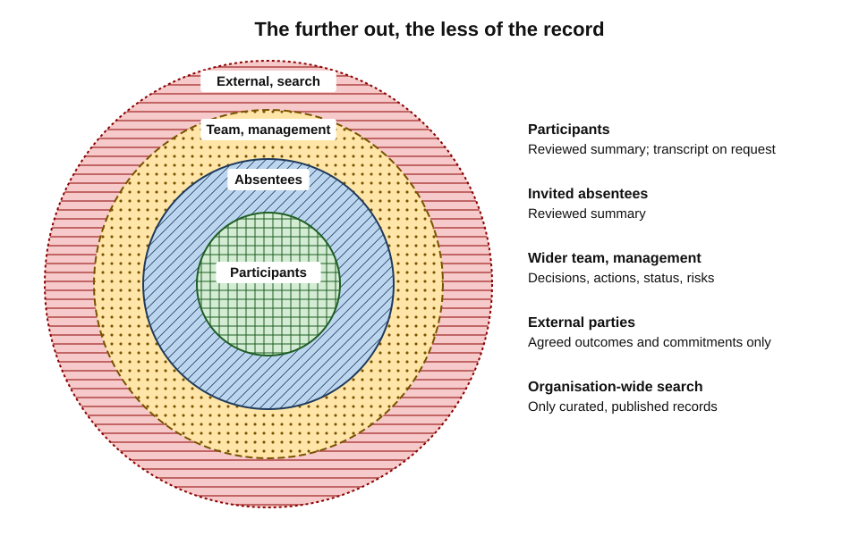
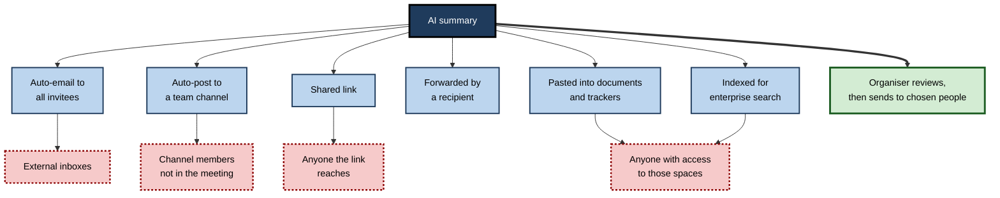
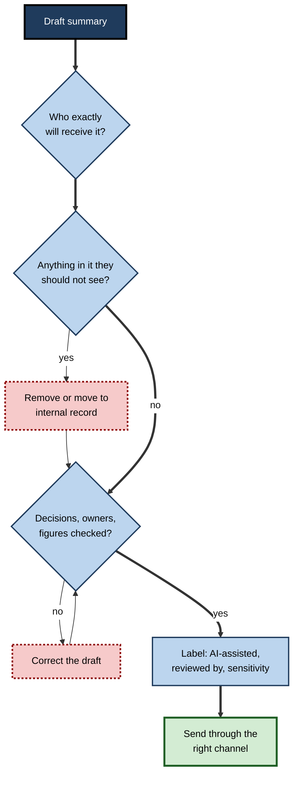
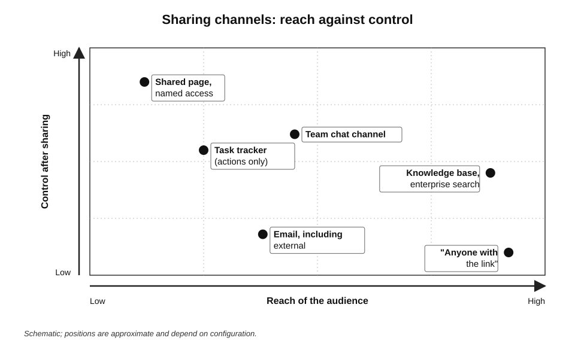
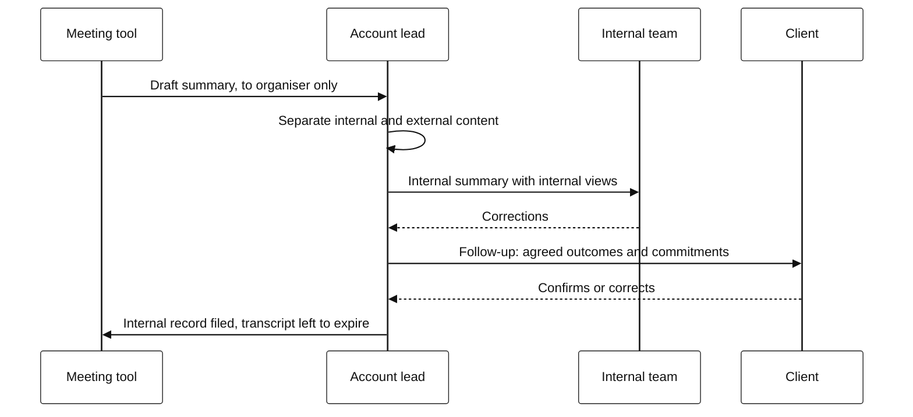

# G.9. Sharing summaries appropriately

A team holds a client call, and the client drops off five minutes before the end. The team stays on and speaks frankly: the client's budget is unrealistic, their project lead is "out of his depth", and the team will pad the estimate. The AI note-taker, still running, adds all of it to the summary — and its default setting emails the summary to every invitee. Including the client.

> **Definition — Distribution (of a summary):** the act of making a meeting summary or transcript available to people — by email, chat post, shared link, document or system — and the set of people who can therefore read it.

> **Definition — Need to know:** the principle that information should be shared only with people who require it for their role or task.

**Why it matters**

- **Summaries travel further than meetings** — a meeting has a fixed set of people; its summary can reach anyone, indefinitely.
- **Defaults share widely** — many tools send summaries to all invitees, post them to channels, or make them findable through enterprise search.
- **Content is mixed** — one summary may contain public decisions, internal opinions, personal data and confidential figures side by side.
- **Mistakes are hard to undo** — an email cannot be recalled from an external inbox; a forwarded summary cannot be un-forwarded.

---

## Who Should See What

### Audiences of a meeting record

- **Participants** — usually entitled to the record of what they took part in, subject to the meeting's purpose.
- **Invited absentees** — need the outcome, often not the full discussion.
- **The wider team** — may need decisions and actions, rarely the conversation.
- **Managers and sponsors** — need status, risks and decisions.
- **External parties** — clients, suppliers, partners: need **agreed** outcomes and commitments, never internal views.
- **Systems** — trackers, knowledge bases and enterprise assistants, which then expose content to *their* users.

**Figure 1.** Audience rings: the further out, the less of the record each audience should receive.

| | Participants | Invited absentees | Wider team | External parties | Organisation-wide search |
|---|---|---|---|---|---|
| Full transcript | Usually, on request | Rarely | No | No | No |
| Reviewed summary | Yes | Yes | Selected parts | No | Only if deliberately published |
| Decisions and actions | Yes | Yes | Yes | Agreed ones only | Through proper records |
| Internal opinions, frank remarks | In the transcript only | No | No | Never | No |
| Personal data | As needed | Only if needed | Rarely | Rarely | No |

> **Key point:** the further an audience is from the meeting, the more the record should be **reduced to agreed outcomes** — decisions and actions — and the less of the **conversation** it should contain.

### The least-sharing principle

- **Start from the smallest audience** that needs the record, and widen deliberately.
- **Share the smallest form** that serves the purpose — actions rather than summary, summary rather than transcript.
- **Share for a purpose** — "so that you can do X" — not "for information" by default.

> **Definition — Least privilege:** a security principle under which people and systems are given only the access they need for their task; applied to meeting records, it means sharing the minimum content with the minimum audience.

---

## How Summaries Spread

**Figure 2.** Routes by which a meeting summary reaches readers.

- **Auto-email to invitees** — includes external guests, people who declined, and people who left early.
- **Auto-posting to channels** — reaches channel members who were never in the meeting.
- **Shared links** — "anyone with the link" settings let content travel beyond the organisation.
- **Forwarding and pasting** — each copy escapes the original's controls.
- **Enterprise search and assistants** — an assistant that answers "what's happening with the Atlas project?" may surface a summary to anyone who has technical access to where it is stored, including people who should not see it.

> **Definition — Oversharing (permissions):** content being accessible to more people than intended because of broad default permissions, often discovered when an enterprise AI assistant surfaces it in answers.

> **Watch out:** enterprise assistants do not create permission problems; they **reveal** them. A summary saved to a widely shared folder was always readable by everyone with access — the assistant simply makes it easy to find.

---

## What Goes Wrong

### Case study: the transcript that kept running (2024)

- **Situation:** in 2024 an engineer and researcher described publicly how, after a video meeting with a venture-capital firm, he received an automatic transcript from the firm's AI note-taker.
- **What happened:** the transcript included the investors' conversation **after he had left the call**, in which they discussed confidential matters, including details about their own business.
- **Consequence:** he said he decided not to proceed with the deal.
- **Mechanism:** the note-taker kept recording after an external participant left, and automatically sent the full transcript to the attendees.
- **Lesson:** the most damaging sharing errors combine two defaults — **recording that continues after the audience changes**, and **automatic distribution** to everyone on the invitation.

### Common failures

- **The post-meeting conversation** — internal discussion after external guests leave is captured and sent to them.
- **The pre-meeting chat** — remarks before guests arrive are captured.
- **The stale invitation list** — people who changed roles, left the project or declined receive the summary.
- **Mixed content** — one sensitive item in a routine meeting travels with the routine summary.
- **Frank characterisations** — opinions about people, clients or partners become written statements.
- **Wrong attributions amplified** — an error in the summary is now in fifty inboxes.
- **Loss of context** — readers far from the meeting misread a tentative idea as a plan.

> **Remember:** when the **audience** of a meeting changes — someone joins, someone leaves — the **record** should be treated as covering two different meetings.

### Context collapse

**Study card — Marwick and boyd (2011), "context collapse"**

- **Setting:** interviews with users of a public social-media platform about how they imagined their audience.
- **Finding:** people normally adjust what they say to the audience in front of them; online, many different audiences — friends, colleagues, family, strangers — collapse into one, so a message written for one group is read by others.
- **Concept:** **context collapse** — the flattening of multiple audiences into a single one.

> **Definition — Context collapse:** the situation in which content created for one audience reaches several different audiences at once, each of whom reads it through their own expectations.

- **Meeting summaries collapse context in the same way:**
  - the meeting had a particular audience, with shared background and tone;
  - the summary reaches people who lack that background — a frank phrase reads as hostile, a tentative idea reads as a plan, a joke reads as a statement;
  - the AI that wrote the summary had no sense of who would read it.
- **Implication** — summaries should be written, or at least reviewed, with the **actual readers** in mind, not the people who were in the room.

---

## Personal Data in Summaries

Meeting summaries are full of information about people: who said what, who is responsible for what, who is struggling, who is on leave. Sharing them is sharing personal data.

- **People mentioned but not present** — "Ravi is off sick until next week", "the new hire is struggling" — are often discussed in meetings and then named in summaries they never see.
- **Opinions about people** — a manager's view of an employee's performance becomes a written record about that employee, which they may be entitled to see.
- **Special-category information** — health, family circumstances, religious observance, union activity — may appear in passing.
- **Contact and personal details** — phone numbers, home locations, personal plans mentioned in small talk.

### Reducing personal data before sharing

- **Remove what the audience does not need** — "Ravi is on leave until 12 May" may become "Ravi's tasks are covered by Asha until 12 May".
- **Use roles, not names**, where names add nothing — "the client's finance lead" rather than a name, when sharing more widely.
- **Never include health or personal circumstances** in general summaries; handle them through the proper channel.
- **Separate facts from opinions** — keep evaluations of people out of shared records altogether.
- **Ask the tool to omit** — instructions such as "do not include information about individuals' health, personal circumstances or performance" reduce what has to be removed by hand.

> **Key point:** under data-protection law, sharing a summary is processing the personal data in it. The question is not only "is this confidential?" but "**does each recipient need this information about this person?**"

| | Original summary line | Shared version | Why |
|---|---|---|---|
| Absence | "Ravi is off with a back injury until 12 May" | "Ravi's tasks covered by Asha until 12 May" | Health data removed; operational fact kept |
| Performance | "Tom's estimates keep slipping; he may not be up to it" | (removed) | Opinion about a person; belongs in a private conversation |
| Client contact | "Spoke to Meera Shah, client finance, on her mobile" | "Client finance lead consulted" | Personal contact detail unnecessary |
| Personal plans | "Priya off for her wedding in June" | "Priya on leave 10–21 June" | Personal detail unnecessary |

*Illustrative example.*

---

## Sharing With Other AI Systems

Summaries are increasingly passed not only to people but to other AI tools.

- **Pasting into public chatbots** — to translate, rewrite or analyse a summary — sends its contents outside the organisation's control, under the chatbot provider's terms.
- **Feeding enterprise assistants** — summaries stored in shared locations become material that assistants search and quote; their errors and sensitive content travel with them.
- **Automated workflows** — summaries sent automatically to task trackers, customer-relationship systems or reporting tools carry personal data into systems with their own access rules and retention.

> **Watch out:** "I only pasted the summary, not the transcript" offers little protection. A good summary is the **distilled** sensitive content of the meeting — often more revealing, line for line, than the transcript itself.

---

## Tailoring Summaries to Audiences

### One meeting, several records

Mature teams produce different records for different readers rather than sharing one summary with everyone.

- **Internal record** — full reviewed summary for the team: decisions, actions, risks, internal views.
- **Client or partner follow-up** — agreed outcomes and commitments by both sides, in neutral language.
- **Management update** — status, decisions needed, risks.
- **Decision log entry** — the decision, rationale and authority, filed in the right place.

### Worked example (illustrative): turning an internal summary into a client follow-up

**Situation:** after a project review with a client, the AI produces a summary. The account lead prepares the client follow-up.

| Item in AI summary | Decision for client follow-up | Reason |
|---|---|---|
| "Client agreed to extend user testing to 15 March" | **Keep** — reword as agreed outcome | Agreed by both sides |
| "Team will deliver revised data model by 1 March" | **Keep** | Our commitment |
| "Client project lead seemed unprepared on data volumes" | **Remove** | Opinion about a person |
| "Internal view: fixed price at risk if scope grows" | **Remove** | Internal commercial position |
| "Client's IT director raised concern about vendor lock-in" | **Keep, carefully worded** — "Concern raised about long-term flexibility; we will set out options" | Client's own point, with our response |
| "Budget discussed: client indicated £250,000 ceiling" | **Check** — only include if the client stated it in the meeting for the record | Commercially sensitive; confirm wording |
| Post-meeting internal discussion on staffing | **Remove** | Not part of the client meeting |

*Illustrative example.*

- **Result:** a seven-line follow-up with agreed outcomes and commitments by both sides; internal views remain in the internal record only.

> **Watch out:** "just send them the AI summary" is the most common route by which internal opinions reach clients. External follow-ups should be **written for** the external audience, using the summary as a source.

### Summaries for leadership

Senior leaders increasingly receive summaries of summaries: an assistant condenses a week of project meetings into a briefing.

- **The telephone-game problem** — each layer of summary drops detail and may add distortion; a condition lost in the first summary is absent from every later one.
- **Missing dissent** — consensus smoothing compounds across layers, so leaders see a calmer picture than the teams experienced.
- **Missing provenance** — a briefing that cannot point back to the meetings it came from cannot be checked.
- **Good practice:**
  - briefings link each point to its source meeting or decision record;
  - a person responsible for the area adds a line of judgement — what is going well, what is worrying;
  - leaders treat AI briefings as prompts for questions, not as a picture of reality.

> **Watch out:** the further a summary travels up an organisation, the more confident it tends to sound and the less evidence it carries. Seniority of the reader should increase, not decrease, the demand for sources.

---

## Reviewing Before Sending

**Figure 3.** Reviewing a summary before it is shared.

- **Audience** — list the actual recipients; remove people who left, declined or changed role; separate internal from external.
- **Content** — remove opinions about people, internal positions, unrelated sensitive items, pre- and post-meeting talk.
- **Accuracy** — check decisions, owners, figures and attributions.
- **Labels** — note that the summary was AI-assisted and who reviewed it; apply a sensitivity label where relevant.
- **Channel** — choose the medium that reaches the right people and no one else.

> **Mnemonic — "SHARE":** **S**cope the audience, **H**old back what is not theirs, **A**ccuracy checked, **R**emove remarks about people, **E**xplain status (AI-assisted, reviewed by whom).

> **In practice:** a simple header — "*AI-assisted summary, reviewed by A. Mehta, 14 May. Internal only.*" — tells readers both how far to trust the content and how far to share it.

---

## Choosing the Channel

| | Email | Team chat channel | Shared document or page | Task tracker | Enterprise knowledge base |
|---|---|---|---|---|---|
| Reach | Named recipients, plus forwards | All channel members, present and future | Everyone with access to the space | Project members | Broad, often organisation-wide |
| Control after sending | Low — cannot recall externally | Moderate — can edit or delete | High — permissions adjustable | Moderate | Moderate |
| Permanence | High | High, searchable | Editable, versioned | Linked to tasks | High, indexed |
| Best for | External follow-ups; formal outcomes | Team-internal decisions and actions | Living records corrected together | Actions only | Published decisions, approved summaries |

**Figure 4.** Sharing channels compared by reach and control.

- **Channel etiquette for summaries:**
  - post the summary in the channel that matches the meeting's audience, not the largest available one;
  - post the outcome-first section in the message and link to the full summary, so readers who need detail can open it;
  - mark summaries of sensitive or external meetings so they are not re-shared casually;
  - thread replies and corrections under the summary, so the correction travels with it.
- **Chat channels** grow: a summary posted today is readable by everyone who joins the channel next year.
- **Shared links** should be restricted to named people or the organisation, and set to expire where possible.
- **Knowledge bases** should receive **curated** records — approved decisions and summaries — not raw meeting output.

---

## Settings That Prevent Oversharing

- **No automatic distribution** — summaries go to the organiser for review first.
- **Internal-only by default** — summaries not sent to external domains automatically.
- **Recording stops when the audience changes** — or at least, the organiser is prompted when an external participant leaves or joins.
- **Restricted link sharing** — no "anyone with the link" for meeting records.
- **Sensitivity labels** — confidential meetings produce summaries that cannot be forwarded externally or posted to open channels.
- **Permissions hygiene** — meeting records stored in places with appropriate access, reviewed before enterprise assistants are switched on.

**Figure 5.** Sending a client follow-up from an AI-assisted meeting.

---

## Correcting a Summary After It Has Been Shared

Errors discovered after sharing are common: a wrong owner, a dropped condition, a misattributed remark.

- **Correct the source** — update the stored summary so that later readers, searches and assistants use the corrected version.
- **Notify the same audience** — everyone who received the error should receive the correction; a correction sent to fewer people than the error leaves the error standing.
- **Say what changed** — "Correction: the licence cost will be absorbed by the client, not by us, as the summary stated" is clearer than a silently revised attachment.
- **Version clearly** — mark the corrected summary with a date and "corrected", so that readers know which version they hold.
- **Follow the copies** — where the summary was pasted into documents or trackers, correct those too.

> **In practice:** a correction is part of the record. Teams that correct openly and quickly build trust in their summaries; teams that correct quietly teach readers to distrust all of them.

### Sharing with auditors, regulators and courts

- **Requests are formal** — when auditors, regulators or courts ask for meeting records, the legal or compliance team should manage the response, not individual staff.
- **Completeness matters** — the transcript, the summary and any corrections may all be relevant; selective sharing can mislead.
- **Status labels help** — records marked "AI-assisted, reviewed by…" and "corrected on…" are easier to explain than unlabelled ones.

---

## Sharing in Organisational Practice

- **Policy** — who may share meeting records with whom, and in what form; a rule that external follow-ups are written for the external audience.
- **Configured defaults** — review-before-send, internal-only, no anonymous links.
- **Training** — especially for client-facing, sales and leadership roles, on the post-meeting conversation and on tailoring.
- **Incident response** — when a summary reaches the wrong people: ask recipients to delete, assess whether personal data or confidential information was exposed, notify where required, fix the setting that caused it.
- **Readiness for enterprise assistants** — permissions reviewed so that meeting records are not surfaced to people who should not see them.

### Case study (illustrative): the internal debrief that reached the client

- **Situation:** a consulting team's weekly client meeting was followed, on the same call, by a ten-minute internal debrief after the client left. The team's note-taker sent the full summary to all invitees automatically.
- **Problem:** the client's sponsor received a summary including the team's view that the client's data was "a mess" and that a junior client analyst was "slowing everything down".
- **Diagnosis:**
  1. recording continued after the audience changed;
  2. automatic distribution to all invitees, including the client;
  3. frank remarks about named people captured in writing.
- **Actions:**
  1. apology to the client and the analyst concerned;
  2. internal debriefs held as separate, unrecorded calls;
  3. note-taker set to send summaries to the organiser only; external follow-ups written by the account lead;
  4. firm-wide reminder: no characterisations of people in recorded meetings.
- **Result:** the relationship recovered after a difficult month; no recurrence.
- **Lesson:** the safest default is that **a summary has no audience until a person chooses one**.

---

## Open Questions

- **Who owns a meeting summary?**
  - The organiser, all participants, or the organisation — ownership determines who may share it, and practice is unsettled.
- **Should participants approve summaries before external sharing?**
  - Approval improves accuracy and trust but slows follow-up; norms differ across professions.
- **Can tools detect audience changes reliably?**
  - Prompting when external people leave is technically simple; separating "internal" from "external" content within one conversation is harder.
- **How will enterprise assistants change sharing?**
  - When everything stored is findable, permissions become the real sharing decision; many organisations are only now auditing them.
- **Should AI-assisted summaries always be labelled?**
  - Labels help readers calibrate trust; whether they become universal norms is still developing.

---

## Summary

- **Distribution** determines who can read a meeting record; **need to know** and **least privilege** say: smallest audience, smallest form, clear purpose.
- Audiences form **rings** — participants, absentees, team, management, external parties, systems; outer rings should receive only **agreed outcomes**.
- Summaries spread by **auto-email, channel posts, links, forwarding, pasting and enterprise search**; assistants reveal **oversharing** caused by broad permissions.
- Typical failures: the **post-meeting conversation**, pre-meeting chat, stale invitation lists, mixed content, frank remarks about people, amplified errors, lost context.
- Summaries suffer **context collapse**: written for the room, read by people without its background.
- Sharing a summary is sharing **personal data**: remove health, personal circumstances, opinions about people and unnecessary names.
- Pasting summaries into **other AI systems** moves their distilled sensitive content outside the organisation's control.
- Produce **different records for different readers**; write external follow-ups **for** the external audience.
- **Correct openly**: fix the source, notify the same audience, say what changed.
- Review before sending — **SHARE**: scope the audience, hold back, accuracy, remove remarks about people, explain status.
- Choose channels by **reach, control and permanence**; curate what enters knowledge bases.
- Defaults matter: **review-before-send, internal-only, stop when the audience changes, restricted links, sensitivity labels**.

---

## Self-Check

1. Define distribution, need to know and least privilege as they apply to meeting summaries.
2. Describe the audience rings and what each should receive.
3. List five routes by which a summary can spread.
4. Why do enterprise assistants expose oversharing rather than cause it?
5. Explain the post-meeting conversation problem with reference to the 2024 case.
6. Why should an external follow-up be written rather than forwarded from the AI summary?
7. Classify these items for a client follow-up: an agreed deadline; an internal view of profitability; a client's stated concern; a remark about a client employee's competence.
8. Explain the SHARE mnemonic.
9. Compare email and a team chat channel for sharing a summary.
10. Name four settings that reduce oversharing.
11. A summary containing frank internal remarks has been emailed to a client. What should happen next?
12. What header would you put on an internal AI-assisted summary, and why?
13. What is context collapse, and how does it apply to meeting summaries?
14. Rewrite "Ravi is off with a back injury until 12 May" for a project-wide summary, and explain the change.

### Answer Key

1. Distribution: making a summary available and the resulting set of readers. Need to know: share only with those who require it. Least privilege: give the minimum access needed — minimum content to the minimum audience.
2. Participants — reviewed summary, transcript on request; invited absentees — reviewed summary; wider team — decisions and actions; management — status, decisions, risks; external parties — agreed outcomes and commitments only; systems and organisation-wide search — only deliberately published, curated records.
3. Any five: auto-email to invitees; auto-post to channels; shared links; forwarding; pasting into documents and trackers; indexing by enterprise search and assistants.
4. The content was already accessible to anyone with permission to its storage location; assistants simply make it easy to find and surface in answers, revealing that permissions were too broad.
5. A note-taker kept recording after an external participant left and automatically sent the full transcript, including the hosts' confidential discussion, to that participant, who then withdrew from the deal. Recording and distribution did not adjust when the audience changed.
6. The AI summary mixes agreed outcomes with internal opinions, positions and remarks about people; an external follow-up should contain only agreed outcomes and commitments in neutral language written for the client.
7. Agreed deadline — keep. Internal view of profitability — remove. Client's stated concern — keep, carefully worded with our response. Remark about competence — remove.
8. Scope the audience; Hold back what is not theirs; Accuracy checked; Remove remarks about people; Explain status (AI-assisted, reviewed by whom, sensitivity).
9. Email reaches named recipients but cannot be recalled externally and is easily forwarded. A channel reaches all present and future members, is searchable, and can be edited or deleted; it suits team-internal outcomes, not external ones.
10. Any four: review before send; internal-only default; stop or prompt when the audience changes; restricted links; sensitivity labels; permissions hygiene before enabling assistants.
11. Apologise and ask the recipient to delete it; assess whether personal data or confidential information was exposed and whether notification is required; inform affected people where appropriate; fix the settings and practices that caused it.
12. For example: "AI-assisted summary, reviewed by [name], [date]. Internal only." It signals how far to trust the content and how far it may be shared.
13. Content created for one audience reaching several at once, each reading it with different expectations. A summary written from a meeting with shared background and tone is read by people without that context, so frank phrases, tentative ideas or jokes are misread.
14. For example: "Ravi's tasks are covered by Asha until 12 May." The health detail is removed because recipients do not need it; the operational fact they need is kept.

---

## Glossary

| Term | Meaning |
|---|---|
| Audience ring | A level of distance from a meeting, from participants outwards, governing how much of the record is shared. |
| Auto-distribution | Automatic sending or posting of a summary without human review. |
| Context collapse | Content created for one audience reaching several audiences at once. |
| Distribution | Making a record available, and the set of people who can read it. |
| Least privilege | Giving only the access needed for a task. |
| Need to know | Sharing information only with people who require it for their role. |
| Oversharing | Content accessible to more people than intended because of broad permissions. |
| Post-meeting conversation | Discussion after some participants leave, at risk of being captured and shared with them. |
| Sensitivity label | A classification that restricts how content can be shared. |
| Tailored record | A version of a meeting record written for a specific audience. |
