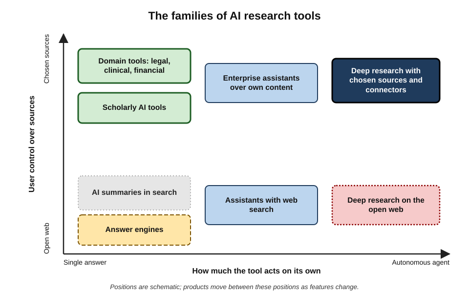
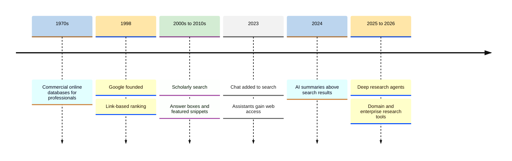
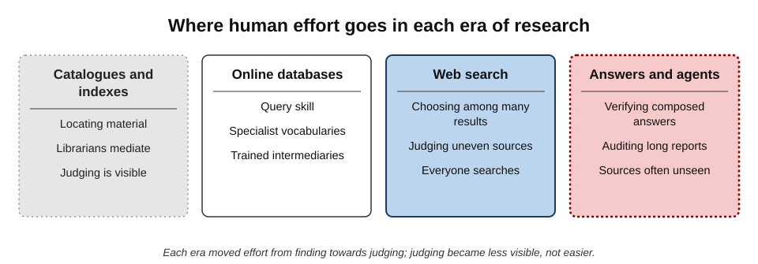
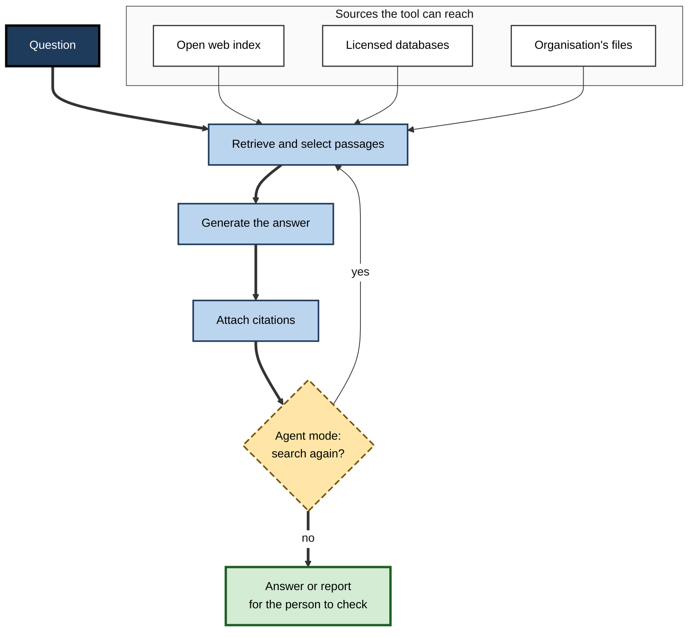
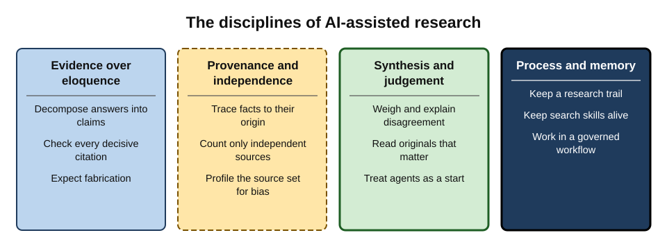
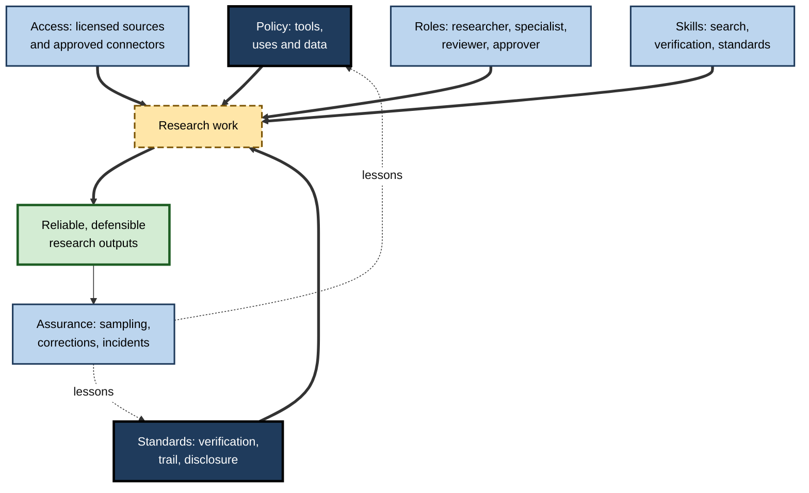

# H. AI in Search & Research

For twenty-five years, finding something out at work meant typing words into a search box and reading what came back. Since 2023 a different pattern has spread: asking a question in ordinary language and receiving a composed answer, often with citations — or delegating a whole investigation to an agent that searches, reads and writes for half an hour.

Research has become faster, broader and more fluent. It has not become more reliable by default. The professional who uses these tools well gains days; the one who uses them carelessly can put invented cases before a court or false figures before a board.

> **Definition — AI-assisted search and research:** the use of AI systems — answer engines, AI summaries in search, assistants with web or document search, deep research agents and specialist research tools — to find, read, summarise, compare and synthesise information in order to answer questions and inform decisions.

**Why the subject matters**

- **Research is everyone's work.** Analysts, managers, lawyers, clinicians, engineers, marketers and civil servants all look things up, assemble evidence and make claims on it.
- **The interface has changed.** The default output of search is moving from a list of sources to an answer, and from an answer to a report.
- **The failure modes have changed.** Errors now arrive fluent, cited and confident; the old cues for doubt — a poor website, an obvious gap — are hidden.
- **Accountability has not changed.** The person who relies on a fact, signs a document or advises a client remains responsible for it.
- **The skills transfer.** Products change monthly; the disciplines of evidence — provenance, independence, verification, proportion — last a career.

---

## The Scope of the Subject

### What counts as AI-assisted research

- **Any research task in which an AI system mediates** between the person and the sources: interpreting the question, retrieving material, selecting it, summarising it or composing an answer.
- **Not only chat tools.** AI now sits inside search engines, office suites, browsers, document libraries, legal and medical databases and company intranets — often without a label.
- **Not only the web.** The same tools search an organisation's own files, mail and databases.

### The families of tools

- **AI summaries in search engines** — generated paragraphs above ordinary results.
- **Answer engines** — services built around cited, generated answers.
- **General assistants with search** — chat assistants that search the web or connected sources during a conversation.
- **Deep research agents** — modes that plan, search, read and write long cited reports over many minutes.
- **Scholarly AI tools** — search, summarisation and data extraction over academic literature.
- **Domain tools** — AI features inside licensed legal, clinical, financial and technical databases.
- **Enterprise assistants** — tools that search an organisation's own content within users' access permissions.

**Figure 1.** The families of AI research tools, by how much the user controls the sources and how much the tool acts on its own.

> **Key point:** the families differ less in their underlying models than in **which sources they can reach** and **how much they decide on the user's behalf**. Both determine what can go wrong.

---

## From Catalogues to Agents: A Short History

### Four eras of finding things out

- **Catalogues and indexes (to the 1960s).** Card catalogues, printed indexes and abstracting services organised knowledge by subject; librarians mediated searches.
- **Online databases (1970s–1990s).** Commercial services gave professionals Boolean searching over bibliographic, legal and business databases, usually through trained intermediaries.
- **Web search (1990s–2022).** Search engines gave everyone ranked lists of web pages; Google, founded in 1998, made link-based ranking dominant; scholarly search followed in the 2000s; answer boxes and featured snippets began to quote passages directly.
- **Generative answers and agents (2023 onwards).** Chat assistants gained web search; search engines added AI summaries; deep research agents appeared from December 2024.

**Figure 2.** Milestones from database searching to research agents.

### What each era asked of the person

- **The database era** asked for **query skill** — knowing the vocabulary and the logic of the database.
- **The web era** asked for **source judgement** — choosing among many results of uneven quality.
- **The answer era** asks for **verification** — checking a composed answer against sources the person may never have seen.
- **The agent era** asks for **auditing** — reviewing a long report built from many decisions made by a machine.

> **Key point:** each era moved the human role further from **finding** and closer to **judging**. The judging has not become easier; it has become less visible.

**Figure 3.** Where human effort goes in each era of research: from finding towards checking.

---

## How AI Research Tools Work, in Outline

### Retrieval, generation and agency

- **Retrieval** — the tool searches an index (the web, a database, an organisation's documents) and returns candidate passages.
- **Generation** — a language model writes an answer using those passages as context, together with patterns learned in training.
- **Citation** — links are attached to some sentences.
- **Agency** — in deep research modes, the model decides what to search next, repeating the cycle many times before writing.

> **Definition — Retrieval-augmented generation (RAG):** an architecture in which a language model is given retrieved documents before generating, so that its output can draw on specific or current information.

**Figure 4.** The general architecture of an AI research tool.

### What the architecture predicts

- **An answer is only as good as the sources reached.** Paywalled, offline, foreign-language and internal sources are often missed.
- **Generation can exceed retrieval.** A model may add content not in its sources, especially where they are thin.
- **Selection is invisible.** The person sees what was cited, not what was read and discarded.
- **Agency compounds.** Long chains of small decisions amplify small error rates.

---

## The Evidence on Reliability

Since 2023 a body of independent research has tested AI search and research tools. The studies differ in method, task and date, so their figures cannot be compared directly; together they show consistent **kinds** of failure.

| Study | Institution and date | What was tested | Headline finding |
|---|---|---|---|
| Verifiability of generative search | Stanford University, 2023 | Four generative search engines' answers and citations | About half of sentences fully supported by their citations; more fluent answers less well supported |
| Fabricated references | Walters and Wilder, *Scientific Reports*, 2023 | ChatGPT literature reviews without web search | 55% (GPT-3.5) and 18% (GPT-4) of references fabricated |
| Legal research tools | Stanford RegLab, 2024 (published 2025) | Specialist legal AI tools and a general model | Hallucinated or misgrounded answers in roughly 17–33% of queries for specialist tools |
| Citation of news | Tow Center for Digital Journalism, Columbia University, 2025 | Eight AI search tools identifying news sources | Collectively wrong on more than 60% of 1,600 queries |
| News integrity | BBC and European Broadcasting Union, 2025 | Four assistants answering news questions in 14 languages | 45% of answers had a significant issue; sourcing the largest problem |
| Effect on clicking | Pew Research Center, 2025 | Real browsing of about 900 US adults | Clicks on results fell from about 15% to 8% of visits when an AI summary appeared |

> **Watch out:** these are snapshots of products that change every few months, mostly on hard tasks (news, law, precise citation). They show **where to look for failure**, not a fixed error rate for any tool today.

### The pattern across studies

- **Attribution is the weakest link.** Saying accurately **where** information came from fails more often than stating the gist.
- **Fluency hides failure.** The most confident and readable answers are not the best supported.
- **Specialist sources help but do not cure.** Domain tools reduce invention but still misground.
- **People check less.** AI summaries reduce the reading of underlying sources.

---

## The Disciplines of AI-Assisted Research

The tools are new; the disciplines that make research trustworthy are old. What has changed is how easily each can be skipped.

### Evidence over eloquence

- **A composed answer is a claim, not evidence.** The professional habit is to decompose answers into claims and trace the decisive ones to the sources closest to the facts.
- **Citations are promises to be checked**, not proofs: a cited source must exist, be the one described, support the claim in context and still be valid.
- **Fabrication is structural.** Language models can generate perfect-looking references, quotations and statistics for things that do not exist, so the habit of opening the primary record is permanent.

### Provenance and independence

- **Every important fact needs an origin** — the registry, statute, study or filing closest to it.
- **Agreement means little without independence.** Many sources repeating one original — or many AI tools retrieving the same pages — are one source until their family tree shows otherwise.
- **Retrieved sets are never random samples.** What gets written, indexed, ranked and selected skews the evidence before a question is even asked.

### Synthesis and judgement

- **Synthesis is more than summary.** It weighs evidence by method, relevance and independence, explains disagreement and states confidence — work that AI can scaffold but not own.
- **Originals carry the conditions.** Summaries keep headlines and drop exceptions, baselines and definitions; whatever is quoted, decisive or binding must be read at source.
- **Agents widen, but do not deepen, the view.** Deep research modes gather broadly and quickly, but their limits — source access, compounding errors, missing negatives — make them a starting point, not a finish.

### Process and memory

- **Research must be reconstructable.** AI outputs cannot be regenerated, so a record of questions, tools, sources, checks and decisions is what makes AI-assisted work defensible.
- **Skills must be kept alive.** Query craft, knowledge of specialist sources and lead-following are the abilities that let a person check and correct an AI.
- **Workflows, not tools, produce reliability.** Sound practice assigns AI to orienting, gathering, navigating and drafting, and keeps people at framing, reading, weighing and verifying.

**Figure 5.** The disciplines of AI-assisted research, grouped by what they protect.

> **Mnemonic — "PIVOT":** **P**rovenance, **I**ndependence, **V**erification, **O**riginals, **T**rail — the five habits that turn an AI answer into evidence.

---

## The Economics and Ecology of AI Search

### Fewer clicks, fewer visits

- **Answer-first interfaces reduce visits** to the sites whose content they use, as the Pew Research Center's 2025 browsing study showed.
- **Publishers depend on those visits** for advertising and subscriptions; reduced traffic threatens the funding of the journalism, reference work and analysis that AI answers draw upon.
- **Responses have varied:** some publishers block AI crawlers; some license content to AI companies; some have gone to court over the use of their work.

### Optimising for machines

- **Generative engine optimisation** — shaping content to be retrieved and cited by AI systems — is a growing commercial practice.
- **Experiments in 2024 by researchers at Princeton University and collaborators** showed that features such as quotations, statistics and citations measurably increased content's visibility in generative answers.
- **Consequence:** visibility in AI answers increasingly reflects **optimisation**, not only **authority** — reinforcing the need to judge sources directly.

### Machine-generated content in the record

- **AI-generated text is increasingly published** on the web, sometimes at scale and without disclosure.
- **AI tools can then retrieve it**, creating loops in which machine output becomes a "source" for further machine output.
- **Fabricated material has entered formal records** — court filings, published papers, government and consultancy reports — from which it may be cited onwards.

> **Key point:** the information ecosystem that AI research tools depend on is itself being changed by them. Professionals need to know not only how to use the tools, but how the **sources** around them are shifting.

---

## Landmark Debates

### Do AI answers make people know less?

- **For:** experiments in 2025 found that people who learned an everyday topic from an AI summary, rather than from web search, developed shallower knowledge and gave less specific advice; easy access to information has long been shown to inflate people's sense of what they know.
- **Against:** AI explanations can make complex fields accessible and can be used to deepen learning when the person engages actively.
- **State of the evidence:** early, mostly on everyday topics; the effect on professional expertise is unknown. The design of tools and the habits of users probably matter more than the technology itself.

### Will AI research replace analysts?

- **The case for substitution:** agents produce in minutes what took analysts days; much routine gathering and summarising is already automated.
- **The case for transformation:** the bottleneck shifts to framing, judging, verifying and taking responsibility — tasks that require expertise and accountability.
- **A real risk in between:** if junior staff no longer do the gathering, they may not build the judgement needed to audit agents later.

### Can hallucination be solved?

- **Optimists** point to falling fabrication rates with retrieval, better training incentives and abstention.
- **Sceptics** argue that generating plausible text without guaranteed grounding makes some error inherent, and note that newer models have not always been more factual.
- **Practical consensus:** rates will keep falling for common tasks; verification will remain necessary for anything that matters.

### Who is responsible?

- **Courts have been clear:** the person who files or signs is responsible, whatever tool was used.
- **Tribunals have held organisations liable** for statements made by their AI tools — as in the 2024 Canadian case in which an airline was ordered to honour its chatbot's wrong account of its fare policy.
- **Open questions remain** about the liability of tool providers and the standard of care for AI-assisted professional research.

---

## Professional Standards

### Courts and the legal profession

- **Mata v. Avianca (2023).** A US federal court sanctioned lawyers who filed a brief citing six non-existent decisions produced by ChatGPT — the case that made AI fabrication a professional-conduct issue worldwide.
- **England and Wales (2025).** The High Court warned, in a judgment by the President of the King's Bench Division, that lawyers who cite fictitious authorities may face referral to their regulators or contempt proceedings.
- **The scale.** A public database maintained by the legal researcher Damien Charlotin recorded more than **two thousand** court decisions worldwide involving AI-fabricated material by September 2026.

### Publishing, government and consulting

- **Academic publishing:** AI tools cannot be authors; substantive use must be disclosed.
- **Journalism:** newsrooms have adopted rules on AI use and verification after incidents involving fabricated content.
- **Government and consulting:** clients increasingly require disclosure of AI use in commissioned work — a lesson reinforced when a consultancy report for the Australian government was found in 2025 to contain non-existent references.

> **Key point:** across professions the standard has converged: **AI may assist research; people must verify it, disclose it and answer for it.**

---

## Research Governance in Organisations

### The operating model

- **Policy** — which tools may be used for which research, with which data.
- **Access** — licences to specialist databases so that originals can be reached; approved connectors to internal sources.
- **Standards** — verification requirements by type of output; trail depth; disclosure wording.
- **Roles** — researchers, information specialists, reviewers and approvers.
- **Skills** — training in search, verification and the organisation's standards.
- **Assurance** — sampling of deliverables, tracking of post-delivery corrections, incident reporting.

**Figure 6.** An operating model for research governance in an organisation.

### Proportion

- **Light controls** for internal, low-stakes research.
- **Standard controls** for decisions and client work.
- **Strict controls** for legal, regulatory, clinical and published work.

| Output | Typical verification | Typical trail | Typical review |
|---|---|---|---|
| Internal background note | Spot-check surprising claims | Light | None |
| Management recommendation | All decisive claims against originals | Standard | Peer check |
| Client deliverable | All decisive claims and every citation | Standard to full | Second reviewer |
| Filing, submission or publication | Every factual claim and citation | Full | Specialist review and sign-off |

### Case study (illustrative): a public body adopts AI research tools

- **Situation:** a regional health authority's policy team began using AI assistants and a deep research tool for evidence briefings to its board.
- **Early problems:**
  1. a briefing cited a study whose population was children when the policy concerned adults;
  2. a figure for waiting-list growth came from a news article that had misreported official statistics;
  3. nobody could say which parts of a briefing were AI-drafted.
- **Actions:**
  - a short **research standard**: AI for orientation, gathering and drafting; every decisive claim traced to an original; official statistics taken only from the statistics body's own tables;
  - **access** to a clinical evidence database and training from the authority's librarians;
  - a **briefing template** with an evidence appendix, a scope statement and an AI-use note;
  - **review** of each briefing by a second analyst, sampling decisive claims.
- **Result after a year:** board members reported greater confidence in briefings; errors found at review fell; briefings took slightly longer to draft but far less time to defend.
- **Lesson:** the value of AI research tools was realised only when they were placed inside a **governed workflow** with access to originals and clear accountability.

---

## Worked Example (illustrative): One Question, Three Ways of Researching It

**Situation:** a procurement director asks, "Is our main packaging supplier financially sound enough for a five-year contract?"

| | Answer-first | Agent-first | Governed hybrid |
|---|---|---|---|
| Method | Ask an assistant; accept the answer | Run a deep research report; skim it | Frame; orient with AI; go to filings and registries; verify; record |
| Time | Ten minutes | Forty minutes | About half a day |
| Sources actually used | Whatever the tool retrieved: news and the supplier's own site | Dozens of pages, mostly freely available | Filed accounts, credit-agency data, court records, plus AI-gathered leads |
| Typical weakness | Out-of-date figures; no view of liabilities | Volume hides weak sources; scanned filings missed | Slower; needs access to licensed sources |
| Defensible if challenged | No | Partly | Yes |

*Illustrative scenario and timings.*

1. **Frame.** The decision is a five-year commitment; the evidence needed is current financial position, trend and contingent liabilities.
2. **Orient.** An AI assistant explains which filings and ratios matter for a manufacturer and suggests where to find them.
3. **Gather.** The latest filed accounts come from the company registry; a credit report from a licensed agency; a search of court records finds a pending claim.
4. **Read and verify.** The accounts' notes reveal a large loan due for refinancing within eighteen months — absent from every AI summary, because it sat in a note to the accounts.
5. **Synthesise and record.** The briefing states the position, the refinancing risk and the pending claim, with sources and dates, and recommends a contract with financial covenants.

- **Conclusion:** the AI tools saved time at orientation and gathering; the **decisive fact** came from reading an original that the tools had not surfaced.

> **Watch out:** the faster methods would not have been **wrong** so much as **incomplete** — and incompleteness is invisible in a fluent answer.

---

## What Distinguishes Expert AI-Assisted Researchers

- **They frame before they ask.** The question, the decision and the standard of evidence come first.
- **They know their sources.** They can name the authoritative records in their field and go to them directly.
- **They treat answers as leads.** Fluency earns no trust; provenance does.
- **They check where it matters.** Verification effort follows consequence and uncertainty.
- **They look for what is missing** — opposing evidence, failures, other regions, other populations.
- **They keep a trail** without being asked.
- **They say what they do not know.** Confidence levels and gaps are part of every conclusion.
- **They keep their own skills sharp**, so that they can tell when the tool is wrong.

> **In practice:** the expert's advantage is not faster prompting. It is the ability to answer, for any claim in their work, the oldest question in research: **"How do you know?"**

---

## Open Questions

- **Will AI research tools become reliably attributable?**
  - Citation and grounding are improving; guarantees that every claim is supported remain out of reach.
- **What happens to the sources?**
  - If answer-first interfaces erode the economics of publishing, the quality and quantity of new primary content may fall; licensing models are evolving.
- **How should professional standards adapt?**
  - Courts, regulators and professional bodies are defining reasonable verification for AI-assisted work; standards differ across jurisdictions and professions.
- **What will happen to expertise?**
  - If agents do the gathering, how will the next generation develop the judgement needed to supervise them?
- **Can tools be designed to encourage checking?**
  - Interfaces that expose sources, uncertainty and unsupported sentences may help; evidence on their effect is limited.
- **How should research in languages and regions with thin online records be supported?**
  - AI tools inherit the web's coverage gaps; remedies are only beginning to be explored.

---

## Summary

- **AI-assisted search and research** uses answer engines, AI summaries, assistants with search, deep research agents, scholarly and domain tools and enterprise assistants to find, read and synthesise information.
- The history runs from **catalogues and databases** through **web search** to **answers and agents**; each era moved human effort from **finding** to **judging**.
- Tools **retrieve, generate, cite** and, as agents, **repeat**; answers are only as good as the sources reached, and selection is invisible.
- Independent studies (2023–2025) show consistent weaknesses: **attribution**, **fluency hiding failure**, **misgrounding even in specialist tools**, and **reduced checking** by users.
- The disciplines: **evidence over eloquence**, **provenance and independence**, **synthesis and judgement**, **process and memory** — **PIVOT**: Provenance, Independence, Verification, Originals, Trail.
- AI search changes the **economics and ecology** of information: fewer clicks, optimisation for machines, machine-generated content in the record.
- Debates continue on **learning**, **the future of analysts**, **whether hallucination can be solved** and **responsibility**; courts and professions agree that **people must verify, disclose and answer for** AI-assisted work.
- Organisations need **research governance** — policy, access, standards, roles, skills and assurance — in proportion to stakes.
- Expert researchers **frame first, know their sources, treat answers as leads, check where it matters and keep a trail**.

---

## Self-Check

1. Define AI-assisted search and research and name its main families of tools.
2. Describe the four eras of finding things out and what each asked of the person.
3. Outline how an AI research tool works and three things the architecture predicts.
4. Why can the figures from different reliability studies not be compared directly, and what do the studies show together?
5. What is meant by "attribution is the weakest link"?
6. Explain the PIVOT habits.
7. How does generative engine optimisation affect the reliability of AI answers?
8. What is the "loop" problem of machine-generated content in the record?
9. Summarise the debate on whether AI answers make people know less.
10. What have courts established about responsibility for AI-assisted research?
11. Describe the elements of an organisational operating model for research governance.
12. How should verification, trail and review differ between an internal note and a regulatory submission?
13. In the health-authority case study, what three problems arose and what made the difference?
14. A new graduate asks how to become an expert researcher when AI tools do most of the searching. Advise them.

### Answer Key

1. The use of AI systems to find, read, summarise, compare and synthesise information to answer questions and inform decisions. Families: AI summaries in search, answer engines, assistants with search, deep research agents, scholarly AI tools, domain tools and enterprise assistants.
2. Catalogues and indexes (librarian-mediated); online databases (query skill); web search (source judgement among many results); generative answers and agents (verification and auditing of composed outputs).
3. The tool retrieves passages from reachable sources, generates an answer, attaches citations and, as an agent, repeats the cycle. Predictions: answers are limited by reachable sources; generation can exceed retrieval; selection is invisible; agency compounds small errors.
4. They tested different tools, tasks, metrics and dates, and products change quickly. Together they show that attribution is weak, fluent answers are not better supported, specialist tools still misground, and AI summaries reduce checking.
5. Across studies, tools most often fail at saying accurately where information came from — wrong, fabricated or unsupporting citations — even when the gist is right.
6. Provenance (trace facts to their origin), Independence (count only independent sources), Verification (check decisive claims), Originals (read the source when quoted, decisive or binding), Trail (record how the research was done).
7. Content shaped to be retrieved and cited by AI gains visibility regardless of authority, so AI answers may draw disproportionately on optimised rather than authoritative sources.
8. AI-generated text published on the web can be retrieved by AI tools and treated as a source, so machine output becomes evidence for further machine output; fabrications can enter formal records and be cited onwards.
9. Experiments suggest learning from AI summaries can be shallower than from searching, and easy access inflates felt knowledge; but AI can also make fields accessible and support active learning. Evidence is early and mostly on everyday topics.
10. That the person who files or signs is responsible whatever tool was used; courts have sanctioned lawyers for fabricated citations and warned of regulatory and contempt consequences; tribunals have held organisations liable for their AI tools' statements.
11. Policy on tools and data; access to licensed sources and approved connectors; standards for verification, trail and disclosure; defined roles; training; and assurance through sampling, correction tracking and incident learning.
12. Internal note: spot-check surprising claims, light trail, no formal review. Regulatory submission: verify every factual claim and citation, full trail, specialist review and sign-off.
13. A study on the wrong population, a misreported statistic taken from news, and no record of AI drafting. A governed workflow — a research standard, access to originals, a template with evidence appendix and AI note, and second-analyst review — made the difference.
14. For example: use AI to orient and gather, but regularly search specialist sources directly; learn the authoritative records of the field; trace AI-provided figures to originals; read the originals of decisive sources; keep a research trail; seek review from experienced colleagues and librarians; practise explaining "how do you know?" for every claim.

---

## Glossary

| Term | Meaning |
|---|---|
| AI-assisted search and research | Using AI systems to find, read, summarise, compare and synthesise information. |
| AI summary (in search) | A generated paragraph shown above ordinary search results. |
| Answer engine | A search service whose main output is a generated, cited answer. |
| Attribution | Stating accurately where information came from. |
| Deep research agent | An AI mode that plans, searches, reads and writes a long cited report. |
| Domain tool | An AI research feature within a specialist legal, clinical, financial or technical database. |
| Enterprise assistant | An AI tool that searches an organisation's own content within access permissions. |
| Generative engine optimisation | Shaping content to be retrieved and cited by AI systems. |
| Misgrounding | Citing a real source for a claim it does not support. |
| PIVOT | Provenance, Independence, Verification, Originals, Trail. |
| Provenance | The documented origin and history of information. |
| Research governance | Organisational rules and roles for tools, data, verification, records and disclosure in research. |
| Retrieval-augmented generation (RAG) | Giving a language model retrieved documents before it generates. |
