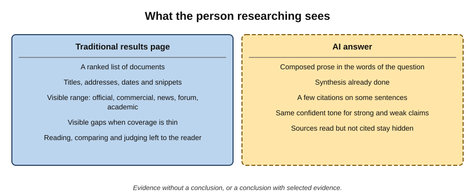
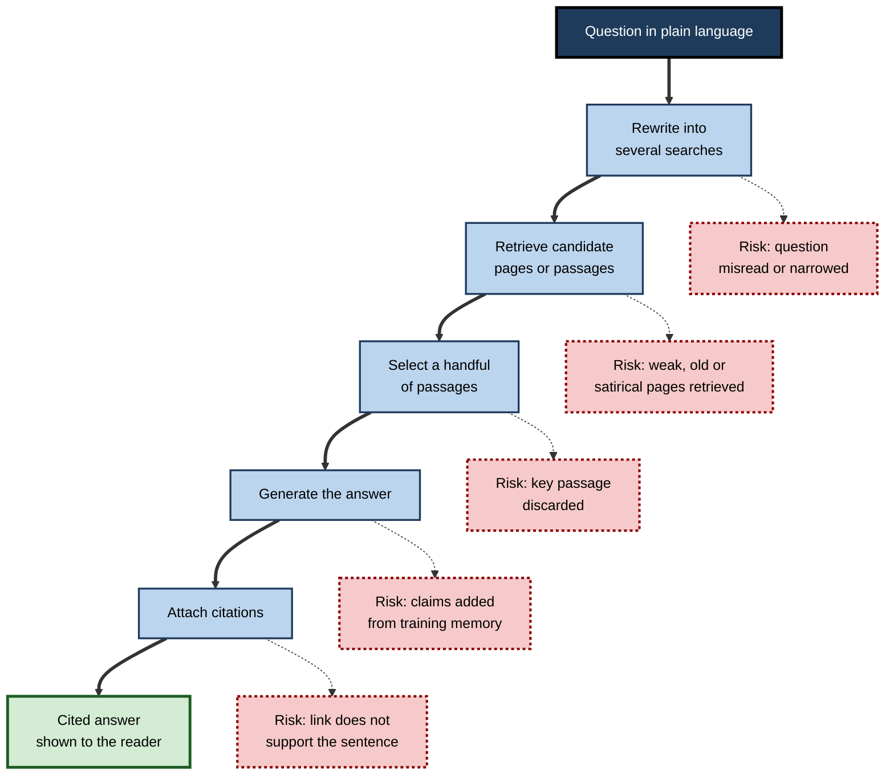
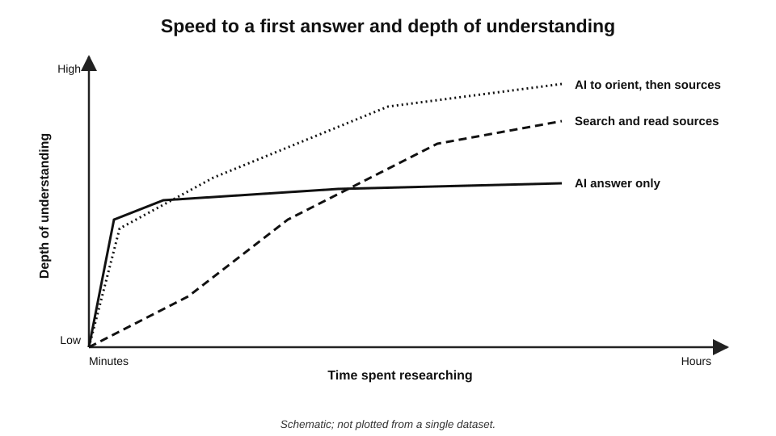
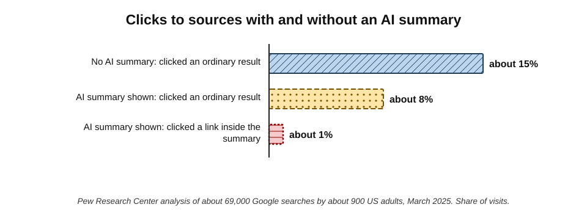
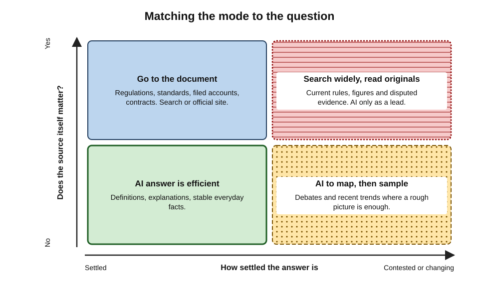
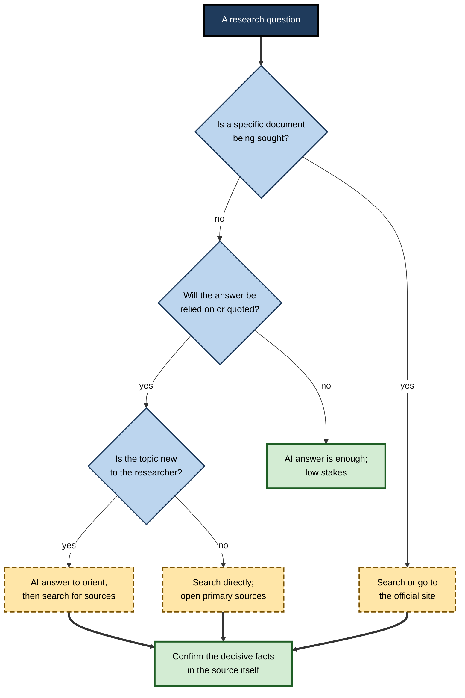

# H.1. AI answers versus traditional search

A procurement analyst types "average payment terms for UK construction subcontractors" into a search engine and gets a page of links: a government consultation, a trade body survey, two law-firm blogs and a forum thread. A colleague asks an AI answer engine the same question and gets three confident paragraphs, a figure of "around 45 days" and four small numbered citations. Both people now hold an answer. Only one of them has seen the **landscape of evidence** from which it came.

Neither has yet checked whether the answer is true.

> **Definition — Traditional search:** retrieval of a ranked list of documents that match a query, leaving the reading, comparison and judgement to the person searching.

> **Definition — AI answer:** a passage of prose generated by a language model in response to a question, usually composed from retrieved web pages or documents and often accompanied by citations to some of them.

**Why the distinction matters**

- **Research behaviour changes with the interface.** A list invites the reader to open, compare and choose; an answer invites the reader to accept and move on.
- **Errors take different forms.** Search fails by returning poor or irrelevant documents, which the reader can see; AI answers fail by stating something wrong fluently, which the reader often cannot see.
- **Accountability differs.** A document has an author and a publisher; a generated answer has neither in the usual sense.
- **Professional standards assume sources.** Auditors, lawyers, clinicians, journalists and analysts must be able to say *where* a fact came from.
- **Both are now everywhere.** Major search engines show AI summaries above their links, and AI assistants run web searches inside conversations, so most professionals use both every day — often without noticing which mode they are in.

---

## Two Ways of Answering a Question

### What a results page offers

- **A ranked list of documents**, each with a title, an address and a short snippet.
  - The ranking reflects relevance, popularity, freshness and many other signals — not truth.
- **Visible diversity.** Government pages, commercial sites, news, forums and academic sources sit side by side, signalling different kinds of authority.
- **Visible absence.** Few or poor results tell the searcher that the question is unusual, badly worded or poorly covered.
- **Work left to the reader.** Opening, reading, judging and combining are the searcher's job.

### What an AI answer offers

- **A composed response** in the language of the question, organised into a direct reply.
- **Synthesis already done.** Points from several pages are merged, reworded and ordered.
- **Selective citation.** Some sentences carry links to sources; many carry none; the sources the tool read but did not cite are usually invisible.
- **Conversation.** Follow-up questions refine the answer without a new search.
- **Uniform confidence.** Well-supported and poorly supported statements arrive in the same tone.

> **Key point:** a results page shows **evidence without a conclusion**; an AI answer shows **a conclusion with selected evidence**. Research needs both, in the right order.

**Figure 1.** What the person researching sees in each mode.

### The kinds of AI answer met at work

- **AI summaries in search engines** — a generated paragraph above the ordinary results (Google's AI Overviews, launched widely in May 2024; similar features in Bing and other engines).
- **Conversational search modes** — a chat-style search experience inside a search engine (for example Google's AI Mode, introduced in the United States in 2025).
- **Answer engines** — services built around generated answers with citations, such as Perplexity.
- **General assistants with search** — ChatGPT, Copilot, Gemini and Claude can search the web during a conversation when the feature is enabled or the model decides it is needed.
- **Workplace assistants** — assistants that search the organisation's own files, mail and intranet before answering.
- **Deep research modes** — agents that run many searches over several minutes and produce a long cited report.

> **Definition — Answer engine:** a search service whose primary output is a generated answer with citations, rather than a list of links.

> **Definition — Zero-click search:** a search after which the person leaves without opening any result, because the results page itself appeared to answer the question.

---

## How an AI Answer Is Assembled

The reader does not need the engineering, but does need enough of the mechanism to know where errors enter.

### From question to cited answer

1. **Interpreting the question.** The system rewrites the request into one or more search queries; complex questions are often split into several sub-queries (**query fan-out**).
2. **Retrieving.** The queries run against a web index, a news index or an internal document store; a few dozen candidate pages or passages come back.
3. **Selecting.** The system keeps a handful of passages judged most relevant — the reader rarely sees which were discarded.
4. **Generating.** A language model writes the answer using those passages as context, together with whatever it absorbed during training.
5. **Attaching citations.** Links are placed against some sentences, either during generation or by matching sentences to passages afterwards.

> **Definition — Retrieval-augmented generation (RAG):** a design in which a language model is given retrieved documents as context before it writes, so that its answer can draw on current or specific information rather than only on its training. The approach was set out by researchers at Facebook AI Research in 2020.

> **Definition — Query fan-out:** splitting one question into several machine-written searches whose results are merged into a single answer.

**Figure 2.** The stages of an AI answer and where errors can enter.

### Why grounding does not guarantee accuracy

- **The retrieved page may be wrong.** A generated answer inherits the errors of its sources — and adds the authority of a neat summary.
- **The model may go beyond its sources.** It can blend retrieved text with remembered material, filling gaps with plausible content.
- **The model may misread its sources.** Conditions, exceptions, dates and negations are easily lost when several passages are compressed into one sentence.
- **The citation may be decorative.** A link can sit beside a sentence it does not support.

> **Watch out:** the presence of citations is often read as proof of accuracy. Citations make an answer **checkable**, not **correct** — and only if the reader actually checks them.

**Study card — Liu, Zhang and Liang, Stanford University (2023)**

- **Question:** how verifiable are the answers of generative search engines?
- **Design:** human annotators audited answers from four engines of the time — Bing Chat, NeevaAI, perplexity.ai and YouChat — to a varied set of questions, checking each sentence against its citations.
- **Results:**
  - on average only about **half (51.5%)** of generated sentences were **fully supported** by their citations (*citation recall*);
  - about **three-quarters (74.5%)** of citations actually supported the sentence they were attached to (*citation precision*);
  - answers that read as **more fluent and useful** tended to have **lower** citation recall and precision.
- **Conclusion:** the qualities that make an answer feel trustworthy were, if anything, inversely related to how well it was supported.

> **Key point:** fluency is a property of the **writing**; support is a property of the **evidence**. The first is no guide to the second.

---

## What Each Mode Does to the Person Researching

### Effort, speed and depth

- **AI answers are fast to a first answer.** A complex question can be "answered" in seconds.
- **Traditional search is slower but leaves more behind.** The searcher sees alternatives, learns which organisations publish on the subject, and builds a mental map of the field.
- **Effort shapes learning.** Working through sources is a form of active processing; receiving a finished synthesis is closer to passive reading.

**Study card — controlled comparisons of learning from AI answers and from links (2025)**

- **Design:** in a series of online and laboratory experiments reported in *PNAS Nexus* in 2025, participants researched an everyday topic (for example how to plant a vegetable garden) either through a language-model summary or through ordinary web search, and then wrote advice for a friend.
- **Results:**
  - people who learned from the AI summary reported **less ownership** of what they learned and wrote **shorter, less specific, more generic advice**;
  - independent readers rated the search-based advice as more helpful and more likely to be followed;
  - the pattern held even when both groups saw the same underlying facts.
- **Conclusion:** receiving synthesis ready-made tended to produce **shallower** knowledge than assembling it.
- **Caveat:** the tasks were everyday, low-stakes topics; effects in expert professional research are less studied.

**Figure 3.** Time to a first answer and depth of understanding in the two modes.

### Clicking, or not

**Study card — Pew Research Center (2025)**

- **Design:** browsing data from about **900 US adults** who agreed to share it, covering roughly **69,000 Google searches** in March 2025.
- **Results:**
  - **58%** of participants ran at least one search that produced an AI summary;
  - when an AI summary appeared, people clicked an ordinary result in about **8%** of visits, against about **15%** when none appeared;
  - links **inside** the AI summary were clicked in only about **1%** of visits;
  - people were more likely to **end their browsing session** after a page with an AI summary (about 26%) than after one without (about 16%).
- **Conclusion:** AI summaries substantially reduce the reading of underlying sources.

**Figure 4.** How often people clicked through to a source, with and without an AI summary (Pew Research Center, March 2025 data).

> **Watch out:** a low click rate is rational for trivial questions — nobody needs a source for a unit conversion. The risk is that the **same habit** carries over to questions where the source matters.

### Changes to the questions people ask

- **Search queries are short and keyword-based.** "UK subcontractor payment terms survey 2025".
- **AI queries are long and conversational.** "What are typical payment terms for construction subcontractors in the UK and how have they changed since the pandemic?"
- **Consequences:**
  - longer questions carry **assumptions** ("have they changed?") that the answer may simply accept;
  - multi-part questions get **blended** answers in which it is hard to see which part rests on which source;
  - conversational follow-ups **anchor** on the first answer rather than starting fresh.

> **Definition — Anchoring:** the tendency for an initial figure or framing to pull later judgements towards it, even when the initial value is weakly justified.

---

## Choosing the Mode for the Question

### Question types

- **Known-item lookup** — finding a specific document: the text of a regulation, a company's annual report, a standard.
  - **Best mode:** traditional search, or going straight to the official site.
- **Quick fact** — a stable, uncontroversial fact.
  - **Best mode:** either; an AI answer is efficient if the fact is low-stakes.
- **Explanation** — "how does reverse charge VAT work?"
  - **Best mode:** an AI answer is strong for orientation and plain-language explanation, with the authoritative source checked for anything that will be relied on.
- **Current or fast-moving fact** — prices, rates, leaders, recent events.
  - **Best mode:** traditional search to a dated authoritative source; AI answers often lag or mix old and new.
- **Contested or evaluative question** — "is a four-day week productive?"
  - **Best mode:** traditional search across sources with different perspectives; an AI answer can map the debate but tends to flatten it.
- **Exploratory research** — getting to know a new field.
  - **Best mode:** both, alternating — AI for vocabulary and structure, search for the actual literature.

| Question type | Traditional search | AI answer | Recommended start |
|---|---|---|---|
| Known-item lookup | Strong | Weak — may paraphrase instead of linking the document | Search or official site |
| Stable low-stakes fact | Adequate | Strong | Either |
| Explanation of a concept | Adequate — needs reading | Strong | AI, then confirm key points |
| Current figure or rule | Strong, if the source is dated | Variable — may be stale or mixed | Search to the primary source |
| Contested question | Strong — shows the range | Weak — tends to average | Search, with AI to map positions |
| Unfamiliar field | Slow without vocabulary | Fast orientation | AI first, then search |

**Figure 5.** Matching the mode to the question: how much the source matters and how settled the answer is.

> **Remember:** **AI to orient, search to evidence, the source to decide.**

> **Mnemonic — "OSD":** Orient with AI, Search for the evidence, Decide from the Source.

### A decision path

**Figure 6.** A decision path for choosing between an AI answer and traditional search.

---

## Worked Example (illustrative): One Question in Both Modes

**Situation:** an operations manager at a mid-sized logistics firm must brief the board on whether new rules require the firm to report its greenhouse-gas emissions. She has an afternoon.

1. **AI answer first.**
   - She asks an answer engine: "Do UK companies have to report greenhouse-gas emissions?"
   - The answer explains the streamlined energy and carbon reporting regime, says it applies to "large companies", lists thresholds, and cites a consultancy blog and a government guidance page.
2. **What the answer does well.**
   - It supplies the **vocabulary** ("streamlined energy and carbon reporting", "large company" tests) and the **name of the regime**.
   - It points to one primary source.
3. **What the answer leaves unclear.**
   - The thresholds are given without saying **which** definition of "large" applies or **when** they were last changed.
   - It mentions an international sustainability standard in passing without making clear whether it is mandatory in the UK.
4. **Traditional search second.**
   - Using the vocabulary from the AI answer, she searches the government's guidance and the relevant regulations, and finds the current thresholds and their legal source.
   - A second search on the sustainability standard shows that its UK adoption was still a matter of consultation and voluntary use at the time she checked — the answer had blurred **proposed** and **required**.
5. **Outcome.** Her briefing states the legal duty as found in the primary source, labels the standard as proposed, and records the date on which she checked.

| | AI answer alone | Search alone | Combined |
|---|---|---|---|
| Time to orientation | Minutes | An hour or more | Minutes |
| Risk of misstating the legal duty | Moderate | Low, once the right source is found | Low |
| Distinguishes proposed from required | Weak | Strong | Strong |
| Traceable to a primary source | Partly | Yes | Yes |

*Illustrative scenario; the time estimates are illustrative figures.*

> **Watch out:** the most dangerous AI errors in regulatory research are not invented rules but **blurred status** — proposed versus in force, guidance versus law, one jurisdiction versus another.

---

## Deeper Mechanisms

### Information foraging

> **Definition — Information foraging theory:** Peter Pirolli and Stuart Card's account (1999) of information seeking as analogous to animal foraging: people follow **information scent** — cues such as titles and snippets — and leave a "patch" when the expected gain from staying falls below the gain from moving on.

- **On a results page**, scent comes from titles, addresses, dates and snippets; the searcher decides which patch to enter.
- **With an AI answer**, the tool has already foraged; the person receives the meal without seeing the patches.
- **Consequence:** the searcher's ability to judge *where* information came from — part of expertise — gets less practice.

### Automation bias

> **Definition — Automation bias:** the tendency to favour suggestions from automated systems and to under-use contradictory information, including one's own judgement.

- Reviewed by **Raja Parasuraman and Dietrich Manzey (2010)** across aviation, medicine and process control: people both **miss** problems the automation fails to flag (omission errors) and **follow** wrong automated advice (commission errors).
- **Applied to research:** a fluent answer at the top of the screen is an automated suggestion; contrary evidence further down the page is easily under-weighted.

### Data voids and the long tail

- **Popular questions** have many good sources; AI answers on them are usually adequate.
- **Rare or niche questions** have few sources; whatever exists — a forum joke, a single blog, a marketing page — dominates.
- **Professional research lives in the long tail.** The questions that matter at work ("how does this regulation apply to our specific contract structure?") are precisely the ones with thin coverage.

> **Key point:** AI answers are most reliable where they are **least needed** (common questions) and least reliable where professionals most need help (specific, recent, specialised questions).

### The wider evidence on accuracy

- **News and attribution.** Independent tests in 2025 — by Columbia University's Tow Center for Digital Journalism and by an international group of public broadcasters led by the BBC and the European Broadcasting Union — found that AI search tools and assistants frequently misattributed or mis-sourced news content, with error rates varying widely between products.
- **Improvement is real but uneven.** Products change every few months; error rates measured in one year are a guide to the **kinds** of failure, not a fixed property of any tool.

> **Watch out:** neither "AI search is unreliable" nor "AI search is now accurate" is a safe generalisation. Reliability depends on the **tool**, the **question type**, the **language** and the **date** — which is why the professional habit is to check the decisive facts, whatever the tool.

---

## Professional Practice

### Using AI answers well

- **Treat the answer as a map, not the territory.** Use it to learn terms, names of regimes, key organisations and the shape of the debate.
- **Ask for sources, then open them.** A cited answer is only valuable if the decisive citations are read.
- **Ask neutral questions.** "What does the evidence say about X?" rather than "Why is X effective?"
- **Split compound questions.** One question per claim makes it easier to see which source supports which point.
- **Note the date.** Record when the answer was produced; the same question may produce a different answer next month.

### Keeping traditional search sharp

- **Use precise search syntax** for known items: quoted phrases, site restrictions, file types.
- **Scan the whole first page** before opening anything — the range of sources is itself information.
- **Go to specialist sources** directly — legislation databases, company registries, journal databases, standards bodies.

> **In practice:** many experienced researchers now work in a deliberate rhythm — an AI answer to frame the question and suggest terms, a traditional search to find the authoritative documents, and their own reading to decide.

### Case study (illustrative): a market-sizing slide that cost a pitch

- **Situation:** a junior consultant was asked to find the size of the UK market for commercial heat pumps for a client pitch.
- **What happened:**
  - an AI answer gave a single figure with two citations;
  - the figure went onto a slide unchanged.
- **Problem:** in the pitch meeting, the client's head of strategy asked where the number came from. The consultant opened the citations live:
  1. one was a market-research vendor's press release covering **all heat pumps**, domestic and commercial;
  2. the other was a news article quoting the same press release.
- **Diagnosis:**
  - the AI answer had **narrowed the scope** of the original figure to fit the question;
  - two citations looked like **corroboration** but were **one source** reported twice;
  - nobody had opened either link before the meeting.
- **Actions afterwards:** the firm's research guidance was changed so that every number on a client slide must be traced to the **original publisher**, with scope and date noted beside it.
- **Result:** slower slide production, fewer challenges in client meetings.
- **Lesson:** AI answers can **change the meaning** of a figure while keeping the number; scope and definition must be checked in the original.

### Wider consequences of answer-first search

- **For the open web:** fewer clicks mean less traffic, and therefore less income, for the publishers whose work the answers depend on — raising questions about the long-term supply of good sources.
- **For organisations:** content is increasingly written to be **quoted by AI systems** ("generative engine optimisation"), not only to rank in search — which can distort what answers draw on.
- **For skills:** professionals who only ever receive answers may lose practice at finding, judging and reading sources.

> **Definition — Generative engine optimisation (GEO):** shaping web content so that AI answer systems are more likely to retrieve, quote or cite it.

---

## Open Questions

- **Will AI answers become reliably attributable?**
  - Citation accuracy has improved but remains uneven; whether systems can guarantee that every claim is supported by its citation is unresolved.
- **What happens to the sources AI answers depend on?**
  - If publishers lose traffic and revenue, the quality and availability of new high-quality content may decline; licensing arrangements are still evolving.
- **Does answer-first search make people know less?**
  - Early experiments suggest shallower learning on everyday topics; evidence for professionals doing expert work is thin.
- **How should search literacy be taught now?**
  - Whether to teach query syntax, source evaluation, AI prompting or all three — and in what order — is debated in schools, universities and workplaces.
- **Can interfaces encourage checking?**
  - Designs that show uncertainty, highlight unsupported sentences or require a click before reuse are being explored; their effect on behaviour is not yet established.

---

## Summary

- **Traditional search** returns ranked documents and leaves judgement to the reader; an **AI answer** returns composed prose with selected citations.
- A results page shows **evidence without a conclusion**; an AI answer shows **a conclusion with selected evidence**.
- AI answers are built by **rewriting, retrieving, selecting, generating and citing** — errors can enter at each stage.
- **Grounding is not accuracy**: sources can be wrong, misread or decorative; Liu, Zhang and Liang (2023) found only about half of generative-search sentences fully supported by their citations, and more fluent answers were less well supported.
- AI summaries **reduce clicks** to sources (Pew Research Center, 2025: about 8% versus 15%; about 1% on links inside the summary).
- Learning from ready-made syntheses tends to be **shallower** than learning by assembling sources, at least for everyday topics.
- Choose the mode by question: **known items and current or contested facts → search; explanations and orientation → AI**; for anything relied on, end at the **primary source**.
- **Information foraging**, **automation bias** and **data voids** explain why AI answers are weakest where professionals most need them.
- Mnemonic **OSD**: Orient with AI, Search for evidence, Decide from the Source.

---

## Self-Check

1. Define traditional search and an AI answer, and state the main difference in what each leaves for the reader to do.
2. List the five stages by which an AI answer is assembled and name one error that can enter at each.
3. Why do citations make an answer checkable but not necessarily correct?
4. Summarise the findings of Liu, Zhang and Liang (2023), including the relationship between fluency and support.
5. What did the Pew Research Center find about clicking behaviour when AI summaries appeared?
6. Explain "zero-click search" and when it is a rational behaviour.
7. Why might a conversational question produce a less reliable answer than a short keyword search on the same subject?
8. For each of the following, name the better starting mode and why: the text of a newly published regulation; an explanation of a statistical concept; whether hybrid working raises productivity.
9. Explain information foraging theory and what changes when an AI tool forages on the person's behalf.
10. What is a data void, and why does it matter for professional research in particular?
11. A colleague says, "The answer had four citations, so it must be right." Give three reasons this does not follow.
12. In the market-sizing case study, identify two distinct failures and the change that addressed them.
13. Explain generative engine optimisation and one way it could affect the reliability of AI answers.
14. Design a fifteen-minute approach, using both modes, for a manager who must know whether a supplier has been fined by a regulator.

### Answer Key

1. Traditional search returns a ranked list of documents matching a query; an AI answer is generated prose composed from retrieved material, often with citations. Search leaves reading, comparing and judging to the person; an AI answer has done the synthesis, leaving the person to decide whether to check it.
2. Rewriting the question (misread or narrowed question); retrieving (weak, old or satirical pages); selecting passages (key passage discarded); generating (claims added from training memory or misread sources); attaching citations (links that do not support the sentence).
3. A citation lets the reader trace the claim, but the cited page may be wrong, may not contain the claim, may say something different in context, or may be a copy of another source. Accuracy is established only by reading the source.
4. Auditing four generative search engines, they found about 51.5% of sentences fully supported by their citations and about 74.5% of citations supporting their sentences. Answers rated more fluent and useful tended to be less well supported, so perceived quality was no guide to verifiability.
5. With an AI summary, people clicked an ordinary result in about 8% of visits versus about 15% without; links inside the summary were clicked in about 1% of visits; sessions more often ended after a summary page.
6. A search in which the person opens no result because the results page seems to answer the question. It is rational for trivial, stable, low-stakes facts such as conversions or opening hours.
7. Long questions embed assumptions and several sub-questions; the system may accept the assumptions, blend sources across sub-questions and anchor follow-ups on its first answer, making support harder to trace.
8. The regulation: traditional search or the official legislation site — a known item whose exact text matters. The statistical concept: AI answer for explanation, confirming any formula used. Hybrid working: traditional search across studies with different methods and perspectives; AI can map the positions but tends to average them.
9. Pirolli and Card's theory that people follow information scent and move between patches of information to maximise gain. When an AI forages, the person no longer sees the patches or the scent, so loses information about where facts came from and practice at judging sources.
10. A query for which little reliable content exists, so whatever does exist dominates. Professional questions are often specific and specialised — long-tail queries with thin coverage — so AI answers are least reliable exactly there.
11. The citations may not support their sentences; several may be copies of one original; the sources themselves may be wrong, outdated or out of scope; uncited sentences may carry the key claims.
12. Scope was changed (an all-heat-pump figure presented as commercial-only), and one source reported twice was mistaken for corroboration; the firm required every client-facing number to be traced to its original publisher with scope and date recorded.
13. Shaping content to be retrieved and cited by AI systems. If marketing or low-quality content is optimised for quotation, answers may draw disproportionately on it rather than on authoritative sources.
14. For example: two minutes asking an AI tool for the regulator's name and the kind of enforcement record to look for; ten minutes searching the regulator's own enforcement or penalties register and reputable news for the supplier's name; three minutes reading the decision notice itself and recording its date, amount and reference. The answer rests on the regulator's record, not on the AI summary.

---

## Glossary

| Term | Meaning |
|---|---|
| AI answer | Generated prose responding to a question, often composed from retrieved material and accompanied by citations. |
| AI summary (in search) | A generated paragraph displayed above ordinary search results. |
| Anchoring | The pull of an initial figure or framing on later judgements. |
| Answer engine | A search service whose main output is a generated, cited answer rather than a list of links. |
| Automation bias | The tendency to over-rely on automated suggestions and under-use contrary information. |
| Citation precision | The share of citations that actually support the sentence they are attached to. |
| Citation recall | The share of generated sentences fully supported by their citations. |
| Data void | A query for which little reliable content exists, so poor content dominates. |
| Generative engine optimisation (GEO) | Shaping content so AI answer systems retrieve, quote or cite it. |
| Information foraging theory | Pirolli and Card's account of information seeking as following scent between patches. |
| Information scent | Cues such as titles and snippets that suggest where useful information lies. |
| Known-item lookup | A search for a specific document already known to exist. |
| Query fan-out | Splitting one question into several machine-written searches. |
| Retrieval-augmented generation (RAG) | Giving a language model retrieved documents as context before it writes. |
| Traditional search | Retrieval of a ranked list of documents for the reader to assess. |
| Zero-click search | A search after which no result is opened. |
