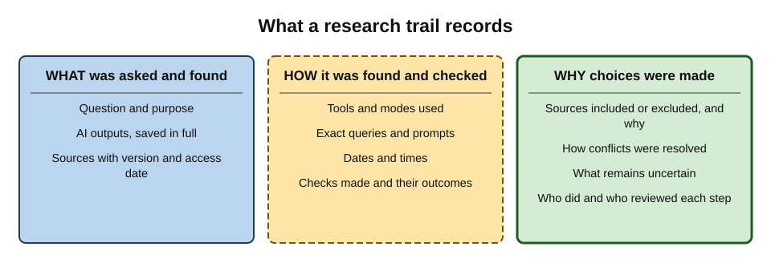
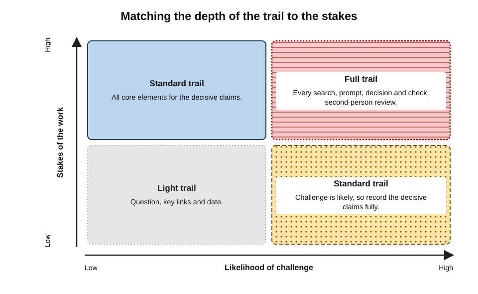
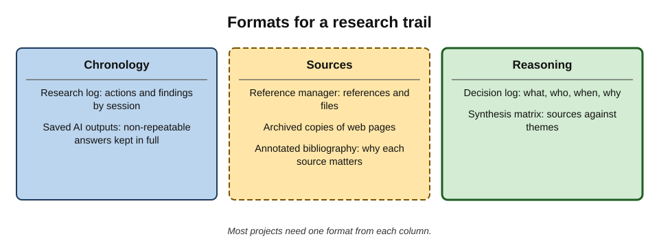
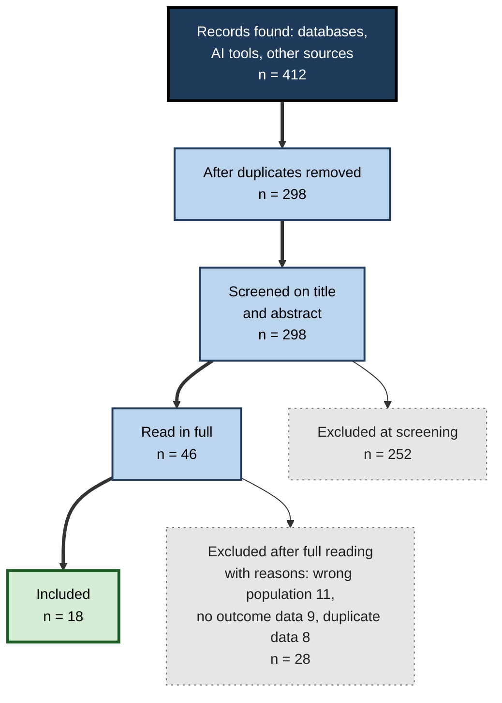
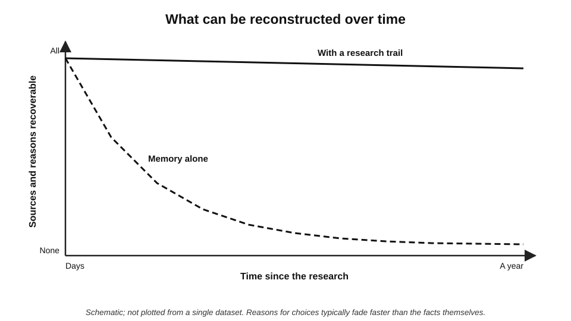
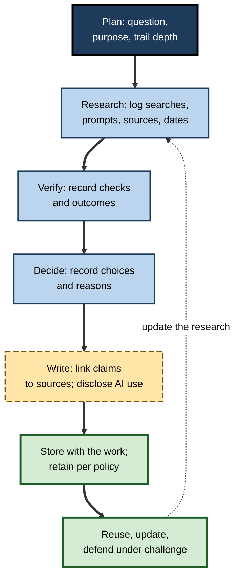

# H.10. Keeping a research trail

Six months after a pricing recommendation, a finance director asks the analyst who wrote it: "Where did the 12% competitor discount figure come from?" The analyst remembers an AI research session, a few reports and a long afternoon. She cannot find the conversation, does not know which report contained the figure, and when she asks the same AI tool the same question, it gives a different number. The figure may well have been right. She can no longer show it.

> **Definition — Research trail:** a record, made during research, of the question pursued, the tools and sources used, the searches and prompts run, what was found, what was checked, and the decisions made — sufficient for the work to be understood, checked or repeated later.

> **Definition — Provenance:** the documented origin and history of a piece of information — where it came from, through whose hands and tools it passed, and how it was changed.

**Why it matters**

- **Memory fails quickly.** Within weeks, people forget where a fact came from and why a source was trusted or rejected.
- **AI outputs are not repeatable.** The same prompt can produce a different answer tomorrow; an unsaved AI output is effectively lost.
- **Professional work is challenged.** Clients, auditors, regulators, courts and colleagues ask "how do you know?"
- **Disclosure rules increasingly require it.** Journals, courts, public bodies and employers ask whether and how AI was used.
- **Trails make work reusable.** A well-kept trail lets a colleague pick up, update or extend research without starting again.

---

## What a Research Trail Is For

### Five purposes

- **Accountability** — showing the basis for a conclusion.
- **Reproducibility** — allowing someone else (or one's future self) to repeat the work.
- **Verification** — letting a reviewer check sources and reasoning efficiently.
- **Continuity** — handing over work, updating it, or reusing it.
- **Learning** — seeing which tools, sources and methods worked, and improving.

> **Key point:** a research trail is not paperwork after the fact; it is a by-product of **disciplined research**, captured **as the work happens**.

### Why AI makes trails more important

- **Non-determinism.** Generative tools produce different outputs on different runs.
- **Model change.** Tools are updated frequently; behaviour last month may not be reproducible today.
- **Hidden sources.** AI answers draw on sources the user may not have seen; only the cited ones are visible.
- **Blended provenance.** A paragraph in a draft may mix AI text, human edits and quotations from sources — and nobody can later tell which is which.
- **Disclosure.** Many organisations now require statements of AI use; without a record, an honest statement is hard to write.

> **Definition — Non-determinism (in AI tools):** the property that the same input does not always produce the same output, because generation involves sampling and because tools and their data change over time.

---

## What to Record

### The core elements

- **Question and purpose** — what was being researched, for whom, for what decision.
- **Date and time** — of each search, prompt and access to a source.
- **Tools** — which search engines, databases and AI tools, with mode and version where shown (e.g. "deep research mode").
- **Queries and prompts** — the exact wording used.
- **Outputs** — AI answers and reports saved in full, not only the parts used.
- **Sources** — full reference, link or identifier, version and access date.
- **Verification** — which claims were checked, against what, with what outcome.
- **Decisions** — sources included or excluded, and why; how conflicts were resolved.
- **Uncertainties** — what remains unverified or contested.
- **People** — who did each step; who reviewed.

> **Mnemonic — "WHAT-HOW-WHY":** **What** was asked and found (question, outputs, sources), **How** it was found and checked (tools, prompts, dates, verification), **Why** choices were made (decisions, uncertainties).

**Figure 1.** What a research trail records.

### Proportion

- **Light trail** — for low-stakes, internal, quickly superseded work: question, key sources with links, date.
- **Standard trail** — for client deliverables and decisions: all core elements for decisive claims.
- **Full trail** — for publications, regulatory submissions, litigation, audits, systematic reviews: every search, every prompt, every screening decision, every verification.

**Figure 2.** Matching the depth of the trail to the stakes and the likelihood of challenge.

---

## How to Keep a Trail

### The research log

> **Definition — Research log:** a chronological record, kept during research, of actions taken, sources found, results and thoughts.

- **Format:** a document, spreadsheet or notes file, one entry per session or significant step.
- **Content of an entry:** date; aim of the session; tools and queries; key findings with sources; verification done; next steps.
- **Habit:** write the entry **at the end of each session** — five minutes that save hours later.

### Worked example (illustrative): a log entry

**Situation:** an analyst researching competitor pricing for a subscription software product.

| Field | Entry |
|---|---|
| Date and session | 14 March, 10:05–11:40 |
| Purpose | Establish typical annual discount offered by three named competitors for multi-year contracts |
| Tools | AI answer engine (web search mode); company websites; analyst firm portal (licensed) |
| Prompts and queries | "What multi-year discounts do [Competitor A, B, C] offer for annual subscriptions?"; site search on each competitor's pricing page; portal search "discounting enterprise SaaS 2025" |
| AI output | Saved as PDF: "AI-2025-03-14-pricing.pdf". Stated A offers 10–15%, B "around 12%", C not found |
| Sources found | A: pricing page, archived copy saved, accessed 14 March; B: news article quoting a sales director; analyst report section 3.2, table 4 |
| Verification | A: confirmed on pricing page ("save up to 15% with a 3-year plan"). B: only news quote; analyst table shows 8–12% range for B's segment. C: no public data |
| Decisions | Use A's published figure; report B as a range from the analyst table, noting the news quote; mark C as unknown |
| Uncertainties | Negotiated discounts likely differ from list; analyst data covers 2024 |
| Next steps | Ask sales team for win/loss notes on B and C |

*Illustrative entry.*

- **Result:** six months later, the "12%" figure can be traced to the news quote and the analyst table, with its limits stated.

> **Remember:** a trail entry should let a stranger **find every source** and **understand every choice** without asking the author.

### Saving AI interactions

- **Export or save** the full conversation or report, with the date.
- **Name files consistently** — date, topic, tool.
- **Note the mode** — ordinary chat, web search, deep research, document-grounded.
- **Record which parts were used** and where they ended up in the deliverable.
- **Respect confidentiality** — saved conversations may contain sensitive material and must be stored under the organisation's rules.

### Managing sources

- **Reference managers** — software that stores references, PDFs and notes, and formats citations; widely used in academia and increasingly in professional work.
- **Archived copies** — web pages change or vanish; saving a copy or using a web archive preserves what was seen.
- **Version and date** — record the version of reports, standards and legislation consulted.
- **Annotations** — notes on why a source was used and what it supports.

| Format | Best for | Strengths | Limitations |
|---|---|---|---|
| Research log | Any project | Chronology; captures reasoning | Needs discipline; can become long |
| Reference manager | Many formal sources | Organised references; attached files; citation formatting | Less suited to prompts and decisions |
| Annotated bibliography | Literature-heavy work | Source-by-source evaluation | No chronology of search |
| Decision log | Projects with key choices | Records why, by whom, when | Thin on sources unless linked |
| Synthesis matrix | Multi-source synthesis | Shows sources against themes | Not a record of the search |
| Saved AI outputs | AI-assisted work | Preserves non-repeatable outputs | Bulky; needs naming and storage rules |

**Figure 3.** Formats for a research trail and what each captures best.

---

## Standards from Formal Research

### Systematic reviews

- **Systematic reviews** in health and social science set the highest standard of research trail: every database, search string, date, and screening decision is reported.
- **PRISMA** (Preferred Reporting Items for Systematic reviews and Meta-Analyses), updated in **2020**, specifies what to report and includes a **flow diagram** showing how many records were found, screened, excluded (with reasons) and included.
- **PRISMA-S** (2021) is an extension specifically for reporting literature **searches** so that they can be reproduced.

**Figure 4.** A flow record of the kind used in systematic reviews.

*Illustrative figures.*

> **In practice:** the same logic scales down. A one-page note — "searched X, Y and Z on these dates; found 40 items; read 12; used 5, for these reasons" — gives a business research project much of the defensibility of a formal review.

### Professional documentation standards

- **Audit.** International auditing standards require working papers sufficient for an **experienced auditor with no previous connection** to the engagement to understand the work done, the evidence obtained and the conclusions reached.
- **Law.** Lawyers keep research notes and file notes showing the authorities consulted and the reasoning behind advice.
- **Science.** Laboratory notebooks and data-management plans record methods and data; the **FAIR principles** (2016) call for data to be Findable, Accessible, Interoperable and Reusable.
- **Journalism.** Reporters keep notes, recordings and documents to substantiate published facts.

> **Key point:** the "experienced stranger" test from auditing is a good general standard: **could a competent person who was not involved understand and check this work from the trail alone?**

---

## Disclosure of AI Use

### What is increasingly expected

- **Academic publishing.** From 2023 leading journals and editorial bodies adopted policies that AI tools **cannot be listed as authors** and that **substantive use must be disclosed**, typically in the methods or acknowledgements.
- **Courts.** Some courts require statements on whether generative AI was used in preparing filings and confirmation that citations were checked.
- **Public sector and consultancy.** Governments and clients increasingly require disclosure of AI use in commissioned work.
- **Employers.** Internal policies often require labelling of AI-assisted content.

### What a good disclosure contains

- **Which tools** were used, and **for what** (search, summarisation, drafting, analysis).
- **What human checks** were applied.
- **Where** in the work AI contributed.
- **Who** is accountable for the final content.

> **Watch out:** a disclosure without a trail is an assertion. A disclosure **backed by a trail** is evidence.

### Real case: a government-commissioned report (Australia, 2025)

- **Situation:** Deloitte Australia produced a report for the federal Department of Employment and Workplace Relations reviewing an automated compliance framework for welfare payments.
- **Problem:** after publication, an academic at the University of Sydney identified references to works that did not exist and a quotation attributed to a Federal Court judgment that did not appear in it.
- **Response:**
  - a corrected version was published, removing the erroneous references and quotation;
  - the revised report disclosed that a generative AI tool had been used in preparing parts of it;
  - the firm agreed to refund part of the contract fee, while stating that the report's substantive findings were unchanged.
- **Lessons:**
  1. **Disclosure came after the problem**, not with the original publication.
  2. A trail showing which content was AI-generated and which sources were opened would have made the errors easy to find **before** publication.
  3. Reputational damage came as much from the **lack of transparency** as from the errors.

---

## Trails Over Time

### Memory and the value of the trail

- **People forget sources faster than facts.** A person may remember a figure but not where it came from — **source amnesia**.
- **Reasons fade fastest of all.** Why a source was rejected, or a conflict resolved, is rarely remembered beyond a few weeks.
- **The trail's value rises with time** — little needed tomorrow, essential in six months.

> **Definition — Source amnesia:** remembering information while forgetting where or how it was acquired.

**Figure 5.** What can be reconstructed over time with and without a trail.

### Keeping trails usable

- **Store with the work** — the trail lives in the same project folder as the deliverable.
- **Link claims to sources** in the deliverable — footnotes, comments or an evidence appendix.
- **Retain according to policy** — some sectors require records for years.
- **Review at hand-over** — a colleague taking over should be able to use the trail without a briefing.

**Figure 6.** The life cycle of a research trail.

---

## Professional Practice

### Team habits

- **A shared template** for research logs, so trails are consistent across a team.
- **Evidence appendices** in reports, listing key sources with access dates.
- **Clear AI labelling** in drafts until content is verified.
- **Peer review of trails** for high-stakes work — the reviewer checks the trail, not only the conclusion.

### Case study (illustrative): the regulatory challenge

- **Situation:** an energy company's regulatory team submitted a cost-benchmarking analysis to a regulator, prepared with AI-assisted research.
- **Challenge:** a year later the regulator questioned three benchmark figures.
- **What the trail held:**
  1. the research log showing searches, dates and the databases used;
  2. saved AI outputs, marked with the parts used;
  3. archived copies of the web pages and reports cited;
  4. verification notes: two figures confirmed against original filings; one taken from an industry survey whose method was described.
- **Outcome:** the team answered within days; the regulator accepted two figures and asked for a sensitivity analysis on the third.
- **Counterfactual:** a parallel team in the same company, without a trail, spent weeks reconstructing another analysis and withdrew two figures it could not substantiate.
- **Lesson:** the trail turned a challenge from a **crisis** into a **routine response**.

---

## Organising the Trail

### Naming and filing

- **Consistent file names** make a trail searchable: date first, then topic, then source or tool.
  - *e.g.* "2026-03-14 competitor pricing - AI answer engine.pdf"; "2026-03-14 competitor A pricing page - archived.pdf".
- **One project folder** holding the deliverable, the log, the sources and the saved AI outputs.
- **Sub-folders by type** — sources, AI outputs, working files, final.
- **Version labels** on drafts — and a clear marker on the final version sent.

**Folder structure (illustrative)**

- **Project: market entry brief**
  - **00 Log** — research log; decision log; AI-use note
  - **01 Sources** — archived pages; downloaded reports; data files
  - **02 AI outputs** — saved conversations and reports, dated
  - **03 Working** — synthesis matrix; drafts
  - **04 Final** — the deliverable as sent, with its evidence appendix

### Linking claims to evidence

- **Footnotes or endnotes** in the deliverable for external readers.
- **Comments or hidden notes** in drafts linking each decisive claim to the log entry and source file.
- **An evidence appendix** — a table of decisive claims, their sources and verification status — for high-stakes work.

> **Definition — Evidence appendix:** a table attached to a report listing each decisive claim, its source, the location within the source and how it was verified.

---

## What Not to Record, and How to Protect What Is Recorded

### Data minimisation

- **Record what is needed** to understand and check the work — not everything that passed across the screen.
- **Avoid copying personal data** into logs unless the research requires it.
- **Summarise sensitive content** in the log and keep the sensitive source itself under proper controls.

### Confidentiality and privilege

- **Saved AI conversations** may contain confidential client information, personal data or legally privileged material; they must be stored under the same controls as the source material.
- **Public or consumer AI tools** may retain conversations under their own terms; organisations commonly restrict which tools may be used for confidential research for this reason.
- **Legal privilege** may attach to some research for litigation; lawyers advise on how such records are created and kept.

### Retention

- **Keep records as long as policy and law require** — for regulated work, often several years.
- **Delete when no longer needed**, in line with data-protection principles.
- **Document the retention decision** for important projects.

> **Watch out:** a research trail can itself become a risk if it holds personal or confidential data carelessly. A good trail is **complete enough to defend the work and lean enough to be safe to keep**.

---

## Trails in Teams

- **Shared logs** — a single log per project, with entries initialled by each contributor.
- **Hand-over notes** — a short summary at the top of the log: question, status, key sources, open issues, where everything is.
- **Team libraries** — shared reference collections and "verified facts" lists for recurring figures, each with source and date.
- **Templates** — a common log, claims register and AI-use statement, so that any team member can read any trail.
- **Review of trails** — for high-stakes work, the reviewer checks a sample of claims against the trail, not only the prose.

| Practice | Benefit | Cost |
|---|---|---|
| Shared project log | One place for reasoning and sources | Needs a habit of updating |
| Hand-over summary | New contributor productive within an hour | Ten minutes at each hand-over |
| Verified-facts list | Recurring figures checked once, reused safely | Needs an owner and review dates |
| Common templates | Any trail readable by anyone | Initial agreement on format |
| Trail review | Errors caught before delivery | Reviewer time |

> **In practice:** teams that adopt a shared trail template often find that **review becomes faster**, because reviewers can check the decisive claims directly rather than reconstructing how the author found them.

---

## Reproducing AI-Assisted Research

### What can and cannot be reproduced

- **Can be reproduced:** searches in databases and search engines (approximately, since indexes change); the reading of saved sources; the reasoning recorded in the log; the verification of each claim against its source.
- **Cannot be reproduced exactly:** an AI tool's output — the same prompt, even in the same tool, may give a different answer; after a model update, the difference may be large.
- **Consequence:** the **evidence** in AI-assisted research must ultimately rest on **sources that can be re-read**, not on AI outputs that cannot be regenerated.

> **Key point:** a well-built trail makes AI outputs **historical records of what was suggested**, while the conclusions rest on **sources anyone can check**.

### Recording the tool context

- **Tool and mode** — which product, and whether web search, deep research or document grounding was used.
- **Model or version** — where the tool displays it.
- **Settings** — any source restrictions, uploaded files or connectors.
- **Date and time** — since tools and the web change.

### Stability checks

- **Re-run decisive questions** — if a second run gives a materially different answer, the finding is unstable and must rest on direct sources.
- **Vary the wording** — robust findings survive reasonable rephrasing.
- **Record the outcome** of stability checks in the log.

| Element of the work | Reproducible? | How to make it defensible |
|---|---|---|
| AI answer or report | No, not exactly | Save it in full with date, tool and mode |
| Web search results | Approximately | Record queries and dates; archive key pages |
| Database search | Largely | Record database, search string, filters and date |
| Source content | Yes, if saved or stable | Save or archive copies; record versions |
| Reasoning and decisions | Yes, if logged | Decision log with reasons |
| Verification | Yes, if logged | Record claim, source, pinpoint and outcome |

> **Watch out:** "I asked the AI and it said so" is not reproducible evidence. "The AI pointed to the regulator's guidance, paragraph 4.2, which I read on 14 March and which says…" is.

---

## Open Questions

- **How much trail is enough?**
  - Little evidence exists on the cost-benefit of documentation depth outside formal research and audit.
- **Can tools keep trails automatically?**
  - Some AI and research tools log activity and sources automatically; whether these logs are complete, exportable and trustworthy varies.
- **How should non-reproducible AI outputs be treated as evidence?**
  - Saved outputs record what was produced, but cannot be regenerated; standards for their evidential weight are unsettled.
- **What should disclosure statements say?**
  - Practice varies from a single sentence to detailed accounts; consensus on useful, proportionate disclosure has not formed.
- **How should privacy and trail-keeping be balanced?**
  - Saved conversations may contain personal or confidential data; retention rules must reconcile record-keeping with data-protection duties.

---

## Summary

- A **research trail** records question, tools, prompts, outputs, sources, verification, decisions, uncertainties and people — enough for the work to be understood, checked or repeated.
- **Provenance** is the documented origin and history of information.
- Trails serve **accountability, reproducibility, verification, continuity and learning**.
- AI raises the stakes: **non-determinism, model change, hidden sources and blended provenance** make unsaved AI work unrecoverable.
- Record **WHAT-HOW-WHY**; set trail depth by **stakes and likelihood of challenge** (light, standard, full).
- Use a **research log**, saved AI outputs, reference management, archived copies and decision notes.
- Formal standards — **PRISMA 2020**, **PRISMA-S**, auditing's **experienced-stranger** test, the **FAIR** principles — show what full trails look like.
- **Disclosure** of AI use is increasingly expected; a disclosure backed by a trail is evidence, not assertion — as the **2025 Deloitte Australia** case showed.
- **Source amnesia** makes trails more valuable over time; store them with the work.

---

## Self-Check

1. Define a research trail and provenance.
2. List the five purposes of a research trail.
3. Explain four reasons why AI-assisted research needs a better trail than traditional research.
4. What does WHAT-HOW-WHY stand for, and what elements fall under each?
5. Distinguish light, standard and full trails, with an example of when each is appropriate.
6. What should a research log entry contain?
7. Why should AI outputs be saved in full rather than only the parts used?
8. What do PRISMA 2020 and PRISMA-S require, and how can their logic be scaled down?
9. State the "experienced stranger" test and its origin.
10. What do academic publishing policies since 2023 generally require regarding AI?
11. What lessons does the Deloitte Australia case offer about trails and disclosure?
12. What is source amnesia, and how does it affect the value of a trail over time?
13. In the regulatory-challenge case study, what made the difference between the two teams?
14. Design a research-trail template for a small consultancy team using AI tools for client research.

### Answer Key

1. A research trail is a record, made during research, of the question, tools, sources, searches and prompts, findings, checks and decisions, sufficient for the work to be understood, checked or repeated. Provenance is the documented origin and history of information.
2. Accountability, reproducibility, verification, continuity and learning.
3. Outputs are non-deterministic; tools change; answers draw on hidden sources; drafts blend AI and human content; disclosure increasingly requires a record of AI use.
4. What was asked and found (question, outputs, sources); How it was found and checked (tools, prompts, dates, verification); Why choices were made (decisions, uncertainties).
5. Light: question, key sources and date — internal background notes. Standard: all core elements for decisive claims — client deliverables. Full: every search, prompt, screening decision and check — regulatory submissions, litigation, systematic reviews.
6. Date and session; purpose; tools; exact queries and prompts; where outputs were saved; sources with access dates; verification and outcomes; decisions; uncertainties; next steps.
7. Outputs cannot be regenerated identically; the full output shows context, other claims and what was not used, and supports later verification and disclosure.
8. PRISMA requires reporting of sources searched, numbers found, screened, excluded with reasons and included, with a flow diagram; PRISMA-S specifies reporting searches reproducibly. Scaled down: a short note of what was searched, when, how many items were found, read and used, and why.
9. Whether an experienced person with no previous connection to the work could understand what was done, the evidence and the conclusions from the record alone; it comes from international auditing documentation standards.
10. That AI tools cannot be authors and that substantive use must be disclosed, typically in methods or acknowledgements.
11. Disclosure came only after errors were found; a trail separating AI-generated content and recording opened sources would have exposed errors before publication; lack of transparency compounded the damage.
12. Remembering information while forgetting its origin. Because sources and reasons fade within weeks, the trail's value grows over time.
13. The first team had a research log, saved AI outputs, archived sources and verification notes, so it answered quickly and defended two of three figures; the other team had to reconstruct work and withdrew figures it could not substantiate.
14. For example: a header (client, question, purpose, trail depth, researcher, reviewer); a session log table (date, tool and mode, prompt or query, output file, sources with access date); a claims register (claim, source, pinpoint, verification outcome); a decision log; an AI-use disclosure paragraph; storage in the client folder with naming conventions and retention per policy.

---

## Glossary

| Term | Meaning |
|---|---|
| Annotated bibliography | A list of sources with notes on content and evaluation. |
| Archived copy | A saved copy of a web page or document as it was when consulted. |
| Decision log | A record of decisions made, by whom, when and why. |
| Disclosure statement | A statement of whether and how AI tools were used in producing work. |
| FAIR principles | Data should be Findable, Accessible, Interoperable and Reusable. |
| Non-determinism | The property that the same input can produce different outputs. |
| PRISMA | Reporting guideline for systematic reviews, including a flow diagram. |
| PRISMA-S | Extension of PRISMA for reporting literature searches. |
| Provenance | The documented origin and history of information. |
| Reference manager | Software for storing, organising and citing sources. |
| Research log | A chronological record of research actions, findings and reasoning. |
| Research trail | A record sufficient for research to be understood, checked or repeated. |
| Source amnesia | Remembering information while forgetting its origin. |
