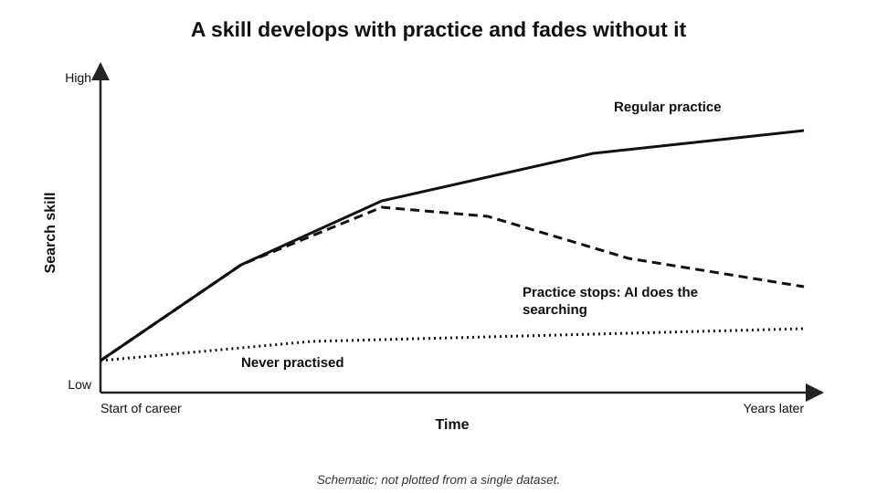
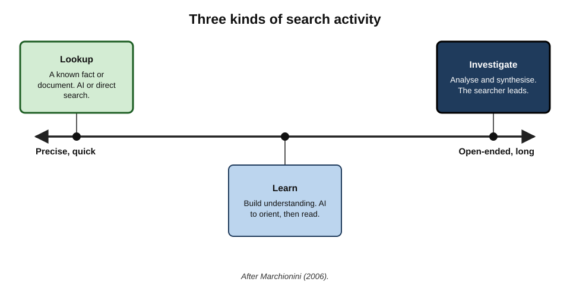
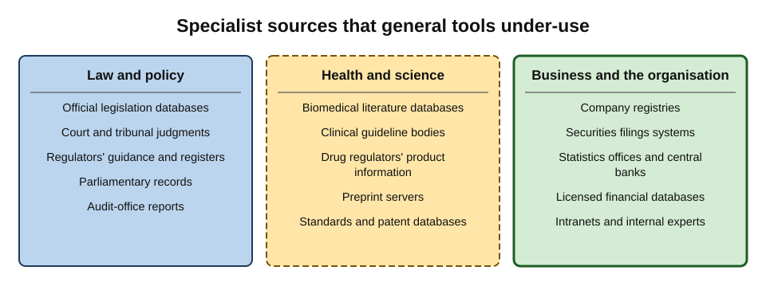
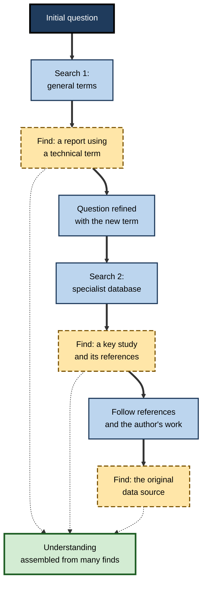
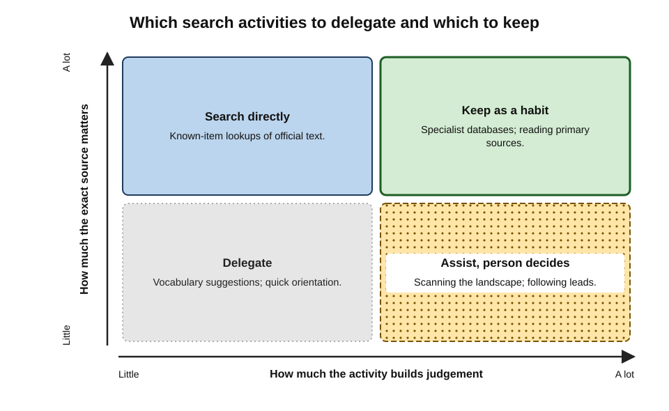

# H.11. Search habits worth preserving

A senior librarian at a law firm can find, in four minutes, the exact paragraph of a regulation, the two cases that interpreted it and the consultation paper that preceded it. A new trainee asks an AI assistant the same question, gets a fluent paragraph, and cannot say which of its statements came from where.

The trainee is not less intelligent; the librarian has habits — of phrasing, of knowing where to look, of reading results, of following trails — built over years. Those habits are exactly what answer-first tools make it easy never to acquire.

> **Definition — Search habit:** a practised, largely automatic way of finding information — how queries are phrased, where searches are run, how results are read and how leads are followed.

> **Definition — Deskilling:** the loss, or failure to develop, a skill because a tool performs the task in its place.

**Why it matters**

- **AI tools depend on search.** Most AI answers are built from retrieved documents; the person who can search well can check, extend and correct them.
- **Some questions cannot be answered by AI tools** — known-item lookups in specialist databases, very recent material, paywalled or internal sources, exact text.
- **Verification needs search skill.** Checking an AI claim is a search task.
- **Skills not practised decline.** If AI does all the searching, the human ability to search — and to judge what search finds — weakens.

---

## Why Habits Erode

### Automation and its ironies

- **Lisanne Bainbridge's "Ironies of Automation" (1983)** observed that automating the routine parts of a task leaves humans with the hardest parts — monitoring and taking over when automation fails — while depriving them of the practice that builds the skill to do so.
- **Applied to research:** when AI handles routine search, people get less practice at search — but must still search expertly when the AI is wrong, stuck or unable to reach the source.

> **Key point:** automation shifts the human role from **doing** to **checking** — and checking requires the very skill that doing used to build.

### Evidence on offloading

- **Cognitive offloading** — relying on external tools for memory or thinking — is often efficient, but reduces the processing that builds knowledge.
- **The "Google effect"** (2011) — the claim that people remember less when they expect information to remain available — was influential, but a large 2018 replication project failed to reproduce one of its central findings; its size is **uncertain**.
- **Early studies of AI assistance** (2025), including an electroencephalography study of essay writing by researchers at the MIT Media Lab, reported lower engagement and weaker recall of one's own work among people who relied on a language model — but the study was small, not yet peer reviewed at release, and **preliminary**.

> **Watch out:** claims that "AI is making people stupid" go far beyond the evidence. The defensible conclusion is narrower: **skills that are not practised tend not to develop or to fade**, and research skills are no exception.

**Figure 1.** How a skill develops with practice and fades without it.

---

## Habit 1: Knowing What Kind of Search It Is

**Gary Marchionini (2006)** distinguished three kinds of search activity:

- **Lookup** — finding a known fact or document; precise queries, quick answers.
- **Learn** — building understanding of a topic; reading, comparing, assembling.
- **Investigate** — analysing, evaluating and synthesising over time; many searches, many sources, judgement.

> **Definition — Exploratory search:** searching to learn or investigate, where the goal is not fully known in advance and the searcher's understanding changes as the search proceeds.

**Figure 2.** From lookup to investigation: three kinds of search activity.

- **AI answers suit lookup and the start of learning** — for low-stakes facts and orientation.
- **Investigation needs the searcher's own engagement** — choosing sources, following leads, revising the question.
- **The habit to preserve:** pausing to ask "Is this a lookup, a learning search or an investigation?" before choosing a tool.

---

## Habit 2: Formulating Queries

### Building a query

- **Identify the concepts** — split the question into its key ideas.
- **List synonyms and variants** — terms used by different communities, countries and periods ("redundancy" and "layoff"; "SME" and "small business").
- **Use the field's vocabulary** — technical terms retrieve technical sources.
- **Combine** — concepts joined with AND (implicit in most engines), variants with OR.

> **Definition — Controlled vocabulary:** a fixed list of subject terms assigned by indexers to documents in a database — such as the Medical Subject Headings used to index biomedical literature — so that searches find documents on a concept whatever words the authors used.

### Search operators worth knowing

| Operator | What it does | Example |
|---|---|---|
| Quotation marks | Exact phrase | "duty of care" negligence |
| Minus sign | Excludes a term | jaguar speed -car |
| site: | Limits to a site or domain | site:gov.uk flexible working |
| filetype: | Limits to a file format | annual report filetype:pdf |
| OR | Either term | redundancy OR layoff consultation |
| intitle: | Term in the page title | intitle:guidance data retention |
| before: / after: | Date limits in some engines | cyber incident reporting after:2025-01-01 |

- **Engines differ** in which operators they support, and support changes; the core ones — quotation marks, minus, site — are widely available.
- **Verbatim and literal modes** in some engines stop automatic rewriting of queries.
- **Results filters** — date range, a plain "web results" view without AI summaries, in some engines — restore control.

> **In practice:** a single **site:** operator — restricting a search to an official domain — is often the fastest route to a primary source, faster than asking an AI tool and then checking its citation.

### Worked example (illustrative): searching for a regulatory requirement

**Situation:** a data-protection officer needs the official guidance on how long a UK employer may keep unsuccessful job applicants' data.

1. **AI first (orientation):** an assistant says "typically six months" and mentions the data-protection regulator. Useful vocabulary: "retention", "recruitment", "employment practices".
2. **Query 1:** `site:ico.org.uk recruitment retention unsuccessful candidates` — finds the regulator's employment-practices guidance pages.
3. **Read:** the guidance does not set a fixed period; it requires a justified retention period and points to factors such as the time limit for discrimination claims.
4. **Query 2:** `"time limit" employment tribunal discrimination claim` — confirms the statutory time limit relevant to the justification.
5. **Conclusion:** "six months" is a **common practice** with a rationale, **not a legal rule**; the employer must set and justify its own period.

*Illustrative scenario.*

> **Watch out:** the AI answer was not wrong exactly — it stated a common practice — but it blurred **practice** and **requirement**. Search to the regulator's own text made the difference visible.

---

## Habit 3: Reading a Results Page

- **Scan the whole first page before clicking.** The mix of domains — official, commercial, news, forum, academic — maps the landscape.
- **Read the addresses.** A familiar organisation's name on an unfamiliar domain is a warning sign.
- **Read the dates** in snippets and on pages.
- **Notice absences.** No official source on the first page may mean the query used the wrong vocabulary.
- **Notice advertising and sponsored results.**
- **Refine rather than click.** If the first page is poor, change the query rather than opening poor results.

> **Key point:** a results page is **information about the information space** — who publishes on this, how recent, how contested. An AI answer removes this layer entirely.

---

## Habit 4: Knowing Where to Look

### Specialist sources

General web search and AI tools are not the only — or the best — places for many professional questions.

- **Law** — official legislation databases, court and tribunal judgment databases, regulators' sites, licensed legal databases.
- **Health** — biomedical literature databases, clinical guideline bodies, drug regulators' product information, systematic-review libraries.
- **Business and finance** — company registries, securities filings systems, central-bank and statistics-office data, licensed financial databases.
- **Science and engineering** — journal databases, preprint servers, standards bodies, patent databases.
- **Public policy** — parliamentary records, government publications, official statistics, audit-office reports.
- **Inside the organisation** — intranets, document management systems, knowledge bases, experts.

**Figure 3.** Specialist sources by field that general tools often under-use.

> **Remember:** **the best source for a professional question is usually a specialist database or an official site** — not the open web and not an AI summary of it.

### A personal source map

- **Experienced researchers keep a mental and written map** of the authoritative sources in their field: which databases, which regulators, which journals, which data series, which experts.
- **The map is built through use** — by repeatedly going to sources directly.
- **AI-only research does not build the map**, because the tool chooses the sources.

---

## Habit 5: Iterating and Following Leads

### Berrypicking

> **Definition — Berrypicking:** Marcia Bates's (1989) model of real-world searching, in which the searcher gathers useful information bit by bit from many sources, and the query itself evolves as each find changes understanding — like picking berries from bush to bush rather than harvesting one field.

- **The classic search model** assumes a fixed question matched once to a set of documents.
- **Real research** moves: a found document suggests a new term, an author, a reference, a different database.
- **Techniques used in berrypicking** include following footnotes, searching an author's other work, browsing a journal's issues, and searching by subject heading.

**Figure 4.** Berrypicking: the query evolves as the search proceeds.

### Lead-following techniques

- **Backward chaining** — following a good source's references.
- **Forward chaining** — finding later work that cites it.
- **Author searching** — other work by the same expert.
- **Subject-heading searching** — using the database's index terms from a relevant record.
- **"More like this"** — related-record features in databases.
- **Asking people** — librarians, colleagues, experts.

> **In practice:** AI tools can **accelerate** berrypicking — suggesting terms, summarising a found paper, proposing related authors — as long as the searcher still decides **where to go next** and **opens what is found**.

---

## Habit 6: Keeping Searches Alive

- **Saved searches and alerts** — databases and search engines can notify the searcher of new items matching a query.
- **Feeds and newsletters** from regulators, journals and professional bodies.
- **Periodic re-searching** of fast-moving topics.

> **Key point:** AI answers are **snapshots**; alerts and saved searches give a **stream** — essential for staying current in a field.

---

## What to Keep, What to Delegate

| Activity | Delegate to AI? | Keep as a personal habit? |
|---|---|---|
| Suggesting vocabulary and synonyms | Yes | Check terms against the field's own usage |
| Known-item lookup of official text | Rarely — search directly | Yes |
| Orientation in a new topic | Yes | Follow up with direct searching |
| Scanning results for the landscape | No | Yes |
| Specialist database searching | Partly — some databases have AI features | Yes |
| Following references and authors | Assist | Yes — decide where to go next |
| Reading primary sources | Assist with navigation | Yes |
| Staying current | Assist with summaries | Yes — alerts and direct reading |

**Figure 5.** Which search activities to delegate and which to keep.

> **Mnemonic — "FORMS" of search worth keeping:** **F**ormulate queries, **O**perators, **R**ead the results page, **M**ap the specialist sources, **S**ustain the trail (berrypick, chain, alert).

---

## Professional Practice

### Building habits deliberately

- **Do some searches "by hand"** regularly, especially in one's own field.
- **When AI cites a source, find it yourself** in the publisher's site or database — practising the search while verifying.
- **Learn one specialist database well** in one's field.
- **Keep a list of go-to sources** and update it.
- **Ask a librarian or information professional** — many organisations have them, and they can teach search strategy quickly.

### Teaching others

- **Pair juniors with experienced researchers** on real questions.
- **Ask juniors to show their search** — not only their answer.
- **Set tasks that AI cannot complete alone** — finding exact text in a specialist database, tracing a figure to its origin.

### Case study (illustrative): the analyst who could only prompt

- **Situation:** a graduate analyst at an investment firm was quick and fluent with AI research tools, producing polished company profiles in hours.
- **Problem:** asked to find the exact wording of a covenant in a company's bond prospectus, he spent a day prompting AI tools, which offered paraphrases and, once, a fabricated clause.
- **Diagnosis:**
  1. he had never searched the securities-filing system directly;
  2. he did not know the document type's structure or vocabulary;
  3. he had no habit of going to the primary source.
- **Actions:**
  - a senior colleague spent an hour showing him the filing system, the prospectus structure and search within long PDFs;
  - his manager set a monthly "source exercise": trace three figures from his AI-assisted profiles to their filings.
- **Result:** within two months he could locate primary documents quickly; his profiles became more accurate because he caught AI errors himself.
- **Lesson:** fluency with AI tools is not the same as research skill; the second must be built deliberately.

---

## Habit 7: Using Search to Verify

Search tools offer verification functions that AI answers do not.

- **Reverse image search** — finding where an image has appeared before, to test whether a photograph, chart or screenshot is what it claims to be, or is older, altered or from another context.
- **Web archives** — services that store snapshots of web pages over time, such as the Internet Archive's Wayback Machine (public since 2001), show what a page said on a given date and whether it has been changed.
- **Domain information** — registration records can show when a website was created; a "long-established" organisation with a domain registered last month deserves suspicion.
- **Exact-phrase search** — testing whether a quotation, statistic or title exists anywhere outside the AI answer.
- **Site-restricted search** — testing whether an official body has published what is attributed to it.

> **Key point:** these tools answer the question AI answers cannot: **"Where else, and since when, does this exist?"**

---

## Habit 8: Searching Across Languages and Places

- **Use local terms.** Legal, administrative and commercial concepts have local names; searching in English for another country's regime often retrieves foreign commentary rather than the source.
- **Use country domains and official portals** — many governments publish legislation, statistics and registries on national portals in the national language.
- **Translate queries, not only results.** Machine translation of the search terms opens local sources; machine translation of results aids reading.
- **Check local news and professional bodies** for practice that national law does not capture.

> **In practice:** researchers working across countries often keep a short glossary of key terms in each relevant language — for example, the local names of company registries, labour ministries and tax authorities — which makes direct searching far faster.

---

## Habit 9: Asking People

- **Librarians and information professionals** are trained in search strategy, specialist databases and source evaluation; in many organisations they are under-used.
- **The reference interview.** Librarians use a structured conversation to find out what a person really needs — the decision behind the question, the level of detail, the deadline — before searching. The same discipline improves any research brief or AI prompt.
- **Subject experts** can name the two or three authoritative sources in minutes.
- **Practitioner communities** — professional associations, forums, colleagues in other organisations — know what is not written down.

> **Definition — Reference interview:** a structured conversation, developed in librarianship, in which an information professional clarifies the real need behind a request before searching.

| Source of help | Best for | Limitation |
|---|---|---|
| AI tool | Speed, vocabulary, orientation | Cannot be relied on for exact sources |
| Search engine | Breadth; known items; verification | Needs skill to query and judge |
| Specialist database | Authoritative, structured sources | Needs access and familiarity |
| Librarian | Strategy; databases; hard-to-find items | Availability |
| Subject expert | Judgement on what matters | Own perspective and interests |

---

## Search Habits as Professional Identity

- **Every profession has characteristic research habits** — the lawyer's reflex to read the authority, the clinician's to check the guideline, the auditor's to see the source document, the journalist's to call a second source.
- **These habits embody the profession's standard of evidence.** They are how members know what they claim to know.
- **AI tools do not change the standard;** they change how easily it can be skipped.

> **Remember:** the habit to preserve above all is the profession's own answer to **"How do you know?"** — and the reflex to go and find out.

---

## Search Engines in the Age of AI Modes

### What changed

- **AI summaries above the results.** Major search engines now show generated summaries for many queries, pushing ordinary results down the page.
- **Conversational modes.** Some engines offer a chat-style mode that answers follow-up questions rather than returning links.
- **Fewer visible results.** Advertising, summaries and other features take space once occupied by links.

### Keeping control

- **Use plain-results views** where engines offer them — some provide a filter or mode showing only links.
- **Use operators and literal modes** to stop automatic rewriting of queries.
- **Scroll past the summary** deliberately for anything that matters.
- **Go direct** to known authoritative sites and specialist databases.
- **Use more than one engine** for important searches; their indexes and rankings differ.

### When the AI summary in search helps

- **Quick orientation** on an unfamiliar term or topic.
- **Simple, stable facts** of low consequence.
- **Pointing to sources** — when its citations lead to authoritative pages, which are then opened.

| Situation | Use the AI summary? | Habit to apply |
|---|---|---|
| Definition of an unfamiliar term | Yes, for orientation | Confirm in a specialist glossary if it matters |
| Opening hours, simple conversions | Yes | None needed |
| Current legal requirement | Only as a pointer | Go to the official text |
| Contested question | Only to map positions | Scan the full results and read sources |
| Specific document | No | Known-item search with operators |

> **Key point:** the habit worth preserving is not avoiding AI summaries but **choosing** when to stop at them — and noticing when the question deserves the results page underneath.

---

## Open Questions

- **Will search skills become a specialist niche?**
  - If most people rely on AI, advanced search may become a skill held mainly by information professionals; whether this is acceptable for other professions is debated.
- **How should search be taught in the AI era?**
  - Curricula are shifting from operators and databases towards evaluation and verification; the right balance is unsettled.
- **Will search engines keep supporting advanced search?**
  - Operators and literal modes have changed over time; their future in AI-first interfaces is uncertain.
- **How much does offloading search affect learning?**
  - Early studies suggest shallower learning from AI summaries; long-term effects on professional expertise are unknown.
- **Can AI tools teach search rather than replace it?**
  - Tools that show their queries and sources might build user skill; evidence is limited.

---

## Summary

- **Search habits** — phrasing, operators, reading results, knowing sources, following leads — underpin both research and the **checking** of AI outputs.
- **Bainbridge's ironies of automation**: automating routine work leaves people the hardest parts while removing their practice.
- Evidence on offloading is real but often **overstated**; the Google-effect finding failed a major replication; early AI-assistance studies are **preliminary**.
- **Marchionini**: lookup, learn, investigate — AI suits lookup and orientation; investigation needs the searcher.
- **Formulate** with concepts, synonyms and controlled vocabulary; use **operators** (quotation marks, minus, site:, filetype:, OR) and literal modes.
- **Read the results page** as a map of the information space.
- **Know the specialist sources** in one's field; keep a **source map**.
- **Berrypick** (Bates, 1989): follow references, authors and subject headings; let the query evolve.
- **Keep searches alive** with alerts; AI answers are snapshots.
- Delegate vocabulary and orientation; keep **FORMS** — Formulate, Operators, Read results, Map sources, Sustain the trail.

---

## Self-Check

1. Define deskilling and explain Bainbridge's "ironies of automation" as applied to research.
2. What is the status of the evidence on the "Google effect" and on early AI-assistance studies?
3. Describe Marchionini's three kinds of search activity and which suit AI answers.
4. How should a query be built from a research question?
5. What is controlled vocabulary, and why is it useful?
6. Give the purpose of five search operators, with examples.
7. In the data-retention example, what distinction did direct searching reveal?
8. What information does a results page provide that an AI answer does not?
9. Name specialist sources for law, health and business research.
10. Explain berrypicking and how AI can support it without replacing it.
11. Why do saved searches and alerts matter in the AI era?
12. Which search activities should be delegated to AI and which kept?
13. In the case study, what three gaps did the analyst have, and how were they addressed?
14. Design a monthly practice routine that preserves search skills for a team that relies heavily on AI tools.

### Answer Key

1. Deskilling is the loss or non-development of a skill because a tool performs the task. Bainbridge noted that automation leaves humans the hardest parts — monitoring and intervening when it fails — while removing the practice that builds the skill; in research, AI does routine search, but people must still search expertly to check and correct it.
2. A central Google-effect finding failed to replicate in a large 2018 project, so its size is uncertain; early AI-assistance studies, such as an MIT Media Lab EEG study, are small and preliminary.
3. Lookup (known facts or documents), learn (building understanding), investigate (analysis and synthesis over time). AI answers suit lookup and the start of learning.
4. Split it into concepts; list synonyms and variants; use the field's vocabulary; combine concepts with AND and variants with OR.
5. A fixed list of index terms assigned to documents, such as medical subject headings, letting searches find all documents on a concept regardless of authors' wording.
6. Quotation marks for exact phrases ("duty of care"); minus to exclude (jaguar -car); site: to restrict to a domain (site:gov.uk); filetype: for formats (filetype:pdf); OR for alternatives (redundancy OR layoff).
7. That "six months" was a common practice with a rationale, not a legal requirement; the regulator requires a justified period.
8. The range of publishers, dates, domains, advertising and absences — a map of who publishes on the topic and how contested and recent it is.
9. Law: legislation and judgment databases, regulators. Health: biomedical literature databases, guideline bodies, drug regulators. Business: company registries, securities filings, statistics offices.
10. Bates's model of gathering information bit by bit from many sources while the query evolves. AI can suggest terms, summarise finds and propose related authors, while the searcher decides where to go and opens the sources.
11. AI answers are snapshots; alerts and saved searches deliver a stream of new material, keeping the researcher current.
12. Delegate vocabulary suggestions and orientation; assist with lead-following, navigation and summaries; keep known-item lookups, reading results pages, specialist database searching, deciding where to go next and reading primary sources.
13. He had never used the filing system, did not know the document structure and vocabulary, and lacked the habit of going to primary sources. A senior colleague taught the system and structure, and a monthly exercise required tracing figures to filings.
14. For example: each member traces three AI-provided figures to primary sources monthly; one specialist-database session per month with a librarian; a shared source map updated quarterly; occasional "no-AI" research tasks reviewed by peers; sharing of useful search strings and alerts.

---

## Glossary

| Term | Meaning |
|---|---|
| Alert | An automatic notification of new items matching a saved search. |
| Berrypicking | Bates's model of evolving, piece-by-piece searching across many sources. |
| Controlled vocabulary | Fixed index terms assigned to documents in a database. |
| Deskilling | Loss or non-development of a skill because a tool performs the task. |
| Exploratory search | Searching to learn or investigate when the goal is not fully known. |
| Ironies of automation | Bainbridge's observation that automation removes practice while leaving humans the hardest tasks. |
| Known-item search | Searching for a specific document known to exist. |
| Search habit | A practised way of phrasing, running and following up searches. |
| Search operator | A symbol or command that modifies how a search engine matches a query. |
| Source map | A researcher's knowledge of the authoritative sources in a field. |
| Verbatim mode | A search setting that stops the engine from rewriting the query. |
