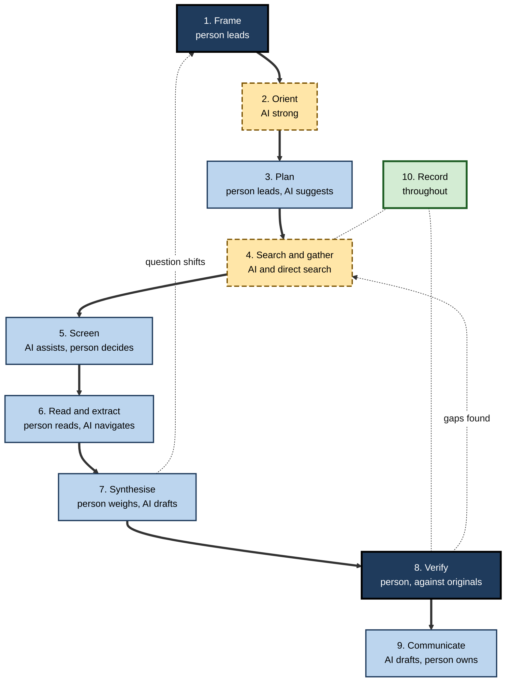
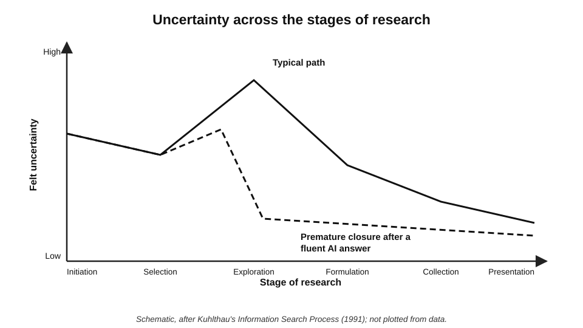
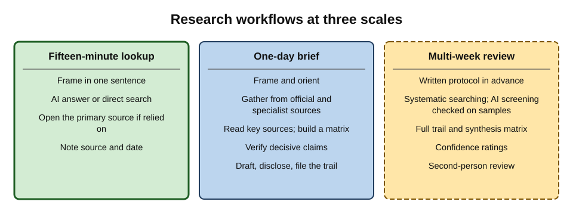
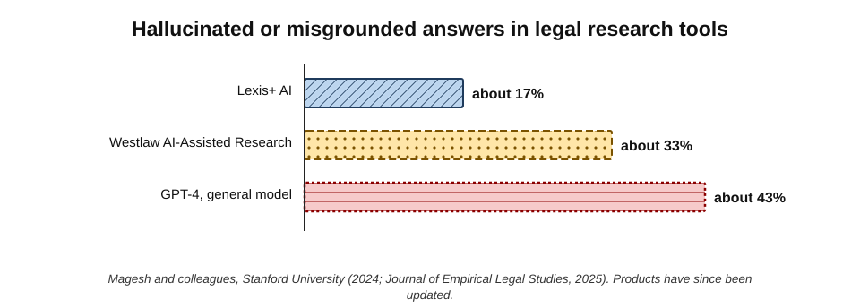
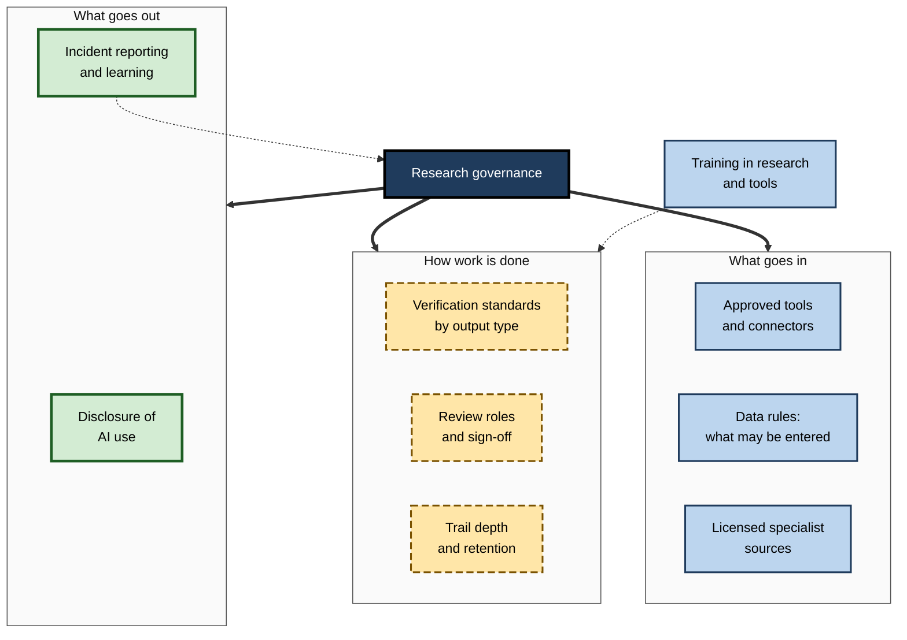

# H.12. Effective research workflows

Two analysts receive the same request on Monday morning: "What should we know about entering the Polish market for commercial solar installations? Board paper by Friday." One opens an AI tool, asks the question, refines the answer for three days and submits a polished paper. The other spends an hour framing questions, uses AI to orient and gather leads, goes to official registries and statistics, reads the key sources, verifies the decisive figures and keeps a log.

By Friday both papers look professional. Only one could survive the board's first hard question.

> **Definition — Research workflow:** the planned sequence of stages, tools and checks by which a question is turned into a reliable, documented answer.

> **Definition — Hybrid research workflow:** a workflow that deliberately combines AI tools with traditional search, specialist sources and human reading and judgement, assigning each to the stages it does best.

**Why it matters**

- **Tools do not make research reliable; workflows do.** The same AI tool produces good or poor research depending on where it sits in the process.
- **AI changes the cost of each stage** — drafting and gathering become cheap; framing, verifying and judging do not.
- **Workflows scale.** A team that shares a workflow produces consistent, reviewable work.
- **Organisations need governance.** Which tools, which data, which checks and which disclosures are organisational decisions, not individual ones.

---

## The Stages of Research

### A general workflow

1. **Frame** — clarify the decision, the question, the scope and the standard of evidence needed.
2. **Orient** — learn the vocabulary, the main actors and the shape of the field.
3. **Plan** — choose sources, tools, search strategies and the depth of the research trail.
4. **Search and gather** — run searches across AI tools, the web and specialist sources; collect candidates.
5. **Screen** — decide which sources are relevant and credible enough to read.
6. **Read and extract** — read the key sources; extract findings with references.
7. **Synthesise** — compare, weigh and integrate into conclusions with confidence levels.
8. **Verify** — check decisive claims and citations against originals.
9. **Communicate** — write for the audience, with sources, limits and AI-use disclosure.
10. **Record** — keep the trail with the work.

**Figure 1.** A hybrid research workflow and the role of AI at each stage.

> **Key point:** AI is strongest at **orienting, gathering, navigating and drafting**; the person is indispensable at **framing, screening decisions, reading what matters, weighing, verifying and owning** the result.

### Kuhlthau's model of the search process

**Study card — Carol Kuhlthau, the Information Search Process (1991)**

- **Design:** longitudinal studies of high-school and university students, and later professionals, working on research assignments; observation, interviews, journals.
- **Findings — six stages:**
  - **initiation** — recognising a need; uncertainty;
  - **selection** — choosing a general topic; brief optimism;
  - **exploration** — encountering inconsistent information; **confusion and doubt peak**;
  - **formulation** — forming a focused perspective; **confidence rises**;
  - **collection** — gathering pertinent information with direction;
  - **presentation** — completing and reporting; satisfaction or disappointment.
- **Conclusion:** research involves feelings as well as thoughts; uncertainty **rises before it falls**, and the turning point is **formulation** — when the researcher forms a focus.
- **Relevance today:** AI answers can make people skip exploration and formulation — resolving uncertainty prematurely with a fluent answer, before a real focus has formed.

**Figure 2.** Uncertainty across the stages of research, with and without premature closure.

> **Watch out:** the **relief** of a fluent AI answer during the exploration stage is not the same as **formulation**. Feeling certain early is often a sign that the hard thinking has been skipped.

---

## Patterns for Combining AI and Traditional Research

### Five patterns

- **Orient, then source.** AI explains the topic and suggests terms and sources; the researcher then searches specialist sources directly.
  - Best for: unfamiliar topics.
- **Search, then synthesise.** The researcher gathers and reads sources; AI helps extract, compare and draft from them.
  - Best for: work where source selection is critical.
- **Draft, then verify.** AI produces a draft answer or report; the researcher decomposes and verifies it claim by claim.
  - Best for: time-pressed, moderate-stakes work with a strong verifier.
- **Parallel and compare.** AI research and independent human research run side by side; differences are investigated.
  - Best for: high-stakes questions; testing a new tool.
- **Red team.** After forming a conclusion, AI is asked for the strongest case against it and for evidence that would contradict it; the researcher checks that evidence.
  - Best for: decisions vulnerable to confirmation bias.

| Pattern | AI role | Human role | Main risk | Control |
|---|---|---|---|---|
| Orient, then source | Explain, suggest terms and sources | Search specialist sources, read | AI framing anchors the search | Re-frame after orientation |
| Search, then synthesise | Extract, compare, draft | Choose and read sources | Extraction errors | Spot-check extractions |
| Draft, then verify | Produce draft | Decompose and verify | Verification skipped or shallow | Verify all decisive claims |
| Parallel and compare | Independent research | Independent research; reconcile | Time cost | Use for high stakes only |
| Red team | Argue the other side | Check counter-evidence | Fabricated counter-evidence | Verify the counter-sources |

> **Remember:** **the AI's output is an input to the next human step, never the end of the process.**

---

## Workflows at Three Scales

### The fifteen-minute lookup

- **Frame** in one sentence; decide whether the answer will be relied on.
- **Ask an AI tool or search directly**; if relied on, open the primary source.
- **Record** the source and date in the note or message.

### The one-day brief

- **Hour 1:** frame; orient with AI; list sub-questions and target sources.
- **Hours 2–4:** search specialist and official sources; gather; save AI outputs.
- **Hours 5–6:** read key sources; build a synthesis matrix.
- **Hour 7:** verify decisive claims; draft with AI from the matrix.
- **Hour 8:** edit, add sources and limits, disclose AI use, file the trail.

### The multi-week review

- **Protocol** written in advance: question, sources, inclusion criteria, synthesis method.
- **Systematic searching** across databases, with AI-assisted screening checked on samples.
- **Full trail**, synthesis matrix, confidence ratings, second-person review.

**Figure 3.** Research workflows at three scales.

### Worked example (illustrative): a one-day market-entry brief

**Situation:** an analyst must brief the board on entering the Polish commercial-solar installation market.

| Time | Activity | Tools | Output |
|---|---|---|---|
| 09:00 | Frame: decision, five sub-questions (demand, regulation, competition, grid connection, incentives) | Notes | Question sheet |
| 09:30 | Orient: terms, regulators, main programmes | AI assistant | Vocabulary list; candidate sources |
| 10:00 | Gather: official energy-regulator data, national statistics, programme rules, company registry for competitors; deep research run for competitor landscape | Official sites, registry, deep research mode | Source list; saved AI report |
| 12:00 | Screen and read: regulator report, programme rules, three competitor filings | Direct reading; AI to locate sections | Extraction notes |
| 14:00 | Synthesise: matrix of sub-questions by sources | Spreadsheet; AI to fill cells with references | Synthesis matrix |
| 15:30 | Verify: eight decisive figures traced to originals | Originals | Two figures corrected, one labelled unconfirmed |
| 16:30 | Draft: AI drafts from the matrix; analyst edits | AI assistant | Three-page brief |
| 17:30 | Finalise: sources appendix, limits, AI-use statement; trail filed | Document | Board-ready brief and trail |

*Illustrative schedule.*

- **Result:** the brief states which findings are well supported, which are uncertain, and where the board's question cannot yet be answered.
- **What the AI saved:** perhaps half a day of orientation, gathering and drafting.
- **What it did not save:** framing, reading, verifying and judging.

> **Watch out:** a common failure is to spend the time saved by AI on **polish** rather than **verification**.

---

## Domain-Specific Research Tools

### The landscape

- **Academic research** — AI tools that search scholarly databases, summarise papers, extract data into tables and classify how papers cite each other.
- **Law** — AI features in licensed legal databases that answer questions with citations to cases and legislation, and that draft research memos.
- **Health** — AI tools that answer clinical questions from medical literature and guidelines, increasingly used by clinicians.
- **Finance and business** — AI search over filings, earnings-call transcripts, broker research and news in licensed platforms.
- **Inside organisations** — assistants that search the organisation's own documents, intranet, mail and knowledge bases, respecting access permissions.

### Domain tools are better — not infallible

**Study card — Stanford RegLab, AI legal research tools (2024; published 2025)**

- **Who:** Varun Magesh, Faiz Surani, Matthew Dahl, Mirac Suzgun, Christopher Manning and Daniel Ho, at Stanford University; published in the *Journal of Empirical Legal Studies*.
- **Design:** more than **200** legal queries, of varied types, were posed to leading AI legal research tools from the two largest legal-information providers and to a general model (GPT-4); legal experts scored answers for correctness and grounding.
- **Results:**
  - the specialist tools **reduced** errors compared with the general model (which hallucinated on about **43%** of queries);
  - but they still produced incorrect or misgrounded answers on roughly **17%** (Lexis+ AI) to **33%** (Westlaw AI-Assisted Research) of queries;
  - errors included citing real cases for propositions they did not support.
- **Conclusion:** vendor claims of "hallucination-free" legal research were not borne out; **retrieval from authoritative databases reduces but does not remove** the need to verify.
- **Caveat:** the products have been updated since testing; the vendors disputed aspects of the methodology.

**Figure 4.** Share of test queries with hallucinated or misgrounded answers in the 2024 Stanford study of legal research tools.

> **Key point:** domain tools change **where** the risk lies — fewer invented sources, more subtle misgrounding — but not **whether** verification is needed.

| Tool type | Main advantage | Typical remaining risk | Verification focus |
|---|---|---|---|
| General assistant with web search | Breadth; ease | Weak sources; fabrication without retrieval | Sources and decisive facts |
| Deep research mode | Coverage; structure | Source mix; compounding errors; length | Source mix; decisive claims; missing negatives |
| Academic AI search | Scholarly sources; extraction | Overgeneralisation; extraction errors | Populations, effect sizes, study design |
| Legal AI research | Authoritative databases | Misgrounded citations; currency of law | Read each authority; check status |
| Clinical AI search | Guidelines and literature | Applicability to the patient; currency | Original guideline; patient context |
| Enterprise assistant | Internal knowledge | Outdated or over-shared documents | Document date, owner and authority |

---

## Organisational Research Governance

### What organisations decide

- **Approved tools** — which AI and research tools may be used, for which purposes and data.
- **Data rules** — what may be entered or connected: public, internal, confidential, client, personal data.
- **Verification standards** — what must be checked, by whom, for each type of output.
- **Review roles** — who reviews research before it informs decisions or leaves the organisation.
- **Record-keeping** — trail depth, storage and retention.
- **Disclosure** — how AI use is stated to clients, regulators, courts and readers.
- **Licensing** — access to specialist databases so that people can reach originals.
- **Training** — research skills, tool use and the organisation's standards.
- **Incident learning** — reporting and learning from research errors.

**Figure 5.** The elements of organisational research governance.

### Proportionate controls

- **Light controls** for internal, low-stakes research — approved tools, basic data rules.
- **Standard controls** for client deliverables and decisions — verification of decisive claims, review, trail.
- **Strict controls** for regulated, legal, clinical and published work — full verification, second-person review, full trail, disclosure, specialist sources.

> **In practice:** many professional firms now publish internal "AI research standards" that set out, for each output type, which tools are permitted, what must be verified against originals, who signs off and what disclosure is required.

### Case study (illustrative): building a team research playbook

- **Situation:** a 40-person strategy consultancy found that research quality varied widely after AI tools were adopted; two client reports had contained unsupported figures.
- **Diagnosis:**
  1. each consultant used different tools and different checking habits;
  2. verification was informal and often skipped under deadline pressure;
  3. nobody could reconstruct how key figures had been found.
- **Actions:**
  - a **research playbook** defined the hybrid workflow, patterns for common tasks and a verification standard for client work ("every number and citation traced to an original by the author; ten per cent checked by a reviewer");
  - a **shared log template** and storage rules;
  - **licences** to two specialist databases so originals could be reached;
  - a monthly **research clinic** with the firm's information specialist;
  - an **AI-use statement** added to all client reports.
- **Result after six months:** no further unsupported figures reached clients; review time per report fell as trails made checking faster; consultants reported more confidence answering client challenges.
- **Side effect:** initial drafts took slightly longer; partners accepted the trade-off.
- **Lesson:** reliability came from a **shared workflow and standard**, not from a better tool.

---

## Using AI Well at Each Stage

The same tool serves different purposes at different stages. Example instructions illustrate the kind of request that fits each.

- **Frame**
  - "Here is the decision our board faces. What sub-questions would an analyst need to answer, and what evidence would settle each?"
  - The person chooses which sub-questions matter.
- **Orient**
  - "Explain the main concepts, regulators and terms in this field for a newcomer. List the authoritative sources a specialist would consult."
  - The person treats the list as leads.
- **Plan**
  - "Suggest search terms, synonyms and specialist databases for each sub-question."
- **Gather**
  - "Find official reports, statistics and independent evaluations on X since 2023; list each with publisher, date and link; label vendor material."
- **Screen**
  - "For each of these 30 abstracts, state population, method and outcome in one line."
  - The person decides inclusion.
- **Read and extract**
  - "In this document, where are the definitions, exceptions and commencement provisions? Quote them with section numbers."
- **Synthesise**
  - "Using only this matrix, list where sources agree, disagree and are silent, and why they might differ."
- **Verify**
  - The person traces decisive claims; AI can help **locate** passages, not confirm them.
- **Communicate**
  - "Draft a two-page brief from this matrix, keeping each claim's strength as stated in the matrix and citing sources by number."
- **Red team**
  - "What is the strongest case against this conclusion, and what evidence would support it?" — then check that evidence.

> **Watch out:** the most dangerous request is the one that **skips a stage** — "Write me a board paper on entering the Polish solar market" collapses framing, gathering, synthesis and verification into one unexamined step.

---

## Common Workflow Failures

- **Starting with the answer.** Asking an AI tool for a conclusion before framing the question anchors everything that follows.
- **Gathering without screening.** A long list of sources is mistaken for evidence.
- **Reading only summaries.** The originals of decisive sources are never opened.
- **Synthesising by volume.** The most repeated claim becomes the conclusion.
- **Verifying the easy claims.** Checking is done where it is quick rather than where it matters.
- **Polishing instead of checking.** Time saved by AI is spent on presentation.
- **No trail.** The work cannot be defended or reused.
- **No disclosure.** Readers do not know how the work was produced.

| Failure | Early warning sign | Remedy |
|---|---|---|
| Starting with the answer | The first file in the folder is an AI report | Write the question sheet first |
| Gathering without screening | Dozens of sources, none annotated | Screen against stated criteria |
| Reading only summaries | No original source opened for decisive claims | Read decisive originals |
| Synthesising by volume | Conclusions match the most frequent claim | Weigh by method and independence |
| Verifying the easy claims | Checked items are background facts | Verify decisive claims first |
| Polishing instead of checking | Design finished, evidence appendix empty | Reserve verification time in the plan |

---

## Measuring Research Quality

Organisations improve what they measure. Useful indicators for research work include:

- **Traceability rate** — share of decisive claims in a deliverable that can be traced to a source in the trail.
- **Verification coverage** — share of decisive claims verified against an original.
- **Reviewer findings** — errors found per deliverable at review.
- **Post-delivery corrections** — errors found by clients, readers or regulators after delivery.
- **Rework time** — time spent reconstructing or correcting research.

> **Formula — Verification coverage (illustrative):** decisive claims verified against an original ÷ total decisive claims. Example: 18 ÷ 20 = **90%**. A team might set a standard of 100% for client deliverables and track the figure at review. *Illustrative figures.*

> **In practice:** tracking **post-delivery corrections** over time is one of the clearest ways for a team to see whether its use of AI in research is improving or eroding quality.

---

## Roles in a Team Research Workflow

Research in organisations is rarely one person's work. Clear roles make hybrid workflows reliable.

- **Requester** — owns the decision; states the question, purpose, deadline and stakes.
- **Researcher** — frames the sub-questions, runs the workflow, keeps the trail and drafts the output.
- **Information specialist** — advises on sources, databases and search strategy; helps with hard-to-find material.
- **Subject expert** — judges relevance, applicability and quality of evidence in the field.
- **Reviewer** — checks decisive claims against the trail and the originals; challenges conclusions.
- **Approver** — signs off before the work informs a decision or leaves the organisation.

| Role | Main responsibility | AI-specific duty |
|---|---|---|
| Requester | Clear question and stakes | State whether AI-assisted research is acceptable for this use |
| Researcher | Workflow and trail | Save AI outputs; verify decisive claims; disclose use |
| Information specialist | Sources and strategy | Advise on tools' source coverage and limits |
| Subject expert | Quality and applicability | Spot plausible but wrong claims in the field |
| Reviewer | Independent check | Sample AI-derived claims against originals |
| Approver | Accountability | Confirm verification standard was met |

> **In practice:** in small teams one person may hold several roles, but the **reviewer** should never be the person who did the research — a fresh reader catches what the author cannot.

### Hand-offs that fail

- **Requester to researcher:** an unclear question leads to an answer to the wrong question.
- **Researcher to reviewer:** no trail means the reviewer can only read the prose.
- **Reviewer to approver:** "reviewed" without saying what was checked.
- **Team to client:** no statement of limits or AI use.

> **Key point:** most research failures in organisations happen at **hand-offs** — where the question, the evidence or the limits are lost between people.

---

## Open Questions

- **Which workflows produce the best research with AI?**
  - Comparative evidence on hybrid workflows in professional settings is scarce; most guidance is practice-based.
- **How will agentic tools change workflows?**
  - Agents that plan and execute whole research tasks may compress stages; where human checkpoints must remain is debated.
- **How should verification effort be allocated?**
  - Risk-based sampling is common; little evidence exists on optimal levels for different outputs.
- **Will domain tools close the reliability gap?**
  - Specialist tools have improved, but independent testing is limited and products change faster than evaluations.
- **How will organisations keep research skills alive?**
  - If agents do most gathering, the pipeline of people who can judge research may thin.

---

## Summary

- A **research workflow** turns a question into a reliable, documented answer; a **hybrid workflow** assigns AI, traditional search, specialist sources and human judgement to the stages each does best.
- Ten stages: **frame, orient, plan, search and gather, screen, read and extract, synthesise, verify, communicate, record**.
- AI is strongest at **orienting, gathering, navigating and drafting**; people must **frame, decide, read, weigh, verify and own**.
- **Kuhlthau's Information Search Process**: uncertainty rises in exploration and falls at formulation; fluent AI answers can cause **premature closure**.
- Five patterns: **orient then source; search then synthesise; draft then verify; parallel and compare; red team**.
- Scale the workflow: **fifteen-minute lookup, one-day brief, multi-week review**.
- **Domain tools** reduce but do not remove error — the 2024 Stanford study found 17–33% of legal research queries answered with hallucinated or misgrounded content.
- **Organisational governance** sets tools, data rules, verification standards, review, records, disclosure, licences, training and incident learning, in proportion to stakes.

---

## Self-Check

1. Define a hybrid research workflow.
2. List the ten stages of the general workflow and identify where AI is strongest and where people are indispensable.
3. Describe Kuhlthau's six stages and explain "premature closure" in the AI era.
4. Explain the five patterns for combining AI and traditional research, with a suitable use for each.
5. What are the main risk and control for the "draft, then verify" pattern?
6. Outline a one-day research brief workflow.
7. What did the AI save, and not save, in the market-entry worked example?
8. Summarise the 2024 Stanford study of AI legal research tools and its implications.
9. How does the verification focus differ between a legal AI tool and an enterprise assistant?
10. List the elements of organisational research governance.
11. What are light, standard and strict controls, and when does each apply?
12. In the consultancy case study, what three problems were diagnosed and what was the main lesson?
13. Why is spending AI time savings on polish a common failure?
14. Design a research workflow for a hospital quality team investigating whether a new falls-prevention method should be adopted.

### Answer Key

1. A planned workflow that combines AI tools with traditional search, specialist sources and human reading and judgement, assigning each to the stages it does best.
2. Frame, orient, plan, search and gather, screen, read and extract, synthesise, verify, communicate, record. AI is strongest at orienting, gathering, navigating sources and drafting; people are indispensable for framing, screening decisions, reading key sources, weighing, verifying and owning the result.
3. Initiation, selection, exploration, formulation, collection, presentation; uncertainty peaks in exploration and falls when a focus is formulated. Premature closure is when a fluent AI answer relieves uncertainty before exploration and formulation, so the researcher never forms a real focus.
4. Orient then source (unfamiliar topics); search then synthesise (when source selection is critical); draft then verify (time-pressed, moderate stakes); parallel and compare (high stakes, testing tools); red team (decisions vulnerable to confirmation bias).
5. The risk is that verification is skipped or shallow; the control is to verify all decisive claims against originals.
6. Frame and orient; gather from specialist and official sources and AI; read key sources and build a synthesis matrix; verify decisive claims; draft from the matrix with AI; finalise with sources, limits, disclosure and trail.
7. It saved time in orientation, gathering and drafting; it did not save framing, reading, verifying and judging.
8. Specialist legal AI tools reduced errors compared with GPT-4 but still gave hallucinated or misgrounded answers on about 17% to 33% of queries, often citing real cases for unsupported propositions. Authoritative retrieval reduces but does not remove the need to read and verify authorities.
9. Legal tools: read each cited authority and check it is still good law. Enterprise assistants: check the document's date, owner and authority, since internal documents may be outdated or superseded.
10. Approved tools; data rules; verification standards; review roles; record-keeping; disclosure; licensing of specialist sources; training; incident learning.
11. Light for internal low-stakes work (approved tools, basic data rules); standard for client deliverables and decisions (verification of decisive claims, review, trail); strict for regulated, legal, clinical or published work (full verification, second review, full trail, disclosure).
12. Inconsistent tools and habits; informal, skipped verification; no reconstructable trails. Reliability came from a shared workflow and standard rather than a better tool.
13. The output looks better but is no more reliable; the saved time should go to verification, which AI does not reduce.
14. For example: frame the decision and outcomes (falls per bed-day, harms); orient with AI on the method and terms; search clinical guideline bodies and biomedical databases directly; screen with AI assistance checked by a clinician; read key trials and guidelines; build a synthesis matrix with study design and setting; rate confidence; verify decisive figures in originals; compare with local incident data; draft with AI from the matrix; clinical review and sign-off; record the trail and AI use.

---

## Glossary

| Term | Meaning |
|---|---|
| Domain-specific research tool | An AI research tool built on a field's specialist sources, such as legal or clinical databases. |
| Enterprise assistant | An AI assistant that searches an organisation's own documents and systems. |
| Formulation | In Kuhlthau's model, the stage at which a focused perspective forms. |
| Hybrid research workflow | A workflow combining AI, traditional search, specialist sources and human judgement by stage. |
| Information Search Process | Kuhlthau's six-stage model of thoughts and feelings in research. |
| Premature closure | Ending exploration too early because an answer feels sufficient. |
| Red team | Deliberately arguing against a conclusion to test it. |
| Research governance | Organisational rules for tools, data, verification, review, records and disclosure in research. |
| Research playbook | A team's documented workflows, standards and templates for research. |
| Research workflow | The planned sequence of stages, tools and checks in research. |
