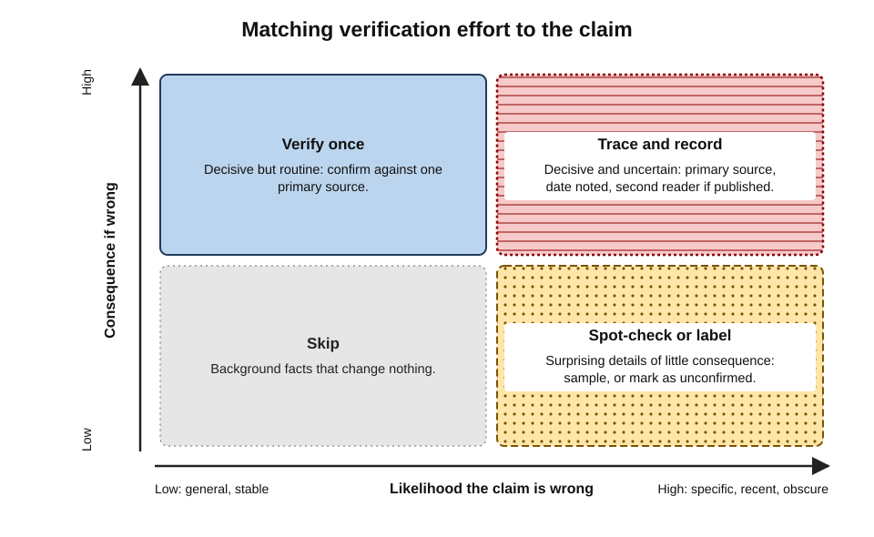
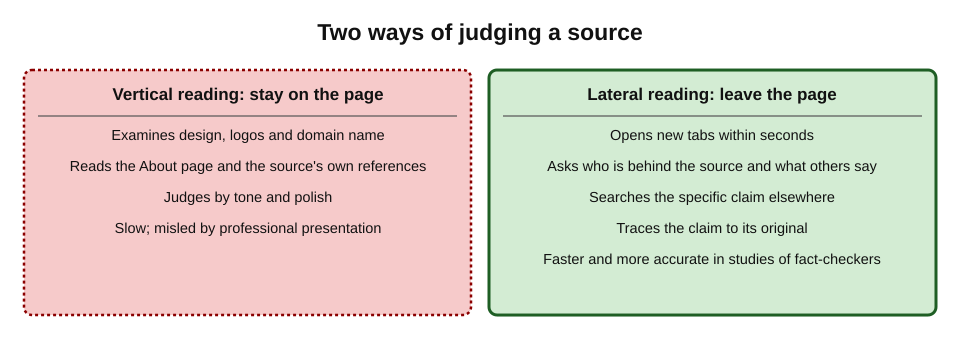
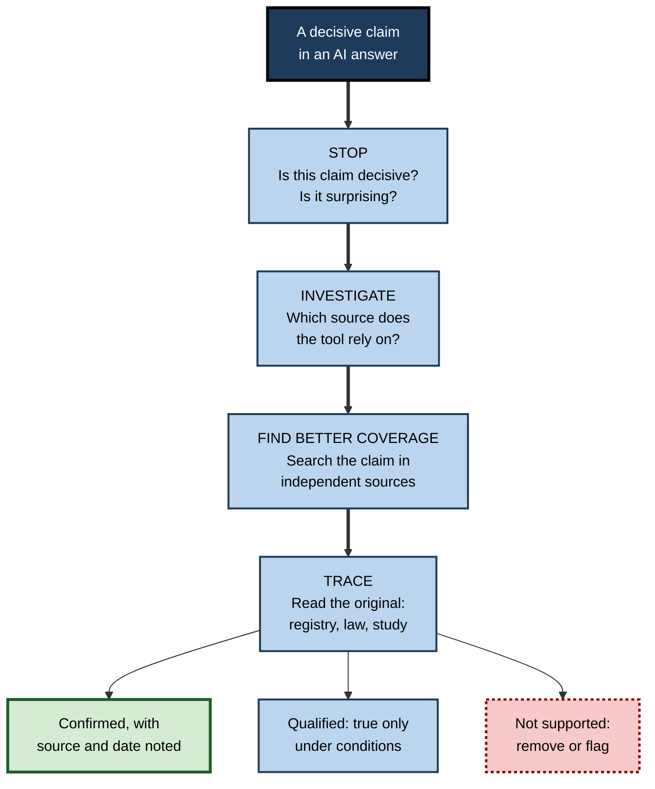
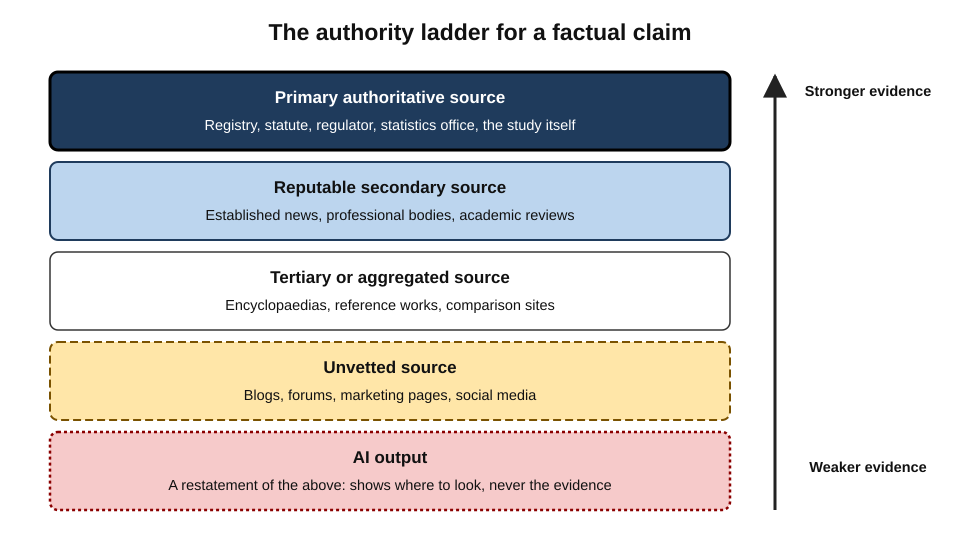
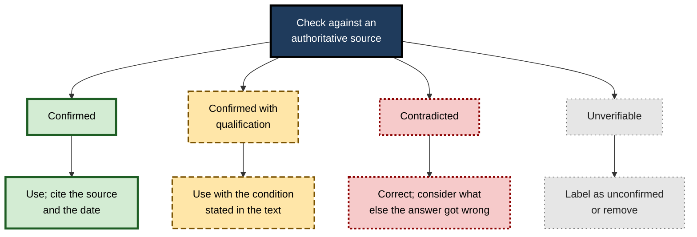

# H.2. Verifying AI-provided facts

An AI research assistant tells a recruiter that a candidate's previous employer "was acquired by a US competitor in 2023", that the statutory notice period for the role is "one week per year of service" and that the sector's average salary rose "by 6.2% last year". Each statement is specific, plausible and delivered in the same even tone.

One is true, one is a half-truth that misses a condition, and one is a number that appears in no source at all. Nothing in the wording reveals which is which.

> **Definition — Verification:** establishing, from evidence independent of the claim's presenter, whether a factual statement is true, in what sense and under what conditions.

> **Definition — AI-provided fact:** any factual statement — a figure, date, name, attribution, rule, event or causal claim — that reaches a person through the output of an AI tool rather than directly from a source document.

**Why it matters**

- **AI tools state facts in the same voice whether right or wrong.** Tone, fluency and detail carry no information about accuracy.
- **Errors are mixed in with truths.** A paragraph that is 90% correct can contain the one error that matters.
- **Responsibility stays with the person.** Courts, regulators, clients and employers hold the professional — not the tool — accountable for facts they rely on.
- **Verification is a learnable skill**, with methods that are faster than most people expect.
- **The skill predates AI.** Fact-checkers, auditors and researchers developed these methods for human-written sources; AI makes them a daily necessity for everyone.

---

## Why AI-Provided Facts Need Checking

### How factual errors arise

- **From training memory.** A language model produces text by predicting likely continuations; a fact "remembered" from training may be **outdated**, **conflated** with a similar fact, or **invented** where memory is thin.
- **From retrieval.** When a tool searches before answering, it may retrieve a poor, outdated or satirical source — and faithfully repeat its error.
- **From compression.** Summarising several sources into one sentence loses conditions, exceptions, units and dates.
- **From the question itself.** A question that assumes something ("Why did sales fall in 2024?") invites an answer that supplies reasons even if sales did not fall.

> **Definition — Knowledge cutoff:** the date after which a model's training data contains little or no information; facts that changed after it may be stated in their old form unless the tool searches for current information.

> **Definition — Conflation:** merging two similar but distinct things into one — two people with the same name, two regulations with similar titles, two companies in the same group.

### Which facts fail most often

- **Precise numbers** — percentages, prices, thresholds, sample sizes.
- **Dates and sequences** — when a rule took effect, when a company changed hands.
- **Attributions** — who said, wrote, decided or found something.
- **Current status** — who holds a post, whether a rule is in force, whether a company still exists.
- **Specific legal and regulatory content** — thresholds, conditions, exceptions, jurisdiction.
- **Obscure entities** — small companies, local organisations, less-known people, where training data and web coverage are thin.

> **Key point:** the facts most likely to be wrong are the **specific, current and obscure** ones — which are also the facts most likely to matter in professional work.

**Real case — Moffatt v. Air Canada (2024)**

- **Situation:** a traveller asked Air Canada's website chatbot about bereavement fares after a relative died. The chatbot said he could buy a full-price ticket and claim the bereavement discount retrospectively.
- **Fact:** the airline's actual policy, on another page of the same website, did not allow retrospective claims.
- **Decision:** British Columbia's Civil Resolution Tribunal rejected the airline's argument that the chatbot was responsible for its own statements and ordered Air Canada to pay the difference.
- **Lesson:** an AI tool's statement of fact can create real obligations; the organisation deploying it — and the person relying on it — cannot treat it as someone else's problem.

---

## The Core Method: From Answer to Atomic Claims

### Decomposition

A paragraph cannot be verified as a whole; it must be broken into **atomic claims** — single statements that can each be true or false on their own.

> **Definition — Atomic claim:** the smallest factual statement that can be checked independently, such as "Company X was acquired in 2023" or "the acquirer was based in the US".

**How to decompose**

1. **Split compound sentences.** "X was acquired by a US competitor in 2023" contains three claims: acquired; acquirer was a competitor based in the US; year 2023.
2. **Separate fact from interpretation.** "Prices rose sharply" contains a fact (prices rose) and a judgement (sharply).
3. **Make implicit claims explicit.** "Since the new rule…" asserts that a new rule exists.
4. **Note conditions and scope.** "Employees are entitled to…" — which employees, in which country, from what date?

### Triage: which claims to check

Not every claim deserves the same effort. Verification effort should follow **consequence** and **uncertainty**.

- **Consequence** — what happens if the claim is wrong?
  - Will it be quoted to a client, put in a contract, used in a decision, published?
- **Uncertainty** — how likely is the claim to be wrong?
  - Is it specific, recent, obscure, numerical, or surprising?

**Figure 1.** Matching verification effort to consequence and uncertainty.

> **Remember:** check **every decisive claim**, check **a sample of supporting claims**, and **label** what has not been checked.

> **Definition — Decisive claim:** a claim on which a conclusion, decision or recommendation depends, such that if it were false the conclusion would change.

### Worked example (illustrative): decomposing a paragraph

**Situation:** a sales manager asks an AI assistant about a prospective client and receives: *"Northbridge Foods, founded in 1987 in Leeds, is the UK's third-largest supplier of chilled ready meals, with revenue of £412 million in 2024. It was acquired by the private-equity firm Halden Capital in 2022 and has since expanded into plant-based products."*

| Atomic claim | Type | Consequence if wrong | Uncertainty | Check |
|---|---|---|---|---|
| Founded 1987 | Date | Low | Moderate | Skip or sample |
| Based in Leeds | Fact | Low | Low | Skip |
| Third-largest UK supplier of chilled ready meals | Ranking | High — used in the pitch | High — rankings vary by source and definition | Verify; note the source's definition |
| Revenue £412m in 2024 | Number | High | High — precise and recent | Verify in filed accounts |
| Acquired by Halden Capital in 2022 | Ownership and date | High — affects who decides | Moderate | Verify in the company registry and press releases |
| Expanded into plant-based products | Activity | Moderate | Moderate | Verify on the company's own site |

*Illustrative company and figures.*

- **Result of checking (illustrative):** the registry shows the acquisition completed in early 2023, not 2022; the filed accounts show revenue for the financial year ending March 2024, with a different figure; the "third-largest" ranking came from a trade article using a narrower category.
- **Conclusion:** three of the six claims needed correction or qualification — and they were the three that mattered most.

> **Watch out:** "most of it was right" is not reassurance. Errors cluster in the **specific** claims that carry the weight.

---

## Reading Laterally

### Vertical and lateral reading

> **Definition — Vertical reading:** judging a source by examining it from the inside — its design, its "About" page, its references, its tone.

> **Definition — Lateral reading:** leaving a source to find out what other, independent sources say about it and about its claims.

**Study card — Wineburg and McGrew (2019)**

- **Who:** Sam Wineburg and Sarah McGrew of the Stanford History Education Group.
- **Design:** three groups evaluated unfamiliar websites and claims online while being observed:
  - PhD historians;
  - Stanford undergraduates;
  - professional fact-checkers from leading news organisations.
- **Results:**
  - historians and students mostly **read vertically** — they stayed on the site, scrutinised its design, logos, domain name and "About" page, and were often misled by professional-looking pages;
  - fact-checkers **read laterally** — within seconds they opened new tabs to see what others said about the organisation behind the site, and reached **more accurate conclusions in less time**.
- **Conclusion:** expertise in evaluating online information lay in **knowing what to ignore** and **leaving the page** quickly — "reading less and learning more".

**Figure 2.** Vertical reading stays inside the source; lateral reading leaves it.

### Lateral reading applied to AI answers

- **The AI answer is the "site".** Its fluency and structure are like a well-designed web page — signals about presentation, not truth.
- **Leave it.** For each decisive claim, open a new tab and search for the claim in independent sources.
- **Search for the claim, not the answer.** Use the specific names, figures and dates as search terms.
- **Find the original.** Prefer the source closest to the event — the registry, the statute, the study, the company's own filing.

### SIFT

**Mike Caulfield's SIFT method (2019)**, developed for teaching digital literacy, compresses lateral reading into four moves:

- **Stop** — notice the reaction to a claim; check what is known about the source before going further.
- **Investigate the source** — who is behind it, and what is their expertise and agenda?
- **Find better coverage** — look for more trusted reporting or analysis of the same claim.
- **Trace claims, quotes and media to the original context** — see what the original actually said.

> **Mnemonic — SIFT:** Stop, Investigate the source, Find better coverage, Trace to the original.

**Figure 3.** The SIFT moves applied to a claim from an AI answer.

> **In practice:** professional fact-checkers spend most of their time on **trace** — finding what the original actually says — because errors most often arise in the journey from original to summary.

---

## Where to Verify: Source Authority

### The authority ladder

Different sources carry different weight for different kinds of fact. For any claim, the strongest confirmation comes from the source **closest to the fact** and **accountable for it**.

- **Primary authoritative sources** — the body that creates or records the fact.
  - *e.g.* legislation databases for law; company registries and filed accounts for corporate facts; national statistics offices for official data; the journal article for a study's results; the court's judgment for a ruling.
- **Reputable secondary sources** — independent organisations that report or analyse primary material with editorial standards.
  - *e.g.* established news organisations, professional bodies, academic reviews.
- **Tertiary and aggregated sources** — encyclopaedias, comparison sites, reference works.
  - Useful for orientation and for pointing to primary sources.
- **Unvetted sources** — blogs, forums, marketing pages, social media.
  - Useful for leads and experiences; weak as evidence of fact.
- **AI outputs** — a generated restatement of any of the above; never itself the evidence.

**Figure 4.** The authority ladder for verifying a factual claim.

> **Key point:** an AI answer can tell the researcher **where to look**; it can never be **what the researcher cites**.

### Matching the claim type to its best check

| Claim type | Typical AI failure | Best verifying source | What to confirm |
|---|---|---|---|
| Legal or regulatory rule | Wrong jurisdiction; outdated; condition omitted | Official legislation or regulator's site | Text, date in force, scope, exceptions |
| Company fact | Conflated entities; stale ownership | Company registry, filed accounts, official announcements | Exact legal entity, date, figure and period |
| Statistic | Invented or mis-scoped number | National statistics office or original survey | Definition, population, period, unit |
| Research finding | Overgeneralised; wrong study | The study itself | Sample, method, size of effect, limitations |
| Quotation | Paraphrased or invented | Original recording, transcript or publication | Exact words and context |
| Current office-holder or status | Outdated | The organisation's own official page | Date of the page or announcement |

### Time-sensitivity

- **Every fact has a date.** Thresholds, rates, office-holders, prices, ownership and rules change.
- **AI answers often blend dates.** A tool may combine a 2021 source with a 2025 source without signalling it.
- **Record the "as at" date.** A verified fact should be stored with the date of its source and the date it was checked.

> **Watch out:** a source that was correct when written can be wrong today. "I found it on the official site" is reassuring only if the page is **current**.

---

## The Psychology of Checking

### Why people do not verify

- **Fluency.** Smooth, well-organised text feels true — a long-documented effect in which ease of processing is mistaken for accuracy.
- **Automation bias.** People tend to over-rely on automated outputs and under-weight contradictory information.
- **Time pressure.** Verification feels like a delay; its benefits are invisible when nothing goes wrong.
- **Partial accuracy.** When most of an answer checks out, the reader generalises trust to the rest.
- **Confirmation.** Claims that fit what the reader expected are checked less.

> **Definition — Illusory truth effect:** the tendency to judge statements as truer after repeated exposure or when they are easy to process, regardless of their accuracy.

**Study card — knowledge workers' critical thinking with generative AI (2025)**

- **Who:** researchers at Microsoft Research and Carnegie Mellon University, presented at the CHI conference on human factors in computing (2025).
- **Design:** survey of **319** knowledge workers describing nearly a thousand real examples of using generative AI at work.
- **Results:**
  - higher **confidence in the AI** was associated with **less** critical thinking about its output;
  - higher **confidence in one's own ability** to do the task was associated with **more** critical evaluation;
  - critical effort shifted from gathering information towards **verifying** and **integrating** AI responses.
- **Conclusion:** trust in the tool tends to displace checking — unless the person has, and uses, their own expertise.
- **Caveat:** self-reported, cross-sectional data; it shows association, not cause.

### Habits that counter the biases

- **Decide what is decisive before reading the answer.** Knowing which claim matters prevents being lulled by the rest.
- **Ask: "How would I know if this were wrong?"** — then do that check.
- **Distrust round, precise or perfectly fitting numbers** that come without a source.
- **Be most sceptical of what confirms expectations.**
- **Never ask the same AI tool whether its own fact is correct** as the only check — it may simply reaffirm or invent a confirmation.

> **Watch out:** asking a tool "Are you sure?" often causes it to change a correct answer or defend a wrong one. Confirmation must come from **outside** the tool.

---

## Verification Outcomes and How to Record Them

### Four outcomes

- **Confirmed** — an authoritative source states the claim as given.
- **Confirmed with qualification** — true only under conditions, for a narrower scope, or as of a certain date.
- **Contradicted** — an authoritative source states otherwise.
- **Unverifiable** — no adequate source found within reasonable effort.

> **Key point:** "unverifiable" is a legitimate result. The professional response is to **label** it ("not independently confirmed") or **remove** it — never to present it as fact.

**Figure 5.** The four outcomes of a verification check and what to do with each.

### What a contradiction tells the researcher

- **One wrong decisive claim lowers trust in the rest** of that answer — especially claims from the same apparent source.
- **Look for the cause.** Was the source outdated? Was an entity conflated? Was a condition dropped? The cause predicts other errors.
- **Widen the check.** If one figure was wrong, check the others from the same passage.

### Recording verification

- **What to note:** the claim, the source used, the date of the source, the date checked, the outcome.
- **Where:** beside the claim in working notes, in comments on a draft, or in a research log.
- **Why:** others can rely on the work without repeating it, and the reasoning can be reconstructed if challenged.

---

## Verification at Scale

### Proportionate effort

> **Formula — Expected cost of not checking (illustrative):** probability the claim is wrong × cost if wrong. Example: a 10% chance of error × £50,000 exposure = £5,000 expected cost — far more than the fifteen minutes needed to check a filed account. *Illustrative figures.*

| Context | Typical verification standard |
|---|---|
| Personal curiosity, internal chat | Spot-check surprising claims |
| Internal working document | Verify decisive claims; label the rest |
| Client deliverable or board paper | Verify every decisive claim against a primary source; sample others |
| Publication, legal filing, regulatory submission | Verify every factual claim and citation; second-person review |

### Team practices

- **Separate drafting from checking.** The person who gathered the facts is the worst-placed to spot their own errors; a second reader checks decisive claims.
- **Mark provenance in drafts.** Highlight or tag any fact that came from an AI tool until it has been verified.
- **Keep shared "verified facts" lists** for recurring data — client details, standard figures, regulatory thresholds — with sources and dates.
- **Build verification time into plans.** Research that uses AI is faster to draft but not faster to verify.

> **In practice:** many professional services and publishing teams now require that any AI-generated factual content be marked until a named person has confirmed it against a primary source.

### Case study (illustrative): a compliance brief that nearly went out

- **Situation:** a compliance officer at a payments company used an AI research tool to prepare a brief on new anti-money-laundering obligations for the executive committee.
- **Problem:** the draft stated that a reporting deadline was "30 days", attributed to a regulator's guidance.
- **Diagnosis during review:**
  1. a colleague decomposed the brief into its decisive claims — deadlines, thresholds, scope;
  2. she traced each to the regulator's published guidance;
  3. the "30 days" figure came from **another country's** regime with a similar name; the domestic deadline was shorter and applied only to certain transaction types.
- **Actions:** the brief was corrected; the team adopted a rule that every deadline and threshold must cite the **paragraph** of the official text.
- **Result:** the committee approved a process built on the correct deadline; an internal audit later sampled the brief's claims and found them traceable.
- **Lesson:** conflation across jurisdictions is a characteristic AI error; decomposition plus tracing to the official paragraph catches it.

---

## Sanity-Checking Numbers Before Tracing Them

Before searching for a figure's source, a few seconds of reasoning often reveal that it cannot be right.

- **Order of magnitude.** Is the figure plausible given what is known? A claim that a mid-sized firm has "12,000 employees in one city office" invites an immediate check.
- **Internal consistency.** Do the numbers in the answer add up? Percentages that sum to more than 100, growth rates inconsistent with start and end values, or totals smaller than their parts signal error.
- **Units and periods.** Annual or monthly? Thousands or millions? Gross or net? Nominal or real?
- **Precision mismatch.** A figure given to one decimal place for something that cannot be measured that precisely ("37.4% of employees feel…") suggests either a specific survey — which should be named — or invention.
- **Comparison with a known anchor.** A country's population, a company's reported revenue, a sector's total employment — known anchors expose impossible figures.

> **Formula — Growth consistency check (illustrative):** if an answer says revenue grew from £40m to £52m and "rose by 45%", the implied growth is (52 − 40) ÷ 40 = **30%**. One of the three figures is wrong. *Illustrative figures.*

| Signal | Example | What it suggests |
|---|---|---|
| Totals do not add up | Segments summing to more than the total | Figures from different sources or periods |
| Growth rate inconsistent | Start, end and rate disagree | One number misremembered or invented |
| Implausible precision | "Exactly 63.2% of managers" with no source | A specific survey to find — or fabrication |
| Implausible scale | A small firm with a giant market share | Wrong entity or wrong unit |

> **Key point:** sanity checks do not confirm a number — only a source can — but they **direct effort** to the figures most likely to be wrong.

---

## Open Questions

- **Can AI tools verify AI tools?**
  - Automated fact-checking systems that check claims against retrieved sources are improving, but they inherit retrieval and reading errors; their reliability as a sole check is unproven.
- **How much verification is enough?**
  - There is little empirical guidance on optimal sampling of non-decisive claims in professional work.
- **Will people keep checking as tools improve?**
  - As accuracy rises, the temptation to stop checking grows — but rare errors in high-stakes facts remain costly.
- **Who is liable when a verified source was itself wrong?**
  - Professional standards on reasonable verification effort for AI-assisted research are still forming.
- **Can interfaces support verification?**
  - Showing confidence, highlighting unsupported sentences and linking claims to exact passages may help; evidence on whether they change behaviour is limited.

---

## Summary

- **Verification** establishes from independent evidence whether a claim is true, in what sense and under what conditions.
- AI-provided facts fail through **training memory**, **retrieval**, **compression** and **loaded questions**; **specific, current and obscure** facts fail most.
- **Moffatt v. Air Canada (2024)** showed that an AI tool's wrong statement can create real obligations.
- Break answers into **atomic claims**, identify the **decisive** ones, and set effort by **consequence × uncertainty**.
- **Lateral reading** — leaving the source to see what independent sources say — outperformed vertical reading in Wineburg and McGrew's (2019) study of fact-checkers; **SIFT** compresses it into four moves.
- Verify against the source **closest to the fact and accountable for it**; an AI answer shows where to look but is never the evidence.
- Every fact has a **date**; record the "as at" date and the date checked.
- **Fluency**, **automation bias** and **confidence in the tool** reduce checking; confirmation must come from **outside** the tool.
- Outcomes: **confirmed, qualified, contradicted, unverifiable** — label or remove the unverifiable.
- Verification standards should rise with the **stakes** of the output.

---

## Self-Check

1. Define verification and explain why the tone of an AI answer gives no information about its accuracy.
2. List four ways factual errors enter AI answers.
3. Which kinds of fact are most likely to be wrong, and why are these often the ones that matter most?
4. What happened in Moffatt v. Air Canada, and what principle does it illustrate?
5. Decompose this sentence into atomic claims: "The firm's Dublin office, opened in 2019, now employs 300 people and leads its EU expansion."
6. Explain how consequence and uncertainty should determine verification effort.
7. Describe Wineburg and McGrew's study and its main finding.
8. Distinguish vertical from lateral reading and explain how lateral reading applies to an AI answer.
9. State the four moves of SIFT.
10. Rank these as sources for a company's revenue: a news article, the company registry's filed accounts, an AI answer, a comparison website.
11. Why is asking the same AI tool "Are you sure?" an inadequate check?
12. What are the four verification outcomes, and what should be done with an unverifiable claim?
13. In the compliance case study, what kind of error occurred and what rule prevented its recurrence?
14. A director wants a one-page market overview by tomorrow, written with AI. Propose a verification approach proportionate to the stakes.

### Answer Key

1. Verification establishes, from evidence independent of the presenter, whether a claim is true and under what conditions. Language models produce the same fluent, confident style whether the content is accurate or not, so tone reflects generation, not evidence.
2. From training memory (outdated, conflated or invented facts); from retrieved sources that are themselves wrong; from compression that drops conditions, units and dates; from questions that embed false assumptions.
3. Specific numbers, dates, attributions, current status, legal detail and obscure entities. These are the precise facts that decisions, contracts and client advice depend on, and they are thinly or inconsistently covered in sources.
4. Air Canada's chatbot told a traveller he could claim a bereavement discount retrospectively; the policy said otherwise. The tribunal held the airline responsible for its chatbot's statement. An AI tool's factual statements create real accountability for those who deploy or rely on them.
5. The firm has a Dublin office; it opened in 2019; it now employs about 300 people; it leads the firm's EU expansion (partly an interpretive claim about role).
6. Effort should be greatest where a wrong claim would be costly and where the claim is likely to be wrong (specific, recent, obscure, surprising). Low-consequence, low-uncertainty claims can be skipped or sampled; decisive, uncertain claims must be traced to a primary source.
7. Historians, undergraduates and professional fact-checkers evaluated unfamiliar websites. Historians and students read vertically and were often misled; fact-checkers left the site to see what others said about it and reached better conclusions faster.
8. Vertical reading assesses a source from within (design, About page, tone); lateral reading leaves it to consult independent sources. For an AI answer, the reader takes each decisive claim and searches for it in independent, authoritative sources, rather than judging the answer's plausibility.
9. Stop; Investigate the source; Find better coverage; Trace claims, quotes and media to the original context.
10. Filed accounts at the registry (primary and accountable); news article (reputable secondary); comparison website (aggregated); AI answer (a restatement, never the evidence).
11. The tool has no independent access to truth beyond what it generated or retrieved; it may reaffirm a wrong answer, invent a confirmation, or switch away from a correct one. Confirmation must come from an external authoritative source.
12. Confirmed, confirmed with qualification, contradicted, unverifiable. An unverifiable claim should be labelled as not independently confirmed or removed.
13. Conflation across jurisdictions: a deadline from another country's similarly named regime was presented as domestic. The rule that every deadline and threshold must cite the specific paragraph of the official text.
14. For example: decompose the draft into claims; identify the five to ten decisive ones (market size, growth rate, main competitors, regulatory facts); trace each to a primary or reputable source with date; sample a few supporting claims; label anything unconfirmed; note sources and dates in a footnote or appendix; ask a colleague to spot-check the figures.

---

## Glossary

| Term | Meaning |
|---|---|
| AI-provided fact | A factual statement received through an AI tool's output rather than directly from a source. |
| Atomic claim | The smallest independently checkable factual statement. |
| Authority ladder | An ordering of sources by closeness to, and accountability for, a fact. |
| Automation bias | Over-reliance on automated outputs and under-use of contrary information. |
| Conflation | Merging two similar but distinct entities or rules into one. |
| Decisive claim | A claim on which a conclusion or decision depends. |
| Illusory truth effect | Judging statements truer when repeated or easy to process. |
| Knowledge cutoff | The date after which a model's training data contains little information. |
| Lateral reading | Leaving a source to see what independent sources say about it and its claims. |
| Primary source | The body or document that creates or records a fact. |
| SIFT | Stop, Investigate the source, Find better coverage, Trace to the original. |
| Triage (verification) | Deciding which claims to check, and how deeply, by consequence and uncertainty. |
| Verification | Establishing from independent evidence whether a claim is true and under what conditions. |
| Vertical reading | Evaluating a source by examining it from the inside. |
