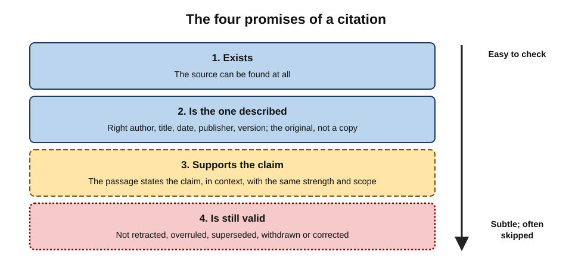
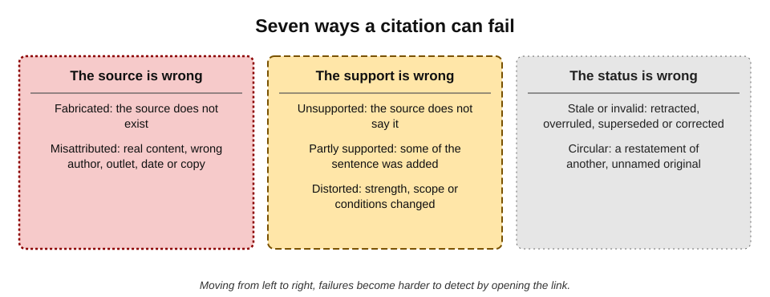
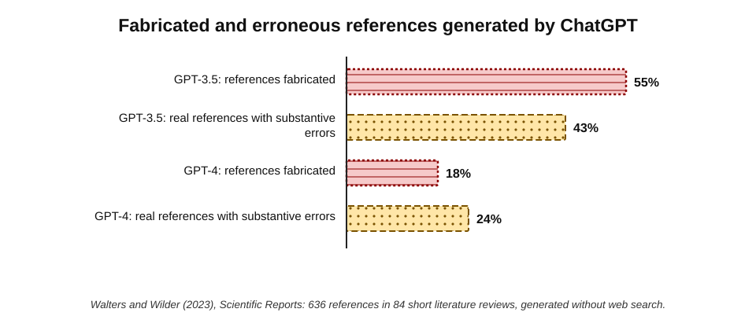
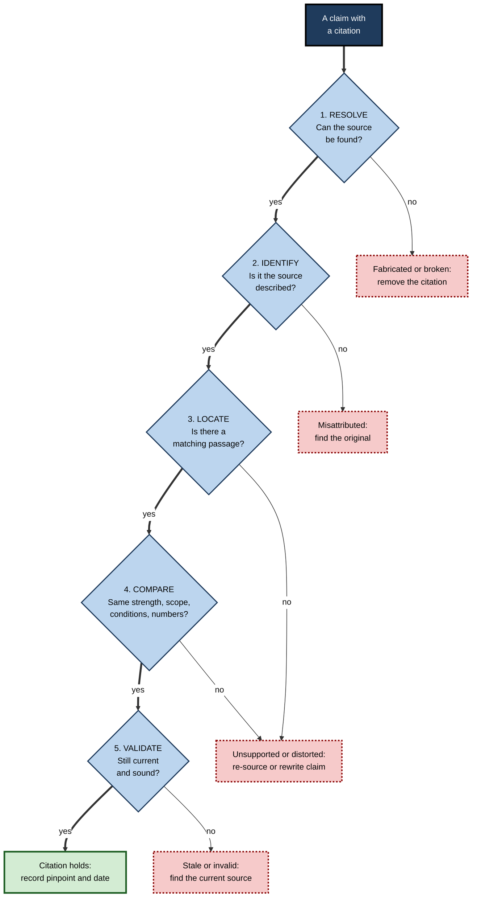
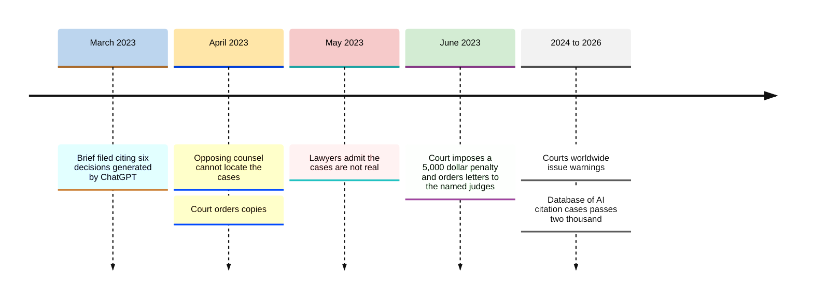
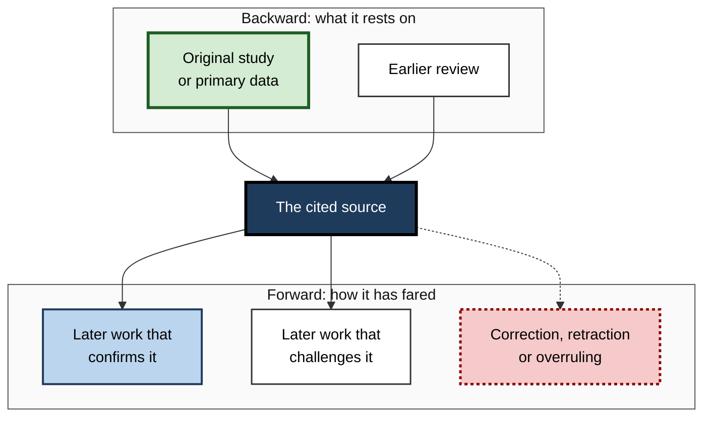

# H.3. Following and checking citations

In the spring of 2023 a New York lawyer filed a brief citing six court decisions in support of his client's case. The opposing lawyers could not find them; neither could the judge. The cases — complete with names, docket numbers and quotations — had been produced by ChatGPT, and when the lawyer asked the tool whether they were real, it assured him they were.

A citation is a promise that a source exists and says what it is claimed to say. Checking that promise is one of the most important habits in AI-assisted research.

> **Definition — Citation:** a reference that identifies a specific source — document, page, passage, dataset, judgment — as the origin of, or support for, a particular statement.

> **Definition — Citation checking:** confirming that a cited source exists, is the source it claims to be, actually supports the statement it is attached to, and is still valid.

**Why it matters**

- **Citations carry borrowed authority.** A claim with a footnote looks researched; readers rarely follow the footnote.
- **AI tools generate citations with the same fluency as prose** — including citations to sources that do not exist or do not say what is claimed.
- **Professional rules require accurate citation.** Courts, journals, regulators and clients treat false citations as serious misconduct, whatever their origin.
- **Following citations is also how research deepens.** A good citation leads to the evidence, its context and further sources.

---

## What a Citation Promises

### The four promises

Every citation makes four implicit claims, each of which can fail independently:

1. **Existence** — the source exists.
2. **Identity** — it is the source described: right author, title, date, publisher, version.
3. **Support** — the cited passage actually states, or clearly implies, the claim it is attached to.
4. **Validity** — the source is still current and sound: not retracted, overruled, superseded, withdrawn or corrected.

> **Mnemonic — "EIS-V" (Exists, Is the one, Supports, Valid):** say it as "**E**very **I**mportant **S**ource **V**erified".

**Figure 1.** The four promises a citation makes, each a check that can fail.

> **Key point:** most people check only the first promise, if any. AI-era citation failures occur at **all four**, and the subtle ones — support and validity — are the most common.

### Kinds of citation in AI tools

- **Inline links** in answer engines — numbered markers that link to web pages.
- **Formal references** in generated text — author, year, title, journal, volume, pages, DOI — produced when a tool is asked for "sources" or "references".
- **Document anchors** in workplace and document tools — links to a specific file, page or passage in the user's own material.
- **Legal and regulatory citations** — case names, neutral citations, section numbers.

> **Definition — DOI (Digital Object Identifier):** a persistent identifier assigned to a scholarly article, dataset or report, which resolves to the publisher's record of that item.

---

## How Citations Fail

### A taxonomy of failures

- **Fabricated source** — the source does not exist.
  - Typical form: plausible author names, a real journal, a realistic title, a DOI that resolves to a different paper or to nothing.
- **Misattributed source** — the content exists but is credited to the wrong author, outlet, date or document.
  - *e.g.* a syndicated copy credited instead of the original publisher.
- **Unsupported claim** — the source exists and is correctly identified, but does not say what the sentence claims.
- **Partially supported claim** — the source supports part of the sentence; the rest was added.
- **Distorted claim** — the source says something related but the citation changes its strength, scope or conditions ("may reduce" becomes "reduces").
- **Stale or invalid source** — the source was right once but has been superseded, retracted, overruled or corrected.
- **Circular citation** — the source is itself a restatement of another, often unidentified, original — or of AI-generated text.

**Figure 2.** Seven ways a citation can fail, from the obvious to the subtle.

> **Definition — Misgrounded citation:** a citation to a real source that does not support the proposition it is cited for. Researchers at Stanford University who tested AI legal research tools in 2024 treated such citations as a form of hallucination, alongside invented ones.

### Why AI tools produce failed citations

- **Language models learn the form of citations.** A model trained on millions of reference lists can produce a perfectly formatted reference without retrieving any source.
- **Retrieval and generation are separate.** An answer engine may write a sentence from several passages and then attach the link that best matches — not necessarily the one that supports it.
- **Syndication and copying.** The same article appears on many sites; tools often cite a copy, an aggregator or a summary rather than the original.
- **Recency.** Sources the tool retrieves may be outdated versions, or tools may lack access to the current version behind a paywall.

### The evidence

**Study card — Walters and Wilder (2023)**

- **Who:** William Walters and Esther Isabelle Wilder, published in *Scientific Reports*.
- **Design:** ChatGPT (GPT-3.5 and GPT-4 versions) was asked to write short literature reviews on a range of topics; the researchers checked **636** references across 84 papers.
- **Results:**
  - **55%** of GPT-3.5 references and **18%** of GPT-4 references were **fabricated** — the cited works did not exist;
  - of the references that did exist, **43%** (GPT-3.5) and **24%** (GPT-4) contained substantive errors such as wrong authors, dates, volumes or pages.
- **Conclusion:** fabrication fell sharply between model generations but remained common; even "real" references were often wrong in detail.
- **Caveat:** these were models answering from memory without web search; tools that retrieve sources fabricate less, but fail in other ways.

**Figure 3.** Fabricated and erroneous references in ChatGPT-generated literature reviews (Walters and Wilder, 2023).

**Further evidence in brief**

- **Generative search engines (2023):** a Stanford University audit of four engines found that only about half of generated sentences were fully supported by their citations, and about a quarter of citations did not support their sentences.
- **News attribution (2025):** Columbia University's Tow Center for Digital Journalism found that eight AI search tools collectively misidentified the source article in more than 60% of 1,600 tests, often citing syndicated copies or fabricating links.
- **News integrity (2025):** in an international study led by the BBC and the European Broadcasting Union, sourcing was the single largest category of significant problems in AI assistants' news answers, at about 31% of responses.
- **Legal research (2024–2025):** Stanford researchers found that even specialist legal AI tools produced incorrect or misgrounded answers in roughly a sixth to a third of test queries.

> **Watch out:** retrieval-based tools rarely invent sources outright; their characteristic failure is **misgrounding** — a real link beside a sentence it does not support. This is harder to spot, because the link works.

---

## The Citation-Checking Procedure

### Five steps

1. **Resolve** — open the link or search for the reference.
   - For formal references, search the exact title in quotation marks and resolve the DOI.
   - For legal citations, search the official court or legislation database.
2. **Identify** — confirm that the item found is the one cited.
   - Check author, title, date, publisher, version; for web pages, check the publisher is the original, not a copy.
3. **Locate** — find the passage that supports the claim.
   - Use the browser's find function for key terms, figures or names.
   - If no passage can be found in a reasonable time, treat the claim as unsupported.
4. **Compare** — read the passage and its surrounding context against the claim.
   - Same strength? Same scope? Same conditions? Same numbers and units?
5. **Validate** — confirm the source is still sound.
   - Retraction notices, corrections, later versions, appeals and overruling, updated statistics.

**Figure 4.** The five-step citation check.

> **Remember:** a citation is checked only when the **passage** has been read **in context**. Opening the link is step one of five.

### Techniques that make checking fast

- **Search the exact title in quotation marks.** A fabricated article returns nothing, or only other AI-generated pages repeating it.
- **Resolve the DOI separately.** Fabricated references often carry real DOIs belonging to unrelated papers.
- **Search the author's publication list.** If the claimed article is absent from an author's profile or institutional page, suspect fabrication.
- **Use the find function.** Search the cited page for the key figure, name or phrase; absence after two or three tries is a strong signal.
- **Check the date on the page, not the date in the citation.**
- **For legal citations, use the official reporter or court database**, never only a general web search.
- **For statistics, go to the statistics office's own table**, not the press coverage.

> **In practice:** experienced researchers check the **decisive** citations first — those supporting the claims a conclusion rests on — and then sample the rest, increasing the sample if any fail.

### Reading the passage in context

- **Read the sentence before and after.** Qualifications often sit next to the quoted line.
- **Check what the source is reporting.** Is it the author's finding, a view the author is criticising, or a claim attributed to someone else?
- **Check the section.** A statement in a "background" or "limitations" section carries a different weight from one in "results".
- **Check the population and setting.** A finding about hospital nurses in one country may not support a claim about "employees".

> **Watch out:** a citation can be technically accurate yet misleading — a real sentence from a real source, quoted out of the context that limited it. Context checks catch what existence checks miss.

---

## Worked Example (illustrative): Auditing Five Citations

**Situation:** a policy analyst receives an AI-generated paragraph on remote work and productivity, with five references, for a briefing to a public-sector employer.

| Reference | Resolve | Identify | Locate and compare | Validate | Verdict |
|---|---|---|---|---|---|
| 1. A large randomised trial of hybrid working at a technology firm | Found | Correct authors and journal | Supports "no loss of productivity" for that firm's graduates and engineers; the sentence generalised to "all employees" | Current | **Distorted** — narrow the claim |
| 2. A government statistical release on homeworking | Found | Correct | Figure quoted matches, but from the previous year's release | A newer release exists | **Stale** — update the figure |
| 3. A management journal article with plausible authors | Not found by exact title; DOI resolves to a chemistry paper | — | — | — | **Fabricated** — remove |
| 4. A news article on a bank's office-return policy | Found | It is a syndicated copy on an aggregator site | Supports the claim | Original found on the newspaper's site | **Misattributed** — cite the original |
| 5. A consultancy survey | Found | Correct | Supports the claim as stated | Current | **Holds** |

*Illustrative references and outcomes.*

- **Result:** one citation of five survived unchanged; one had to be removed; three needed correction.
- **Conclusion:** the paragraph's headline claim — that hybrid work does not reduce productivity "for employees generally" — rested on a single study whose population was narrower, and needed rewording.

> **Watch out:** the most consequential failure was not the fabricated reference — which was easy to spot — but the **distorted** one, which looked fully legitimate.

---

## Real Case: Mata v. Avianca (2023)

- **Situation:** in a personal-injury claim against the airline Avianca in the US District Court for the Southern District of New York, the claimant's lawyers filed a brief opposing dismissal.
- **The problem:** the brief cited six decisions — including one named *Varghese v. China Southern Airlines* — that did not exist. The lawyer had used ChatGPT for research; when he asked it whether the cases were real, it said they were and that they could be found in legal databases.
- **Discovery:** the airline's lawyers reported that they could not locate the cases; the court ordered copies; the lawyers then submitted purported excerpts, also generated.
- **Decision (June 2023):** Judge P. Kevin Castel found that the lawyers had acted in bad faith by failing to withdraw the citations after being alerted, and imposed a **$5,000** penalty, also requiring them to write to the judges falsely named as authors of the fake opinions.
- **Aftermath:**
  - courts in the United States, the United Kingdom, Canada, Australia and elsewhere issued guidance or warnings on AI-generated citations;
  - in June 2025 the High Court of England and Wales, in a judgment by the President of the King's Bench Division, Dame Victoria Sharp, warned that lawyers citing fictitious authorities could face contempt proceedings or referral to their regulators;
  - a public database maintained by the legal researcher Damien Charlotin had recorded more than **two thousand** court decisions worldwide involving AI-fabricated material by September 2026, the majority in the United States.
- **Lesson:**
  1. **Asking the tool to confirm its own citation is not a check.**
  2. Legal citations must be verified in an **authoritative database**, and the **text** of each authority read.
  3. Responsibility rests on the person who signs the document.

**Figure 5.** Key events in the Mata v. Avianca citation case.

---

## Following Citations to Deepen Research

### Citations as paths, not only proofs

- **Backward chaining** — reading the sources a good source cites, to reach the foundational work.
- **Forward chaining** — finding later works that cite a source, to see whether it was confirmed, extended, criticised or overturned.
- **Pinpoint following** — going to the exact page, paragraph or table cited, rather than skimming the whole.

> **Definition — Citation chaining:** following references backwards (to earlier work cited) and forwards (to later work citing) to map the evidence around a source.

### What later citations reveal

- **Support or contradiction.** Some academic tools classify citing statements as supporting, contrasting or merely mentioning — a useful but imperfect signal of how a finding has fared.
- **Retraction.** Retracted papers continue to be cited; publishers' retraction notices and dedicated databases record them.
- **Overruling and amendment.** In law, citator services show whether a case is still good law and whether a provision has been amended or repealed.

| Field | How validity is checked | What can go wrong |
|---|---|---|
| Academic research | Retraction notices; later replications and critiques | Citing a retracted or failed-to-replicate study |
| Law | Citator services; official legislation sites showing amendments | Citing an overruled case or a repealed section |
| Official statistics | Latest release from the statistics office; revision notes | Citing a provisional figure later revised |
| News | Corrections and updates on the publisher's own page | Citing a report later corrected |
| Company information | Latest filings and announcements | Citing superseded accounts or guidance |

**Figure 6.** Following a citation backwards and forwards.

---

## Citation Practice in Professional Work

### Writing citations others can check

- **Cite the original, not the copy.** The publisher of record, the official database, the version of record.
- **Give a pinpoint.** Page, paragraph, section, table or timestamp.
- **Give the date accessed** for web sources that may change.
- **Quote sparingly and exactly.** If a phrase is in quotation marks, it must match the source character for character.
- **Distinguish what the source says from what the writer infers.** "The survey found X; this suggests Y" — not "the survey shows Y".

### Organisational controls

- **Citation verification as a named step** in review processes for client deliverables, filings and publications.
- **Prohibition on citing AI outputs as sources.** The AI tool may be acknowledged as having been used; the source cited must be the underlying document.
- **Approved databases** for high-stakes citation — official legal reporters, journal databases, statistics offices.
- **Disclosure rules.** Many courts, journals and employers now require disclosure of AI use in preparing documents and confirmation that citations were checked by a person.

> **In practice:** several courts now require lawyers to certify either that no generative AI was used in drafting a filing, or that every citation produced with AI was checked against authoritative sources by a person.

### Case study (illustrative): a pharmaceutical literature summary

- **Situation:** a medical-affairs team used an AI tool to draft a summary of evidence for a drug's use in an older population, with references, for internal training slides.
- **Problem:** a reviewer noticed that a key reference's journal did not publish in that subject area.
- **Diagnosis:**
  1. the reference was fabricated — real-sounding authors, a real journal, a DOI belonging to an unrelated article;
  2. on full checking, two further references were real but reported results in a **younger** population than the summary claimed;
  3. one cited trial had been followed by a correction that changed a secondary outcome.
- **Actions:**
  - every reference was rechecked through the five-step procedure;
  - the claims about older patients were rewritten to say that direct evidence was limited;
  - the team adopted a rule that any reference produced by an AI tool must be located in a recognised bibliographic database before use.
- **Result:** the training slides were delayed by a week but were accurate; a later compliance review praised the traceability of the references.
- **Lesson:** a fabricated reference is often the **visible tip** of deeper problems — misapplied populations and outdated results.

---

## Checking Citations Tool by Tool

Different tools produce citations in different forms, and each form fails in its own way.

### Inline links in answer engines

- **What they are:** small numbered markers beside sentences, linking to web pages the tool retrieved.
- **What to check:**
  - whether the marker sits beside the **specific** claim being relied on, or only at the end of a paragraph;
  - whether **uncited** sentences carry decisive claims — these rest on nothing visible;
  - whether the linked page is the **original publisher** or a copy, aggregator or summary;
  - whether the source panel lists pages the tool read but did **not** cite — sometimes the better sources.
- **Typical failure:** misgrounding — a working link that does not contain the claim.

### Anchors in document-grounded tools

- **What they are:** links to a page, paragraph or passage in documents the user supplied or the organisation stores.
- **What to check:**
  - that the anchored passage says what the answer says, **in context**;
  - that the document is the **current** version, not a superseded draft;
  - that the document has **authority** for the claim — a policy owner's final version, not someone's notes.
- **Typical failure:** right passage, wrong version; or a confident answer stitched from passages in several documents that individually say less.

### Formal references produced in conversation

- **What they are:** full bibliographic references — authors, year, title, journal, identifiers — produced when a tool is asked for "sources".
- **Default assumption:** if the tool did not retrieve them during the conversation, treat them as **unverified leads**.
- **What to check:** locate each in a bibliographic database or the publisher's site before reading or citing.
- **Typical failure:** fabrication or hybrid references — a real author and journal attached to a non-existent title.

### Legal citations

- **What they are:** case names with neutral or report citations, statute sections, regulation numbers.
- **What to check:** the official judgment or legislation database; the **pinpoint paragraph**; whether the case has been appealed, overruled or distinguished; whether the provision has been amended or repealed.
- **Typical failure:** a real case cited for a proposition it does not support — or an invented case with a plausible citation.

### Statistical citations

- **What they are:** references to a dataset, table or release from a statistics office or survey.
- **What to check:** the table's own title, definitions, units, period and release date; whether a later release has **revised** the figure.
- **Typical failure:** the right series from the wrong year, or a figure from press coverage that rounded or reframed the original.

| Citation form | Points to | First check | Characteristic failure |
|---|---|---|---|
| Inline link | A web page | Is it the original, and does the passage contain the claim? | Misgrounding; syndicated copy |
| Document anchor | A passage in a stored document | Is it the current, authoritative version? | Superseded draft |
| Formal reference from chat | A publication | Does it exist in a bibliographic database? | Fabrication; hybrid reference |
| Legal citation | A judgment or provision | Official database, pinpoint and current status | Real case, wrong proposition |
| Statistical citation | A table or release | Definition, period and latest revision | Wrong year; rounded or reframed figure |

### The anatomy of a formal reference

- **Author(s)** — fabricated references often use real researchers in the right field.
- **Year** — often plausible but wrong, or before the concept existed.
- **Title** — fabricated titles tend to echo the question's own wording.
- **Container** — the journal, book or website; check that it publishes in that field.
- **Volume, issue and pages** — frequently wrong even for real articles.
- **Identifier** — a DOI or similar; resolve it separately, since fabricated references often borrow real identifiers belonging to unrelated items.

> **Key point:** each element is a separate opportunity for error. A reference is confirmed only when **all** the elements match a record found independently.

---

## Open Questions

- **Can tools guarantee that every citation supports its sentence?**
  - Techniques that require quoting the supporting passage verbatim reduce misgrounding, but no current consumer system guarantees support for every claim.
- **Will fabricated references contaminate the record?**
  - Fabricated references have been found in published papers, reports and court filings; whether these will be cited onwards and treated as real is a live concern for librarians and editors.
- **How should citation be taught?**
  - Teaching has focused on formatting; the AI era shifts emphasis to **verification** and **pinpointing**.
- **What standard of checking is "reasonable"?**
  - Courts and regulators are still defining what a professional must do before relying on an AI-provided citation.
- **Can automated checkers help?**
  - Tools that check references against bibliographic databases catch fabrication well but are weaker at detecting distortion and misgrounding.

---

## Summary

- A **citation** promises that a source **exists**, **is the one described**, **supports** the claim and is still **valid** — "Every Important Source Verified".
- Failures range from **fabricated** and **misattributed** sources to **unsupported**, **partially supported**, **distorted**, **stale** and **circular** citations.
- **Misgrounding** — a real source that does not support the claim — is the characteristic failure of retrieval-based tools and is harder to spot than fabrication.
- **Walters and Wilder (2023)** found 55% (GPT-3.5) and 18% (GPT-4) of generated references fabricated, with many real ones containing errors; other studies found weak support and attribution in AI search and news answers.
- The five-step check: **resolve, identify, locate, compare, validate** — a citation is checked only when the passage has been read in context.
- **Mata v. Avianca (2023)** showed that asking the tool to confirm its own citations is no check; courts worldwide now sanction fabricated authorities.
- **Citation chaining** backwards and forwards deepens research and reveals whether a source still stands.
- Good practice: cite the **original** with a **pinpoint** and **access date**; never cite an AI output as the source.

---

## Self-Check

1. State the four promises a citation makes.
2. Distinguish a fabricated citation from a misgrounded one, and explain which is more typical of retrieval-based AI tools.
3. Why can a language model produce a perfectly formatted reference to a non-existent paper?
4. Summarise the findings of Walters and Wilder (2023) and their main caveat.
5. List the five steps of the citation check and the failure each catches.
6. Give three fast techniques for detecting a fabricated academic reference.
7. Why must the passage be read in context, and what might context reveal?
8. In the worked example, which failure was most consequential and why?
9. What happened in Mata v. Avianca, and what are its three lessons?
10. Explain backward and forward citation chaining and what each reveals.
11. How is a source's validity checked in law, in academic research and in official statistics?
12. What makes a citation easy for others to check?
13. A colleague says, "The link works, so the citation is fine." Respond.
14. Design a citation-checking rule for a team producing weekly client research notes with AI assistance.

### Answer Key

1. Existence (the source exists); identity (it is the source described); support (it states the claim); validity (it is still current and sound).
2. A fabricated citation refers to a source that does not exist; a misgrounded citation refers to a real source that does not support the claim. Retrieval-based tools rarely fabricate outright but often attach real links to sentences they do not support.
3. Models learn the patterns of reference lists — typical author names, journal titles, formats and DOIs — and can generate text in that form without retrieving any actual source.
4. They found 55% of GPT-3.5 and 18% of GPT-4 references fabricated, and substantive errors in 43% and 24% of the real ones. The models answered from memory without web search, so retrieval-based tools fail differently.
5. Resolve (fabricated or broken); identify (misattributed or wrong version); locate (unsupported claims); compare (distorted or partially supported claims); validate (stale, retracted, overruled or superseded sources).
6. Search the exact title in quotation marks; resolve the DOI and see whether it leads to the cited paper; check the author's publication list; check whether the journal publishes in that field.
7. A quoted sentence may be qualified nearby, may report someone else's view, may sit in a limitations section or may concern a different population. Context shows whether the source really supports the claim as made.
8. The distorted citation: a real, strong study whose narrow population was generalised to all employees. It looked legitimate and carried the headline claim, so it would have misled the reader most.
9. Lawyers cited six non-existent decisions generated by ChatGPT, which had assured them the cases were real; the court imposed a $5,000 penalty. Lessons: a tool cannot confirm its own citations; legal authorities must be checked in authoritative databases and read; responsibility rests with the signer.
10. Backward chaining follows a source's own references to the original evidence; forward chaining finds later works citing it, revealing confirmation, criticism, correction or retraction.
11. Law: citator services and official legislation sites for overruling, amendment and repeal. Academic research: retraction notices, corrections and later replications. Statistics: the latest release and revision notes from the statistics office.
12. Citing the original publisher or version of record, giving a pinpoint (page, paragraph, table), an access date for web sources, exact quotations, and separating what the source says from the writer's inference.
13. A working link only shows the source exists. It must also be the right source, the passage must support the claim in context, and the source must still be valid.
14. For example: every citation in a client note must point to the original publisher; decisive citations must be checked through all five steps by the author and spot-checked by a reviewer; no AI output may be cited as a source; any failure triggers a full check of all citations in the note; the checker's initials and date are recorded.

---

## Glossary

| Term | Meaning |
|---|---|
| Backward chaining | Following a source's references to earlier work. |
| Circular citation | A citation whose source merely restates another, unidentified original. |
| Citation | A reference identifying a specific source as support for a statement. |
| Citation chaining | Following references backwards and forwards to map evidence. |
| Citation checking | Confirming a citation's existence, identity, support and validity. |
| Citator | A legal service showing whether a case or provision is still good law. |
| Distorted claim | A claim that changes a source's strength, scope or conditions. |
| DOI | Digital Object Identifier: a persistent identifier for a scholarly item. |
| Fabricated source | A cited source that does not exist. |
| Forward chaining | Finding later works that cite a source. |
| Misattributed source | Real content credited to the wrong author, outlet, date or document. |
| Misgrounded citation | A real source cited for a proposition it does not support. |
| Pinpoint | The exact page, paragraph, section or table supporting a claim. |
| Retraction | Formal withdrawal of a published paper by its journal. |
| Syndicated copy | A republished copy of an article on a site other than the original publisher's. |
| Version of record | The final, authoritative published version of a document. |
