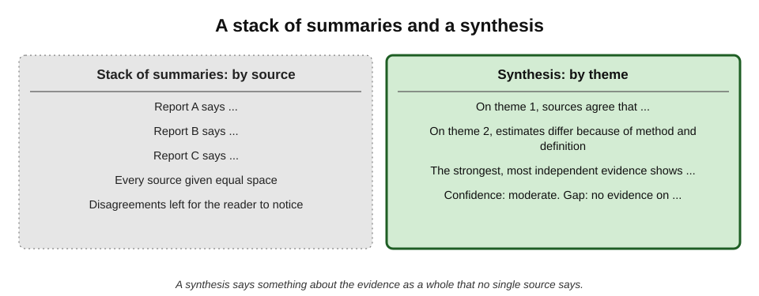
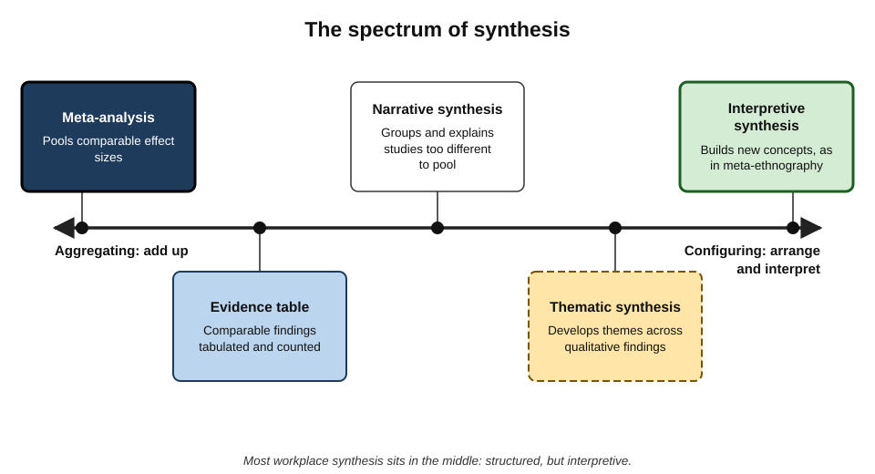
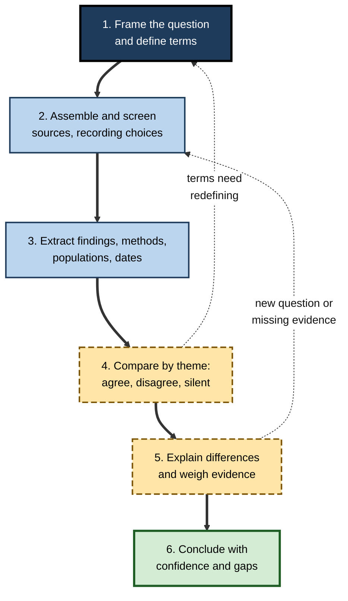
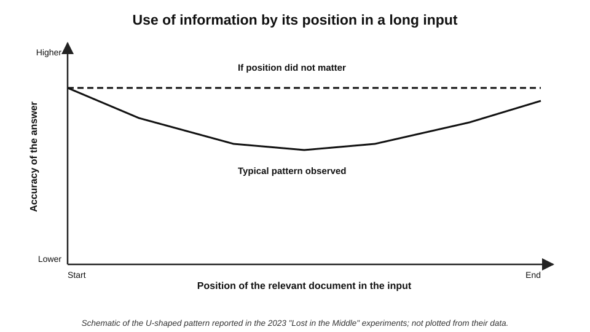
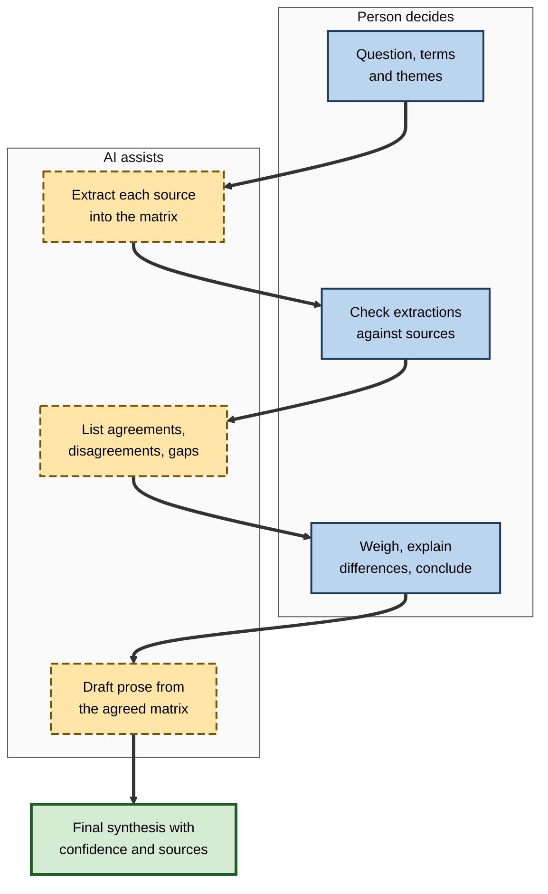
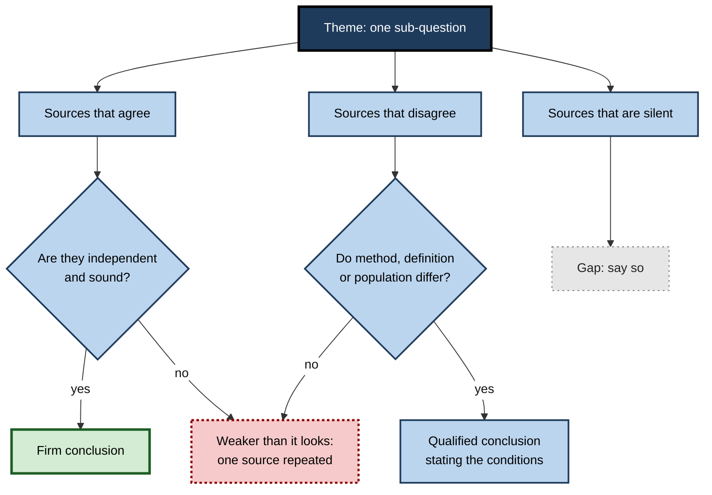

# H.4. Research synthesis across sources

A strategy team uploads twelve reports on the future of retail banking into an AI tool and asks for "the key findings". Within a minute it has a tidy list of five trends, each supported by several of the reports. What the list does not show is that three of the reports were written by the same consultancy, that two of the "trends" were forecasts the reports disagreed about, and that the most rigorous study in the set — the only one with original data — was barely mentioned.

The list summarised the documents. It did not synthesise the evidence.

> **Definition — Research synthesis:** combining findings from several sources into an integrated account that states what the evidence as a whole shows, where sources agree and disagree, why they differ, and how confident one can be.

> **Definition — Summary:** a shortened restatement of one or more sources' content, without necessarily weighing, reconciling or judging them.

**Why it matters**

- **Professional questions rarely have one source.** Market assessments, policy briefs, literature reviews, due diligence and strategy papers all combine many.
- **AI tools make summarising effortless** — and therefore make it easy to mistake a stack of summaries for a synthesis.
- **Synthesis is where judgement lives.** Deciding which evidence counts for more, and why sources conflict, is the part of research that cannot be delegated without loss.
- **Errors in synthesis are invisible in the output.** A smoothly written synthesis that has ignored a contrary study looks exactly like one that has weighed it.

---

## Summary and Synthesis

### The difference

- **A summary is organised by source:** "Report A says…; Report B says…".
- **A synthesis is organised by question or theme:** "On customer adoption, the evidence agrees that…; on cost savings, estimates diverge because…".
- **A summary reports; a synthesis argues** — it takes a position on what the evidence supports, with reasons.
- **A summary can be produced from any set of documents; a synthesis requires a question.**

**Figure 1.** A stack of summaries compared with a synthesis.

> **Key point:** the test of a synthesis is whether it says something **no single source says** — about the pattern, the strength and the limits of the evidence as a whole.

### The elements of a good synthesis

- **A clear question** — what the synthesis is meant to answer.
- **A defined body of sources** — what was included, what was excluded and why.
- **Themes or dimensions** — the aspects of the question the evidence addresses.
- **Agreement and disagreement** — where findings converge, where they diverge.
- **Explanations for divergence** — differences in method, definition, population, period, incentive.
- **Weight** — which sources count for more, and why.
- **Confidence** — how sure one can be in each conclusion.
- **Gaps** — what the evidence does not address.

> **Mnemonic — "Q-SAWCG" ("Quick Synthesis Always Weighs Conflicting Gaps"):** Question, Sources, Agreement and disagreement, Weight, Confidence, Gaps.

---

## Kinds of Synthesis

### Aggregative and configurative

David Gough, James Thomas and Sandy Oliver (2012) distinguished two broad logics of synthesis, used widely in evidence reviews:

- **Aggregative synthesis** — **adds up** comparable findings to test or estimate something.
  - Asks: "Does this intervention work, and by how much?"
  - Needs comparable measures, pre-specified methods and attention to study quality.
  - Example form: **meta-analysis**, which pools effect sizes statistically.
- **Configurative synthesis** — **arranges** diverse findings into a new understanding.
  - Asks: "How do people experience this?" "What explains variation?"
  - Uses interpretation, themes, models and theory.
  - Example forms: **thematic synthesis**, **meta-ethnography**, **narrative synthesis**.

**Figure 2.** From aggregating to configuring: the spectrum of synthesis.

> **Definition — Meta-analysis:** a statistical method that combines the quantitative results of several studies of the same question into a pooled estimate; the term was coined by the statistician Gene Glass in 1976.

> **Definition — Narrative synthesis:** a structured, mainly text-based approach to combining findings from studies that are too different to pool statistically, using tabulation, grouping, and exploration of relationships between studies.

### Synthesis in everyday professional work

Most workplace synthesis is informal but follows the same logic:

- **Market and competitor assessments** — configuring analyst reports, filings, news and interviews into a picture of a market.
- **Policy and regulatory briefs** — combining legislation, guidance, commentary and case examples.
- **Evidence-informed decisions** — aggregating studies, benchmarks and internal data on whether something works.
- **Due diligence** — triangulating documents, interviews and records about a company or person.
- **Literature reviews** — mapping what is known in an academic or technical field.

| | Aggregative synthesis | Configurative synthesis |
|---|---|---|
| Typical question | Does it work? How much? | What is going on? Why? How? |
| Sources | Comparable studies with similar measures | Diverse sources, often qualitative |
| Method | Pre-specified; quality appraisal; pooling | Iterative; interpretation; themes |
| Output | An estimate with confidence | A model, framework or explanation |
| Main risk | Combining incomparable numbers | Imposing the synthesiser's preconceptions |
| AI tools help most with | Extracting data from many papers into tables | Suggesting candidate themes and groupings |

---

## The Synthesis Process

### Six steps

1. **Frame the question.** Narrow enough to answer, with defined terms ("adoption" measured how? "SMEs" defined how?).
2. **Assemble and screen the sources.** Record what was searched, included and excluded.
3. **Extract.** Pull the relevant findings, methods, populations, dates and definitions from each source into a structured form.
4. **Compare.** Lay findings side by side by theme; mark agreement, disagreement and silence.
5. **Explain and weigh.** Account for differences; give more weight to stronger, more relevant, more independent evidence.
6. **Conclude with confidence levels.** State what the evidence supports, how firmly, and what remains unknown.

**Figure 3.** The six steps of a research synthesis.

### The synthesis matrix

> **Definition — Synthesis matrix:** a table with sources as rows and themes or questions as columns, in which each cell records what that source says on that theme — making agreement, disagreement and gaps visible at a glance.

- **Rows** — one per source, with its type, date, method and author or sponsor.
- **Columns** — the themes or sub-questions.
- **Cells** — the finding, with page reference; blank where the source is silent.
- **Final row** — the synthesised position on each theme, with a confidence rating.

> **In practice:** the synthesis matrix is the single most useful tool for AI-assisted synthesis — the AI can help fill the cells; the person reads down the columns and decides.

### Weighing evidence

- **Method strength.** Original data with sound design outweighs opinion; a large randomised trial outweighs a small survey on causal questions.
- **Relevance.** Evidence from the same sector, country, period and population counts for more.
- **Independence.** Sources that rely on each other count as one; a vendor's study of its own product carries a conflict of interest.
- **Recency.** In fast-moving fields, older findings may no longer hold.
- **Consistency.** Findings replicated across independent studies are more trustworthy than a single striking result.

> **Watch out:** **counting sources is not weighing evidence.** Ten blog posts repeating one survey are one piece of evidence, not ten; one rigorous study can outweigh many weak ones.

---

## Worked Example (illustrative): Synthesising Evidence on a Four-Day Week

**Situation:** an HR director asks whether a four-day week (same pay, fewer hours) would maintain productivity in a 400-person professional-services firm. An analyst has four sources.

| Source | Type and sponsor | Productivity finding | Well-being finding | Population |
|---|---|---|---|---|
| A. National pilot report | Trial run by an advocacy organisation with academic evaluators | Most firms reported maintained output; measures self-reported by firms | Large reported reductions in burnout | Mixed sectors, mostly small firms |
| B. Academic study of one public body | Peer-reviewed; before-after with comparison group | No significant change on administrative metrics | Improved sickness absence | Public administrators |
| C. Consultancy survey | Sponsored by a scheduling-software vendor | "Productivity up 20%" (self-rated) | Not measured | Office workers, online panel |
| D. News feature | Journalism; three case examples | One firm reverted after client complaints | Mixed | Agencies and professional services |

*Illustrative sources and findings.*

**Synthesis by theme**

- **Productivity:**
  - *agreement* — no source shows a large fall in output in the settings studied;
  - *divergence* — C's 20% rise rests on self-rating in a sponsored survey and is given little weight; A relies on firms' own reports; B has the strongest design but a different sector;
  - *position* — evidence suggests productivity is often **maintained**, not raised, with **moderate confidence**; little direct evidence for client-facing professional services.
- **Well-being:**
  - *agreement* — A and B both show improvement by different measures;
  - *position* — likely improvement, **moderate-to-high confidence**.
- **Client service:**
  - *silence* — only D addresses it, anecdotally;
  - *position* — **gap**: a key risk for this firm, unaddressed by the evidence.

**Conclusion:** a pilot with client-service metrics is justified; claims of large productivity gains are not supported.

> **Watch out:** an AI summary of these four sources asked for "the key findings" would very probably have reported "productivity up to 20%" as a headline — because it is the most specific, quotable number in the set.

---

## AI and Synthesis

### What AI tools do well

- **Reading volume.** Summarising dozens of documents quickly, to see what is there.
- **Extraction.** Pulling specified fields — sample size, country, outcome, date — from many papers into a table.
- **Candidate themes.** Suggesting groupings that a person can accept, merge or reject.
- **Spotting explicit contradictions** when asked directly ("Where do these reports disagree?").
- **Drafting prose** from a completed matrix.

> **Definition — Source-grounded assistant:** an AI tool that answers only from documents the user supplies, citing passages in them, rather than from the open web or its general training.

### Characteristic AI failures in synthesis

- **False consensus.** Differences are smoothed into a single statement; disagreements vanish.
- **Volume weighting.** Points repeated across many sources dominate, regardless of independence or quality.
- **Salience bias.** Specific, quotable numbers and confident claims are favoured over hedged findings.
- **Averaging the incomparable.** Figures measured differently are combined as if comparable.
- **Lost material.** Content in the middle of long inputs, or in tables and appendices, is under-used.
- **Overgeneralisation.** Findings about one population or setting are stated as general.
- **Invented connections.** Causal links between findings that no source makes.

> **Definition — False consensus (in synthesis):** presenting sources as agreeing when they differ in finding, scope or certainty.

**Study card — "Lost in the Middle" (2023)**

- **Who:** researchers at Stanford University and collaborators; published in *Transactions of the Association for Computational Linguistics*.
- **Design:** language models were given many documents and asked questions whose answers lay in one document placed at different positions in the input.
- **Results:**
  - accuracy was highest when the relevant document was at the **beginning** or **end** of the input;
  - accuracy fell markedly when it was in the **middle** — a U-shaped curve;
  - longer inputs did not remove the effect.
- **Conclusion:** a model given a large bundle of sources may systematically under-use some of them, depending only on where they sit.
- **Caveat:** newer models handle long inputs better, but position effects have continued to appear in later tests; the size of the effect varies by model and task.

**Figure 4.** Use of information by position in a long input: the U-shaped pattern.

> **In practice:** when synthesising many sources with AI, work **source by source** or **theme by theme** in smaller batches, and vary the order — rather than pasting everything at once and asking for "the key findings".

### A safer AI-assisted synthesis workflow

**Figure 5.** AI-assisted synthesis with human decision points.

- **Define the matrix first.** The person chooses the themes and fields; the AI fills them.
- **Extract one source at a time,** with page or passage references for every cell.
- **Spot-check extractions** against the sources — especially numbers and populations.
- **Ask explicitly for disagreement:** "For each theme, where do sources differ, and how do their methods differ?"
- **Weigh and conclude yourself.** The AI can propose; the person decides what the evidence supports.
- **Draft last.** Prose generated from an agreed matrix is far safer than prose generated from raw documents.

| Stage | AI contribution | Human contribution | Typical AI error to watch |
|---|---|---|---|
| Framing | Suggest sub-questions and terms | Choose question and definitions | Over-broad or loaded framing |
| Extraction | Fill matrix cells with references | Spot-check, especially numbers | Wrong population; missed table data |
| Comparison | List agreements and contradictions | Confirm and add what was missed | False consensus |
| Weighing | Flag method and sponsor differences | Decide weights and confidence | Counting sources as weight |
| Drafting | Turn matrix into prose | Edit claims to match confidence | Overstated certainty |

---

## Confidence and Its Communication

### Expressing how sure the synthesis is

- **Explicit levels.** High, moderate, low, very low — as in the **GRADE** approach used in health evidence, which rates certainty by study design, risk of bias, inconsistency, indirectness, imprecision and publication bias.
- **Calibrated language.** "The evidence consistently shows" versus "a single study suggests" versus "there is no direct evidence".
- **Separate findings from recommendations.** What the evidence shows is distinct from what the organisation should do.

> **Definition — GRADE (Grading of Recommendations, Assessment, Development and Evaluation):** a widely used framework, developed from 2000 onwards by an international working group, for rating the certainty of a body of evidence and the strength of recommendations.

**Figure 6.** Mapping convergence and divergence across sources on one theme.

---

## Professional Practice

### Habits of skilled synthesisers

- **Write the question at the top** of every synthesis document and return to it.
- **Read the strongest sources in full**, even when AI has summarised them.
- **Keep the matrix** — it is both the working tool and the audit trail.
- **Seek the disconfirming source** deliberately: "What is the best evidence against this conclusion?"
- **Name the gaps** — silence in the evidence is a finding.
- **Separate what sources say from what the synthesiser infers.**

### Case study (illustrative): a supplier-risk synthesis

- **Situation:** a procurement team at a manufacturer used an AI tool to synthesise thirty documents about a critical overseas supplier — news, audit reports, financial filings and the supplier's own sustainability report.
- **First output:** "The supplier is financially stable, has strong labour practices and faces minor regulatory risks."
- **Problem:** a reviewer asked which sources supported "strong labour practices".
- **Diagnosis:**
  1. the claim rested mainly on the supplier's **own** report and two articles **quoting it**;
  2. an independent audit summary — a scanned appendix the tool had largely ignored — recorded overtime breaches at one plant;
  3. a local-language news article on a regulatory investigation had not been included at all.
- **Actions:**
  - the team rebuilt the synthesis as a matrix with columns for finance, labour, environment and regulation, and a column for **source independence**;
  - each cell was filled from one source at a time, with references;
  - the audit appendix was read in full and the local article translated and checked.
- **Result:** the revised synthesis rated labour risk as **elevated**, with the evidence and its limits stated; the contract included audit rights.
- **Lesson:** synthesis that does not account for **independence** and **hard-to-read sources** reproduces the subject's own narrative.

---

## Structuring and Writing a Synthesis

### Choosing a structure

- **Thematic** — organised by sub-question or theme; the default for most professional synthesis.
  - *e.g.* adoption, cost, risk, regulation.
- **Chronological** — organised by period; useful where understanding has changed over time.
  - *e.g.* how evidence on a drug's safety evolved as larger studies appeared.
- **Methodological** — organised by kind of evidence; useful when methods give different answers.
  - *e.g.* what trials show versus what observational studies show versus what surveys report.
- **By stakeholder** — organised by perspective; useful for policy and change questions.
  - *e.g.* what employers, employees, regulators and customers report.
- **By decision option** — organised around the choices facing the reader.
  - *e.g.* evidence for building, buying or partnering.

> **In practice:** the structure should follow the **reader's decision**, not the order in which sources were found.

### The language of synthesis

Synthesis is written in a vocabulary that signals agreement, strength and source.

| Situation | Weaker phrasing | Stronger, more precise phrasing |
|---|---|---|
| Several independent sources agree | "Studies show…" | "Four independent evaluations, using different methods, found…" |
| One source only | "Research shows…" | "A single survey of 300 firms reported…" |
| Sources disagree | "Opinions differ" | "Estimates diverge because A counts only X, while B includes Y" |
| Evidence is indirect | "This applies to us" | "Evidence comes from larger firms in another sector; applicability here is uncertain" |
| No evidence found | (silence) | "No study addressing this question was found in the sources searched" |

- **Reporting verbs carry weight.** "Found", "reported", "estimated", "argued", "claimed" and "assumed" are not interchangeable; each tells the reader how the source knows.
- **Distinguish three levels** in the text:
  - **evidence** — what the sources found;
  - **interpretation** — what the synthesiser concludes from it;
  - **implication** — what the organisation might do.

> **Watch out:** AI drafting tends to flatten reporting verbs into "shows" and "demonstrates". Editing these back to the strength the evidence supports is one of the most valuable minutes in the process.

### A one-page synthesis template

1. **Question** — one sentence.
2. **Bottom line** — two or three sentences with confidence levels.
3. **What the evidence shows** — by theme, each with agreement, disagreement and weight.
4. **What it does not show** — gaps and indirect evidence.
5. **Sources** — the body of evidence, with how it was assembled.
6. **Method note** — how AI tools were used and what was checked.

### Combining external evidence with internal data

- **External sources** say what happened elsewhere; **internal data** say what is happening here.
- **Applicability** is the bridge: are the settings, populations and conditions similar enough?
- **Local data can confirm or contradict.** A study showing that a scheduling change reduced absence in hospitals is stronger evidence for a hospital trust whose own pilot data point the same way.
- **AI tools help** by laying external findings and internal figures side by side in the matrix; the judgement of applicability remains the synthesiser's.

> **Key point:** the most useful professional syntheses end with a statement of **how far the external evidence applies here**, and what internal evidence would settle the question.

---

## Mixed Evidence and Living Syntheses

### Combining numbers and narratives

- **Quantitative evidence** tells **how much** and **how often** — effect sizes, rates, costs.
- **Qualitative evidence** tells **why**, **how** and **for whom** — experiences, mechanisms, barriers.
- **Mixed-methods synthesis** uses each to illuminate the other:
  - qualitative findings explain **variation** in quantitative results (why a programme worked in some sites and not others);
  - quantitative findings show **how widespread** a qualitatively reported problem is.
- **Common error:** treating a vivid interview quotation as if it showed prevalence, or a survey percentage as if it explained motivation.

> **Example (illustrative):** trials show a coaching programme raises sales by a modest average; interviews reveal that gains occur only where managers protect time for coaching. Together they yield a conditional recommendation: adopt it **with** protected time.

### Keeping a synthesis current

- **Evidence moves.** New studies, new regulations and new market data can change conclusions.
- **Living reviews** — a practice in health research, where a synthesis is updated continually as new evidence appears — show one model.
- **For workplace synthesis:**
  - record the **date** of the evidence base and the searches;
  - set a **review date** for decisions that depend on fast-moving evidence;
  - use **alerts** on key sources so new evidence is noticed;
  - keep the **matrix**, so that updating means adding rows rather than starting again.

> **In practice:** a synthesis that states "evidence searched to 30 June; next review in six months" is more trustworthy — and more reusable — than one that presents its conclusions as timeless.

### When AI makes updating easy — and risky

- **Easy:** an AI tool can quickly summarise new studies against an existing matrix.
- **Risky:** an update run entirely by AI can quietly change the weighting of evidence or drop earlier cautions.
- **Safeguard:** compare the old and new conclusions explicitly and record **why** anything changed.

---

## Open Questions

- **Can AI tools be trusted to weigh evidence?**
  - Tools can be instructed to consider method and independence, but whether they apply such judgements consistently is not established.
- **How should AI-assisted synthesis be reported?**
  - Evidence-review standards are being updated to require disclosure of AI use in screening, extraction and drafting; consensus on acceptable uses is still forming.
- **Will automated systematic reviews be reliable?**
  - AI-assisted screening and extraction can save substantial time; accuracy relative to human reviewers varies by task and is an active research area.
- **How can false consensus be detected automatically?**
  - Methods to flag where a synthesis glosses over disagreement are at an early stage.
- **Does AI-assisted synthesis change what people learn?**
  - Reading summaries rather than sources may weaken the synthesiser's own understanding of a field; long-term effects are unknown.

---

## Summary

- **Synthesis** integrates sources around a **question**, showing agreement, disagreement, reasons, weight, confidence and gaps; a **summary** restates sources one by one.
- A synthesis should say something **no single source says**.
- **Aggregative** synthesis adds up comparable findings (e.g. meta-analysis); **configurative** synthesis arranges diverse findings into understanding (e.g. thematic or narrative synthesis) — Gough, Thomas and Oliver (2012).
- Six steps: **frame, assemble, extract, compare, explain and weigh, conclude**.
- The **synthesis matrix** (sources × themes) makes agreement, disagreement and gaps visible and is the best scaffold for AI assistance.
- **Counting sources is not weighing evidence**: weigh by method, relevance, independence, recency and consistency.
- AI failures in synthesis: **false consensus, volume weighting, salience bias, averaging the incomparable, lost material, overgeneralisation, invented connections**; long inputs show a **lost-in-the-middle** effect.
- Let AI **extract and draft**; let the person **frame, weigh and conclude**; express **confidence** explicitly, as in GRADE.

---

## Self-Check

1. Distinguish a summary from a synthesis, and state the test of a good synthesis.
2. List the elements of a good synthesis.
3. Explain aggregative and configurative synthesis with an example of each.
4. What is a synthesis matrix, and why is it useful when working with AI tools?
5. Why is counting sources not the same as weighing evidence?
6. Name five criteria for weighing evidence.
7. In the four-day-week example, why was the consultancy survey given little weight, and what gap was identified?
8. Describe the "lost in the middle" finding and its practical implication.
9. List five characteristic AI failures in synthesis.
10. Which stages of synthesis should a person keep, and which can AI assist with?
11. What does GRADE assess, and why is explicit confidence useful?
12. In the supplier case study, what caused the misleading first output, and what fixed it?
13. An AI tool produces "five key trends" from twenty reports. What three questions should be asked before using the list?
14. Design an approach for synthesising forty academic papers on a training method for a learning-and-development team in two days.

### Answer Key

1. A summary restates sources' content, usually source by source; a synthesis integrates them around a question, showing agreement, disagreement, reasons, weight and confidence. A good synthesis says something about the evidence as a whole that no single source says.
2. A clear question; a defined body of sources; themes; agreement and disagreement; explanations for divergence; weighting; confidence; gaps.
3. Aggregative synthesis adds up comparable findings to estimate an effect — e.g. a meta-analysis of trials of a training method. Configurative synthesis arranges diverse findings into an explanation — e.g. a thematic synthesis of interviews on why employees resist new software.
4. A table of sources by themes, each cell recording what the source says. It makes agreement, disagreement and silence visible, structures extraction so AI can fill cells with references, and leaves the comparison and judgement visible to the person.
5. Sources may repeat one original, may share a sponsor, or may differ greatly in quality; ten weak or dependent sources can be outweighed by one rigorous, independent one.
6. Method strength; relevance; independence; recency; consistency across independent studies.
7. It was sponsored by a vendor with an interest, used self-rated productivity and came from an online panel. The gap was the effect on client service in professional services, addressed only anecdotally.
8. Models used information best when it was at the start or end of a long input and worst when in the middle. Large bundles of sources should be processed in smaller batches, source by source or theme by theme, with order varied.
9. False consensus; volume weighting; salience bias; averaging incomparable figures; lost material; overgeneralisation; invented connections.
10. The person frames the question and themes, checks extractions, weighs evidence, explains differences and concludes. AI can assist with extraction into a matrix, listing agreements and contradictions, and drafting from the agreed matrix.
11. GRADE rates the certainty of a body of evidence considering design, risk of bias, inconsistency, indirectness, imprecision and publication bias. Explicit confidence lets readers know how much to rely on each conclusion.
12. The tool weighted the supplier's own report and articles quoting it, under-used a scanned audit appendix and lacked a local news source. Rebuilding as a matrix with an independence column, extracting source by source, and reading the hard-to-read sources fixed it.
13. Which sources support each trend, and are they independent? Do any sources disagree, and was that disagreement reported? Are the strongest sources (original data, rigorous methods) reflected, or only the most frequent claims?
14. For example: define the question and outcome measures; screen papers on title and abstract with AI assistance, checking a sample; build a matrix (design, sample, setting, outcome, effect, limitations); have AI extract each paper with page references and spot-check a fifth; compare by outcome; weigh by design and relevance; state conclusions with confidence levels and gaps; record inclusion decisions.

---

## Glossary

| Term | Meaning |
|---|---|
| Aggregative synthesis | Synthesis that adds up comparable findings to test or estimate something. |
| Configurative synthesis | Synthesis that arranges diverse findings into a new understanding. |
| False consensus | Presenting sources as agreeing when they differ. |
| GRADE | A framework for rating the certainty of a body of evidence. |
| Lost in the middle | Under-use by language models of information in the middle of long inputs. |
| Meta-analysis | Statistical pooling of results from several studies of the same question. |
| Narrative synthesis | Structured text-based combination of studies too different to pool. |
| Research synthesis | Integrating several sources into an account of what the evidence shows, with agreement, disagreement, weight and confidence. |
| Salience bias | Over-weighting specific, quotable or striking content. |
| Source-grounded assistant | An AI tool that answers only from user-supplied documents. |
| Summary | A shortened restatement of sources' content. |
| Synthesis matrix | A sources-by-themes table recording each source's position on each theme. |
| Thematic synthesis | Identifying and developing themes across qualitative findings. |
| Volume weighting | Letting the number of times a point appears stand in for its strength. |
