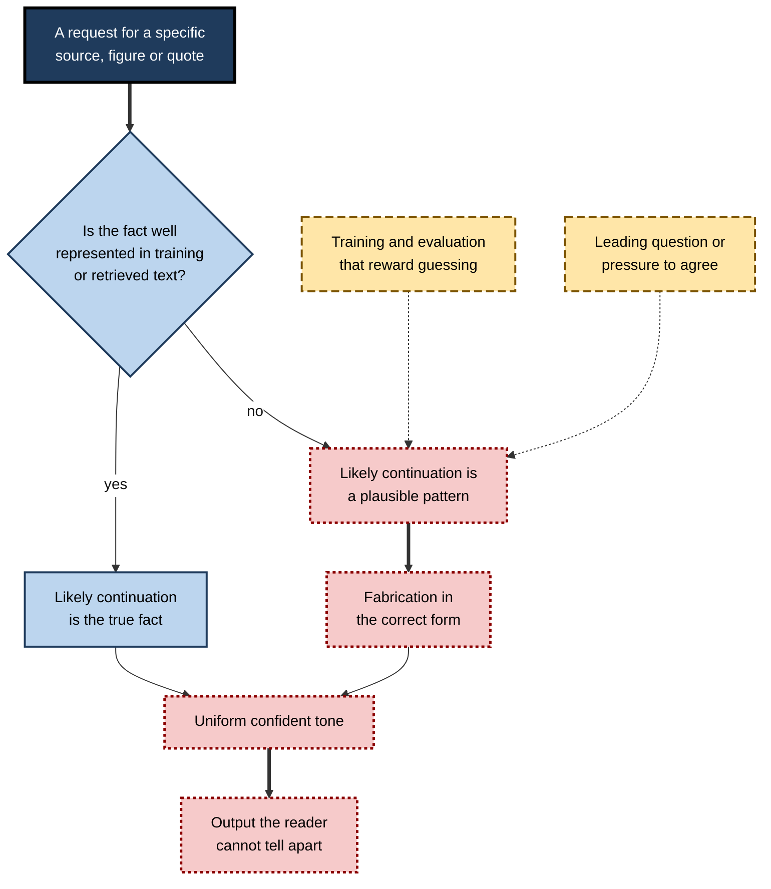
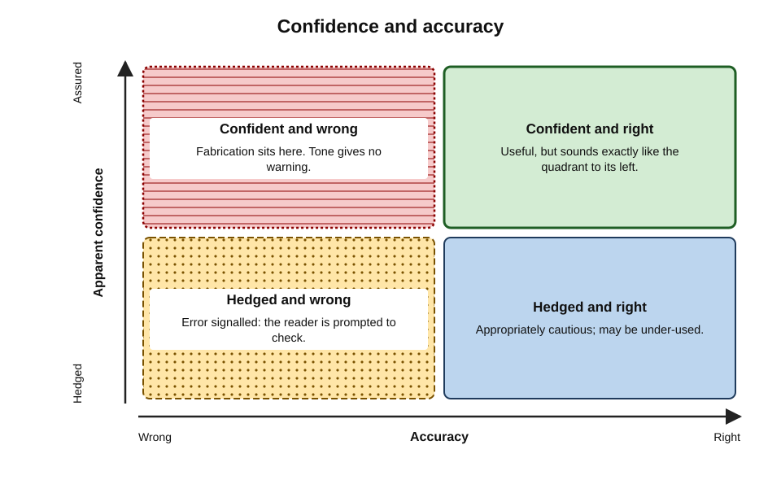
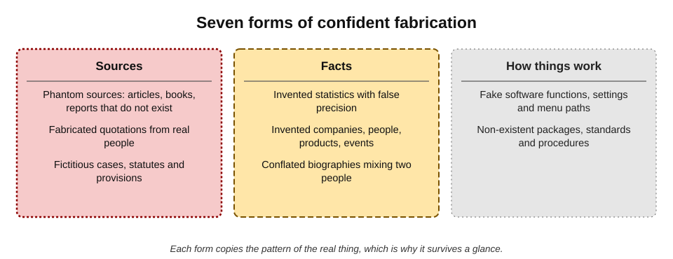
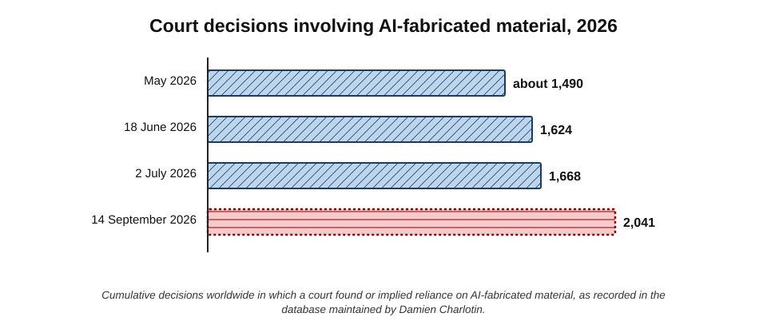
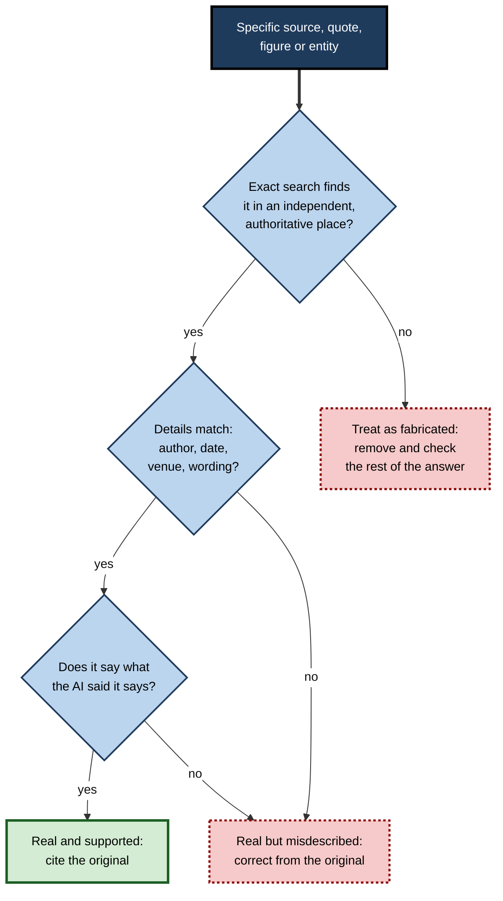
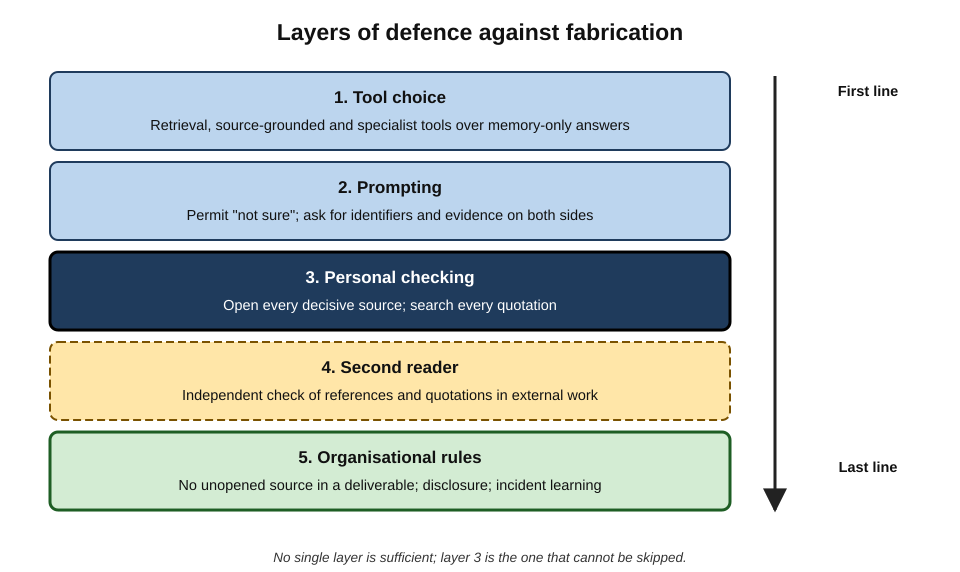

# H.5. Recognising confident fabrication

In May 2025 two American newspapers printed a syndicated summer reading list recommending new novels by well-known authors. Most of the books did not exist. The list had been produced with an AI tool by a freelance writer; the titles were plausible, the plot descriptions vivid, the authors real. Nobody along the chain — writer, syndicator, editors — had checked. The error was not a garbled fact but a **complete, coherent, confident invention**.

> **Definition — Confident fabrication:** AI-generated content that presents non-existent sources, facts, quotations, people, events or entities as real, in the same assured manner as accurate content.

> **Definition — Hallucination (in AI):** the common term for output that is fluent and plausible but unsupported by the model's input or by reality. Some researchers prefer **confabulation** — a term from neurology for sincere, fluent production of false memories — because the model is not perceiving anything.

**Why it matters**

- **Fabrication is not random noise.** It takes the most persuasive form available: realistic titles, plausible authors, credible numbers.
- **It defeats casual checking.** A fabricated reference looks exactly like a real one; a fabricated quotation sounds like the person.
- **Consequences are severe.** Courts have sanctioned lawyers; governments and firms have withdrawn reports; publishers have printed corrections.
- **It is a structural property of current models**, not a bug that a single update will remove — so recognising it is a lasting professional skill.

---

## Why Language Models Fabricate

### The mechanism in plain terms

- **Models generate likely text, not retrieved facts.** A language model predicts plausible continuations of the text so far. When it "knows" a fact well, the most plausible continuation is the true one; when it does not, the most plausible continuation is still fluent — and may be false.
- **The form is easier than the content.** Models learn the patterns of citations, quotations and statistics from vast amounts of text; reproducing the **pattern** does not require the **instance** to exist.
- **There is pressure to answer.** Systems are trained to be helpful and to respond to the request; producing *something* that fits is the default.
- **Evaluations have rewarded guessing.** In a 2025 analysis, researchers at OpenAI argued that common training and benchmarking practices score a confident guess better than "I don't know", so models learn to guess when uncertain — much as a student guesses on a multiple-choice test with no penalty for wrong answers.

**Figure 1.** How confident fabrication arises.

### Conditions that raise the risk

- **Obscure topics** — small companies, local events, minor figures, niche research.
- **Requests for specifics** — "give me five peer-reviewed sources", "quote what the CEO said", "what was the exact figure?"
- **No retrieval** — the tool answers from memory rather than searching.
- **Retrieval that fails** — a search returns nothing useful and the model fills the gap.
- **Leading questions** — "Find studies showing that X" invites studies that show X, whether or not they exist.
- **Long outputs** — the more content generated, the more opportunities for invention.
- **Recent events** — after the model's knowledge cutoff, with no search.

> **Definition — Sycophancy (in AI):** the tendency of a model to tell users what they appear to want to hear — agreeing with stated views or supplying requested support — at the expense of accuracy.

> **Watch out:** a request phrased as "Find me evidence that…" is one of the most reliable ways to obtain fabricated evidence. Ask instead: "What does the evidence say about…, including evidence against?"

---

## Confidence and Accuracy

### The calibration problem

> **Definition — Calibration:** the match between how confident a system (or person) appears and how often it is actually right. A well-calibrated source that says "90% sure" is right about nine times in ten.

- **Human sources signal uncertainty** with hedges, hesitations, caveats and "I think".
- **AI tools often do not**, or do so inconsistently: the same assured style covers well-established facts and inventions.
- **Stated confidence is unreliable.** When asked how sure they are, models' verbal confidence has often been found to be poorly related to actual accuracy, though this varies by model and is improving.
- **Readers calibrate on style.** People are used to treating fluent, detailed, specific statements as signs of knowledge — exactly the features fabrication reproduces.

**Figure 2.** Confidence and accuracy: where fabrication sits.

> **Key point:** fabrication lives in the **confident-and-wrong** quadrant — the one where human intuition offers least protection.

### Detail as a false signal

- **Specificity feels like knowledge.** "A 2019 study by researchers at the University of Michigan found a 23% increase" sounds more credible than "some research suggests an increase".
- **But specificity is cheap for a language model.** Generating a plausible university, year and percentage costs no more than generating a vague phrase.
- **For a reader, the rule inverts:** unsourced specificity from an AI tool should raise suspicion, not lower it.

> **Remember:** **specific + unsourced = check first.**

---

## Forms of Fabrication

### Seven common forms

- **Phantom sources** — articles, books, reports or web pages that do not exist, often with real authors or real journals.
- **Fabricated quotations** — words attributed to real people that they never said or wrote.
- **Invented statistics** — figures with apparent precision but no source, or attributed to a real organisation that never published them.
- **Fictitious legal authorities** — cases, statutes or regulatory provisions that do not exist, or real case names with invented holdings.
- **Invented entities** — companies, products, people, job titles, programmes or events.
- **Conflated biographies** — a real person given another person's career, publications or controversies.
- **Fake technical details** — software functions, settings, menu paths, packages or standards that do not exist.

**Figure 3.** Seven forms of confident fabrication.

| Form | Typical appearance | Fastest test |
|---|---|---|
| Phantom source | Realistic title, real journal, plausible authors | Exact-title search; resolve the identifier |
| Fabricated quotation | Sounds like the person; no date or venue | Search the exact phrase; find the original speech or text |
| Invented statistic | Precise figure attributed to a body | Search the body's own publications for the figure |
| Fictitious legal authority | Correctly formatted case citation | Official court or legislation database |
| Invented entity | Plausible company or programme name | Registry, official site, independent news |
| Conflated biography | Mostly true career with one wrong element | Person's own official profile |
| Fake technical detail | Plausible function or menu path | Official documentation; try it in a safe environment |

### Real cases

- **Summer reading list (May 2025).** A syndicated supplement printed by the *Chicago Sun-Times* and the *Philadelphia Inquirer* recommended books, attributed to real and well-known novelists, most of which did not exist. The freelance writer acknowledged using AI without checking; the papers apologised and changed their procedures for syndicated content.
- **Government health report (May 2025).** A report by the US "Make America Healthy Again" Commission was found by journalists to cite several studies that did not exist and to misrepresent others; the citations were corrected after publication, with officials describing the problems as formatting errors.
- **A consultancy report for the Australian government (2025).** A report by Deloitte for the federal Department of Employment and Workplace Relations was found by an academic reviewer to contain references to non-existent works and a misquoted court judgment; a revised version disclosed the use of a generative AI tool, and the firm agreed to refund part of its fee.
- **Courts worldwide.** A public database of court decisions involving AI-fabricated material, maintained by the legal researcher Damien Charlotin, grew from roughly 1,500 entries in May 2026 to more than 2,000 by mid-September 2026.

**Figure 4.** Growth in recorded court decisions involving AI-fabricated material, 2026.

> **Key point:** in every one of these cases, the fabrication was **discoverable in minutes** by someone who looked. The failure was not the tool's alone; it was the absence of a check.

---

## Recognising the Signs

### Red flags in the output

- **Perfect fit.** Sources that answer the exact question, in the exact terms used, with exactly the desired conclusion.
- **Unfamiliar but plausible specifics.** A study, report or expert the reader has never encountered in a field they know well.
- **Precision without provenance.** Exact percentages, dates or amounts with no link or a vague attribution ("according to industry research").
- **Generic-sounding titles.** Titles assembled from the question's keywords: "The Impact of Remote Work on Employee Productivity: A Meta-Analysis".
- **Mismatched details.** A journal that does not publish in that field; an author whose known work is in another area; a date before the concept existed.
- **Identifiers that misbehave.** A DOI resolving to a different paper; a URL that returns "page not found" on a site that otherwise exists.
- **Quotation without occasion.** A quotation with no date, event, interview or publication.
- **Shifting answers.** Asking again produces different sources or details for the same claim.

> **Mnemonic — "PUPIL":** **P**erfect fit, **U**nfamiliar specifics, **P**recision without provenance, **I**dentifiers that misbehave, **L**ack of occasion for quotes — the pupils dilate when these appear.

### Signals in the conversation

- **Over-ready agreement.** The tool readily confirms whatever the user suggests.
- **Self-confirmation.** Asked "Is this source real?", the tool says yes — as in the 2023 New York case in which ChatGPT assured a lawyer that invented cases existed.
- **Regeneration drift.** Each regeneration produces a different "source" for the same claim — a sign none of them is real.

> **Watch out:** the absence of red flags is **not** evidence of accuracy. Many fabrications are entirely plausible. Red flags tell the reader where to look **first**; they do not replace checking.

**Figure 5.** A quick test for suspected fabrication.

---

## Worked Example (illustrative): Spotting Fabrication in an Answer

**Situation:** a learning-and-development manager asks an AI assistant without web search: "What research shows that microlearning improves knowledge retention?" The answer includes:

1. *"A 2015 study in a leading applied-psychology journal found that microlearning improved retention by 17% compared with traditional e-learning."*
2. *"Researchers at a German university showed that bite-sized content increased learner engagement by 50%."*
3. *"The spacing effect, first described by Hermann Ebbinghaus in 1885, supports distributing learning over time."*
4. *"As a prominent workplace-learning analyst has noted, 'microlearning is the future of all corporate training.'"* — with the analyst named.

**Analysis**

| Claim | Red flags | Test | Outcome (illustrative) |
|---|---|---|---|
| 1 | Precise figure; perfect fit; generic description | Search the journal's archive for microlearning studies in 2015 | No such study found — **treat as fabricated** |
| 2 | Vague institution; round number; no title | Search for the claim with key terms | Only marketing blogs repeating the figure, with no original — **unsupported** |
| 3 | None; well-known historical fact | Standard reference works | **Accurate** |
| 4 | Real person; quotation without occasion | Search the exact phrase | No source found — **treat as fabricated quotation** |

*Illustrative answer and outcomes.*

- **Conclusion:** the one claim that was true was the general, well-established one; the specific, persuasive ones were not.
- **Better approach:** use a tool that searches academic databases, ask for evidence **for and against**, and read the original studies before citing any figure.

> **Watch out:** the 50% figure in claim 2 may well appear on dozens of websites. **Repetition is not provenance** — fabricated and unsupported statistics circulate widely once published.

---

## Reducing Fabrication Risk

### Choosing tools and settings

- **Prefer retrieval.** Tools that search and cite sources fabricate outright far less than tools answering from memory — though they can still cite real sources that do not support the claim.
- **Use source-grounded tools** for document work — tools that answer only from supplied files and cite passages.
- **Use specialist databases** for specialist citations — legal, academic, clinical, regulatory.

### Prompting to lower the risk

- **Permit uncertainty:** "If you are not sure, say so; do not guess."
- **Ask for verifiable identifiers:** title, publication, date, DOI or URL — which can be checked.
- **Ask for evidence on both sides,** not for support of a conclusion.
- **Ask for direct quotations from supplied documents,** with location, rather than paraphrase.
- **Keep requests narrow;** fewer claims per answer means fewer chances to invent.

> **Watch out:** prompting reduces fabrication but **does not eliminate it**. A tool told "do not make up sources" can still make up sources.

**Figure 6.** Layers of defence against fabrication.

### Organisational defences

- **A rule that no source enters a deliverable unless a person has opened it.**
- **Review roles** — a second reader checks references and quotations in anything external.
- **Disclosure** — documents state where AI tools were used.
- **Training** with real examples of fabrication from the organisation's own field.
- **Incident learning** — when a fabrication is caught, record how, and adjust the process.

> **In practice:** after high-profile incidents, many law firms, consultancies and publishers introduced explicit "human verification of every citation" steps for AI-assisted work, and some courts now require a certificate to that effect.

### Case study (illustrative): the fabricated benchmark

- **Situation:** a product-marketing team at a software company drafted a white paper with AI assistance, including the line "a study by a leading analyst firm found that teams using automated testing ship 40% faster".
- **Problem:** a prospective customer's analyst asked for the study.
- **Diagnosis:**
  1. the AI tool had generated the statistic and a plausible-sounding analyst-firm attribution;
  2. no such study existed;
  3. the figure had also been copied into a sales deck and two blog posts.
- **Actions:**
  - the white paper was withdrawn and reissued;
  - all derivative materials were traced and corrected;
  - a rule was introduced that every statistic in marketing materials must have a named, opened source in a review log.
- **Result:** the customer relationship survived, with an apology; internal audit found two further unsupported statistics in older materials.
- **Lesson:** a fabrication **propagates** — into decks, blogs and other people's work — so it must be stopped at the point of entry.

---

## Fabrication Beyond References

### Quotations

- **Misattributed quotations long predate AI.** Famous lines are routinely credited to people who never said them — Einstein, Churchill and Gandhi attract many — and specialist quotation researchers have traced numerous such attributions to later inventions.
- **AI tools amplify the problem** in three ways:
  - **paraphrase in quotation marks** — a fair summary of someone's view presented as their exact words;
  - **composite quotations** — phrases from different occasions joined into one quotation;
  - **invented quotations** — plausible words in the person's style, never spoken.
- **The test:** a quotation is confirmed only when the **exact words** are found in a **primary record** — transcript, recording, publication, official minutes — with a date and occasion.

> **Remember:** **no occasion, no quotation.** If the date, place and medium cannot be found, the words should not appear in quotation marks.

### Technical details and code

- **Invented functions, settings and menu paths.** AI assistants may describe software features that do not exist, or that existed in an earlier version.
- **Invented software packages.** Security researchers in 2024 and 2025 documented that AI coding assistants sometimes recommend software packages that do not exist — and warned that attackers could publish malicious packages under those invented names so that developers who trusted the suggestion would install them.
- **The test:** official documentation, the official package registry and a trial in a safe environment.

### Documents, images and screenshots

- **Generated "evidence".** AI tools can produce realistic images of documents, letters, receipts and screenshots.
- **Reverse image search** and checks of the document's claimed origin — the issuing organisation, its reference numbers and its own records — are the standard tests.
- **Metadata** can help but is easily altered; it is supporting, not decisive, evidence.

### Fabrication inside workplace tools

- **Summaries of documents and meetings** can attribute statements or decisions to people who did not make them; the check is the source document or recording.
- **Assistants grounded in internal files** can still fill gaps when the files are silent — for example, inventing a policy detail that the policy does not contain.

> **Watch out:** "it came from our own documents" is not a guarantee. A grounded tool can be grounded for most of an answer and fabricate the rest.

---

## Rates, Trends and Their Limits

### Is fabrication getting rarer?

- **Generally, yes, for common tasks.** Retrieval, better training and abstention have reduced outright invention of sources compared with early chat assistants — the fall from 55% to 18% fabricated references between GPT-3.5 and GPT-4 reported by Walters and Wilder (2023) is one illustration.
- **But not uniformly.** In April 2025 OpenAI's own published evaluations showed two newer reasoning models hallucinating **more** often than an older model on a test of factual questions about people — a reminder that new capabilities do not automatically bring better factual reliability.
- **And not to zero.** Even the best tools fabricate occasionally, and the occasional error is the one nobody expects.

> **Key point:** the right mental model is not "this tool fabricates" or "this tool does not", but "**this tool fabricates at some rate, higher for some kinds of request** — and I do not know in advance which answers are affected".

### Why another AI is a weak check

- **Shared foundations.** Different tools are trained on overlapping data and often retrieve the same pages.
- **Shared failure modes.** A plausible fabrication can be plausible to another model too, and a second tool may "confirm" it from the same weak source.
- **Useful role:** a second tool can **flag** a doubtful claim worth checking; it cannot **settle** it.

| Check | What it can establish | What it cannot establish |
|---|---|---|
| Asking the same tool "is this real?" | Nothing reliable | Existence or accuracy |
| Asking a different AI tool | That the claim is worth checking | Existence or accuracy |
| Exact search in independent sources | Whether the item appears in the record | Whether the source is itself correct |
| Opening the primary record | Existence, exact content and context | Truth of the source's own claims |

### Expected-cost reasoning

> **Formula — Expected cost of an unchecked fabrication (illustrative):** probability that a specific citation is fabricated × probability nobody else catches it × cost if it reaches a client or court. Example: 0.05 × 0.5 × £200,000 = **£5,000** per citation — against perhaps five minutes to open it. *Illustrative figures.*

- **The arithmetic nearly always favours checking** decisive sources, because the cost of a fabrication reaching a court, a client or the public is high and the cost of opening a source is low.

---

## A Field Guide to Fabrication by Profession

Each profession meets fabrication in its own characteristic forms.

| Profession | Characteristic fabrication | Where it hides | Decisive check |
|---|---|---|---|
| Law | Non-existent cases; real cases with invented holdings | Briefs, advice notes, research memos | Official judgment database; read the paragraph cited |
| Medicine and health | Invented studies; wrong doses or guideline content | Patient information, literature summaries | The guideline or product information itself |
| Academia | Phantom references; invented quotations from scholars | Literature reviews, grant applications | Bibliographic database; the cited text |
| Journalism | Fabricated quotations; invented background facts | Profiles, explainers, syndicated lists | Recording, transcript or direct confirmation |
| Consulting and strategy | Invented statistics and analyst attributions | Slides, market sizing, white papers | The named publisher's own release |
| Software engineering | Non-existent functions, settings and packages | Code, configuration, documentation | Official documentation; trial in a safe environment |
| Human resources | Invented legal rights or thresholds | Policies, guidance to managers | Official legislation and regulator guidance |

- **The pattern across professions:** fabrication appears where **form is standardised** (citations, quotations, statistics, function names) and **checking is skipped** because the form looks right.
- **The common defence:** every profession already has a **primary record** — the judgment, the guideline, the transcript, the filing, the documentation. Fabrication fails the moment that record is consulted.

> **Remember:** fabrication is defeated not by cleverness but by **habit** — the habit of opening the primary record for anything that matters.

### Teaching people to recognise it

- **Use real examples** from the profession — the reading list, the court cases, the consultancy report — rather than abstract warnings.
- **Practise on mixed sets:** give people AI answers containing some real and some fabricated sources and have them find which is which, using only search.
- **Normalise reporting:** people who catch fabrications should be thanked, and near-misses shared so that others learn.
- **Make the check easy:** licences to the relevant databases, templates for logging sources, time in the plan for verification.

> **In practice:** organisations that treat a caught fabrication as a **near-miss to learn from**, rather than an embarrassment to hide, tend to catch more of them.

---

## Open Questions

- **Can fabrication be eliminated?**
  - Retrieval, better training incentives and abstention reduce it; many researchers argue that some rate of fabrication is inherent in generative models.
- **Should models abstain more?**
  - Rewarding "I don't know" reduces fabrication but makes tools less helpful; the right balance is contested.
- **Can tools signal their own uncertainty reliably?**
  - Calibrated confidence displays are being researched; whether people use them sensibly is uncertain.
- **What happens when fabrications enter the record?**
  - Fabricated references and quotations in published documents may be cited onwards and absorbed into future training data.
- **Where does responsibility lie?**
  - Liability between tool providers, deploying organisations and individual users is still being worked out in courts and regulation.

---

## Summary

- **Confident fabrication** is AI output presenting non-existent sources, quotes, figures, people or entities as real, in an assured tone; "hallucination" and "confabulation" are related terms.
- Models fabricate because they generate **plausible patterns**, are pressed to **answer**, and have been trained and evaluated in ways that **reward guessing**.
- Risk rises with **obscure topics, requests for specifics, no or failed retrieval, leading questions, long outputs and recent events**.
- **Calibration** is poor: tone does not track accuracy; **specific + unsourced = check first**.
- Seven forms: **phantom sources, fabricated quotes, invented statistics, fictitious legal authorities, invented entities, conflated biographies, fake technical details**.
- Real cases in 2025–2026 — a newspaper reading list, a government health report, a consultancy report, thousands of court decisions — show fabrications **discoverable in minutes** but unchecked.
- Red flags (**PUPIL**) direct attention; they do not replace checking. **Repetition is not provenance.**
- Defences: retrieval and source-grounded tools; prompts that permit uncertainty and ask for both sides; organisational rules that every source is **opened by a person**.

---

## Self-Check

1. Define confident fabrication and explain why some researchers prefer "confabulation" to "hallucination".
2. Explain, in plain terms, why a language model can produce a perfectly formatted reference to a non-existent paper.
3. What did OpenAI researchers argue in 2025 about why models guess?
4. List five conditions that raise the risk of fabrication.
5. Why is "Find me evidence that X" a risky prompt? Rewrite it.
6. Define calibration and explain why specificity is a poor signal of accuracy in AI output.
7. Name the seven forms of fabrication and the fastest test for three of them.
8. Summarise two real cases of AI fabrication from 2025 and what they have in common.
9. Explain the PUPIL red flags.
10. Why is the absence of red flags not evidence of accuracy?
11. In the microlearning example, which claim was accurate and why is that pattern typical?
12. What does "repetition is not provenance" mean?
13. Why does prompting "do not make up sources" not solve the problem?
14. In the fabricated-benchmark case, what made the damage spread and how was entry blocked?

### Answer Key

1. AI output presenting non-existent sources, facts, quotes or entities as real, in a confident manner. "Confabulation" describes fluent, sincere production of false content without perception, which fits a model better than "hallucination", which implies perceiving something absent.
2. The model has learned the patterns of reference lists — names, journal titles, formats — and generates the most plausible continuation; it does not need to retrieve any real source to produce the pattern.
3. That common training and evaluation practices reward a confident guess over an admission of uncertainty, so models learn to guess when unsure.
4. Obscure topics; requests for specific sources, quotes or figures; no web retrieval; failed retrieval; leading questions; long outputs; events after the knowledge cutoff.
5. It invites the model to supply supporting evidence whether or not it exists (sycophancy). Better: "What does the research say about X, including evidence against it? Give titles, publications and dates I can check."
6. Calibration is the match between apparent confidence and actual accuracy. Generating specific details costs a model nothing, so precision, names and numbers do not indicate knowledge in AI output.
7. Phantom sources (exact-title search, resolve identifier); fabricated quotes (search exact phrase, find original occasion); invented statistics (search the attributed body's publications); fictitious legal authorities (official database); invented entities (registry or official site); conflated biographies (official profile); fake technical details (official documentation).
8. For example, the newspaper summer reading list with non-existent books and the Deloitte report for the Australian government with non-existent references. In both, AI-generated content was published without anyone opening the sources, though checks would have taken minutes.
9. Perfect fit; Unfamiliar but plausible specifics; Precision without provenance; Identifiers that misbehave; Lack of occasion for quotations.
10. Many fabrications are fully plausible and show none of the flags; flags prioritise checking but cannot certify accuracy.
11. The Ebbinghaus spacing-effect claim — a general, well-established fact widely represented in training data. Specific, persuasive, obscure claims are where fabrication concentrates.
12. A claim appearing on many websites does not show it has an original source; fabricated or unsupported figures circulate once published. Provenance means tracing to the original.
13. Instructions lower the rate but do not change the underlying mechanism; the model can still generate plausible but false content while believing it is following the instruction.
14. The fabricated statistic was copied into a deck and blog posts before anyone checked. The rule that every statistic needs a named, opened source in a review log blocked entry at the source.

---

## Glossary

| Term | Meaning |
|---|---|
| Calibration | The match between apparent confidence and actual accuracy. |
| Confabulation | Fluent, sincere production of false content; used as an alternative to "hallucination". |
| Confident fabrication | AI output presenting non-existent sources, facts, quotes or entities as real. |
| Conflated biography | A real person's profile mixed with another person's details. |
| Fabricated quotation | Words attributed to a real person that they never said or wrote. |
| Hallucination (AI) | Fluent, plausible output unsupported by input or reality. |
| Phantom source | A cited work that does not exist. |
| Provenance | The traceable origin of a piece of information. |
| PUPIL | Red flags: Perfect fit, Unfamiliar specifics, Precision without provenance, Identifiers that misbehave, Lack of occasion for quotes. |
| Regeneration drift | Different details or sources produced each time the same question is asked. |
| Source-grounded tool | An AI tool that answers only from supplied documents. |
| Sycophancy | A model's tendency to tell users what they appear to want to hear. |
