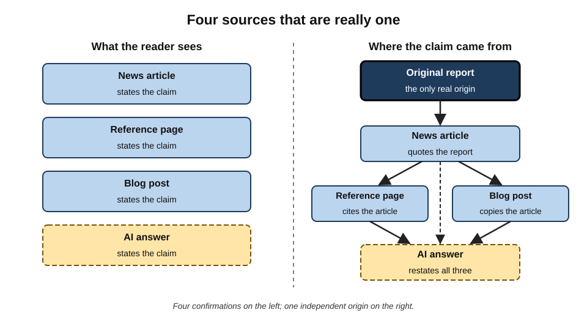
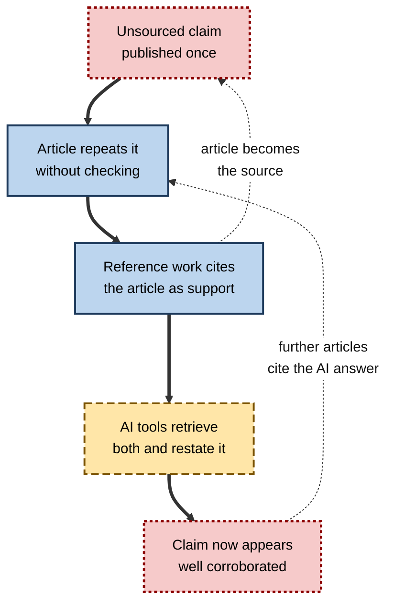
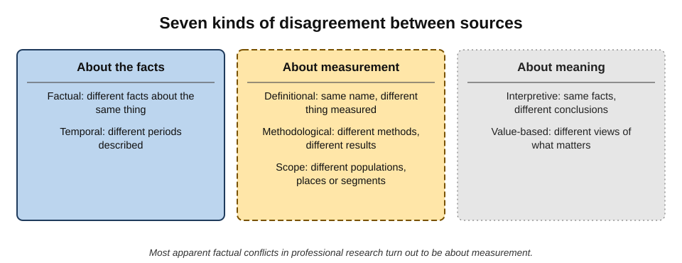
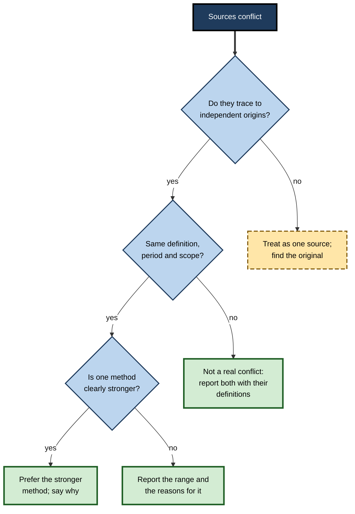
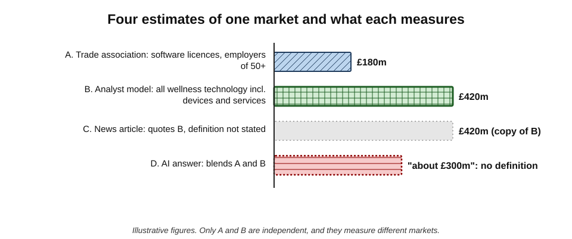
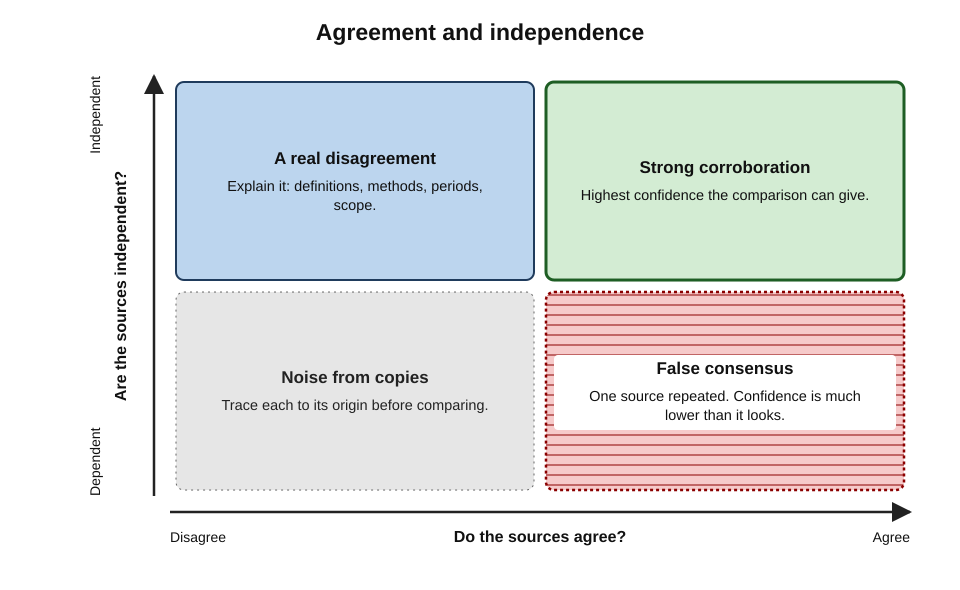

# H.6. Comparing multiple sources

A finance analyst needs the size of a market. She finds four sources: an industry association says £2.1 billion, a research firm says £3.4 billion, a news article says £3.4 billion and an AI answer says "around £3 billion". Three of the four seem to agree. On inspection, the news article quotes the research firm, the AI answer blends both figures, and the two originals measure different things — one counts only business customers, the other includes consumers.

There were never four sources: there were **two**, and they were not even answering the same question.

> **Definition — Source comparison:** examining what several sources say about the same question in order to establish where they agree, where and why they differ, and which to rely on.

> **Definition — Triangulation:** using several independent sources, methods or perspectives to test a claim, so that agreement among them gives more confidence than any one alone.

**Why it matters**

- **No single source is reliable on every point.** Even authoritative sources make errors, have blind spots and serve interests.
- **Agreement can be manufactured.** Copying, syndication and AI summarisation multiply one claim into many apparent confirmations.
- **Disagreement is information.** How and why sources differ often reveals more than any one of them.
- **AI tools change the landscape.** They make it easy to gather many sources quickly — and easy to mistake many restatements for many confirmations.

---

## What Comparison Is For

### Three purposes

- **Corroboration** — does an independent source confirm the claim?
- **Calibration** — how much do sources vary, and what range is plausible?
- **Explanation** — why do sources differ, and what does that reveal about the question?

> **Key point:** the value of a second source lies entirely in its **independence**. A second source that copied the first adds no evidence.

### The two-source habit

- Many newsrooms have long followed a rule of confirming important facts with **two independent sources** before publication.
- The principle generalises: a decisive claim should rest on **at least two sources that could not have copied each other**, or on one primary, accountable source.
- In professional research, "independent" means:
  - **different origin** — not one quoting the other or both quoting a third;
  - **different method** — ideally different ways of knowing (a survey and administrative records);
  - **different interests** — not both sponsored by a party with a stake.

---

## Independence

### Why independence is everything

**Study card — Francis Galton's ox (1907)**

- **Setting:** a livestock fair in Plymouth, England, where visitors paid to guess the dressed weight of an ox.
- **Design:** Galton collected the roughly 800 valid entries and analysed them.
- **Result:** the **median** guess was within about **1%** of the true weight — closer than most individual guesses.
- **Condition:** the guesses were made **independently**; each person wrote their own estimate.
- **Lesson for research:** combining sources improves accuracy **only if their errors are independent**. If everyone copies one confident guesser, combining adds nothing.

> **Definition — Independent sources:** sources whose information was obtained separately, so that an error in one is not automatically reproduced in another.

### How dependence hides

- **Quotation chains** — B quotes A; C quotes B; all three appear to agree.
- **Syndication** — one wire-service story republished by dozens of outlets.
- **Press-release journalism** — multiple articles rewritten from one press release.
- **Common upstream data** — several reports drawing on the same government dataset or the same consultancy forecast.
- **AI blending** — an AI answer restating whichever sources it retrieved, presented as a new voice.
- **Shared sponsorship** — several studies funded by the same interested party.

**Figure 1.** Apparent agreement and real independence: four sources that are really one.

### Circular reporting and citogenesis

> **Definition — Circular reporting:** a situation in which a claim appears to be confirmed by several sources that in fact all derive from one, sometimes from the original claimant itself.

> **Definition — Citogenesis:** a term popularised by the web comic *xkcd* in 2011 for a cycle in which an unsourced claim in an encyclopaedia is repeated by a published source, which is then cited back as support for the encyclopaedia's claim.

**Real case — the "Bicholim conflict" hoax**

- **What happened:** in 2007 a detailed Wikipedia article described a seventeenth-century war between Portuguese colonists and the Maratha Empire in India — the "Bicholim conflict". It had footnotes and a scholarly tone.
- **The truth:** the war never happened; the article was a hoax.
- **Duration:** it survived for about **five years** and was rated a "good article" before an editor checked the cited books in 2012 and found nothing.
- **Lesson:** formatting, length and citations created the appearance of corroboration; **nobody had opened the sources**.

**Figure 2.** How circular reporting manufactures confirmation.

> **Watch out:** AI tools now sit **inside** these loops. An AI-generated web page can be retrieved by another AI tool and cited as a source. Text that appears on many sites may be many copies of one machine-generated passage.

---

## Appraising Each Source

### Six questions

- **Authority** — Who produced it, and are they in a position to know?
- **Method** — How did they find out? Original data, analysis of others' data, opinion?
- **Independence** — Where did their information come from? Does it derive from another source in the set?
- **Interest** — Does the producer benefit from a particular answer?
- **Currency** — When was it produced, and has the situation changed?
- **Transparency** — Are definitions, data and methods disclosed so that they can be checked?

> **Mnemonic — "AMI ICT":** Authority, Method, Independence, Interest, Currency, Transparency — "am I in contact" with the evidence?

| Source type | Usual strengths | Usual weaknesses | Typical dependence |
|---|---|---|---|
| Official statistics | Large samples, published methods | Lag; definitions may not fit the question | Often the upstream source for others |
| Peer-reviewed research | Methods scrutinised | Narrow populations; slow; publication bias | Cites earlier studies |
| Industry or analyst report | Timely; sector-specific | Opaque methods; commercial interest | May recycle official data |
| News reporting | Timely; editorial checks | Compression; reliance on press releases | Often quotes reports or releases |
| Company publications | Authoritative on the company's own facts | Promotional framing | Original for its own data |
| AI answer | Fast overview | Blends sources; may fabricate | Wholly dependent on what it retrieved |

---

## Understanding Disagreement

### Kinds of disagreement

- **Factual** — sources state different facts about the same thing (different dates for an event).
- **Definitional** — sources measure different things under the same name ("market", "unemployment", "small business").
- **Methodological** — different methods produce different results (survey versus administrative data; modelled versus observed).
- **Temporal** — sources describe different periods.
- **Scope** — different populations, places or segments.
- **Interpretive** — the same facts, different conclusions.
- **Value-based** — disagreement about what matters or what should be done, not about facts.

**Figure 3.** Seven kinds of disagreement between sources.

> **Key point:** most apparent factual disagreements in professional research turn out to be **definitional, methodological, temporal or scope** differences. Resolving them requires reading the method sections and footnotes — exactly the parts AI summaries drop.

### Resolving a conflict

**Figure 4.** A procedure for resolving a conflict between sources.

1. **Trace each figure to its origin.** Remove duplicates.
2. **Align definitions, periods and scopes.** Many conflicts dissolve here.
3. **Compare methods.** Prefer observed over modelled, large over small, transparent over opaque — for the question at hand.
4. **Consider interests.** Discount, but do not dismiss, sources with a stake.
5. **Report honestly.** Where a real conflict remains, present the range and the reasons.

> **Remember:** **trace, align, compare, discount, report.**

---

## Worked Example (illustrative): Three Estimates of One Market

**Situation:** a strategy analyst must state the size of the UK market for workplace well-being software for an investment memo.

| Source | Figure | Definition | Method | Interest |
|---|---|---|---|---|
| A. Trade association annual survey | £180m | Software licences sold to employers with 50+ staff | Survey of member vendors | Members benefit from a large figure |
| B. Analyst firm report | £420m | All "corporate wellness technology", including wearables and services | Top-down model from global estimates | Sells the report; moderate |
| C. News article | £420m | Not stated | Quotes B | None obvious |
| D. AI answer | "about £300m" | Not stated | Blends A and B | — |

*Illustrative figures.*

**Figure 5.** Four estimates of one market and what each measures.

**Steps**

1. **Trace:** C quotes B; D blends A and B — only **two independent** estimates exist.
2. **Align:** A counts only software licences to larger employers; B includes hardware and services. They measure different markets.
3. **Compare methods:** A is bottom-up but self-reported by interested members; B is a top-down model with undisclosed assumptions.
4. **Discount:** both have interests in larger figures; neither is clearly neutral.
5. **Report:** "Estimates range from about £180m (software licences to employers of 50 or more, trade-association survey) to about £420m (broader wellness technology including devices and services, analyst model). No independent estimate for the software-only market was found."

> **Watch out:** the AI's "about £300m" is the most dangerous figure of all — it **looks like a reasonable midpoint** but corresponds to no definition and no method.

---

## AI Tools and Source Comparison

### What AI tools can do

- **Gather quickly.** Retrieve many sources on a question in seconds.
- **Lay out positions.** "Summarise what each of these sources says about X, with their definitions."
- **Flag differences.** "Where do these sources disagree, and how do their methods differ?"
- **Classify citing statements.** Some academic tools label later papers' citations of a study as supporting, contrasting or mentioning — a useful map of how a finding has fared.
- **Report consensus in research literatures.** Some tools summarise what a set of papers concludes on a yes-or-no question.

### Where AI comparison goes wrong

- **Blending.** Producing a single figure or position from incompatible sources.
- **Hiding dependence.** Presenting syndicated copies as separate sources.
- **Volume as consensus.** Treating the most frequently repeated position as the agreed one.
- **Dropping definitions.** Summaries keep the number and lose what it measures.
- **False balance.** Presenting a fringe view as equal to a well-supported one — or the reverse.

> **Definition — False balance:** presenting two positions as equally supported when the evidence strongly favours one.

> **Watch out:** asking **several AI tools** the same question is **not** comparing independent sources. The tools may retrieve the same pages and share similar training data; their agreement is weak evidence.

**Figure 6.** Agreement and independence together determine how much confidence comparison gives.

---

## Professional Practice

### Habits of skilled comparers

- **Draw the family tree.** For each important figure, sketch where each source got it.
- **Read the method notes and footnotes** — definitions live there.
- **Seek a source of a different kind.** If all sources are reports, look for administrative data, filings or direct observation.
- **Look for the best opposing source**, not the weakest.
- **Report ranges with reasons** rather than a false single number.
- **Keep the comparison table** as part of the research record.

> **In practice:** intelligence analysts use **structured analytic techniques** — such as weighing evidence against competing hypotheses, a method developed by Richards Heuer at the US Central Intelligence Agency — partly to force comparison of sources against several explanations rather than one favoured story.

### Superforecasters and many perspectives

- **Philip Tetlock's Good Judgment Project** (2011–2015), part of a US government forecasting tournament, identified "superforecasters" whose predictions on geopolitical questions were consistently more accurate than others'.
- Among their habits: gathering **many perspectives**, actively seeking **disconfirming information**, and **adjusting** estimates incrementally as evidence arrived.
- **Lesson for source comparison:** skilled judges treat each source as one view to be weighed, not as the answer.

### Case study (illustrative): conflicting safety data

- **Situation:** a facilities manager at a university researched whether a new floor-cleaning chemical was safe for daily use in laboratories.
- **Sources:** the manufacturer's safety data sheet, a distributor's brochure, two online articles and an AI answer — all said "safe for daily use".
- **Problem:** a laboratory technician remembered an occupational-health advisory about a related compound.
- **Diagnosis:**
  1. the brochure, both articles and the AI answer all derived from the **manufacturer's** marketing claims;
  2. the safety data sheet itself specified **ventilation and glove** requirements not mentioned elsewhere;
  3. an independent occupational-health agency's guidance on the active ingredient recommended **exposure limits** for enclosed spaces.
- **Actions:** the manager compared only **independent** sources — the safety data sheet and the agency's guidance — and wrote a usage procedure with ventilation, gloves and frequency limits for enclosed laboratories.
- **Result:** the product was adopted with controls; the procedure passed the university's health-and-safety review.
- **Lesson:** five sources saying the same thing were **one** source plus copies; the independent sources disagreed with the marketing in exactly the ways that mattered.

---

## Comparing Numbers

### Ranges, orders of magnitude and sanity checks

- **Start with the order of magnitude.** Are the figures within a factor of two of each other, or a factor of ten? Large gaps almost always mean different definitions or scopes.
- **Check units and periods.** Millions versus billions; annual versus cumulative; nominal versus inflation-adjusted; one country versus a region.
- **Check what is counted.** Revenue or volume; installed base or annual sales; firms or establishments; people or households.
- **Build an independent rough estimate.** A simple bottom-up calculation from known quantities tests whether a published figure is plausible.

> **Definition — Fermi estimate:** a rough calculation from a few known or reasonably estimated quantities, named after the physicist Enrico Fermi, used to check whether a figure is of the right order of magnitude.

> **Formula — Bottom-up cross-check (illustrative):** 6,000 UK employers with 50 or more staff likely to buy × 40% adoption × £75,000 average annual spend ≈ **£180m**. If a published estimate for the same definition were £1.8 billion, one of the assumptions — or the published figure — would need explaining. *Illustrative figures.*

### Top-down and bottom-up estimates

| | Top-down estimate | Bottom-up estimate |
|---|---|---|
| Method | Start from a large total and apply shares | Build up from units, prices and counts |
| Typical source | Analyst models; global reports | Surveys; registries; company data |
| Typical bias | Over-broad definitions; optimistic shares | Missing segments; under-counting |
| Best use | Context and upper bounds | Grounded estimates for a defined scope |

- **When top-down and bottom-up estimates roughly agree**, confidence rises; when they diverge, the gap usually reveals a definitional difference.

---

## Comparing Accounts and Testimony

Not all comparison is of documents and numbers. Much professional research compares **accounts** — interviews, witness statements, customer feedback, expert opinions.

- **Independence of witnesses.** Accounts given separately are worth more than accounts agreed in discussion; people who have talked to each other converge.
- **Contemporaneous over later.** Notes and records made at the time are generally more reliable than recollections made later.
- **Corroborated detail.** Specific details that can be checked against records — dates, documents, locations — strengthen an account; vague agreement does not.
- **Interest.** People with a stake in the outcome may honestly remember in their favour.
- **Expert disagreement.** When experts disagree, compare their **reasons and evidence**, not their titles.

> **In practice:** investigators, auditors and journalists routinely separate the "what was seen or recorded" from the "what was concluded" in each account before comparing them.

---

## Comparing Explanations: Competing Hypotheses

**Analysis of Competing Hypotheses** — a structured technique developed by Richards Heuer, a veteran analyst at the US Central Intelligence Agency, and set out in his book *Psychology of Intelligence Analysis* (1999):

1. **List all reasonable hypotheses**, not only the favoured one.
2. **List the evidence** and arguments, including absences.
3. **Build a matrix** of evidence against hypotheses, marking each piece as consistent, inconsistent or neutral.
4. **Focus on disconfirmation** — the hypothesis with the **least inconsistent** evidence is favoured, not the one with the most consistent evidence.
5. **Test sensitivity** — which pieces of evidence, if wrong, would change the conclusion? Those are the ones to verify first.

**Worked example (illustrative) — why did customer churn rise last quarter?**

| Evidence | H1: price increase | H2: competitor launch | H3: service outage |
|---|---|---|---|
| Churn rose mainly among small accounts | Consistent | Consistent | Neutral |
| Exit surveys cite price in 45% of cases | Consistent | Neutral | Inconsistent |
| Competitor launched only in one region; churn rose everywhere | Neutral | **Inconsistent** | Neutral |
| Outage affected all customers; churn rose only among small ones | Neutral | Neutral | **Inconsistent** |

*Illustrative figures.*

- **Result:** H1 has no inconsistent evidence; H2 and H3 each have a strong inconsistency.
- **Next step:** verify the exit-survey figure and the regional churn data — the evidence on which the conclusion most depends.

> **Key point:** comparison of sources is most powerful when it is organised around **competing explanations**, because it forces attention to evidence that would **rule something out**.

---

## Comparing Sources with AI Assistance

### Requests that help

- **"For each source, state its definition, method, period, population and sponsor."** — makes differences visible before findings are compared.
- **"Which of these sources cite or depend on each other?"** — a first pass at the family tree, to be checked.
- **"Where do these sources disagree, and what explains each disagreement?"** — surfaces conflicts that a summary would smooth.
- **"What kind of evidence is missing from this set?"** — prompts a search for a different source type.
- **"Present the range of estimates with the definition behind each; do not average them."** — prevents false midpoints.

### Limits to remember

- **The AI sees only what it retrieved or was given.** Dependence on sources outside the set is invisible to it.
- **It may assert independence or dependence wrongly.** Quotation chains are often implicit; the person must check.
- **It may still blend.** Even when told not to, generated prose tends to merge figures; a table is safer than paragraphs.

> **In practice:** asking for a **comparison table** rather than prose — one row per source, columns for definition, method, figure, date and sponsor — is the single most effective way to stop an AI tool from blending incompatible sources.

---

## Communicating Disagreement to Decision-Makers

- **Do not hide it.** Decision-makers need to know where evidence conflicts; a falsely single answer transfers risk to them without their knowledge.
- **Explain it briefly.** "Estimates range from £180m to £420m because one counts software only and the other includes devices and services."
- **Say which to use and why.** "For our software-only proposition, the lower estimate is the relevant one."
- **Show what would resolve it.** "A survey of our own target customers would settle the size of the software-only market."
- **Match confidence to evidence.** Use explicit language — "well established", "likely", "uncertain", "unknown".

| Weak communication | Strong communication |
|---|---|
| "The market is about £300m" | "Two independent estimates, using different definitions: £180m (software) and £420m (broader); the software figure fits our offer" |
| "Experts disagree" | "Two regulators' guidance differs on X; our legal team's view is Y, for these reasons" |
| "Studies show mixed results" | "Trials in large firms found no effect; one in small firms found a modest gain; evidence for our size is limited" |

> **Key point:** a well-explained disagreement is **more useful** to a decision-maker than a false consensus, because it shows where the decision's risk lies.

---

## Open Questions

- **Can independence be detected automatically?**
  - Tools that trace quotation chains and near-duplicate text exist, but detecting shared upstream data or machine-generated copies remains hard.
- **Will AI-generated content swamp independent sources?**
  - As machine-generated text proliferates, the share of the web that is genuinely independent may fall; how much is uncertain.
- **How should consensus be represented?**
  - Tools that summarise "what the literature says" may over- or under-state agreement; standards for reporting consensus are not settled.
- **How many sources are enough?**
  - Rules of thumb (two independent sources) are common in journalism; there is little research on optimal source numbers for workplace decisions.
- **Can AI help find the best opposing evidence?**
  - Prompting for counter-evidence helps, but tools tend toward the majority view in their retrieved set.

---

## Summary

- **Source comparison** establishes agreement, disagreement and reliance; **triangulation** uses independent sources or methods to test a claim.
- The value of a second source lies in its **independence** — Galton's ox shows that combining helps only when errors are independent.
- Dependence hides in **quotation chains, syndication, press releases, common data, AI blending and shared sponsorship**; **circular reporting** and **citogenesis** manufacture false confirmation, as in the **Bicholim conflict** hoax.
- Appraise each source by **Authority, Method, Independence, Interest, Currency, Transparency**.
- Disagreements are **factual, definitional, methodological, temporal, scope, interpretive or value-based** — most apparent conflicts are definitional or methodological.
- Resolve conflicts by **trace, align, compare, discount, report**; report **ranges with reasons**, not false midpoints.
- AI tools gather and lay out positions quickly but **blend, hide dependence, treat volume as consensus and drop definitions**; several AI tools agreeing is weak evidence.

---

## Self-Check

1. Define triangulation and explain why independence is essential to it.
2. What did Galton's ox experiment show, and what condition made it work?
3. Name five ways dependence between sources can hide.
4. Explain circular reporting and citogenesis, with an example.
5. What lesson does the Bicholim conflict hoax teach about citations and corroboration?
6. List the six appraisal questions and apply them to an industry association's survey.
7. Distinguish definitional, methodological and scope disagreements with examples.
8. State the five steps for resolving a conflict between sources.
9. In the market-size example, why was the AI's figure the most dangerous?
10. Why is asking several AI tools the same question not true triangulation?
11. What is false balance, and how might an AI tool produce it?
12. What habits did Tetlock's superforecasters show that are relevant to source comparison?
13. In the cleaning-chemical case study, what did the independent sources reveal?
14. A manager finds six articles reporting the same staff-turnover statistic. Describe how to establish how much confidence the six provide.

### Answer Key

1. Testing a claim with several independent sources, methods or perspectives so that agreement gives more confidence than one alone. If sources copy each other, their agreement reflects one origin and adds no evidence.
2. The median of about 800 independent guesses of an ox's weight was within about 1% of the true weight, better than most individuals. It worked because guesses were made independently, so errors cancelled.
3. Quotation chains; syndication; press-release journalism; common upstream data; AI blending; shared sponsorship.
4. Circular reporting: several sources appearing to confirm a claim that all derive from one. Citogenesis: an unsourced encyclopaedia claim repeated by a publication, which is then cited back as support. The Bicholim conflict hoax is an example of fabricated content gaining apparent support.
5. That length, formatting and footnotes can create an appearance of scholarship and corroboration; only opening the cited sources revealed that nothing supported the article.
6. Authority (members know their own sales), Method (self-reported survey), Independence (original data, but from interested parties), Interest (members benefit from a large market), Currency (check survey year), Transparency (is the questionnaire and sample disclosed?).
7. Definitional: two "market size" figures counting different products. Methodological: a survey of firms versus a top-down model. Scope: one covering the UK, another only England, or only large employers.
8. Trace each figure to its origin; align definitions, periods and scopes; compare methods; discount for interests; report honestly, with a range and reasons if conflict remains.
9. It looked like a sensible midpoint but corresponded to no definition or method; it blended incompatible figures into a number no source supported.
10. The tools may retrieve the same pages and share training data, so their outputs are not independent; agreement may reflect a common source.
11. Presenting two positions as equally supported when evidence strongly favours one. An AI tool asked to give "both sides" may give a fringe view equal weight, or a tool reflecting majority retrieval may suppress a well-supported minority finding.
12. Gathering many perspectives, seeking disconfirming information and updating estimates incrementally.
13. That the "safe for daily use" claim derived from the manufacturer's marketing, while the safety data sheet and an independent agency specified ventilation, gloves and exposure limits.
14. Trace each article to the statistic's original source; if all quote one survey, there is one source; then appraise that survey's method, definition and sponsor; look for an independent source such as official labour statistics or the organisation's own HR data; report the figure with its origin and limits.

---

## Glossary

| Term | Meaning |
|---|---|
| Circular reporting | Apparent confirmation by several sources that all derive from one. |
| Citogenesis | A cycle in which an unsourced claim is published, then cited back as its own support. |
| Corroboration | Confirmation of a claim by an independent source. |
| Definitional disagreement | Sources measuring different things under the same name. |
| False balance | Presenting unequally supported positions as equal. |
| Independent sources | Sources whose information was obtained separately. |
| Quotation chain | A sequence of sources each quoting the previous one. |
| Source comparison | Examining several sources to find agreement, disagreement and reliability. |
| Superforecaster | A forecaster with consistently superior accuracy, identified in Tetlock's Good Judgment Project. |
| Syndication | Republication of one story by many outlets. |
| Triangulation | Testing a claim with several independent sources, methods or perspectives. |
