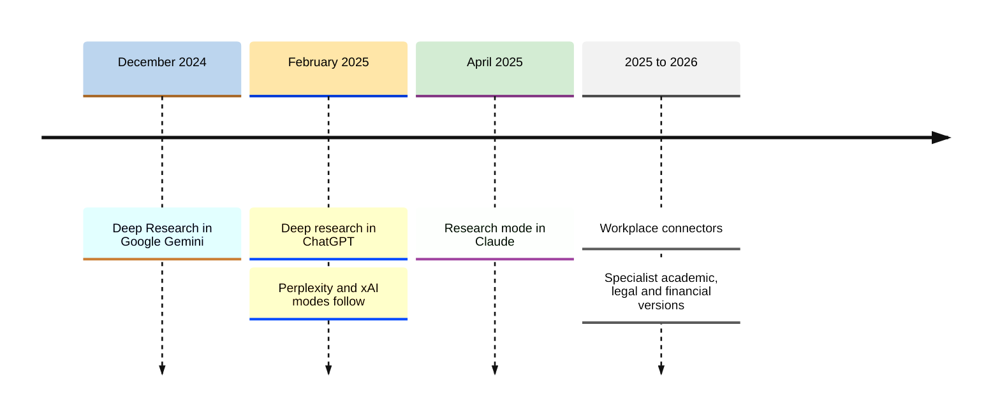
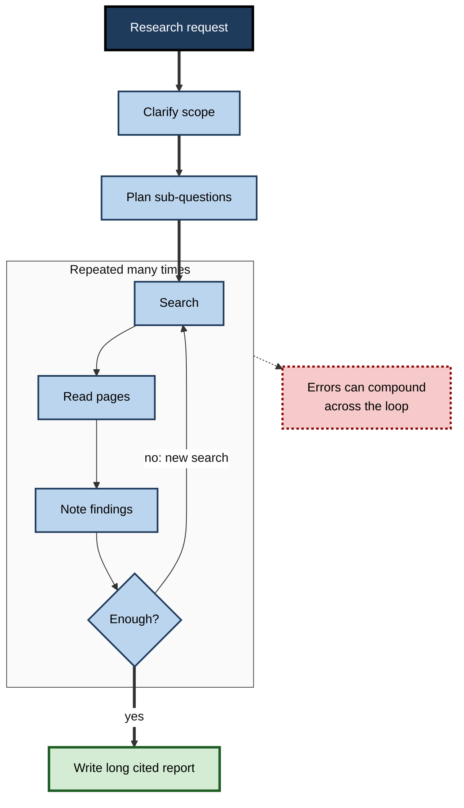
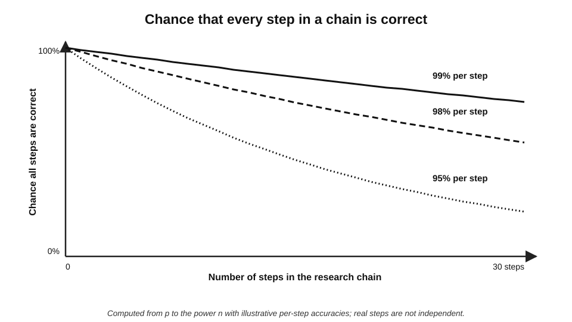
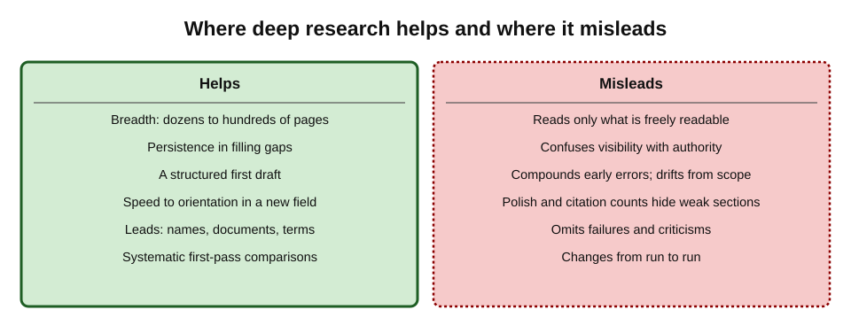
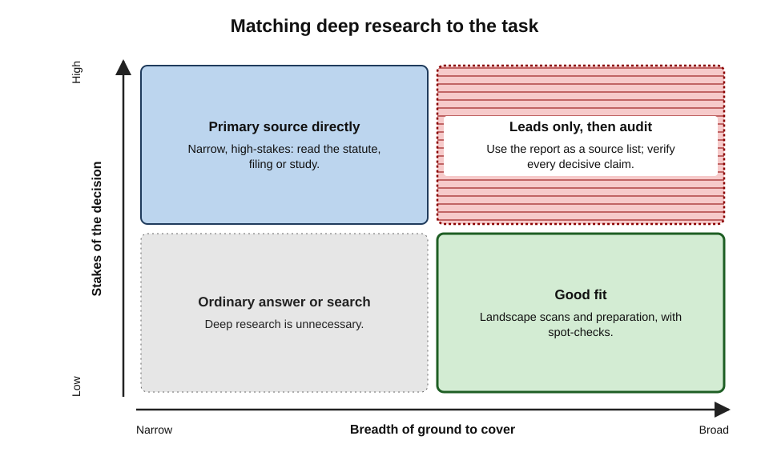
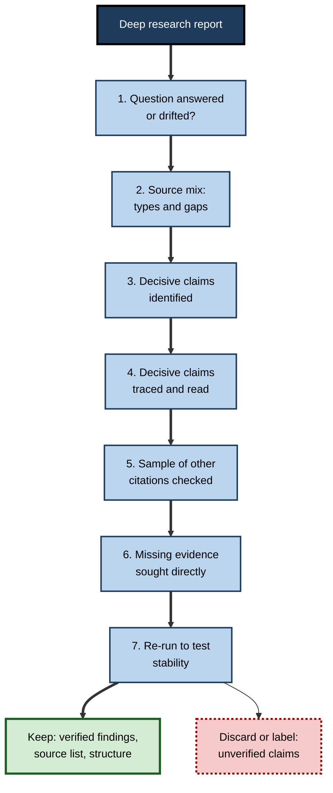

# H.7. Deep research modes and their limits

A business-development manager types a single paragraph into a deep research tool: "Survey the market for warehouse robotics in Northern Europe — main vendors, pricing models, adoption barriers, recent funding." Twenty minutes later she has a twenty-five-page report with headings, tables and over a hundred citations. It would have taken an analyst a week. It is also, in places, built on vendor press releases, a two-year-old pricing article and a forum post — and nobody, including the tool, has said which places those are.

> **Definition — Deep research mode:** a feature of an AI assistant in which an agent autonomously plans a research task, runs many searches, reads and reasons over the retrieved material over several minutes, and produces a long, structured report with citations.

> **Definition — AI agent:** an AI system that pursues a goal through a sequence of self-directed steps — choosing actions such as searching, reading or calculating, observing the results, and deciding what to do next.

**Why it matters**

- **It changes the economics of research.** Work that took days of searching and reading can be drafted in minutes.
- **It changes the reviewer's job.** The human role shifts from finding to **auditing** — a different skill, and one that is easy to skip.
- **Its outputs look finished.** Length, structure and citation density signal rigour whether or not rigour is present.
- **It is now widely available** in mainstream assistants and in some workplace tools, often connected to the organisation's own files.

---

## What Deep Research Tools Are

### A short history

- **December 2024** — Google introduced **Deep Research** in its Gemini assistant.
- **February 2025** — OpenAI launched **deep research** in ChatGPT, built on a reasoning model trained for browsing; Perplexity and xAI released similar modes within weeks.
- **April 2025** — Anthropic added a **Research** mode to Claude.
- **2025–2026** — the modes spread to most major assistants and to workplace suites, gained connectors to email, documents and internal systems, and were joined by specialist versions for academic, legal and financial research.

**Figure 1.** The arrival of deep research modes.

### How a deep research agent works

1. **Clarifying.** Many tools first ask questions to narrow scope — region, period, purpose.
2. **Planning.** The agent drafts a research plan: sub-questions and search strategies. Some tools show the plan for approval.
3. **Searching and reading in a loop.** It runs a search, reads pages, notes findings, decides what is missing, and searches again — often dozens of cycles.
4. **Reasoning.** Between searches it compares findings, resolves (or fails to resolve) conflicts and decides when it has enough.
5. **Writing.** It composes a long report — headings, tables, sometimes charts — with inline citations.

**Figure 2.** The loop inside a deep research agent.

> **Key point:** a deep research report is the end product of **many small decisions** — what to search, which pages to trust, what to note, when to stop — none of which the reader sees unless the tool exposes its activity log.

### What distinguishes it from an ordinary AI answer

| | Ordinary AI answer | Deep research report |
|---|---|---|
| Time | Seconds | Several minutes to half an hour |
| Searches | One or a few | Dozens to hundreds |
| Pages read | A handful | Dozens to hundreds |
| Output | A few paragraphs | Many pages with structure and tables |
| Citations | A few | Often dozens or more |
| Reviewer's burden | Check a few claims | Audit a document |
| Characteristic risk | A wrong fact | A wrong picture, assembled from many small choices |

---

## What Deep Research Does Well

- **Breadth.** Covers more ground in minutes than a person can in hours, including obscure pages.
- **Persistence.** Keeps searching for missing pieces rather than stopping at the first page of results.
- **Structure.** Produces an organised first draft — a landscape, a comparison, a timeline.
- **Speed to orientation.** Ideal for getting to know a new field, market or question before deeper work.
- **Surfacing leads.** Finds names, organisations, documents and terms that a person can then pursue.
- **Consistency of coverage.** When asked to compare many items (vendors, countries, policies) on the same criteria, fills a grid systematically.

> **In practice:** many professionals use deep research as a **"first week in a day"** — the orientation and source-gathering phase of a project — not as the final deliverable.

---

## The Limits

### Source access

- **Paywalled and licensed content** — academic journals, analyst reports, legal databases, news archives — is often unavailable or available only as abstracts.
- **Internal knowledge** — the organisation's own data, contracts, past work — is invisible unless connectors are enabled and permitted.
- **Non-text sources** — scanned PDFs, images, data tables, video — may be read poorly or not at all.
- **Consequence:** the report reflects **what was freely readable**, which skews toward marketing pages, news, blogs and summaries.

### Source judgement

- **Authority confusion.** When OpenAI launched its deep research tool in 2025, it acknowledged that the tool could hallucinate facts, make incorrect inferences, and struggle to distinguish authoritative information from rumours — and that it might fail to convey uncertainty accurately.
- **Search-optimised content.** Pages written to rank and to be quoted by AI systems are over-represented among what agents find.
- **Recency without validity.** A recent blog post may be preferred to an older but authoritative report, or the reverse.

### Errors that compound

- **Early mistakes propagate.** A misread definition or a wrong assumption in an early step shapes every later search.
- **Scope drift.** The agent can wander from the question into adjacent topics that were easier to find.
- **Premature stopping.** It may stop when it has *an* answer rather than the *best* answer.

> **Formula — Compounding reliability (illustrative):** if each of *n* steps is independently correct with probability *p*, the chance all are correct is *p*ⁿ. With *p* = 0.98 and *n* = 20, the chance is 0.98²⁰ ≈ **0.67**; with *p* = 0.95, it is 0.95²⁰ ≈ **0.36**. *Illustrative figures; real steps are not independent, but the direction holds — long chains magnify small error rates.*

**Figure 3.** How small error rates per step compound over a long research chain.

### Output that resists review

- **Length.** A twenty-page report invites skimming; errors hide in the volume.
- **Citation density as a false signal.** A hundred citations look rigorous; checking even a tenth is a substantial task.
- **Uniform polish.** Strong and weak sections read equally well.
- **Non-reproducibility.** Running the same request again can produce a different plan, different sources and different conclusions.
- **Missing negatives.** Reports tend to describe what exists and what proponents claim; failures, criticisms and absent evidence are under-reported unless explicitly requested.

> **Definition — Verification burden:** the time and expertise required to check an AI output to the standard its use demands. For deep research reports it can approach the time saved in producing them — which is why it is often skipped.

**Figure 4.** Where deep research helps and where it misleads.

> **Watch out:** "the report cites 140 sources" is a statement about **volume**, not about **quality** or **support**. A report built on many weak sources can be less reliable than a page built on two strong ones.

---

## Choosing When to Use It

### Good uses

- **Landscape scans** — who the players are, what the main positions are, what has happened recently.
- **Preparation** — before an interview, meeting, negotiation or project kick-off.
- **Source gathering** — producing a long list of candidate documents for a person to read.
- **Systematic comparisons** of many items on fixed criteria, as a first pass.
- **Finding vocabulary and leads** in an unfamiliar field.

### Poor uses

- **Final answers to high-stakes questions** — legal positions, clinical decisions, investment decisions, regulatory submissions.
- **Questions dependent on paywalled or internal sources** the tool cannot read.
- **Highly contested questions** where source selection decides the conclusion.
- **Precise current figures** — prices, rates, thresholds — which should be taken from the primary source.

**Figure 5.** Matching deep research to the task: breadth needed against stakes of the decision.

---

## Worked Example (illustrative): Briefing and Reviewing a Deep Research Task

**Situation:** a public-sector project manager must recommend whether to pilot an AI chatbot for council tax enquiries.

**Step 1 — Write a good brief**

- **Weak brief:** "Research AI chatbots for councils."
- **Strong brief:**
  - *Purpose:* "Inform a decision on piloting an AI chatbot for council tax enquiries in a UK local authority."
  - *Scope:* "UK and comparable European public bodies, 2023 to now."
  - *Questions:* "Which authorities have deployed such tools? What outcomes were reported (call volumes, accuracy, complaints)? What problems or failures occurred? What legal and data-protection requirements apply?"
  - *Sources:* "Prefer official council reports, regulator guidance, audit reports and independent evaluations; label vendor material as such."
  - *Balance:* "Include failures, criticisms and discontinued pilots."
  - *Output:* "A table of deployments with source links; a separate section on unresolved questions; state where evidence was not found."

**Step 2 — Review the plan** (if shown): remove sub-questions that drift; add "discontinued pilots".

**Step 3 — Audit the report**

| Check | What was found (illustrative) | Action |
|---|---|---|
| Source mix | 60% vendor pages and trade press; two council reports | Search council minutes and audit reports directly |
| Decisive claims | "Reduced call volumes by 30%" traced to a vendor case study | Label as vendor-reported; seek independent evaluation |
| Missing negatives | No failed pilots mentioned despite the brief | Targeted search found one discontinued pilot with a published review |
| Legal section | Correct regulator named; guidance date outdated | Replace with the current guidance |
| Re-run | Second run named different "leading" deployments | Treat lists as leads, not findings |

*Illustrative findings.*

**Step 4 — Decide:** the recommendation rests on two council evaluations, the regulator's current guidance and the discontinued pilot's review; the deep research report is kept as a **source list**, not cited as evidence.

> **Remember:** **brief it like an analyst, review it like an editor, cite it never** — cite the sources it found, after reading them.

---

## Reviewing a Deep Research Report

### An audit protocol

1. **Read the question back.** Did the report answer the question asked, or a drifted version?
2. **Inspect the source list.** What types of source dominate? Are the authoritative ones present? Any obvious gaps?
3. **Identify decisive claims.** Which statements would change the conclusion if false?
4. **Trace decisive claims** to their citations and read the passages.
5. **Sample other citations** — for example, one in ten — to estimate overall reliability.
6. **Look for what is missing:** opposing evidence, failures, regions, recent changes.
7. **Re-run or vary the request** to see which findings are stable.
8. **Decide what to keep:** the source list, the structure, specific verified findings.

**Figure 6.** An audit protocol for a deep research report.

> **In practice:** a useful rule is that the review time for a deep research report used in a decision should be **at least a third** of the time a person would have needed to research the question unaided — otherwise the review is probably superficial. *This is a rule of thumb, not an empirical finding.*

---

## Deep Research in Organisations

### Governance questions

- **Which tools are approved,** and with which data connectors?
- **What may be uploaded or connected** — client data, personal data, confidential documents?
- **Who reviews** deep research outputs before they inform decisions or leave the organisation?
- **How is use disclosed** to clients, regulators or readers?
- **How are outputs stored** — as research records, with the request, date and tool?

### Case study (illustrative): vendor due diligence

- **Situation:** a bank's procurement team used a deep research tool to produce a due-diligence profile of a fintech vendor before a contract.
- **Output:** a polished twenty-page report praising the vendor's growth, security certifications and client base.
- **Problem:** a risk analyst noticed that the client list matched the vendor's own website word for word.
- **Diagnosis:**
  1. most citations were the vendor's site, press releases and articles derived from them;
  2. a regulator's enforcement notice against the vendor's parent company — published as a scanned PDF — was absent;
  3. a security certification claimed as current had lapsed, which the certifying body's register showed.
- **Actions:**
  - the team defined a due-diligence protocol: deep research for **leads**; mandatory direct checks of company registries, regulator registers, certification registers and litigation databases;
  - independent sources became a required column in the profile.
- **Result:** the contract went ahead with additional warranties and an audit clause; the protocol became standard.
- **Lesson:** a deep research agent reads what is **easy to read**, which in due diligence is often what the subject wants read.

---

## How Deep Research Tools Differ

Deep research modes share an architecture but differ in features that matter for review.

- **Plan visibility** — some tools show the research plan for approval before starting; others start immediately.
- **Activity logs** — some show every search and page visited; others show only the final citations.
- **Source controls** — some allow the user to restrict or prioritise domains, upload documents, or connect specific internal sources.
- **Citation style** — inline links, numbered references, or quoted passages with locations.
- **Length and format controls** — whether the user can ask for a short memo instead of a long report.
- **Export** — whether the report and its sources can be saved with dates for the research record.

| Feature | Why it matters for review | What to prefer |
|---|---|---|
| Visible, editable plan | Catches scope drift before it happens | Approve the plan before the run |
| Activity log | Shows what was read and discarded | Tools that expose searches and pages |
| Source controls | Steers away from weak sources | Ability to prioritise official and specialist sources |
| Passage-level citations | Speeds checking of support | Quotations with locations |
| Export with dates | Supports the research trail | Full export of report and source list |

> **In practice:** choosing a tool that exposes its plan and activity log can cut review time substantially, because the reviewer sees **how** the report was built, not only **what** it says.

---

## Deep Research Inside the Organisation

### Connectors and internal sources

- **What connectors do:** let the agent search email, shared drives, document libraries, wikis, ticketing systems or databases alongside the web.
- **Benefits:** research that combines external evidence with the organisation's own data and history.
- **Risks:**
  - **Over-exposure** — the agent can surface documents a person technically has access to but should not be using for this purpose, revealing weaknesses in permission settings;
  - **Stale documents** — old drafts and superseded policies sit beside current ones and may be cited as if authoritative;
  - **Unlabelled mixing** — internal and external findings blended in one sentence, making provenance unclear;
  - **Confidentiality** — prompts, uploads and reports may contain sensitive material and must be handled under the organisation's data rules.

> **Watch out:** a deep research report that blends a confidential internal figure with public sources may be safe to read internally but **unsafe to send** to a client or publish. Labelling the origin of every internal finding is essential.

### Practices that help

- **Separate sections** for internal and external findings.
- **Cite internal documents with owner and date**, so currency can be judged.
- **Restrict connectors** to the sources needed for the task.
- **Review before sharing** outside the team, checking for confidential content.

---

## How Deep Research Is Evaluated

- **Browsing benchmarks.** Developers test agents on collections of hard-to-find facts that require many searches — for example OpenAI's BrowseComp, released in 2025 — and on demanding expert question sets.
- **What benchmarks measure well:** whether an agent can **find** a specific, verifiable answer.
- **What they measure poorly:**
  - the **balance** and **completeness** of a long report;
  - the **quality of source selection**;
  - whether **uncertainty** is conveyed accurately;
  - whether the report would support a **sound decision**.
- **Independent evaluation is scarce.** Most published results come from developers, on their own benchmarks, at launch; products then change.

> **Key point:** a high benchmark score says the agent is good at **finding**; professional use depends on **judging** — which no benchmark yet captures well.

### Evaluating a tool for a team

- **Use the team's own past questions** with known answers.
- **Score** decisive-claim accuracy, citation support, source mix, missing negatives and stability across re-runs.
- **Compare** against the time and quality of an experienced researcher.
- **Re-test** after major product updates.

---

## The Anatomy of a Research Brief

A deep research agent does what it is asked. The brief is therefore the single biggest lever on the quality of the result.

- **Purpose and decision** — what the research will inform, and for whom.
- **Scope** — geography, period, sector, population, language.
- **Questions** — a short list of specific sub-questions, rather than one broad topic.
- **Definitions** — what key terms mean for this task ("SME means fewer than 250 employees").
- **Source preferences** — which kinds of source to prioritise; which to label or avoid.
- **Balance** — an explicit request for opposing evidence, failures and limitations.
- **Gaps** — an instruction to say where evidence was **not** found.
- **Output** — length, structure, tables, citation form.
- **Uncertainty** — an instruction to mark claims by strength of evidence.

> **Mnemonic — "Purpose, Places, Questions, Sources, Sides, Shape":** what the research is for, where and when it applies, what exactly is asked, which sources to favour, both sides of the evidence, and the form of the output.

### Before and after the run

- **Before:** check whether the tool can reach the sources the question needs; if not, plan to search them directly.
- **During:** if the plan is shown, edit it — remove drift, add missing sub-questions.
- **After:**
  - **keep** the report and source list, dated, in the research record;
  - **extract** the verified findings into the working document;
  - **discard or label** everything unverified;
  - **note** what the run could not find, as a list of direct searches still to do.

| Brief element | Typical omission | Consequence |
|---|---|---|
| Purpose | "Research X" with no decision stated | Report optimised for breadth, not relevance |
| Scope | No geography or period | Global, mixed-period findings |
| Definitions | Key terms undefined | Figures with incompatible definitions blended |
| Source preferences | None stated | Over-reliance on freely available marketing and news |
| Balance | No request for counter-evidence | Missing negatives |
| Gaps | No request to report absences | Silence read as "no evidence exists" |

---

## Open Questions

- **Can agents judge source quality reliably?**
  - Training agents to prefer authoritative sources helps, but authority is context-dependent and hard to encode.
- **How should agents show their work?**
  - Activity logs and source lists help; whether reviewers use them, and what form helps most, is little studied.
- **What review is proportionate?**
  - There is no established standard for auditing long AI research reports; organisations are developing their own.
- **Will deep research change professional skills?**
  - If junior staff no longer do the searching and reading, they may not develop the judgement needed to audit agents.
- **How should benchmarks measure research quality?**
  - Benchmarks test finding hard-to-locate facts; measuring the **quality of a whole report** — balance, judgement, completeness — is harder and largely unsolved.

---

## Summary

- A **deep research mode** is an **agent** that plans, searches and reads in a loop over minutes and writes a long cited report.
- Introduced from **December 2024** (Gemini), **February 2025** (ChatGPT, Perplexity, xAI) and **April 2025** (Claude), now widespread, often with workplace connectors.
- Strengths: **breadth, persistence, structure, speed to orientation, leads, systematic comparison**.
- Limits: **source access** (paywalls, internal and non-text sources), **source judgement** (authority confusion, search-optimised content), **compounding errors** and **scope drift**, output that **resists review** (length, citation density, polish, non-reproducibility, missing negatives).
- Small per-step error rates compound over long chains (*p*ⁿ).
- The **verification burden** can approach the time saved; it must not be skipped.
- Use for **landscape scans, preparation, source gathering and first-pass comparisons**; not as the final word on **high-stakes, paywalled, contested or precise current** questions.
- **Brief it like an analyst, review it like an editor, cite it never.**

---

## Self-Check

1. Define a deep research mode and an AI agent.
2. Describe the stages by which a deep research agent produces a report.
3. How does a deep research report differ from an ordinary AI answer in time, searches, output and risk?
4. List four strengths of deep research tools.
5. Why does limited source access skew deep research reports, and in which direction?
6. What limitations did OpenAI acknowledge when launching its deep research tool?
7. Use the compounding formula to explain why long research chains magnify small error rates.
8. What is the verification burden, and why is it often skipped?
9. Why is citation density a poor signal of reliability?
10. Name three good uses and three poor uses of deep research.
11. Rewrite "Research AI chatbots for councils" as a strong brief.
12. Outline the audit protocol for a deep research report.
13. In the vendor due-diligence case study, what systematic weakness did the report show, and how was it addressed?
14. Your manager proposes replacing a monthly competitor-intelligence report with deep research outputs. Give a reasoned response.

### Answer Key

1. A deep research mode is a feature in which an AI agent plans a research task, searches and reads repeatedly over minutes and writes a long cited report. An AI agent pursues a goal through self-directed steps, choosing actions, observing results and deciding next steps.
2. Clarifying scope; planning sub-questions; looping through search, reading and note-taking until enough is gathered; reasoning across findings; writing a structured report with citations.
3. It takes minutes rather than seconds, runs dozens to hundreds of searches rather than a few, produces a multi-page structured report rather than paragraphs, and its characteristic risk is a wrong overall picture assembled from many small choices rather than one wrong fact.
4. Breadth; persistence; structured output; speed to orientation; surfacing leads; systematic comparison.
5. Paywalled, licensed, internal and non-text sources are often unreadable, so reports over-represent freely available marketing, news, blogs and summaries.
6. That it could hallucinate facts and make incorrect inferences, could struggle to distinguish authoritative information from rumours, and might not convey uncertainty accurately.
7. If each of n steps is correct with probability p, all are correct with probability pⁿ; at 0.95 per step over 20 steps that is about 0.36. Real steps are not independent, but long chains still magnify small error rates.
8. The time and expertise needed to check an output to the standard its use demands. For long reports it is large and can approach the time saved, so people are tempted to skip it.
9. Citations may be weak, duplicated or misgrounded; volume says nothing about quality or support, and the more citations there are, the fewer a reviewer checks proportionally.
10. Good: landscape scans, meeting preparation, source gathering. Poor: final legal or clinical positions, questions dependent on paywalled or internal sources, precise current figures (also highly contested questions).
11. For example: state the decision the research informs; scope (UK and comparable public bodies, period); specific questions (deployments, outcomes, failures, legal requirements); source preferences and labelling of vendor material; an explicit request for failures and criticisms; output format with a table of deployments and a statement of where evidence was not found.
12. Check the question was answered; inspect the source mix; identify decisive claims; trace and read them; sample other citations; seek missing evidence directly; re-run to test stability; keep verified findings and the source list, label or discard the rest.
13. It relied on what was easy to read — the vendor's own materials and derivatives — and missed a scanned enforcement notice and a lapsed certification. A protocol made deep research a lead generator and required direct checks of registries, regulators, certification registers and litigation databases.
14. For example: deep research can draft the scan quickly and broaden coverage, but cannot read paywalled analyst reports or internal sales intelligence, may favour competitors' marketing, and varies between runs. Propose a hybrid: deep research for the first draft and leads; an analyst audits decisive claims, adds licensed and internal sources, checks for missing negatives, and signs off; the request and outputs are stored for consistency month to month.

---

## Glossary

| Term | Meaning |
|---|---|
| AI agent | An AI system that pursues a goal through self-directed steps. |
| Activity log | A record, shown by some tools, of the searches and pages an agent used. |
| Compounding error | The growth in overall error as many steps, each slightly unreliable, are chained. |
| Connector | A permitted link letting an AI tool search a specific data source such as email or documents. |
| Deep research mode | An agentic feature that plans, searches, reads and writes a long cited report. |
| Missing negatives | Failures, criticisms or absent evidence left out of a report. |
| Non-reproducibility | The tendency of repeated runs to give different plans, sources and conclusions. |
| Research brief | A written specification of purpose, scope, questions, sources, balance and output for a research task. |
| Scope drift | Wandering of a research process away from the question asked. |
| Verification burden | The time and expertise needed to check an output to the required standard. |
