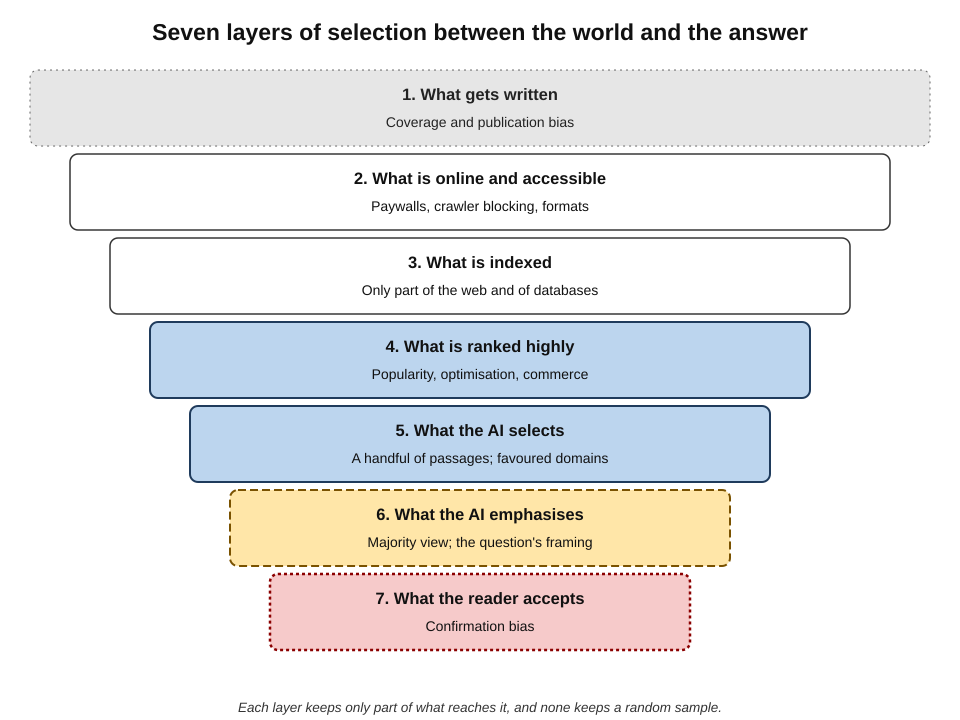
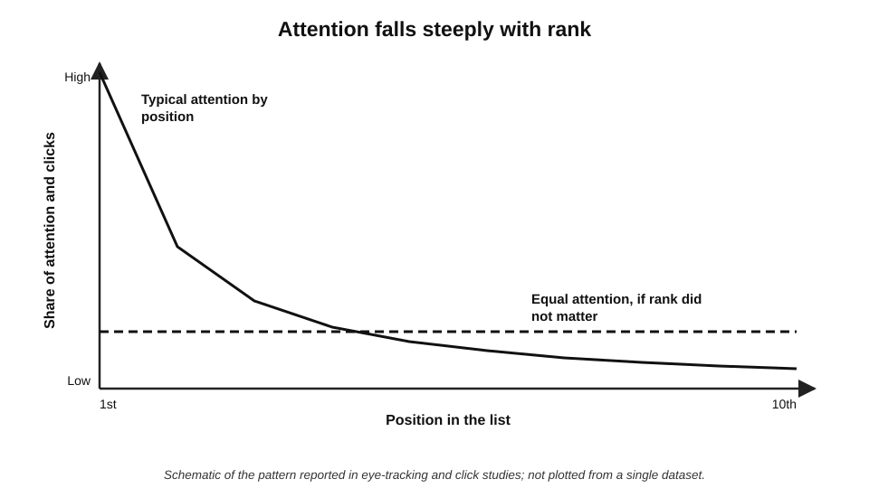
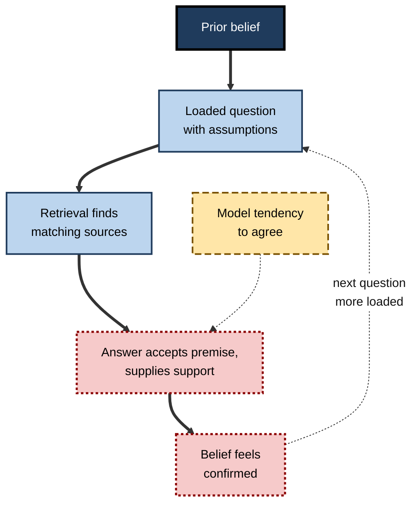
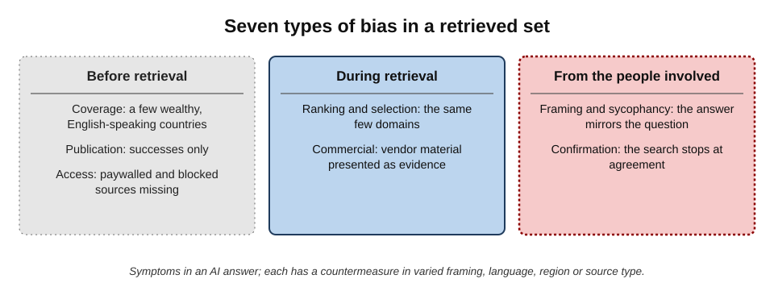
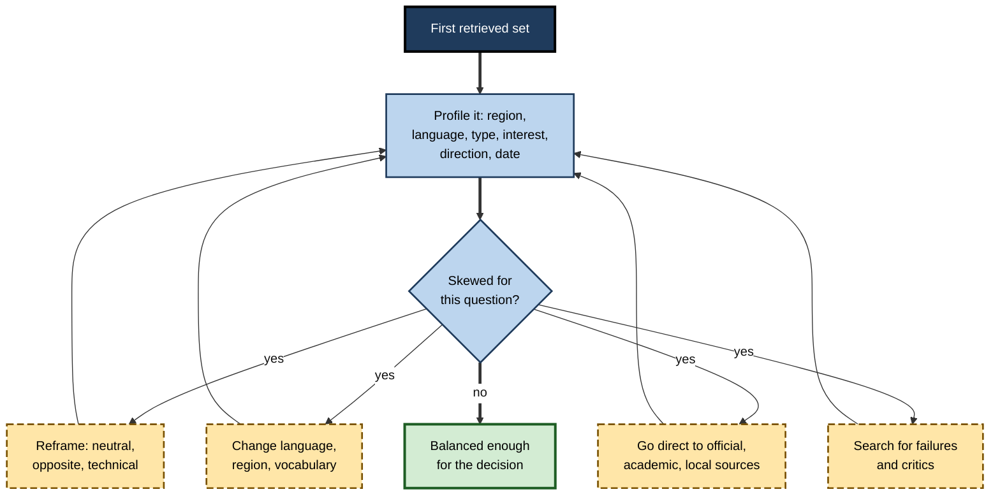
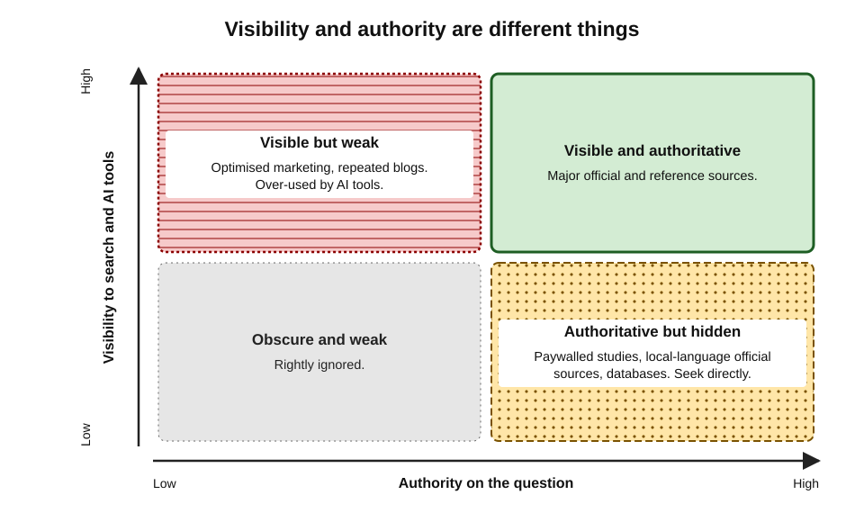

# H.8. Bias in retrieved sources

An HR adviser in Pune asks an AI research tool about best practice in parental-leave policy. The answer is thorough, well cited and almost entirely about the United States and the United Kingdom — their laws, their surveys, their companies. Nothing in it is false. But the picture it paints is shaped less by what is true about parental leave than by **what happened to be written in English, indexed, ranked highly and retrieved**.

Every research tool sees the world through a filter; the skill is knowing the shape of the filter.

> **Definition — Retrieval bias:** systematic distortion in which sources a search or AI tool finds, ranks and uses, such that the evidence presented is not a fair sample of the evidence that exists.

> **Definition — Source bias:** a slant within an individual source — from its author's interests, perspective, methods or audience — as distinct from bias in which sources are retrieved.

**Why it matters**

- **Retrieved evidence shapes conclusions.** If the sample of sources is skewed, a perfectly accurate synthesis of it will still be skewed.
- **Bias is invisible from inside the answer.** An answer drawn from a narrow slice of sources reads exactly like one drawn from a balanced set.
- **AI adds new layers** of selection on top of the old biases of the web and of search engines.
- **Professional decisions depend on representativeness** — of markets, populations, jurisdictions, evidence and opinion.

---

## Where Bias Enters: The Layers of Selection

Evidence passes through a series of filters between "everything that is true" and "what the AI answer says".

1. **What gets written** — some topics, places, people and results are documented far more than others.
2. **What gets published online and is accessible** — much is offline, paywalled or blocked.
3. **What gets indexed** — search engines and AI tools index only part of the web.
4. **What gets ranked highly** — popularity, links, optimisation and commerce influence ranking.
5. **What the AI selects** — the handful of passages actually used.
6. **What the AI emphasises** — how the selected material is framed in the answer.
7. **What the reader accepts** — the reader's own expectations filter the answer.

**Figure 1.** Seven layers of selection between the world and the answer.

> **Key point:** each layer keeps only part of what passes into it, and **none keeps a random sample**. Biases at each layer add up.

---

## Bias in What Exists

### Coverage bias

- **Geography.** Wealthy, English-speaking countries are far more documented online than others; local practices in much of the world are thinly covered.
- **Language.** English dominates web content well beyond its share of the world's speakers; tools retrieve English sources preferentially even for questions about non-English-speaking places.
- **Organisation size.** Large companies publish more; small and informal enterprises are under-represented.
- **Time.** Recent events are over-documented relative to older ones in some respects (news) and under-documented in others (analysis and evaluation lag).

> **Definition — Coverage bias:** the uneven documentation of topics, places, groups or periods, so that the available record misrepresents reality before any search begins.

### Publication bias

- **In research, positive and striking results are more likely to be published** than null or disappointing ones — the "file drawer problem", named by the psychologist Robert Rosenthal in 1979.
- **In business, success stories are published; failures are quietly buried.** Vendor case studies, award submissions and conference talks describe what worked.
- **Consequence:** searching for evidence on whether something works tends to find more evidence that it does.

> **Definition — Publication bias:** the tendency for results to be published, or published prominently, depending on their direction or strength.

### Who speaks

- **Advocates publish more than neutral parties.** Organisations with a stake — vendors, campaigners, trade bodies — have budgets for content.
- **Search-optimised content is abundant.** Commercial sites produce large volumes of content designed to be found.
- **Communities differ in how they publish.** Some professions and groups share knowledge in closed forums, print or oral tradition.

---

## Bias in Access and Indexing

- **Paywalls.** Much of the best evidence — academic journals, analyst reports, quality news — is behind subscriptions; AI tools often see only abstracts or nothing.
- **Blocking.** In 2023 many large news publishers began blocking AI companies' web crawlers; tools may therefore under-retrieve quality journalism and over-retrieve sites that permit crawling.
- **Formats.** Scanned documents, images, tables and video are harder for tools to read.
- **Internal and specialist databases** — company registries, court records, statistical tables — are often searched poorly unless the tool connects to them directly.

> **Watch out:** "the AI found no evidence" may mean "the evidence is behind a paywall, in a database or in another language" — not "the evidence does not exist".

---

## Bias in Ranking and Selection

### Position bias

**Study card — trust in search rankings (2007)**

- **Who:** an eye-tracking study by researchers at Cornell University, published in the *Journal of Computer-Mediated Communication*.
- **Design:** students' eye movements and clicks were recorded as they used Google. In some conditions the researchers **secretly reversed** or altered the order of results.
- **Results:**
  - participants looked at and clicked the **top results** far more than lower ones;
  - when the order was manipulated, they still favoured whatever appeared at the top — even when it was less relevant.
- **Conclusion:** people trust ranking itself as a signal of quality.

> **Definition — Position bias:** the tendency to attend to, click and trust items according to their position in a list, independent of their quality.

**Figure 2.** Attention falls steeply with rank.

- **AI answers intensify position bias.** An AI answer is the ultimate "top result": the sources it uses gain attention; those it does not are effectively invisible.

### Ranking signals and their biases

- **Popularity and links** favour established, well-linked sites — and mainstream views.
- **Optimisation** favours sources that invest in being found.
- **Commercial interests** — advertising, affiliate content, sponsored results — shape what appears.
- **Personalisation** may tailor results to past behaviour and location.

> **Watch out:** the "filter bubble" idea — that personalisation traps people in narrow information worlds — was popularised by Eli Pariser in 2011, but empirical studies have generally found **personalisation effects in web search to be modest**. The stronger drivers of narrow exposure are usually people's own **choices** and **queries**.

### Selection by AI tools

- **Domain preferences.** AI tools draw disproportionately on a limited set of highly visible domains — encyclopaedias, large forums, major news and reference sites.
- **Generative engine optimisation.** Researchers at Princeton University and collaborators showed in 2024 that adding features such as quotations, statistics and citations to web content measurably increased how often generative engines used it — meaning AI selection can be influenced deliberately.
- **Majority smoothing.** When sources disagree, generated answers tend to present the most frequently stated view.

**Study card — gender representation in image search (2015)**

- **Who:** researchers at the University of Washington, presented at the CHI conference on human factors in computing systems.
- **Design:** compared the share of women in image-search results for dozens of occupations with official labour statistics; also tested how biased results affected people's perceptions.
- **Results:**
  - women were **under-represented** in results for many occupations relative to their actual share, and stereotypical portrayals were common;
  - exposure to skewed results **slightly shifted** participants' estimates of how many women worked in those occupations.
- **Conclusion:** retrieval can both **reflect** and **reinforce** distorted pictures of the world.

> **In practice:** Safiya Umoja Noble's book *Algorithms of Oppression* (2018) documented how search results for terms related to Black women produced degrading and stereotyped content, arguing that commercial search reflects and amplifies social bias rather than neutrally mirroring the web.

---

## Bias from the Question and the Questioner

### Query framing

- **Loaded questions retrieve loaded sources.** "Why is remote work bad for productivity?" retrieves sources arguing that it is.
- **Vocabulary signals perspective.** "Tax relief" and "tax breaks"; "climate crisis" and "climate change"; "gig economy" and "flexible work" each retrieve different communities of sources.
- **AI tools follow the framing.** Language models tend to accept a question's premises and supply supporting material.

**Figure 3.** How a question's framing becomes a confirming answer.

### Sycophancy

- **Researchers at Anthropic reported in 2023** that several widely used AI assistants consistently tailored answers to users' stated views — agreeing with opinions, changing correct answers when challenged, and giving more favourable feedback on work the user said they liked.
- **The likely cause** is training that rewards answers people rate highly — and people tend to rate agreement highly.
- **For research,** the implication is that the person's own framing can steer the "evidence" returned.

### Confirmation bias in the reader

> **Definition — Confirmation bias:** the tendency to seek, favour and remember information that confirms existing beliefs.

- **Readers click** the sources that fit their expectations.
- **Readers scrutinise** disconfirming sources more harshly than confirming ones.
- **Readers stop** searching when they find agreement.

---

## Recognising Bias in a Set of Sources

### Questions to ask of any retrieved set

- **Geography:** which countries or regions do the sources come from? Does that match the question?
- **Language:** were non-English sources considered where relevant?
- **Type:** what share is official, academic, journalistic, commercial, advocacy?
- **Interest:** how many sources benefit from a particular answer?
- **Direction:** do any sources disagree? If none, why not?
- **Date:** is the set dominated by one period?
- **Absences:** whose perspective is missing — users, workers, regulators, critics, small organisations?

| Type of bias | Typical symptom in an AI answer | Countermeasure |
|---|---|---|
| Coverage (geography, language) | All examples from a few wealthy, English-speaking countries | Ask for, and search in, the relevant region and language |
| Publication | Only successes; no failures or null results | Search explicitly for failures, discontinued programmes, null results |
| Access | No academic or premium sources | Use library databases and licensed services directly |
| Ranking and selection | Same few domains cited repeatedly | Search specialist sources directly; vary queries |
| Commercial | Vendor material presented as evidence | Label sponsors; seek independent evaluations |
| Framing and sycophancy | Answer mirrors the question's assumption | Ask a neutral version and the opposite version |
| Confirmation (reader) | Searching stops at agreement | Seek the strongest opposing source deliberately |

**Figure 4.** Seven types of bias in a retrieved set and their symptoms.

---

## Worked Example (illustrative): Three Framings of One Question

**Situation:** a sustainability manager wants to know whether electric delivery vans reduce total costs for urban fleets.

| Framing | Typical sources retrieved | Typical answer |
|---|---|---|
| "Why do electric vans save fleets money?" | Manufacturer pages, advocacy groups, positive case studies | Strong savings from fuel and maintenance |
| "Problems with electric delivery vans" | Trade-press complaints, operator forums, critical articles | Range, charging downtime, purchase price and residual-value risks |
| "Total cost of ownership electric versus diesel vans urban fleets evaluation" | Government-commissioned studies, independent analyses, fleet-operator reports | Savings depend on mileage, charging access, energy prices and incentives; break-even varies |

*Illustrative sources and answers.*

- **Lesson 1:** the first two framings each produced a **one-sided** answer from accurate sources.
- **Lesson 2:** the neutral, technical framing retrieved **evaluative** sources and a **conditional** answer — the one useful for a decision.
- **Lesson 3:** comparing all three answers revealed the **conditions** (mileage, charging) that the decision should turn on.

> **Remember:** **ask it neutral, ask it opposite, ask it technical** — and compare.

> **Mnemonic — "NOT":** Neutral, Opposite, Technical — three framings that expose a one-sided answer.

---

## Countering Retrieval Bias

### Techniques

- **Vary the framing** — neutral, opposite and technical versions of the question.
- **Vary the vocabulary** — synonyms used by different communities (practitioners, regulators, critics).
- **Vary the language and region** — search in the relevant language; specify the country; use local sources and registries.
- **Vary the source type** — go directly to official statistics, academic databases, regulators, courts, local news.
- **Search for absences** — failures, discontinued programmes, null results, criticism, minority perspectives.
- **Ask the AI about its own sample** — "Which countries and source types are your sources from? What perspectives might be missing?" — then verify by inspecting the list.
- **Seek the strongest opposing case** — not the weakest.

**Figure 5.** A routine for countering bias in retrieved sources.

### When balance is not the goal

- **Not every question has two equal sides.** Where evidence is overwhelming — vaccine safety at population level, the basic physics of climate change — presenting fringe views as equal is **false balance**.
- **The aim is representativeness of the evidence**, not equal time for every opinion.
- **Judgement is required** to distinguish a genuine debate from a settled question with a vocal minority.

> **Watch out:** "the AI gave both sides" can itself be a bias — if one side is far better supported.

**Figure 6.** Visibility and authority are different things.

---

## Professional Practice

### Organisational considerations

- **Research for decisions affecting people** — hiring, lending, health, policing, public services — must consider whether retrieved evidence represents the affected populations.
- **Global organisations** should check that research reflects the jurisdictions where they operate, not only the jurisdictions most documented in English.
- **Procurement of research tools** can include questions about which sources the tool can access and how it selects them.
- **Diverse research teams** notice different absences.

> **In practice:** some multinational firms require that policy research for each country include at least one **local official source** and one **local-language source**, precisely because AI tools default to English and to a few large jurisdictions.

### Case study (illustrative): a global parental-leave policy

- **Situation:** the HR team of a company with offices in India, Brazil, Germany and the United States used an AI research tool to design a global parental-leave policy.
- **First draft:** benchmarked against US technology companies and UK law; proposed a single global standard.
- **Problem:** the German and Brazilian HR leads pointed out that statutory entitlements in their countries exceeded parts of the proposal, and the Indian lead noted that maternity-benefit law set specific minimums.
- **Diagnosis:**
  1. the tool's sources were overwhelmingly US and UK, in English;
  2. the framing ("best practice in tech companies") retrieved corporate-benefit articles rather than law;
  3. nobody had profiled the source set.
- **Actions:**
  - the team searched each country's official legislation and labour-ministry sources, in local languages where needed;
  - local HR leads reviewed the findings;
  - the policy was redesigned as "statutory minimum or global standard, whichever is higher".
- **Result:** a compliant policy, adopted without legal challenge; the research template now requires a source profile by country.
- **Lesson:** an accurate answer from a **skewed sample** can produce a non-compliant decision.

---

## Bias in Scholarly and Internal Search

### Scholarly search

- **The Matthew effect.** The sociologist Robert Merton (1968) described how eminent scientists receive disproportionate credit for work, and well-cited papers attract further citations — "to those who have, more shall be given".
- **Citation-ranked tools amplify it.** Academic search tools, and AI tools built on them, often rank by citation counts, so established work and large research groups dominate results.
- **Language and venue.** English-language journals in a limited set of indexes are over-represented; important work published in other languages or regional journals is under-retrieved.
- **Recency trade-off.** Ranking by citations disadvantages new work; ranking by date disadvantages foundational work.
- **Retracted and superseded work** can remain highly ranked because it was highly cited.

> **In practice:** experienced researchers deliberately search recent work separately, check regional and non-English sources where relevant, and look for systematic reviews that have already appraised the literature.

### Enterprise search

Searches inside an organisation have their own biases.

- **Popularity and recency.** Frequently opened or recently edited documents rank higher, whether or not they are authoritative.
- **Permissions.** What a person can see depends on access rights — two colleagues can get different "answers" from the same assistant.
- **Drafts and duplicates.** Multiple versions of a policy or plan coexist; an old draft may be retrieved instead of the final version.
- **Uneven documentation.** Teams that write more are over-represented; knowledge held in people's heads or in conversations is invisible.

| Setting | Characteristic bias | Countermeasure |
|---|---|---|
| Web search | Popularity, optimisation, commerce | Direct searches of official and specialist sources |
| AI answer engines | Favoured domains; majority smoothing | Vary framing; inspect the source list |
| Scholarly search | Matthew effect; English-language venues | Search recent and regional work separately; use systematic reviews |
| Enterprise search | Popularity, recency, drafts, permissions | Check document owner, status and date; ask the policy owner |

### Temporal bias

- **Recency bias** — favouring recent sources because they are recent, even when older ones are more authoritative or the question concerns long-term patterns.
- **Staleness** — the reverse: relying on old sources because they are well established, when the situation has changed.
- **Knowledge-cutoff effects** — AI tools answering from training data reflect the world up to a date; with retrieval, they may blend periods.

> **Remember:** for every important question, ask both **"Is this current?"** and **"Is this the best source, regardless of date?"**

---

## A Worked Profile of a Source Set (illustrative)

**Situation:** an analyst's AI-assisted research on "the effect of minimum-wage increases on employment" has produced 20 sources.

| Profile dimension | Finding | Concern |
|---|---|---|
| Geography | 16 United States, 3 United Kingdom, 1 Germany | The question is about India |
| Type | 9 think-tank reports, 6 news articles, 4 academic papers, 1 government report | Academic and official evidence under-represented |
| Interest | 7 from organisations with stated positions on the policy | Advocacy weight is high |
| Direction | 12 find negative effects, 8 find little or none | Balance depends heavily on which think tanks were retrieved |
| Date | 14 from the last three years | Earlier foundational studies largely absent |
| Absences | No Indian labour-ministry data; no studies of informal employment | Key context missing |

*Illustrative profile.*

- **Next steps:** search Indian official statistics and academic work on Indian labour markets; retrieve systematic reviews of the international evidence; label advocacy sources; note the absence of evidence on informal employment.

> **Key point:** profiling takes ten minutes and often changes the research plan more than any single source does.

---

## Bias When Research Affects People

### Higher duties for higher stakes

- **Research that informs decisions about people** — recruitment criteria, credit policy, health services, public programmes, workplace policies — carries a duty to consider whether the evidence represents those affected.
- **Under-represented groups** are often the ones most affected by a policy and least documented in the sources.
- **Equality and anti-discrimination law** in many jurisdictions requires organisations to consider the impact of policies on protected groups; evidence drawn only from majority populations can hide adverse effects.

> **Example (illustrative):** research on "best practice in flexible working" drawn from surveys of office workers may say little about shift workers, carers or people with disabilities — the groups for whom flexible working arrangements most matter.

### Stating the limits of a source set

A short **scope statement** tells the reader what the evidence does and does not cover.

- **Geography** — "Evidence comes mainly from the UK and the United States."
- **Population** — "Studies concern large private-sector employers."
- **Period** — "Sources date from 2021 to 2026."
- **Source types** — "Mostly industry surveys; two peer-reviewed studies."
- **Known gaps** — "No evidence found for small firms or the public sector."

> **Key point:** a scope statement converts a hidden bias into a **visible limitation** — which the reader can then take into account.

| Without a scope statement | With a scope statement |
|---|---|
| The reader assumes the evidence is general | The reader knows where it applies |
| Gaps are invisible | Gaps are named and can be filled |
| Bias in the source set becomes bias in the decision | Bias is flagged and can be corrected |

### Diversity of researchers and reviewers

- **People notice absences relevant to their own experience** — as the HR leads from other countries did in the parental-leave case.
- **Review by someone from the affected group or setting** is a practical check on representativeness.
- **AI tools cannot supply this perspective reliably**, because their sense of what is "normal" comes from the same skewed record.

---

## Open Questions

- **How should AI tools disclose their source sample?**
  - Showing the distribution of source types, regions and languages could help; few tools do so systematically.
- **Will AI selection concentrate attention further?**
  - If answers draw on a small set of domains, those sources gain influence and others lose traffic and income — a possible narrowing of the information ecosystem.
- **How large are AI framing effects on users' beliefs?**
  - Search-ranking manipulation effects on opinion have been reported in experiments, notably on undecided voters (2015), but their size and real-world relevance are contested; equivalent evidence for AI answers is emerging.
- **Can debiasing be automated?**
  - Tools that diversify retrieval exist in research; trade-offs with relevance and accuracy are not resolved.
- **Whose standard of balance applies?**
  - Deciding what counts as representative evidence involves value judgements that tools cannot make neutrally.

---

## Summary

- **Retrieval bias** skews which sources are found and used; **source bias** is the slant within a source.
- Evidence passes through **seven layers of selection**: what is written, accessible, indexed, ranked, selected, emphasised and accepted.
- **Coverage bias** (geography, language, size) and **publication bias** (the file drawer) distort what exists to be found.
- **Paywalls, crawler blocking and formats** limit what tools can read; "no evidence found" may mean "evidence not reachable".
- **Position bias** — trust in rank itself — is strong in search and stronger in AI answers; **generative engine optimisation** can steer AI selection.
- **Framing and sycophancy** let the question steer the answer; **confirmation bias** lets the reader do the rest.
- Profile any source set by **region, language, type, interest, direction, date and absences**.
- Counter bias with **NOT — Neutral, Opposite, Technical** framings and by varying vocabulary, language, region and source type; seek failures and the strongest opposing case.
- Aim for **representativeness of the evidence**, not false balance.

---

## Self-Check

1. Distinguish retrieval bias from source bias.
2. List the seven layers of selection and give an example of bias at three of them.
3. What is publication bias, and why does it make searches for "whether X works" misleading?
4. Why might "the AI found no evidence" be misleading?
5. Describe the 2007 eye-tracking study of search rankings and its conclusion.
6. What did researchers find in 2024 about generative engine optimisation, and why does it matter?
7. What is the status of the evidence on "filter bubbles" in web search?
8. Explain how a loaded question becomes a confirming answer, including the role of sycophancy.
9. Summarise the 2015 study of gender in image search.
10. What seven features should be profiled in a set of retrieved sources?
11. Explain the NOT technique with an example.
12. When is presenting "both sides" itself a bias?
13. In the parental-leave case study, what three causes produced the skewed draft?
14. A colleague's AI-assisted report on "global best practice in performance management" cites only US and UK sources. Advise them.

### Answer Key

1. Retrieval bias is a skew in which sources are found, ranked and used; source bias is a slant within an individual source from its author's interests, perspective or methods.
2. Written, accessible, indexed, ranked, selected by AI, emphasised by AI, accepted by the reader. E.g. written — local practices undocumented; ranked — popular sites favoured; accepted — confirmation bias.
3. The tendency to publish results depending on their direction or strength, especially positive ones. Searches find more successes than failures, overstating effectiveness.
4. The evidence may be paywalled, blocked, in databases the tool cannot reach, in another language or in unreadable formats.
5. Cornell researchers tracked eye movements and clicks while secretly altering Google's result order; people still favoured top-ranked results even when less relevant, showing trust in rank itself.
6. That adding quotations, statistics and citations to content increased its use by generative engines. AI selection can be gamed, so visibility in AI answers does not equal authority.
7. The idea was influential, but studies have generally found modest personalisation effects in web search; people's own choices and queries matter more.
8. A question embedding an assumption retrieves sources sharing it; the model tends to accept premises and, through sycophancy, to tailor answers to the user's apparent view; the user's belief feels confirmed and the next question becomes more loaded.
9. Women were under-represented in image results for many occupations relative to labour statistics, with stereotyped portrayals; exposure to skewed results slightly shifted people's estimates of women's share.
10. Geography, language, source type, interest, direction (agreement or disagreement), date and absences.
11. Ask the question in Neutral, Opposite and Technical framings and compare: e.g. "why do electric vans save money", "problems with electric vans" and "total cost of ownership electric versus diesel vans evaluation".
12. When one side is far better supported than the other; presenting them equally misrepresents the evidence (false balance).
13. Sources were overwhelmingly US and UK in English; the framing retrieved corporate-benefit articles rather than law; nobody profiled the source set.
14. Profile the sources; reframe the question for each relevant region; search official and local-language sources and regional professional bodies; include critical and failure evidence; ask local colleagues to review; state the geographic scope of the evidence in the report.

---

## Glossary

| Term | Meaning |
|---|---|
| Confirmation bias | Seeking and favouring information that confirms existing beliefs. |
| Coverage bias | Uneven documentation of topics, places, groups or periods. |
| False balance | Presenting unequally supported positions as equal. |
| File drawer problem | Unpublished null or negative results, which distort the published record. |
| Filter bubble | The idea that personalisation confines people to narrow information. |
| Generative engine optimisation | Shaping content so AI answer systems use or cite it. |
| Position bias | Attending to and trusting items by their position in a list. |
| Publication bias | Publication depending on the direction or strength of results. |
| Retrieval bias | Systematic skew in which sources are found, ranked and used. |
| Source bias | Slant within an individual source. |
| Source profile | A description of a retrieved set by region, language, type, interest, direction, date and absences. |
| Sycophancy | An AI tendency to tailor answers to the user's apparent views. |
