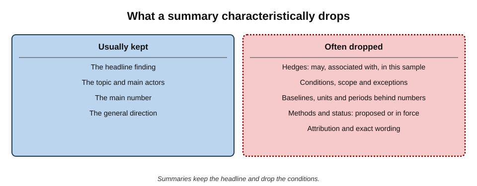
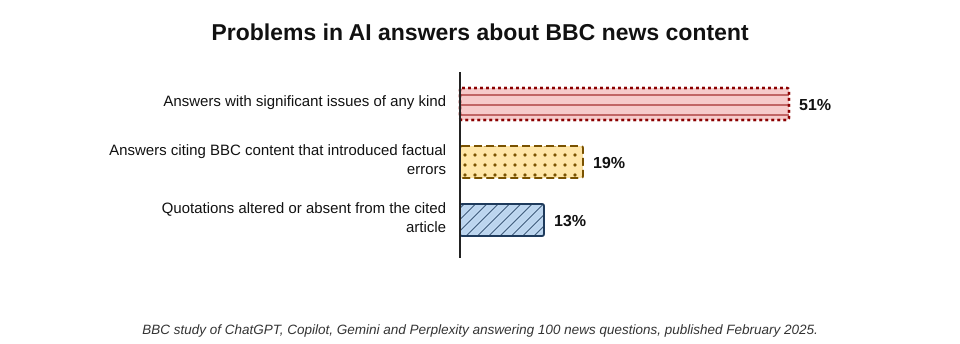
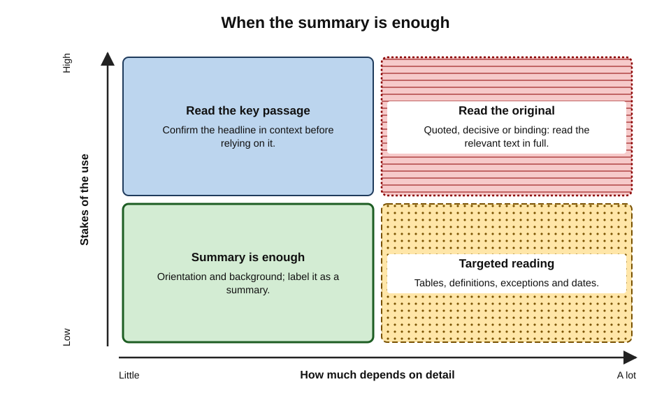
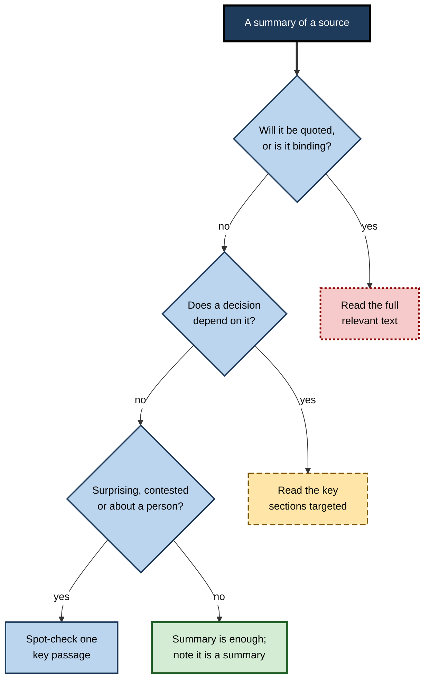
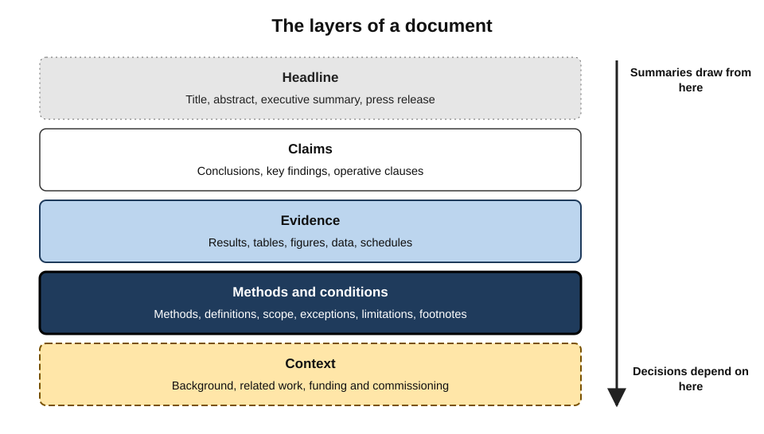

# H.9. Knowing when to read the original

A product manager reads an AI summary of a new clinical study: "Daily use of the supplement reduced the risk of heart disease by 30%." She shares it with her team as evidence for a product idea. The study itself says something narrower: in a group of men over sixty with a specific deficiency, the supplement was associated with a 30% reduction in one **secondary** outcome, the result was not statistically robust after adjustment, and the authors call for a trial.

Every word of the summary could be traced to the paper. Its **meaning** could not.

> **Definition — Original source:** the document in which information was first recorded or published by those responsible for it — the study, the statute, the contract, the filing, the transcript, the dataset — as opposed to summaries, reports or AI restatements of it.

> **Definition — Summary gap:** the difference in meaning between an original and a summary of it, arising from what the summary omits, compresses, generalises or changes.

**Why it matters**

- **AI makes summaries effortless,** so originals are opened less often than ever.
- **Summaries are lossy by design.** What they drop — conditions, caveats, methods, exceptions — is often what decides whether a finding applies.
- **Professional accountability attaches to originals.** A contract binds by its text, a regulation by its wording, a study by its results — not by anyone's summary.
- **Reading everything is impossible.** The skill is **judging when** the original is needed and **reading it efficiently**.

---

## What Summaries Lose

### Systematic losses

- **Hedges and certainty** — "may", "was associated with", "in this sample" become "does", "causes", "in general".
- **Conditions and scope** — who, where, when, under what circumstances.
- **Exceptions and carve-outs** — "except where…", "unless…", "subject to…".
- **Numbers and their meaning** — relative versus absolute change; units; denominators; time periods.
- **Methods** — how something was found, which determines how far it can be trusted.
- **Status** — draft versus final; proposed versus in force; primary versus secondary outcome.
- **Attribution and voice** — whose view is being reported; whether the author endorses it.
- **Exact wording** — quotations, defined terms, legal language where one word changes the obligation.

**Figure 1.** What a summary characteristically drops.

> **Key point:** summaries tend to keep the **headline** and drop the **conditions**. In professional work, the conditions are usually what matters.

### Relative and absolute numbers

> **Formula — Relative and absolute risk reduction:** if a risk falls from 2% to 1.4%, the **relative** reduction is (2 − 1.4) ÷ 2 = **30%**; the **absolute** reduction is 2 − 1.4 = **0.6 percentage points** — about six fewer cases per thousand people. *Illustrative figures.*

- A summary that reports "30% lower risk" is accurate and still misleading without the baseline.
- The original's results table nearly always shows both.

### The evidence on AI summaries

**Study card — BBC study of AI assistants and news (February 2025)**

- **Design:** BBC journalists put 100 questions about the news to four AI assistants — ChatGPT, Copilot, Gemini and Perplexity — asking them to use BBC News sources where possible; expert journalists rated the answers.
- **Results:**
  - **51%** of answers were judged to have **significant issues** of some kind;
  - **19%** of answers that cited BBC content introduced **factual errors** — incorrect statements, numbers or dates;
  - **13%** of quotations attributed to BBC articles were **altered** from the original or **not present** in the article cited.
- **Conclusion:** even when a tool cites the original, its restatement can change the facts, the numbers and the words.
- **Follow-up:** a larger international study led by the BBC and the European Broadcasting Union later in 2025 found significant issues in 45% of answers, with sourcing the largest problem.

**Figure 2.** Problems found in AI assistants' answers about BBC news content (February 2025).

**Study card — generalisation in AI summaries of science (2025)**

- **Published in:** *Royal Society Open Science* (2025).
- **Design:** researchers compared thousands of summaries of scientific abstracts and articles produced by several widely used language models with the original texts and with summaries written by experts.
- **Results:**
  - most models produced summaries containing **broader generalisations** than the original findings supported — for example, turning a past-tense finding in a specific sample into a present-tense general claim;
  - model summaries were **substantially more likely** to overgeneralise than expert-written summaries;
  - some newer models overgeneralised **more**, not less, and prompts asking for accuracy did not reliably prevent it.
- **Conclusion:** overgeneralisation is a systematic tendency of AI summarisation of research, not an occasional slip.
- **Caveat:** results varied by model and setting; models change rapidly.

> **Watch out:** a summary's errors are not random — they lean towards **certainty**, **generality** and **simplicity**, which are the directions that make findings seem more applicable than they are.

---

## Why People Skip the Original

- **Time.** Originals are long; summaries are short.
- **Fluency.** A clear summary feels like understanding.
- **Illusion of knowing.** Having read about something feels like having read it.
- **Trust in the tool.** Accurate summaries in the past build confidence that carries over.
- **Social proof.** Others are citing the summary too.

**Study card — searching and the illusion of knowledge (2015)**

- **Who:** psychologists at Yale University, published in the *Journal of Experimental Psychology: General*.
- **Design:** participants who had just searched the internet for explanations of everyday phenomena were then asked to rate how well they could explain **unrelated** topics, compared with participants who had not searched.
- **Results:** those who had searched rated their own knowledge **higher**, even for topics they had not searched — as if access to information felt like possessing it.
- **Conclusion:** easy access to external information can inflate people's sense of their own understanding.
- **Relevance:** reading an AI summary may make a person feel they know the original — and therefore feel no need to read it.

> **Definition — Illusion of explanatory depth:** the tendency to believe one understands something in more detail than one actually does, revealed when asked to explain it step by step.

---

## When to Read the Original

### Triggers

Read the original when **any** of these apply:

- **It will be quoted.** Quotations must be exact and in context.
- **It is decisive.** The conclusion, decision or advice depends on it.
- **It is binding.** Contracts, statutes, regulations, policies, terms and conditions, court orders.
- **It contains numbers that will be used.** Figures, thresholds, rates, dates, sample sizes.
- **It is surprising.** A finding that contradicts expectation or prior evidence.
- **It is contested.** Others interpret it differently.
- **It concerns a person.** Statements about individuals' actions, views or conduct.
- **It is in the reader's own field.** Professionals are expected to know the primary literature of their specialism.
- **It will leave the organisation** — in a publication, a client deliverable, a filing.

> **Mnemonic — "QDB, the Quick Decision Box":** **Q**uoted, **D**ecisive, **B**inding — if a source falls in the box, open it.

> **Remember:** **quoted, decisive or binding → read the original.**

**Figure 3.** When the summary is enough and when the original is needed.

### When a summary is enough

- **Orientation** — deciding what to read.
- **Background** — facts that change nothing in the conclusion.
- **Low-stakes, reversible decisions.**
- **Material outside the person's responsibility,** where a specialist will read the original.

**Figure 4.** A decision path for reading the original.

---

## Reading Originals Efficiently

Reading the original does not mean reading every word. Skilled readers go to the parts that carry the weight.

### The anatomy of a document

- **Headline layer** — title, abstract, executive summary, press release.
- **Claim layer** — conclusions, key findings, operative clauses.
- **Evidence layer** — results, tables, figures, data, schedules.
- **Method and condition layer** — methods, definitions, scope, exceptions, limitations, footnotes.
- **Context layer** — background, related work, who funded or commissioned it.

**Figure 5.** The layers of a document: summaries draw on the top; decisions depend on the lower layers.

> **Key point:** AI summaries are drawn mostly from the **headline and claim layers**. The original is needed for the **evidence** and **conditions** layers.

### Targeted reading by document type

| Document | Read first | Then check | Common summary distortion |
|---|---|---|---|
| Research paper | Abstract; main results table or figure | Methods (sample, design), limitations, primary versus secondary outcomes, funding | Overgeneralisation; relative numbers without baselines |
| Statute or regulation | Definitions; the operative section | Exceptions, commencement date, territorial scope, schedules | "Must" versus "may"; omitted exceptions |
| Contract | Obligations and rights of each party | Definitions, conditions precedent, limitation of liability, termination, schedules | Carve-outs dropped; defined terms read in ordinary sense |
| Company accounts | Primary statements | Notes, segment information, auditor's report, post-balance-sheet events | Adjusted figures presented as statutory ones |
| Policy or guidance | Scope; effective date; mandatory requirements | Transitional provisions; guidance versus rule | Guidance presented as binding, or the reverse |
| News report | Date; who is quoted; on what basis | Corrections; the underlying document | Speculation reported as fact |

**Figure 6.** Targeted reading paths for three kinds of original.

```mermaid
%%{init: {'theme':'base','themeVariables':{'fontFamily':'Arial, Helvetica, sans-serif','fontSize':'15px','primaryColor':'#FFFFFF','primaryTextColor':'#111111','primaryBorderColor':'#222222','lineColor':'#333333','secondaryColor':'#F2F2F2','tertiaryColor':'#FFFFFF','clusterBkg':'#FAFAFA','clusterBorder':'#555555','edgeLabelBackground':'#FFFFFF','titleColor':'#111111'}}}%%
flowchart TD
    classDef key     fill:#BCD5EE,stroke:#1F3B5C,stroke-width:2px,color:#000000
    classDef accent  fill:#FFE6A8,stroke:#7A5200,stroke-width:2px,stroke-dasharray:8 4,color:#000000
    classDef good    fill:#D3ECD3,stroke:#1E5E24,stroke-width:3px,color:#000000

    subgraph STUDY["Research paper"]
        S1["Abstract"] --> S2["Main results table"] --> S3["Methods and sample"] --> S4["Limitations and funding"]
    end
    subgraph LAW["Statute or regulation"]
        L1["Definitions"] --> L2["Operative section"] --> L3["Exceptions and scope"] --> L4["Commencement date"]
    end
    subgraph CONTRACT["Contract"]
        C1["Obligations"] --> C2["Defined terms"] --> C3["Liability and termination"] --> C4["Schedules"]
    end

    class S1,L1,C1 key
    class S2,L2,C2 key
    class S3,L3,C3 accent
    class S4,L4,C4 good
```

### Techniques

- **Use the AI to navigate, not to replace.** "Where in this document are the exceptions to clause 4?" then read them.
- **Search within the document** for key terms: "except", "unless", "subject to", "limitation", "primary outcome", "adjusted".
- **Read the table, not the text about the table.** Numbers in tables are less often distorted than numbers in prose.
- **Read definitions first** in legal and technical documents — they change the meaning of everything else.
- **Check the date and version** before anything else.

> **In practice:** many lawyers use AI to locate relevant clauses in long contracts, then read every located clause in full — the AI saves time in finding, not in reading.

---

## Worked Example (illustrative): A Summary Against Its Original

**Situation:** an HR director receives an AI summary of a government report on flexible working: *"Flexible working increases productivity and is now a legal right for all employees from day one."*

| Element | Summary | Original (illustrative) |
|---|---|---|
| Productivity claim | "Increases productivity" | "Employers in the survey **reported** productivity benefits; the survey did not measure productivity directly" |
| Legal right | "A legal right… from day one" | Employees may **request** flexible working from day one; employers may refuse on specified business grounds |
| Scope | "All employees" | Employees; not all workers, such as some agency staff |
| Status | Present tense | Describes the law **from a stated commencement date** |

*Illustrative example.*

- **Analysis:** the summary converted a **right to request** into a **right to have**, and **reported** benefits into **measured** ones.
- **Consequence avoided:** a policy promising flexible working as of right would have created obligations the law does not impose — or raised expectations the firm could not meet.

> **Watch out:** in legal and policy material, one word — "request", "may", "reasonable", "subject to" — can reverse the practical meaning. Summaries routinely drop it.

---

## Professional Practice

### Habits

- **Label summaries as summaries** in notes and drafts: "per AI summary, not verified".
- **Never quote from a summary.** Quotations come from the original or not at all.
- **Keep the original to hand** — saved or linked — for anything relied upon.
- **Read the original of anything in your own specialism** that changes practice.
- **Set a personal threshold** — for example, "any figure going into a client deliverable is read in the original table".

### Organisational standards

- **Review processes** that ask: "Has the original of each decisive source been read?"
- **Templates** that record which sources were read in full and which were summarised.
- **Training** on targeted reading for common document types.
- **Access** — licences to journals, databases and legal services, so that originals can be reached.

### Case study (illustrative): the indemnity clause

- **Situation:** a procurement manager used an AI assistant to summarise a 60-page supplier contract before signature.
- **Summary:** "The supplier indemnifies the customer for all losses arising from data breaches."
- **Problem:** a junior lawyer asked to "just check the summary" decided to read the indemnity clause itself.
- **Findings in the original:**
  1. the indemnity applied only to breaches "caused by the Supplier's gross negligence";
  2. it was capped at the fees paid in the previous twelve months;
  3. a defined term, "Data Breach", excluded incidents involving the customer's own systems.
- **Actions:** the clause was renegotiated to cover negligence, with a higher cap; the firm adopted a rule that liability, indemnity and termination clauses are always read in full by a person.
- **Result:** six months later a breach at a sub-processor was covered under the renegotiated clause.
- **Lesson:** the summary was not false — the supplier did indemnify for data breaches — but the **conditions** reversed its practical meaning.

---

## Reading Numbers in the Original

Numbers are where summaries most often mislead and where originals most repay attention.

### Six questions to ask of any number

- **What is the denominator?** Per person, per household, per firm, per transaction, per year?
- **What is the baseline?** A change from what, measured when?
- **How big is the sample?** A percentage from 40 respondents means less than one from 40,000.
- **How uncertain is it?** Is there a range, confidence interval or margin of error?
- **Is it adjusted?** For inflation, seasonality, population, other factors — and is the adjusted or unadjusted figure being quoted?
- **Is it the main result?** Or a subgroup, secondary outcome or exploratory analysis?

> **Definition — Confidence interval:** a range, calculated from sample data, that indicates the precision of an estimate; a wide interval signals that the true value could lie far from the headline figure.

> **Formula — Reading an interval (illustrative):** a survey reports average salary growth of 4.0% with a 95% confidence interval of 1.5% to 6.5%. The headline "4%" is compatible with growth as low as 1.5% — a very different story for a pay negotiation. *Illustrative figures.*

### Statistical and practical significance

- **Statistically significant** means a result is unlikely to be due to chance alone, given the study's assumptions — not that it is large or important.
- **Practically significant** means large enough to matter for the decision.
- **Summaries often blur the two:** "a significant improvement" may be statistically detectable but trivially small.

### Subgroups and secondary outcomes

- **Studies measure many things.** The more outcomes and subgroups examined, the more likely some show striking results by chance.
- **Summaries favour striking results** — which are disproportionately likely to be subgroup or secondary findings.
- **In the original,** check whether the quoted result was **pre-specified** as the main question.

| What the summary says | What to check in the original | Why |
|---|---|---|
| "Cut risk by 30%" | Absolute risks in both groups | Relative figures exaggerate small absolute changes |
| "Significant effect" | Effect size and confidence interval | Significance is not importance |
| "Works for older adults" | Whether this was a pre-specified subgroup | Unplanned subgroups often fail to replicate |
| "Productivity rose" | How productivity was measured | Self-report differs from output measures |
| "Average pay is £42,000" | Mean or median; who is included | Means are pulled up by high earners |

---

## Originals in Other Languages

- **Official versions matter.** For laws, contracts and regulatory documents, the authoritative text is in the official language(s); translations — including official ones — may carry disclaimers.
- **Machine translation is a navigation aid.** It is usually good enough to find the relevant section and understand its gist; decisive wording should be checked with a qualified reader where stakes are high.
- **Terms of art do not translate cleanly.** Legal and technical terms may have no exact equivalent; a translation can silently change scope.
- **AI summaries of foreign-language sources** add a second layer of loss: translation and compression together.

> **Watch out:** a summary of a translation of a legal text is two steps from the original. For anything binding, go back to the official-language text.

---

## Originals That Are Data

- **Read the table title, notes and footnotes** — definitions, exclusions and breaks in series live there.
- **Check the release and revision status** — provisional figures are often revised.
- **Check units and scaling** — thousands, millions, index values, percentages, percentage points.
- **Check the geography and period** of every column.
- **Download rather than copy** where possible, keeping the file with its source and date.

> **In practice:** analysts in statistics-heavy roles commonly keep a habit of reading the **methodology note** of any dataset before using a figure from it for the first time — five minutes that prevent the most common misuses.

---

## Reading the Original Under Time Pressure

Reading the original need not take long. A disciplined ten-minute approach covers most professional needs.

1. **Minute 1 — identify.** Confirm it is the right document: title, author or issuer, date, version.
2. **Minutes 2–3 — locate.** Use the contents page, headings or a search within the document for the relevant section; AI can help find it.
3. **Minutes 4–7 — read the decisive passage** in full, with the paragraphs either side.
4. **Minute 8 — check conditions.** Definitions, exceptions, scope, dates, units.
5. **Minute 9 — compare** with the summary or claim being relied on.
6. **Minute 10 — record** the pinpoint, the date and any difference from the summary.

> **Remember:** **identify, locate, read, condition, compare, record** — ten minutes that convert a summary into evidence.

### Prioritising when there are many originals

- **Rank by consequence.** Read first the originals behind the claims a decision rests on.
- **Read one, sample the rest.** For a set of similar sources, read the strongest in full and spot-check the others.
- **Delegate within the team** — specialists read the originals in their field.
- **Accept and label** what cannot be read in the time: "based on summaries; originals not reviewed".

| Situation | Minimum reading of originals |
|---|---|
| Internal background note | None required; label summaries as such |
| Recommendation to a manager | Originals behind each decisive claim, targeted |
| Client deliverable | Originals behind each decisive claim and every quotation |
| Legal, regulatory or published work | Every cited original, in the relevant passages |

### Signs that a summary cannot be trusted for this purpose

- **The summary is very confident about something contested.**
- **It contains numbers with no denominators or baselines.**
- **It uses absolute words** — "all", "always", "never", "proves", "guarantees".
- **It reports a rule** without its exceptions or commencement date.
- **It quotes** without a page, paragraph or timestamp.

> **Watch out:** these signs justify opening the original — but their absence does not justify skipping it when the material is **quoted, decisive or binding**.

---

## Open Questions

- **Can AI summaries preserve conditions reliably?**
  - Instructions to retain hedges and exceptions help, but research on scientific summaries suggests the tendency to generalise persists.
- **Will people lose the ability to read long documents?**
  - Concerns about declining sustained reading predate AI; whether AI summarisation accelerates the decline is unknown.
- **What should professional standards require?**
  - Some professions specify reading of primary authorities; whether such standards will extend to AI-summarised material is being debated.
- **Can summaries show what they omit?**
  - Interfaces that flag omitted exceptions or link each sentence to its source passage are being developed; their effect on reading behaviour is untested.
- **Who bears the cost of reading?**
  - If summaries reduce traffic to originals, the producers of primary material may lose the revenue that funds it.

---

## Summary

- The **original source** is the document where information was first recorded by those responsible; the **summary gap** is the meaning lost between original and summary.
- Summaries lose **hedges, conditions, exceptions, number context, methods, status, attribution and exact wording** — they keep the headline and drop the conditions.
- Relative figures without **baselines** mislead; the original's tables show both.
- The **BBC study (2025)** found factual errors in 19% of AI answers citing BBC content and altered or missing quotations in 13%; research summaries by AI tend to **overgeneralise**.
- Easy access to information inflates people's sense of their own knowledge (**illusion of explanatory depth**).
- Read the original when it is **quoted, decisive or binding** — and when numbers, surprises, contests, people, one's own field or external outputs are involved.
- Read efficiently by **document layers** and **document type**: definitions, operative text, results tables, methods, exceptions, dates.
- Use AI to **navigate** originals, not to replace them.

---

## Self-Check

1. Define the original source and the summary gap.
2. List six kinds of information summaries characteristically lose.
3. A summary says a drug "cut risk by 50%". What must be checked in the original, and why?
4. Summarise the BBC's February 2025 findings.
5. What did the 2025 research on AI summaries of science find, and in which direction do summary errors lean?
6. Describe the 2015 Yale study on searching and knowledge, and its relevance to AI summaries.
7. State the three main triggers for reading the original, and four further triggers.
8. When is a summary enough?
9. Describe the layers of a document and which ones AI summaries draw on.
10. What should be read first and then checked in a statute and in a research paper?
11. How can AI help with reading originals without replacing them?
12. In the flexible-working example, what two distortions did the summary contain?
13. In the indemnity case study, what three conditions did the summary omit?
14. A colleague's board paper quotes a regulator's guidance from an AI summary. What should be done?

### Answer Key

1. The original is the document where information was first recorded or published by those responsible for it; the summary gap is the difference in meaning between an original and its summary.
2. Hedges and certainty; conditions and scope; exceptions; numbers' context (baselines, units, periods); methods; status; attribution; exact wording.
3. The baseline (absolute risk), the population, whether it was a primary outcome, the study design and statistical robustness. A 50% relative reduction can be a tiny absolute change in a narrow group.
4. In answers to 100 news questions from four assistants, 51% had significant issues; 19% of answers citing BBC content introduced factual errors; 13% of quotations were altered or absent from the cited article.
5. Model summaries were substantially more likely than expert summaries to generalise beyond the original findings; some newer models did so more. Errors lean towards certainty, generality and simplicity.
6. People who had searched the internet rated their knowledge of unrelated topics higher, suggesting access feels like knowledge. Reading a summary may create a feeling of knowing the original, reducing the felt need to read it.
7. Quoted, decisive, binding; also numbers to be used, surprising findings, contested material, statements about people, one's own field, outputs leaving the organisation.
8. For orientation, background facts that change nothing, low-stakes reversible decisions, and material a specialist will read in the original.
9. Headline, claim, evidence, method and condition, and context layers. AI summaries draw mainly on the headline and claim layers.
10. Statute: definitions and the operative section, then exceptions, scope and commencement date. Research paper: abstract and main results table, then methods, sample, limitations, outcome status and funding.
11. By locating relevant passages ("where are the exceptions?"), which the person then reads in full; by searching within documents for key terms.
12. A right to request became a right to have; reported productivity benefits became measured increases (also scope and status issues).
13. The indemnity applied only to gross negligence; it was capped at twelve months' fees; the defined term excluded breaches involving the customer's own systems.
14. Locate the regulator's guidance itself, check the date and version, read the relevant section, replace the quotation with the exact words and a pinpoint, and confirm whether it is guidance or a binding rule.

---

## Glossary

| Term | Meaning |
|---|---|
| Absolute risk reduction | The difference between two risks in percentage points. |
| Carve-out | An exception that removes certain cases from a provision. |
| Defined term | A word given a specific meaning within a document. |
| Illusion of explanatory depth | Believing one understands something in more detail than one does. |
| Operative provision | The part of a legal text that creates rights or obligations. |
| Original source | The document where information was first recorded by those responsible. |
| Overgeneralisation | Stating a finding as broader than the evidence supports. |
| Primary outcome | The main pre-specified measure in a study. |
| Relative risk reduction | The proportional fall in risk compared with the baseline. |
| Secondary outcome | An additional measure in a study, given less weight than the primary outcome. |
| Summary gap | The difference in meaning between an original and its summary. |
| Targeted reading | Reading the sections of a document that carry the decisive content. |
