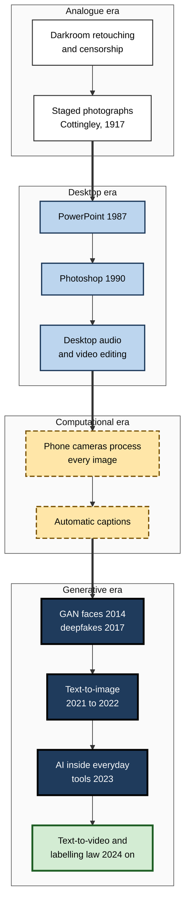
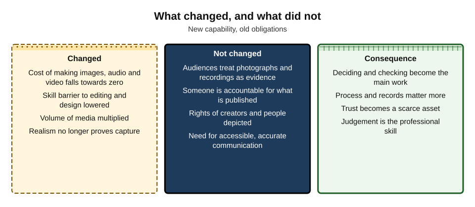
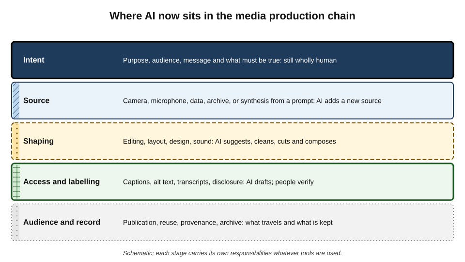
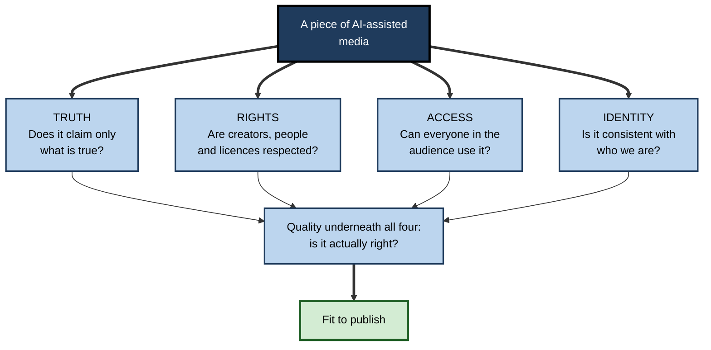
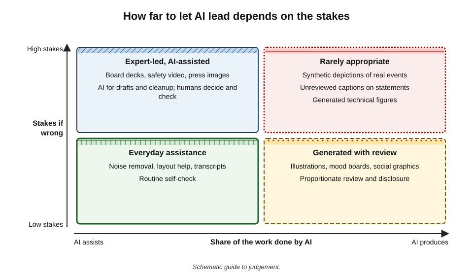
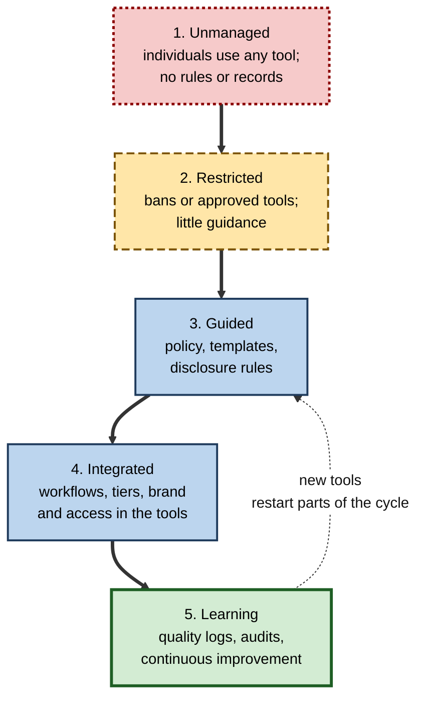

# I. AI in Images, Slides & Media

In 1990 a small program called Photoshop made it possible for anyone with a personal computer to retouch a photograph. In 2022 openly released models made it possible for anyone to produce a photograph of something that never existed. Between those dates, and accelerating since, almost every kind of visual and audio material that professionals make — images, slides, posters, podcasts, training videos, captions — has acquired an AI layer. The tools are new; the questions they raise about truth, credit, access and responsibility are as old as pictures.

> **Definition — AI in visual and audio media:** the use of machine-learning tools to generate, edit, design, structure, caption, translate or evaluate images, slide decks, audio and video in everyday professional work.

> **Definition — Synthetic media:** images, audio or video wholly or substantially created by AI rather than captured from the world by a camera or microphone.

**Why it matters**

- **Visual and audio communication is now everyday work.** Professionals who never thought of themselves as designers or producers make decks, graphics, recordings and videos weekly.
- **The cost of making has collapsed.** A picture, a narrated video or a forty-slide deck can be produced in minutes.
- **The cost of being wrong has not.** A misleading image, an inaccessible video or an infringing graphic does as much damage as ever — and travels faster.
- **Trust in media is a shared resource.** Every undisclosed synthetic image makes audiences a little more sceptical of every genuine one.
- **The professional skill has shifted** from operating tools to judging what to make, how to make it and whether it is right.

---

## From Darkroom to Diffusion

### Manipulation is old

- **Darkroom alteration** — photographs have been retouched, composited and censored almost since the invention of photography.
  - *e.g.* in the Soviet Union, officials who fell from favour were removed from official photographs; Nikolai Yezhov, head of the secret police, vanished from a well-known photograph beside Stalin after his execution in 1940.
- **Staged "evidence"** — in 1917 two girls in Cottingley, England, photographed paper cut-outs of fairies; the images convinced many people, including Arthur Conan Doyle, for decades until the women admitted the hoax in the 1980s.
- **Lesson** — the problem of images that claim more than they record is not new; what has changed is **who** can make such images, **how fast**, and **how convincingly**.

### The digital desktop

- **1987 — PowerPoint** is released and soon becomes the default medium of organisational argument.
- **1990 — Photoshop** brings photographic retouching to personal computers.
- **1990s — desktop video and audio editing** bring post-production out of specialist studios.
- **2000s–2010s — phone cameras and computational photography** make every image processed before it is seen; automatic captioning appears on video platforms.

### The generative turn

- **2014 — generative adversarial networks** produce increasingly realistic synthetic faces.
- **2017 — "deepfakes"** — the term spreads after face-swapped videos appear online.
- **2021–2022 — text-to-image goes public** — DALL·E, Midjourney and the openly released Stable Diffusion.
- **2023 — generation built into everyday tools** — generative fill in photo editors, AI in presentation and design software, voice cloning and AI dubbing.
- **2024 onward — text-to-video** models producing short realistic clips; provenance and labelling rules begin to take legal force.

**Figure 1.** From darkroom manipulation to generative media.

> **Key point:** each era lowered the cost of making and altering media. The generative era removes the last link between an image and an event: a photograph-like picture no longer implies that a camera was present.

---

## What Has Changed and What Has Not

**Figure 2.** What changed, and what did not.

### What changed

- **Making is nearly free** — images, narration, video clips and slide layouts are produced in seconds.
- **The skill barrier is lower** — background removal, sound cleanup, layout and captioning no longer need specialist training.
- **Volume has multiplied** — teams publish far more, and every item needs checking.
- **Realism no longer proves capture** — a convincing photograph or recording is no longer evidence that something happened.
- **Media converge** — a single tool can turn a document into a deck, a deck into a video, a video into clips and captions.

### What has not changed

- **Audiences still treat photographs and recordings as evidence** by default.
- **Someone is accountable** for what is published — the organisation and the person who chose to publish it.
- **Creators and people depicted still have rights** — copyright, credit, likeness, privacy.
- **Communication must still be accurate and accessible** — to deaf, blind, neurodivergent and other disabled audiences as well as everyone else.

> **Remember:** **new capability, old obligations.** The obligations of honesty, fairness, credit and access apply with full force to media made in seconds.

---

## The Production Chain

Every piece of visual or audio media passes through the same stages, whatever the tools. AI now acts at almost every one — but the responsibilities attached to each stage remain.

**Figure 3.** Where AI now sits in the media production chain.

- **Intent** — purpose, audience, message and what must be true.
  - Wholly human; the quality of everything that follows depends on it.
- **Source** — camera, microphone, data, archive — and now synthesis from a prompt.
  - Choosing to generate an image rather than photograph a real scene is the decision that most often determines whether the result is honest, which is why responsible generation begins with whether to generate at all.
- **Shaping** — editing, layout, design and sound.
  - AI cleans, cuts, suggests and composes; editing a real image raises the further question of whether an edit changes what it claims happened.
  - In slides, the hardest part remains the storyline, which tools cannot supply; templates and design suggestions encode visual expertise that authors still need to judge.
  - In audio and video, text-based editing makes cutting easy — including cuts that change meaning.
- **Access and labelling** — captions, transcripts, alt text and disclosures.
  - AI drafts them quickly; people must verify them, because those who depend on them often cannot check them.
- **Audience and record** — publication, reuse, provenance and archive.
  - What travels with the media (labels, credentials, credits) and what is kept (records, originals) decide whether later questions can be answered.

---

## Four Lenses for Any Media Decision

Across images, slides, audio and video, four questions recur. Together they form a compact framework for judgement.

**Figure 4.** Four lenses for judging AI-assisted media.

### Truth

- **The implicit claim** — every image, recording and slide asserts something about the world; photorealism and recorded speech assert the most.
- **The central test** — would the audience be misled about what is real if not told how this was made?
- **Disclosure** helps only when it is specific and visible, and it cannot rescue media used in the wrong context — a generated image in a report about real events remains misleading however it is labelled.

### Rights

- **Ownership** — purely generated material may carry little or no copyright in many jurisdictions; human contributions can be owned.
- **Infringement** — outputs that resemble characters, brands, artworks or real people carry risk regardless of how they were made.
- **Credit** — human contributors, licensors and sources keep their claims to attribution.

### Access

- **Media must work for disabled audiences** — alt text, captions, transcripts, contrast, no dangerous flashing.
- **AI both helps and harms** — it makes captions and descriptions cheap, and makes inaccessible media (text baked into images, uncorrected captions) cheaper still.

### Identity

- **Brand and style** — recognisable, consistent presentation built over years can dissolve in a month of uncontrolled generation.
- **Values** — what an organisation shows, whom it shows and how its work is made are part of its identity.

### Quality underneath

- **Generated media fails in patterned ways** — hands, text, counts, physics; invented numbers in decks; mispronunciations in synthetic speech; flicker in video.
- **Fluency hides error** — polished output looks finished, which is why checking must be deliberate and targeted.

> **Mnemonic — "TRAIQ" ("True Rights Are In Question"):** Truth, Rights, Access, Identity — and Quality beneath them all.

| Lens | Typical failure | Typical safeguard | Who usually holds it |
|---|---|---|---|
| Truth | Photoreal image read as a record; misleading splice | Illustrate ideas, record facts; specific disclosure | Maker and approver |
| Rights | Unowned brand asset; resemblance to a character | Human authorship; clearance; contract terms | Maker, legal |
| Access | Text in pixels; uncorrected captions | Real text; corrected captions; alt text by the author | Maker, reviewer |
| Identity | Style drift; distorted logo | Templates, brand kits, style packs | Brand team |
| Quality | Invented figure; wrong procedure shown | Targeted inspection; subject-expert review | Maker, subject expert |

---

## Trust in an Age of Synthetic Media

### The liar's dividend

- **Robert Chesney and Danielle Citron** (2019), legal scholars writing on deepfakes, described the **liar's dividend**: as synthetic media becomes familiar, people caught on genuine recordings can more plausibly claim the evidence is fake.
- **Consequence** — the harm of synthetic media is not only that false things are believed, but that **true things are doubted**.

> **Definition — Liar's dividend:** the benefit gained by people who dismiss genuine evidence as fabricated, made more credible by the existence of convincing synthetic media.

**Study card — Vaccari and Chadwick (2020), deepfakes and uncertainty**

- **Design:** an experiment in the United Kingdom showed participants versions of a well-known deepfake video in which a former US president appeared to make statements he never made, with or without the reveal that it was fake.
- **Findings:**
  - relatively few participants were outright deceived;
  - many more were left **uncertain** about whether the video was real;
  - that uncertainty was associated with **reduced trust in news** on social media.
- **Conclusion:** synthetic media may damage public communication less by convincing people of falsehoods than by **eroding confidence that anything can be known**.

> **Key point:** for organisations, the practical response is to be **unusually reliable** — clear about what is real, specific in disclosure, consistent in provenance — so that their genuine material keeps its value as evidence.

### Provenance and labelling

- **Provenance standards** — the Coalition for Content Provenance and Authenticity (C2PA), founded in 2021 by technology and media organisations, defines **Content Credentials**: signed records of how media was made and edited.
- **Watermarking** — several providers embed invisible signals in generated media.
- **Regulation** — the European Union's AI Act requires machine-readable marking of synthetic content by providers and disclosure of deepfakes by those who publish them, from August 2026; China, India and others have introduced or proposed labelling rules.
- **Limits** — metadata is stripped by many platforms; open models may not mark outputs; partial labelling can make unlabelled content look verified.

> **Watch out:** "no label" does not mean "real", and "AI-generated" does not mean "false". Labels inform judgement; they do not replace it.

---

## Media Work and Creative Labour

### Displacement and augmentation

- **Augmentation** — non-designers produce competent visuals; designers explore more options faster; editors spend less time on mechanical tasks.
- **Displacement** — stock illustration, routine retouching, simple voice-over and template design face direct substitution.
- **Training data** — many models were trained on creators' work without permission or payment, a grievance at the centre of litigation and policy debates.
- **Quality and distinctiveness** — when everyone can make the average, distinctive human craft becomes more valuable for organisations that want to stand out.

### Case study: the 2023 Hollywood strikes

- **Situation:** in 2023 the Writers Guild of America (from May) and the actors' union SAG-AFTRA (from July) went on strike against the major film and television studios — the first time both had struck together in over six decades.
- **AI in the dispute:**
  - writers sought protection against AI being used to write or rewrite scripts, or to reduce their credit and pay;
  - actors sought control over **digital replicas** — AI reproductions of their faces, bodies and voices — including for background performers who feared being scanned once and reused indefinitely.
- **Outcomes:**
  - the writers' agreement (September 2023) provided that AI-generated material cannot be treated as literary material or source material to undermine writers' credit, and that writers cannot be required to use AI;
  - the actors' agreement (November 2023, after 118 days) required **informed consent** and **compensation** for creating and using digital replicas, with specific terms for background performers.
- **Analysis:**
  1. **Consent, credit and compensation** emerged as the core terms for AI in creative work.
  2. **Likeness and voice** were treated as assets belonging to the person, not to whoever holds a recording.
  3. **Collective agreements**, not only law, set the practical rules.
- **Lesson for everyday professionals:** the same principles apply in ordinary organisations — staff whose faces and voices are used in AI-generated training or marketing deserve **specific consent**, clear limits and the right to withdraw.

---

## Creativity, Sameness and Distinctiveness

### Individual gains, collective sameness

**Study card — Doshi and Hauser (2024), generative AI and creative writing**

- **Design:** an online experiment in which participants wrote short stories with no AI help, with one AI-generated idea, or with a choice of several AI ideas; independent evaluators rated the stories.
- **Findings:**
  - access to AI ideas made stories more creative and better written on average, with the largest gains for **less creative** writers;
  - stories written with AI help were **more similar to one another** than stories written without it.
- **Limits:** short texts, one task type and one model; visual and audio media were not tested directly.
- **Conclusion:** generative tools can raise **individual** quality while reducing **collective** diversity — a social dilemma in which each user gains but the overall pool becomes more uniform.

- **Relevance to media** — if many organisations use the same models, prompts and defaults, their images, decks and videos converge on a shared "AI look".
- **Implication** — distinctiveness becomes scarcer and more valuable; owned assets, real photography of real people and places, and deliberate style choices matter more, not less.

### The economics of making

| | Before generative tools | With generative tools |
|---|---|---|
| Marginal cost of an image or voice-over | Hours of skilled time or a licence fee | Seconds and a subscription |
| Scarce resource | Production skill and budget | Attention, judgement and trust |
| Typical bottleneck | Making | Deciding and checking |
| Main quality risk | Too little material, too slowly | Too much material, too little checked |
| Source of competitive advantage | Production capability | Distinctiveness and reliability |

- **Abundance shifts value** — when anyone can make polished media, polish stops signalling effort or competence, and audiences look for other signs of credibility: specificity, accuracy, real people, consistent provenance.
- **Attention is finite** — more media competes for the same audiences; volume alone rarely wins.

### Environmental cost

- **Generation consumes energy** — producing images and, especially, video uses far more computation per output than producing short text.
- **Estimates vary widely** by model, settings and data centre, and change quickly as systems improve.
- **Proportionate habits** — well-briefed generation of a few options, reuse of approved assets and avoidance of generating for its own sake reduce both cost and footprint.

### Media literacy as a professional skill

- **For makers** — knowing how media is produced, what tools can and cannot do, and how audiences read images and recordings.
- **For audiences** — including colleagues, clients and the public: checking sources, context and provenance rather than trusting realism.
- **For organisations** — training staff to recognise synthetic media used against them (impersonation, fake evidence) as well as to use it responsibly themselves.

> **Key point:** in a world of abundant synthetic media, **media literacy is part of professional literacy**. Everyone who publishes, approves or relies on images and recordings needs it.

---

## AI Media in Organisations

### Matching AI's role to the stakes

**Figure 5.** How far to let AI lead depends on the stakes.

- **Everyday assistance** — low stakes, AI assists: noise removal, layout help, transcripts.
- **Generated with review** — low stakes, AI produces: illustrations, mood boards, social graphics.
- **Expert-led, AI-assisted** — high stakes, AI assists: board decks, safety videos, press images.
- **Rarely appropriate** — high stakes, AI produces: synthetic depictions of real events, unreviewed captions on public statements, generated technical figures.

### Stages of organisational practice

**Figure 6.** Stages in an organisation's practice with AI media tools.

- **Unmanaged** — enthusiasm and inconsistency; errors discovered by audiences.
- **Restricted** — risk controlled by bans or approved lists; many staff work around them.
- **Guided** — policies on generation, disclosure and rights; templates and brand kits available.
- **Integrated** — workflows with briefs, source decisions, review tiers and records; accessibility and brand built into the tools.
- **Learning** — quality logs and audits feed improvements; practice keeps pace with new tools.

### What good governance contains

- **Approved tools** chosen for terms, data handling, indemnities and provenance support.
- **Use rules** — permitted, restricted and prohibited uses (real people without consent, evidence and records, testimonials, named-artist styles, core brand assets).
- **Disclosure standard** — thresholds, wording and placement.
- **Accessibility standard** — alt text, captions, transcripts, contrast, flashing.
- **Brand-in-AI pack** — style blocks, references, templates, chosen voices.
- **Workflow and tiers** — who reviews what.
- **Records** — asset records and provenance metadata.
- **Training** — short, practical and repeated as tools change.

### Worked example (illustrative): one announcement across media

**Situation:** a manufacturer announces a new recycling scheme. The communications lead plans a deck for the launch meeting, a social post, a two-minute video and a podcast segment.

| Asset | AI role | Human decisions | Truth | Rights | Access | Identity |
|---|---|---|---|---|---|---|
| Launch deck | Drafts slide bodies from the approved briefing | Storyline; every figure traced | Real plant photos, not generated | Licensed fonts and icons | Titles, alt text, contrast | Company template |
| Social post | Generates an illustration of the recycling loop | Illustrative style chosen deliberately | Captioned "Illustration created with AI" | No brand marks in prompt | Message in post text; alt text | Style block and references |
| Video | Rough cut; captions; voice cleanup | Real footage of the scheme; chief operating officer speaks in person | No synthetic leader | Music from licensed library | Corrected captions; no flashing | Colour grade and title style |
| Podcast segment | Transcript; filler trimming | Interview edited without changing meaning | Joins signposted | Guest consent to editing | Transcript published | Approved sonic logo |

*Illustrative scenario.*

1. **One brief** with the message and truth requirements covered all four assets.
2. **Source decisions** were made per element — real footage and photographs for the scheme itself, generation only for the conceptual illustration.
3. **Each asset passed the four lenses** and a quality check before approval.

- **Conclusion:** AI saved most of the production time; the decisions that kept the campaign credible were made before and after the tools were used.

---

## Landmark Debates

### Should all synthetic media be labelled?

- **For universal labelling** — audiences have a right to know; consistent labels prevent the implied-truth problem where unlabelled items seem verified.
- **Against** — labels on harmless illustrations add noise; experiments show "AI-generated" labels lower trust even in true content; the boundary between editing and generation is too blurred for a single rule.
- **Emerging position** — mandatory labels for **realistic** synthetic depictions of people and events; specific, explained labels elsewhere; machine-readable provenance underneath.

### Is generated imagery "creative work"?

- **One view** — prompting, selecting, editing and composing are creative choices, as in photography, which was once denied artistic status.
- **The other** — where the system determines the expression, the human contribution is direction rather than authorship.
- **Where law stands** — many jurisdictions protect the human contributions and not the machine-determined expression; the boundary is being tested in court.

### Will synthetic presenters replace human ones?

- **For** — consistent delivery, instant translation, low cost for routine training and product content.
- **Against** — audiences place weight on a real person speaking for difficult news, leadership messages and anything requiring trust; near-real avatars risk unease.
- **Likely outcome** — synthetic presenters for routine, low-stakes content; real people where accountability and empathy matter.

### Does AI widen or narrow access?

- **Optimists** — automatic captions, descriptions and simplification bring access to content that was never made accessible.
- **Sceptics** — uncorrected outputs give the appearance of access without its substance, and the people who rely on them cannot check them.
- **Resolution** — AI widens access where humans verify; it narrows it where tools replace verification.

---

## The Competent Media Professional

- **Knows what each tool is good and bad at** — and chooses the method element by element.
- **Reads the implicit claim** of every image, recording and slide before audiences do.
- **Protects meaning** — in edits, summaries, captions and translations.
- **Respects rights** — of creators, of people depicted, of licensors.
- **Makes media usable by everyone** — and does not delegate that judgement to a tool.
- **Keeps the brand recognisable** by putting it inside the tools.
- **Checks deliberately**, for the known failure patterns, at a depth proportionate to the stakes.
- **Works in a process** that others can follow and audit.

> **In practice:** the most effective professionals with AI media are not those who generate the most. They are those whose material is **reliably true, credited, accessible and on brand** — and who can show how they know.

---

## Open Questions

- **Will provenance become universal, or will scepticism become the default?**
  - Standards and laws are arriving; whether they achieve the coverage needed to preserve trust in genuine media is uncertain.
- **How will law settle ownership and training?**
  - Courts in several jurisdictions are deciding cases on training data, outputs and authorship, with divergent results so far.
- **What happens to creative professions?**
  - Some tasks are being displaced and others augmented; the long-run effect on employment, pay and craft is not yet clear.
- **Can accessibility keep pace with volume?**
  - AI makes access aids cheaper but also multiplies media needing them; outcomes depend on organisational choices.
- **Will audiences reward authenticity?**
  - Reactions to visibly synthetic campaigns suggest a premium on human-made and documentary material in some contexts, but evidence is early and attitudes are changing.

---

## Summary

- **AI in visual and audio media** generates, edits, designs, captions and evaluates images, decks, audio and video; **synthetic media** is wholly or substantially created by AI.
- Manipulation is old (darkroom censorship, the Cottingley fairies); each era — desktop, computational, generative — lowered the cost of making and altering media. The generative era breaks the link between a photograph-like image and an event.
- **Changed:** cost, skill barrier, volume, the evidential value of realism. **Unchanged:** audience assumptions, accountability, rights, the need for accurate and accessible communication — **new capability, old obligations**.
- The **production chain** — intent, source, shaping, access and labelling, audience and record — keeps its responsibilities whatever tools are used.
- Judge media through four lenses — **Truth, Rights, Access, Identity** — with **Quality** beneath them.
- Synthetic media threatens trust through deception and through doubt (**liar's dividend**; Vaccari and Chadwick, 2020); provenance, labelling and organisational reliability are the responses.
- Creative labour faces both augmentation and displacement; the **2023 Hollywood strikes** made **consent, credit and compensation** the core terms for AI and likeness.
- Match AI's role to the **stakes**; organisations mature from unmanaged use to integrated, learning practice with tools, rules, disclosure, accessibility, brand packs, workflows and records.
- The competent professional chooses methods deliberately, protects meaning, respects rights, ensures access, keeps the brand and checks proportionately.

---

## Self-Check

1. Define synthetic media and distinguish it from AI-assisted editing.
2. Give two historical examples of manipulated or staged images and explain what the generative era adds.
3. What has AI changed in media work, and what obligations remain unchanged?
4. Describe the five stages of the media production chain and the main human responsibility at each.
5. Explain the four lenses and why quality sits beneath them.
6. What is the liar's dividend, and what did Vaccari and Chadwick find?
7. What are Content Credentials, and what limits their effectiveness?
8. Summarise the AI provisions in the 2023 writers' and actors' agreements and their lesson for ordinary organisations.
9. Place these on the stakes–automation matrix: background noise removal; a generated image of a real factory fire for a press release; an AI-drafted board deck; a generated illustration for an internal newsletter.
10. Describe the stages of organisational practice and what distinguishes "integrated" from "guided".
11. Using the four lenses, review a proposal to publish an AI-generated video of the chief executive announcing redundancies.
12. What distinguishes the most effective professionals working with AI media?

### Answer Key

1. Synthetic media is wholly or substantially created by AI; AI-assisted editing changes captured media (correcting, cutting, enhancing) without creating it from nothing — though heavy generative edits blur the line.
2. Soviet removal of purged officials from photographs; the Cottingley fairy photographs of 1917. The generative era lets anyone create convincing photograph-like media of events that never happened, quickly and at scale.
3. Changed: near-zero cost of making, lower skill barrier, much higher volume, realism no longer proving capture. Unchanged: audiences' default trust in photographs and recordings, accountability, rights of creators and people depicted, the need for accurate and accessible communication.
4. Intent (decide purpose, audience, message and what must be true); source (choose capture, data or synthesis honestly); shaping (edit without changing meaning; judge design); access and labelling (verify captions, alt text, disclosures); audience and record (keep provenance, originals and records).
5. Truth (claims only what is true), Rights (creators, people, licences respected), Access (usable by everyone), Identity (consistent with the organisation). Quality underlies all four: an asset with errors fails every lens.
6. The benefit to people who dismiss genuine evidence as fake because synthetic media exists. A deepfake experiment found few people deceived outright but many left uncertain, with uncertainty linked to lower trust in news.
7. Signed provenance records under the C2PA standard showing how media was made and edited. Limited by platforms stripping metadata, unmarked open models and uneven adoption.
8. Writers: AI material cannot undermine credit as literary or source material; writers cannot be forced to use AI. Actors: informed consent and compensation for digital replicas. Lesson: staff likeness and voice used in AI media need specific consent, limits and withdrawal rights.
9. Noise removal — everyday assistance. Generated image of a real fire for a press release — rarely appropriate. AI-drafted board deck — expert-led, AI-assisted. Newsletter illustration — generated with review.
10. Unmanaged, restricted, guided, integrated, learning. Guided organisations have policies and templates; integrated ones build briefs, source decisions, tiers, records, brand and accessibility into the workflow and tools.
11. Truth: a synthetic leader delivering sensitive news is likely to feel deceptive even if disclosed, and undermines trust. Rights: requires the chief executive's specific consent to a digital replica. Access: captions and transcript needed. Identity: conflicts with values of honesty and care at a difficult moment. Recommendation: the chief executive records the message in person.
12. They choose methods element by element, read implicit claims, protect meaning, respect rights, ensure accessibility, keep brand consistency, check proportionately, and work in an auditable process — so their material is reliably true, credited, accessible and on brand.

---

## Glossary

| Term | Meaning |
|---|---|
| C2PA | Coalition for Content Provenance and Authenticity, which defines Content Credentials. |
| Computational photography | In-camera processing that merges and adjusts images before they are saved. |
| Content Credentials | Signed provenance records attached to media files. |
| Deepfake | Realistic synthetic media depicting people or events that did not occur as shown. |
| Digital replica | An AI reproduction of a real person's face, body or voice. |
| Implicit claim | What an image or recording leads a reasonable viewer to believe about reality. |
| Liar's dividend | The advantage gained by dismissing genuine evidence as fake. |
| Production chain | The stages of intent, source, shaping, access and labelling, and audience and record. |
| Provenance | Information about the origin and edit history of media. |
| Synthetic media | Images, audio or video wholly or substantially created by AI. |
| TRAIQ | Truth, Rights, Access, Identity, with Quality beneath them. |
