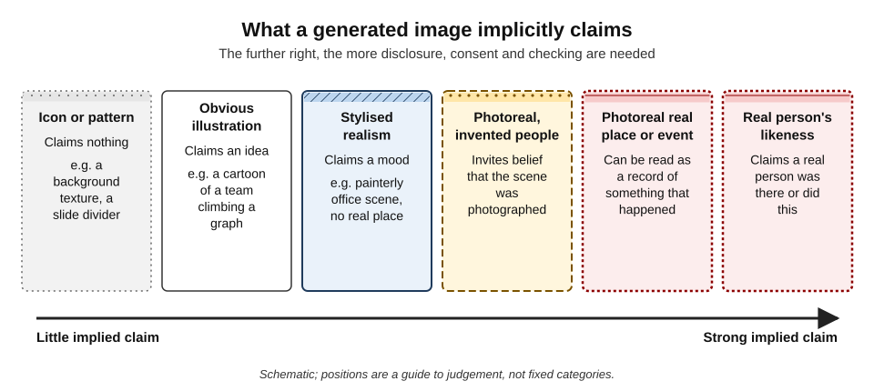
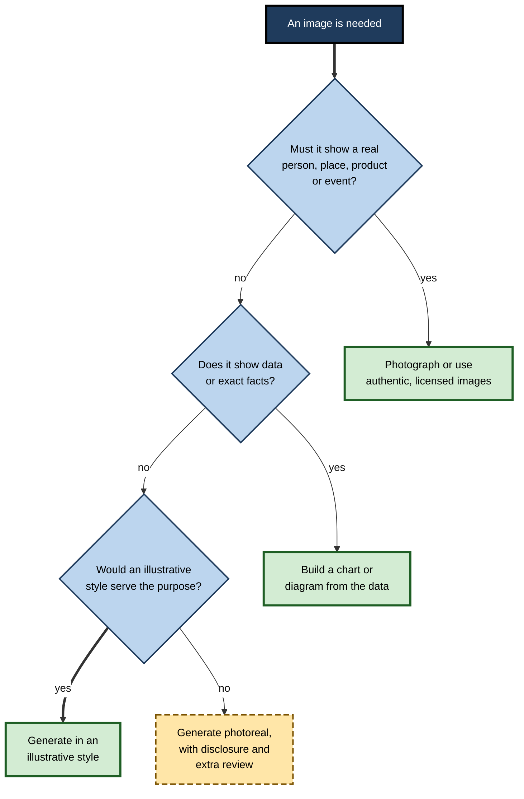
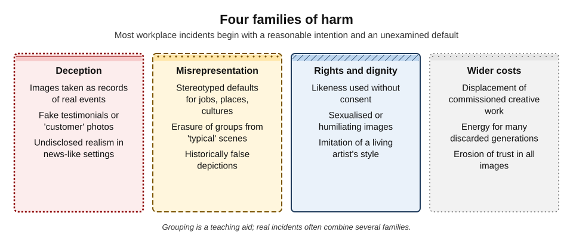
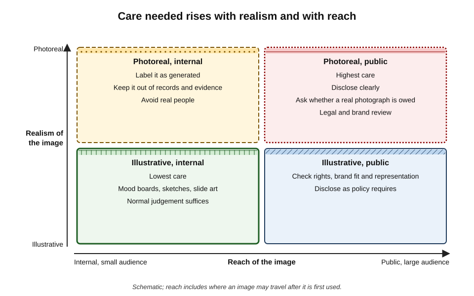
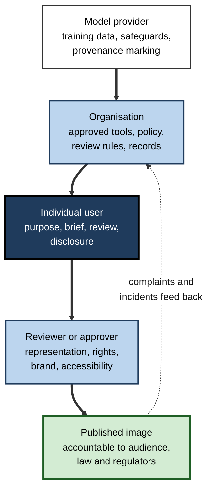
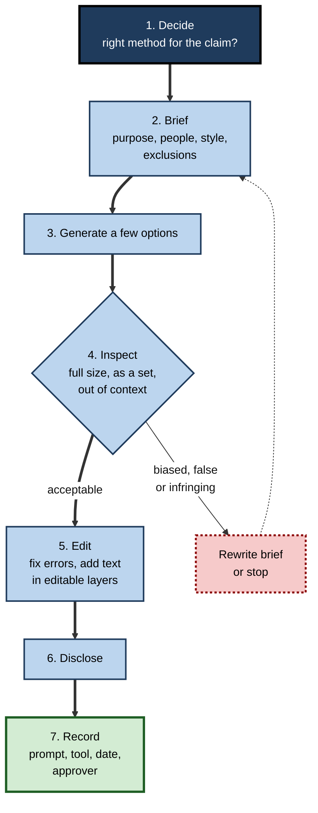

# I.1. Generating images responsibly

A marketing assistant needs a picture of "a happy customer using our app" for a launch page and has a generator open. Thirty seconds later there is a smiling woman, perfectly lit, holding a phone. She does not exist, she never used the app, and nothing on the page says so. Nothing illegal has necessarily happened — yet the page now makes a claim that is false, and the person who pressed the button is responsible for it.

> **Definition — Responsible image generation:** creating images with AI in a way that is honest about what the image is, fair to the people and groups it depicts, respectful of others' rights and dignity, proportionate in its use of resources, and accountable — so that someone can explain why the image was made, how and with what checks.

**Why it matters**

- **Images persuade faster than text.** Viewers process a picture before they read a caption, and they tend to treat photographs as evidence.
- **Generation removes the friction that used to force reflection.** Commissioning a photographer took days and a brief; generating takes seconds and no one else need be involved.
- **Defaults are not neutral.** A generator fills every gap in a request with what is statistically typical of its training images — including stereotypes.
- **Responsibility does not transfer to the tool.** Employers, regulators, clients and the public hold the person and organisation that published an image accountable, not the model.
- **Trust is shared.** Each misleading synthetic image makes audiences slightly more sceptical of every genuine one, including the organisation's own.

---

## What a Generated Image Claims

Every image carries an **implicit claim** about the world. Responsible generation starts by reading that claim before anyone else does.

> **Definition — Implicit claim:** what a reasonable viewer will take an image to assert — that a place looks like this, that these people exist, that this event happened — whether or not the creator intended it.

### Documentary and illustrative images

- **Documentary images** — understood as records.
  - *e.g.* a photograph of the new office in an annual report; a "before and after" photo of a repaired roof; a press photo of the chief executive at an event.
  - Viewers assume a camera was pointed at something real.
- **Illustrative images** — understood as ideas.
  - *e.g.* a cartoon of a rocket for "launch"; an abstract network pattern on a slide; a watercolour of a city skyline for a newsletter header.
  - Viewers assume someone made a picture to convey a concept.
- **The trap** — generators produce **photorealism by default** when asked for people and places, so an image intended as illustration is often *read* as documentary.

> **Key point:** the same generated image can be harmless as an illustration and deceptive as a record. What changes is not the pixels but the **claim the context makes**.

### The claim spectrum

**Figure 1.** What a generated image implicitly claims, from patterns to real people.

- **Low-claim images** — textures, icons, obviously stylised illustration.
  - Normal professional judgement is enough.
- **Middle of the spectrum** — photoreal scenes with invented people.
  - The image invites belief that the scene was photographed.
  - Labelling, placement and wording decide whether it misleads.
- **High-claim images** — real places, real events, real people.
  - Consent, disclosure and often legal review are required; frequently the right answer is not to generate at all.

> **Definition — Photorealism:** the quality of an image that makes it look like a photograph taken with a camera.

> **Definition — Likeness:** the recognisable appearance (or voice) of a particular real person, whether reproduced exactly or imitated.

### Style as a responsibility lever

- **Choosing a visibly illustrative style** — line drawing, flat vector, watercolour, clay-model look — moves an image left on the spectrum without losing its message.
- **Photorealism should be a deliberate choice**, made only when the purpose genuinely requires it.
  - *e.g.* a product mock-up for an internal design review may need realism; a blog header about "teamwork" does not.

> **In practice:** many communications teams adopt a rule of thumb — **"illustrate ideas, photograph facts"**. Generated imagery is used freely for concepts; anything presented as the organisation's real people, premises, products or events is photographed.

---

## The Decision to Generate

The first responsible decision is whether generation is the right method at all.

### Questions before the first prompt

1. **What is the image for?** Decoration, explanation, persuasion, evidence or identity.
2. **What will viewers assume it is?** A record or an illustration.
3. **Who or what will it depict?** Real people, recognisable places, groups, cultures, brands.
4. **Where will it travel?** Internal slide, client deliverable, public website, social media, press.
5. **Is there a better source?** The organisation's own photographs, licensed stock, a commissioned creator, a diagram built from real data.

**Figure 2.** Deciding whether to generate an image or obtain it another way.

### Comparing the main sources of images

| | Generated | Licensed stock | Commissioned creator | Own photography |
|---|---|---|---|---|
| Speed | Seconds to minutes | Minutes | Days to weeks | Hours to days |
| Cost per image | Very low at the margin | Low to moderate | High | Moderate (staff time) |
| Can show real people and events truthfully | No | Only those photographed | Yes | Yes |
| Rights position | Depends on tool terms and law; often no exclusive copyright | Defined by the licence | Defined by the contract | Owned, subject to consent of people shown |
| Typical risks | Bias, false realism, resemblance to others' work | Overused, generic images | Cost, time | Consent and privacy of subjects |
| Best for | Concepts, mock-ups, drafts, illustration | Generic scenes where realism matters | Flagship campaigns, distinctive style | Documentary content about the organisation |

> **Watch out:** "it was quicker" is a reason, not a justification. When an image will be read as fact, the speed of generation is irrelevant if the result is untrue.

---

## Responsible Briefing

A **prompt** is a brief. Responsible generation writes into the brief the things a careful human commissioner would have specified.

### What a responsible brief adds

- **Purpose and placement** — "a header illustration for an internal newsletter", not just "office".
  - Many tools use this context to choose style and composition.
- **Representation, where people appear** — ages, genders, ethnicities, body types, disabilities, roles.
  - Specify **who leads and who assists**, not merely who is present.
- **Style that matches the claim** — "flat vector illustration" for an idea; photorealism only when needed.
- **Exclusions** — no logos, no text, no recognisable landmarks, no real people, no named artists.
- **Cultural and contextual accuracy** — correct dress, settings and symbols for the place portrayed, or a deliberately generic setting.

> **Mnemonic — "PRESCRIBE":** **P**urpose, **R**epresentation, **E**xclusions, **S**tyle, **C**ontext, then **R**eview, **I**terate, **B**e honest (disclose), **E**xplainable (keep a record).

### What a responsible brief avoids

- **Named living artists or photographers** — "in the style of [artist]" imitates a person's distinctive work and may harm their market; many organisations ban it outright.
- **Real people's names** — public figures, colleagues, competitors' staff.
- **Brand names and characters** — they invite trademark and copyright problems and distorted logos.
- **Sensitive descriptors used carelessly** — "poor", "criminal", "exotic", "primitive" pull the model towards its most stereotyped associations.

### Defaults and stereotypes

**Study card — Luccioni, Akiki, Mitchell and Jernite (2023), "Stable Bias"**

- **Design:** researchers at the AI company Hugging Face generated large sets of images from text-to-image systems (versions of Stable Diffusion and DALL·E 2) using prompts that varied profession and descriptive adjectives, then analysed the results with methods that avoided assigning race or gender labels to individual synthetic faces.
- **Findings:**
  - outputs for many professions skewed towards depictions that viewers associate with **white men**, more strongly than real workforce statistics;
  - adding personality adjectives to the prompt shifted the apparent gender and ethnicity of the people depicted in stereotyped directions;
  - different systems showed different patterns, so bias is a property of each model and its data, not of "AI" in general.
- **Conclusion:** text-to-image defaults **encode and can amplify** social stereotypes; neutral prompts do not produce neutral pictures.

> **Watch out:** the opposite error also occurs. When providers adjusted systems to diversify outputs, some produced **historically inaccurate** images — such as diverse depictions of groups that were historically homogeneous — and in early 2024 one major provider paused generating people for this reason. Responsible briefing aims at **accuracy for the context**, not a fixed quota.

### Worked example (illustrative): briefing images for a graduate-recruitment brochure

**Situation:** a firm wants three illustrations showing graduates at work in finance, engineering and client service.

| | First brief | Responsible brief |
|---|---|---|
| Prompt core | "Young professionals working in an office, photo" | "Flat editorial illustration, warm palette, for a recruitment brochure: a mixed team of graduates of different ethnicities and genders; one wears a hijab, one uses a wheelchair; a woman leads the discussion at a whiteboard" |
| Style | Photoreal — reads as the firm's real staff | Illustrative — reads as a concept |
| Representation | All slim, light-skinned; a man presents, women listen | Varied; leadership role assigned deliberately |
| Exclusions | Generator added a fake corporate logo | "No logos, no text, no recognisable buildings" |
| Disclosure | None | Credit line "Illustrations created with AI tools" |

1. **First output reviewed** for who is shown, in what role, with what body language.
2. **Brief rewritten** to fix style, representation and exclusions.
3. **Set reviewed together** — the three images are checked as a set, because patterns (who leads, who serves) only appear across several images.
4. **Accessibility** — each image receives alt text describing its purpose.

- **Conclusion:** the responsible brief took about ten minutes longer and produced images that make no false claim about the firm's actual staff.

> **Watch out:** a recruitment brochure that shows a workforce far more diverse than the real one, in photoreal images, is itself misleading. The illustrative style is what makes aspirational representation honest.

---

## People, Likeness and Sensitive Subjects

Images of people carry the highest risks, because a person can be harmed by a picture of something they never did.

### Real people

- **Public figures** — politicians, celebrities, executives.
  - Realistic depictions can mislead voters, investors or customers; many tools refuse such prompts, and several jurisdictions restrict deceptive synthetic depictions in elections and advertising.
- **Colleagues and clients** — using a staff photo as a reference to make a "fun" image can embarrass, sexualise or misrepresent them.
  - Consent should be **specific** (this use), **informed** (they have seen it) and **revocable**.
- **Children** — the strongest restraint applies; there is almost never a workplace reason to generate realistic images of identifiable children.
- **The deceased** — family members and communities may object to "resurrected" likenesses, even when legally permitted.

> **Remember:** **no real person without consent**, and no realistic image of a real person in a situation that did not happen — even with consent — unless it is clearly labelled.

### Sensitive subjects

- **Health and medical imagery** — invented anatomy or symptoms can mislead patients.
- **Conflict, disaster and crime** — realistic scenes may circulate as news; victims and communities may be retraumatised.
- **Religion and culture** — sacred symbols, dress and rituals are easily rendered inaccurately or disrespectfully.
- **History** — reconstructions blur into fake archives; the image may later be cited as a real historical photograph.
- **Poverty and vulnerability** — "poverty imagery" repeats the problems that aid organisations spent decades trying to correct: people shown as passive, nameless and pitiable.

### Tool safeguards and their limits

- **Prompt filters** — block requests that name public figures or describe sexual or violent content.
- **Output classifiers** — check generated images before they are shown.
- **Provenance marking** — some tools add watermarks or signed metadata to every output.
- **Limits:**
  - **over-blocking** — legitimate medical, historical or artistic requests refused;
  - **under-blocking** — harmful outputs produced through rephrasing;
  - **inconsistency** — different tools apply different rules, and open models may have none.

> **Key point:** a tool's willingness to generate an image is **not permission** to use it. Safeguards prevent the worst outputs; they do not make judgements about the user's context.

---

## Training Data and Its Shadows

Every image a model produces draws on the images it was trained on. Responsible users know, in outline, where those came from.

- **Web-scale datasets** — many early open models were trained on billions of image–caption pairs collected automatically from the public web.
  - *e.g.* LAION-5B, released in 2022, a dataset of roughly five billion links to images with captions.
- **Licensed and owned collections** — some providers train on stock libraries, licensed archives and public-domain material, and market the result as commercially safer.
- **Opt-outs** — some datasets and providers allow creators to request exclusion; coverage and enforcement vary.

**Study card — Stanford Internet Observatory (December 2023)**

- **Design:** researchers used hash-matching tools and expert review to examine the LAION-5B dataset for links to known child sexual abuse material.
- **Findings:** more than a thousand confirmed instances of such material were linked from the dataset, among many more suspected.
- **Response:** LAION withdrew the dataset, later releasing a cleaned version; the study prompted wider scrutiny of how training data are collected and filtered.
- **Conclusion:** automated collection at web scale cannot be assumed to be clean; the contents of training data are an ethical question for anyone who chooses a model, not only for its builders.

> **In practice:** choosing *which* generator to use is itself a responsibility decision. Questions an organisation can ask a provider include what the model was trained on, how that data was filtered, whether creators could opt out and what indemnities are offered. The legal side of these questions is a subject in its own right; the ethical side — whose work and whose images made the model — belongs here.

---

## A Taxonomy of Harms

Thinking in families of harm helps a practitioner spot risks that a single checklist would miss.

**Figure 3.** Four families of harm from generated images.

- **Deception** — the image is taken as true.
  - Fake "customer" photos, invented product results, synthetic event photos.
- **Misrepresentation** — the image distorts how groups, places or histories look.
  - Stereotyped defaults; erasure; romanticised or degrading depictions.
- **Rights and dignity** — the image injures a person or creator.
  - Non-consensual likeness, sexualised imagery, harassment, imitation of a living artist.
- **Wider costs** — the image is fine, but the practice is not.
  - Displacement of commissioned illustrators and photographers; energy spent on hundreds of discarded generations; cumulative erosion of trust.

| Harm | Who is harmed | Typical workplace trigger | Proportionate safeguard |
|---|---|---|---|
| Deception | Customers, the public, regulators | Photoreal image placed where records are expected | Illustrative style or clear disclosure; never as evidence |
| Misrepresentation | Depicted groups; audiences | Unspecified people in a brief | Specify representation; review sets of images together |
| Rights and dignity | Real individuals; creators | Staff photos as references; "in the style of" prompts | Consent; ban named-artist prompts |
| Wider costs | Creative workers; environment; trust | Generating for its own sake | Generate few, well-briefed options; reuse approved images |

> **Definition — Non-consensual intimate imagery (NCII):** sexual or intimate images of a real person created or shared without their consent — including synthetic ones. Many jurisdictions now treat creating or sharing synthetic NCII as an offence.

> **Watch out:** "no one will be fooled" is often wrong. Images are cropped, screenshotted and re-shared without their original captions. Judge an image by how it will look **out of context**, not only on the page where it first appears.

---

## Context, Placement and Reach

Responsibility scales with two things: how real the image looks and how far it will travel.

**Figure 4.** Care needed rises with realism and with reach.

- **Illustrative and internal** — mood boards, sketches, slide art for a team meeting.
  - Ordinary judgement suffices.
- **Illustrative and public** — blog headers, social posts, brochure illustrations.
  - Check rights, brand fit and representation; disclose according to policy.
- **Photoreal and internal** — product mock-ups, concept visualisations for a design review.
  - Label as generated; keep out of records; avoid real people.
- **Photoreal and public** — anything a stranger could mistake for a photograph.
  - Highest care: disclosure, legal and brand review, and the question of whether a real photograph is owed to the audience.

### Contexts where generation is usually inappropriate

- **Evidence and records** — inspection photos, insurance claims, incident reports, research data, legal exhibits.
- **News and documentary content** — journalistic codes generally forbid presenting synthetic images as news photographs.
- **Testimonials and reviews** — invented customers misrepresent real experience and may breach consumer-protection and advertising rules.
- **Identity and verification** — staff ID photos, profile images used for trust.
- **Scientific and medical figures** — where viewers rely on the image as data.

> **Remember:** **never generate what should be recorded.** If the image is meant to show what *is*, use a camera or real data.

---

## Case Study: Amnesty International's Colombia Images

- **Situation:** in spring 2023, Amnesty International's Norwegian section published images to mark the second anniversary of the 2021 national protests in Colombia and to highlight police violence against protesters.
- **The choice:** the images were generated with an AI tool rather than taken from photographers' archives.
  - The organisation said it wanted to **protect protesters' identities** from possible state retaliation.
  - The images carried a small note that they were AI-generated.
- **What viewers noticed:**
  - faces with an uncanny, smoothed look;
  - police uniforms that did not match those actually worn;
  - a protester wrapped in a flag whose colours were not quite those of Colombia.
- **Criticism:**
  - photojournalists argued that synthetic images of real events **devalue documentary work** by people who had risked their safety to record the protests;
  - commentators warned that a human-rights organisation, whose credibility rests on evidence, was blurring the line between record and illustration;
  - opponents could cite the images to dismiss genuine evidence as fabricated.
- **Result:** the images were withdrawn within days; the organisation said it would reflect on its use of AI.
- **Analysis:**
  1. The **purpose** was legitimate — protecting identities.
  2. The **style** was wrong for it — photorealism made the images read as records of a real event.
  3. **Alternatives** existed — blurred or anonymised real photographs, consenting subjects, or clearly illustrative art.
  4. **Disclosure** was present but too weak to outweigh the implicit claim of photorealism.
- **Lesson:** a small label does not neutralise a strong implicit claim. When a real event is depicted, the responsible options are **authentic material** or an **unmistakably illustrative** style.

---

## Responsibility in Organisations

### Who is responsible for what

**Figure 5.** How responsibility for a generated image is shared.

- **Provider** — decides training data, safety filters, provenance marking and contractual terms.
- **Organisation** — chooses tools, sets policy, defines review thresholds and keeps records.
- **Individual** — chooses to generate, writes the brief, selects and edits the output, discloses.
- **Reviewer** — checks representation, rights, brand fit and accessibility before publication.

> **Key point:** responsibility is **layered, not transferred**. A provider's safeguards do not excuse a careless brief; an organisation's policy does not excuse an individual's failure to look at what they are publishing.

### Elements of a workable policy

- **Approved tools** — chosen for their data practices, safeguards and terms.
- **Permitted and prohibited uses** — *e.g.* permitted for concept art and internal slides; prohibited for evidence, testimonials, real people without consent and named-artist styles.
- **Disclosure rule** — when and how generated images are labelled.
- **Review thresholds** — who must approve photoreal or public images.
- **Records** — prompt, tool, date and approver kept for published images.
- **Incident route** — how to withdraw an image and respond to complaints quickly.

### Proportion and resources

- **Generate deliberately** — a well-specified brief producing four options is better practice than two hundred random attempts.
- **Reuse approved images** rather than regenerating near-duplicates.
- **Respect creative labour** — generated drafts often work best as **briefs** for designers and photographers on important work, not replacements for them.

> **Watch out:** estimates of the energy used per generated image vary enormously with model, settings and data centre, and change as systems improve. The reliable point is relative: images, and especially video, cost far more computation per output than short text, so habits of wasteful generation add up.

### The responsible-generation routine

1. **Decide** — is generation the right method for this purpose and claim?
2. **Brief** — purpose, representation, style, exclusions, context.
3. **Generate few** — several options, not hundreds.
4. **Inspect** — at full size, as a set, and out of context.
5. **Edit** — correct errors; add text and logos in an editable layer, not in the generator.
6. **Disclose** — in line with policy and the strength of the implicit claim.
7. **Record** — prompt, tool, date, approver.

**Figure 6.** The responsible-generation routine.

### Case study (illustrative): a hospital trust's patient-information leaflets

- **Situation:** a hospital's communications team began generating images for patient leaflets to replace dated clip art.
- **Problem:** a leaflet about a skin condition used a photoreal generated image of a rash; a dermatologist noticed that it resembled no real presentation of the condition. Separately, images of "a family receiving news" showed only one ethnic group across a whole series.
- **Diagnosis:**
  - the team had treated medical imagery as decoration rather than information;
  - images were reviewed one at a time, so the pattern across the series was missed;
  - no clinician reviewed generated content before printing.
- **Actions:**
  1. clinical images limited to **consented real photographs or medically reviewed illustrations**;
  2. generated imagery restricted to non-clinical, illustrative scenes in a recognisably drawn house style;
  3. every series reviewed as a set for representation;
  4. a credit line added to leaflets using generated illustrations.
- **Result:** leaflets were reprinted; complaints ceased; the team kept the speed benefit for non-clinical illustration.
- **Lesson:** the responsible boundary is drawn by **what viewers rely on the image for**, not by the technology.

---

## Open Questions

- **Can provenance marking become universal?**
  - Watermarks and signed metadata help, but they are stripped by many platforms and absent from open models; a world in which unmarked images are presumed suspicious is not yet in sight.
- **How should "diverse by default" be balanced against accuracy?**
  - Correcting stereotyped defaults can introduce historical or contextual errors; there is no agreed technical or ethical standard for the right balance.
- **What do generators owe the creators whose work trained them?**
  - Licensing schemes, opt-outs and compensation funds exist, but their fairness and adequacy are contested.
- **Does widespread generation erode trust in all images?**
  - The "liar's dividend" — genuine evidence dismissed as fake — is widely discussed, but its scale in practice is hard to measure.
- **Where will regulation settle?**
  - Transparency rules for synthetic media are arriving in several jurisdictions, including European Union requirements applying from 2026, but enforcement and cross-border consistency remain uncertain.

---

## Summary

- **Responsible image generation** is honest about what an image is, fair to those depicted, respectful of rights and dignity, proportionate and accountable.
- Every image makes an **implicit claim**; photorealism turns an illustration into an apparent **record**. Use the **claim spectrum** to judge how much care is needed.
- **"Illustrate ideas, photograph facts."** Never generate what should be recorded — evidence, news, testimonials, identity, scientific data.
- Decide first whether to generate at all; compare with **stock, commissioned and own photography**.
- A **responsible brief** states purpose, representation, style, exclusions and context, and avoids named living artists, real people and brands.
- Generator **defaults encode stereotypes** (Stable Bias, 2023); over-correction can create historical inaccuracy. Aim for accuracy in context.
- **Real people** require consent; children, the deceased, health, conflict, religion and history need particular care. Tool safeguards are **not permission**.
- Training data has an ethical dimension (the 2023 LAION-5B findings); choosing a tool is a responsibility decision.
- Harms fall into **deception, misrepresentation, rights and dignity, and wider costs**; judge images **out of context**.
- Care rises with **realism and reach**. The Amnesty case shows that a small label cannot neutralise a strong implicit claim.
- Responsibility is **layered** across provider, organisation, individual and reviewer; follow a routine of decide, brief, generate few, inspect, edit, disclose, record.

---

## Self-Check

1. Define responsible image generation and name its five qualities.
2. What is an implicit claim? Give an example of one image whose claim changes with context.
3. Place these on the claim spectrum and justify: a watercolour city skyline; a photoreal "customer" holding a product; a realistic image of the chief executive at a conference she did not attend.
4. Why does the rule "illustrate ideas, photograph facts" work as a practical heuristic?
5. List five contexts where generated images are usually inappropriate, and say what to use instead.
6. What did the "Stable Bias" study find, and what does it imply for writing prompts?
7. Explain how attempts to correct bias have themselves produced errors, and what principle resolves the tension.
8. Why is a tool's willingness to generate an image not permission to use it?
9. What did the Stanford Internet Observatory find in 2023, and why does it matter to ordinary users choosing a tool?
10. Name the four families of harm and give a workplace trigger for each.
11. Using realism and reach, explain why a photoreal internal mock-up and a photoreal public advert need different handling.
12. Analyse the Amnesty case: what was legitimate about the purpose, what went wrong and what alternatives existed?
13. A colleague wants to generate a realistic image of the team "celebrating the contract win" for a press release because the real event was not photographed. Advise them.
14. Draft the main elements of a one-page policy on generated images for a mid-sized firm.

### Answer Key

1. Creating images honestly (clear about what the image is), fairly (to people and groups depicted), respectfully (of rights and dignity), proportionately (in resource use) and accountably (explainable and recorded).
2. What a reasonable viewer will take the image to assert. A photoreal office scene is a harmless illustration on an internal slide about "hybrid work", but in an annual report section about the firm's premises it claims to show the real office.
3. Watercolour skyline — low claim (obvious illustration). Photoreal "customer" — middle to high: invites belief that a real customer was photographed; needs disclosure or, better, a real testimonial or illustrative style. Chief executive at a conference — highest: real likeness in an event that did not happen; do not generate.
4. It ties the method to the implicit claim: concepts have no truth to misrepresent, while facts need records. It is easy to remember and covers most cases without legal analysis.
5. Evidence and records, news and documentary, testimonials and reviews, identity and verification, scientific and medical figures. Use real photographs, real data visualisations, consented images or genuine testimonials.
6. Default outputs for many professions skewed towards white men more than real workforce data, and adjectives shifted gender in stereotyped ways, with patterns differing by model. Prompts must specify representation and roles deliberately, and sets of outputs must be reviewed for patterns.
7. Providers diversified outputs automatically; some systems then produced historically inaccurate images, and one provider paused generating people in 2024. The resolving principle is accuracy for the context — deliberate representation where the scene is invented, historical fidelity where it is not.
8. Safeguards only block the most obviously harmful content and are inconsistent; they know nothing of the user's purpose, audience or placement, which determine whether an image deceives or harms.
9. More than a thousand confirmed links to child sexual abuse material in LAION-5B, a dataset used to train widely used open models. It shows that web-scale training data cannot be assumed clean, so the choice of model carries ethical weight.
10. Deception — photoreal image in an annual report. Misrepresentation — unspecified "doctor" prompts producing only men. Rights and dignity — a staff photo used as a reference for a joke image. Wider costs — generating hundreds of images instead of briefing a designer.
11. The internal mock-up has limited reach and an audience that knows its purpose; labelling and keeping it out of records suffices. A public advert reaches strangers who may take it as a photograph and may re-share it without context, so it needs disclosure, review and possibly a real photograph.
12. Protecting protesters' identities was legitimate. Photorealism made the images read as records of a real event, errors undermined credibility, and documentary photographers' work was devalued. Alternatives: anonymised real photographs, consenting subjects or clearly illustrative art.
13. Do not generate it: a press release image of a real event is documentary and would be false. Options: use a genuine photograph from another occasion with an accurate caption, take a new posed photo labelled as such, or use an illustrative graphic that makes no claim to show the event.
14. Approved tools; permitted uses (concepts, internal slides, illustration); prohibited uses (evidence, testimonials, real people without consent, named-artist styles, children); disclosure rule; review thresholds for photoreal or public images; record-keeping (prompt, tool, date, approver); incident and withdrawal route; periodic review of the policy.

---

## Glossary

| Term | Meaning |
|---|---|
| Documentary image | An image understood by viewers as a record of something real. |
| Illustrative image | An image understood as conveying an idea rather than recording reality. |
| Implicit claim | What a reasonable viewer takes an image to assert about the world. |
| LAION-5B | A web-scale dataset of about five billion image–caption links released in 2022 and used to train open models. |
| Liar's dividend | The ability to dismiss genuine evidence as fake because synthetic media exist. |
| Likeness | The recognisable appearance or voice of a particular real person. |
| Non-consensual intimate imagery (NCII) | Sexual or intimate images of a real person made or shared without consent, including synthetic ones. |
| Output classifier | An automated check applied to generated images before they are shown. |
| Over-blocking | A safeguard refusing legitimate requests. |
| Photorealism | The quality of looking like a camera photograph. |
| Prompt filter | An automated check that blocks certain requests before generation. |
| Provenance marking | Watermarks or signed metadata recording that an image was generated and how. |
| Responsible image generation | Creating images honestly, fairly, respectfully, proportionately and accountably. |
| Stereotyped default | What a generator produces when a request leaves attributes unspecified, reflecting biases in its training data. |
| Under-blocking | A safeguard failing to stop harmful outputs. |
