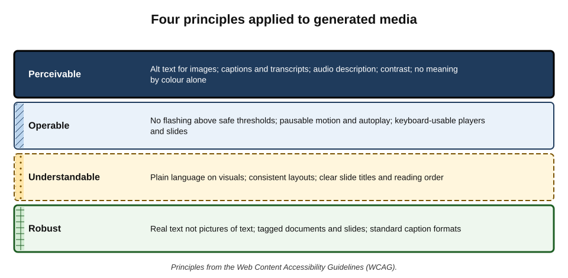
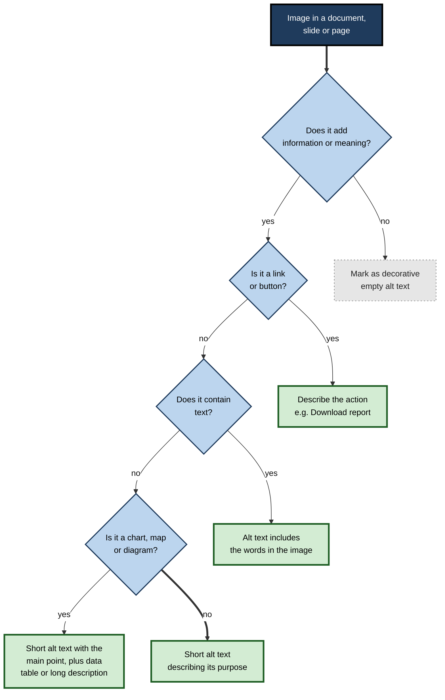
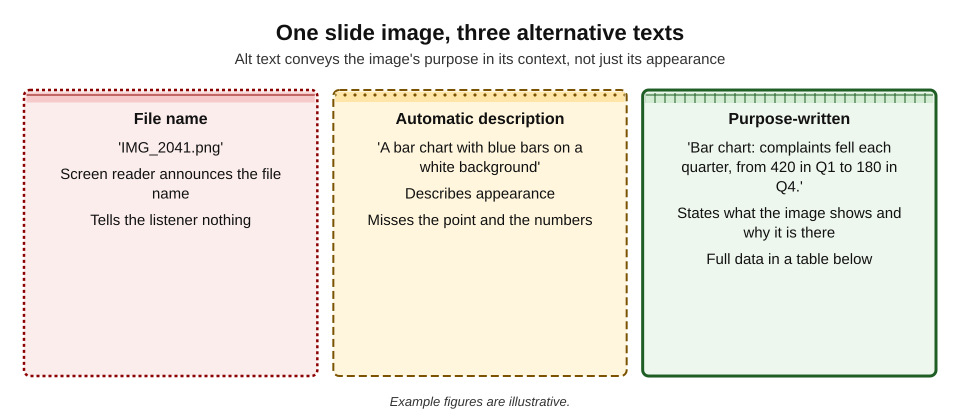
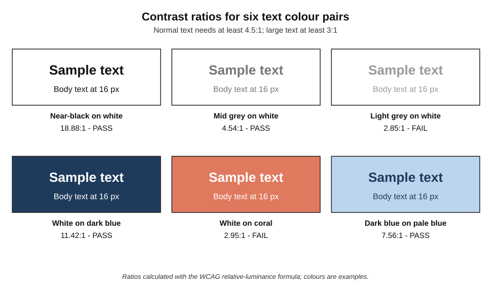
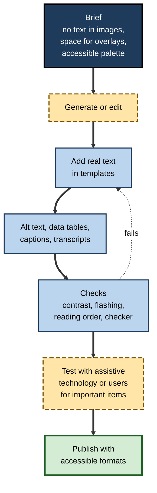

# I.10. Accessibility of generated media

A team generates a striking infographic for a public consultation: soft pastel text on a photographic background, the key figures embedded in the image, an animated version for social media that pulses as each number appears. Sighted colleagues love it. A blind resident's screen reader announces only "image". A resident with low vision cannot read the pale text. A resident with photosensitive epilepsy scrolls past the animation quickly. The consultation was meant to hear from everyone; its central graphic excluded several groups at once.

> **Definition — Accessibility:** the degree to which content, products and services can be used by people with the widest range of abilities, including people with visual, hearing, motor, cognitive and neurological disabilities.

> **Definition — Accessible media:** images, slides, audio and video designed and published so that people can perceive, operate and understand them whatever their sensory, physical or cognitive abilities, often with the help of assistive technology.

**Why it matters**

- **Disability is common.** The World Health Organization estimated in 2022 that about 1.3 billion people — roughly one in six — live with significant disability; many more have temporary or situational limitations (a broken arm, bright sunlight, a noisy train).
- **Generated media is often inaccessible by default** — text baked into images, low-contrast palettes, no alternative text, flashing or rapid motion.
- **Law requires it** in many contexts — public bodies, and increasingly private services, must meet accessibility standards.
- **AI is also an accessibility tool** — automatic descriptions, captions, audio description and simplified text can open content to people who were excluded — if the output is checked.

---

## Who Is Affected, and How

- **Blind and low-vision people**
  - Use **screen readers** (software that reads content aloud or to a braille display), magnification and high-contrast settings.
  - Need **text alternatives** for images, **real text** rather than pictures of text, and good **contrast**.
- **People with colour-vision deficiency**
  - About **8% of men and 0.5% of women** of Northern European ancestry have some form of red–green colour-vision deficiency.
  - Need meaning conveyed **not by colour alone**.
- **Deaf and hard-of-hearing people**
  - Need **captions** and **transcripts** for audio and video.
- **People with photosensitive epilepsy or vestibular disorders**
  - Can be harmed by **flashing** content and by large-scale **motion** (parallax, zooming, spinning).
- **People with cognitive, learning or neurological disabilities**
  - Benefit from **plain language**, consistent layouts, limited distraction and control over timing.
- **People with motor disabilities**
  - Need media players, slide viewers and interactive graphics usable by **keyboard** and switch devices.

> **Definition — Assistive technology:** hardware or software that helps disabled people use content — screen readers, braille displays, magnifiers, switch controls, captioning, voice control.

**Figure 1.** Four principles applied to generated media.

- **WCAG's four principles** — content must be **Perceivable, Operable, Understandable and Robust**.

> **Mnemonic — "POUR":** Perceivable, Operable, Understandable, Robust — the four principles of the Web Content Accessibility Guidelines.

---

## Text Alternatives for Images

### What alt text is for

> **Definition — Alternative text (alt text):** a short text description attached to an image that assistive technology reads in place of the image, conveying its content and purpose.

- **Purpose, not appearance** — say what the image **contributes** in its context.
  - The same photo of a crowded station might be "Commuters queue past closed ticket barriers during the strike" in a news story, and "Busy railway station" as a decorative header.
- **Concise** — usually one or two sentences; longer explanations belong in the surrounding text or a long description.
- **Include text in the image** — if the image contains words (a slogan, a sign, a figure), the alt text must contain them.
- **Do not begin with "image of"** — screen readers already announce that it is an image.
- **Avoid guessing identity** — race, gender, age, disability or emotion should be described only when relevant and known, not inferred from appearance.

> **Watch out:** the widely repeated rule that alt text must be under 125 characters comes from the behaviour of some older screen readers, not from the standard. Brevity is good practice, but completeness of meaning matters more than a character count.

### Decorative, informative and complex images

- **Decorative** — adds nothing to understanding (a background texture, a divider, a mood image repeated next to a heading).
  - Mark as decorative (empty alt text), so screen readers skip it.
- **Informative** — conveys information or meaning.
  - Short alt text describing that information.
- **Functional** — an image that is a link or button.
  - Alt text describes the **action** ("Download the report"), not the picture.
- **Complex** — charts, diagrams, maps, infographics.
  - Short alt text stating the main point, **plus** a long description or data table nearby.
- **Images of text** — avoid; use real text. If unavoidable (a logo), the alt text repeats the words.

**Figure 2.** Deciding what text alternative an image needs.

### AI-generated alt text

- **Where it appears** — office suites, social platforms, content-management systems and image tools now suggest alt text automatically.
- **Strengths** — far better than nothing; fast for large image libraries; useful for people browsing images that others have not described.
- **Weaknesses:**
  - describes **appearance**, not **purpose** ("a group of people sitting at a table");
  - misses the **point** of charts and diagrams;
  - **hallucinates** details or misreads text;
  - makes **identity assumptions** about people;
  - cannot know the **context** in which the image is used.

**Figure 3.** One slide image, three alternative texts.

**Study card — MacLeod and colleagues (2017), blind users and automatic image captions**

- **Design:** researchers at Microsoft Research and the University of Washington studied how blind people interpreted automatically generated descriptions of images on social media, including descriptions that were wrong.
- **Findings:**
  - participants found automatic descriptions valuable;
  - they tended to **trust** the descriptions — sometimes constructing elaborate explanations to reconcile an incorrect description with the surrounding text rather than doubting the description;
  - wording that expressed uncertainty affected trust, but not always in the intended way.
- **Conclusion:** people who cannot see an image **cannot check** its description. Errors in automatic alt text are therefore more harmful than errors visible to sighted readers.

> **Key point:** AI alt text should be treated as a **draft** written for someone who has no way of checking it. The author, who can see the image and knows why it is there, must review and rewrite it.

### Generated images that describe themselves

- **When generating an image, the prompt is a head start** — it already states what the image was meant to show.
- **But the output may differ** — the alt text must describe the image actually produced, not the one requested.
- **Generated infographics** — ensure all figures and labels exist as real text or in a data table, because generated text in images is unreliable and inaccessible.

---

## Colour, Contrast and Legibility

### Contrast ratios

- **WCAG thresholds (Level AA):**
  - **4.5:1** for normal text;
  - **3:1** for large text (roughly 18 point, or 14 point bold) and for essential graphical elements such as chart lines and icons.
- **Generated designs** frequently fail — pastel text on pastel backgrounds, text over photographs, thin light fonts.

> **Formula — Contrast ratio:** (L1 + 0.05) ÷ (L2 + 0.05), where L1 and L2 are the relative luminances of the lighter and darker colours (0 for black, 1 for white). Mid grey #767676 has a relative luminance of about 0.181, so on white: (1 + 0.05) ÷ (0.181 + 0.05) ≈ **4.54:1** — just passing the 4.5:1 threshold. Lighter greys fail.

**Figure 4.** Contrast ratios for six text colour pairs.

> **Example:** white text on a fashionable coral reaches only about 3:1 — borderline even for large headings and far short of the 4.5:1 needed for body text. A common fix is a darker shade of the same hue, or dark text on the coral.

### Colour alone

- **Never convey meaning by colour alone** — "items in red are overdue" fails people who cannot distinguish red.
- **Add a second channel** — labels, icons, patterns, position or text.
  - *e.g.* chart series identified by direct labels and line styles as well as colours.
- **AI-generated charts and diagrams** often rely on colour legends; rebuild them with direct labels.

### Text over images

- **Busy backgrounds** — generated images often have detail everywhere, making overlaid text unreadable.
- **Remedies** — solid or semi-opaque panels behind text; placing text in empty areas generated deliberately ("plain sky on the left third"); darkening the image under the text.

---

## Accessible Slides

- **Unique, meaningful slide titles** — screen-reader users navigate by titles; AI-generated decks with repeated titles ("Overview", "Overview") are hard to navigate.
- **Built-in layouts and placeholders** — preserve reading order; manually drawn text boxes may be read in a random order.
- **Reading order checked** — especially on slides with several text boxes, images and shapes.
- **Alt text on every meaningful image**, decorative images marked as such.
- **Real text, adequate size** — no text baked into generated images.
- **Contrast** of all text and essential graphics.
- **Tables** with header rows, not images of tables.
- **Embedded video** with captions; **audio** with transcripts.
- **Animations and transitions** — minimal; no flashing.
- **Accessible export** — when saving as PDF, use the option that keeps tags and structure.

> **In practice:** presentation and document tools include **accessibility checkers** that flag missing alt text, missing titles, low contrast and reading-order problems. Running the checker on every AI-generated deck catches most structural faults in minutes.

| Fault in a generated deck | Who it affects | Fix |
|---|---|---|
| Text embedded in images | Screen-reader users; low-vision users who enlarge text | Replace with real text in placeholders |
| Repeated or missing slide titles | Screen-reader users navigating by title | Unique action titles in title placeholders |
| Low-contrast palette | Low-vision and older viewers; anyone in bright light | Template colours checked to 4.5:1 |
| Colour-only legends | People with colour-vision deficiency | Direct labels, patterns, icons |
| Decorative images without marking | Screen-reader users (noise) | Mark as decorative |
| Uncaptioned embedded video | Deaf and hard-of-hearing viewers | Add captions; link transcript |

---

## Motion, Flashing and Sound

### Flashing and seizures

- **Photosensitive epilepsy** — flashing lights or rapidly changing patterns can trigger seizures in susceptible people.
- **WCAG rule** — no content that flashes **more than three times in any one-second period**, unless the flashes are below defined size and brightness thresholds.
- **Broadcast guidance** — UK broadcasters follow Ofcom guidance on flashing images and test programmes with automated analysis tools.
- **Generated video** — can produce flicker, strobing textures and rapid frame-to-frame changes; generated animations of "energy" or "excitement" often include flashing.

### Case study: the 1997 Pokémon broadcast

- **Situation:** on 16 December 1997, Japanese television broadcast an episode of the *Pokémon* animated series containing a sequence of rapidly alternating red and blue flashes, lasting a few seconds.
- **What happened:** hundreds of viewers, most of them children, were taken to hospital with symptoms including seizures, nausea and visual disturbances.
- **Investigation:** the flashing sequence was identified as the trigger; many affected children had no previous diagnosis of epilepsy.
- **Response:** Japanese broadcasters adopted guidelines limiting flashing and red flashes in particular; the episode influenced flashing-image guidance internationally and the thresholds later written into accessibility standards.
- **Lesson:** visual effects that seem harmless to most viewers can cause **physical harm** to some. Any generated animation for public use should be checked for flashing.

> **Watch out:** "it only flashes briefly" is no defence. The thresholds are about flashes **per second**; a two-second burst can exceed them.

### Motion

- **Large-scale motion** — parallax scrolling, zooms, spinning and auto-panning backgrounds can cause dizziness and nausea for people with vestibular disorders.
- **Provide control** — pause, stop or hide for any motion lasting more than a few seconds; respect users' "reduce motion" settings where platforms support it.
- **Autoplay** — avoid autoplaying video with sound; allow users to start media themselves.

### Sound

- **Speech clarity** — clear narration, sensible pace, minimal background noise.
- **Background music** — keep it well below speech.

> **Formula — Background sound level:** WCAG's enhanced (AAA) guideline recommends background sound at least **20 dB lower** than foreground speech. If narration averages −16 LUFS, background music should sit around −36 LUFS or lower.

- **Synthetic voices** — choose natural, clear voices; check pronunciation; allow transcripts for those who prefer reading.

---

## AI as an Accessibility Aid

- **Automatic captions and transcripts** — make audio and video accessible quickly, if corrected.
- **Image description** — visual-assistance apps using multimodal models describe surroundings, documents and images to blind users; Be My Eyes launched an AI-powered describer in 2023 alongside its human-volunteer service.
- **Audio description** — AI-generated descriptions and synthetic narration are beginning to make audio description affordable for corporate and educational video.
- **Simplification** — easy-read and plain-language versions of documents and slide text.
- **Sign language** — experimental avatar and translation systems exist, but Deaf communities have raised serious concerns about quality and the replacement of human interpreters.

> **Watch out:** AI accessibility tools shift risk onto the people least able to detect errors. Use them to **increase** access, never as a reason to **stop checking** or to replace accommodations that people have asked for.

---

## The Accessible Media Workflow

**Figure 5.** Building accessibility into generated media from brief to publication.

1. **Brief accessibly** — no text in generated images; leave clear space for overlays; specify an accessible palette.
2. **Generate or edit.**
3. **Add real text** in templates — headings, figures, labels.
4. **Write text alternatives** — alt text, data tables, captions, transcripts.
5. **Check** — contrast, colour-only meaning, flashing, reading order; run the built-in checker.
6. **Test** important items with a screen reader, or with disabled users.
7. **Publish** in accessible formats (tagged PDF, captioned video, HTML rather than image-only posts).

### Worked example (illustrative): repairing the consultation infographic

**Situation:** the council's generated infographic from the opening must be made accessible before the consultation launches.

| Problem | Fix |
|---|---|
| Key figures embedded in the generated image | Image regenerated without text; figures added as real text in the template |
| Pale lilac text on photographic background (about 2:1) | Dark text on a solid white panel (above 12:1) |
| Colour-coded map legend | Areas labelled directly; patterns added |
| No alt text | "Infographic: three proposed changes to bus routes, each summarised in the text below." Full content provided as accessible web text |
| Animated version flashing five times per second as numbers appear | Animation slowed to a fade; no flashes |
| Social post as image only | Post text repeats the three key points |

*Illustrative scenario and figures.*

- **Conclusion:** every fix kept the design's message and most of its appearance; the main change was moving words **out of pixels and into text**.

> **Remember:** **words belong in text, not in pixels.** It is the single change that most improves the accessibility of generated media.

---

## Law and Organisational Practice

- **Standards** — WCAG 2.2 (2023) is the current version; laws often reference 2.1 or 2.2 at Level AA.
- **United Kingdom** — public-sector bodies must meet accessibility regulations for websites, apps and documents; the Equality Act 2010 requires reasonable adjustments.
- **European Union** — the European Accessibility Act applies from June 2025 to many private-sector products and services, including e-commerce, banking and e-books.
- **United States** — the Americans with Disabilities Act has been applied to websites and online media; a 2024 federal rule set WCAG 2.1 AA as the standard for state and local government web content on a phased timetable.
- **India** — the Rights of Persons with Disabilities Act 2016 and government guidelines for websites set accessibility duties for public bodies.

### Case study (illustrative): an accessibility gate for marketing content

- **Situation:** a retailer's marketing team adopted AI image and video generation, increasing output fourfold.
- **Problem:** an accessibility audit found that most social posts were images of text, most videos lacked corrected captions and a generated sale animation contained rapid flashing.
- **Actions:**
  1. **brief template** requiring "no text in image" and an accessible palette;
  2. **alt text** written by the person who commissioned each asset, with AI drafts as a starting point;
  3. **automated checks** for contrast and flashing in the publishing workflow;
  4. **captions corrected** before any video goes live;
  5. **quarterly review** with a panel of disabled customers.
- **Result:** audit failures fell sharply; engagement on posts with real text and clear captions was at least as good as before.
- **Lesson:** accessibility holds up under high volume only when it is **built into the brief and the workflow**, not bolted on after publication.

---

## Audio Description and Cognitive Access

### Audio description in practice

> **Definition — Audio description:** additional narration that describes important visual information — actions, scene changes, on-screen text, charts — for blind and low-vision viewers, usually inserted in natural pauses in the dialogue.

- **When it is needed** — whenever important information is **only** visual: a chart the speaker does not explain, on-screen text, a demonstration of a procedure, a silent scene.
- **Integrated description** — often the best solution for workplace video: the presenter **says what is shown** ("This chart shows complaints falling every quarter, from 420 to 180"), so no separate description is needed.
- **Standard description** — narration fitted into existing pauses.
- **Extended description** — the video pauses to allow longer description; suitable for dense training content.
- **AI assistance** — models can draft descriptions of scenes and synthetic voices can narrate them; describers' judgement about **what matters** remains the hard part.

> **In practice:** scripting presenters to **describe their own visuals** is the cheapest and most effective audio-description strategy for training and corporate video — and it improves the video for every viewer.

### Cognitive accessibility

- **Plain language** on slides, infographics and captions — short sentences, common words, one idea per line.
- **Consistent layout** — the same place for titles, the same order of elements on each slide.
- **Limited distraction** — no decorative motion, moderate use of images.
- **Clear structure** — headings that say what follows; numbered steps for procedures.
- **Time** — control over pace: pausable video, no auto-advancing slides.
- **Easy-read versions** — simplified text with supporting images for people with learning disabilities; AI can draft them, but they should be tested with intended readers.

> **Watch out:** AI simplification can **drop conditions and exceptions** ("you can claim travel costs" instead of "you can claim travel costs if you have a receipt and claim within 30 days"). Simplified versions must keep everything the reader needs to act correctly.

### Accessible documents from AI tools

- **Headings as styles** — documents generated or converted by AI should use real heading styles, not bold text, so that screen-reader users can navigate.
- **Tables with headers** — real tables, not images or tab-aligned text.
- **Lists as lists** — real list formatting.
- **Language set** — the document's language property set correctly so screen readers pronounce words properly.
- **Tagged PDFs** — export with tags; image-only PDFs (including scans and "flattened" designs) are inaccessible.
- **Links** — descriptive link text rather than "click here".

| Format | Common AI-era fault | Accessible alternative |
|---|---|---|
| Social graphic | Key message only in the image | Repeat the message in the post text; alt text |
| Infographic | Data embedded as pixels | Real text plus a data table or accessible web version |
| Slide deck | Generated images of text; repeated titles | Placeholders with real text; unique titles |
| PDF report | Exported without tags | Tagged export; check with an accessibility checker |
| Video | Uncorrected automatic captions | Corrected captions; transcript; integrated description |
| Podcast | No transcript | Transcript with speaker labels |

### Testing with people

- **Automated checks** find missing alt text, low contrast and flashing; they cannot judge whether alt text is meaningful or a layout is understandable.
- **Screen-reader spot checks** — listening to a slide or page with a screen reader reveals reading-order and labelling problems quickly.
- **User testing** — for important public content, testing with disabled people finds problems no checklist anticipates.

---

## Open Questions

- **Can AI-generated descriptions become reliable enough to trust?**
  - Multimodal models describe images far better than earlier systems, but hallucination and missing context remain, and users who cannot see cannot verify.
- **Will AI audio description be accepted?**
  - It could make description widespread; quality, voice and judgement about what matters are debated by blind audiences and describers.
- **How should identity be described?**
  - Communities and guidelines differ on when and how to describe race, gender and disability in alt text, and AI systems inferring identity raise further concerns.
- **Can accessibility checks be fully automated?**
  - Contrast, flashing and missing alt text can be detected; whether alt text is *meaningful* still needs human judgement.
- **Will generated media widen or narrow the accessibility gap?**
  - Volume is rising faster than checking capacity in many organisations; whether tools close or widen the gap depends on workflow choices.

---

## Summary

- **Accessible media** can be perceived, operated and understood by people with a wide range of abilities; about one in six people live with significant disability.
- Follow **POUR** — Perceivable, Operable, Understandable, Robust.
- **Alt text** conveys an image's **purpose in context**; mark decorative images; describe actions for functional images; give charts a short alt text plus a **data table or long description**; avoid images of text.
- **AI alt text** describes appearance and can hallucinate; blind users tend to **trust** it (MacLeod and colleagues, 2017), so authors must review it.
- **Contrast**: 4.5:1 for normal text, 3:1 for large text and essential graphics — ratio = (L1 + 0.05) ÷ (L2 + 0.05); never use **colour alone**.
- **Accessible slides**: unique titles, placeholders, reading order, real text, contrast, captions, minimal animation, tagged export; run the **checker**.
- **No more than three flashes per second**; the **1997 Pokémon** broadcast showed the harm flashing can cause. Give control over motion; keep background sound well below speech.
- AI can **widen access** — captions, descriptions, simplification — but shifts risk to those least able to detect errors.
- Build accessibility into the **brief and workflow**: words in text, not pixels.

---

## Self-Check

1. Define accessibility and give the four POUR principles.
2. Which groups are affected by inaccessible generated media, and how?
3. Write alt text for the same photograph of a crowded station used (a) in a news article about a strike and (b) as a decorative page header.
4. Explain how decorative, functional and complex images should be handled.
5. Why are errors in AI-generated alt text especially harmful? Cite the relevant study.
6. Calculate the contrast ratio of text with relative luminance 0.05 on a background of 0.6, and say whether it passes for normal text.
7. Why should meaning not be carried by colour alone? Give a fix for a colour-coded chart.
8. List six checks for an AI-generated slide deck.
9. What is the WCAG flashing threshold, and what does the 1997 Pokémon incident illustrate?
10. How loud should background music be relative to narration under WCAG's enhanced guideline?
11. Describe three ways AI can improve accessibility and the main risk in each.
12. Repair plan: a generated poster with embedded text, pastel colours and an animated version. What would you change?
13. How can an organisation keep generated media accessible as volume rises?

### Answer Key

1. The degree to which content can be used by people with the widest range of abilities. Perceivable, Operable, Understandable, Robust.
2. Blind and low-vision people (no alt text, images of text, low contrast); people with colour-vision deficiency (colour-only meaning); deaf and hard-of-hearing people (no captions); people with photosensitive epilepsy or vestibular disorders (flashing, motion); people with cognitive disabilities (complex language, clutter); people with motor disabilities (inaccessible players and controls).
3. (a) "Commuters queue behind closed ticket barriers at a crowded station during the strike." (b) Decorative: empty alt text, or "Busy railway station" if it adds context.
4. Decorative: empty alt text so it is skipped. Functional: describe the action. Complex: short alt text with the main point plus a data table or long description nearby.
5. Users who cannot see cannot check the description and tend to trust it, even reconciling wrong descriptions with context (MacLeod and colleagues, 2017).
6. (0.6 + 0.05) ÷ (0.05 + 0.05) = 0.65 ÷ 0.10 = 6.5:1 — passes 4.5:1.
7. About 8% of men and 0.5% of women of Northern European ancestry have colour-vision deficiency, and colour is lost in some displays. Add direct labels, patterns, line styles or icons.
8. Unique titles; placeholders and reading order; alt text or decorative marking; real text not images of text; contrast; captions on video; minimal animation and no flashing; accessible tables; checker run; tagged export.
9. No more than three flashes in any one second (unless below size and brightness thresholds). Brief flashing sequences can cause seizures and other symptoms in many viewers, including those without a diagnosis.
10. At least 20 dB below the speech.
11. Captions — errors in names and numbers; image description — hallucination and unverifiable errors; simplification — loss of nuance or accuracy; (audio description — misjudging what matters).
12. Regenerate without text and add real text; use an accessible palette with checked contrast or text panels; direct labels rather than colour legends; alt text and full text version; animation checked and slowed to avoid flashing; captions if there is sound.
13. Accessible brief templates; alt text owned by commissioners; automated contrast and flashing checks; caption correction before publication; accessibility checkers in the workflow; periodic audits and review with disabled users.

---

## Glossary

| Term | Meaning |
|---|---|
| Accessibility | Usability of content by people with the widest range of abilities. |
| Accessibility checker | A built-in tool that flags common accessibility faults in documents and slides. |
| Alt text | A short text alternative read in place of an image. |
| Assistive technology | Tools such as screen readers, magnifiers and switch controls used by disabled people. |
| Colour-vision deficiency | Reduced ability to distinguish certain colours, most often red and green. |
| Complex image | A chart, map, diagram or infographic needing a long description or data table. |
| Contrast ratio | (L1 + 0.05) ÷ (L2 + 0.05), comparing the luminance of two colours. |
| Decorative image | An image adding no information, marked so assistive technology skips it. |
| Long description | A fuller text explanation of a complex image, placed near it. |
| Photosensitive epilepsy | A form of epilepsy in which seizures can be triggered by flashing light or patterns. |
| POUR | Perceivable, Operable, Understandable, Robust. |
| Reading order | The sequence in which assistive technology reads elements of a page or slide. |
| Relative luminance | The relative brightness of a colour, from 0 (black) to 1 (white). |
| Screen reader | Software that reads on-screen content aloud or to a braille display. |
| WCAG | Web Content Accessibility Guidelines, the international accessibility standard. |
