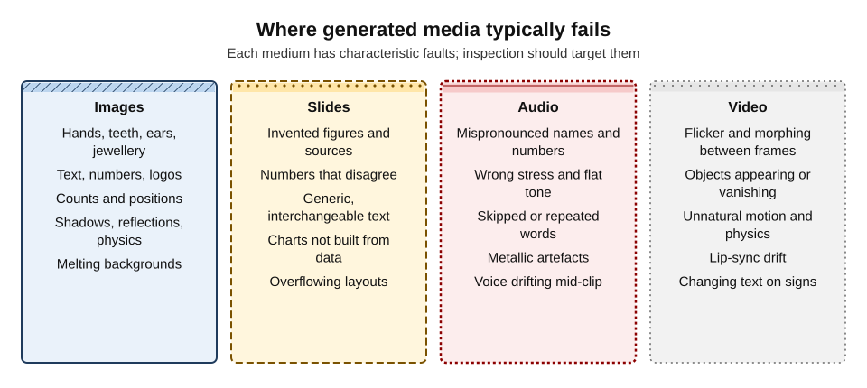
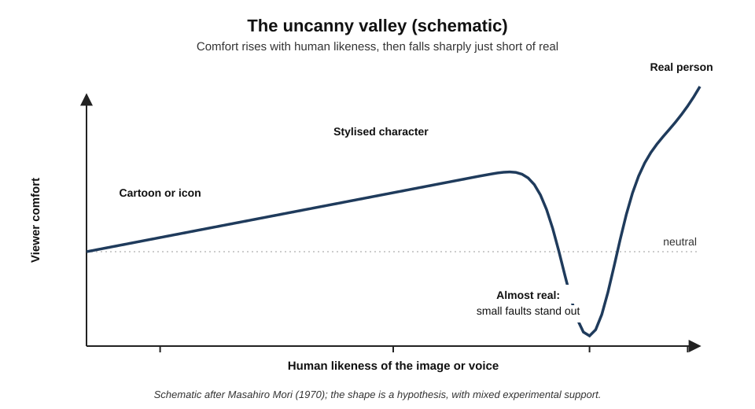
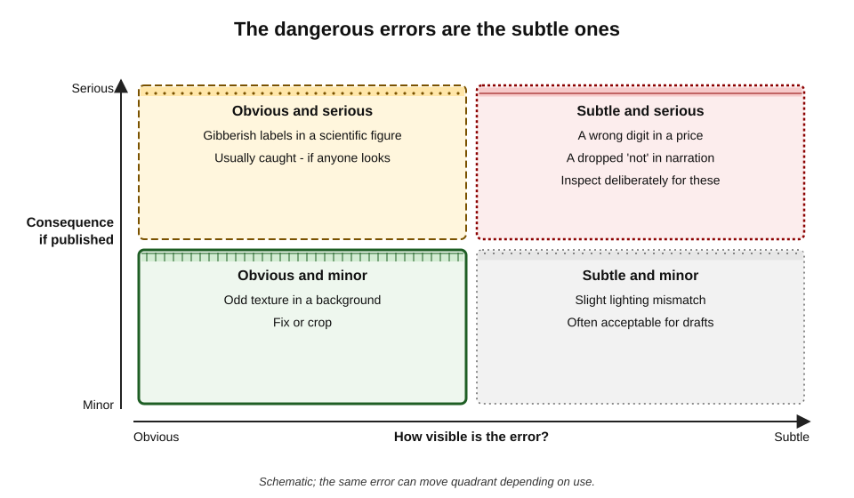
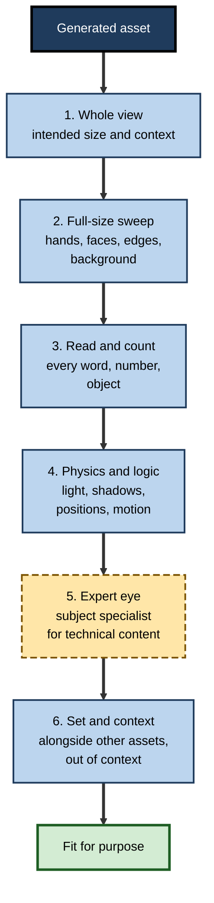
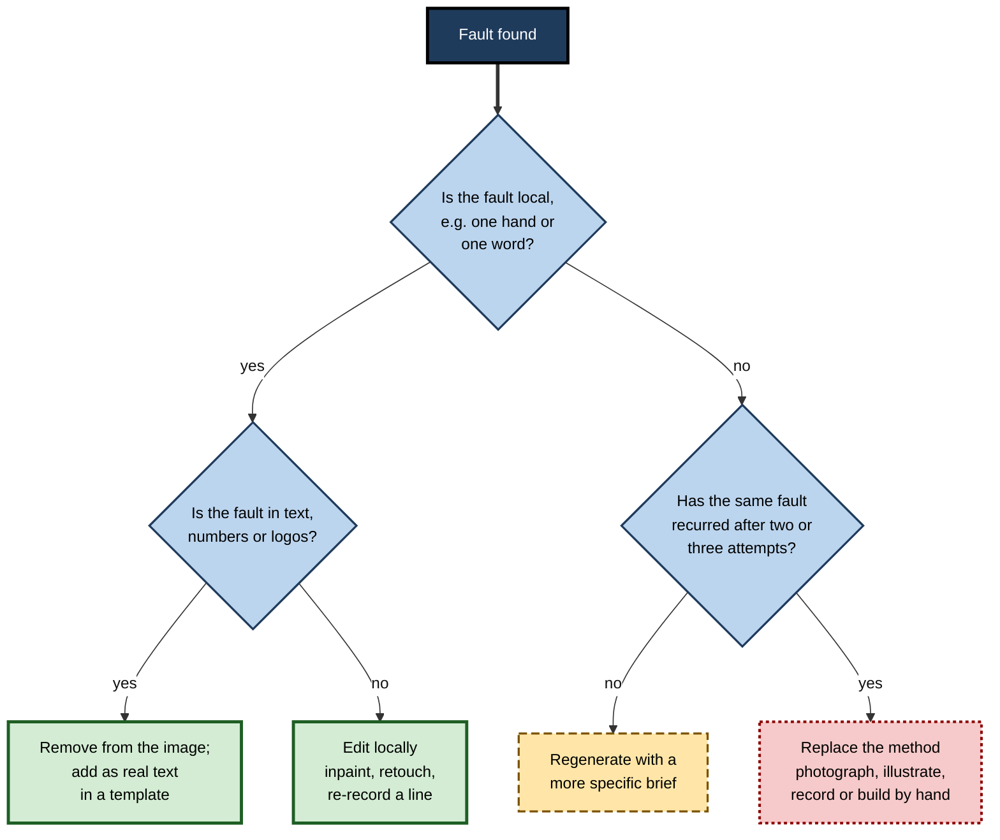

# I.11. Quality limits to watch for

In February 2024 a peer-reviewed biology journal published a paper whose figures included an anatomically absurd rat and diagrams labelled with invented words. The images had been generated with an AI tool and disclosed as such; they had passed through submission, review and publication. Within days the paper was retracted and the images were being shared worldwide as a symbol of what happens when generated media is not looked at properly. The faults were not hidden. Nobody with the job of looking had looked.

> **Definition — Quality limit (of generated media):** a systematic weakness in what a generative tool can reliably produce — a kind of error it makes repeatedly, which a user must anticipate and check for.

> **Definition — Artefact:** a visible or audible flaw introduced by the generation or processing method rather than present in the intended subject — such as warped text, extra fingers, metallic voice tones or flickering video.

**Why it matters**

- **Generated media is fluent.** It looks finished, so errors hide in plain sight.
- **Errors are patterned.** Each medium fails in characteristic ways; knowing the patterns makes checking fast.
- **The serious errors are often the subtle ones** — a wrong digit, a dropped word, an implausible but unnoticed detail.
- **Responsibility stays with the publisher.** "The tool did it" is not a defence for a misleading or embarrassing asset.

---

## Why Generated Media Fails

Generative models learn the **statistics of appearance**: what images, sounds and videos matching a description tend to look and sound like. Most quality limits follow from that.

- **No model of the world** — a generator knows what hands usually look like, not how many fingers a hand has or how joints bend.
  - Errors appear where structure matters more than texture: hands, teeth, mechanical parts, architecture.
- **Weak symbolic precision** — text, numbers, counts and exact positions are rules, not textures.
  - Recent models render text far better than early ones, but errors persist in longer text, small text and non-Latin scripts.
- **Composition is hard** — binding the right attribute to the right object ("a red cube on a blue sphere") and placing several objects correctly.
- **Physics and consistency** — reflections, shadows, perspective and, in video, motion and object permanence must agree across the scene and across frames.
- **Training-data gaps** — rare subjects, specialist equipment, non-Western settings and technical diagrams are underrepresented and rendered worse.
- **Sampling randomness** — the same prompt gives different results; a good first output does not guarantee a good second one.

**Study card — T2I-CompBench (2023), testing compositional generation**

- **Design:** researchers built a benchmark of thousands of prompts testing whether text-to-image models correctly bind **attributes** (colour, shape, texture) to objects, place objects in stated **spatial** relationships, and handle **complex** combinations.
- **Findings:** the leading models of the time performed reasonably on single objects but often failed when prompts combined several objects with different attributes or specified positions — colours "leaked" between objects and spatial relations were ignored.
- **Since then:** newer models have improved substantially on such tests, but compositional errors have not disappeared.
- **Conclusion:** the more **specific relationships** a prompt demands, the more likely the output is to get one of them wrong.

> **Key point:** generators are strongest at **mood, texture and style** and weakest at **structure, symbols and relationships** — which is exactly where professional content most needs to be right.

---

## A Catalogue of Failure

**Figure 1.** Where generated media typically fails.

### Images

- **Anatomy** — extra, missing or fused fingers; too many teeth; mismatched ears and earrings; limbs that merge with furniture.
- **Text and symbols** — misspelled or invented words, distorted logos, wrong flags, nonsense on signs, screens and documents.
- **Counts** — "five people" becomes six; "three windows" becomes four.
- **Spatial relations** — left and right swapped; objects floating; scale inconsistent.
- **Light and physics** — shadows in different directions; reflections that show something else; impossible structures.
- **Background degradation** — faces in crowds melt; patterns and lettering dissolve at the edges.
- **Specialist subjects** — equipment, uniforms, vehicles, medical and scientific detail plausible to a lay viewer, wrong to an expert.

### Slides and documents

- **Invented content** — statistics, sources, quotations and case examples that do not exist.
- **Internal inconsistency** — a figure on one slide contradicting another.
- **Genericness** — text that could describe any organisation.
- **Layout faults** — text overflowing placeholders, misaligned elements, shrunken fonts.
- **Pictures of charts** — generated "charts" whose bars and labels mean nothing.

### Audio

- **Pronunciation** — names, acronyms, numbers, foreign words and technical terms.
- **Prosody** — wrong emphasis, flat delivery, questions that sound like statements.
- **Omissions and repetitions** — skipped words or repeated phrases in long passages.
- **Artefacts** — metallic or warbling tones, clicks, breaths in odd places.
- **Voice drift** — a synthetic voice subtly changing character over a long recording.

### Video

- **Temporal flicker** — textures and details shimmering between frames.
- **Morphing** — faces, hands and objects changing shape mid-shot.
- **Object permanence** — items appearing, vanishing or multiplying.
- **Motion and physics** — walking that slides, liquids that behave like gel, wheels that glide rather than turn.
- **Lip-sync drift** — mouth movements falling out of step with speech.
- **Text instability** — words on signs and screens changing from frame to frame.

| Medium | Most frequent fault | Most dangerous fault | Fastest check |
|---|---|---|---|
| Image | Hands, text, background faces | A plausible but false detail in a factual image | Full-size inspection; read every word aloud |
| Slides | Generic wording | An invented or inconsistent number | Trace every figure to a source |
| Audio | Mispronunciation | A misread number or dropped negation | Listen at normal speed against the script |
| Video | Flicker and morphing | A misleading action or expression | Watch key moments frame by frame |

---

## Realism Is Not Quality

### Faces people cannot tell apart

**Study card — Nightingale and Farid (2022), synthetic faces**

- **Design:** participants in online experiments judged whether faces were real photographs or generated by a then state-of-the-art face generator (StyleGAN2); another group rated faces for trustworthiness.
- **Findings:**
  - accuracy at telling real from synthetic was **close to chance** — around 50%;
  - training with feedback improved accuracy only modestly;
  - synthetic faces were rated slightly **more trustworthy** than real ones on average.
- **Conclusion:** for some content, generated media has crossed the point where **inspection by eye cannot reveal its origin** — so quality checking must target what matters (accuracy, appropriateness), not just whether the image "looks real".

### The uncanny valley

**Figure 2.** The uncanny valley.

- **Masahiro Mori** (1970), a Japanese roboticist, proposed that as robots become more humanlike, people's affinity rises — until a point near full likeness, where small imperfections cause a sharp drop into unease, before rising again for real humans.
- **Evidence:** some studies support a dip; Maya Mathur and David Reichling (2016), using photographs of real robot faces, found likeability and trust fell for faces that were nearly but not quite human. Other studies find weaker or inconsistent effects.
- **Relevance:** synthetic presenters, avatars and near-real faces can trigger unease that undermines the message, even when viewers cannot say what is wrong.

> **Watch out:** the uncanny valley is a **useful hypothesis**, not an established law; its existence and shape vary with stimuli and audiences. The practical lesson stands: **near-real but slightly wrong** is often worse than clearly stylised.

---

## The Errors That Matter

**Figure 3.** The dangerous errors are the subtle ones.

- **Obvious and minor** — a strange background texture; fix or crop.
- **Obvious and serious** — gibberish labels in a scientific figure; caught if anyone looks.
- **Subtle and minor** — slight lighting mismatch; often acceptable.
- **Subtle and serious** — a wrong digit in a price, a dropped "not" in narration, an incorrect safety step shown in a training image.
  - These need **deliberate, targeted checks**, because no one notices them by accident.

> **Remember:** **check the facts in the media, not just the look of it.** Numbers, names, negations, safety steps and depicted procedures deserve the closest inspection.

### Fit for purpose

| Use | Acceptable residual faults | Must be flawless |
|---|---|---|
| Internal brainstorm or mood board | Most artefacts | Nothing offensive or misleading if shared |
| Internal training slide | Minor background artefacts | Procedures, safety information, numbers |
| Public social post | Barely noticeable texture faults | Text, logos, hands and faces in focus, claims |
| Advertising | None visible at intended size | Product depiction, prices, claims, people |
| Scientific, medical or legal material | None — generated imagery usually inappropriate | Everything |

---

## Inspecting Generated Media

**Figure 4.** A targeted inspection routine for generated media.

1. **Whole view** — at the size and in the context where it will be seen: slide, phone screen, poster.
2. **Full-size sweep** — zoom to 100% and scan systematically: hands, faces, eyes, teeth, edges of objects, background people, patterns.
3. **Read and count** — read every word aloud, check every number, count objects and people against the brief.
4. **Physics and logic** — light direction, shadows, reflections, perspective, gravity; in video, continuity across frames.
5. **Expert eye** — for anything technical (machinery, anatomy, procedures, uniforms, cultural detail), ask someone who knows.
6. **Set and context** — view alongside the other assets and imagine it cropped and shared without its caption.

### Why reviewers miss obvious faults

**Study card — Simons and Chabris (1999), inattentional blindness**

- **Design:** participants watched a video of two teams passing basketballs and counted the passes made by one team. Midway, a person in a gorilla suit walked through the scene, faced the camera and walked off.
- **Findings:** about half of participants **did not notice the gorilla** at all.
- **Explanation:** attention focused on one task filters out unexpected information, even when it is large and central.
- **Relevance:** a reviewer checking a generated image for "does it look good?" or a deck for "is the layout right?" can miss a sixth finger, an invented label or a wrong price. People see what they are looking **for**.

> **Key point:** inspection works when it is **targeted** — looking deliberately for the known failure types, one at a time — rather than a general impression of quality.

### Medium-specific techniques

- **Images** — flip horizontally (fresh eyes catch asymmetries); view as a small thumbnail (composition) and at 200% (detail).
- **Slides** — slide-sorter view for consistency; list every number with its source.
- **Audio** — listen on both headphones (artefacts) and a laptop speaker (intelligibility); follow along with the script for omissions.
- **Video** — watch once at normal speed for overall impression, then step through key moments (faces, hands, text, actions) frame by frame; watch muted with captions to check that the picture alone tells the story.

> **In practice:** professional reviewers **look for specific faults in a fixed order** rather than "looking it over". Targeted inspection is faster and finds far more than general viewing.

### Automated quality measures

- **Benchmark metrics** — researchers measure image generators with scores such as the **Fréchet Inception Distance** (FID; Martin Heusel and colleagues, 2017), which compares the statistics of generated and real images, and **CLIPScore** (Jack Hessel and colleagues, 2021), which estimates how well an image matches its text prompt.
- **What they are good for** — comparing models across thousands of images.
- **What they cannot do** — tell a professional whether **this** image is accurate, appropriate and fit for **this** use.

> **Watch out:** a tool advertised as "state of the art" on benchmarks can still produce the wrong number of fingers, an invented label or a misleading scene in any individual output. Benchmarks measure averages; publication risk lives in individual assets.

---

## Fix, Regenerate or Replace

**Figure 5.** Deciding what to do with a faulty generated asset.

- **Local faults** — fix with inpainting, retouching, re-synthesising a single line of audio.
- **Text, numbers and logos** — remove from the generated image and add as **real text** in an editable layer.
- **Global faults** — regenerate with a more specific brief (fewer elements, simpler composition, explicit exclusions).
- **Persistent faults** — after two or three attempts, **change the method**: the subject is beyond the tool's reliable range.

> **Mnemonic — "FIX, TEXT, RETRY, REPLACE":** fix local faults, move text out of pixels, retry with a better brief, replace the method when faults persist.

---

## Case Study: The Retracted Rat Figure

- **Situation:** in February 2024 the journal *Frontiers in Cell and Developmental Biology* published a review article on stem-cell signalling. Its figures had been generated with Midjourney, as the authors stated in the paper.
- **The faults:**
  - an illustration of a rat with grossly impossible anatomy;
  - diagrams of cells and signalling pathways labelled with **invented, misspelled words** that resembled scientific terms;
  - structures that matched no real biology.
- **What happened:** the figures circulated widely on social media within days; the publisher retracted the article and acknowledged that it did not meet its standards, and the episode prompted scrutiny of how peer review had missed the figures.
- **Analysis:**
  1. **Wrong tool for the purpose** — scientific figures are data and explanation; generated imagery cannot ensure accuracy.
  2. **Obvious faults went unchecked** — the errors were visible to any reader who looked at the labels.
  3. **Disclosure did not substitute for checking** — the authors had stated AI use, but disclosure does not make inaccurate content acceptable.
  4. **Multiple failed gates** — authors, reviewers and editors each assumed someone else had checked.
- **Lesson:** quality limits are predictable. For technical, scientific and instructional images, **generated media is the wrong method**, and any image that is published must be **read**, not just seen.

> **Example:** in the same month, an immersive "chocolate experience" event in Glasgow was advertised with lavish AI-generated images — complete with garbled words on the posters. Visitors who paid for tickets found a sparsely decorated warehouse; the organiser offered refunds and the event became an international news story. The images promised what reality could not deliver, and their gibberish text was a warning sign that nobody heeded.

---

## Worked Example (illustrative): Quality Review of a Generated Explainer Video

**Situation:** a software company produced a 90-second explainer video with generated scenes, a synthetic narrator and AI-generated captions. A reviewer logs every fault with a severity rating.

| Time | Fault | Medium | Severity | Action |
|---|---|---|---|---|
| 0:07 | Presenter's hand gains a sixth finger for four frames | Video | Minor at intended size; visible on pause | Regenerate shot |
| 0:15 | Narrator says "S-Q-L" as "sequel" inconsistently | Audio | Minor | Fix pronunciation in script |
| 0:31 | On-screen dashboard shows nonsense labels | Video | Serious — product misrepresented | Replace with real screen recording |
| 0:44 | Price stated as "£19 per user" — correct price £29 | Audio and captions | Serious | Correct script and captions; re-synthesise line |
| 0:58 | Office background people morph between frames | Video | Minor | Blur background or recompose |
| 1:12 | Caption reads "can't export"; narration says "can export" | Captions | Serious | Correct caption file |
| 1:25 | Logo rendered inside the scene, distorted | Video | Serious for brand | Remove; overlay real logo |

*Illustrative figures.*

1. **Targeted pass** in the order: words and numbers, product depiction, people, brand, physics.
2. **Severity assigned** by consequence, not by how noticeable the fault is.
3. **Three serious faults** were in content (price, product, negation), not appearance.
4. **Method change** for the dashboard: generated imagery replaced by a real screen recording.

- **Conclusion:** the most visible fault (the sixth finger) was minor; the most damaging (the wrong price) was invisible to anyone not checking the script.

> **Watch out:** reviewers' attention is drawn to the **strange-looking** faults. Build severity on consequence: a wrong price, product claim or negation outranks every extra finger.

---

## Building Quality Into Practice

- **Brief within the tool's range** — fewer elements, simpler compositions, no text in images, no technical diagrams.
- **Plan the method by content type** — generate mood and illustration; photograph, record or build from data what must be accurate.
- **Inspect with a routine**, not by impression.
- **Use subject experts** for technical, medical, legal, cultural and safety content.
- **Log faults** — recurring faults reveal where a tool should not be used.
- **Budget review time** — quality checking is part of the cost of generated media, not an optional extra.

### Case study (illustrative): a safety-training image library

- **Situation:** a construction firm generated 200 images for safety induction materials.
- **Problem:** a site supervisor noticed that several images showed workers with harnesses clipped to nothing, hard hats worn backwards and scaffolding without guard rails — unsafe practices presented as correct.
- **Diagnosis:**
  - images were reviewed by communications staff for appearance, not by safety specialists for content;
  - the generator produced "typical-looking" construction scenes, including typical unsafe ones from its training data.
- **Actions:**
  1. all images reviewed by a safety officer; 60 withdrawn;
  2. images depicting **procedures and equipment** replaced with photographs of the firm's own correctly equipped staff (with consent);
  3. generated images retained only for scene-setting where no procedure is shown;
  4. a rule that any image depicting a **procedure** is reviewed by a subject expert.
- **Result:** induction materials passed external audit; supervisors reported fewer questions from new starters about contradictory images.
- **Lesson:** generators reproduce the **typical**, and the typical is not always the **correct**. Where an image teaches a procedure, accuracy must be checked by someone who knows the procedure.

---

## Limits That Depend on the Medium

### Synthetic speech

- **How quality is judged** — listening tests remain the standard; researchers ask listeners to rate naturalness on a five-point scale and average the ratings.

> **Definition — Mean opinion score (MOS):** the average of listeners' ratings of audio quality or naturalness on a scale from 1 (bad) to 5 (excellent), a method standardised for telephony and widely used for synthetic speech.

> **Formula — Mean opinion score:** MOS = sum of ratings ÷ number of ratings. Ten listeners rate a narration 5, 4, 4, 5, 3, 4, 4, 5, 4, 4: sum 42 ÷ 10 = **4.2**. A high average can still hide one misread number — MOS measures naturalness, not accuracy.

- **Persistent weak points:**
  - numbers, dates, currencies and abbreviations ("£1.5m", "Q3", "Dr") read wrongly;
  - names from languages other than the voice's main language;
  - long sentences losing natural phrasing;
  - emotional range — sympathy, urgency and humour sound flat or forced.
- **Mitigations** — write for the ear (spell out numbers and abbreviations), use pronunciation dictionaries, keep sentences short, listen to every line.

### Long-form video

- **Clip length** — many generators produce short clips; longer pieces are assembled from many, multiplying continuity errors.
- **Continuity** — characters' faces, clothing and props drift between clips; settings change.
- **Planning** — storyboard each shot; reuse reference images for characters and settings; prefer cutaways and graphics over long generated sequences.
- **Mixed productions** — real footage for people and products; generated material for transitions, backgrounds and concepts.

### Text inside images

- **Better but not solved** — recent models render short, common words well; longer phrases, small sizes, unusual words and non-Latin scripts remain unreliable.
- **Subtle errors** — a single wrong letter, a swapped digit, a plausible but wrong word.
- **Rule** — treat any text in a generated image as **untrusted** until read letter by letter; for anything that matters, put text in an editable layer instead.

### Series and sets

- **Single images can pass while sets fail** — inconsistent style, lighting, people or colours across a campaign.
- **Patterns appear only in sets** — who is shown leading or serving, which groups are absent.
- **Review sets together**, as audiences will encounter them.

| Medium | Quality limit that persists | What reduces it |
|---|---|---|
| Synthetic speech | Numbers, names, emotion | Writing for the ear; pronunciation dictionaries; human narration for sensitive content |
| Long video | Continuity across clips | Storyboards; references; mixing real footage |
| Text in images | Letter-level errors | Text in editable layers |
| Image sets | Inconsistency and patterned bias | Set review; style packs |
| Technical depiction | Plausible but wrong detail | Real photography; expert review |

---

## Open Questions

- **Will quality limits disappear?**
  - Each model generation fixes visible faults (hands, text); errors in structure, relationships and specialist detail are more persistent, and new media (long video) bring new faults.
- **Can automated checks find content errors?**
  - Tools can flag text artefacts and anatomical faults; judging whether a depicted procedure or diagram is correct still requires expertise.
- **How will audiences' tolerance change?**
  - Viewers increasingly recognise an "AI look"; whether this lowers trust or becomes accepted is unclear and may differ by context.
- **Who is accountable in multi-step pipelines?**
  - When assets pass through several people and tools, responsibility for checking can fall between them, as the retracted figure showed.
- **How should severity be standardised?**
  - Organisations use ad hoc scales; shared standards for media quality review are rare.

---

## Summary

- **Quality limits** are systematic weaknesses of generative tools; **artefacts** are the flaws they introduce.
- Generators learn the **statistics of appearance**: strong on mood, texture and style; weak on **structure, symbols, counts, relationships, physics** and rare subjects (T2I-CompBench, 2023).
- Each medium fails characteristically: **images** (hands, text, counts, light), **slides** (invented and inconsistent figures, generic text), **audio** (pronunciation, prosody, omissions), **video** (flicker, morphing, object permanence, motion).
- **Realism is not quality**: people cannot reliably tell synthetic faces from real ones (Nightingale and Farid, 2022); near-real faults can trigger unease (the **uncanny valley**, a contested hypothesis).
- The dangerous errors are **subtle and serious** — numbers, names, negations, procedures. Check the facts in the media.
- Set acceptable faults by **purpose**; scientific, medical and legal uses rarely suit generation.
- Inspect with a **routine**: whole view, full-size sweep, read and count, physics and logic, expert eye, set and context.
- Benchmarks (FID, CLIPScore) compare models; they cannot certify an individual asset.
- **Fix, text, retry, replace** — and change the method when faults persist.
- The **retracted rat figure** (2024) shows that disclosure does not replace checking, and that every gate must look.

---

## Self-Check

1. Define a quality limit and an artefact.
2. Explain, from how generators learn, why they struggle with hands, text and counts.
3. What did T2I-CompBench test, and what did it find?
4. List three characteristic faults each for images, slides, audio and video.
5. What did Nightingale and Farid find, and what does it imply for quality checking?
6. Describe the uncanny valley and the strength of the evidence for it.
7. Why are subtle, serious errors the most dangerous? Give three examples.
8. What residual faults are acceptable in an internal mood board, and what must be flawless in an advert?
9. Describe the six-step inspection routine.
10. What do FID and CLIPScore measure, and why are they insufficient for publication decisions?
11. A generated poster has a perfect scene but a misspelled product name. What should be done?
12. Analyse the retracted-figure case: which gates failed, and what is the lesson for technical imagery?
13. In the illustrative explainer review, why was the wrong price more serious than the extra finger?
14. Propose rules for using generated images in safety or procedural training.

### Answer Key

1. A quality limit is a systematic weakness in what a tool reliably produces; an artefact is a flaw introduced by the method rather than the subject.
2. Models learn statistical patterns of appearance, not rules or structure; hands, text and counts depend on exact structure and symbols rather than texture.
3. Whether models bind attributes to the right objects, respect spatial relationships and handle complex compositions. Leading models often failed on multi-object prompts: attributes leaked and positions were ignored; newer models have improved but not eliminated this.
4. Images: hands, text, shadows. Slides: invented figures, inconsistent numbers, generic text. Audio: mispronunciation, wrong emphasis, skipped words. Video: flicker, morphing, gliding motion.
5. People could not distinguish synthetic from real faces better than chance and rated synthetic faces slightly more trustworthy. Checking must target accuracy and appropriateness, not whether something "looks real".
6. Mori's hypothesis that affinity rises with human likeness but drops sharply just short of real; some studies (Mathur and Reichling, 2016) support it, others find inconsistent effects — useful but contested.
7. They are not noticed by accident and have real consequences: a wrong price, a dropped "not" in narration, an incorrect safety step.
8. Mood board: most artefacts, provided nothing offensive or misleading. Advert: nothing visible at intended size; product, prices, claims and people must be flawless.
9. Whole view at intended size; full-size sweep of hands, faces, edges, background; read and count every word, number and object; physics and logic; expert review for technical content; set and out-of-context view.
10. FID compares statistics of generated and real image sets; CLIPScore estimates prompt–image match. They measure averages across many images, not the accuracy or fitness of a single asset.
11. Remove the text from the image and set the product name as real text in an editable layer or template.
12. Authors used generation for scientific figures; reviewers and editors did not read labels; disclosure was mistaken for acceptability. Technical images need accurate methods and must be read by experts at every gate.
13. The finger was barely visible at intended size and harmless; the price was a false commercial claim invisible to anyone not checking the script, with legal and customer consequences.
14. No generated images depicting procedures or equipment use; photographs of correctly equipped staff with consent; generated images only for scene-setting; subject-expert review of every image; fault logging and periodic audit.

---

## Glossary

| Term | Meaning |
|---|---|
| Artefact | A flaw introduced by the generation or processing method. |
| Attribute binding | Correctly assigning properties such as colour or texture to the right object. |
| CLIPScore | A metric estimating how well an image matches a text description. |
| Compositional generation | Producing images with several objects in specified relationships. |
| FID (Fréchet Inception Distance) | A metric comparing the statistics of generated and real image sets. |
| Lip-sync drift | Mouth movements falling out of step with speech. |
| Morphing | Shapes changing unnaturally between video frames. |
| Object permanence | Objects persisting consistently through a video. |
| Prosody | The rhythm, stress and intonation of speech. |
| Quality limit | A systematic weakness in what a generative tool reliably produces. |
| Severity | The seriousness of a fault, judged by its consequence. |
| Temporal flicker | Shimmering of detail between frames of video. |
| Uncanny valley | The hypothesised drop in comfort at near-human but imperfect likeness. |
